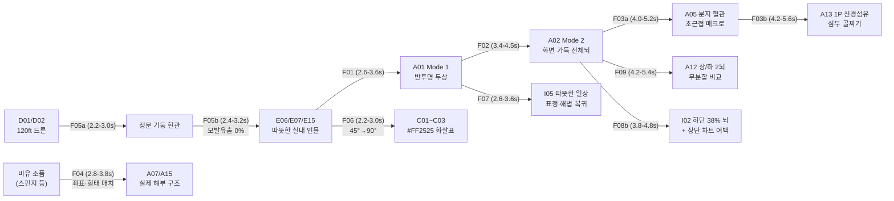

# 고정 시각 자산 라이브러리 v1.1 설계 명세서 — 장면 전환(`Category F`) & 누락 기반 자산(`A+ · E+ · G · H · I`)

> [!IMPORTANT]
> - **머신 리더블 생성 명세 SSOT (`@Operator` 직결 입력본)**: [canonical_v1_1_spec.json](file:///home/canadaofbin/gdrive/Kyubin_Yun_Workspace/07_Youtube/.agents/research/canonical_v1_1_spec.json)
> - **실증 분석 원천**:
>   1. [benchmark_31_O2CmlKOk_all_cuts_sheet.jpg](file:///home/canadaofbin/gdrive/Kyubin_Yun_Workspace/07_Youtube/artifacts_archive/01_YouTube_CEO/benchmark_31_O2CmlKOk_all_cuts_sheet.jpg) (`31_O2CmlKOk` 전 `13`컷 `0.0–90.9s` 전환 해부)
>   2. [r86_igwahyung_teardown_dataset.json](file:///home/canadaofbin/gdrive/Kyubin_Yun_Workspace/07_Youtube/.agents/research/r86_igwahyung_teardown_dataset.json) (`이과형` `10`편 · `106`문장 · `96`개 연속 전환 + `cv2` 컷 길이 실측)
>   3. `Ep #9–#12` `94`컷 결함 전수 기록 + [r86_beat_cards_ep09_12.json](file:///home/canadaofbin/gdrive/Kyubin_Yun_Workspace/07_Youtube/.agents/research/r86_beat_cards_ep09_12.json) (`56`컷) + `BCI_Shorts_Channel/research_dossiers/` (`135`개 대기 도시에 빈도 실측)
> - **사용자 v1 승인 4대 정본·스타일 잠금 전면 반영**: ① **`A01~A12` 뇌 정본 = 사용자 직접 선택 2번 열(`cand_02.png`, `manifest.json` `approved_sha256` 기준)** 고정, ② 고랑 속 **가지 치는 굵은 불투명 하늘색 혈관 그물**(`0%` 이펙트·입자·후광), ③ 기본 뇌 **세로 `72–82%` 화면 가득 채우는 프레이밍**, ④ 장소 **따뜻한 실사풍(`warm sunlit/lamplit tactile`) 2.5D 조명** + 성인 `4.2등신` 통일.

---

## 1. 실증 전환 분석 결과 (`31_O2CmlKOk` + `이과형` 10편 + 자사 94컷)

### 1.1 왜 장면 전환 레퍼런스(`Category F` `Start + End` 쌍)가 필수인가?
- 자사 `Ep #9–#12` `94`컷의 연속 경계 `90`구간을 전수 집계한 결과, **서로 다른 시각 세계를 건너뛰는 경계 전환이 `39 / 90`구간(`43.3%`)**, **뇌 내부 스케일 점프가 `21 / 90`구간(`23.3%`)**으로 전체 연결부의 **`66.7%`**를 차지합니다(`HUMAN↔BRAIN 15회`, `DRONE 진출입 8회`, `HUMAN/BRAIN↔ARROW 8회`, `BRAIN↔BRAIN 스케일 이동 21회`, `데이터 스탬프 진입 8회`).
- `31_O2CmlKOk`와 `이과형`(`Shorts` 평균 컷 `2.90s` / 중앙값 `2.18s`; 기능별 중앙값 `data 2.73s`, `comparison 2.92s`, `causal_arrow 3.00s`, `metaphor 3.02s`, `mechanism 3.05s`, `reaction 3.20s`, `misconception_flip 3.29s`, `scale 3.80s`)이 세계가 바뀌어도 자연스러운 이유는 **아래 3대 연속성 고리 중 최소 2개를 고정**하기 때문입니다:
  1. **화면 좌표(`x%, y%`) 및 외곽 실루엣 일치**: 예) `31_O2CmlKOk C01→C03`(동일 두상 좌표에서 두개골만 투명화), `이과형 Sfxgykds9oY B17→B19`(배터리를 감싸던 청록 원형 링 좌표 그대로 실제 3D 심장으로 교체).
  2. **단일 축 연속 카메라 벡터**: 줌인(`1.0x→3.2x`), 수직 피치다운(`45°→90°`), 크래니엄 풀백(`1.35x→1.0x`) 등 **1클립 1방향 이동**.
  3. **기존 승인 정본(`v1 A~E`)과의 레고형 끝점 결합**: 전환의 시작 또는 끝 프레임이 기존 `v1`/`v1.1` 정본 이미지와 일치하면 `Omni 1.1 Flash` (`Start+End` 잠금)가 중간 모션을 드리프트 없이 물리적으로 보간합니다.

---

## 2. CEO 초안 대비 실증 기반 보정·추가·통합 내역 (`Why Changed`)

| 구분 | 대상 항목 | 수정 내용 및 정량·기술적 근거 |
|---|---|---|
| **무결점 분할 (`Split`)** | `F3` → `F03a + F03b` `F5` → `F05a + F05b` `F8` → `F08a + F08b` | • `Omni 1.1 Flash`는 클립당 `Start + End` **2프레임 쌍**만 받으므로 2단계 뇌 줌인(`전체뇌→혈관→1P골짜기`)은 `F03a 끝 = F03b 시작` 데이지체인 2쌍으로 분리해야 무점프 연결됨. • `Ep09·10·11 C04`에서 3편 연속 터진 **외벽 창문 돌파(`fpv_window_portal_breach`) 모발 환각**을 영구 근절하기 위해 `F05a`(`120ft 드론→정문 현관`)와 `F05b`(`실내 창틀 안쪽→인물 미디엄샷`)로 분리함. • `R70-M` 차트는 밝은 원목 책상(`37.5%`)과 어두운 `#040711` 뇌(`62.5%`) 두 바탕에서 쓰이므로 `F08a`(소품용)와 `F08b`(뇌용)로 분리함. |
| **필수 추가 (`Add`)** | `F09`, `A18`, `A19`, `G08`, `G09`, `I02` | • **`F09` (단일뇌→상하 2뇌 비교)**: 4편 중 3편(`75%`: `Ep09 C17, Ep10 C19, Ep12 C16`) 필수. • **`A18` (관상면 양측 해마·뇌실 절개)**: 4편 중 2편(`50%`)에서 쓰이나 현행 `v1 A01~A12`에 관상면(`coronal`) 슬롯이 `0`개였음. • **`A19` (전대상피질 ACC·편도체 절개)**: `Ep11` 3컷 및 대기 도시에 통증·불안 `40+`건 대응. • **`G08` (기하 도형 검사 카드, 도시에 `22.2%`)** & **`G09` (무문자 그래픽 스마트폰/태블릿, 도시에 `30.4%`, AI UI 텍스트 깨짐 1위 소품)**. |
| **중복 제거·무충돌 보정 (`Prune & Fix`)** | `G01` (`MRI`), `G07` (`상자+블록`), `I03` (`콜아웃 펜 선`) | • **`G01` 보정**: MRI 스캐너 본체는 이미 `v1 E02·E07`에 완비됨 → 실제로 `Ep09 C08·Ep10 C08`에서 결함이 났던 **'벽걸이 뇌 MRI 필름 2장 비교 라이트박스'**로 정교화. • **`G07` 통합**: 흰 뚜껑 상자와 무문자 단색 원목 블록은 항상 한 세트로 쓰이므로 `1`슬롯으로 통합. • **`I03` 규칙 충돌 제거**: Flow에서 '콜아웃 펜 선'을 그리면 외계어 텍스트가 생성되므로(1등급 #9 위반), Flow 정본은 **'상단 `26%` 콜아웃 안전 헤드룸 뇌 구도 틀'**로 만들고 펜 지시선·`PatrickHand` 라벨은 Python 조립 단계에서만 합성하도록 명시. |

---

## 3. [1순위] `Category F` — 장면 전환 레퍼런스 명세표 (`12`개 `Start + End` 쌍)

| 슬롯 ID | 시작 프레임 (`Start Frame`) | 끝 프레임 (`End Frame`) | 공유 시각 앵커 (`Continuity`) & 카메라 | 권장 길이 | 사용 규칙 (1줄) |
|---|---|---|---|---:|---|
| **`F01_human_profile_to_mode1_xray_head`** | 좌향 `4.2등신` 대머리 크림 비닐 옆모습 상반신 (`x=50%, y=40%`) | 동일 좌표 `A01` 밝은 회색 마네킹 두상 + 투명 두개골 속 무광 백색 뇌·분지 혈관 그물 | 좌향 두상 실루엣 `1:1` 일치 · `gentle_push_in` (`1.0→1.12x`) | `2.6–3.6s` | 1막 인물 서사에서 2막 첫 뇌 기전으로 진입할 때 사용 |
| **`F02_mode1_xray_head_to_mode2_whole_brain`** | `#040711` 배경 위 `A01` 좌향 반투명 두상 | 두개골 외곽이 밀려나고 세로 `75%`를 채운 `A02` 좌향 무광 백색 전체 뇌 + 굵은 하늘색 혈관 그물 | 내부 좌향 반구·실비우스 혈관 축 연속 확대 · `cranial_breach_push_in` | `3.4–4.5s` | Mode 1 두상(`A01`)에서 Mode 2 본격 해부 뇌(`A02`)로 무점프 돌파 시 사용 |
| **`F03a_whole_brain_to_sulcal_vessel_macro`** | 세로 `75%` `A02` 좌향 전체 뇌 (중심 고랑 분지 혈관 정렬) | `A05(cand_02)` 백색 석고 두 이랑 사이 굵은 불투명 하늘색 Y자 혈관 초근접 매크로 | 중심 Y자 하늘색 원통 혈관 줄기 축 고정 · `optical_macro_dive_in` (`3.2x`) | `4.0–5.2s` | 전체 뇌에서 표면 혈관·뇌척수액 기전 매크로로 파고들 때 사용 |
| **`F03b_sulcal_vessel_macro_to_1p_tract_canyon`** | `A05(cand_02)` 백색 석고 이랑 + 하늘색 혈관 매크로 | `A13` 좌우 석고 피질 절벽 사이 단색 매트 황금 신경다발이 뻗는 `1P` 심부 협곡 | 좌우 이랑 벽이 양옆으로 갈라지며 중앙 소실점 형성 · `neural_fpv_canyon_dive` | `4.2–5.6s` | `F03a` 직후(데이지체인) 심부 백질 신경섬유 협곡(`A13`) 진입 시 사용 |
| **`F04_metaphor_prop_to_anatomy_shape_bridge`** | 중앙(`x=50%, y=50%`) 황금 스펀지가 수축하며 하늘색 물줄기를 짜내는 수조 매크로 | 동일 중앙 좌표 `#040711` 위 매트 황금 시상 코어가 하늘색 뇌실 CSF(`A15`)를 밀어내는 단면 | 중앙 타원 황금 코어 + 하늘색 유체 궤적 `1:1` 형태 매치 · `matched_center_push_in` | `2.8–3.8s` | `R86` 일상 비유(`3~5`컷) 종료 후 실제 뇌 기전으로 복귀하는 브리지에 사용 |
| **`F05a_drone_120ft_to_courtyard_portico`** | `D01(cand_01)` `120ft` 대학 캠퍼스 돔·잔디 광장 부감 (점 크기 보행자) | 중앙 석조 기둥 현관(portico)·계단 앞 `35ft` 저고도 부감 (원거리 비닐 실루엣만) | 중앙 돔·기둥 파사드 중심축 고정 · `drone_aerial_approach` (`35°` 하강) | `2.2–3.0s` | 오프닝 연구기관 항공샷에서 지상 보행 착시 없이 건물 입구로 하강 시 사용 |
| **`F05b_window_threshold_to_staged_interior`** | 실내 채광창 바로 안쪽에서 본 따뜻한 연구실/MRI실(`E01/E02`) | 동일 방(`E06/E07`) 중앙 장비 옆 `4.2등신` 대머리 비닐 연구원 미디엄샷 | 창가 햇살 광선·바닥·장비 축 고정 · `gentle_pan_and_push_in` | `2.4–3.2s` | 외벽 창문 돌파 모발 환각 없이 드론 직후 실내 연구원 컷(`C04`) 진입 시 사용 |
| **`F06_oblique_corridor_to_topdown_r80_arrow`** | `45°` 사선 상공에서 본 크림색 석조 대로(또는 원목 문틀 통로, 중앙 `x=50%`) | `90°` 수직 탑다운 `C01/C02/C03` 흰 출발 원 + `#FF2525` 3D 돌출 화살표 (무문자) | 세로 중심 도로/복도 축(`x=50%`) 고정 · `pitch_down_to_90deg_topdown` | `2.2–3.0s` | 실제 실험 공간에서 `R80` 실험군 vs 대조군 3D 경로 화살표로 진입 시 사용 |
| **`F07_mode2_brain_to_vinyl_character_return`** | `#040711` 위 반투명 두개골 윤곽 너머 활성 31번 뇌 (`x=50%, y=38%`) | 따뜻한 실사풍 실내(`E10/E12`) 동일 머리 좌표의 대머리 크림 비닐 미소 상반신 | 두상/뇌 중심 좌표(`x=50%, y=38%`) 고정 · `cranial_pullback_to_warm_room` | `2.6–3.6s` | 뇌 기전 설명 완료 후 3막 피험자 반응·실생활 행동 팁으로 복귀할 때 사용 |
| **`F08a_prop_settle_for_data_stamp_entry`** | 원목 책상 중앙(`y=52%`)에 4손가락 비닐 손이 무문자 소품을 내려놓음 | `I01` 하단 `30%`에 소품 정박 + 상단 `70%` 깨끗한 난백색 회벽 차트 여백 개방 | 원목 책상 위 핵심 소품 연속 정박 · `tilt_up_opening_chart_headroom` | `2.4–3.4s` | 실물 소품 컷 위에 `R70-M` Study 차트가 겹침 없이 등장할 때 사용 |
| **`F08b_brain_settle_for_data_stamp_entry`** | 중앙을 `74%` 채운 31번 백색 무광 뇌 + 하늘색 분지 혈관 그물 | `I02` 하단 `38%`에 온전한 뇌 정박 + 상단 `60%` 단색 `#040711` 진남색 차트 여백 개방 | 무절단 31번 뇌 실루엣 하강 정박 · `pedestal_up_opening_navy_slate` | `3.8–4.8s` | 뇌 컷 위에 `R70-M` Study 차트를 띄울 때 뇌가 차트에 안 가리게 할 때 사용 |
| **`F09_single_brain_to_dual_top_bottom_compare`** | 중앙 세로 `72%` 단일 좌향 활성 31번 뇌 (매트 황금 강조) | `A12(cand_02)` 무분할 진남색 배경 위 상단(매트 황금 활성) vs 하단(매트 슬레이트 억제) 2뇌 | 상단 좌향 뇌 실루엣 유지 + 수직 풀백으로 하단 대조 뇌 노출 · `vertical_pullback` | `4.2–5.4s` | 단일 기전 설명 직후 실험군 vs 대조군 상/하 2뇌 동시 비교(`A12`) 진입 시 사용 |

---

## 4. [2·3순위] 누락 기본 자산 확장 명세표 (`31`개 슬롯: `A+ 7 · E+ 6 · G 9 · H 4 · I 5`)

| 분류 | 슬롯 ID | 자산명 (핵심 구도 & v1 통일 스타일 잠금) | 실증 근거 (`Ep09–12` · `31번` · `135` 도시에) |
|---|---|---|---|
| **A+ 뇌 보강 (`7`)** | `A13_1p_white_matter_tract_canyon` | **1P 백질 신경섬유 골짜기** (좌우 백색 석고 절벽·굵은 분지 하늘색 혈관 + 중앙 매트 황금 원통 섬유 다발, 스파크 `0%`) | `31번 C08` + `Ep09~12` **4/4편(`100%`)** 사용 |
| | `A14_neuron_synapse_junction_macro` | **신경세포·시냅스 매크로** (세로 `78%` 무광 백색 석고 시냅스 전·후 말단 + 불투명 하늘/황금 구체 소포, 번개·먼지 `0%`) | `31번 C10` + 도시에 `32/135`건(`23.7%`) |
| | `A15_ventricular_csf_aqueduct_cutaway` | **뇌실계 & 뇌척수액(CSF) 통로 단면** (세로 `76%` 정중시상 절개 속 측뇌실·제3뇌실·수도관 불투명 하늘색 유체 수로) | `31번 C08~09` + `Ep10` 3컷 + 수면 도시에 `34`건 |
| | `A16_eyes_optic_nerve_to_v1_pathway` | **눈→시신경→후두엽 시각피질(V1) 경로** (밝은 회색 Mode 1 두상 속 매트 황금 시신경~V1 구조물, 눈 앞 빛줄기 `0%`) | `Ep09 C09, Ep12 C08` + 도시에 `62/135`건(`45.9%`) |
| | `A17_brain_spinal_body_descending_xray` | **뇌→뇌간→척수 상반신 반투명 투시도** (세로 `84%` 밝은 회색 마네킹 상반신 내부 뇌~척수 기둥 매트 황금 경로) | `Ep11 C10~11` + 통증/심장/장/척수 도시에 `40%+` |
| | `A18_coronal_bilateral_hippocampus_ventricles` | **[추가] 관상면 양측 해마·측뇌실 대칭 절개** (세로 `76%` 정면 관상면 절개 + 양측 측두엽 매트 황금 해마) | `Ep09 C20, Ep12 C17·20` (`50%` 등장, `v1` 누락분) |
| | `A19_anterior_cingulate_amygdala_limbic_cutaway` | **[추가] 전대상피질(ACC)·편도체 내측 절개** (뇌량 상단 ACC 띠 & 편도체 단색 매트 진홍 경보 강조) | `Ep11` 3컷 + 통증·불안·갈등 도시에 `40+`건 |
| **E+ 공간 보강 (`6`)** | `E11_night_bedroom_empty` / `E14_..._staged` | **따뜻한 밤 침실 (빈 방 + `4.2등신` 침대 맡 1인)** (`2700K` 협탁 스탠드 + 은은한 달빛 창가, 시계 숫자 `0%`) | `31번 C01·12` + `Ep10` 3컷 + 도시에 `38`건(`28.1%`) |
| | `E12_clinic_consult_office_empty` / `E15_..._staged` | **따뜻한 의사 진료·상담실 (빈 방 + 흰 가운 의사 1인)** (오전 자연광 원목 책상·서가, 시력표·문자 `0%`) | `Ep10 C23, Ep11` 6컷 + 도시에 `49`건(`36.3%`) |
| | `E13_urban_street_sidewalk_empty` / `E16_..._staged` | **따뜻한 자연광 도심 가로수 보도 (빈 거리 + 보행 1인)** (골든아워 석조·벽돌 보도, 간판·번호판 문자 `0%`) | `Ep09~12` **4/4편(`100%`)** 야외 거리 컷 등장 |
| **G 실험 소품 (`9`)** | `G01_mri_lightbox_dual_brain_scans` | **[정교화] 백라이트 뇌 MRI 필름 2장 비교 라이트박스** (매끄러운 크림 벽면 위 동일 축상면 좌·우 대조 필름, 문자 `0%`) | `E02` MRI 본체 중복 제거 → `Ep09/10 C08` 결함 해결 |
| | `G02_eeg_electrode_cap_vinyl_head` | **무문자 뇌파(EEG) 센서 캡 착용 대머리 비닐 두상** (`#EAE6DF` 배경, 원형 은색/하늘색 센서, 전극 기호 `0%`) | `31번 C12` + 도시에 전극·EEG `34`건(`25%`) |
| | `G03_unlabeled_amber_pill_bottle_and_capsules` | **완전 무라벨 호박색 유리 약병 + 무문자 캡슐 2알 + 물컵** (따뜻한 원목 책상 매크로, 라벨·mg 숫자 `0%`) | `Ep10·11` 총 `7`컷 등장 + 약물/플라시보 토픽 |
| | `G04_tabletop_3d_experimental_maze` | **원목·매트 화이트 3D 공간 학습 미로(Maze) 모형** (`45°` 부감, 갈림길 입체 그림자, START 글자 `0%`) | 공간기억·탐색·동물 행동실험 도시에 공통 |
| | `G05_unlabeled_street_map_and_pointer` | **무문자 그래픽 방사형 거리 지도 + 빨간 원목 지시봉** (지명 글자 `0%`, 순수 선화 도로망·강줄기) | `Ep09 C06` + 도시에 `map` `69/135`건(`51.1%`) |
| | `G06_numeral_free_brass_stopwatch` | **무숫자(눈금 전용) 클래식 황동 스톱워치** (아라비아 숫자 `0%` 눈금 다이얼 + 빨간 초침으로 숫자 깨짐 원천 차단) | `Ep09 C06` + `이과형` 3편 + 시간/반응속도 실험 |
| | `G07_white_occlusion_box_and_plain_blocks` | **[통합] 흰색 뚜껑 수납 상자 + 무문자 단색 원목 블록 3종** (알파벳 글자 `0%` 순수 단색 정육면체 + 흰 상자 세트) | `Ep12` 4컷 + 도시에 `23`건 (`상자+블록` 통합) |
| | `G08_geometric_stimulus_cards_and_sketchpads` | **[추가] 무문자 기하 도형 기억 검사 카드 & 스케치패드** (검은 기하 선화 카드 더미 + 백지 스프링 패드) | `Ep09 C22·23` + 도시에 `card` `30`건(`22.2%`) |
| | `G09_graphic_icon_smartphone_and_tablet` | **[추가] 무문자 순수 그래픽 파형·아이콘 스마트폰 & 태블릿** (시계 숫자·앱 글자 `0%` 화면으로 UI 외계어 차단) | `Ep09 C01` + 도시에 `phone/screen` `41`건(`30.4%`) |
| **H 통념 반전 (`4`)** | `H01_padlocked_acrylic_plaster_brain_case` | **자물쇠 채워진 아크릴 케이스 속 백색 석고 뇌** ('고정되어 변하지 않는 뇌' 구식 통념 물리 오브제) | `Ep09 C07` 검증 완료 + 통념 반전 도입 범용 |
| | `H02_dormant_off_toggle_switch_panel` | **내려간 무문자 황동 토글 레버 & 꺼진 투명 전구** ('수면·휴식 중 뇌 완전 정지' 착각 물리 오브제, ON/OFF 글자 `0%`) | `Ep10 C09` + 수면·마취·휴지기 통념 범용 |
| | `H03_pulled_apart_empty_clear_capsule` | **양손으로 열어 보인 100% 텅 빈 투명 캡슐** ('유효 약물 성분 0% = 효과 0%' 통념 물리 오브제) | `Ep11 C05` + 플라시보·기대효과 통념 범용 |
| | `H04_physical_red_x_over_simple_diagram_card` | **무문자 선화 카드 위 무광 `#FF2525` 3D `X` 기각 블록** (`이과형` `[틀렸습니다]` 스탬프의 무문자 2.5D 물리 이식) | 모든 에피소드 기존 가설 기각 장면 범용 |
| **I 배치 틀 (`5`)** | `I01_data_stamp_backdrop_warm_tabletop_low30` | **실물 소품용 `R70-M` 차트 여백 틀** (하단 `30%` 따뜻한 원목 책상 + 상단 `70%` 무장애물 난백색 회벽) | `Ep09 C19·23, Ep11 C19` 차트 가독성 `100%` 보장 |
| | `I02_data_stamp_backdrop_dark_brain_low38` | **[추가] 뇌 해부용 `R70-M` 차트 여백 틀** (하단 `38%` 무절단 31번 뇌 + 상단 `60%` 단색 `#040711` 진남색 슬레이트) | 전체 스탬프의 `62.5%`(`Ep10·11·12` 5컷) 대응 |
| | `I03_callout_safezone_brain_headroom_frame` | **[무충돌 보정] 해부 콜아웃 전용 상단 `26%` 헤드룸 뇌 구도** (Flow 내 선·글자 `0%`, Python이 지시선·`PatrickHand` 합성) | `R78-M / R81` 콜아웃 뇌 컷 전수 대응 |
| | `I04_thumbnail_50_50_in_skull_split_frame` | **`R65 v4` 썸네일 정면 50/50 두개골 내 좌우 뇌 대조 틀** (상단 `24%` 타이틀 합성 여백, Flow 내 문자 `0%`) | 전 에피소드 쇼츠 썸네일 베이스 |
| | `I05_ending_warm_takeaway_resolution_frame` | **엔딩 골든아워 정면 미디엄 마무리 구도 틀** (`4.2등신` 온화한 미소 + 하단 `22%` 자막 안전 여백, 얼굴 근접 드리프트 방지) | 전 에피소드 마지막 문장 실천 팁 마무리 |
