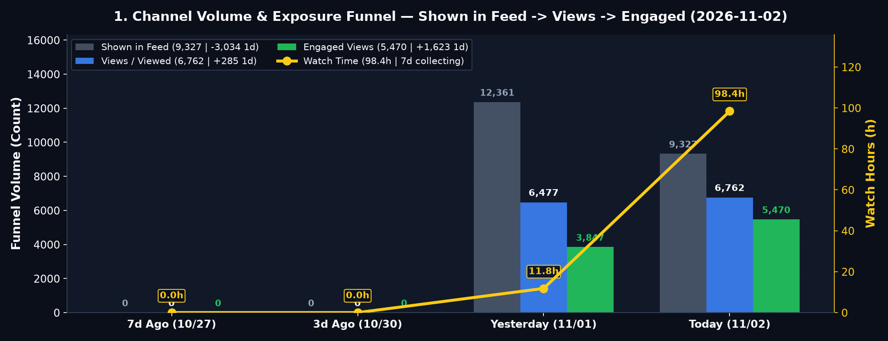
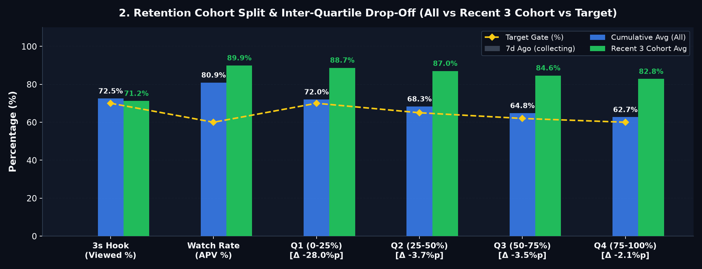
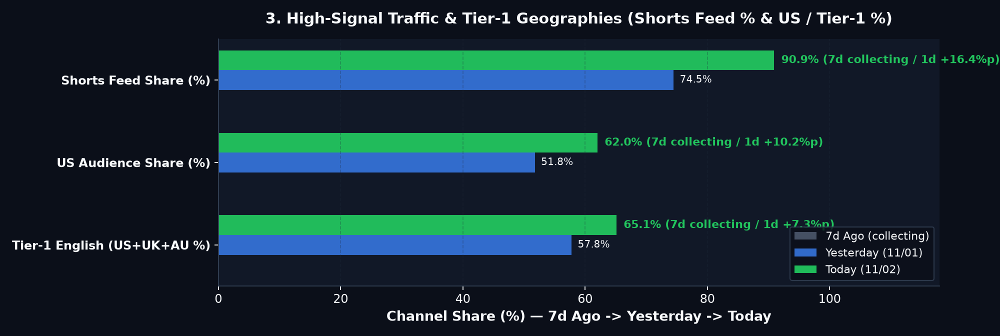
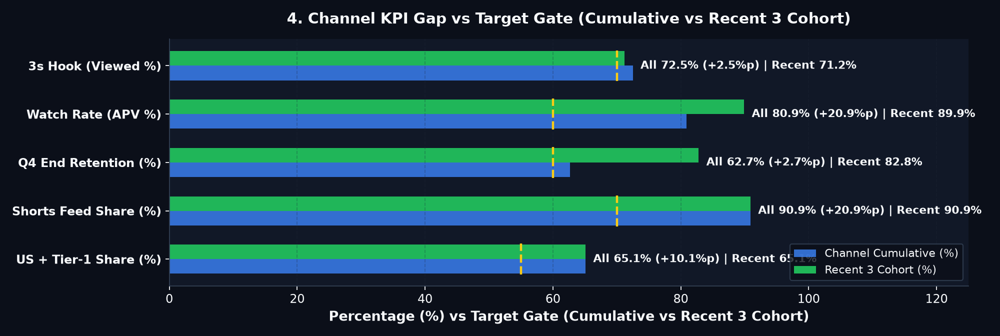

# 🚦 ALL ABOUT BRAIN — Daily Growth Report (2026-11-02)

## 🚦 0. 오늘의 채널 종합 진단: **🟢 순항 중 (핵심 4/5 통과 · ⚠️ 시드 미확산 2건 / 예약 16건)**

> **🚦 0. Executive Growth Pulse (7d)**: 🟢 **Subs** `45 (1d +5)` ｜ 🟢 **Shown→Views→Engaged** `9,327 → 6,762 → 5,470 (-3,034/+285/+1,623)` ｜ 🟢 **Watch** `98.4h (1d +86.6h)` ｜ 🟢 **3s Hook** `72.5% (Rec 71.2%)` ｜ 🟢 **APV** `80.9% (92.3s)` ｜ 🟡 **48h** `1,600 (+63.3%)`

| 진단 영역 | 상태 | 현재 수치 (전일 대비) | 기준 (Gate) | 한줄 진단 |
| :--- | :---: | :---: | :---: | :--- |
| **① 노출·구독 성장** | 🟢 | **Views 6,762** (`+4.4%`) · **Subs 45** (`+5`) | 일 `+500` | 가파른 우상향 |
| **② 초반 3초 훅** | 🟢 | **72.5%** (최근 3개 **71.2%**) | `>= 70%` | 목표선 돌파 |
| **③ 끝까지 시청률** | 🟢 | **80.9%** (`평균 92.3s`) | `>= 60%` | 최상위권 유지 |
| **④ 북미·피드 타겟** | 🟢 | **미국 62.0%** · **피드 90.9%** | `US >= 45%` | 북미 알고리즘 안착 |
| **⑤ 시드·예약 큐** | 🔴 | **Related 9/9** · **시드 대기 2편** · **예약 16개** | `24h 내 시드` | **시드 순환 링 활성(9/9) · 미확산 코호트 2편 전이 관찰** |

> **💡 오늘의 핵심 1줄 액션**: **Gear 5** `Related Video` 시드 순환 링(`9/9` · 재생목록 `9/9`) 전이 효율을 추적하면서, v5 통과 파일럿을 프라임 슬롯(`12:00 ET` / `20:00 ET`)에 보충하고 클립 3~8 구간(`Q1→Q3 -7.2%p`) 전환 밀도를 높입니다.

---

## 1. Volume & Exposure Funnel

| Metric | 7d Ago (`10/27`) | 3d Ago (`10/30`) | Yesterday (`2026-11-01`) | **Today (`2026-11-02`)** | **1d Δ** | **7d Δ (`MA`)** | Gate | Signal |
| :--- | :---: | :---: | :---: | :---: | :---: | :---: | :---: | :---: |
| **Shown in feed** | - | - | 12,361 | **9,327** | **`-3,034` (`-24.5%`)** | `collecting` | `+500/d` | 🟡 `-3,034` |
| **Views (`Viewed`)** | - | - | 6,477 | **6,762** | **`+285` (`+4.4%`)** | `collecting` | `>=70%` | 🟢 `+4.4%` |
| **Engaged Views** | - | - | 3,847 | **5,470** | **`+1,623` (`+42.2%`)** | `collecting` | `>=55%` | 🟢 `+42.2%` |
| **Watch Time (`h`)** | - | - | 11.8h | **98.4h** | `+86.6h (+733.9%)` | `collecting` | `>0h` | 🟢 `+733.9%` |
| **Subscribers (`/1K`)** | - | - | 40 (`6.18`) | **45** (`6.65`) | `+5 (+12.5%)` | `collecting` | `>=2.50` | 🟢 `6.65/1K` |
| **Realtime 48h (`60m`)** | - | - | 980 | **1,600** (`32`) | **`+620` (`+63.3%`)** | `collecting` (`Peak 1,600`) | `>=1,290` | 🟡 `+63.3%` |

---

## 2. Retention & Cohort Drop-Off (`ΔQ`)

| Metric | 7d Ago | Yesterday | **All** | **Recent 3** | **Latest / Next** | **Drop-Off (`ΔQ`)** | Gate | Signal (`All` / `Rec`) |
| :--- | :---: | :---: | :---: | :---: | :---: | :--- | :---: | :---: |
| **3s Hook (`Viewed %`)** | - | 52.4% | **72.5%** | **71.2%** | `66.9% / 73.8%` | `100%→3s: -27.5%p` (`Rec -28.8%p`) | `70%` | 🟢 `+2.5%p` / 🟢 `+1.2%p` |
| **AVD (`s`)** | - | 18.0s | **92.3s** | **133.8s** | `147.0s / 151.4s` | `Len 147.6s` (`Rec 171.6s`) | `25s` | 🟢 `+67.3s` / 🟢 `+108.8s` |
| **APV (`%`)** | - | 59.4% | **80.9%** | **89.9%** | `84.7% / 90.3%` | `7d collecting` (`1d +21.5%p`) | `60%` | 🟢 `+20.9%p` / 🟢 `+29.9%p` |
| **Q1 (0–25%)** | - | 58.0% | **72.0%** | **88.7%** | `83.8% / 89.2%` | `0%→Q1: -28.0%p` (`Rec -11.3%p`) · Clips 1–2 | `70%` | 🟢 `+2.0%p` / 🟢 `+18.7%p` |
| **Q2 (25–50%)** | - | 64.0% | **68.3%** | **87.0%** | `82.0% / 87.4%` | `Q1→Q2: -3.7%p` (`Rec -1.7%p`) · ⚠️ **Clips 3–5** | `65%` | 🟢 `+3.3%p` / 🟢 `+22.0%p` |
| **Q3 (50–75%)** | - | 60.2% | **64.8%** | **84.6%** | `79.2% / 85.1%` | `Q2→Q3: -3.5%p` (`Rec -2.4%p`) · ⚠️ **Clips 6–8** | `62%` | 🟢 `+2.8%p` / 🟢 `+22.6%p` |
| **Q4 (75–100%)** | - | 59.4% | **62.7%** | **82.8%** | `76.8% / 83.5%` | `Q3→Q4: -2.1%p` (`Rec -1.8%p`) · Clips 9–10 | `60%` | 🟢 `+2.7%p` / 🟢 `+22.8%p` |

---

## 3. Traffic & Geographies

| Metric | 7d Ago (`10/27`) | Yesterday (`2026-11-01`) | **Today (`2026-11-02`)** | **7d Δ (`1d Δ`)** | Gate | Signal |
| :--- | :---: | :---: | :---: | :---: | :---: | :---: |
| **Shorts Feed (`%`)** | - | 74.5% | **90.9%** (`6,147`) | `collecting` (`+16.4%p`) | `>=70%` | 🟢 `+20.9%p` |
| **US / Tier-1 (`%`)** | - | 51.8% / 57.8% | **62.0% / 65.1%** | `collecting` (`+10.2%p / +7.3%p`) | `45% / 55%` | 🟢 `+17.0%p / +10.1%p` |

---

## 4. Seed & Queue Tracker + Pipeline Calibration

> **Queue & Operations Health**: 🌐 **Published** `9` ｜ 📅 **Scheduled** `16 (8.0d)` ｜ 🔒 **`Unlisted (Staged)`** `0` ｜ 🔗 **Related Ring** `9/9` ｜ 📂 **Playlists** `9/9` ｜ 🛠️ **Quarantine** `0`

| Cohort | Published (`Elapsed`) | `Shown → Views` | `Time-to-Seed` | `Related Video` | `Z-Test` | Signal |
| :--- | :---: | :---: | :---: | :---: | :---: | :---: |
| **Cohort #1 (`84s`)** | `10-19 12:00` (`+326h`) | `1,690 → 1,589` | `Seeded (<24h)` | `✅ → Cohort #2` | `Var A (7.8%)` | 🟢 `+3/1d` |
| **Cohort #2 (`86s`)** | `10-20 12:00` (`+302h`) | `1 → 15` | `Unseeded (+302h)` | `✅ → Cohort #5` | `Hold` | 🔴 `Shown 1` |
| **Cohort #3 (`31s`)** | `10-14 12:00` (`+446h`) | `830 → 213` | `Search / Niche` | `✅ → Cohort #9` | `Var A (6.4%)` | 🟡 `+0/1d` |
| **Cohort #4 (`90s`)** | `10-21 12:00` (`+278h`) | `10 → 7` | `Unseeded (+278h)` | `✅ → Cohort #1` | `Hold` | 🔴 `Shown 10` |
| **Cohort #5 (`84s`)** | `10-22 12:00` (`+254h`) | `2,304 → 2,000` | `Seeded (<24h)` | `✅ → Cohort #4` | `Var A (7.2%)` | 🟢 `+1/1d` |
| **Cohort #6 (`176s`)** | `10-29 18:40` (`+79h`) | `427 → 380` | `Seeded (<24h)` | `✅ → Cohort #9` | `Var A (6.4%)` | 🟢 `+2/1d` |
| **Cohort #7 (`174s`)** | `10-29 18:27` (`+80h`) | `1,516 → 1,185` | `Seeded (<24h)` | `✅ → Cohort #1` | `Var A (7.8%)` | 🟢 `+102/1d` |
| **Cohort #8 (`168s`)** | `11-01 12:00` (`+14h`) | `557 → 398` | `Seeded (<24h)` | `✅ → Cohort #4` | `Var A (7.2%)` | 🟢 `+111/1d` |
| **Cohort #9 (`173s`)** | `10-26 21:10` (`+149h`) | `1,044 → 903` | `Seeded (<24h)` | `✅ → Cohort #4` | `Var A (6.4%)` | 🟢 `-5/1d` |

| Signal | Bottleneck | Metric | Cause | Pipeline Action |
| :---: | :--- | :---: | :--- | :--- |
| 🔴 | **Cohort #2 Seed Rescue (`2` starved)** | `Shown -3,034` (`#2: 1`) | Feed concentration on top anchors | **Gear 5**: `Related Video` ring active (`9/9`) + queue next v5 Short |
| 🟡 | **Mid-Clip Drop (`Q1→Q3`)** | `-7.2%p` (`-3.7%p / -3.5%p`) | Pacing drag in Clips 3–8 (`148s`) | **Gear 2/3**: `0.28s` pre-pivot hold, `<=18w/clip`, 4-color cutaway |
| 🟡 | **Cumulative Hook (`All`)** | `All 72.5%` vs `Rec 71.2%` | Early cohort hook dilution | **Gear 2**: Lock `<=12w` case hook (`>=80%` Viewed) |

---

## 5. 7-Day Targets (`W+1`)

| Axis | 7d Trend | Current (`All / Rec`) | **W+1 Target** | Focus |
| :--- | :---: | :---: | :---: | :--- |
| **① Funnel & Seed** | `collecting (<7d)` | `9,327 → 6,762 (5,470)` | **`Shown +800/d` · `Seed <=24h` (`5,000+`)** | Multi-video seeding via `Related Video` chain |
| **② Retention (`ΔQ`)** | `collecting (<7d)` | `72.5% / 80.9%` (`71.2% / 89.9%`) | **`All Viewed >=72%` · `Q1→Q3 <=-5.0%p`** | Compress Clips 3–8 drop (`-7.2%p → -5.0%p`) |
| **③ Market & Subs** | `collecting (<7d)` | `US 62.0% · T1 65.1%` (`45 · 6.65/1K`) | **`US >=55%` · `T1 >=62%` (`Subs 20+`)** | Habit, memory & sleep neural circuit topics |

---
> **🔐 Provenance**: `BCI_Shorts_Channel/reports/daily/2026-11-02_studio_metrics.json` | **Dashboard**: `daily/2026-11-02_studio_charts.png` | **Mode**: `LIVE_CDP_DOM` | **SHA-256**: `008b9b65313a9f2be36eb8e2b12df8b97ce3e57d8af46399008dc421b2c76b0f`
