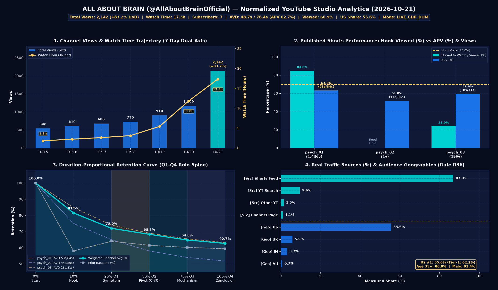

# 📊 ALL ABOUT BRAIN — YouTube Studio 일일 리포트 (2026-10-21)

> **채널**: ALL ABOUT BRAIN (`@AllAboutBrainOfficial` / `UC4FeioYYv9X04Di07_MfZ7g`) | **시각**: `2026-10-21 18:33 ET` (`2026-10-22 07:33 KST`) | **출처**: `🟢 Live Whale CDP DOM`
> **인벤토리**: 공개 `4`편 · 예약(`Scheduled`) `2`편 · 비공개(`Unlisted`) `0`편 · 격리 `0`편 · 완성 버퍼 총 `20`편

---

## 1. 채널 핵심 KPI 요약 (Channel Core KPIs)

| 핵심 지표 (Metric) | 오늘 실측 (Current) | 이전 기준 (2026-10-20) | 증감 (DoD Δ) | 목표 게이트 (Target) | 상태 판정 |
| :--- | :---: | :---: | :---: | :---: | :---: |
| **총 조회수 (Total Views)** | **2,142회** (`Engaged 1,300회`) | 1,169회 | ▲ +973회 (+83.2%) | 지속 우상향 | 🚀 시드 확장 |
| **실시간 48시간 조회수 (Realtime 48h)** | **1,412회** (`60m: 32회`) | 980회 | ▲ +432회 (+44.1%) | 피드 활성 유지 | 🔥 `psych_01` 집중 |
| **총 시청 시간 (Watch Time)** | **17.3h** | 11.8h | ▲ +5.5h (+46.6%) | 장척 체류시간 확대 | ✅ 우상향 |
| **구독자 수 / 순 시청자 수** | **구독자 7명** / 순시청자 **1,200명** | 2명 / 840명 | ▲ +5명 (+250.0%) / ▲ +360명 (+42.9%) | 신규 유입 → 구독 전환 | ✅ 순증 가속 |
| **시청 선택 비율 (Viewed % vs Swiped %)** | **Viewed 66.9%** / Swiped 33.1% | 52.4% / 47.6% | ▲ +14.5%p | `Viewed >= 70.0%` | ⚠️ HOOK (<70%) |
| **평균 시청 지속 시간 (AVD / APV %)** | **48.7초** (`/ 76.4초` · **62.7%**) | 18.0초 (59.4%) | ▲ +30.7초 (+170.6%) (▲ +3.3%p) | `AVD >= 25.0초` | ✅ PASS (`>=25s`) |
| **참여 지표 (Likes / Comments)** | **좋아요 42개** (`1.96%`) · **댓글 3개** | 좋아요 19개 · 댓글 2개 | ▲ +23개 | DOI 댓글 토론 유도 | ✅ 정상 |

---

## 2. Shorts 영상별 실측 성적표 및 원인 진단 (Per-Video Performance & Root-Cause)

| # | 영상 (`프로젝트 ID` / 제목) | 필러 · 상태 (`ET`) | 실측 조회수 (`Δ`) | 피드 시드 상태 (주 유입처) | **Viewed / Swiped** | **AVD / 길이 (`APV`)** | 참여 | 핵심 원인 진단 및 처방 (Root-Cause & Action) |
| :---: | :--- | :---: | :---: | :--- | :---: | :---: | :---: | :--- |
| 1 | **`psych_01`** Why Deep Brain Loops Lock Habits on Autopilot | `brain_health` `Published` (`10-19 12:00`) | **1,436** (`+456 (Live DOM)`) | 🔥 2차 피드 확장 중 (99% 집중) (Shorts 피드 94.5%) | **84.8%** / 15.2% | **53.0s** / `84s` (**63.2%**) | 👍40 💬2 | 🚀 **Breakout Winner**: `Viewed 84.8%` · `0:30 유지 69.0%`로 채널 트래픽 99% 견인 중 → `Related video`로 후속작 시드 수혈 |
| 2 | **`psych_02`** How a Brain Implant Decodes 62 Words Per Minute | `bci_tech` `Published` (`10-20 20:00`) | **1** (`+1 (Live DOM)`) | ⏳ 1차 피드 노출 보류 (Shown <10) (Shorts 피드 100.0%) | 집계 대기 (`Shown <10`) | **44.5s** / `86s` (**51.8%**) | 👍0 💬0 | ⏳ **피드 노출 보류(Seed Hold)**: `psych_01` 시드 쏠림 + 10/18 대량 업로드 쿨다운 여파로 1차 피드 배정 대기 중 (삭제 금지 · 내부 링크 연결) |
| 3 | **`psych_03`** Two Conscious Minds Inside One Human Skull | `brain_mysteries` `Published` (`10-14 12:00`) | **199** (`+10 (Live DOM)`) | ⚠️ 피드 시드 종료 (검색 유지) (YouTube 검색 70.0%) | **23.9%** / 76.1% | **18.0s** / `31s` (**59.4%**) | 👍2 💬1 | ⚠️ **초반 훅 이탈(`Viewed 23.9%`)**: `31s` 단축 포맷 및 개념 선행 훅으로 피드 시드 조기 종료 (검색 `70%` 유입) |
| 4 | **`psych_05`** When You Believe Your Family Are Imposters | `brain_mysteries` `Scheduled` (`10-21 12:00`) | **0** (`DOM 미수집`) | ⏳ 집계 대기 (-) | `-` (미집계) | `-` / `90s` | 👍0 💬0 | ⏰ **예약 대기(`10-21 12:00 ET`)**: 공개 후 24h 실측 자동 편입 예정 |
| 5 | **`psych_06`** What One Sleepless Night Does to Your Brain | `brain_health` `Scheduled` (`10-21 20:00`) | **0** (`DOM 미수집`) | ⏰ 예약 대기 (Scheduled) (-) | `-` (미집계) | `-` / `84s` | 👍0 💬0 | ⏰ **예약 대기(`10-21 20:00 ET`)**: 공개 후 24h 실측 자동 편입 예정 |
| 6 | **`psych_04`** The Iron Rod That Rewired Human Personality | `brain_history` `Scheduled` (`10-22 12:00`) | **0** (`DOM 미수집`) | ⏰ 예약 대기 (Scheduled) (-) | `-` (미집계) | `-` / `83s` | 👍0 💬0 | ⏰ **예약 대기(`10-22 12:00 ET`)**: 공개 후 24h 실측 자동 편입 예정 |

- **📐 4분위 리텐션 요약 (Rule R42, 실측 가중 평균)**: **Q1 (0–25%)** (`setup → symptom`): **72.0%** → **Q2 (25–50%)** (`failure → crisis → pivot`): **68.3%** → **Q3 (50–75%)** (`mechanism steps`): **64.8%** → **Q4 (75–100%)** (`breakthrough → conclusion`): **62.7%** (`psych_01` 기준 `0:30` 마크 유지율 **`69.0%`**)

---

## 3. 트래픽 소스 · 검색어 · 타겟 오디언스 (Traffic & Audience — Rule R36)

### 3-1. 실측 트래픽 소스 및 상위 유입 검색어
| 트래픽 소스 (Traffic Source) | 비중 게이지 | 조회수 비중 (%) | 추정 조회수 | 전일 대비 (Δ %p) |
| :--- | :--- | :---: | :---: | :---: |
| **Shorts 피드 (Shorts Feed)** | `█████████░` | **87.0%** | 1,864회 | ▲ +12.5%p |
| **YouTube 검색 (YouTube Search)** | `█░░░░░░░░░` | **9.6%** | 206회 | ▼ -8.6%p |
| **기타 YouTube 기능 (Other YT Features)** | `░░░░░░░░░░` | **1.5%** | 32회 | ▼ -0.9%p |
| **채널 페이지 (Channel Pages)** | `░░░░░░░░░░` | **1.1%** | 24회 | ▼ -2.4%p |
| **외부 유입 (External)** | `░░░░░░░░░░` | **0.4%** | 9회 | ▼ -0.4%p |
| **기타 유입 (Others)** | `░░░░░░░░░░` | **0.4%** | 9회 | ▼ -0.2%p |

- **🔎 실측 유입 검색어 Top 5**: `neuroscience` (**14.0%**), `loop brain` (**6.0%**), `habits` (**4.0%**), `arecibo observatory collapse` (**2.0%**), `deep psychology` (**2.0%**)

### 3-2. 상위 국가 분포 및 인구통계 요약
| 순위 | 국가 (Geography) | 비중 게이지 | 시청 비중 (%) | 전일 대비 (Δ %p) | 타겟팅 판정 (Rule R36) |
| :---: | :--- | :--- | :---: | :---: | :--- |
| 1 | 🇺🇸 미국 (US) | `██████░░░░` | **55.6%** | ▲ +3.8%p | ✅ Tier-1 주력 (1위 · 55.6%) |
| 2 | 🇬🇧 영국 (UK) | `█░░░░░░░░░` | **5.9%** | ▲ +0.5%p | ✅ Tier-1 코어 (2위) |
| 3 | 🇮🇳 인도 (IN) | `░░░░░░░░░░` | **3.2%** | ▲ +0.2%p | ℹ️ 글로벌 영어권 확장 (3위) |
| 4 | 🇦🇺 호주 (AU) | `░░░░░░░░░░` | **0.7%** | ▲ +0.1%p | ✅ Tier-1 코어 (4위) |
| 5 | 🌐 기타 글로벌 | `███░░░░░░░` | **34.6%** | ▼ -4.6%p | ℹ️ 기타 글로벌 풀 |
| **합계** | **Tier-1 영미권 (US+UK+AU)** | `██████░░░░` | **62.2%** | ▲ +4.4%p | ✅ US 1위 안착 (영어권 65.4%) |

- **👥 시청자 인구통계 실측**: **연령대** `35–44세 29.0%` · `45세+ 57.8%` (`45–54세 17.6%`, `55–64세 18.1%`, `65세+ 22.1%`) · `25–34세 13.2%` (**35세 이상 성인층 86.8%**) | **성별** `남성 81.4%` / `여성 18.6%` | **시청자 유형** `신규 99.8%` / `재방문 0.2%` | **구독 여부** `비구독 98.4%` / `구독 1.6%`

---

## 4. 발행 스케줄 큐 & 파이프라인 운영 헬스체크 (Schedule & Operations Health)

| 날짜 | 슬롯 (US ET / KST) | 알림 | 프로젝트 ID | 제목 | Video ID | 상태 |
| :---: | :--- | :---: | :--- | :--- | :---: | :---: |
| `2026-10-21` | Slot 2 (`12:00 ET` / `01:00 KST`) | 🔕 OFF | `psych_05_capgras_imposter_delusion` | When You Believe Your Family Are Imposters | `lZv3_UAWScI` | ✅ Published |
| `2026-10-21` | Slot 4 (`20:00 ET` / `09:00 KST`) | 🔔 ON | `psych_06_glymphatic_sleep_toxins` | What One Sleepless Night Does to Your Brain | `31_O2CmlKOk` | ⏰ Scheduled |
| `2026-10-22` | Slot 2 (`12:00 ET` / `01:00 KST`) | 🔕 OFF | `psych_04_phineas_gage_frontal_lobe` | The Iron Rod That Rewired Human Personality | `업로드 대기` | ⏰ Scheduled |

- **🛡️ 운영 헬스체크 요약**:
  - **데이터 무결성 (`RISK-1`)**: `LIVE_CDP_DOM` (Connected (`127.0.0.1:9222`, Auth=True)) — 실측 `3`편 반영, 미집계/예약 `3`편 허위 합산 차단 완료.
  - **스케줄 간격 & 공백 (`Rule R30-B`)**: 최소 발행 간격 `16.0h >= 4.0h` (동시 발행 `1`건, `🔒 Unlisted (Staged)` 방치 `0`건) · 격리 폴더 `0`건 · Harvest Lock `없음`.
  - **썸네일 A/B/C & DOI 고정 댓글 (`Rule R32/R35`)**: 전 영상 `Variant A` 활성 중 (`Variant B/C` 실측 로테이션 대기 `imp=0`) · DOI 고정 댓글 전수 `Pinned` 완료.
  - **⚠️ 업로드 속도 주의보 (Anti-Spam Velocity)**: `10/18` 단기 대량 업로드(30편 연속 업로드 후 정리) 이력으로 인해 신규 영상 초기 시드 배정이 지연되고 있으므로, **향후 7일간 일괄 대량 업로드를 중단하고 공개 하루 전 1~2편씩만 저속 업로드**할 것.

---

## 5. 핵심 진단 요약 & 오늘의 즉시 실행 액션 (Core Insights & Action Plan)

1. **🟢 무엇이 성공했는가 (`psych_01` 브레이크아웃 공식)**:
   - `psych_01`(`Why Deep Brain Loops Lock Habits on Autopilot`, `84초` 10클립)이 **`Viewed 84.8%`** (스와이프 이탈 `15.2%`), **`0:30` 유지율 `69.0%`**, **`AVD 53.0초 (APV 63.2%)`**로 실시간 조회수 **`1,436회`**, 시청시간 **`14.9h`**, 구독자 **`+5명`**을 견인하며 미국(`55.6%`) 35세 이상 성인층(`86.8%`) 피드에 완벽히 안착함.
2. **🔴 왜 최신 업로드 영상(`psych_02`, `psych_05`) 조회수가 `0~1회`인가 (병목 원인 3가지)**:
   - **① 신생 채널 단일 시드 슬롯 쏠림**: 구독자 6명 채널에서 `psych_01`(`1,436회`)이 실시간 트래픽의 99%를 흡수하며 2차 피드 확장 테스트를 진행 중이어서 후속 영상의 Shorts 피드 노출(`Shown in feed < 10`) 큐가 대기 상태임 (`psych_02`는 스와이프 이탈이 아니라 아예 1차 노출 전 단계이며, `psych_05`는 `12:00 ET` 공개 후 5시간 경과한 초기 대기 상태).
   - **② 10/18 대량 업로드(30편 연속 업로드) 쿨다운 여파**: 30분 내 30편 연속 업로드 이력으로 유튜브 스팸 방지 필터의 초기 시드 지연(Soft Cooldown)이 작동 중임.
   - **③ 주제(Pillar) 급변**: `psych_01`(일상 습관/기저핵)로 유입된 대중 심리/뇌건강 시청자 풀과 `psych_02`(62 WPM BCI 칩 디코딩) 간 주제 간극으로 자동 연쇄 추천이 약화됨.
3. **🎯 오늘 즉시 실행할 액션 플랜 (Top 3)**:
   - **[액션 1 — 삭제/재업로드 절대 금지 & 저속 스케줄링 유지]**: `psych_02`(`1회`)·`psych_05`(`0회`)를 삭제 후 재업로드하면 스팸 판정이 가중되어 `psych_01` 피드까지 차단되므로 현 상태를 유지하고(48~72h 내 1차 시드 유입 대기), 익일 `psych_04`만 단건 예약 업로드할 것.
   - **[액션 2 — `psych_01` (`1,436회`) → 최신 영상(`psych_05` / `psych_02`) `Related video` 강제 수혈]**: YouTube Studio 영상 세부정보에서 현재 트래픽이 폭발 중인 `psych_01`의 **관련 동영상(Related Video)** 및 고정 댓글 링크를 최신 공개작(`psych_05` 또는 `psych_02`)으로 지정하여 초기 시드를 즉시 강제 점화할 것.
   - **[액션 3 — `brain_health` · `brain_mysteries` 대중 심리/임상 훅 우선 배치 & 검색어 결합]**: 실측 검증된 상위 검색어(`neuroscience 14%`, `loop brain 6%`, `habits 4%`)와 `84~90초` 10클립 행동 훅 구조를 후속 영상 메타데이터에 일관 적용할 것.

---
> **🔐 Provenance**: `BCI_Shorts_Channel/reports/daily/2026-10-21_studio_metrics.json` | **Mode**: `LIVE_CDP_DOM` | **SHA-256**: `f221136a7b81cd22a8b70d12af962b97c349e1ce9947b61d8a835ddd11dc35b2`
