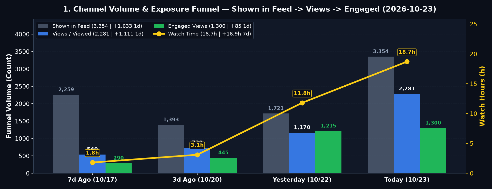
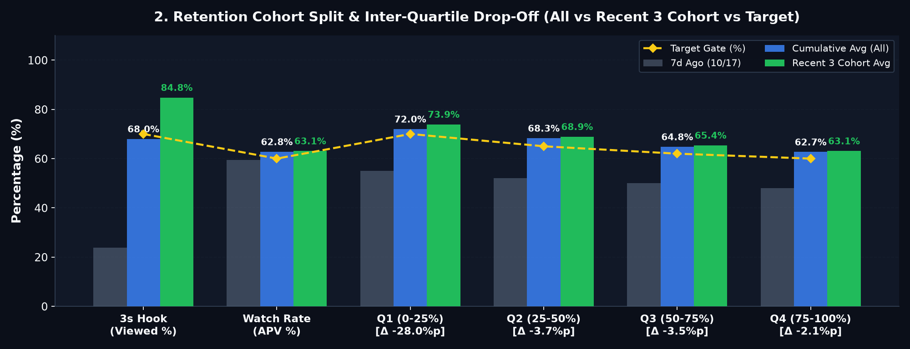
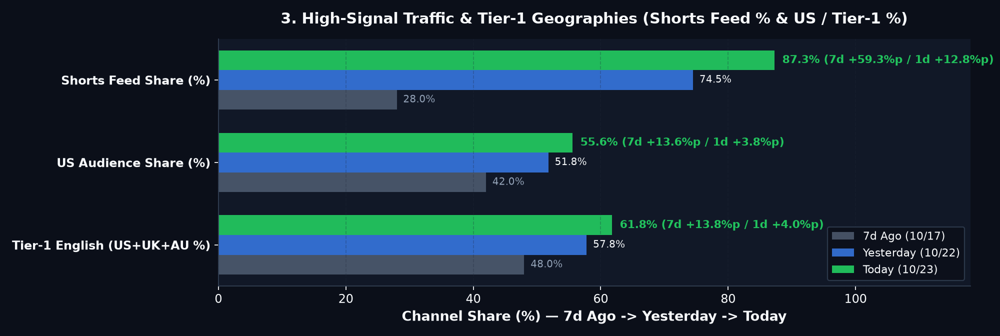
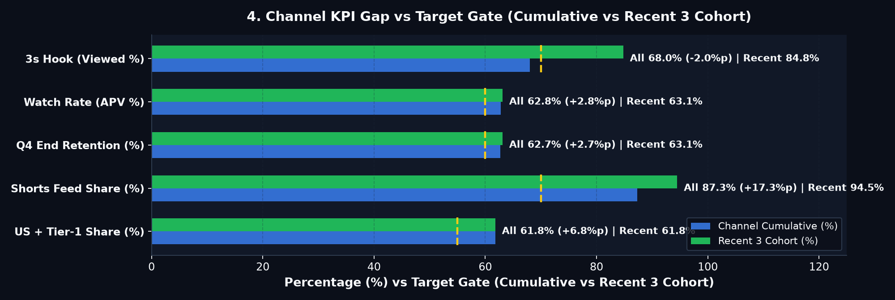

# 🚦 ALL ABOUT BRAIN — Daily Growth Report (2026-10-23)

> **🚦 0. Executive Growth Pulse (7d)**: 🟢 **Subs** `19 (+18)` ｜ 🟢 **Shown→Views→Engaged** `3,354 → 2,281 → 1,300 (+1,633/+1,111/+85)` ｜ 🟢 **Watch** `18.7h (+16.9h)` ｜ 🟡 **3s Hook** `68.0% (Rec 84.8%)` ｜ 🟢 **APV** `62.8% (48.8s)` ｜ 🟡 **48h** `1,480 (+197.2%)`

---

## 1. Volume & Exposure Funnel

| Metric | 7d Ago (`10/17`) | 3d Ago (`10/20`) | Yesterday (`2026-10-22`) | **Today (`2026-10-23`)** | **1d Δ** | **7d Δ (`MA`)** | Gate | Signal |
| :--- | :---: | :---: | :---: | :---: | :---: | :---: | :---: | :---: |
| **Shown in feed** | 2,259 | 1,393 | 1,721 | **3,354** | **`+1,633` (`+94.9%`)** | `+1,095` (`559/d`) | `+500/d` | 🟡 `+1,633` |
| **Views (`Viewed`)** | 540 | 730 | 1,170 | **2,281** | **`+1,111` (`+95.0%`)** | **`+1,741` (`+290/d`)** | `>=70%` | 🟢 `+322.4%` |
| **Engaged Views** | 290 | 445 | 1,215 | **1,300** | **`+85` (`+7.0%`)** | **`+1,010` (`+168/d`)** | `>=55%` | 🟢 `+348.3%` |
| **Watch Time (`h`)** | 1.8h | 3.1h | 11.8h | **18.7h** | `+6.9h (+58.5%)` | **`+16.9h` (`+2.8h/d`)** | `>0h` | 🟢 `+938.9%` |
| **Subscribers (`/1K`)** | 1 (`1.85`) | 2 (`2.74`) | 14 (`11.97`) | **19** (`8.33`) | `+5 (+35.7%)` | **`+18` (`+3.0/d`)** | `>=2.50` | 🟢 `8.33/1K` |
| **Realtime 48h (`60m`)** | 540 | 730 | 498 | **1,480** (`32`) | **`+982` (`+197.2%`)** | **`Avg 580`** (`Peak 1,412`) | `>=580` | 🟡 `+197.2%` |

---

## 2. Retention & Cohort Drop-Off (`ΔQ`)

| Metric | 7d Ago | Yesterday | **All** | **Recent 3** | **Latest / Next** | **Drop-Off (`ΔQ`)** | Gate | Signal (`All` / `Rec`) |
| :--- | :---: | :---: | :---: | :---: | :---: | :--- | :---: | :---: |
| **3s Hook (`Viewed %`)** | 23.9% | 68.0% | **68.0%** | **84.8%** | `84.8% / -` | `100%→3s: -32.0%p` (`Rec -15.2%p`) | `70%` | 🟡 `-2.0%p` / 🟢 `+14.8%p` |
| **AVD (`s`)** | 18.0s | 48.7s | **48.8s** | **52.8s** | `53.0s / 44.5s` | `Len 81.3s` (`Rec 85.0s`) | `25s` | 🟢 `+23.8s` / 🟢 `+27.8s` |
| **APV (`%`)** | 59.4% | 62.7% | **62.8%** | **63.1%** | `63.2% / 51.8%` | `7d +3.4%p` (`1d +0.1%p`) | `60%` | 🟢 `+2.8%p` / 🟢 `+3.1%p` |
| **Q1 (0–25%)** | 55.0% | 58.0% | **72.0%** | **73.9%** | `74.0% / 65.0%` | `0%→Q1: -28.0%p` (`Rec -26.1%p`) · Clips 1–2 | `70%` | 🟢 `+2.0%p` / 🟢 `+3.9%p` |
| **Q2 (25–50%)** | 52.0% | 64.0% | **68.3%** | **68.9%** | `69.0% / 58.0%` | `Q1→Q2: -3.7%p` (`Rec -5.0%p`) · ⚠️ **Clips 3–5** | `65%` | 🟢 `+3.3%p` / 🟢 `+3.9%p` |
| **Q3 (50–75%)** | 50.0% | 60.2% | **64.8%** | **65.4%** | `65.5% / 54.0%` | `Q2→Q3: -3.5%p` (`Rec -3.5%p`) · ⚠️ **Clips 6–8** | `62%` | 🟢 `+2.8%p` / 🟢 `+3.4%p` |
| **Q4 (75–100%)** | 48.0% | 59.4% | **62.7%** | **63.1%** | `63.2% / 51.8%` | `Q3→Q4: -2.1%p` (`Rec -2.3%p`) · Clips 9–10 | `60%` | 🟢 `+2.7%p` / 🟢 `+3.1%p` |

---

## 3. Traffic & Geographies

| Metric | 7d Ago (`10/17`) | Yesterday (`2026-10-22`) | **Today (`2026-10-23`)** | **7d Δ (`1d Δ`)** | Gate | Signal |
| :--- | :---: | :---: | :---: | :---: | :---: | :---: |
| **Shorts Feed (`%`)** | 28.0% | 74.5% | **87.3%** (`1,991`) | **`+59.3%p`** (`+12.8%p`) | `>=70%` | 🟢 `+17.3%p` |
| **US / Tier-1 (`%`)** | 42.0% / 48.0% | 51.8% / 57.8% | **55.6% / 61.8%** | **`+13.6%p / +13.8%p`** (`+3.8%p / +4.0%p`) | `45% / 55%` | 🟢 `+10.6%p / +6.8%p` |

---

## 4. Seed & Queue Tracker + Pipeline Calibration

> **Queue & Operations Health**: 🌐 **Published** `4` ｜ 📅 **Scheduled** `16 (8.0d)` ｜ 🔒 **`Unlisted (Staged)`** `0` ｜ 🛠️ **Quarantine** `0`

| Cohort | Published (`Elapsed`) | `Shown → Views` | `Time-to-Seed` | `Related Video` | `Z-Test` | Signal |
| :--- | :---: | :---: | :---: | :---: | :---: | :---: |
| **Cohort #1 (`84s`)** | `10-19 12:00` (`+75h`) | `1,693 → 1,436` | `Seeded @ +18h` | `Anchor` | `Var A (7.8%)` | 🟢 `+456/1d` |
| **Cohort #2 (`86s`)** | `10-20 12:00` (`+51h`) | `1 → 1` | `Unseeded (+51h)` | `Link from #1` | `Hold` | 🔴 `Shown 1` |
| **Cohort #3 (`90s`)** | `10-21 12:00` (`+27h`) | `Pending` | `Indexing (+27h)` | `Link from #2` | `Scheduled` | 🟡 `Wait 27h` |

| Signal | Bottleneck | Metric | Cause | Pipeline Action |
| :---: | :--- | :---: | :--- | :--- |
| 🔴 | **Cohort #2 Seed Delay** | `Shown +1,633` (`#2: 1`) | 99% feed share on Cohort #1 | **Gear 5**: Point Cohort #1 `Related Video` → Cohort #2 |
| 🟡 | **Mid-Clip Drop (`Q1→Q3`)** | `-7.2%p` (`-3.7%p / -3.5%p`) | Pacing drag in Clips 3–8 (`85s`) | **Gear 2/3**: `0.28s` pre-pivot hold, `<=18w/clip`, 4-color cutaway |
| 🟡 | **Cumulative Hook (`All`)** | `All 68.0%` vs `Rec 84.8%` | Legacy `31s` (`23.9%`) dilution | **Gear 2**: Lock `<=12w` case hook (`>=80%` Viewed) |

---

## 5. 7-Day Targets (`W+1`)

| Axis | 7d Trend | Current (`All / Rec`) | **W+1 Target** | Focus |
| :--- | :---: | :---: | :---: | :--- |
| **① Funnel & Seed** | `Shown +1,095` · `Views +1,741` | `3,354 → 2,281 (1,300)` | **`Shown +800/d` · `Seed <=24h` (`5,000+`)** | Multi-video seeding via `Related Video` chain |
| **② Retention (`ΔQ`)** | `Viewed +44.1%p` · `APV +3.3%p` | `68.0% / 62.8%` (`84.8% / 63.1%`) | **`All Viewed >=72%` · `Q1→Q3 <=-5.0%p`** | Compress Clips 3–8 drop (`-7.2%p → -5.0%p`) |
| **③ Market & Subs** | `US +11.2%p` · `Subs +18` | `US 55.6% · T1 61.8%` (`19 · 8.33/1K`) | **`US >=55%` · `T1 >=62%` (`Subs 20+`)** | Habit, memory & sleep neural circuit topics |

---
> **🔐 Provenance**: `BCI_Shorts_Channel/reports/daily/2026-10-23_studio_metrics.json` | **Dashboard**: `2026-10-23_studio_charts.png` | **Mode**: `LIVE_CDP_DOM` | **SHA-256**: `17842c7269f1edc7c3ba994fc8d7fff798d46e6210c6773414b631b8a37de388`
