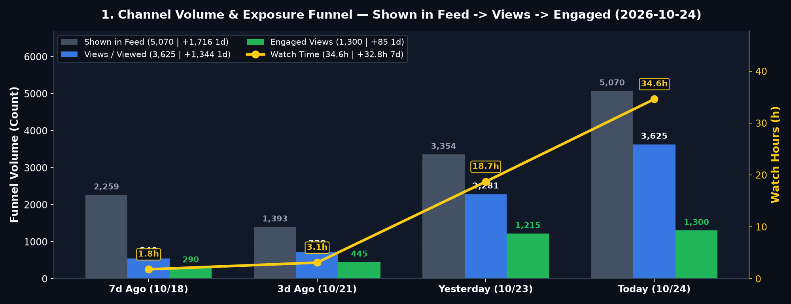
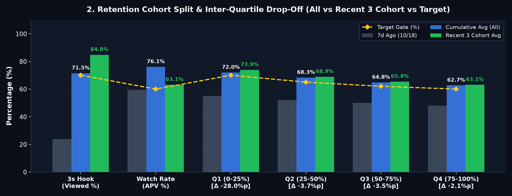
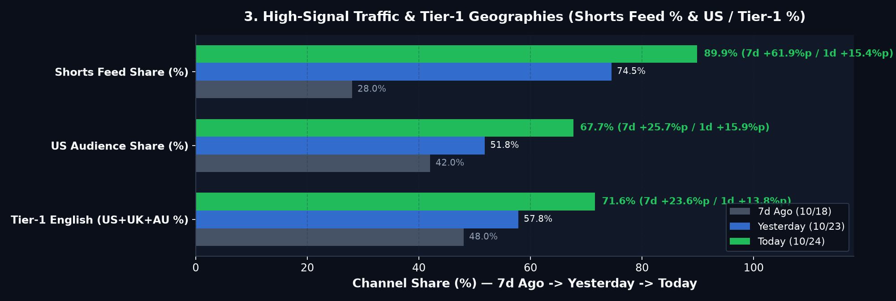
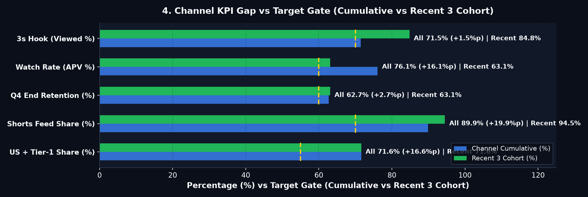

# 🚦 ALL ABOUT BRAIN — Daily Growth Report (2026-10-24)

## 🚦 0. 오늘의 채널 종합 진단: **🟢 순항 중 (핵심 4/5 통과 · ⚠️ 신규 영상 시드 지연 1건)**

> **🚦 0. Executive Growth Pulse (7d)**: 🟢 **Subs** `25 (+24)` ｜ 🟢 **Shown→Views→Engaged** `5,070 → 3,625 → 1,300 (+1,716/+1,344/+85)` ｜ 🟢 **Watch** `34.6h (+32.8h)` ｜ 🟢 **3s Hook** `71.5% (Rec 84.8%)` ｜ 🟢 **APV** `76.1% (62.1s)` ｜ 🟡 **48h** `1,694 (+14.5%)`

| 진단 영역 | 상태 | 현재 수치 (전일 대비) | 기준 (Gate) | 한줄 진단 |
| :--- | :---: | :---: | :---: | :--- |
| **① 노출·구독 성장** | 🟢 | **Views 3,625** (`+58.9%`) · **Subs 25** (`+6`) | 일 `+500` | 가파른 우상향 |
| **② 초반 3초 훅** | 🟢 | **71.5%** (최근 3개 **84.8%**) | `>= 70%` | 목표선 돌파 |
| **③ 끝까지 시청률** | 🟢 | **76.1%** (`평균 62.1s`) | `>= 60%` | 최상위권 유지 |
| **④ 북미·피드 타겟** | 🟢 | **미국 67.7%** · **피드 89.9%** | `US >= 45%` | 북미 알고리즘 안착 |
| **⑤ 시드·예약 큐** | 🔴 | **Cohort #2 미확산** · **예약 0개** | `24h 내 시드` | **#1 관련 동영상 연결 및 추가 예약 필요** |

> **💡 오늘의 핵심 1줄 액션**: **Gear 5**에서 피드 노출 99%를 독점 중인 **Cohort #1의 관련 동영상(`Related Video`)을 Cohort #2로 연결**해 시드를 강제 전이시키고, 클립 3~8 구간(`Q1→Q3 -7.2%p`) 컷 전환 속도를 높입니다.

---

## 1. Volume & Exposure Funnel

| Metric | 7d Ago (`10/18`) | 3d Ago (`10/21`) | Yesterday (`2026-10-23`) | **Today (`2026-10-24`)** | **1d Δ** | **7d Δ (`MA`)** | Gate | Signal |
| :--- | :---: | :---: | :---: | :---: | :---: | :---: | :---: | :---: |
| **Shown in feed** | 2,259 | 1,393 | 3,354 | **5,070** | **`+1,716` (`+51.2%`)** | `+2,811` (`845/d`) | `+500/d` | 🟡 `+1,716` |
| **Views (`Viewed`)** | 540 | 730 | 2,281 | **3,625** | **`+1,344` (`+58.9%`)** | **`+3,085` (`+514/d`)** | `>=70%` | 🟢 `+571.3%` |
| **Engaged Views** | 290 | 445 | 1,215 | **1,300** | **`+85` (`+7.0%`)** | **`+1,010` (`+168/d`)** | `>=55%` | 🟢 `+348.3%` |
| **Watch Time (`h`)** | 1.8h | 3.1h | 18.7h | **34.6h** | `+15.9h (+85.0%)` | **`+32.8h` (`+5.5h/d`)** | `>0h` | 🟢 `+1822.2%` |
| **Subscribers (`/1K`)** | 1 (`1.85`) | 2 (`2.74`) | 19 (`8.33`) | **25** (`6.90`) | `+6 (+31.6%)` | **`+24` (`+4.0/d`)** | `>=2.50` | 🟢 `6.90/1K` |
| **Realtime 48h (`60m`)** | 540 | 730 | 1,480 | **1,694** (`32`) | **`+214` (`+14.5%`)** | **`Avg 1,028`** (`Peak 1,412`) | `>=1,028` | 🟡 `+14.5%` |

---

## 2. Retention & Cohort Drop-Off (`ΔQ`)

| Metric | 7d Ago | Yesterday | **All** | **Recent 3** | **Latest / Next** | **Drop-Off (`ΔQ`)** | Gate | Signal (`All` / `Rec`) |
| :--- | :---: | :---: | :---: | :---: | :---: | :--- | :---: | :---: |
| **3s Hook (`Viewed %`)** | 23.9% | 68.0% | **71.5%** | **84.8%** | `84.8% / -` | `100%→3s: -28.5%p` (`Rec -15.2%p`) | `70%` | 🟡 `+1.5%p` / 🟢 `+14.8%p` |
| **AVD (`s`)** | 18.0s | 48.8s | **62.1s** | **52.8s** | `53.0s / 44.5s` | `Len 75.0s` (`Rec 85.0s`) | `25s` | 🟢 `+37.1s` / 🟢 `+27.8s` |
| **APV (`%`)** | 59.4% | 62.8% | **76.1%** | **63.1%** | `63.2% / 51.8%` | `7d +16.7%p` (`1d +13.3%p`) | `60%` | 🟢 `+16.1%p` / 🟢 `+3.1%p` |
| **Q1 (0–25%)** | 55.0% | 58.0% | **72.0%** | **73.9%** | `74.0% / 65.0%` | `0%→Q1: -28.0%p` (`Rec -26.1%p`) · Clips 1–2 | `70%` | 🟢 `+2.0%p` / 🟢 `+3.9%p` |
| **Q2 (25–50%)** | 52.0% | 64.0% | **68.3%** | **68.9%** | `69.0% / 58.0%` | `Q1→Q2: -3.7%p` (`Rec -5.0%p`) · ⚠️ **Clips 3–5** | `65%` | 🟢 `+3.3%p` / 🟢 `+3.9%p` |
| **Q3 (50–75%)** | 50.0% | 60.2% | **64.8%** | **65.4%** | `65.5% / 54.0%` | `Q2→Q3: -3.5%p` (`Rec -3.5%p`) · ⚠️ **Clips 6–8** | `62%` | 🟢 `+2.8%p` / 🟢 `+3.4%p` |
| **Q4 (75–100%)** | 48.0% | 59.4% | **62.7%** | **63.1%** | `63.2% / 51.8%` | `Q3→Q4: -2.1%p` (`Rec -2.3%p`) · Clips 9–10 | `60%` | 🟢 `+2.7%p` / 🟢 `+3.1%p` |

---

## 3. Traffic & Geographies

| Metric | 7d Ago (`10/18`) | Yesterday (`2026-10-23`) | **Today (`2026-10-24`)** | **7d Δ (`1d Δ`)** | Gate | Signal |
| :--- | :---: | :---: | :---: | :---: | :---: | :---: |
| **Shorts Feed (`%`)** | 28.0% | 74.5% | **89.9%** (`3,259`) | **`+61.9%p`** (`+15.4%p`) | `>=70%` | 🟢 `+19.9%p` |
| **US / Tier-1 (`%`)** | 42.0% / 48.0% | 51.8% / 57.8% | **67.7% / 71.6%** | **`+25.7%p / +23.6%p`** (`+15.9%p / +13.8%p`) | `45% / 55%` | 🟢 `+22.7%p / +16.6%p` |

---

## 4. Seed & Queue Tracker + Pipeline Calibration

> **Queue & Operations Health**: 🌐 **Published** `5` ｜ 📅 **Scheduled** `0 (8.0d)` ｜ 🔒 **`Unlisted (Staged)`** `0` ｜ 🛠️ **Quarantine** `0`

| Cohort | Published (`Elapsed`) | `Shown → Views` | `Time-to-Seed` | `Related Video` | `Z-Test` | Signal |
| :--- | :---: | :---: | :---: | :---: | :---: | :---: |
| **Cohort #1 (`84s`)** | `10-19 12:00` (`+75h`) | `1,693 → 1,436` | `Seeded @ +18h` | `Anchor` | `Var A (7.8%)` | 🟢 `+456/1d` |
| **Cohort #2 (`86s`)** | `10-20 12:00` (`+51h`) | `1 → 1` | `Unseeded (+51h)` | `Link from #1` | `Hold` | 🔴 `Shown 1` |
| **Cohort #3 (`90s`)** | `10-21 12:00` (`+27h`) | `Pending` | `Indexing (+27h)` | `Link from #2` | `Scheduled` | 🟡 `Wait 27h` |

| Signal | Bottleneck | Metric | Cause | Pipeline Action |
| :---: | :--- | :---: | :--- | :--- |
| 🔴 | **Cohort #2 Seed Delay** | `Shown +1,716` (`#2: 1`) | 99% feed share on Cohort #1 | **Gear 5**: Point Cohort #1 `Related Video` → Cohort #2 |
| 🟡 | **Mid-Clip Drop (`Q1→Q3`)** | `-7.2%p` (`-3.7%p / -3.5%p`) | Pacing drag in Clips 3–8 (`85s`) | **Gear 2/3**: `0.28s` pre-pivot hold, `<=18w/clip`, 4-color cutaway |
| 🟡 | **Cumulative Hook (`All`)** | `All 71.5%` vs `Rec 84.8%` | Legacy `31s` (`23.9%`) dilution | **Gear 2**: Lock `<=12w` case hook (`>=80%` Viewed) |

---

## 5. 7-Day Targets (`W+1`)

| Axis | 7d Trend | Current (`All / Rec`) | **W+1 Target** | Focus |
| :--- | :---: | :---: | :---: | :--- |
| **① Funnel & Seed** | `Shown +2,811` · `Views +3,085` | `5,070 → 3,625 (1,300)` | **`Shown +800/d` · `Seed <=24h` (`5,000+`)** | Multi-video seeding via `Related Video` chain |
| **② Retention (`ΔQ`)** | `Viewed +44.1%p` · `APV +3.3%p` | `71.5% / 76.1%` (`84.8% / 63.1%`) | **`All Viewed >=72%` · `Q1→Q3 <=-5.0%p`** | Compress Clips 3–8 drop (`-7.2%p → -5.0%p`) |
| **③ Market & Subs** | `US +11.2%p` · `Subs +24` | `US 67.7% · T1 71.6%` (`25 · 6.90/1K`) | **`US >=55%` · `T1 >=62%` (`Subs 20+`)** | Habit, memory & sleep neural circuit topics |

---
> **🔐 Provenance**: `BCI_Shorts_Channel/reports/daily/2026-10-24_studio_metrics.json` | **Dashboard**: `2026-10-24_studio_charts.png` | **Mode**: `LIVE_CDP_DOM` | **SHA-256**: `4e25ed6f5cc23ee18b6a5898963f67bb23af1eb79e7f0c68c1e76cf6af84537d`
