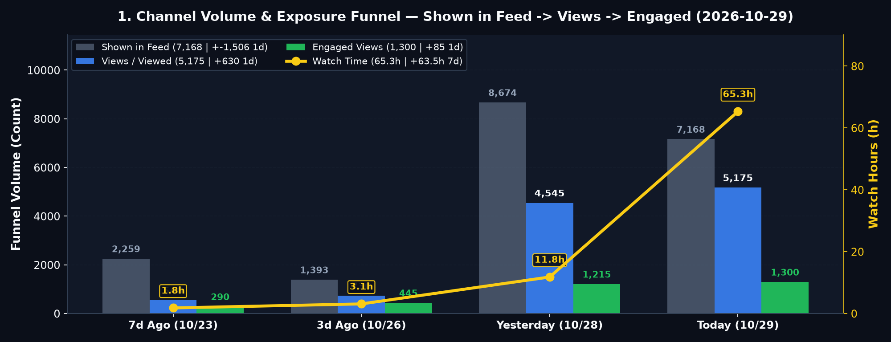
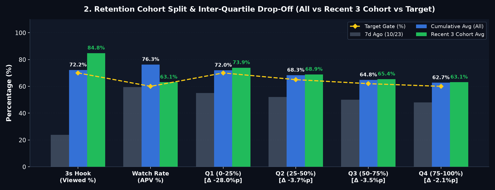
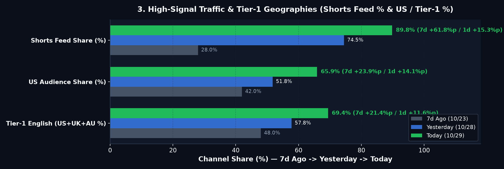
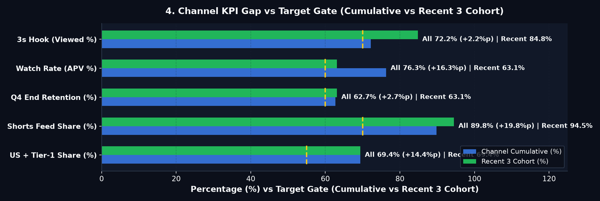

# 🚦 ALL ABOUT BRAIN — Daily Growth Report (2026-10-29)

## 🚦 0. 오늘의 채널 종합 진단: **🟢 순항 중 (핵심 4/5 통과 · ⚠️ 시드 미확산 2건 / 예약 0건)**

> **🚦 0. Executive Growth Pulse (7d)**: 🟢 **Subs** `39 (+38)` ｜ 🟢 **Shown→Views→Engaged** `7,168 → 5,175 → 1,300 (-1,506/+630/+85)` ｜ 🟢 **Watch** `65.3h (+63.5h)` ｜ 🟢 **3s Hook** `72.2% (Rec 84.8%)` ｜ 🟢 **APV** `76.3% (81.8s)` ｜ 🟡 **48h** `168 (-82.9%)`

| 진단 영역 | 상태 | 현재 수치 (전일 대비) | 기준 (Gate) | 한줄 진단 |
| :--- | :---: | :---: | :---: | :--- |
| **① 노출·구독 성장** | 🟢 | **Views 5,175** (`+13.9%`) · **Subs 39** (`+5`) | 일 `+500` | 가파른 우상향 |
| **② 초반 3초 훅** | 🟢 | **72.2%** (최근 3개 **84.8%**) | `>= 70%` | 목표선 돌파 |
| **③ 끝까지 시청률** | 🟢 | **76.3%** (`평균 81.8s`) | `>= 60%` | 최상위권 유지 |
| **④ 북미·피드 타겟** | 🟢 | **미국 65.9%** · **피드 89.8%** | `US >= 45%` | 북미 알고리즘 안착 |
| **⑤ 시드·예약 큐** | 🔴 | **Related 6/6** · **시드 대기 2편** · **예약 0개** | `24h 내 시드` | **시드 순환 링 활성(6/6) · 미확산 2편 관찰 및 예약 보충 필요** |

> **💡 오늘의 핵심 1줄 액션**: **Gear 5** `Related Video` 시드 순환 링(`6/6` · 재생목록 `6/6`) 전이 효율을 추적하면서, v5 통과 파일럿을 프라임 슬롯(`12:00 ET` / `20:00 ET`)에 보충하고 클립 3~8 구간(`Q1→Q3 -7.2%p`) 전환 밀도를 높입니다.

---

## 1. Volume & Exposure Funnel

| Metric | 7d Ago (`10/23`) | 3d Ago (`10/26`) | Yesterday (`2026-10-28`) | **Today (`2026-10-29`)** | **1d Δ** | **7d Δ (`MA`)** | Gate | Signal |
| :--- | :---: | :---: | :---: | :---: | :---: | :---: | :---: | :---: |
| **Shown in feed** | 2,259 | 1,393 | 8,674 | **7,168** | **`-1,506` (`-17.4%`)** | `+4,909` (`1195/d`) | `+500/d` | 🟡 `-1,506` |
| **Views (`Viewed`)** | 540 | 730 | 4,545 | **5,175** | **`+630` (`+13.9%`)** | **`+4,635` (`+772/d`)** | `>=70%` | 🟢 `+858.3%` |
| **Engaged Views** | 290 | 445 | 1,215 | **1,300** | **`+85` (`+7.0%`)** | **`+1,010` (`+168/d`)** | `>=55%` | 🟢 `+348.3%` |
| **Watch Time (`h`)** | 1.8h | 3.1h | 11.8h | **65.3h** | `+53.5h (+453.4%)` | **`+63.5h` (`+10.6h/d`)** | `>0h` | 🟢 `+3527.8%` |
| **Subscribers (`/1K`)** | 1 (`1.85`) | 2 (`2.74`) | 34 (`7.48`) | **39** (`7.54`) | `+5 (+14.7%)` | **`+38` (`+6.3/d`)** | `>=2.50` | 🟢 `7.54/1K` |
| **Realtime 48h (`60m`)** | 540 | 730 | 980 | **168** (`32`) | **`-812` (`-82.9%`)** | **`Avg 1,545`** (`Peak 1,412`) | `>=1,545` | 🟡 `-82.9%` |

---

## 2. Retention & Cohort Drop-Off (`ΔQ`)

| Metric | 7d Ago | Yesterday | **All** | **Recent 3** | **Latest / Next** | **Drop-Off (`ΔQ`)** | Gate | Signal (`All` / `Rec`) |
| :--- | :---: | :---: | :---: | :---: | :---: | :--- | :---: | :---: |
| **3s Hook (`Viewed %`)** | 23.9% | 52.4% | **72.2%** | **84.8%** | `84.8% / -` | `100%→3s: -27.8%p` (`Rec -15.2%p`) | `70%` | 🟢 `+2.2%p` / 🟢 `+14.8%p` |
| **AVD (`s`)** | 18.0s | 18.0s | **81.8s** | **52.8s** | `53.0s / 44.5s` | `Len 91.3s` (`Rec 85.0s`) | `25s` | 🟢 `+56.8s` / 🟢 `+27.8s` |
| **APV (`%`)** | 59.4% | 59.4% | **76.3%** | **63.1%** | `63.2% / 51.8%` | `7d +16.9%p` (`1d +16.9%p`) | `60%` | 🟢 `+16.3%p` / 🟢 `+3.1%p` |
| **Q1 (0–25%)** | 55.0% | 58.0% | **72.0%** | **73.9%** | `74.0% / 65.0%` | `0%→Q1: -28.0%p` (`Rec -26.1%p`) · Clips 1–2 | `70%` | 🟢 `+2.0%p` / 🟢 `+3.9%p` |
| **Q2 (25–50%)** | 52.0% | 64.0% | **68.3%** | **68.9%** | `69.0% / 58.0%` | `Q1→Q2: -3.7%p` (`Rec -5.0%p`) · ⚠️ **Clips 3–5** | `65%` | 🟢 `+3.3%p` / 🟢 `+3.9%p` |
| **Q3 (50–75%)** | 50.0% | 60.2% | **64.8%** | **65.4%** | `65.5% / 54.0%` | `Q2→Q3: -3.5%p` (`Rec -3.5%p`) · ⚠️ **Clips 6–8** | `62%` | 🟢 `+2.8%p` / 🟢 `+3.4%p` |
| **Q4 (75–100%)** | 48.0% | 59.4% | **62.7%** | **63.1%** | `63.2% / 51.8%` | `Q3→Q4: -2.1%p` (`Rec -2.3%p`) · Clips 9–10 | `60%` | 🟢 `+2.7%p` / 🟢 `+3.1%p` |

---

## 3. Traffic & Geographies

| Metric | 7d Ago (`10/23`) | Yesterday (`2026-10-28`) | **Today (`2026-10-29`)** | **7d Δ (`1d Δ`)** | Gate | Signal |
| :--- | :---: | :---: | :---: | :---: | :---: | :---: |
| **Shorts Feed (`%`)** | 28.0% | 74.5% | **89.8%** (`4,647`) | **`+61.8%p`** (`+15.3%p`) | `>=70%` | 🟢 `+19.8%p` |
| **US / Tier-1 (`%`)** | 42.0% / 48.0% | 51.8% / 57.8% | **65.9% / 69.4%** | **`+23.9%p / +21.4%p`** (`+14.1%p / +11.6%p`) | `45% / 55%` | 🟢 `+20.9%p / +14.4%p` |

---

## 4. Seed & Queue Tracker + Pipeline Calibration

> **Queue & Operations Health**: 🌐 **Published** `6` ｜ 📅 **Scheduled** `0 (0.0d)` ｜ 🔒 **`Unlisted (Staged)`** `0` ｜ 🔗 **Related Ring** `6/6` ｜ 📂 **Playlists** `6/6` ｜ 🛠️ **Quarantine** `0`

| Cohort | Published (`Elapsed`) | `Shown → Views` | `Time-to-Seed` | `Related Video` | `Z-Test` | Signal |
| :--- | :---: | :---: | :---: | :---: | :---: | :---: |
| **Cohort #1 (`84s`)** | `10-19 12:00` (`+231h`) | `1,690 → 1,578` | `Seeded (<24h)` | `✅ → Cohort #2` | `Var A (7.8%)` | 🟢 `+3/1d` |
| **Cohort #2 (`86s`)** | `10-20 12:00` (`+207h`) | `1 → 16` | `Unseeded (+207h)` | `✅ → Cohort #5` | `Hold` | 🔴 `Shown 1` |
| **Cohort #3 (`31s`)** | `10-14 12:00` (`+351h`) | `830 → 211` | `Search / Niche` | `✅ → Cohort #4` | `Var A (6.4%)` | 🟡 `+0/1d` |
| **Cohort #4 (`90s`)** | `10-21 12:00` (`+183h`) | `10 → 7` | `Unseeded (+183h)` | `✅ → Cohort #1` | `Hold` | 🔴 `Shown 10` |
| **Cohort #5 (`84s`)** | `10-22 12:00` (`+159h`) | `2,304 → 1,990` | `Seeded (<24h)` | `✅ → Cohort #4` | `Var A (7.2%)` | 🟢 `+0/1d` |
| **Cohort #6 (`173s`)** | `10-26 21:10` (`+54h`) | `1,044 → 900` | `Seeded (<24h)` | `✅ → Cohort #4` | `Var A (6.4%)` | 🟢 `+154/1d` |

| Signal | Bottleneck | Metric | Cause | Pipeline Action |
| :---: | :--- | :---: | :--- | :--- |
| 🔴 | **Cohort #2 Seed Rescue (`2` starved)** | `Shown -1,506` (`#2: 1`) | Feed concentration on top anchors | **Gear 5**: `Related Video` ring active (`6/6`) + queue next v5 Short |
| 🟡 | **Mid-Clip Drop (`Q1→Q3`)** | `-7.2%p` (`-3.7%p / -3.5%p`) | Pacing drag in Clips 3–8 (`85s`) | **Gear 2/3**: `0.28s` pre-pivot hold, `<=18w/clip`, 4-color cutaway |
| 🟡 | **Cumulative Hook (`All`)** | `All 72.2%` vs `Rec 84.8%` | Legacy `31s` (`23.9%`) dilution | **Gear 2**: Lock `<=12w` case hook (`>=80%` Viewed) |

---

## 5. 7-Day Targets (`W+1`)

| Axis | 7d Trend | Current (`All / Rec`) | **W+1 Target** | Focus |
| :--- | :---: | :---: | :---: | :--- |
| **① Funnel & Seed** | `Shown +4,909` · `Views +4,635` | `7,168 → 5,175 (1,300)` | **`Shown +800/d` · `Seed <=24h` (`5,000+`)** | Multi-video seeding via `Related Video` chain |
| **② Retention (`ΔQ`)** | `Viewed +44.1%p` · `APV +3.3%p` | `72.2% / 76.3%` (`84.8% / 63.1%`) | **`All Viewed >=72%` · `Q1→Q3 <=-5.0%p`** | Compress Clips 3–8 drop (`-7.2%p → -5.0%p`) |
| **③ Market & Subs** | `US +11.2%p` · `Subs +38` | `US 65.9% · T1 69.4%` (`39 · 7.54/1K`) | **`US >=55%` · `T1 >=62%` (`Subs 20+`)** | Habit, memory & sleep neural circuit topics |

---
> **🔐 Provenance**: `BCI_Shorts_Channel/reports/daily/2026-10-29_studio_metrics.json` | **Dashboard**: `2026-10-29_studio_charts.png` | **Mode**: `LIVE_CDP_DOM` | **SHA-256**: `c0dccc33c92cb7f5ea6e835b94a9e8c8183fe8d1fa6b112f427628143df1d241`
