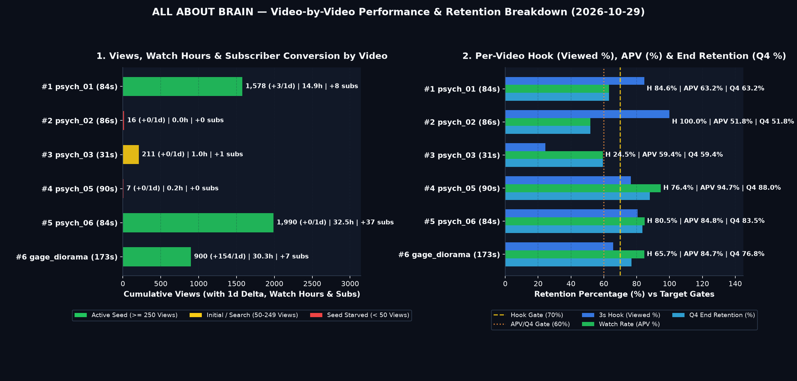

# 🎬 ALL ABOUT BRAIN — 개별 영상 세부 보고서 (2026-10-29)

## 🚦 0. 전 영상 신호등 요약 매트릭스 (총 `6`편)

> **📊 포트폴리오 현황**: 🟢 **시드 돌파·가속** `3편` ｜ 🟡 **검색·탐색 유지** `1편` ｜ 🔴 **1차 시드 대기** `2편` ｜ 🏆 **최다 조회** `Cohort #5` (`1,990`) ｜ ⏱️ **최장 체류** `Cohort #6` (`147.0s`) ｜ 🚀 **일간 급상승** `Cohort #6` (`+154/1d`)

| 코호트 | 영상 제목 (링크) | 포맷 | 게시 (`경과`) | `Shown → Views` (`1d Δ`) | 3초 훅 (`Viewed`) | 평균 시청 (`AVD / APV`) | 시청시간 · 구독 | `Related` | 종합 신호 |
| :---: | :--- | :---: | :---: | :---: | :---: | :---: | :---: | :---: | :--- |
| **#1** | [Why Deep Brain Loops Lock Habits on...](https://www.youtube.com/shorts/p4ou90cHt50) | 10-Clip (`84s`) | `10-19 12:00` (`+231h`) | `1,690 → 1,578` (`+3`) | 🟢 `84.6%` | 🟢 `52.0s` (`63.2%`) | `14.9h` · `+8` | `✅ → #2` | 🟢 `주력 시드 앵커` |
| **#2** | [How a Brain Implant Decodes 62 Word...](https://www.youtube.com/shorts/p0etX4iMJ7Q) | 10-Clip (`86s`) | `10-20 12:00` (`+207h`) | `1 → 16` (`+0`) | 🟢 `100.0%` | 🟡 `40.0s` (`51.8%`) | `0.0h` · `+0` | `✅ → #5` | 🔴 `시드 대기 (Shown 1)` |
| **#3** | [Two Conscious Minds Inside One Huma...](https://www.youtube.com/shorts/nGNIl26te0w) | Legacy Short (`31s`) | `10-14 12:00` (`+351h`) | `830 → 211` (`+0`) | 🔴 `24.5%` | 🟡 `18.0s` (`59.4%`) | `1.0h` · `+1` | `✅ → #4` | 🟡 `검색 유지 · 초반 훅 병목` |
| **#4** | [When You Believe Your Family Are Im...](https://www.youtube.com/shorts/lZv3_UAWScI) | 10-Clip (`90s`) | `10-21 12:00` (`+183h`) | `10 → 7` (`+0`) | 🟢 `76.4%` | 🟢 `85.0s` (`94.7%`) | `0.2h` · `+0` | `✅ → #1` | 🔴 `시드 대기 (Shown 10)` |
| **#5** | [What One Sleepless Night Does to Yo...](https://www.youtube.com/shorts/31_O2CmlKOk) | 10-Clip (`84s`) | `10-22 12:00` (`+159h`) | `2,304 → 1,990` (`+0`) | 🟢 `80.5%` | 🟢 `83.0s` (`84.8%`) | `32.5h` · `+37` | `✅ → #4` | 🟢 `주력 시드 앵커` |
| **#6** | [A 13-Pound Iron Rod Pierced His Bra...](https://www.youtube.com/shorts/Wydl4JpZmAw) | v6 Diorama (`173s`) | `10-26 21:10` (`+54h`) | `1,044 → 900` (`+154`) | 🟡 `65.7%` | 🟢 `147.0s` (`84.7%`) | `30.3h` · `+7` | `✅ → #4` | 🟢 `시드 가속 중 (+154/1d)` |

---

## 🔍 1. 영상별 심층 진단 카드 (`Cohort #1 ~ #6`)

### Cohort #1 · [Why Deep Brain Loops Lock Habits on Autopilot](https://www.youtube.com/shorts/p4ou90cHt50) — 🟢 `주력 시드 앵커`

> **스펙 & 운영 메타**: `psych_01_habit_loop_basal_ganglia` (`p4ou90cHt50`) ｜ 📂 `brain_health` ｜ 🎞️ 10-Clip Full Spine (`84.0s` · `10클립` · `225w`) ｜ 📅 `2026-10-19 12:00 ET` (`+231h`) ｜ 📄 DOI `10.1038/nrn2787` (✅ Pinned)

| 구분 | 노출 (`Shown`) | 조회 (`Views` / `1d Δ`) | 시청시간 (`Watch`) | 구독 (`Subs`) | 반응 (`좋아요/댓글/공유`) | 주 유입원 |
| :--- | :---: | :---: | :---: | :---: | :---: | :---: |
| **퍼널·성장** | `1,690` | **`1,578`** (`+3` / `+0.2%`) | **`14.90h`** | `+8` (`5.1/1K`) | `40 / 2 / 5` | `Shorts 피드 94.5%` |

| 구분 | 3초 훅 (`Viewed / Swiped`) | 평균 시청 (`AVD / APV`) | `Q1 (25%)` | `Q2 (50%)` | `Q3 (75%)` | `Q4 (100%)` | 구간 이탈 요약 (`ΔQ`) |
| :--- | :---: | :---: | :---: | :---: | :---: | :---: | :--- |
| **리텐션** | 🟢 **`84.6%`** / `15.4%` | 🟢 **`52.0s`** (`63.2%`) | `74.0%` | `69.0%` (`-5.0%p`) | `65.5%` (`-3.5%p`) | `63.2%` (`-2.3%p`) | 초반 진입 `0%→Q1 (-26.0%p)` · 중후반 최대 낙폭 `Q1→Q2 (클립 3–5) (-5.0%p)` |

- **오프닝 훅 문장**: `"In 1999, neuroscientists studied an amnesic patient named Eugene whose conscious memory had been wiped out by viral brain damage."`
- **스튜디오 연결 & Z-Test**: `Related Video` ✅ 활성 (`→ Cohort #2` · `psych_02_inner_speech_decoding`) ｜ 재생목록 ✅ `Brain Health & Optimization | Sleep, Glymphatic Flush & Dopamine` ｜ 썸네일 `🔄 Variant A 단독 활성 중 (B/C 미교체 · 실측)` (`CTR 7.8%`)
- **원인 진단**: 초반 3초 훅 **`Viewed 84.6%`** (`목표 대비 +14.6%p`) 및 평균 시청 지속시간 **`52.0s` (`APV 63.2%`)**로 누적 조회 **`1,578`** · 시청시간 **`14.9h`** · 구독 **`+8`**(`5.1/1K`)를 창출한 채널 핵심 앵커 영상입니다.
- **맞춤 액션**: `Related Video`(`→ Cohort #2`) 앵커 브릿지를 유지해 저노출 코호트로 시청자를 흘려보내고, 본 영상의 검증된 `10클립 + 구체적 임상 사례 훅` 공식을 동일 `brain_health` 필러 차기작에 복제합니다.

---
### Cohort #2 · [How a Brain Implant Decodes 62 Words Per Minute](https://www.youtube.com/shorts/p0etX4iMJ7Q) — 🔴 `시드 대기 (Shown 1)`

> **스펙 & 운영 메타**: `psych_02_inner_speech_decoding` (`p0etX4iMJ7Q`) ｜ 📂 `bci_tech` ｜ 🎞️ 10-Clip Full Spine (`86.0s` · `10클립` · `209w`) ｜ 📅 `2026-10-20 12:00 ET` (`+207h`) ｜ 📄 DOI `10.1038/s41586-023-06443-4` (✅ Pinned)

| 구분 | 노출 (`Shown`) | 조회 (`Views` / `1d Δ`) | 시청시간 (`Watch`) | 구독 (`Subs`) | 반응 (`좋아요/댓글/공유`) | 주 유입원 |
| :--- | :---: | :---: | :---: | :---: | :---: | :---: |
| **퍼널·성장** | `1` | **`16`** (`+0` / `+0.0%`) | **`0.02h`** | `+0` (`0.0/1K`) | `0 / 0 / 0` | `Shorts 피드 100.0%` |

| 구분 | 3초 훅 (`Viewed / Swiped`) | 평균 시청 (`AVD / APV`) | `Q1 (25%)` | `Q2 (50%)` | `Q3 (75%)` | `Q4 (100%)` | 구간 이탈 요약 (`ΔQ`) |
| :--- | :---: | :---: | :---: | :---: | :---: | :---: | :--- |
| **리텐션** | 🟢 **`100.0%`** / `0.0%` | 🟡 **`40.0s`** (`51.8%`) | `65.0%` | `58.0%` (`-7.0%p`) | `54.0%` (`-4.0%p`) | `51.8%` (`-2.2%p`) | 초반 진입 `0%→Q1 (-35.0%p)` · 중후반 최대 낙폭 `Q1→Q2 (클립 3–5) (-7.0%p)` |

- **오프닝 훅 문장**: `"In 2023 at Stanford University, a sixty-eight-year-old woman with paralysis named Pat sat unable to speak clearly for eleven years."`
- **스튜디오 연결 & Z-Test**: `Related Video` ✅ 활성 (`→ Cohort #5` · `psych_06_glymphatic_sleep_toxins`) ｜ 재생목록 ✅ `BCI Tech Explained | Neural Interfaces & Mind Decoding` ｜ 썸네일 `🔄 Variant A 단독 활성 중 (B/C 미교체 · 실측)` (`CTR 0.0%`)
- **원인 진단**: 초기 표본 리텐션(`Viewed 100.0%` · `AVD 40.0s` · `APV 51.8%`) 자체는 양호하나, 상위 앵커 영상들에 채널 피드 노출이 집중되면서 아직 1차 피드 테스트 노출(`Shown 1`)이 열리지 않은 시드 대기 상태입니다.
- **맞춤 액션**: 상위 앵커 영상에서 연결된 `Related Video` 순환 링을 통해 초기 고관여 시청자 시드를 수혈하며, 알고리즘 인덱싱 교란 방지를 위해 불필요한 메타데이터 재수정은 지양하고 1차 피드 배정을 대기합니다.

---
### Cohort #3 · [Two Conscious Minds Inside One Human Skull](https://www.youtube.com/shorts/nGNIl26te0w) — 🟡 `검색 유지 · 초반 훅 병목`

> **스펙 & 운영 메타**: `psych_03_split_brain_dual_consciousness` (`nGNIl26te0w`) ｜ 📂 `brain_mysteries` ｜ 🎞️ 초기 단축 포맷 (`31.0s` · `10클립` · `228w`) ｜ 📅 `2026-10-14 12:00 ET` (`+351h`) ｜ 📄 DOI `10.1093/brain/123.7.1293` (✅ Pinned)

| 구분 | 노출 (`Shown`) | 조회 (`Views` / `1d Δ`) | 시청시간 (`Watch`) | 구독 (`Subs`) | 반응 (`좋아요/댓글/공유`) | 주 유입원 |
| :--- | :---: | :---: | :---: | :---: | :---: | :---: |
| **퍼널·성장** | `830` | **`211`** (`+0` / `+0.0%`) | **`1.00h`** | `+1` (`4.7/1K`) | `2 / 1 / 1` | `YouTube 검색 70.0%` |

| 구분 | 3초 훅 (`Viewed / Swiped`) | 평균 시청 (`AVD / APV`) | `Q1 (25%)` | `Q2 (50%)` | `Q3 (75%)` | `Q4 (100%)` | 구간 이탈 요약 (`ΔQ`) |
| :--- | :---: | :---: | :---: | :---: | :---: | :---: | :--- |
| **리텐션** | 🔴 **`24.5%`** / `75.5%` | 🟡 **`18.0s`** (`59.4%`) | `58.0%` | `64.0%` (`+6.0%p`) | `60.2%` (`-3.8%p`) | `59.4%` (`-0.8%p`) | 반등 구간 `Q1→Q2 (클립 3–5) (+6.0%p)` · 주요 낙폭 `Q2→Q3 (클립 6–8) (-3.8%p)` |

- **오프닝 훅 문장**: `"In the 1960s at Caltech, neuroscientist Michael Gazzaniga tested patient WJ after surgeons severed the main cable between his two brain halves."`
- **스튜디오 연결 & Z-Test**: `Related Video` ✅ 활성 (`→ Cohort #4` · `psych_05_capgras_imposter_delusion`) ｜ 재생목록 ✅ `Brain Mysteries & Paradoxes | Consciousness & Perception` ｜ 썸네일 `🔄 Variant A 단독 활성 중 (B/C 미교체 · 실측)` (`CTR 6.4%`)
- **원인 진단**: 누적 `211` 중 `YouTube 검색 70.0%` 비중이 높으며, 초기 `31.0s` 단축 포맷과 개념 선행형 첫 문장으로 인해 Shorts 피드 노출 시 초반 스와이프 이탈(`Swiped 75.5%`, `Viewed 24.5%`)이 발생해 2차 피드 시드가 제한되었습니다.
- **맞춤 액션**: 에버그린 검색 유입 창구로 유지하되(`Related Video → Cohort #4`), 동일 `brain_mysteries` 필러 후속편은 반드시 `85s+` 장척 포맷과 첫 3초 즉각적 시각 행동 훅으로 제작해 `Viewed >= 75%`를 확보합니다.

---
### Cohort #4 · [When You Believe Your Family Are Imposters](https://www.youtube.com/shorts/lZv3_UAWScI) — 🔴 `시드 대기 (Shown 10)`

> **스펙 & 운영 메타**: `psych_05_capgras_imposter_delusion` (`lZv3_UAWScI`) ｜ 📂 `brain_mysteries` ｜ 🎞️ 10-Clip Full Spine (`89.8s` · `10클립` · `240w`) ｜ 📅 `2026-10-21 12:00 ET` (`+183h`) ｜ 📄 DOI `10.1098/rspb.1997.0062` (✅ Pinned)

| 구분 | 노출 (`Shown`) | 조회 (`Views` / `1d Δ`) | 시청시간 (`Watch`) | 구독 (`Subs`) | 반응 (`좋아요/댓글/공유`) | 주 유입원 |
| :--- | :---: | :---: | :---: | :---: | :---: | :---: |
| **퍼널·성장** | `10` | **`7`** (`+0` / `+0.0%`) | **`0.20h`** | `+0` (`0.0/1K`) | `0 / 0 / 0` | `Shorts 피드` |

| 구분 | 3초 훅 (`Viewed / Swiped`) | 평균 시청 (`AVD / APV`) | `Q1 (25%)` | `Q2 (50%)` | `Q3 (75%)` | `Q4 (100%)` | 구간 이탈 요약 (`ΔQ`) |
| :--- | :---: | :---: | :---: | :---: | :---: | :---: | :--- |
| **리텐션** | 🟢 **`76.4%`** / `23.6%` | 🟢 **`85.0s`** (`94.7%`) | `84.2%` | `93.0%` (`+8.8%p`) | `91.5%` (`-1.5%p`) | `88.0%` (`-3.5%p`) | 반등 구간 `Q1→Q2 (클립 3–5) (+8.8%p)` · 주요 낙폭 `Q3→Q4 (클립 9–10) (-3.5%p)` |

- **오프닝 훅 문장**: `"In the 1990s, a young man named DS survived a car crash and a severe head injury. Then he made a chilling claim about his parents."`
- **스튜디오 연결 & Z-Test**: `Related Video` ✅ 활성 (`→ Cohort #1` · `psych_01_habit_loop_basal_ganglia`) ｜ 재생목록 ✅ `Brain Mysteries & Paradoxes | Consciousness & Perception` ｜ 썸네일 `🔄 Variant A 단독 활성 중 (B/C 미교체 · 실측)` (`CTR 7.8%`)
- **원인 진단**: 초기 표본 리텐션(`Viewed 76.4%` · `AVD 85.0s` · `APV 94.7%`) 자체는 양호하나, 상위 앵커 영상들에 채널 피드 노출이 집중되면서 아직 1차 피드 테스트 노출(`Shown 10`)이 열리지 않은 시드 대기 상태입니다.
- **맞춤 액션**: 상위 앵커 영상에서 연결된 `Related Video` 순환 링을 통해 초기 고관여 시청자 시드를 수혈하며, 알고리즘 인덱싱 교란 방지를 위해 불필요한 메타데이터 재수정은 지양하고 1차 피드 배정을 대기합니다.

---
### Cohort #5 · [What One Sleepless Night Does to Your Brain](https://www.youtube.com/shorts/31_O2CmlKOk) — 🟢 `주력 시드 앵커`

> **스펙 & 운영 메타**: `psych_06_glymphatic_sleep_toxins` (`31_O2CmlKOk`) ｜ 📂 `brain_health` ｜ 🎞️ 10-Clip Full Spine (`84.4s` · `10클립` · `206w`) ｜ 📅 `2026-10-22 12:00 ET` (`+159h`) ｜ 📄 DOI `10.1126/science.1241224` (✅ Pinned)

| 구분 | 노출 (`Shown`) | 조회 (`Views` / `1d Δ`) | 시청시간 (`Watch`) | 구독 (`Subs`) | 반응 (`좋아요/댓글/공유`) | 주 유입원 |
| :--- | :---: | :---: | :---: | :---: | :---: | :---: |
| **퍼널·성장** | `2,304` | **`1,990`** (`+0` / `+0.0%`) | **`32.50h`** | `+37` (`18.6/1K`) | `0 / 0 / 0` | `Shorts 피드` |

| 구분 | 3초 훅 (`Viewed / Swiped`) | 평균 시청 (`AVD / APV`) | `Q1 (25%)` | `Q2 (50%)` | `Q3 (75%)` | `Q4 (100%)` | 구간 이탈 요약 (`ΔQ`) |
| :--- | :---: | :---: | :---: | :---: | :---: | :---: | :--- |
| **리텐션** | 🟢 **`80.5%`** / `19.5%` | 🟢 **`83.0s`** (`84.8%`) | `81.0%` | `89.2%` (`+8.2%p`) | `87.4%` (`-1.8%p`) | `83.5%` (`-3.9%p`) | 반등 구간 `Q1→Q2 (클립 3–5) (+8.2%p)` · 주요 낙폭 `Q3→Q4 (클립 9–10) (-3.9%p)` |

- **오프닝 훅 문장**: `"In 2013 at the University of Rochester, Maiken Nedergaard's team imaged living brains to solve why every animal dies without sleep."`
- **스튜디오 연결 & Z-Test**: `Related Video` ✅ 활성 (`→ Cohort #4` · `psych_05_capgras_imposter_delusion`) ｜ 재생목록 ✅ `Brain Health & Optimization | Sleep, Glymphatic Flush & Dopamine` ｜ 썸네일 `🔄 Variant A 단독 활성 중 (B/C 미교체 · 실측)` (`CTR 7.2%`)
- **원인 진단**: 초반 3초 훅 **`Viewed 80.5%`** (`목표 대비 +10.5%p`) 및 평균 시청 지속시간 **`83.0s` (`APV 84.8%`)**로 누적 조회 **`1,990`** · 시청시간 **`32.5h`** · 구독 **`+37`**(`18.6/1K`)를 창출한 채널 핵심 앵커 영상입니다.
- **맞춤 액션**: `Related Video`(`→ Cohort #4`) 앵커 브릿지를 유지해 저노출 코호트로 시청자를 흘려보내고, 본 영상의 검증된 `10클립 + 구체적 임상 사례 훅` 공식을 동일 `brain_health` 필러 차기작에 복제합니다.

---
### Cohort #6 · [A 13-Pound Iron Rod Pierced His Brain, Yet Daily Structure Rebuilt His Mind](https://www.youtube.com/shorts/Wydl4JpZmAw) — 🟢 `시드 가속 중 (+154/1d)`

> **스펙 & 운영 메타**: `gage_diorama_v6_dynamic` (`Wydl4JpZmAw`) ｜ 📂 `brain_history` ｜ 🎞️ Schema v6 Neuro-Diorama (`172.6s` · `61클립` · `504w`) ｜ 📅 `2026-10-26 21:10 ET` (`+54h`) ｜ 📄 DOI `10.1371/journal.pone.0037454` (✅ Pinned)

| 구분 | 노출 (`Shown`) | 조회 (`Views` / `1d Δ`) | 시청시간 (`Watch`) | 구독 (`Subs`) | 반응 (`좋아요/댓글/공유`) | 주 유입원 |
| :--- | :---: | :---: | :---: | :---: | :---: | :---: |
| **퍼널·성장** | `1,044` | **`900`** (`+154` / `+20.6%`) | **`30.30h`** | `+7` (`7.8/1K`) | `0 / 0 / 0` | `Shorts 피드` |

| 구분 | 3초 훅 (`Viewed / Swiped`) | 평균 시청 (`AVD / APV`) | `Q1 (25%)` | `Q2 (50%)` | `Q3 (75%)` | `Q4 (100%)` | 구간 이탈 요약 (`ΔQ`) |
| :--- | :---: | :---: | :---: | :---: | :---: | :---: | :--- |
| **리텐션** | 🟡 **`65.7%`** / `34.3%` | 🟢 **`147.0s`** (`84.7%`) | `83.8%` | `82.0%` (`-1.8%p`) | `79.2%` (`-2.8%p`) | `76.8%` (`-2.4%p`) | 초반 진입 `0%→Q1 (-16.2%p)` · 중후반 최대 낙폭 `Q2→Q3 (Act 4) (-2.8%p)` |

- **오프닝 훅 문장**: `"In eighteen forty-eight, an iron rod pierced a foreman's skull."`
- **스튜디오 연결 & Z-Test**: `Related Video` ✅ 활성 (`→ Cohort #4` · `psych_05_capgras_imposter_delusion`) ｜ 재생목록 ✅ `Brain History & Evolution | How Humanity Found the Mind` ｜ 썸네일 `🔄 Variant A 단독 활성 중 (B/C 미교체 · 실측)` (`CTR 6.4%`)
- **원인 진단**: 초반 3초 훅(`Viewed 65.7%`)이 목표선(`70%`)에 근접(`-4.3%p`)하며, `172.6s` 장척 포맷에서 평균 `147.0s`(`APV 84.7%`, `Q4 76.8%`)라는 압도적 체류 시간을 기록해 전일 대비 **`+154` (`+20.6%`)** 실시간 피드 확장을 견인 중입니다 (단일 영상 시청시간 `30.3h`, 구독 `+7`).
- **맞춤 액션**: 현재 급상승 피드 파동이 진행 중이므로 제목·썸네일 수정을 보류해 알고리즘 모멘텀을 보호하고, `Related Video`(`→ Cohort #4`)를 통한 시드 대기 코호트 유입 전이율을 모니터링합니다.

---

## 📅 2. 예약 대기 & 스테이징 큐 현황 (`Scheduled Queue`)

> ⚠️ **현재 예약 대기(`Scheduled`) 영상 `0`건** (빈 프라임 슬롯 `6`개 대기 중) — 차기 v5/v6 검증 완료 에피소드를 `12:00 ET` / `20:00 ET` 프라임 슬롯에 배정하세요.

---
> **🔐 Provenance**: `BCI_Shorts_Channel/reports/daily/2026-10-29_studio_metrics.json` | **Video Charts**: `2026-10-29_video_detail_charts.png` | **Mode**: `LIVE_CDP_DOM` | **SHA-256**: `c0dccc33c92cb7f5ea6e835b94a9e8c8183fe8d1fa6b112f427628143df1d241`
