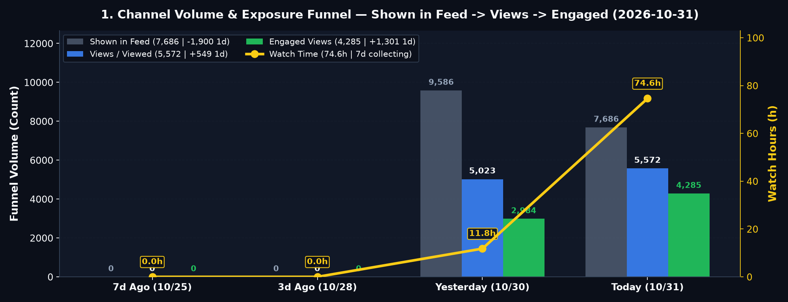
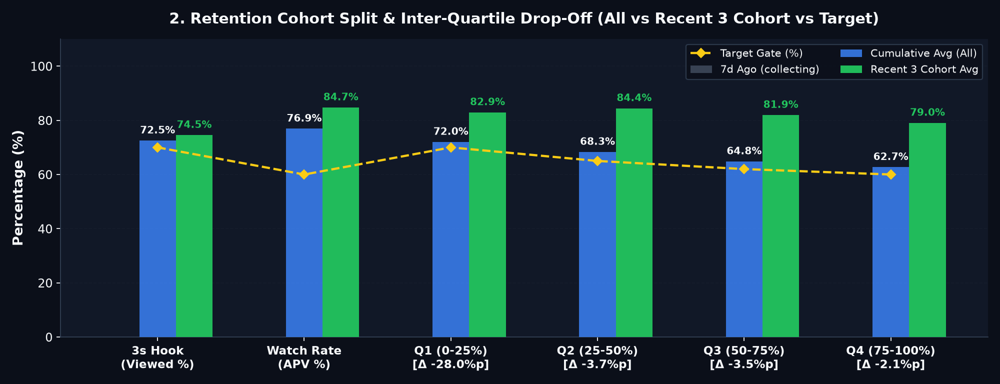
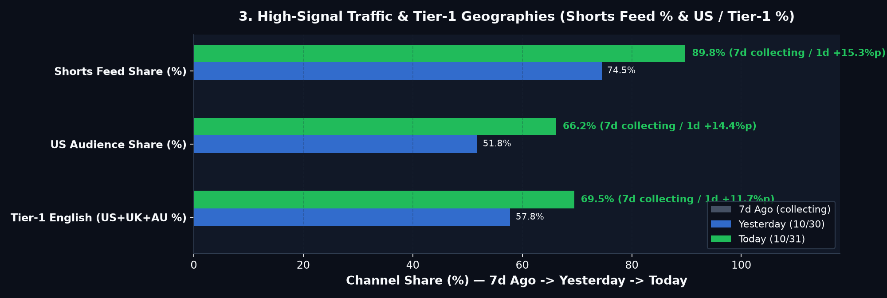
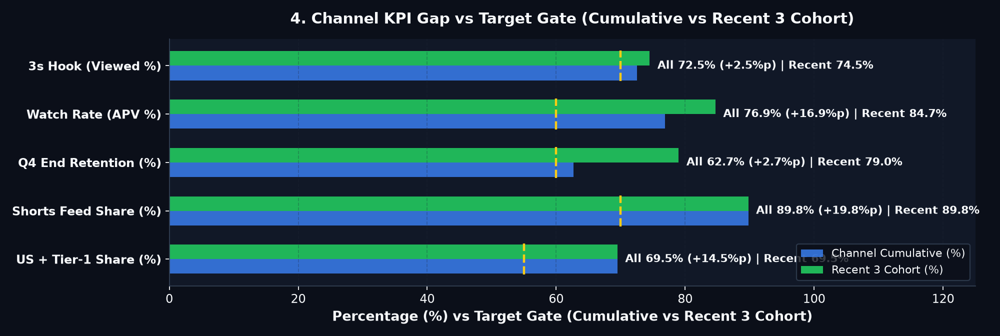

# 🚦 ALL ABOUT BRAIN — Daily Growth Report (2026-10-31)

## 🚦 0. 오늘의 채널 종합 진단: **🟢 순항 중 (핵심 4/5 통과 · ⚠️ 시드 미확산 2건 / 예약 10건)**

> **🚦 0. Executive Growth Pulse (7d)**: 🟢 **Subs** `40 (1d +5)` ｜ 🟢 **Shown→Views→Engaged** `7,686 → 5,572 → 4,285 (-1,900/+549/+1,301)` ｜ 🟢 **Watch** `74.6h (1d +62.8h)` ｜ 🟢 **3s Hook** `72.5% (Rec 74.5%)` ｜ 🟢 **APV** `76.9% (84.8s)` ｜ 🟡 **48h** `386 (-60.6%)`

| 진단 영역 | 상태 | 현재 수치 (전일 대비) | 기준 (Gate) | 한줄 진단 |
| :--- | :---: | :---: | :---: | :--- |
| **① 노출·구독 성장** | 🟢 | **Views 5,572** (`+10.9%`) · **Subs 40** (`+5`) | 일 `+500` | 가파른 우상향 |
| **② 초반 3초 훅** | 🟢 | **72.5%** (최근 3개 **74.5%**) | `>= 70%` | 목표선 돌파 |
| **③ 끝까지 시청률** | 🟢 | **76.9%** (`평균 84.8s`) | `>= 60%` | 최상위권 유지 |
| **④ 북미·피드 타겟** | 🟢 | **미국 66.2%** · **피드 89.8%** | `US >= 45%` | 북미 알고리즘 안착 |
| **⑤ 시드·예약 큐** | 🔴 | **Related 7/7** · **시드 대기 2편** · **예약 10개** | `24h 내 시드` | **시드 순환 링 활성(7/7) · 미확산 코호트 2편 전이 관찰** |

> **💡 오늘의 핵심 1줄 액션**: **Gear 5** `Related Video` 시드 순환 링(`7/7` · 재생목록 `7/7`) 전이 효율을 추적하면서, v5 통과 파일럿을 프라임 슬롯(`12:00 ET` / `20:00 ET`)에 보충하고 클립 3~8 구간(`Q1→Q3 -7.2%p`) 전환 밀도를 높입니다.

---

## 1. Volume & Exposure Funnel

| Metric | 7d Ago (`10/25`) | 3d Ago (`10/28`) | Yesterday (`2026-10-30`) | **Today (`2026-10-31`)** | **1d Δ** | **7d Δ (`MA`)** | Gate | Signal |
| :--- | :---: | :---: | :---: | :---: | :---: | :---: | :---: | :---: |
| **Shown in feed** | - | - | 9,586 | **7,686** | **`-1,900` (`-19.8%`)** | `collecting` | `+500/d` | 🟡 `-1,900` |
| **Views (`Viewed`)** | - | - | 5,023 | **5,572** | **`+549` (`+10.9%`)** | `collecting` | `>=70%` | 🟢 `+10.9%` |
| **Engaged Views** | - | - | 2,984 | **4,285** | **`+1,301` (`+43.6%`)** | `collecting` | `>=55%` | 🟢 `+43.6%` |
| **Watch Time (`h`)** | - | - | 11.8h | **74.6h** | `+62.8h (+532.2%)` | `collecting` | `>0h` | 🟢 `+532.2%` |
| **Subscribers (`/1K`)** | - | - | 35 (`6.97`) | **40** (`7.18`) | `+5 (+14.3%)` | `collecting` | `>=2.50` | 🟢 `7.18/1K` |
| **Realtime 48h (`60m`)** | - | - | 980 | **386** (`32`) | **`-594` (`-60.6%`)** | `collecting` (`Peak 980`) | `>=683` | 🟡 `-60.6%` |

---

## 2. Retention & Cohort Drop-Off (`ΔQ`)

| Metric | 7d Ago | Yesterday | **All** | **Recent 3** | **Latest / Next** | **Drop-Off (`ΔQ`)** | Gate | Signal (`All` / `Rec`) |
| :--- | :---: | :---: | :---: | :---: | :---: | :--- | :---: | :---: |
| **3s Hook (`Viewed %`)** | - | 52.4% | **72.5%** | **74.5%** | `66.9% / 76.3%` | `100%→3s: -27.5%p` (`Rec -25.5%p`) | `70%` | 🟢 `+2.5%p` / 🟢 `+4.5%p` |
| **AVD (`s`)** | - | 18.0s | **84.8s** | **120.0s** | `146.0s / 132.0s` | `Len 143.8s` (`Rec 144.4s`) | `25s` | 🟢 `+59.8s` / 🟢 `+95.0s` |
| **APV (`%`)** | - | 59.4% | **76.9%** | **84.7%** | `84.7% / 84.7%` | `7d collecting` (`1d +17.5%p`) | `60%` | 🟢 `+16.9%p` / 🟢 `+24.7%p` |
| **Q1 (0–25%)** | - | 58.0% | **72.0%** | **82.9%** | `83.8% / 83.8%` | `0%→Q1: -28.0%p` (`Rec -17.1%p`) · Clips 1–2 | `70%` | 🟢 `+2.0%p` / 🟢 `+12.9%p` |
| **Q2 (25–50%)** | - | 64.0% | **68.3%** | **84.4%** | `82.0% / 82.0%` | `Q1→Q2: -3.7%p` (`Rec +1.5%p`) · ⚠️ **Clips 3–5** | `65%` | 🟢 `+3.3%p` / 🟢 `+19.4%p` |
| **Q3 (50–75%)** | - | 60.2% | **64.8%** | **81.9%** | `79.2% / 79.2%` | `Q2→Q3: -3.5%p` (`Rec -2.5%p`) · ⚠️ **Clips 6–8** | `62%` | 🟢 `+2.8%p` / 🟢 `+19.9%p` |
| **Q4 (75–100%)** | - | 59.4% | **62.7%** | **79.0%** | `76.8% / 76.8%` | `Q3→Q4: -2.1%p` (`Rec -2.9%p`) · Clips 9–10 | `60%` | 🟢 `+2.7%p` / 🟢 `+19.0%p` |

---

## 3. Traffic & Geographies

| Metric | 7d Ago (`10/25`) | Yesterday (`2026-10-30`) | **Today (`2026-10-31`)** | **7d Δ (`1d Δ`)** | Gate | Signal |
| :--- | :---: | :---: | :---: | :---: | :---: | :---: |
| **Shorts Feed (`%`)** | - | 74.5% | **89.8%** (`5,004`) | `collecting` (`+15.3%p`) | `>=70%` | 🟢 `+19.8%p` |
| **US / Tier-1 (`%`)** | - | 51.8% / 57.8% | **66.2% / 69.5%** | `collecting` (`+14.4%p / +11.7%p`) | `45% / 55%` | 🟢 `+21.2%p / +14.5%p` |

---

## 4. Seed & Queue Tracker + Pipeline Calibration

> **Queue & Operations Health**: 🌐 **Published** `7` ｜ 📅 **Scheduled** `10 (5.0d)` ｜ 🔒 **`Unlisted (Staged)`** `0` ｜ 🔗 **Related Ring** `7/7` ｜ 📂 **Playlists** `7/7` ｜ 🛠️ **Quarantine** `0`

| Cohort | Published (`Elapsed`) | `Shown → Views` | `Time-to-Seed` | `Related Video` | `Z-Test` | Signal |
| :--- | :---: | :---: | :---: | :---: | :---: | :---: |
| **Cohort #1 (`84s`)** | `10-19 12:00` (`+279h`) | `1,690 → 1,585` | `Seeded (<24h)` | `✅ → Cohort #2` | `Var A (7.8%)` | 🟢 `+5/1d` |
| **Cohort #2 (`86s`)** | `10-20 12:00` (`+255h`) | `1 → 16` | `Unseeded (+255h)` | `✅ → Cohort #5` | `Hold` | 🔴 `Shown 1` |
| **Cohort #3 (`31s`)** | `10-14 12:00` (`+399h`) | `830 → 213` | `Search / Niche` | `✅ → Cohort #7` | `Var A (6.4%)` | 🟡 `+1/1d` |
| **Cohort #4 (`90s`)** | `10-21 12:00` (`+231h`) | `10 → 7` | `Unseeded (+231h)` | `✅ → Cohort #1` | `Hold` | 🔴 `Shown 10` |
| **Cohort #5 (`84s`)** | `10-22 12:00` (`+207h`) | `2,304 → 1,999` | `Seeded (<24h)` | `✅ → Cohort #4` | `Var A (7.2%)` | 🟢 `+2/1d` |
| **Cohort #6 (`176s`)** | `10-29 18:40` (`+32h`) | `427 → 366` | `Seeded (<24h)` | `✅ → Cohort #7` | `Var A (6.4%)` | 🟢 `+61/1d` |
| **Cohort #7 (`173s`)** | `10-26 21:10` (`+102h`) | `1,044 → 907` | `Seeded (<24h)` | `✅ → Cohort #4` | `Var A (6.4%)` | 🟢 `+1/1d` |

| Signal | Bottleneck | Metric | Cause | Pipeline Action |
| :---: | :--- | :---: | :--- | :--- |
| 🔴 | **Cohort #2 Seed Rescue (`2` starved)** | `Shown -1,900` (`#2: 1`) | Feed concentration on top anchors | **Gear 5**: `Related Video` ring active (`7/7`) + queue next v5 Short |
| 🟡 | **Mid-Clip Drop (`Q1→Q3`)** | `-7.2%p` (`-3.7%p / -3.5%p`) | Pacing drag in Clips 3–8 (`144s`) | **Gear 2/3**: `0.28s` pre-pivot hold, `<=18w/clip`, 4-color cutaway |
| 🟡 | **Cumulative Hook (`All`)** | `All 72.5%` vs `Rec 74.5%` | Early cohort hook dilution | **Gear 2**: Lock `<=12w` case hook (`>=80%` Viewed) |

---

## 5. 7-Day Targets (`W+1`)

| Axis | 7d Trend | Current (`All / Rec`) | **W+1 Target** | Focus |
| :--- | :---: | :---: | :---: | :--- |
| **① Funnel & Seed** | `collecting (<7d)` | `7,686 → 5,572 (4,285)` | **`Shown +800/d` · `Seed <=24h` (`5,000+`)** | Multi-video seeding via `Related Video` chain |
| **② Retention (`ΔQ`)** | `collecting (<7d)` | `72.5% / 76.9%` (`74.5% / 84.7%`) | **`All Viewed >=72%` · `Q1→Q3 <=-5.0%p`** | Compress Clips 3–8 drop (`-7.2%p → -5.0%p`) |
| **③ Market & Subs** | `collecting (<7d)` | `US 66.2% · T1 69.5%` (`40 · 7.18/1K`) | **`US >=55%` · `T1 >=62%` (`Subs 20+`)** | Habit, memory & sleep neural circuit topics |

---
> **🔐 Provenance**: `BCI_Shorts_Channel/reports/daily/2026-10-31_studio_metrics.json` | **Dashboard**: `2026-10-31_studio_charts.png` | **Mode**: `LIVE_CDP_DOM` | **SHA-256**: `baf2eb2972c40838a7543c4fbc45fc68bb2ddbc9d9cae0fd6b47e75cddc2d519`
