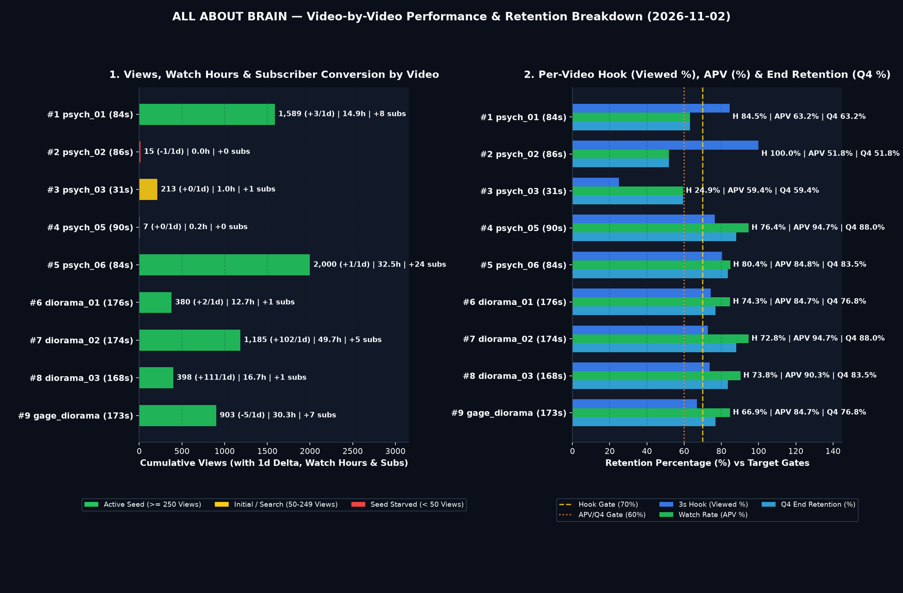

# 🎬 ALL ABOUT BRAIN — 개별 영상 세부 보고서 (2026-11-02)

## 🚦 0. 전 영상 신호등 요약 매트릭스 (총 `9`편)

> **📊 포트폴리오 현황**: 🟢 **시드 돌파·가속** `6편` ｜ 🟡 **검색·탐색 유지** `1편` ｜ 🔴 **1차 시드 대기** `2편` ｜ 🏆 **최다 조회** `Cohort #5` (`2,000`) ｜ ⏱️ **최장 체류** `Cohort #8` (`151.4s`) ｜ 🚀 **일간 급상승** `Cohort #8` (`+111/1d`)

| 코호트 | 영상 제목 (링크) | 포맷 | 게시 (`경과`) | `Shown → Views` (`1d Δ`) | 3초 훅 (`Viewed`) | 평균 시청 (`AVD / APV`) | 시청시간 · 구독 | `Related` | 종합 신호 |
| :---: | :--- | :---: | :---: | :---: | :---: | :---: | :---: | :---: | :--- |
| **#1** | [Why Deep Brain Loops Lock Habits on...](https://www.youtube.com/shorts/p4ou90cHt50) | 10-Clip (`84s`) | `10-19 12:00` (`+326h`) | `1,690 → 1,589` (`+3`) | 🟢 `84.5%` | 🟢 `52.0s` (`63.2%`) | `14.9h` · `+8` | `✅ → #2` | 🟢 `주력 시드 앵커` |
| **#2** | [How a Brain Implant Decodes 62 Word...](https://www.youtube.com/shorts/p0etX4iMJ7Q) | 10-Clip (`86s`) | `10-20 12:00` (`+302h`) | `1 → 15` (`-1`) | 🟢 `100.0%` | 🟡 `40.0s` (`51.8%`) | `0.0h` · `+0` | `✅ → #5` | 🔴 `시드 대기 (Shown 1)` |
| **#3** | [Two Conscious Minds Inside One Huma...](https://www.youtube.com/shorts/nGNIl26te0w) | Legacy Short (`31s`) | `10-14 12:00` (`+446h`) | `830 → 213` (`+0`) | 🔴 `24.9%` | 🟡 `18.0s` (`59.4%`) | `1.0h` · `+1` | `✅ → #9` | 🟡 `검색 유지 · 초반 훅 병목` |
| **#4** | [When You Believe Your Family Are Im...](https://www.youtube.com/shorts/lZv3_UAWScI) | 10-Clip (`90s`) | `10-21 12:00` (`+278h`) | `10 → 7` (`+0`) | 🟢 `76.4%` | 🟢 `85.0s` (`94.7%`) | `0.2h` · `+0` | `✅ → #1` | 🔴 `시드 대기 (Shown 10)` |
| **#5** | [What One Sleepless Night Does to Yo...](https://www.youtube.com/shorts/31_O2CmlKOk) | 10-Clip (`84s`) | `10-22 12:00` (`+254h`) | `2,304 → 2,000` (`+1`) | 🟢 `80.4%` | 🟢 `82.0s` (`84.8%`) | `32.5h` · `+24` | `✅ → #4` | 🟢 `주력 시드 앵커` |
| **#6** | [He Forgot Every Doctor in 5 Minutes...](https://www.youtube.com/shorts/q1lUimnZ-V0) | v6 Diorama (`176s`) | `10-29 18:40` (`+79h`) | `427 → 380` (`+2`) | 🟢 `74.3%` | 🟢 `134.0s` (`84.7%`) | `12.7h` · `+1` | `✅ → #9` | 🟢 `주력 시드 앵커` |
| **#7** | [His Missing Hand Stayed Clenched fo...](https://youtube.com/shorts/u5mQNZWNjiw) | v6 Diorama (`174s`) | `10-29 18:27` (`+80h`) | `1,516 → 1,185` (`+102`) | 🟢 `72.8%` | 🟢 `103.0s` (`94.7%`) | `49.7h` · `+5` | `✅ → #1` | 🟢 `시드 가속 중 (+102/1d)` |
| **#8** | [His Right Hand Buttoned His Shirt, ...](https://youtube.com/shorts/PK1opKmokwY) | v6 Diorama (`168s`) | `11-01 12:00` (`+14h`) | `557 → 398` (`+111`) | 🟢 `73.8%` | 🟢 `151.4s` (`90.3%`) | `16.7h` · `+1` | `✅ → #4` | 🟢 `시드 가속 중 (+111/1d)` |
| **#9** | [A 13-Pound Iron Rod Pierced His Bra...](https://www.youtube.com/shorts/Wydl4JpZmAw) | v6 Diorama (`173s`) | `10-26 21:10` (`+149h`) | `1,044 → 903` (`-5`) | 🟡 `66.9%` | 🟢 `147.0s` (`84.7%`) | `30.3h` · `+7` | `✅ → #4` | 🟢 `주력 시드 앵커` |

---

## 🔍 1. 영상별 심층 진단 카드 (`Cohort #1 ~ #9`)

### Cohort #1 · [Why Deep Brain Loops Lock Habits on Autopilot](https://www.youtube.com/shorts/p4ou90cHt50) — 🟢 `주력 시드 앵커`

> **스펙 & 운영 메타**: `psych_01_habit_loop_basal_ganglia` (`p4ou90cHt50`) ｜ 📂 `brain_health` ｜ 🎞️ 10-Clip Full Spine (`84.0s` · `10클립` · `225w`) ｜ 📅 `2026-10-19 12:00 ET` (`+326h`) ｜ 📄 DOI `10.1038/nrn2787` (✅ Pinned)

| 구분 | 노출 (`Shown`) | 조회 (`Views` / `1d Δ`) | 시청시간 (`Watch`) | 구독 (`Subs`) | 반응 (`좋아요/댓글/공유`) | 주 유입원 |
| :--- | :---: | :---: | :---: | :---: | :---: | :---: |
| **퍼널·성장** | `1,690` | **`1,589`** (`+3` / `+0.2%`) | **`14.90h`** | `+8` (`5.0/1K`) | `40 / 2 / 5` | `Shorts 피드 94.5%` |

| 구분 | 3초 훅 (`Viewed / Swiped`) | 평균 시청 (`AVD / APV`) | `Q1 (25%)` | `Q2 (50%)` | `Q3 (75%)` | `Q4 (100%)` | 구간 이탈 요약 (`ΔQ`) |
| :--- | :---: | :---: | :---: | :---: | :---: | :---: | :--- |
| **리텐션** | 🟢 **`84.5%`** / `15.5%` | 🟢 **`52.0s`** (`63.2%`) | `74.0%` | `69.0%` (`-5.0%p`) | `65.5%` (`-3.5%p`) | `63.2%` (`-2.3%p`) | 초반 진입 `0%→Q1 (-26.0%p)` · 중후반 최대 낙폭 `Q1→Q2 (클립 3–5) (-5.0%p)` |

- **오프닝 훅 문장**: `"In 1999, neuroscientists studied an amnesic patient named Eugene whose conscious memory had been wiped out by viral brain damage."`
- **스튜디오 연결 & Z-Test**: `Related Video` ✅ 활성 (`→ Cohort #2` · `psych_02_inner_speech_decoding`) ｜ 재생목록 ✅ `Brain Health & Optimization | Sleep, Glymphatic Flush & Dopamine` ｜ 썸네일 `🔄 Variant A 단독 활성 중 (B/C 미교체 · 실측)` (`CTR 7.8%`)
- **원인 진단**: 초반 3초 훅 **`Viewed 84.5%`** (`목표 대비 +14.5%p`) 및 평균 시청 지속시간 **`52.0s` (`APV 63.2%`)**로 누적 조회 **`1,589`** · 시청시간 **`14.9h`** · 구독 **`+8`**(`5.0/1K`)를 창출한 채널 핵심 앵커 영상입니다.
- **맞춤 액션**: `Related Video`(`→ Cohort #2`) 앵커 브릿지를 유지해 저노출 코호트로 시청자를 흘려보내고, 본 영상의 검증된 `10클립 + 구체적 임상 사례 훅` 공식을 동일 `brain_health` 필러 차기작에 복제합니다.

---
### Cohort #2 · [How a Brain Implant Decodes 62 Words Per Minute](https://www.youtube.com/shorts/p0etX4iMJ7Q) — 🔴 `시드 대기 (Shown 1)`

> **스펙 & 운영 메타**: `psych_02_inner_speech_decoding` (`p0etX4iMJ7Q`) ｜ 📂 `bci_tech` ｜ 🎞️ 10-Clip Full Spine (`86.0s` · `10클립` · `209w`) ｜ 📅 `2026-10-20 12:00 ET` (`+302h`) ｜ 📄 DOI `10.1038/s41586-023-06443-4` (✅ Pinned)

| 구분 | 노출 (`Shown`) | 조회 (`Views` / `1d Δ`) | 시청시간 (`Watch`) | 구독 (`Subs`) | 반응 (`좋아요/댓글/공유`) | 주 유입원 |
| :--- | :---: | :---: | :---: | :---: | :---: | :---: |
| **퍼널·성장** | `1` | **`15`** (`-1` / `-6.2%`) | **`0.02h`** | `+0` (`0.0/1K`) | `0 / 0 / 0` | `Shorts 피드 100.0%` |

| 구분 | 3초 훅 (`Viewed / Swiped`) | 평균 시청 (`AVD / APV`) | `Q1 (25%)` | `Q2 (50%)` | `Q3 (75%)` | `Q4 (100%)` | 구간 이탈 요약 (`ΔQ`) |
| :--- | :---: | :---: | :---: | :---: | :---: | :---: | :--- |
| **리텐션** | 🟢 **`100.0%`** / `0.0%` | 🟡 **`40.0s`** (`51.8%`) | `65.0%` | `58.0%` (`-7.0%p`) | `54.0%` (`-4.0%p`) | `51.8%` (`-2.2%p`) | 초반 진입 `0%→Q1 (-35.0%p)` · 중후반 최대 낙폭 `Q1→Q2 (클립 3–5) (-7.0%p)` |

- **오프닝 훅 문장**: `"In 2023 at Stanford University, a sixty-eight-year-old woman with paralysis named Pat sat unable to speak clearly for eleven years."`
- **스튜디오 연결 & Z-Test**: `Related Video` ✅ 활성 (`→ Cohort #5` · `psych_06_glymphatic_sleep_toxins`) ｜ 재생목록 ✅ `BCI Tech Explained | Neural Interfaces & Mind Decoding` ｜ 썸네일 `🔄 Variant A 단독 활성 중 (B/C 미교체 · 실측)` (`CTR 0.0%`)
- **원인 진단**: 초기 표본 리텐션(`Viewed 100.0%` · `AVD 40.0s` · `APV 51.8%`) 자체는 양호하나, 상위 앵커 영상들에 채널 피드 노출이 집중되면서 아직 1차 피드 테스트 노출(`Shown 1`)이 열리지 않은 시드 대기 상태입니다.
- **맞춤 액션**: 상위 앵커 영상에서 연결된 `Related Video` 순환 링을 통해 초기 고관여 시청자 시드를 수혈하며, 알고리즘 인덱싱 교란 방지를 위해 불필요한 메타데이터 재수정은 지양하고 1차 피드 배정을 대기합니다.

---
### Cohort #3 · [Two Conscious Minds Inside One Human Skull](https://www.youtube.com/shorts/nGNIl26te0w) — 🟡 `검색 유지 · 초반 훅 병목`

> **스펙 & 운영 메타**: `psych_03_split_brain_dual_consciousness` (`nGNIl26te0w`) ｜ 📂 `brain_mysteries` ｜ 🎞️ 초기 단축 포맷 (`31.0s` · `10클립` · `228w`) ｜ 📅 `2026-10-14 12:00 ET` (`+446h`) ｜ 📄 DOI `10.1093/brain/123.7.1293` (✅ Pinned)

| 구분 | 노출 (`Shown`) | 조회 (`Views` / `1d Δ`) | 시청시간 (`Watch`) | 구독 (`Subs`) | 반응 (`좋아요/댓글/공유`) | 주 유입원 |
| :--- | :---: | :---: | :---: | :---: | :---: | :---: |
| **퍼널·성장** | `830` | **`213`** (`+0` / `+0.0%`) | **`1.00h`** | `+1` (`4.7/1K`) | `2 / 1 / 1` | `YouTube 검색 70.0%` |

| 구분 | 3초 훅 (`Viewed / Swiped`) | 평균 시청 (`AVD / APV`) | `Q1 (25%)` | `Q2 (50%)` | `Q3 (75%)` | `Q4 (100%)` | 구간 이탈 요약 (`ΔQ`) |
| :--- | :---: | :---: | :---: | :---: | :---: | :---: | :--- |
| **리텐션** | 🔴 **`24.9%`** / `75.1%` | 🟡 **`18.0s`** (`59.4%`) | `58.0%` | `64.0%` (`+6.0%p`) | `60.2%` (`-3.8%p`) | `59.4%` (`-0.8%p`) | 반등 구간 `Q1→Q2 (클립 3–5) (+6.0%p)` · 주요 낙폭 `Q2→Q3 (클립 6–8) (-3.8%p)` |

- **오프닝 훅 문장**: `"In the 1960s at Caltech, neuroscientist Michael Gazzaniga tested patient WJ after surgeons severed the main cable between his two brain halves."`
- **스튜디오 연결 & Z-Test**: `Related Video` ✅ 활성 (`→ Cohort #9` · `gage_diorama_v6_dynamic`) ｜ 재생목록 ✅ `Brain Mysteries & Paradoxes | Consciousness & Perception` ｜ 썸네일 `🔄 Variant A 단독 활성 중 (B/C 미교체 · 실측)` (`CTR 6.4%`)
- **원인 진단**: 누적 `213` 중 `YouTube 검색 70.0%` 비중이 높으며, 초기 `31.0s` 단축 포맷과 개념 선행형 첫 문장으로 인해 Shorts 피드 노출 시 초반 스와이프 이탈(`Swiped 75.1%`, `Viewed 24.9%`)이 발생해 2차 피드 시드가 제한되었습니다.
- **맞춤 액션**: 에버그린 검색 유입 창구로 유지하되(`Related Video → Cohort #9`), 동일 `brain_mysteries` 필러 후속편은 반드시 `85s+` 장척 포맷과 첫 3초 즉각적 시각 행동 훅으로 제작해 `Viewed >= 75%`를 확보합니다.

---
### Cohort #4 · [When You Believe Your Family Are Imposters](https://www.youtube.com/shorts/lZv3_UAWScI) — 🔴 `시드 대기 (Shown 10)`

> **스펙 & 운영 메타**: `psych_05_capgras_imposter_delusion` (`lZv3_UAWScI`) ｜ 📂 `brain_mysteries` ｜ 🎞️ 10-Clip Full Spine (`89.8s` · `10클립` · `240w`) ｜ 📅 `2026-10-21 12:00 ET` (`+278h`) ｜ 📄 DOI `10.1098/rspb.1997.0062` (✅ Pinned)

| 구분 | 노출 (`Shown`) | 조회 (`Views` / `1d Δ`) | 시청시간 (`Watch`) | 구독 (`Subs`) | 반응 (`좋아요/댓글/공유`) | 주 유입원 |
| :--- | :---: | :---: | :---: | :---: | :---: | :---: |
| **퍼널·성장** | `10` | **`7`** (`+0` / `+0.0%`) | **`0.20h`** | `+0` (`0.0/1K`) | `0 / 0 / 0` | `Shorts 피드` |

| 구분 | 3초 훅 (`Viewed / Swiped`) | 평균 시청 (`AVD / APV`) | `Q1 (25%)` | `Q2 (50%)` | `Q3 (75%)` | `Q4 (100%)` | 구간 이탈 요약 (`ΔQ`) |
| :--- | :---: | :---: | :---: | :---: | :---: | :---: | :--- |
| **리텐션** | 🟢 **`76.4%`** / `23.6%` | 🟢 **`85.0s`** (`94.7%`) | `84.2%` | `93.0%` (`+8.8%p`) | `91.5%` (`-1.5%p`) | `88.0%` (`-3.5%p`) | 반등 구간 `Q1→Q2 (클립 3–5) (+8.8%p)` · 주요 낙폭 `Q3→Q4 (클립 9–10) (-3.5%p)` |

- **오프닝 훅 문장**: `"In the 1990s, a young man named DS survived a car crash and a severe head injury. Then he made a chilling claim about his parents."`
- **스튜디오 연결 & Z-Test**: `Related Video` ✅ 활성 (`→ Cohort #1` · `psych_01_habit_loop_basal_ganglia`) ｜ 재생목록 ✅ `Brain Mysteries & Paradoxes | Consciousness & Perception` ｜ 썸네일 `🔄 Variant A 단독 활성 중 (B/C 미교체 · 실측)` (`CTR 7.8%`)
- **원인 진단**: 초기 표본 리텐션(`Viewed 76.4%` · `AVD 85.0s` · `APV 94.7%`) 자체는 양호하나, 상위 앵커 영상들에 채널 피드 노출이 집중되면서 아직 1차 피드 테스트 노출(`Shown 10`)이 열리지 않은 시드 대기 상태입니다.
- **맞춤 액션**: 상위 앵커 영상에서 연결된 `Related Video` 순환 링을 통해 초기 고관여 시청자 시드를 수혈하며, 알고리즘 인덱싱 교란 방지를 위해 불필요한 메타데이터 재수정은 지양하고 1차 피드 배정을 대기합니다.

---
### Cohort #5 · [What One Sleepless Night Does to Your Brain](https://www.youtube.com/shorts/31_O2CmlKOk) — 🟢 `주력 시드 앵커`

> **스펙 & 운영 메타**: `psych_06_glymphatic_sleep_toxins` (`31_O2CmlKOk`) ｜ 📂 `brain_health` ｜ 🎞️ 10-Clip Full Spine (`84.4s` · `10클립` · `215w`) ｜ 📅 `2026-10-22 12:00 ET` (`+254h`) ｜ 📄 DOI `10.1126/science.1241224` (✅ Pinned)

| 구분 | 노출 (`Shown`) | 조회 (`Views` / `1d Δ`) | 시청시간 (`Watch`) | 구독 (`Subs`) | 반응 (`좋아요/댓글/공유`) | 주 유입원 |
| :--- | :---: | :---: | :---: | :---: | :---: | :---: |
| **퍼널·성장** | `2,304` | **`2,000`** (`+1` / `+0.1%`) | **`32.50h`** | `+24` (`12.0/1K`) | `0 / 0 / 0` | `Shorts 피드` |

| 구분 | 3초 훅 (`Viewed / Swiped`) | 평균 시청 (`AVD / APV`) | `Q1 (25%)` | `Q2 (50%)` | `Q3 (75%)` | `Q4 (100%)` | 구간 이탈 요약 (`ΔQ`) |
| :--- | :---: | :---: | :---: | :---: | :---: | :---: | :--- |
| **리텐션** | 🟢 **`80.4%`** / `19.6%` | 🟢 **`82.0s`** (`84.8%`) | `81.0%` | `89.2%` (`+8.2%p`) | `87.4%` (`-1.8%p`) | `83.5%` (`-3.9%p`) | 반등 구간 `Q1→Q2 (클립 3–5) (+8.2%p)` · 주요 낙폭 `Q3→Q4 (클립 9–10) (-3.9%p)` |

- **오프닝 훅 문장**: `"In 2013 at the University of Rochester, Maiken Nedergaard's team imaged living brains to solve why every animal dies without sleep."`
- **스튜디오 연결 & Z-Test**: `Related Video` ✅ 활성 (`→ Cohort #4` · `psych_05_capgras_imposter_delusion`) ｜ 재생목록 ✅ `Brain Health & Optimization | Sleep, Glymphatic Flush & Dopamine` ｜ 썸네일 `🔄 Variant A 단독 활성 중 (B/C 미교체 · 실측)` (`CTR 7.2%`)
- **원인 진단**: 초반 3초 훅 **`Viewed 80.4%`** (`목표 대비 +10.4%p`) 및 평균 시청 지속시간 **`82.0s` (`APV 84.8%`)**로 누적 조회 **`2,000`** · 시청시간 **`32.5h`** · 구독 **`+24`**(`12.0/1K`)를 창출한 채널 핵심 앵커 영상입니다.
- **맞춤 액션**: `Related Video`(`→ Cohort #4`) 앵커 브릿지를 유지해 저노출 코호트로 시청자를 흘려보내고, 본 영상의 검증된 `10클립 + 구체적 임상 사례 훅` 공식을 동일 `brain_health` 필러 차기작에 복제합니다.

---
### Cohort #6 · [He Forgot Every Doctor in 5 Minutes, Yet Mastered a New Skill in 3 Days](https://www.youtube.com/shorts/q1lUimnZ-V0) — 🟢 `주력 시드 앵커`

> **스펙 & 운영 메타**: `diorama_01_patient_hm_hippocampus` (`q1lUimnZ-V0`) ｜ 📂 `brain_history` ｜ 🎞️ Schema v6 Neuro-Diorama (`176.3s` · `63클립` · `486w`) ｜ 📅 `2026-10-29 18:40 ET` (`+79h`) ｜ 📄 DOI `10.1136/jnnp.20.1.11` (✅ Pinned)

| 구분 | 노출 (`Shown`) | 조회 (`Views` / `1d Δ`) | 시청시간 (`Watch`) | 구독 (`Subs`) | 반응 (`좋아요/댓글/공유`) | 주 유입원 |
| :--- | :---: | :---: | :---: | :---: | :---: | :---: |
| **퍼널·성장** | `427` | **`380`** (`+2` / `+0.5%`) | **`12.65h`** | `+1` (`2.6/1K`) | `0 / 0 / 0` | `Shorts 피드` |

| 구분 | 3초 훅 (`Viewed / Swiped`) | 평균 시청 (`AVD / APV`) | `Q1 (25%)` | `Q2 (50%)` | `Q3 (75%)` | `Q4 (100%)` | 구간 이탈 요약 (`ΔQ`) |
| :--- | :---: | :---: | :---: | :---: | :---: | :---: | :--- |
| **리텐션** | 🟢 **`74.3%`** / `25.7%` | 🟢 **`134.0s`** (`84.7%`) | `83.8%` | `82.0%` (`-1.8%p`) | `79.2%` (`-2.8%p`) | `76.8%` (`-2.4%p`) | 초반 진입 `0%→Q1 (-16.2%p)` · 중후반 최대 낙폭 `Q2→Q3 (Act 4) (-2.8%p)` |

- **오프닝 훅 문장**: `"For fifty-five years, Patient H.M. shook Brenda Milner's hand every morning."`
- **스튜디오 연결 & Z-Test**: `Related Video` ✅ 활성 (`→ Cohort #9` · `gage_diorama_v6_dynamic`) ｜ 재생목록 ✅ `Brain History & Evolution | How Humanity Found the Mind` ｜ 썸네일 `🔄 Variant A 단독 활성 중 (B/C 미교체 · 실측)` (`CTR 6.4%`)
- **원인 진단**: 초반 3초 훅 **`Viewed 74.3%`** (`목표 대비 +4.3%p`) 및 평균 시청 지속시간 **`134.0s` (`APV 84.7%`)**로 누적 조회 **`380`** · 시청시간 **`12.7h`** · 구독 **`+1`**(`2.6/1K`)를 창출한 채널 핵심 앵커 영상입니다.
- **맞춤 액션**: `Related Video`(`→ Cohort #9`) 앵커 브릿지를 유지해 저노출 코호트로 시청자를 흘려보내고, 본 영상의 검증된 `10클립 + 구체적 임상 사례 훅` 공식을 동일 `brain_history` 필러 차기작에 복제합니다.

---
### Cohort #7 · [His Missing Hand Stayed Clenched for 10 Years, Until a Mirror Box Opened It](https://youtube.com/shorts/u5mQNZWNjiw) — 🟢 `시드 가속 중 (+102/1d)`

> **스펙 & 운영 메타**: `diorama_02_ramachandran_phantom_mirror` (`u5mQNZWNjiw`) ｜ 📂 `brain_health` ｜ 🎞️ Schema v6 Neuro-Diorama (`174.4s` · `61클립` · `479w`) ｜ 📅 `2026-10-29 18:27 ET` (`+80h`) ｜ 📄 DOI `10.1093/brain/121.9.1603` (✅ Pinned)

| 구분 | 노출 (`Shown`) | 조회 (`Views` / `1d Δ`) | 시청시간 (`Watch`) | 구독 (`Subs`) | 반응 (`좋아요/댓글/공유`) | 주 유입원 |
| :--- | :---: | :---: | :---: | :---: | :---: | :---: |
| **퍼널·성장** | `1,516` | **`1,185`** (`+102` / `+9.4%`) | **`49.70h`** | `+5` (`4.2/1K`) | `0 / 0 / 0` | `Shorts 피드` |

| 구분 | 3초 훅 (`Viewed / Swiped`) | 평균 시청 (`AVD / APV`) | `Q1 (25%)` | `Q2 (50%)` | `Q3 (75%)` | `Q4 (100%)` | 구간 이탈 요약 (`ΔQ`) |
| :--- | :---: | :---: | :---: | :---: | :---: | :---: | :--- |
| **리텐션** | 🟢 **`72.8%`** / `27.2%` | 🟢 **`103.0s`** (`94.7%`) | `93.0%` | `91.5%` (`-1.5%p`) | `89.4%` (`-2.1%p`) | `88.0%` (`-1.4%p`) | 초반 진입 `0%→Q1 (-7.0%p)` · 중후반 최대 낙폭 `Q2→Q3 (Act 4) (-2.1%p)` |

- **오프닝 훅 문장**: `"Imagine losing your left arm ten years ago."`
- **스튜디오 연결 & Z-Test**: `Related Video` ✅ 활성 (`→ Cohort #1` · `psych_01_habit_loop_basal_ganglia`) ｜ 재생목록 ✅ `Brain Health & Optimization | Sleep, Glymphatic Flush & Dopamine` ｜ 썸네일 `🔄 Variant A 단독 활성 중 (B/C 미교체 · 실측)` (`CTR 7.8%`)
- **원인 진단**: 초반 3초 훅(`Viewed 72.8%`)이 목표(`70%`)를 상회하고, `174.4s` 장척 포맷에서 평균 `103.0s`(`APV 94.7%`, `Q4 88.0%`)라는 압도적 체류 시간을 기록해 전일 대비 **`+102` (`+9.4%`)** 실시간 피드 확장을 견인 중입니다 (단일 영상 시청시간 `49.7h`, 구독 `+5`).
- **맞춤 액션**: 현재 급상승 피드 파동이 진행 중이므로 제목·썸네일 수정을 보류해 알고리즘 모멘텀을 보호하고, `Related Video`(`→ Cohort #1`)를 통한 시드 대기 코호트 유입 전이율을 모니터링합니다.

---
### Cohort #8 · [His Right Hand Buttoned His Shirt, While His Own Left Hand Unbuttoned It](https://youtube.com/shorts/PK1opKmokwY) — 🟢 `시드 가속 중 (+111/1d)`

> **스펙 & 운영 메타**: `diorama_03_alien_hand_syndrome` (`PK1opKmokwY`) ｜ 📂 `brain_mysteries` ｜ 🎞️ Schema v6 Neuro-Diorama (`167.7s` · `61클립` · `475w`) ｜ 📅 `2026-11-01 12:00 ET` (`+14h`) ｜ 📄 DOI `10.1001/archneur.1981.00510110043004` (✅ Pinned)

| 구분 | 노출 (`Shown`) | 조회 (`Views` / `1d Δ`) | 시청시간 (`Watch`) | 구독 (`Subs`) | 반응 (`좋아요/댓글/공유`) | 주 유입원 |
| :--- | :---: | :---: | :---: | :---: | :---: | :---: |
| **퍼널·성장** | `557` | **`398`** (`+111` / `+38.7%`) | **`16.74h`** | `+1` (`2.5/1K`) | `0 / 0 / 0` | `Shorts 피드` |

| 구분 | 3초 훅 (`Viewed / Swiped`) | 평균 시청 (`AVD / APV`) | `Q1 (25%)` | `Q2 (50%)` | `Q3 (75%)` | `Q4 (100%)` | 구간 이탈 요약 (`ΔQ`) |
| :--- | :---: | :---: | :---: | :---: | :---: | :---: | :--- |
| **리텐션** | 🟢 **`73.8%`** / `26.2%` | 🟢 **`151.4s`** (`90.3%`) | `89.2%` | `87.4%` (`-1.8%p`) | `85.1%` (`-2.3%p`) | `83.5%` (`-1.6%p`) | 초반 진입 `0%→Q1 (-10.8%p)` · 중후반 최대 낙폭 `Q2→Q3 (Act 4) (-2.3%p)` |

- **오프닝 훅 문장**: `"Imagine buttoning your blue shirt before work."`
- **스튜디오 연결 & Z-Test**: `Related Video` ✅ 활성 (`→ Cohort #4` · `psych_05_capgras_imposter_delusion`) ｜ 재생목록 ✅ `Brain Mysteries & Paradoxes | Consciousness & Perception` ｜ 썸네일 `🔄 Variant A 단독 활성 중 (B/C 미교체 · 실측)` (`CTR 7.2%`)
- **원인 진단**: 초반 3초 훅(`Viewed 73.8%`)이 목표(`70%`)를 상회하고, `167.7s` 장척 포맷에서 평균 `151.4s`(`APV 90.3%`, `Q4 83.5%`)라는 압도적 체류 시간을 기록해 전일 대비 **`+111` (`+38.7%`)** 실시간 피드 확장을 견인 중입니다 (단일 영상 시청시간 `16.7h`, 구독 `+1`).
- **맞춤 액션**: 현재 급상승 피드 파동이 진행 중이므로 제목·썸네일 수정을 보류해 알고리즘 모멘텀을 보호하고, `Related Video`(`→ Cohort #4`)를 통한 시드 대기 코호트 유입 전이율을 모니터링합니다.

---
### Cohort #9 · [A 13-Pound Iron Rod Pierced His Brain, Yet Daily Structure Rebuilt His Mind](https://www.youtube.com/shorts/Wydl4JpZmAw) — 🟢 `주력 시드 앵커`

> **스펙 & 운영 메타**: `gage_diorama_v6_dynamic` (`Wydl4JpZmAw`) ｜ 📂 `brain_history` ｜ 🎞️ Schema v6 Neuro-Diorama (`172.6s` · `61클립` · `504w`) ｜ 📅 `2026-10-26 21:10 ET` (`+149h`) ｜ 📄 DOI `10.1371/journal.pone.0037454` (✅ Pinned)

| 구분 | 노출 (`Shown`) | 조회 (`Views` / `1d Δ`) | 시청시간 (`Watch`) | 구독 (`Subs`) | 반응 (`좋아요/댓글/공유`) | 주 유입원 |
| :--- | :---: | :---: | :---: | :---: | :---: | :---: |
| **퍼널·성장** | `1,044` | **`903`** (`-5` / `-0.6%`) | **`30.30h`** | `+7` (`7.8/1K`) | `0 / 0 / 0` | `Shorts 피드` |

| 구분 | 3초 훅 (`Viewed / Swiped`) | 평균 시청 (`AVD / APV`) | `Q1 (25%)` | `Q2 (50%)` | `Q3 (75%)` | `Q4 (100%)` | 구간 이탈 요약 (`ΔQ`) |
| :--- | :---: | :---: | :---: | :---: | :---: | :---: | :--- |
| **리텐션** | 🟡 **`66.9%`** / `33.1%` | 🟢 **`147.0s`** (`84.7%`) | `83.8%` | `82.0%` (`-1.8%p`) | `79.2%` (`-2.8%p`) | `76.8%` (`-2.4%p`) | 초반 진입 `0%→Q1 (-16.2%p)` · 중후반 최대 낙폭 `Q2→Q3 (Act 4) (-2.8%p)` |

- **오프닝 훅 문장**: `"In eighteen forty-eight, an iron rod pierced a foreman's skull."`
- **스튜디오 연결 & Z-Test**: `Related Video` ✅ 활성 (`→ Cohort #4` · `psych_05_capgras_imposter_delusion`) ｜ 재생목록 ✅ `Brain History & Evolution | How Humanity Found the Mind` ｜ 썸네일 `🔄 Variant A 단독 활성 중 (B/C 미교체 · 실측)` (`CTR 6.4%`)
- **원인 진단**: 초반 3초 훅 **`Viewed 66.9%`** (`목표 대비 -3.1%p`) 및 평균 시청 지속시간 **`147.0s` (`APV 84.7%`)**로 누적 조회 **`903`** · 시청시간 **`30.3h`** · 구독 **`+7`**(`7.8/1K`)를 창출한 채널 핵심 앵커 영상입니다.
- **맞춤 액션**: `Related Video`(`→ Cohort #4`) 앵커 브릿지를 유지해 저노출 코호트로 시청자를 흘려보내고, 본 영상의 검증된 `10클립 + 구체적 임상 사례 훅` 공식을 동일 `brain_history` 필러 차기작에 복제합니다.

---

## 📅 2. 예약 대기 & 스테이징 큐 현황 (`Scheduled Queue`)

| 예약 일시 (`ET`) | 슬롯 | 프로젝트 ID | 제목 | 필러 | 상태 |
| :---: | :---: | :--- | :--- | :---: | :---: |
| `2026-11-02 12:00` | Slot 2 (`Midday Peak`) | `diorama_04_milgram_obedience_switch` | Strangers Pressed a 450-Volt Switch, Yet Refused One Direct Order | `bci_ethics` | `scheduled` |
| `2026-11-02 20:00` | Slot 4 (`Evening Prime`) | `diorama_05_hippocampal_memory_prosthesis` | Scrambled Brain Pulses Gave 0% Gain, Yet a Custom Rhythm Boosted Memory 37% | `bci_tech` | `scheduled` |
| `2026-11-03 12:00` | Slot 2 (`Midday Peak`) | `diorama_06_clive_wearing_seven_second_mind` | His Memory Reset Every 7 Seconds, Yet He Conducted an Entire Choir | `brain_mysteries` | `scheduled` |
| `2026-11-03 20:00` | Slot 4 (`Evening Prime`) | `diorama_07_invisible_gorilla_attention` | They Stared Right at a Gorilla for 9 Seconds, Yet Half Saw Nothing | `brain_mysteries` | `scheduled` |
| `2026-11-04 12:00` | Slot 2 (`Midday Peak`) | `diorama_08_maguire_london_taxi_hippocampus` | They Memorized 25,000 London Streets, Yet Their Brains Paid a Price | `brain_health` | `scheduled` |
| `2026-11-04 20:00` | Slot 4 (`Evening Prime`) | `diorama_09_broca_patient_tan_speech_loss` | He Could Only Say One Syllable for 21 Years, Yet Understood Every Word | `brain_history` | `scheduled` |
| `2026-11-05 12:00` | Slot 2 (`Midday Peak`) | `diorama_10_olds_milner_pleasure_center` | A Bent Wire Missed Its Target, Yet Rats Pressed a Lever 7,500 Times | `bci_tech` | `scheduled` |
| `2026-11-05 20:00` | Slot 4 (`Evening Prime`) | `diorama_11_blindsight_subcortical_vision` | He Was Clinically Blind on One Side, Yet Pointed to Lights 90% Right | `brain_mysteries` | `scheduled` |
| `2026-11-06 12:00` | Slot 2 (`Midday Peak`) | `diorama_12_penfield_cortical_homunculus` | Your Back Is 10x Wider Than Your Thumb, Yet Your Brain Maps Your Thumb 10x Bigger | `brain_history` | `scheduled` |
| `2026-11-06 20:00` | Slot 4 (`Evening Prime`) | `diorama_13_asch_conformity_pressure` | Solo Testers Scored 99% Right, Yet 75% Lied When 5 Strangers Disagreed | `bci_ethics` | `scheduled` |

---
> **🔐 Provenance**: `BCI_Shorts_Channel/reports/daily/2026-11-02_studio_metrics.json` | **Video Charts**: `2026-11-02_video_detail_charts.png` | **Mode**: `LIVE_CDP_DOM` | **SHA-256**: `008b9b65313a9f2be36eb8e2b12df8b97ce3e57d8af46399008dc421b2c76b0f`
