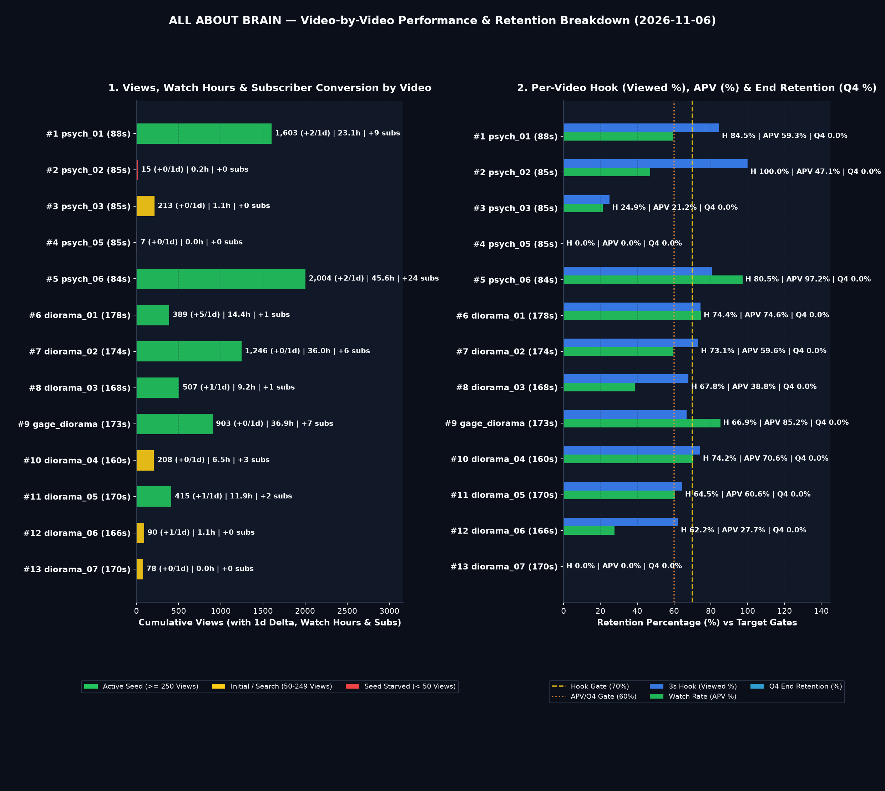

# 🎬 ALL ABOUT BRAIN — 개별 영상 세부 보고서 (2026-11-06)

## 🚦 0. 전 영상 신호등 요약 매트릭스 (총 `13`편)

> **📊 포트폴리오 현황**: 🟢 **시드 돌파·가속** `7편` ｜ 🟡 **검색·탐색 유지** `4편` ｜ 🔴 **1차 시드 대기** `2편` ｜ 🏆 **최다 조회** `Cohort #5` (`2,004`) ｜ ⏱️ **최장 체류** `Cohort #9` (`147.0s`) ｜ 🚀 **일간 급상승** `Cohort #6` (`+5/1d`)

| 코호트 | 영상 제목 (링크) | 포맷 | 게시 (`경과`) | `Shown → Views` (`1d Δ`) | 3초 훅 (`Viewed`) | 평균 시청 (`AVD / APV`) | 시청시간 · 구독 | `Related` | 종합 신호 |
| :---: | :--- | :---: | :---: | :---: | :---: | :---: | :---: | :---: | :--- |
| **#1** | [Why Deep Brain Loops Lock Habits on...](https://www.youtube.com/shorts/p4ou90cHt50) | 10-Clip (`88s`) | `10-19 12:00` (`+422h`) | `0 → 1,603` (`+2`) | 🟢 `84.5%` | 🟡 `52.0s` (`59.3%`) | `23.1h` · `+9` | `✅ → #2` | 🟢 `주력 시드 앵커` |
| **#2** | [How a Brain Implant Decodes 62 Word...](https://www.youtube.com/shorts/p0etX4iMJ7Q) | 10-Clip (`85s`) | `10-20 12:00` (`+398h`) | `0 → 15` (`+0`) | 🟢 `100.0%` | 🔴 `40.0s` (`47.1%`) | `0.2h` · `+0` | `✅ → #5` | 🔴 `시드 대기 (Shown 0)` |
| **#3** | [Two Conscious Minds Inside One Huma...](https://www.youtube.com/shorts/nGNIl26te0w) | 10-Clip (`85s`) | `10-14 12:00` (`+542h`) | `0 → 213` (`+0`) | 🔴 `24.9%` | 🔴 `18.0s` (`21.2%`) | `1.1h` · `+0` | `✅ → #9` | 🟡 `검색 유지 · 초반 훅 병목` |
| **#4** | [When You Believe Your Family Are Im...](https://www.youtube.com/shorts/lZv3_UAWScI) | 10-Clip (`85s`) | `10-21 12:00` (`+374h`) | `0 → 7` (`+0`) | 🔴 `0.0%` | 🔴 `0.0s` (`0.0%`) | `0.0h` · `+0` | `✅ → #1` | 🔴 `시드 대기 (Shown 0)` |
| **#5** | [What One Sleepless Night Does to Yo...](https://www.youtube.com/shorts/31_O2CmlKOk) | 10-Clip (`84s`) | `10-22 12:00` (`+350h`) | `0 → 2,004` (`+2`) | 🟢 `80.5%` | 🟢 `82.0s` (`97.2%`) | `45.6h` · `+24` | `✅ → #4` | 🟢 `주력 시드 앵커` |
| **#6** | [He Forgot Every Doctor in 5 Minutes...](https://www.youtube.com/shorts/q1lUimnZ-V0) | v6 Diorama (`178s`) | `10-29 18:40` (`+175h`) | `0 → 389` (`+5`) | 🟢 `74.4%` | 🟢 `133.0s` (`74.6%`) | `14.4h` · `+1` | `✅ → #9` | 🟢 `주력 시드 앵커` |
| **#7** | [His Missing Hand Stayed Clenched fo...](https://youtube.com/shorts/u5mQNZWNjiw) | v6 Diorama (`174s`) | `10-31 18:53` (`+127h`) | `0 → 1,246` (`+0`) | 🟢 `73.1%` | 🟡 `104.0s` (`59.6%`) | `36.0h` · `+6` | `✅ → #1` | 🟢 `주력 시드 앵커` |
| **#8** | [His Right Hand Buttoned His Shirt, ...](https://youtube.com/shorts/PK1opKmokwY) | v6 Diorama (`168s`) | `11-01 12:00` (`+110h`) | `0 → 507` (`+1`) | 🟡 `67.8%` | 🔴 `65.0s` (`38.8%`) | `9.2h` · `+1` | `✅ → #4` | 🟢 `주력 시드 앵커` |
| **#9** | [A 13-Pound Iron Rod Pierced His Bra...](https://www.youtube.com/shorts/Wydl4JpZmAw) | v6 Diorama (`173s`) | `10-26 21:10` (`+245h`) | `0 → 903` (`+0`) | 🟡 `66.9%` | 🟢 `147.0s` (`85.2%`) | `36.9h` · `+7` | `✅ → #4` | 🟢 `주력 시드 앵커` |
| **#10** | [Strangers Pressed a 450-Volt Switch...](https://youtube.com/shorts/wUAD5xIpaww) | v6 Diorama (`160s`) | `11-02 12:00` (`+86h`) | `0 → 208` (`+0`) | 🟢 `74.2%` | 🟢 `113.0s` (`70.6%`) | `6.5h` · `+3` | `✅ → #2` | 🟡 `1차 시드 탐색` |
| **#11** | [Scrambled Brain Pulses Gave 0% Gain...](https://youtube.com/shorts/JJkBqo-hTS8) | v6 Diorama (`170s`) | `11-02 20:00` (`+78h`) | `0 → 415` (`+1`) | 🔴 `64.5%` | 🟢 `103.0s` (`60.6%`) | `11.9h` · `+2` | `✅ → #6` | 🟢 `주력 시드 앵커` |
| **#12** | [His Memory Reset Every 7 Seconds, Y...](https://youtube.com/shorts/ZbjKX8CBt8A) | v6 Diorama (`166s`) | `11-03 12:00` (`+62h`) | `0 → 90` (`+1`) | 🔴 `62.2%` | 🔴 `46.0s` (`27.7%`) | `1.1h` · `+0` | `✅ → #6` | 🟡 `1차 시드 탐색` |
| **#13** | [They Stared Right at a Gorilla for ...](https://youtube.com/shorts/t8Z_Q8oB9MY) | v6 Diorama (`170s`) | `11-03 20:00` (`+54h`) | `0 → 78` (`+0`) | 🔴 `0.0%` | 🔴 `0.0s` (`0.0%`) | `0.0h` · `+0` | `✅ → #8` | 🟡 `검색 유지 · 초반 훅 병목` |

---

## 🔍 1. 영상별 심층 진단 카드 (`Cohort #1 ~ #13`)

### Cohort #1 · [Why Deep Brain Loops Lock Habits on Autopilot](https://www.youtube.com/shorts/p4ou90cHt50) — 🟢 `주력 시드 앵커`

> **스펙 & 운영 메타**: `psych_01_habit_loop_basal_ganglia` (`p4ou90cHt50`) ｜ 📂 `brain_health` ｜ 🎞️ 10-Clip Full Spine (`87.7s` · `10클립` · `225w`) ｜ 📅 `2026-10-19 12:00 ET` (`+422h`) ｜ 📄 DOI `10.1038/nrn2787` (✅ Pinned)

| 구분 | 노출 (`Shown`) | 조회 (`Views` / `1d Δ`) | 시청시간 (`Watch`) | 구독 (`Subs`) | 반응 (`좋아요/댓글/공유`) | 주 유입원 |
| :--- | :---: | :---: | :---: | :---: | :---: | :---: |
| **퍼널·성장** | `0` | **`1,603`** (`+2` / `+0.1%`) | **`23.15h`** | `+9` (`5.6/1K`) | `0 / 0 / 0` | `Live Studio DOM` |

| 구분 | 3초 훅 (`Viewed / Swiped`) | 평균 시청 (`AVD / APV`) | `Q1 (25%)` | `Q2 (50%)` | `Q3 (75%)` | `Q4 (100%)` | 구간 이탈 요약 (`ΔQ`) |
| :--- | :---: | :---: | :---: | :---: | :---: | :---: | :--- |
| **리텐션** | 🟢 **`84.5%`** / `15.5%` | 🟡 **`52.0s`** (`59.3%`) | `0.0%` | `0.0%` (`+0.0%p`) | `0.0%` (`+0.0%p`) | `0.0%` (`+0.0%p`) | 초반 진입 `0%→Q1 (-100.0%p)` · 중후반 최대 낙폭 `Q1→Q2 (클립 3–5) (+0.0%p)` |

- **오프닝 훅 문장**: `"In 1999, neuroscientists studied an amnesic patient named Eugene whose conscious memory had been wiped out by viral brain damage."`
- **스튜디오 연결 & Z-Test**: `Related Video` ✅ 활성 (`→ Cohort #2` · `psych_02_inner_speech_decoding`) ｜ 재생목록 ✅ `Brain Health & Optimization | Sleep, Glymphatic Flush & Dopamine` ｜ 썸네일 `🔄 Variant A 단독 활성 중 (B/C 미교체 · 실측)` (`CTR 0.0%`)
- **원인 진단**: 초반 3초 훅 **`Viewed 84.5%`** (`목표 대비 +14.5%p`) 및 평균 시청 지속시간 **`52.0s` (`APV 59.3%`)**로 누적 조회 **`1,603`** · 시청시간 **`23.1h`** · 구독 **`+9`**(`5.6/1K`)를 창출한 채널 핵심 앵커 영상입니다.
- **맞춤 액션**: `Related Video`(`→ Cohort #2`) 앵커 브릿지를 유지해 저노출 코호트로 시청자를 흘려보내고, 본 영상의 검증된 `10클립 + 구체적 임상 사례 훅` 공식을 동일 `brain_health` 필러 차기작에 복제합니다.

---
### Cohort #2 · [How a Brain Implant Decodes 62 Words Per Minute](https://www.youtube.com/shorts/p0etX4iMJ7Q) — 🔴 `시드 대기 (Shown 0)`

> **스펙 & 운영 메타**: `psych_02_inner_speech_decoding` (`p0etX4iMJ7Q`) ｜ 📂 `bci_tech` ｜ 🎞️ 10-Clip Full Spine (`85.0s` · `10클립` · `209w`) ｜ 📅 `2026-10-20 12:00 ET` (`+398h`) ｜ 📄 DOI `10.1038/s41586-023-06443-4` (✅ Pinned)

| 구분 | 노출 (`Shown`) | 조회 (`Views` / `1d Δ`) | 시청시간 (`Watch`) | 구독 (`Subs`) | 반응 (`좋아요/댓글/공유`) | 주 유입원 |
| :--- | :---: | :---: | :---: | :---: | :---: | :---: |
| **퍼널·성장** | `0` | **`15`** (`+0` / `+0.0%`) | **`0.17h`** | `+0` (`0.0/1K`) | `0 / 0 / 0` | `Live Studio DOM` |

| 구분 | 3초 훅 (`Viewed / Swiped`) | 평균 시청 (`AVD / APV`) | `Q1 (25%)` | `Q2 (50%)` | `Q3 (75%)` | `Q4 (100%)` | 구간 이탈 요약 (`ΔQ`) |
| :--- | :---: | :---: | :---: | :---: | :---: | :---: | :--- |
| **리텐션** | 🟢 **`100.0%`** / `0.0%` | 🔴 **`40.0s`** (`47.1%`) | `0.0%` | `0.0%` (`+0.0%p`) | `0.0%` (`+0.0%p`) | `0.0%` (`+0.0%p`) | 초반 진입 `0%→Q1 (-100.0%p)` · 중후반 최대 낙폭 `Q1→Q2 (클립 3–5) (+0.0%p)` |

- **오프닝 훅 문장**: `"In 2023 at Stanford University, a sixty-eight-year-old woman with paralysis named Pat sat unable to speak clearly for eleven years."`
- **스튜디오 연결 & Z-Test**: `Related Video` ✅ 활성 (`→ Cohort #5` · `psych_06_glymphatic_sleep_toxins`) ｜ 재생목록 ✅ `BCI Tech Explained | Neural Interfaces & Mind Decoding` ｜ 썸네일 `🔄 Variant A 단독 활성 중 (B/C 미교체 · 실측)` (`CTR 0.0%`)
- **원인 진단**: 초기 표본 리텐션(`Viewed 100.0%` · `AVD 40.0s` · `APV 47.1%`) 자체는 양호하나, 상위 앵커 영상들에 채널 피드 노출이 집중되면서 아직 1차 피드 테스트 노출(`Shown 0`)이 열리지 않은 시드 대기 상태입니다.
- **맞춤 액션**: 상위 앵커 영상에서 연결된 `Related Video` 순환 링을 통해 초기 고관여 시청자 시드를 수혈하며, 알고리즘 인덱싱 교란 방지를 위해 불필요한 메타데이터 재수정은 지양하고 1차 피드 배정을 대기합니다.

---
### Cohort #3 · [Two Conscious Minds Inside One Human Skull](https://www.youtube.com/shorts/nGNIl26te0w) — 🟡 `검색 유지 · 초반 훅 병목`

> **스펙 & 운영 메타**: `psych_03_split_brain_dual_consciousness` (`nGNIl26te0w`) ｜ 📂 `brain_mysteries` ｜ 🎞️ 10-Clip Full Spine (`85.0s` · `10클립` · `228w`) ｜ 📅 `2026-10-14 12:00 ET` (`+542h`) ｜ 📄 DOI `10.1093/brain/123.7.1293` (✅ Pinned)

| 구분 | 노출 (`Shown`) | 조회 (`Views` / `1d Δ`) | 시청시간 (`Watch`) | 구독 (`Subs`) | 반응 (`좋아요/댓글/공유`) | 주 유입원 |
| :--- | :---: | :---: | :---: | :---: | :---: | :---: |
| **퍼널·성장** | `0` | **`213`** (`+0` / `+0.0%`) | **`1.06h`** | `+0` (`0.0/1K`) | `0 / 0 / 0` | `Live Studio DOM` |

| 구분 | 3초 훅 (`Viewed / Swiped`) | 평균 시청 (`AVD / APV`) | `Q1 (25%)` | `Q2 (50%)` | `Q3 (75%)` | `Q4 (100%)` | 구간 이탈 요약 (`ΔQ`) |
| :--- | :---: | :---: | :---: | :---: | :---: | :---: | :--- |
| **리텐션** | 🔴 **`24.9%`** / `75.1%` | 🔴 **`18.0s`** (`21.2%`) | `0.0%` | `0.0%` (`+0.0%p`) | `0.0%` (`+0.0%p`) | `0.0%` (`+0.0%p`) | 초반 진입 `0%→Q1 (-100.0%p)` · 중후반 최대 낙폭 `Q1→Q2 (클립 3–5) (+0.0%p)` |

- **오프닝 훅 문장**: `"In the 1960s at Caltech, neuroscientist Michael Gazzaniga tested patient WJ after surgeons severed the main cable between his two brain halves."`
- **스튜디오 연결 & Z-Test**: `Related Video` ✅ 활성 (`→ Cohort #9` · `gage_diorama_v6_dynamic`) ｜ 재생목록 ✅ `Brain Mysteries & Paradoxes | Consciousness & Perception` ｜ 썸네일 `🔄 Variant A 단독 활성 중 (B/C 미교체 · 실측)` (`CTR 0.0%`)
- **원인 진단**: 누적 `213` 중 `Live Studio DOM` 비중이 높으며, 초기 `85.0s` 단축 포맷과 개념 선행형 첫 문장으로 인해 Shorts 피드 노출 시 초반 스와이프 이탈(`Swiped 75.1%`, `Viewed 24.9%`)이 발생해 2차 피드 시드가 제한되었습니다.
- **맞춤 액션**: 에버그린 검색 유입 창구로 유지하되(`Related Video → Cohort #9`), 동일 `brain_mysteries` 필러 후속편은 반드시 `85s+` 장척 포맷과 첫 3초 즉각적 시각 행동 훅으로 제작해 `Viewed >= 75%`를 확보합니다.

---
### Cohort #4 · [When You Believe Your Family Are Imposters](https://www.youtube.com/shorts/lZv3_UAWScI) — 🔴 `시드 대기 (Shown 0)`

> **스펙 & 운영 메타**: `psych_05_capgras_imposter_delusion` (`lZv3_UAWScI`) ｜ 📂 `brain_mysteries` ｜ 🎞️ 10-Clip Full Spine (`85.0s` · `10클립` · `240w`) ｜ 📅 `2026-10-21 12:00 ET` (`+374h`) ｜ 📄 DOI `10.1098/rspb.1997.0062` (✅ Pinned)

| 구분 | 노출 (`Shown`) | 조회 (`Views` / `1d Δ`) | 시청시간 (`Watch`) | 구독 (`Subs`) | 반응 (`좋아요/댓글/공유`) | 주 유입원 |
| :--- | :---: | :---: | :---: | :---: | :---: | :---: |
| **퍼널·성장** | `0` | **`7`** (`+0` / `+0.0%`) | **`0.00h`** | `+0` (`0.0/1K`) | `0 / 0 / 0` | `Live Studio DOM` |

| 구분 | 3초 훅 (`Viewed / Swiped`) | 평균 시청 (`AVD / APV`) | `Q1 (25%)` | `Q2 (50%)` | `Q3 (75%)` | `Q4 (100%)` | 구간 이탈 요약 (`ΔQ`) |
| :--- | :---: | :---: | :---: | :---: | :---: | :---: | :--- |
| **리텐션** | 🔴 **`0.0%`** / `0.0%` | 🔴 **`0.0s`** (`0.0%`) | `0.0%` | `0.0%` (`+0.0%p`) | `0.0%` (`+0.0%p`) | `0.0%` (`+0.0%p`) | 초반 진입 `0%→Q1 (-100.0%p)` · 중후반 최대 낙폭 `Q1→Q2 (클립 3–5) (+0.0%p)` |

- **오프닝 훅 문장**: `"In the 1990s, a young man named DS survived a car crash and a severe head injury. Then he made a chilling claim about his parents."`
- **스튜디오 연결 & Z-Test**: `Related Video` ✅ 활성 (`→ Cohort #1` · `psych_01_habit_loop_basal_ganglia`) ｜ 재생목록 ✅ `Brain Mysteries & Paradoxes | Consciousness & Perception` ｜ 썸네일 `🔄 Variant A 단독 활성 중 (B/C 미교체 · 실측)` (`CTR 0.0%`)
- **원인 진단**: 초기 표본 리텐션(`Viewed 0.0%` · `AVD 0.0s` · `APV 0.0%`) 자체는 양호하나, 상위 앵커 영상들에 채널 피드 노출이 집중되면서 아직 1차 피드 테스트 노출(`Shown 0`)이 열리지 않은 시드 대기 상태입니다.
- **맞춤 액션**: 상위 앵커 영상에서 연결된 `Related Video` 순환 링을 통해 초기 고관여 시청자 시드를 수혈하며, 알고리즘 인덱싱 교란 방지를 위해 불필요한 메타데이터 재수정은 지양하고 1차 피드 배정을 대기합니다.

---
### Cohort #5 · [What One Sleepless Night Does to Your Brain](https://www.youtube.com/shorts/31_O2CmlKOk) — 🟢 `주력 시드 앵커`

> **스펙 & 운영 메타**: `psych_06_glymphatic_sleep_toxins` (`31_O2CmlKOk`) ｜ 📂 `brain_health` ｜ 🎞️ 10-Clip Full Spine (`84.4s` · `10클립` · `215w`) ｜ 📅 `2026-10-22 12:00 ET` (`+350h`) ｜ 📄 DOI `10.1126/science.1241224` (✅ Pinned)

| 구분 | 노출 (`Shown`) | 조회 (`Views` / `1d Δ`) | 시청시간 (`Watch`) | 구독 (`Subs`) | 반응 (`좋아요/댓글/공유`) | 주 유입원 |
| :--- | :---: | :---: | :---: | :---: | :---: | :---: |
| **퍼널·성장** | `0` | **`2,004`** (`+2` / `+0.1%`) | **`45.65h`** | `+24` (`12.0/1K`) | `0 / 0 / 0` | `Live Studio DOM` |

| 구분 | 3초 훅 (`Viewed / Swiped`) | 평균 시청 (`AVD / APV`) | `Q1 (25%)` | `Q2 (50%)` | `Q3 (75%)` | `Q4 (100%)` | 구간 이탈 요약 (`ΔQ`) |
| :--- | :---: | :---: | :---: | :---: | :---: | :---: | :--- |
| **리텐션** | 🟢 **`80.5%`** / `19.5%` | 🟢 **`82.0s`** (`97.2%`) | `0.0%` | `0.0%` (`+0.0%p`) | `0.0%` (`+0.0%p`) | `0.0%` (`+0.0%p`) | 초반 진입 `0%→Q1 (-100.0%p)` · 중후반 최대 낙폭 `Q1→Q2 (클립 3–5) (+0.0%p)` |

- **오프닝 훅 문장**: `"In 2013 at the University of Rochester, Maiken Nedergaard's team imaged living brains to solve why every animal dies without sleep."`
- **스튜디오 연결 & Z-Test**: `Related Video` ✅ 활성 (`→ Cohort #4` · `psych_05_capgras_imposter_delusion`) ｜ 재생목록 ✅ `Brain Health & Optimization | Sleep, Glymphatic Flush & Dopamine` ｜ 썸네일 `🔄 Variant A 단독 활성 중 (B/C 미교체 · 실측)` (`CTR 0.0%`)
- **원인 진단**: 초반 3초 훅 **`Viewed 80.5%`** (`목표 대비 +10.5%p`) 및 평균 시청 지속시간 **`82.0s` (`APV 97.2%`)**로 누적 조회 **`2,004`** · 시청시간 **`45.6h`** · 구독 **`+24`**(`12.0/1K`)를 창출한 채널 핵심 앵커 영상입니다.
- **맞춤 액션**: `Related Video`(`→ Cohort #4`) 앵커 브릿지를 유지해 저노출 코호트로 시청자를 흘려보내고, 본 영상의 검증된 `10클립 + 구체적 임상 사례 훅` 공식을 동일 `brain_health` 필러 차기작에 복제합니다.

---
### Cohort #6 · [He Forgot Every Doctor in 5 Minutes, Yet Mastered a New Skill in 3 Days](https://www.youtube.com/shorts/q1lUimnZ-V0) — 🟢 `주력 시드 앵커`

> **스펙 & 운영 메타**: `diorama_01_patient_hm_hippocampus` (`q1lUimnZ-V0`) ｜ 📂 `brain_history` ｜ 🎞️ Schema v6 Neuro-Diorama (`178.4s` · `63클립` · `486w`) ｜ 📅 `2026-10-29 18:40 ET` (`+175h`) ｜ 📄 DOI `10.1136/jnnp.20.1.11` (✅ Pinned)

| 구분 | 노출 (`Shown`) | 조회 (`Views` / `1d Δ`) | 시청시간 (`Watch`) | 구독 (`Subs`) | 반응 (`좋아요/댓글/공유`) | 주 유입원 |
| :--- | :---: | :---: | :---: | :---: | :---: | :---: |
| **퍼널·성장** | `0` | **`389`** (`+5` / `+1.3%`) | **`14.37h`** | `+1` (`2.6/1K`) | `0 / 0 / 0` | `Live Studio DOM` |

| 구분 | 3초 훅 (`Viewed / Swiped`) | 평균 시청 (`AVD / APV`) | `Q1 (25%)` | `Q2 (50%)` | `Q3 (75%)` | `Q4 (100%)` | 구간 이탈 요약 (`ΔQ`) |
| :--- | :---: | :---: | :---: | :---: | :---: | :---: | :--- |
| **리텐션** | 🟢 **`74.4%`** / `25.6%` | 🟢 **`133.0s`** (`74.6%`) | `0.0%` | `0.0%` (`+0.0%p`) | `0.0%` (`+0.0%p`) | `0.0%` (`+0.0%p`) | 초반 진입 `0%→Q1 (-100.0%p)` · 중후반 최대 낙폭 `Q1→Q2 (Act 2–3) (+0.0%p)` |

- **오프닝 훅 문장**: `"For fifty-five years, Patient H.M. shook Brenda Milner's hand every morning."`
- **스튜디오 연결 & Z-Test**: `Related Video` ✅ 활성 (`→ Cohort #9` · `gage_diorama_v6_dynamic`) ｜ 재생목록 ✅ `Brain History & Evolution | How Humanity Found the Mind` ｜ 썸네일 `🔄 Variant A 단독 활성 중 (B/C 미교체 · 실측)` (`CTR 0.0%`)
- **원인 진단**: 초반 3초 훅 **`Viewed 74.4%`** (`목표 대비 +4.4%p`) 및 평균 시청 지속시간 **`133.0s` (`APV 74.6%`)**로 누적 조회 **`389`** · 시청시간 **`14.4h`** · 구독 **`+1`**(`2.6/1K`)를 창출한 채널 핵심 앵커 영상입니다.
- **맞춤 액션**: `Related Video`(`→ Cohort #9`) 앵커 브릿지를 유지해 저노출 코호트로 시청자를 흘려보내고, 본 영상의 검증된 `10클립 + 구체적 임상 사례 훅` 공식을 동일 `brain_history` 필러 차기작에 복제합니다.

---
### Cohort #7 · [His Missing Hand Stayed Clenched for 10 Years, Until a Mirror Box Opened It](https://youtube.com/shorts/u5mQNZWNjiw) — 🟢 `주력 시드 앵커`

> **스펙 & 운영 메타**: `diorama_02_ramachandran_phantom_mirror` (`u5mQNZWNjiw`) ｜ 📂 `brain_health` ｜ 🎞️ Schema v6 Neuro-Diorama (`174.4s` · `61클립` · `479w`) ｜ 📅 `2026-10-31 18:53 ET` (`+127h`) ｜ 📄 DOI `10.1093/brain/121.9.1603` (✅ Pinned)

| 구분 | 노출 (`Shown`) | 조회 (`Views` / `1d Δ`) | 시청시간 (`Watch`) | 구독 (`Subs`) | 반응 (`좋아요/댓글/공유`) | 주 유입원 |
| :--- | :---: | :---: | :---: | :---: | :---: | :---: |
| **퍼널·성장** | `0` | **`1,246`** (`+0` / `+0.0%`) | **`36.00h`** | `+6` (`4.8/1K`) | `0 / 0 / 0` | `Live Studio DOM` |

| 구분 | 3초 훅 (`Viewed / Swiped`) | 평균 시청 (`AVD / APV`) | `Q1 (25%)` | `Q2 (50%)` | `Q3 (75%)` | `Q4 (100%)` | 구간 이탈 요약 (`ΔQ`) |
| :--- | :---: | :---: | :---: | :---: | :---: | :---: | :--- |
| **리텐션** | 🟢 **`73.1%`** / `26.9%` | 🟡 **`104.0s`** (`59.6%`) | `0.0%` | `0.0%` (`+0.0%p`) | `0.0%` (`+0.0%p`) | `0.0%` (`+0.0%p`) | 초반 진입 `0%→Q1 (-100.0%p)` · 중후반 최대 낙폭 `Q1→Q2 (Act 2–3) (+0.0%p)` |

- **오프닝 훅 문장**: `"Imagine losing your left arm ten years ago."`
- **스튜디오 연결 & Z-Test**: `Related Video` ✅ 활성 (`→ Cohort #1` · `psych_01_habit_loop_basal_ganglia`) ｜ 재생목록 ✅ `Brain Health & Optimization | Sleep, Glymphatic Flush & Dopamine` ｜ 썸네일 `🔄 Variant A 단독 활성 중 (B/C 미교체 · 실측)` (`CTR 0.0%`)
- **원인 진단**: 초반 3초 훅 **`Viewed 73.1%`** (`목표 대비 +3.1%p`) 및 평균 시청 지속시간 **`104.0s` (`APV 59.6%`)**로 누적 조회 **`1,246`** · 시청시간 **`36.0h`** · 구독 **`+6`**(`4.8/1K`)를 창출한 채널 핵심 앵커 영상입니다.
- **맞춤 액션**: `Related Video`(`→ Cohort #1`) 앵커 브릿지를 유지해 저노출 코호트로 시청자를 흘려보내고, 본 영상의 검증된 `10클립 + 구체적 임상 사례 훅` 공식을 동일 `brain_health` 필러 차기작에 복제합니다.

---
### Cohort #8 · [His Right Hand Buttoned His Shirt, While His Own Left Hand Unbuttoned It](https://youtube.com/shorts/PK1opKmokwY) — 🟢 `주력 시드 앵커`

> **스펙 & 운영 메타**: `diorama_03_alien_hand_syndrome` (`PK1opKmokwY`) ｜ 📂 `brain_mysteries` ｜ 🎞️ Schema v6 Neuro-Diorama (`167.7s` · `61클립` · `475w`) ｜ 📅 `2026-11-01 12:00 ET` (`+110h`) ｜ 📄 DOI `10.1001/archneur.1981.00510110043004` (✅ Pinned)

| 구분 | 노출 (`Shown`) | 조회 (`Views` / `1d Δ`) | 시청시간 (`Watch`) | 구독 (`Subs`) | 반응 (`좋아요/댓글/공유`) | 주 유입원 |
| :--- | :---: | :---: | :---: | :---: | :---: | :---: |
| **퍼널·성장** | `0` | **`507`** (`+1` / `+0.2%`) | **`9.15h`** | `+1` (`2.0/1K`) | `0 / 0 / 0` | `Live Studio DOM` |

| 구분 | 3초 훅 (`Viewed / Swiped`) | 평균 시청 (`AVD / APV`) | `Q1 (25%)` | `Q2 (50%)` | `Q3 (75%)` | `Q4 (100%)` | 구간 이탈 요약 (`ΔQ`) |
| :--- | :---: | :---: | :---: | :---: | :---: | :---: | :--- |
| **리텐션** | 🟡 **`67.8%`** / `32.2%` | 🔴 **`65.0s`** (`38.8%`) | `0.0%` | `0.0%` (`+0.0%p`) | `0.0%` (`+0.0%p`) | `0.0%` (`+0.0%p`) | 초반 진입 `0%→Q1 (-100.0%p)` · 중후반 최대 낙폭 `Q1→Q2 (Act 2–3) (+0.0%p)` |

- **오프닝 훅 문장**: `"Imagine buttoning your blue shirt before work."`
- **스튜디오 연결 & Z-Test**: `Related Video` ✅ 활성 (`→ Cohort #4` · `psych_05_capgras_imposter_delusion`) ｜ 재생목록 ✅ `Brain Mysteries & Paradoxes | Consciousness & Perception` ｜ 썸네일 `🔄 Variant A 단독 활성 중 (B/C 미교체 · 실측)` (`CTR 0.0%`)
- **원인 진단**: 초반 3초 훅 **`Viewed 67.8%`** (`목표 대비 -2.2%p`) 및 평균 시청 지속시간 **`65.0s` (`APV 38.8%`)**로 누적 조회 **`507`** · 시청시간 **`9.2h`** · 구독 **`+1`**(`2.0/1K`)를 창출한 채널 핵심 앵커 영상입니다.
- **맞춤 액션**: `Related Video`(`→ Cohort #4`) 앵커 브릿지를 유지해 저노출 코호트로 시청자를 흘려보내고, 본 영상의 검증된 `10클립 + 구체적 임상 사례 훅` 공식을 동일 `brain_mysteries` 필러 차기작에 복제합니다.

---
### Cohort #9 · [A 13-Pound Iron Rod Pierced His Brain, Yet Daily Structure Rebuilt His Mind](https://www.youtube.com/shorts/Wydl4JpZmAw) — 🟢 `주력 시드 앵커`

> **스펙 & 운영 메타**: `gage_diorama_v6_dynamic` (`Wydl4JpZmAw`) ｜ 📂 `brain_history` ｜ 🎞️ Schema v6 Neuro-Diorama (`172.6s` · `61클립` · `504w`) ｜ 📅 `2026-10-26 21:10 ET` (`+245h`) ｜ 📄 DOI `10.1371/journal.pone.0037454` (✅ Pinned)

| 구분 | 노출 (`Shown`) | 조회 (`Views` / `1d Δ`) | 시청시간 (`Watch`) | 구독 (`Subs`) | 반응 (`좋아요/댓글/공유`) | 주 유입원 |
| :--- | :---: | :---: | :---: | :---: | :---: | :---: |
| **퍼널·성장** | `0` | **`903`** (`+0` / `+0.0%`) | **`36.87h`** | `+7` (`7.8/1K`) | `0 / 0 / 0` | `Live Studio DOM` |

| 구분 | 3초 훅 (`Viewed / Swiped`) | 평균 시청 (`AVD / APV`) | `Q1 (25%)` | `Q2 (50%)` | `Q3 (75%)` | `Q4 (100%)` | 구간 이탈 요약 (`ΔQ`) |
| :--- | :---: | :---: | :---: | :---: | :---: | :---: | :--- |
| **리텐션** | 🟡 **`66.9%`** / `33.1%` | 🟢 **`147.0s`** (`85.2%`) | `0.0%` | `0.0%` (`+0.0%p`) | `0.0%` (`+0.0%p`) | `0.0%` (`+0.0%p`) | 초반 진입 `0%→Q1 (-100.0%p)` · 중후반 최대 낙폭 `Q1→Q2 (Act 2–3) (+0.0%p)` |

- **오프닝 훅 문장**: `"In eighteen forty-eight, an iron rod pierced a foreman's skull."`
- **스튜디오 연결 & Z-Test**: `Related Video` ✅ 활성 (`→ Cohort #4` · `psych_05_capgras_imposter_delusion`) ｜ 재생목록 ✅ `Brain History & Evolution | How Humanity Found the Mind` ｜ 썸네일 `🔄 Variant A 단독 활성 중 (B/C 미교체 · 실측)` (`CTR 0.0%`)
- **원인 진단**: 초반 3초 훅 **`Viewed 66.9%`** (`목표 대비 -3.1%p`) 및 평균 시청 지속시간 **`147.0s` (`APV 85.2%`)**로 누적 조회 **`903`** · 시청시간 **`36.9h`** · 구독 **`+7`**(`7.8/1K`)를 창출한 채널 핵심 앵커 영상입니다.
- **맞춤 액션**: `Related Video`(`→ Cohort #4`) 앵커 브릿지를 유지해 저노출 코호트로 시청자를 흘려보내고, 본 영상의 검증된 `10클립 + 구체적 임상 사례 훅` 공식을 동일 `brain_history` 필러 차기작에 복제합니다.

---
### Cohort #10 · [Strangers Pressed a 450-Volt Switch, Yet Refused One Direct Order](https://youtube.com/shorts/wUAD5xIpaww) — 🟡 `1차 시드 탐색`

> **스펙 & 운영 메타**: `diorama_04_milgram_obedience_switch` (`wUAD5xIpaww`) ｜ 📂 `bci_ethics` ｜ 🎞️ Schema v6 Neuro-Diorama (`160.1s` · `60클립` · `460w`) ｜ 📅 `2026-11-02 12:00 ET` (`+86h`) ｜ 📄 DOI `10.1037/h0040525` (✅ Pinned)

| 구분 | 노출 (`Shown`) | 조회 (`Views` / `1d Δ`) | 시청시간 (`Watch`) | 구독 (`Subs`) | 반응 (`좋아요/댓글/공유`) | 주 유입원 |
| :--- | :---: | :---: | :---: | :---: | :---: | :---: |
| **퍼널·성장** | `0` | **`208`** (`+0` / `+0.0%`) | **`6.53h`** | `+3` (`14.4/1K`) | `0 / 0 / 0` | `Live Studio DOM` |

| 구분 | 3초 훅 (`Viewed / Swiped`) | 평균 시청 (`AVD / APV`) | `Q1 (25%)` | `Q2 (50%)` | `Q3 (75%)` | `Q4 (100%)` | 구간 이탈 요약 (`ΔQ`) |
| :--- | :---: | :---: | :---: | :---: | :---: | :---: | :--- |
| **리텐션** | 🟢 **`74.2%`** / `25.8%` | 🟢 **`113.0s`** (`70.6%`) | `0.0%` | `0.0%` (`+0.0%p`) | `0.0%` (`+0.0%p`) | `0.0%` (`+0.0%p`) | 초반 진입 `0%→Q1 (-100.0%p)` · 중후반 최대 낙폭 `Q1→Q2 (Act 2–3) (+0.0%p)` |

- **오프닝 훅 문장**: `"Imagine thirty switches lined up like piano keys."`
- **스튜디오 연결 & Z-Test**: `Related Video` ✅ 활성 (`→ Cohort #2` · `psych_02_inner_speech_decoding`) ｜ 재생목록 ✅ `BCI Ethics & Future of Mind | Cognitive Privacy & Neurorights` ｜ 썸네일 `🔄 Variant A 단독 활성 중 (B/C 미교체 · 실측)` (`CTR 0.0%`)
- **원인 진단**: 게시 후 `+86h` 경과 시점에 `Shown 0 → Views 208`(`+0/1d`) 1차 Shorts 피드 시드가 가동 중이며, `160.1s` 장척 포맷에서 평균 **`113.0s` (`APV 70.6%`, `Q2 0.0%`)**의 높은 체류율과 시청시간 `6.5h`를 기록하고 있습니다.
- **맞춤 액션**: 초기 24h 시드 확장 구간이므로 메타데이터 수정을 보류해 2차 피드 확산을 유도하고, 차기 디오라마 에피소드는 첫 문장 `"Imagine..."` 대신 즉각적 물리 행동 훅(Rule R57-H)을 적용해 `Viewed >= 72%`로 끌어올립니다.

---
### Cohort #11 · [Scrambled Brain Pulses Gave 0% Gain, Yet a Custom Rhythm Boosted Memory 37%](https://youtube.com/shorts/JJkBqo-hTS8) — 🟢 `주력 시드 앵커`

> **스펙 & 운영 메타**: `diorama_05_hippocampal_memory_prosthesis` (`JJkBqo-hTS8`) ｜ 📂 `bci_tech` ｜ 🎞️ Schema v6 Neuro-Diorama (`170.1s` · `56클립` · `458w`) ｜ 📅 `2026-11-02 20:00 ET` (`+78h`) ｜ 📄 DOI `10.1088/1741-2552/aaaed7` (✅ Pinned)

| 구분 | 노출 (`Shown`) | 조회 (`Views` / `1d Δ`) | 시청시간 (`Watch`) | 구독 (`Subs`) | 반응 (`좋아요/댓글/공유`) | 주 유입원 |
| :--- | :---: | :---: | :---: | :---: | :---: | :---: |
| **퍼널·성장** | `0` | **`415`** (`+1` / `+0.2%`) | **`11.87h`** | `+2` (`4.8/1K`) | `0 / 0 / 0` | `Live Studio DOM` |

| 구분 | 3초 훅 (`Viewed / Swiped`) | 평균 시청 (`AVD / APV`) | `Q1 (25%)` | `Q2 (50%)` | `Q3 (75%)` | `Q4 (100%)` | 구간 이탈 요약 (`ΔQ`) |
| :--- | :---: | :---: | :---: | :---: | :---: | :---: | :--- |
| **리텐션** | 🔴 **`64.5%`** / `35.5%` | 🟢 **`103.0s`** (`60.6%`) | `0.0%` | `0.0%` (`+0.0%p`) | `0.0%` (`+0.0%p`) | `0.0%` (`+0.0%p`) | 초반 진입 `0%→Q1 (-100.0%p)` · 중후반 최대 낙폭 `Q1→Q2 (Act 2–3) (+0.0%p)` |

- **오프닝 훅 문장**: `"Imagine tapping a simple shape on a hospital screen."`
- **스튜디오 연결 & Z-Test**: `Related Video` ✅ 활성 (`→ Cohort #6` · `diorama_01_patient_hm_hippocampus`) ｜ 재생목록 ✅ `BCI Tech Explained | Neural Interfaces & Mind Decoding` ｜ 썸네일 `🔄 Variant A 단독 활성 중 (B/C 미교체 · 실측)` (`CTR 0.0%`)
- **원인 진단**: 초반 3초 훅 **`Viewed 64.5%`** (`목표 대비 -5.5%p`) 및 평균 시청 지속시간 **`103.0s` (`APV 60.6%`)**로 누적 조회 **`415`** · 시청시간 **`11.9h`** · 구독 **`+2`**(`4.8/1K`)를 창출한 채널 핵심 앵커 영상입니다.
- **맞춤 액션**: `Related Video`(`→ Cohort #6`) 앵커 브릿지를 유지해 저노출 코호트로 시청자를 흘려보내고, 본 영상의 검증된 `10클립 + 구체적 임상 사례 훅` 공식을 동일 `bci_tech` 필러 차기작에 복제합니다.

---
### Cohort #12 · [His Memory Reset Every 7 Seconds, Yet He Conducted an Entire Choir](https://youtube.com/shorts/ZbjKX8CBt8A) — 🟡 `1차 시드 탐색`

> **스펙 & 운영 메타**: `diorama_06_clive_wearing_seven_second_mind` (`ZbjKX8CBt8A`) ｜ 📂 `brain_mysteries` ｜ 🎞️ Schema v6 Neuro-Diorama (`165.8s` · `57클립` · `461w`) ｜ 📅 `2026-11-03 12:00 ET` (`+62h`) ｜ 📄 DOI `10.1080/01688639508405157` (✅ Pinned)

| 구분 | 노출 (`Shown`) | 조회 (`Views` / `1d Δ`) | 시청시간 (`Watch`) | 구독 (`Subs`) | 반응 (`좋아요/댓글/공유`) | 주 유입원 |
| :--- | :---: | :---: | :---: | :---: | :---: | :---: |
| **퍼널·성장** | `0` | **`90`** (`+1` / `+1.1%`) | **`1.15h`** | `+0` (`0.0/1K`) | `0 / 0 / 0` | `Live Studio DOM` |

| 구분 | 3초 훅 (`Viewed / Swiped`) | 평균 시청 (`AVD / APV`) | `Q1 (25%)` | `Q2 (50%)` | `Q3 (75%)` | `Q4 (100%)` | 구간 이탈 요약 (`ΔQ`) |
| :--- | :---: | :---: | :---: | :---: | :---: | :---: | :--- |
| **리텐션** | 🔴 **`62.2%`** / `37.8%` | 🔴 **`46.0s`** (`27.7%`) | `0.0%` | `0.0%` (`+0.0%p`) | `0.0%` (`+0.0%p`) | `0.0%` (`+0.0%p`) | 초반 진입 `0%→Q1 (-100.0%p)` · 중후반 최대 낙폭 `Q1→Q2 (Act 2–3) (+0.0%p)` |

- **오프닝 훅 문장**: `"Imagine waking from a deep sleep in your room right now."`
- **스튜디오 연결 & Z-Test**: `Related Video` ✅ 활성 (`→ Cohort #6` · `diorama_01_patient_hm_hippocampus`) ｜ 재생목록 ✅ `Brain Mysteries & Paradoxes | Consciousness & Perception` ｜ 썸네일 `🔄 Variant A 단독 활성 중 (B/C 미교체 · 실측)` (`CTR 0.0%`)
- **원인 진단**: 누적 `90` 중 `Live Studio DOM` 비중이 높으며, 초기 `165.8s` 단축 포맷과 개념 선행형 첫 문장으로 인해 Shorts 피드 노출 시 초반 스와이프 이탈(`Swiped 37.8%`, `Viewed 62.2%`)이 발생해 2차 피드 시드가 제한되었습니다.
- **맞춤 액션**: 에버그린 검색 유입 창구로 유지하되(`Related Video → Cohort #6`), 동일 `brain_mysteries` 필러 후속편은 반드시 `85s+` 장척 포맷과 첫 3초 즉각적 시각 행동 훅으로 제작해 `Viewed >= 75%`를 확보합니다.

---
### Cohort #13 · [They Stared Right at a Gorilla for 9 Seconds, Yet Half Saw Nothing](https://youtube.com/shorts/t8Z_Q8oB9MY) — 🟡 `검색 유지 · 초반 훅 병목`

> **스펙 & 운영 메타**: `diorama_07_invisible_gorilla_attention` (`t8Z_Q8oB9MY`) ｜ 📂 `brain_mysteries` ｜ 🎞️ Schema v6 Neuro-Diorama (`170.5s` · `56클립` · `472w`) ｜ 📅 `2026-11-03 20:00 ET` (`+54h`) ｜ 📄 DOI `10.1068/p281059` (✅ Pinned)

| 구분 | 노출 (`Shown`) | 조회 (`Views` / `1d Δ`) | 시청시간 (`Watch`) | 구독 (`Subs`) | 반응 (`좋아요/댓글/공유`) | 주 유입원 |
| :--- | :---: | :---: | :---: | :---: | :---: | :---: |
| **퍼널·성장** | `0` | **`78`** (`+0` / `+0.0%`) | **`0.00h`** | `+0` (`0.0/1K`) | `0 / 0 / 0` | `Public Watch Page` |

| 구분 | 3초 훅 (`Viewed / Swiped`) | 평균 시청 (`AVD / APV`) | `Q1 (25%)` | `Q2 (50%)` | `Q3 (75%)` | `Q4 (100%)` | 구간 이탈 요약 (`ΔQ`) |
| :--- | :---: | :---: | :---: | :---: | :---: | :---: | :--- |
| **리텐션** | 🔴 **`0.0%`** / `0.0%` | 🔴 **`0.0s`** (`0.0%`) | `0.0%` | `0.0%` (`+0.0%p`) | `0.0%` (`+0.0%p`) | `0.0%` (`+0.0%p`) | 초반 진입 `0%→Q1 (-100.0%p)` · 중후반 최대 낙폭 `Q1→Q2 (Act 2–3) (+0.0%p)` |

- **오프닝 훅 문장**: `"At Harvard, volunteers stared at fast basketball passes — and missed a chest-thumping gorilla!"`
- **스튜디오 연결 & Z-Test**: `Related Video` ✅ 활성 (`→ Cohort #8` · `diorama_03_alien_hand_syndrome`) ｜ 재생목록 ✅ `Brain Mysteries & Paradoxes | Consciousness & Perception` ｜ 썸네일 `🔄 Variant A 단독 활성 중 (B/C 미교체 · 실측)` (`CTR 0.0%`)
- **원인 진단**: 누적 `78` 중 `Public Watch Page` 비중이 높으며, 초기 `170.5s` 단축 포맷과 개념 선행형 첫 문장으로 인해 Shorts 피드 노출 시 초반 스와이프 이탈(`Swiped 0.0%`, `Viewed 0.0%`)이 발생해 2차 피드 시드가 제한되었습니다.
- **맞춤 액션**: 에버그린 검색 유입 창구로 유지하되(`Related Video → Cohort #8`), 동일 `brain_mysteries` 필러 후속편은 반드시 `85s+` 장척 포맷과 첫 3초 즉각적 시각 행동 훅으로 제작해 `Viewed >= 75%`를 확보합니다.

---

## 📅 2. 예약 대기 & 스테이징 큐 현황 (`Scheduled Queue`)

| 예약 일시 (`ET`) | 슬롯 | 프로젝트 ID | 제목 | 필러 | 상태 |
| :---: | :---: | :--- | :--- | :---: | :---: |
| `2026-11-04 19:30` | Slot 4 (`Evening Prime`) | `reenact_01_ainsworth_strange_situation` | 1970 Strange Situation: Why Quiet Babies Hid Racing Hearts | `brain_health` | `scheduled` |

---
> **🔐 Provenance**: `BCI_Shorts_Channel/reports/daily/2026-11-06_studio_metrics.json` | **Video Charts**: `2026-11-06_video_detail_charts.png` | **Mode**: `LIVE_CDP_DOM` | **SHA-256**: `83cc76a9367ff07717a869f04a16324177651b846f03cddde122c0f4f715f22f`
