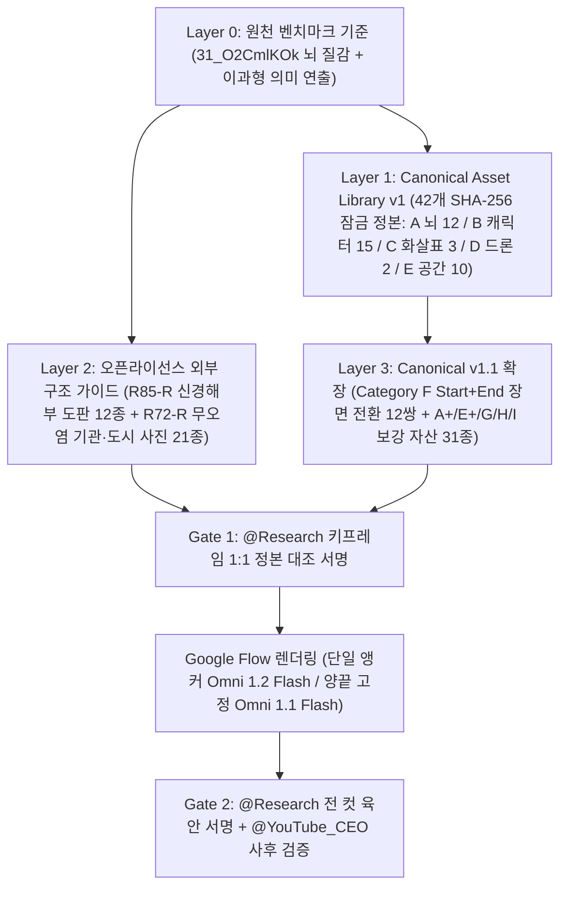

# ALL ABOUT BRAIN — 전체 레퍼런스 마스터 종합 보고서 (`Master Reference Compendium`)

채널 `@AllAboutBrainOfficial`의 모든 에피소드 기획·키프레임 생성·영상 렌더링·검수에 공통 적용되는 **전체 레퍼런스 체계(원천 벤치마크 · 고정 시각 자산 `v1` 42정본 · 학술/실세계 오픈라이선스 도판 33종 · 장면 전환 및 확장 자산 `v1.1` 43종)**를 하나로 통합한 공식 기준 문서입니다.

> [!IMPORTANT]
> **전역 레퍼런스 잠금 현황 (`SHA-256` Hard Lock 적용 완료)**
> - **정본 저장소**: [manifest.json](file:///home/canadaofbin/gdrive/Kyubin_Yun_Workspace/07_Youtube/BCI_Shorts_Channel/canonical_assets/v1/manifest.json) (`42`개 승인 정본 `SHA-256` 잠금 완료 — 뇌 `A01~A12`는 **2번 열 `cand_02.png`**, 캐릭터·화살표·드론·공간 `B~E`는 **1순위 `cand_01.png`**)
> - **확장 설계서 (`v1.1`)**: [canonical_v1_1_spec.json](file:///home/canadaofbin/gdrive/Kyubin_Yun_Workspace/07_Youtube/.agents/research/canonical_v1_1_spec.json) (`Category F` 장면 전환 `12`쌍 + 보강 기반 자산 `31`종 = `43`슬롯)
> - **외부 학술·실세계 감사 원장**: [r85_verified_data_and_reference_audit.json](file:///home/canadaofbin/gdrive/Kyubin_Yun_Workspace/07_Youtube/.agents/research/r85_verified_data_and_reference_audit.json) (무문자 신경해부 도판 `12`종 + 실세계 랜드마크/장비 `21`종)
> - **영구 아카이브 색인**: [INDEX_2026-11-18_R85_R86_CANONICAL.md](file:///home/canadaofbin/gdrive/Kyubin_Yun_Workspace/07_Youtube/artifacts_archive/INDEX_2026-11-18_R85_R86_CANONICAL.md)

---

## 1. 전체 레퍼런스 아키텍처 한눈에 보기 (`4-Layer Reference System`)



---

## 2. Layer 0 — 2대 원천 벤치마크 레퍼런스 (`Origin Benchmarks`)

````carousel

<!-- slide -->

````

| 원천 레퍼런스 | 참조 원본 문서 | 핵심 추출 규칙 (채널 영구 고정) | 절대 금지 항목 |
|---|---|---|---|
| **① `31_O2CmlKOk` 시그니처 뇌 메커니즘** (`Rule R85`) | [four_videos_94cuts_full_audit_and_31brain_restoration.md](file:///home/canadaofbin/gdrive/Kyubin_Yun_Workspace/07_Youtube/artifacts_archive/01_YouTube_CEO/four_videos_94cuts_full_audit_and_31brain_restoration.md) | • **뇌 재질**: 노란기·푸른기 없는 밝은 쿨 매트 백색 석고(`#DCDFE3~#ECEFF2`)<br/>• **혈관**: 표면 위로 가지를 치며 퍼지는 **굵고 불투명한 하늘색(`#27D8FF`) 원통 혈관 그물**<br/>• **Mode 1 두상**: 밝은 펄그레이 마네킹 흉상 + 상부 두개골 투명 투시<br/>• **기능 강조**: 대상 해부 구조물 자체를 단색 매트 재질로 채색 + 단색 진남색(`#040711`) 배경 | 수작업 `Blender` 회색 찰흙 메쉬 노출, 입자·스파크·불꽃·네온 번개선·발광 후광·연기·안구 서치라이트 빛줄기, 검은 유리 두상 |
| **② 『이과형』 의미 기반 연출** (`Rule R86`) | [r86_igwahyung_teardown_and_beat_card_report.md](file:///home/canadaofbin/gdrive/Kyubin_Yun_Workspace/07_Youtube/artifacts_archive/03_Research/r86_igwahyung_teardown_and_beat_card_report.md) | • **`1문장 = 1시각 이해`**: 명사 나열이 아닌 문장의 주장(`claim`)과 변화량(`state_delta`) 시각화<br/>• **계층 교대**: 실험 행동 `story`(2.5D 비닐) ↔ 원리·비교 `diagram`(뇌·화살표·차트, 무배경)<br/>• **비유 연속성**: 동일 비유 소품 `3~5`컷 유지 후 공유 형태(`bridge_element`)로 해부 복귀<br/>• **반전 3단계**: 통념 물리 오브제 → 기각 → 진짜 원리 씨앗 동시 제시 | 화풍·캐릭터·유행어 복제, 모눈종이 한글 텍스트 카드, 의미 없는 장식(`decorative`) 컷, 변화 없는 동일 뇌 반복(`Zero-Delta`), 편당 `3`컷 이상 단순 리액션 |

---

## 3. Layer 1 — 고정 시각 자산 라이브러리 `Canonical v1` (`42`개 승인 정본 전수 도감)

모든 에피소드의 스타일·캐스트·화살표·드론·공간 앵커는 [canonical_assets.py](file:///home/canadaofbin/gdrive/Kyubin_Yun_Workspace/07_Youtube/pipeline/canonical_assets.py)를 통해 아래 **`42`개 `SHA-256` 잠금 정본 파일에서만 로드**됩니다(구형 파생 이미지 참조 시 즉시 에러 발생).

````carousel

<!-- slide -->

<!-- slide -->

````

### 3.1 Category A — 시그니처 뇌 정본 `12`종 (`전원 cand_02.png 확정`)
| 슬롯 ID | 정본 파일 · `SHA-256` 앞 12자 | 핵심 시각 명세 | 언제 사용하는가 (`1줄 사용 규칙`) |
|---|---|---|---|
| `A01_mode1_translucent_head_lateral` | `cand_02.png` (`937d0cb741f4`) | 밝은 펄그레이 마네킹 흉상 + 상부 투명 두개골 속 뇌·혈관 (측면) | 인간 일상 서사에서 뇌 메커니즘으로 첫 진입할 때(`Mode 1` 투시 입구 컷) |
| `A02_mode2_whole_brain_lateral` | `cand_02.png` (`b55cc9ee4f71`) | 전체 대뇌 외측면, 무광 백색 석고 + 굵은 하늘색 분지 혈관 그물 | 외측 피질·고랑 혈관 흐름을 설명하는 기본 전체 뇌 앵커 |
| `A03_mode2_whole_brain_dorsal_topdown` | `cand_02.png` (`0d15874576e1`) | 좌·우 반구 대칭 상면(`Top-Down`), 동일 좌상단 고휘도 조명 | 좌뇌 vs 우뇌 비교 또는 양측 피질 전반의 혈류·세척 조망 |
| `A04_mode2_whole_brain_anterior_frontal` | `cand_02.png` (`26be7e75ef18`) | 양측 전두엽·측두엽 정면(`Anterior`) 대칭 구도 | 정면 대칭 구도 및 관상단면(`Coronal`) 진입 직전 기준 뇌 |
| `A05_sulcal_vessel_macro` | `cand_02.png` (`f9d7c46cdc1b`) | 두 백색 석고 이랑 사이 굵은 불투명 하늘색 Y자 원통 혈관 매크로 | 뇌혈관 수축·뇌척수액(`CSF`) 유입·고랑 미세혈관 초근접 클로즈업 |
| `A06_hippocampus_cutaway` | `cand_02.png` (`db19b9237ac5`) | 외측 하방 측두엽 절개창 속 매트 황금 해마 노출 (`뇌량 오표기 차단`) | 기억·공간 학습·경계 세포 등 해마(`Hippocampus`) 관련 모든 측면 컷 |
| `A07_thalamus_brainstem_midsagittal` | `cand_02.png` (`3ca5ca87ee85`) | 정중시상 단면 속 중앙 시상 코어 + 뇌간 기둥 + 뇌량 분리 노출 | 수면 각성·통증 하행 억제·시상(`Thalamus`)·뇌간(`Brainstem`) 정중 단면 |
| `A08_insula_operculum_retracted` | `cand_02.png` (`79fb690e1bc2`) | 외측 실비우스열 덮개(`Operculum`)를 젖혀 노출한 심부 섬엽 (`정중시상 금지`) | 통증·내수용감각·혐오·직관 등 섬엽(`Insula`) 설명 전용 앵커 |
| `A09_prefrontal_cortex_3q_anterolateral` | `cand_02.png` (`839395292d05`) | `3/4` 전외측 시점, 전전두엽 구역 단색 매트 황금 강조 | 자기통제·의사결정·위약 예측·실행기능 등 전전두엽(`PFC`) 활성/억제 |
| `A10_signal_segment_sample` | `cand_02.png` (`bdfad9571415`) | 고랑 경로 내부의 짧고 불투명한 단색 금색 구간 (`입자·번개·발광 0%`) | 뇌 영역 간 신경 신호 전달을 무이펙트 단색 이동으로 표현할 때 |
| `A11_region_shutdown_sample` | `cand_02.png` (`d03028c7027f`) | 백색 뇌 위에서 목표 구역만 단색 매트 슬레이트로 불 꺼진 대조 | 수면 부족·약물 억제·기능 저하·회백질 위축 등 구역 `Shutdown` 표현 |
| `A12_dual_brain_top_bottom_compare` | `cand_02.png` (`7d936ebbd227`) | 진남색 단일 배경 위 상단(활성) vs 하단(억제/기본) 온전한 2개 뇌 (`이음매 0%`) | 실험군 vs 대조군 두 뇌의 부피·활성 차이를 한 화면에서 비교할 때 |

### 3.2 Category B — 2.5D 대머리 크림 비닐 캐릭터 정본 `15`종 (`전원 cand_01.png 확정`)
| 구분 | 슬롯 ID (`SHA` 앞 8자) | 역할 및 모듈 결합 규칙 (`성인 4.2등신 · 아동 3.2등신 · 모발/실사피부 0%`) |
|---|---|---|
| **기본 체형 (`4`)** | `B01` 성인 남 (`308d295d`) · `B02` 성인 여 (`34fc7bf2`) · `B03` 노인 (`16c39e9d`) · `B04` 아동 (`1251a02b`) | 정면·`3/4`·측면 3각도 턴어라운드 기준 시트. 아래 표정(`B05~B10`)·의상(`B11~B15`)을 갈아입히는 1차 체형 앵커 |
| **2D 먹선 표정 (`6`)** | `B05` 놀람 (`097d3b30`) · `B06` 기쁨 (`cd4b7db2`) · `B07` 걱정 (`b4df384b`) · `B08` 집중 (`c82a743c`) · `B09` 혼란 (`da4c7a64`) · `B10` 유레카 (`6d2b523d`) | 실사 주름·3D 홍채 없이 순수 2D 검은 먹선 눈·눈썹·입만으로 감정을 전달하는 클로즈업 표정 기준 |
| **표준 무문자 의상 (`5`)** | `B11` 흰 가운 (`88b96940`) · `B12` 청록 수술복 (`7d08a645`) · `B13` 일상복 (`42ff22f7`) · `B14` 정장 (`a9dfc59c`) · `B15` 학생복 (`d5e55e1d`) | 명찰·로고·글자가 `0%`인 역할별 전신 의상 시트 (`4.2등신` 단일 비율 고정) |

### 3.3 Categories C · D · E — 대조 화살표(`3`) · 상공 드론(`2`) · 반복 공간(`10`) (`전원 cand_01.png 확정`)
| 분류 | 슬롯 ID (`SHA` 앞 8자) | 핵심 구도 & 사용 규칙 |
|---|---|---|
| **C. `R80` `#FF2525` 화살표** | `C01` 직선 (`e0eadd91`) · `C02` 지그재그 (`f061e40b`) · `C03` 문턱 단절 (`578089d2`) | `90°` 수직 탑다운 입체 화살표. 고정 노선(`C01`) vs 복잡 우회(`C02`) vs 경계 단절 틈(`C03`, `Omni 1.1` 양끝 고정 필수) |
| **D. `120ft` 상공 드론** | `D01` 대학 캠퍼스 (`1f84b4b1`) · `D02` 임상 대학병원 (`a0b9a9e6`) | 오프닝(`S01~S04`) 연구기관 실제 상공 항공 부감 구도 기준 (`지상 인물은 작은 점 크기`, 주변부 인위 블러 `0%`) |
| **E. 반복 공간 (`빈 방 + 인물판`)** | `E01/E06` 연구실 (`a55af79f`/`70959a2a`) · `E02/E07` MRI실 (`b5a00545`/`4cfbfb17`) · `E03/E08` 집 문턱 (`9c17b36c`/`8cc337fa`) · `E04/E09` 강의실 (`fc39173b`/`a355bc14`) · `E05/E10` 주방 (`667897ef`/`12a8078b`) | 따뜻한 실사풍 자연광 실내. `E01~E05`는 원하는 인원·소품을 배치하는 **무인 빈 배경판**, `E06~E10`은 동일 방 `1:1` 인물 스케일 기준판 |

---

## 4. Layer 2 — 검증 완료 외부 오픈라이선스 구조 레퍼런스 (`R85-R` 해부 `12`종 & `R72-R` 실세계 `21`종)

외부 레퍼런스는 화면에 직접 노출하지 않고 `/tmp/aab_real_refs/` 오프스크린 격리 폴더에서만 **해부 위치·실제 건축 비례 가이드**로 사용하며, 전 항목 오픈 라이선스 및 무문자·무재난·무인물 육안 감사를 통과했습니다([r85_verified_data_and_reference_audit.md](file:///home/canadaofbin/gdrive/Kyubin_Yun_Workspace/07_Youtube/.agents/research/r85_verified_data_and_reference_audit.md)).

### 4.1 `NEUROANATOMY_CUTAWAY_MAP` — 부위별 무문자 표준 신경해부 도판 `12`종 (+ 오프스크린 `MNI152` 실루엣)
| 타깃 뇌 부위 | 허용 해부 시점 (`R85` 강제) | 육안 검증 통과 오픈라이선스 도판 (`Wikimedia Commons`, 내부 글자 `0`개) |
|---|---|---|
| **① 해마 (`Hippocampus`)** | `inferior_lateral_cutaway` 또는 `coronal_cutaway` *(등쪽 뇌량 오표기 금지)* | • `File:Hippocampus image.png` (`Anatomography`, `CC BY-SA 2.1 jp`)<br/>• `File:202102 Frontal plane of the brain hippocampus.svg` (`TogoTV`, `CC BY 4.0`)<br/>• `File:Human brain frontal (coronal) section.JPG` (`CC BY 2.5`) |
| **② 시상 · 뇌간 · 뇌척수액 (`CSF`)** | `midsagittal_cutaway` *(측면 피질 표면 오표기 금지)* | • `File:Thalamus.png` (`Anatomography`, `CC BY-SA 2.1 jp`)<br/>• `File:Brainstem.png` (`Anatomography`, `CC BY-SA 2.1 jp`)<br/>• `File:Human ventricular system -- left side view.png` (`1200×1200`, `CC BY-SA 2.1 jp`) |
| **③ 섬엽 (`Insula`)** | `lateral_opercular_retracted` *(정중시상 단면 절대 금지)* | • `File:Brain lobes - insular lobe.png` (`CC BY 2.5`, 외측 덮개 개방 적색 강조)<br/>• `File:Human brain view on transverse temporal and insular gyri.JPG` (`CC BY 2.5`)<br/>• `File:Gray731.png` (`Public domain`, Gray's Anatomy 무번호 도판) |
| **④ 전전두엽 (`Prefrontal Cortex`)** | `anterior_three_quarter_lateral` | • `File:Prefrontal cortex (left) - lateral view.png` (`1600×1600`, `CC BY-SA 2.1 jp`)<br/>• `File:Prefrontal cortex (left) - anterior view.png` (`1600×1600`, `CC BY-SA 2.1 jp`)<br/>• `File:Cerebrum - frontal lobe - anterior view.png` (`900×900`, `CC BY-SA 2.1 jp`) |

### 4.2 `R72-R` 실세계 연구기관 · 도시 · 장비 클린 레퍼런스 (`21`종 확정 — 오염 `8`건 영구 퇴출)
- **코드 블록리스트 영구 차단 완료**: `FEMA`, `hurricane`, `damage`, `ruin`, `Waarschuwing`, `warning`, `bottle`, `mg`, `alphabet`, `EMERGENCY` 등 재난·경고판·약품 상표·알파벳 블록 자동 차단.
- **에피소드별 검증 완료 클린 파일**:
  - **`Ep #9` (UCL · 런던)**: `File:London - Gower Street - University College London 1827 William Wilkins.jpg` (UCL 정문), `File:MIT Killian Court.jpg`, `File:3TMRI.jpg` (무인 클린 3T MRI), `File:Kingston-upon-Thames - London Buses (geograph 7672593).jpg`, `File:Black cab and a Mercedes beside the Trafalgar Square lions...jpg`, `File:Embankment Pier and London Eye.jpg`
  - **`Ep #10` (오슬로 · 코펜하겐 · 옥스퍼드)**: `File:Oslo University Hospital, Rikshospitalet - Oslo, Norway 2020-09-25.jpg` (흑백 고서 엽서 대체), `File:3TMRI.jpg` (실제 인물 노출 MRI 사진 대체), `File:Bispegården - Copenhagen University.jpg`, `File:Kongens Have - avenue.jpg`, `File:Radcliffe Camera, Oxford.jpg`
  - **`Ep #11` (하버드 의대 · BIDMC · 보스턴)**: `File:Gordon Hall Harvard Medical School Quadrangle.jpg` (석조 명판 클로즈업 대체), `File:Beth Israel Deaconess Medical Center East Campus.jpg` (`EMERGENCY` 배너 대체), `File:Antique Amber Medicine Bottle (42378014251).jpg` (당뇨약 라벨 약병 대체), `File:Harvard University Memorial Hall side.jpg`, `File:20180527 - 02 - Boston, MA (Back Bay).jpg`
  - **`Ep #12` (노틀담 · 미국 주택 · 상자/블록)**: `File:Golden Dome frontal.jpg`, `File:1110SewardEvanstonIL.jpg` (`FEMA` 허리케인 폐허 주택 대체), `File:Two sets of wooden unit blocks.jpeg` (알파벳 블록 대체 무문자 원목 기하 블록)

---

## 5. Layer 3 — 확장 레퍼런스 `Canonical v1.1` (`43`슬롯 생성 · 전수 선별 완료 — 승인 대기)

자사 94컷 연결부(`세계 전환 43.3% + 뇌 스케일 이동 23.3% = 66.7%`)와 대기 도시에 `135`건을 실측해 설계·생성하고, `@Research` 1차 선별(`7`건 승격·`23`건 부적합 격리) 및 `@YouTube_CEO` 검수(`F04` 황금 해면 스펀지→시상·CSF 보정, `F03a→F03b` 바이트 일치 검증)까지 완료한 **`43`개 슬롯(`137`개 PNG)** 실물 시트입니다([manifest.json](file:///home/canadaofbin/gdrive/Kyubin_Yun_Workspace/07_Youtube/BCI_Shorts_Channel/canonical_assets/v1_1/manifest.json)). **초록 테두리(`[*REC #1*]`)가 추천 1순위**이며, 승인하시면 `v1`과 동일하게 `SHA-256` 정본으로 잠급니다.

````carousel

<!-- slide -->

<!-- slide -->

<!-- slide -->

<!-- slide -->

<!-- slide -->

````

### 5.1 [1순위] `Category F` 장면 전환 레퍼런스 (`12`개 `Start + End` 쌍 — `Omni 1.1` 양끝 잠금 직결)
| 슬롯 ID | `Start Frame` → `End Frame` (`cand_02` / `cand_01` 정본 직결) | 공유 연속성 고리 & 단일 카메라 축 | 권장 길이 |
|---|---|---|---:|
| **`F01`** | 좌향 비닐 옆모습(`B01/B02`) → 동일 좌표 `A01(cand_02)` 반투명 두상+뇌 | 좌향 두상 실루엣 `(x=50%, y=40%)` 일치 · `gentle_push_in` | `2.6–3.6s` |
| **`F02`** | `A01(cand_02)` 반투명 두상 → 세로 `75%` `A02(cand_02)` 전체 뇌 | 내부 반구·혈관 축 연속 확대 · `cranial_breach_push_in` | `3.4–4.5s` |
| **`F03a`** | `A02(cand_02)` 전체 뇌 → `A05(cand_02)` 굵은 하늘색 Y자 혈관 매크로 | 중심 Y자 혈관 줄기 고정 · `optical_macro_dive_in` (`3.2x`) | `4.0–5.2s` |
| **`F03b`** | `A05(cand_02)` 혈관 매크로 → `A13` `1P` 백질 신경섬유 심부 협곡 | `F03a` 끝 = `F03b` 시작 데이지체인 · `neural_fpv_canyon_dive` | `4.2–5.6s` |
| **`F04`** | 일상 비유 소품(황금 스펀지 수축 등) → 동일 좌표 실제 해부(`A07/A15`) | 중앙 코어 형태·유체 궤적 `1:1` 매치 · `matched_center_push_in` | `2.8–3.8s` |
| **`F05a`** | `D01` `120ft` 캠퍼스 드론 → `35ft` 정문 기둥 현관 저고도 부감 | 중앙 돔·파사드 중심축 고정 · `drone_aerial_approach` | `2.2–3.0s` |
| **`F05b`** | 실내 채광창 바로 안쪽(`E01/E02`) → 중앙 장비 옆 대머리 비닐(`E06/E07`) | 외벽 창문 돌파 모발 환각 원천 차단 · `gentle_pan_and_push_in` | `2.4–3.2s` |
| **`F06`** | `45°` 사선 실험 도로/문틀 통로 → `90°` 탑다운 `C01~C03` `#FF2525` 화살표 | 세로 중심 도로/복도 축(`x=50%`) 고정 · `pitch_down_to_90deg` | `2.2–3.0s` |
| **`F07`** | `A01(cand_02)` 활성 뇌 투시 → 따뜻한 실내 동일 좌표 비닐 미소 상반신 | 머리 중심점 `(x=50%, y=38%)` 고정 · `cranial_pullback` | `2.6–3.6s` |
| **`F08a`** | 원목 책상 위 소품 안착 → `I01` 하단 `30%` 소품 + 상단 `70%` 회벽 차트 여백 | 실물 소품 위 `R70-M` 차트 비침범 개방 · `tilt_up_headroom` | `2.4–3.4s` |
| **`F08b`** | 중앙 `74%` 활성 31번 뇌 → `I02` 하단 `38%` 뇌 + 상단 `60%` 진남색 차트 여백 | 뇌 컷 위 `R70-M` 차트 비침범 개방 · `pedestal_up_slate` | `3.8–4.8s` |
| **`F09`** | 단일 좌향 활성 뇌(`A06/A09`) → `A12(cand_02)` 상/하 2뇌 동시 비교 | 상단 뇌 유지 + 수직 풀백으로 하단 대조 뇌 노출 · `vertical_pullback` | `4.2–5.4s` |

### 5.2 [2·3순위] 누락 기반 자산 `31`종 요약 (`A+ 7 · E+ 6 · G 9 · H 4 · I 5`)
| 분류 | 슬롯 범위 (`개수`) | 포함 레퍼런스 목록 (전원 무문자 · v1 스타일 통일) |
|---|---|---|
| **A+ 뇌 스케일·단면 보강** | `A13 ~ A19` (`7`종) | `A13` 1P 백질 신경섬유 골짜기 · `A14` 시냅스 매크로 · `A15` 뇌실 CSF 통로 · `A16` 눈→시신경→V1 경로 · `A17` 뇌→뇌간→척수 상반신 투시 · `A18` 관상면 양측 해마 절개 · `A19` 전대상피질(`ACC`)·편도체 절개 |
| **E+ 공간 보강** | `E11 ~ E16` (`6`종) | 밤 침실(`E11` 빈 방 / `E14` 침대 맡 1인) · 의사 진료실(`E12` 빈 방 / `E15` 의사 1인) · 자연광 도심 가로수 보도(`E13` 빈 거리 / `E16` 보행 1인) |
| **G 무문자 실험 소품** | `G01 ~ G09` (`9`종) | `G01` 벽걸이 뇌 MRI 필름 2장 비교 라이트박스 · `G02` 무문자 EEG 캡 비닐 두상 · `G03` 무라벨 호박색 약병+캡슐 · `G04` 원목 3D 미로 · `G05` 무문자 거리 지도+지시봉 · `G06` 무숫자 눈금 황동 스톱워치 · `G07` 흰 상자+무문자 단색 원목 블록 세트 · `G08` 기하 도형 검사 카드 · `G09` 무문자 그래픽 스마트폰/태블릿 |
| **H 통념 반전 오브제** | `H01 ~ H04` (`4`종) | `H01` 자물쇠 아크릴 케이스 속 석고 뇌('고정된 뇌' 통념) · `H02` 내려간 무문자 황동 레버+꺼진 전구('수면 중 정지' 통념) · `H03` 열어 보인 텅 빈 투명 캡슐('플라시보 무효' 통념) · `H04` 무문자 선화 카드 위 `#FF2525` 3D `X` 기각 블록 |
| **I 화면 배치·여백 틀** | `I01 ~ I05` (`5`종) | `I01` 원목 책상 하단 `30%` 차트 여백 틀 · `I02` 어두운 뇌 하단 `38%` 차트 여백 틀 · `I03` 콜아웃 상단 `26%` 여백 뇌 구도 틀(선·글자는 Python 합성) · `I04` `R65 v4` 50/50 두개골 내 좌우 뇌 썸네일 틀 · `I05` 엔딩 골든아워 미디엄 마무리 틀 |

---

## 6. 실전 적용 검증 실례 (`Ep #9` Gate 1 `33 / 33` 정본 대조 완료)

위 `Canonical v1`(`A01~A12 cand_02.png` + `B~E cand_01.png`) 정본 잠금을 실제 `Ep #9` 키프레임에 적용해 `33 / 33` 전수 통과한 실증 시트입니다.

````carousel

<!-- slide -->

````
