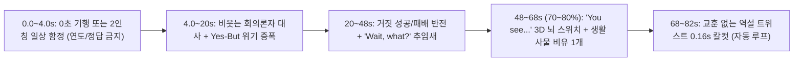
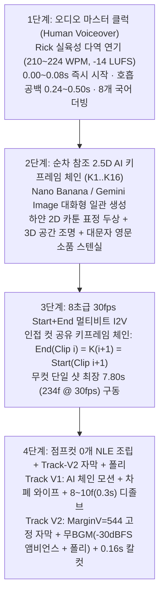

# 벤치마크 3대 채널 성공 공식 추출, `@RicksClips3000` 제작 공정 역설계 & 장면 전환(`lnYLIWP2l-I`) 마스터 보고서

Research 채팅방(`ffbdfca1`)의 3대 벤치마크 채널([`@RicksClips3000`](../02_Research/ricksclips3000_shorts_report.md) · [`@HeyHistorically`](../02_Research/heyhistorically_shorts_report.md) · [`@PsychToonsHQ`](../02_Research/psychtoonshq_videos_report.md)) 전수 분석에 더해, **`@RicksClips3000`가 실제로 어떤 툴과 공정으로 영상을 제작하는지(픽셀·코덱·오디오 스템 역설계)**와 **`lnYLIWP2l-I`(892만 뷰) 전 구간(`0.00s~63.50s`, `1,905프레임`, `T01~T17`)의 장면 전환 기법 및 우리 파이프라인(`07_Youtube`) 100% 구현 방법**까지 통합 확정했습니다.

---

## 1. 3대 벤치마크에서 추출한 검증된 성공 공식 (Data Proof)

> [!IMPORTANT]
> 세 채널의 데이터는 단 하나의 결론으로 수렴합니다: **쇼츠는 `45~90초 이내`(`91초` 초과 시 일일 확산 속도 `-45%` 급락)**에서 **표정이 살아 있는 단순 2D 카툰 얼굴 + 입체 3D 현장**으로 인간 드라마를 먼저 터뜨리고, **뇌/원리 설명은 후반 `70~80%`까지 아껴두었다가 마지막 문장 직후 `0.15~0.30초` 만에 칼컷**해야 천만 뷰 루프가 터집니다.

| 추출 축 | `@RicksClips3000` *(28일 25편 = 2.08억 뷰, 중앙값 741만)* | `@HeyHistorically` *(Era 2 39편 전원 100만+, 중앙값 802만)* | `@PsychToonsHQ` *(롱폼 142편 = 2,755만 뷰, 구독전환 0.8%)* | **우리가 가져올 핵심 무기** |
|---|---|---|---|---|
| **골든 길이** | `45~66초` 18편 **100% 100만+ 돌파** (주력 `58~65초`) | `45~90초` **VPD `63,000/일`** (`76~90초` 성숙 중앙값 **863만** vs `91~111초` **`-45%` 반토막**) | 롱폼 `14~16분` (`0~75초` 일상 패배 마이크로 씬) | **단발 역설 `60~70초` / 다단계 서사 `75~88초` (`1분 30초` 상한 엄수)** |
| **캐릭터 & 화면** | **2.5D 단일 신경망 렌더**: 검은 외곽선 하얀 2D 동그라미 두상(**눈·눈썹·입 표정 + 분노 개그**) + 3D 공간 그림자·보케 | 하얀 마시멜로형 **'Doodlie' 2D 표정 두상** + 시대 복식 + 검열 우회 유머 은유 | 단색 배경 + **에피소드별 고유 생활 사물 메타포 1개** *(빛나는 뇌 3~4회 재탕 시 조회수 `-98%` 폭락!)* | **무표정 달걀 두상 폐기 → 눈·눈썹·입이 살아 있는 2D 카툰 두상 + 3D 공간 결합 & 뇌 CG 희소화** |
| **훅 & 대본 척추** | `0.00s` 연도/정답 없는 **물리적 기행** → **비웃는 회의론자(Foil) 조롱 대사** → `[35~50%]` `"Wait, what?"` → `[70~80%]` `"You see..."` 감각 비유 → **`0.16~0.30초` 반전 칼컷** | `0~50ms` 무인트로 **`220 WPM` 과속 타격** + 시각 지시어(*"these guys"*) + `15초` 주기 `"해결책 → 허점 → 극단적 해결책"` 사다리 + **`0.05초` 칼컷** | 일상 패배 씬 → 통념(의지력 신화) 논문 해체 → `55%` 실전 프로토콜 + **연구 한계 솔직 고백** + `98%` 1:1 DM 공유 유도 | **`0.00s` 기행/위기 타격 + 조롱 대사 1줄 + `75%` 지연된 뇌 원리 공개 + 엔딩 여백 `0.15~0.25초` 칼컷** |
| **제목 & 패키징** | **`4~8단어(19~45자)` 보통명사 치환**(*The Pink Prison Cell Experiment*, *Your Brain's Secret Idea Zone*) / 역설 `Why`; 해시태그 `0개` | 평균 **`5.5단어(30.6자)`** `How [극한 생존]` / `Why [역설]`; 검색 태그 `0개` | **`Unfair`(평균 341만) · `Anything`(166만)** 고지위 격상; 약장수 과장어(`Instantly` 4.9만, `Feels Illegal` 7.4만) 참패 | **학술어·인명·연도 뺀 `4~8단어` 보통명사/역설 타이틀 + 해시태그 `0개`** |
| **자막·소품·사운드** | 상단 배너 `0개`, 하단 `Y=70.3%`(`MarginV=544`) `1~3단어` 자막, **영문 스텐실 소품**(`GARBAGE`, `HOT SHOT`, `P-618`), 무BGM(`-30 dBFS` 앰비언스 + 호흡 공백 폴리), **`210~224 WPM`** 다역 연기 + **8개 국어 더빙** | 우측 상단 **진행 카운터 UI**(`YEARS PASSED`), **1초 일시정지 유도(Pause-Bait) 문서**, 무음률 `0.31%` | 무자막 + 그림 속 손글씨 팻말(`FORTY SECONDS`), `-14.3 dBFS`, 무음 `0.18초` | **거대 상단 배너 삭제 + 영문 소품 라벨 허용 + 호흡 공백 폴리 임팩트 + `205~220 WPM` 다역 보이스** |
| **댓글 & 수익 퍼널** | 본문에서 **공식 학술 명칭을 일부러 생략**해 댓글창 ‘셜록 홈즈 해설단’ 폭발 → 배경 자동 루프(`APV > 100%`) | **쇼츠 59편 전수(100%) `Related video`를 롱폼으로 직결** + **D-1 티저 스왑**으로 연 `\$500K+` 수익화 | 쇼츠 0편, 15분 정지화(`2.94초/컷`, 카메라 모션 `0%`) 롱폼 + 미드롤 + PDF 매뉴얼(`\$24.99`) | **본문 학술명 생략 + 고정 댓글 DOI 박제** / 쇼츠 성공 후 **정지화 롱폼 런칭 & 100% 직결** |

````carousel

<!-- slide -->

<!-- slide -->

<!-- slide -->

<!-- slide -->

````

---

## 2. 왜 기존 우리 컨셉은 막혔는가? (냉정한 패인 대조)

우리 채널 초기 업로드작들의 실제 스튜디오 지표에서도 벤치마크 법칙이 **그대로 재현**되고 있었습니다:
- **길이 & 2인칭 일상성 격차**: `84~88초` 2인칭 일상 소재였던 *Sleep*(`2,002뷰`, 스와이프 방어 **`80.5%`**, 시청지속률 **`97.2%`**, 1천 뷰당 구독 `+12.0명`)과 *Habits*(`1,595뷰`, 스와이프 방어 **`84.5%`**)가 선전한 반면, `168~178초`(약 3분) 디오라마는 스와이프 방어가 `66.9~74.4%`로 떨어지고 완주율이 `38~85%`에 묶여 시드 풀을 뚫지 못했습니다.
- **연도/학술 선행 훅의 참패**: `"In the 1960s at Caltech..."`로 시작한 에피소드는 초반 이탈률 **`75.1%`(`Viewed 24.9%`)**로 즉각 붕괴했습니다 (`@RicksClips3000`에서 *The Science Behind Slot Machines*가 `11.3만 뷰`로 꼴찌를 기록한 원인과 100% 동일).

### 우리가 버려야 할 7가지 구습 vs 새로 이식할 `expressive_25d_v8` 변화표

| 변화 영역 | 기존 방식 (버릴 것) | 신규 컨셉 (`expressive_25d_v8` — 바꿀 것) |
|---|---|---|
| **1. 캐릭터 얼굴** | 눈·코·입 없는 매끈한 무표정 도자기 달걀 두상 (감정 이입 불가) | **굵은 검은 잉크 외곽선의 하얀 2D 카툰 두상 + 생생한 눈·눈썹·입 표정 연기 + 분노/땀방울 카툰 감정 개그** (몸체·배경은 입체 3D 조명·그림자 유지) |
| **2. 뇌 CG 비중** | 초중반부터 빛나는 뇌 클립을 반복 노출 (`-98%` 시각 피로 유발) | **`[0~70%]` 뇌 내부 CG 전면 금지(100% 인간 갈등·실험 현장)** → **`[70~85%]` 단 2~4컷만 시그니처 4색 3D 뇌 단면 + 고유 생활 사물 메타포 1개 공개** |
| **3. 영상 길이 & 컷수** | `140~179초` (`48~63컷`, Flow 생성만 1.5~3시간) | **`58~88초` (`1분~1분 30초` 이내, `14~26컷`)** — 90초 벽 안쪽에서 총시청시간 극대화 + **1편 제작 `15~22분` 달성** |
| **4. 첫 5초 & 결말** | 3문장 정형 공식 / 연도·장소 설명 + 마지막 `2.2초` BGM 페이드아웃 | **`0.00s` 연도·스포일러 없는 기행/일상 위기 + 비웃는 조롱 대사(`Foil`)** 투입 → **마지막 반전 문장 직후 `0.15~0.25초` 요약 없는 칼컷** |
| **5. 전문용어 & 댓글** | 본문에서 실험명·뇌 부위 학술어를 친절히 다 설명함 (`댓글 0개`) | 본문에서는 감각 비유만 쓰고 **유명 실험 별칭은 의도적으로 생략**해 ‘해설 댓글단’ 유도 + **고정 댓글(`R35`)에 DOI 논문 원문 박제**로 권위 독점 |
| **6. 화면 전환 & UI** | 상단 `276pt` 거대 배너 + 세계관 내 글자 전면 금지 + 100% 뚝뚝 끊기는 점프컷 | **점프컷 `0개` 하이브리드 전환(공유 키프레임 AI 패닝/포털줌 + 연기/어둠 차폐 와이프 + `0.27~0.33s` 디졸브)** + 상단 배너 삭제 + **영문 스텐실 소품 라벨 허용** + 하단 `MarginV=544` 자막 |
| **7. 제목 & 사운드** | `67~81자` 학술 명사형 + 해시태그 블록 + 연속 멜로디 BGM + `165 WPM` 단일 톤 | **`4~8단어(19~45자)` 보통명사 치환 / `Why`·`How` 역설 / `Unfair`** (해시태그 `0개`) + **`205~220 WPM` 하이텐션 다역 발화 + 호흡 공백(`0.24~0.42s`) 폴리 타격음** |

---

## 3. 우리 채널 전용 듀얼 내러티브 엔진 (`58~88초` 실전 템플릿)



1. **엔진 A (60% 비중 — 기묘한 실제 심리·신경과학 실험 우화)**:
   - *예시*: `"They painted a maximum-security prison cell bright pink — and not just any pink."` → 교도관 조롱 대사(`"Barbie's gonna love it in here."`) → 15분 만에 흉악범들이 진정되는 기적 → 야간 당직자가 **15분 제한 타이머**를 어기자 정반대 폭주 발생(`"Wait, what?"`) → `75%` 지점 `"You see..."` 뇌 경보 스위치 + 감각 비유 공개(`Baker-Miller Pink` 명칭은 생략해 댓글 유도) → `"Leave someone inside one minute longer, and the calmest room on earth turns into a rage cage."` (`0.16s` 칼컷).
2. **엔진 B (40% 비중 — 내 뇌의 일상 배신 & 도파민/수면/기억 역설)**:
   - *예시*: 새벽 3시 첫날밤 호텔에서 반쪽 뇌만 깨어 보초를 서는 현상, 알람 후 40초 타협, 에디슨의 쇠구슬 낮잠(`Your Brain's Secret Idea Zone`) 등 **시청자 본인(`You`)의 일상 고통**을 `0.00s`에 찌르고 S2(`4.5s`)에서 `"Imagine..."`으로 가둔 뒤 논문 실험으로 통념을 부수고 `0.16s` 칼컷.
3. **쇼츠 성공 후 롱폼 확장 전략 (2단계 로켓)**:
   - **1단계 (현재)**: 롱폼 제작 전면 보류(`LONGFORM_DEFERRED=True`), 위 `58~88초` 신규 컨셉 쇼츠로 시드 풀 돌파(1편당 20분 이내 고속 생산)에 100% 집중.
   - **2단계 (쇼츠 10만~100만 뷰 루틴 안착 후)**: `@PsychToonsHQ` 공식(**카메라 모션 `0%` 일러스트 슬라이드 `2.9초` 하드컷 + 무자막 손글씨 표지판 + `55%` 실전 프로토콜 + 연구 한계 명시**)으로 저비용 15분 롱폼을 런칭하고, `@HeyHistorically` 공식대로 **모든 쇼츠의 `Related video`를 100% 롱폼으로 직결 + D-1 런칭 이브 티저 스왑**을 가동해 고단가 수익화 달성.

---

## 4. 멀티 에이전트 동시 작업 시 "탭 탈취 제로" 기술 분석 결과 (라이브 `:9222` 실증 완료)

1. **탭 탈취의 진짜 원인 4가지**:
   - Flow·Studio 스크립트 **14곳의 `Page.bringToFront()` 호출**이 다른 에이전트의 포커스를 강탈했습니다.
   - `studio_watchdog.py`, `whale_session.py`, `flow_browser.py` 등 **6곳의 와일드카드 탭 스위퍼**가 소유권 확인 없이 `about:blank`나 기존 탭을 닫거나 가로챘습니다.
   - `shared-chrome` 컨테이너(`Xvfb :99` + `fluxbox`, `--start-maximized`)에서 `newWindow=True`를 쓰면 새 최대화 창이 이전 창을 가려 `visibilityState: "hidden"`, `hasFocus: false`로 죽어버림을 실증했습니다.
   - Hermes 브라우저 데몬이 `BU_NAME` 미설정 시 무조건 `pages[0]`을 재사용했습니다.
2. **라이브 `:9222` 실증 해결책 (4-Layer Isolation)**:
   - **`Target.createTarget({newWindow: False, background: True})` + `Emulation.setFocusEmulationEnabled({enabled: True})`**: 화면을 앞으로 끌어오지(`bringToFront` 0회) 않고도 다중 백그라운드 탭이 동시에 `visibilityState: "visible"`, `hasFocus() === true`를 유지하며 클릭·타이핑·스크린샷이 100% 동작합니다.
   - **프로세스별 탭 임대 장부 (`/tmp/aab_cdp_leases.json` + `flock`)**: 본인이 연 `targetId`(또는 죽은 PID의 고아 탭)만 닫고 타 에이전트·사용자 탭은 절대 건드리지 않습니다.
   - **Google Flow 방 정규화 (`AAB_<project_id>`)**: 무명 `"New project"` 생성을 금지하고 에피소드/샤드별 결정론적 이름을 즉시 부여하며 로컬 검증 직후 자동 정리(`main.py flow-clean`)합니다.

---

## 5. `@RicksClips3000` 실제 영상 제작 파이프라인 완전 역설계 (4단계 포렌식)

`@RicksClips3000` Era 3 메가히트 4편(`lnYLIWP2l-I` *Pirate Cannonballs* `8.92M`, `VS1Z_Q-Klt8` *Ancient Jar* `31.54M`, `7xS87iActkU` *Perfect Railroads* `20.75M`, `HxqtHI62otM` *Pink Prison Cell* `2.30M/24h`)의 원본 `1080x1920 @ 30fps` `H.264`(`137`) + `VP9`(`248`) 비디오 스트림과 무압축(`non-DRC`) `48 kHz` 오디오 스템을 프레임 단위로 해부한 결과, **Blender 3D 세트 위에 After Effects 2D 캐릭터를 얹은 수작업 합성이 아니라, 철저히 표준화된 4단계 AI 키프레임 체인 + `Start+End` I2V + NLE 하이브리드 공정**임이 픽셀 증거로 입증되었습니다.

> [!TIP]
> **왜 "3D 블렌더 + 2D 리깅 합성"이 아닌 단일 AI 생성 이미지/비디오인가? (4대 픽셀 물증)**
> 1. **3D 그림자의 2D 두상 곡면 투사**: *Pink Prison Cell*에서 복도 창살의 3D 직사광 그림자가 하얀 2D 스틱맨 얼굴 위를 입체 곡률에 맞춰 굴절하며 지나갑니다.
> 2. **실제 3D 피사계 심도(Bokeh)에 의한 검은 외곽선 블러**: *Perfect Railroads*에서 원경 캐릭터의 2D 검은 잉크 테두리가 3D 렌즈 아웃포커싱과 함께 뭉개집니다.
> 3. **카메라 패닝 시 배경 소품의 비강체(Non-rigid) AI 재합성**: `lnYLIWP2l-I` 갑판 패닝(`f=385 → f=520`) 도중 왼쪽의 `SHOT` 나무 상자가 카메라 이동 후 `GARBAGE` 오크통 2개로 자연스럽게 AI 재합성됩니다(3D 고정 메쉬라면 불가능).
> 4. **1~2px Canny 외곽선 끓음(Stroke Boil)**: `f=240..242` R/G/B 엣지 중첩 시 정지한 캐릭터의 검은 잉크 선이 매 프레임 `1~2px` 미세하게 요동치는 전형적 비디오 확산(Diffusion I2V) 특성을 보입니다.



### 공정별 실측 스펙 요약

| 제작 단계 | 역설계 실측치 (`H.264`/`VP9` & `48 kHz` 오디오 스템 검증) | 핵심 제작 노하우 |
|---|---|---|
| **Stage 1. 보이스 & 다국어 트랙** | 센터 모노 녹음(`Mid -16.8 dBFS`, `Side -48.0 dBFS`, 통합 `-14.0 LUFS`), 기본 톤 대비 `+2~3 ST` 하이텐션 피치(`F0 중앙값 165~194 Hz`, 표준편차 **`4.5~5.1 ST`**, 조롱 대사 피치 폭 `16.3 ST`), **`210~224 WPM`** | 첫 음절 `0.00~0.08s` 타격, 문장 간 숨 고르기 `0.24~0.50s`(`최대 0.62s`)로 타이트하게 펀치 편집 후 **유튜브 8개 국어 오디오 트랙(`en-US`, `es-US`, `pt-BR`, `de-DE`, `fr-FR`, `it`, `hi`, `id`)** 배포로 글로벌 노출 증폭 |
| **Stage 2. 2.5D 키프레임 체인 (`K1..K16`)** | 단일 패스 이미지 생성 모델(`Nano Banana` / Gemini Image / `gpt-image-1` 레퍼런스 체인)로 이전 컷 키프레임($K_i$)을 참조해 다음 컷($K_{i+1}$)의 공간·복식을 고정 | AI가 뭉개기 쉬운 문장 대신 **`1~3단어` 굵은 대문자 영문 스텐실(`GARBAGE`, `HOT SHOT`, `1812`, `CARCASS`, `P-618`)**을 키프레임 단계에서 소품에 선명하게 박아 넣음 |
| **Stage 3. `8s`급 `Start+End` 멀티비트 I2V** | 네이티브 `30.00 fps` (`24→30` 풀다운 중복 프레임 `0.00~0.33%`), 단일 무컷 클립 길이가 **`1.73s ~ 7.80s`(`52f ~ 234f @ 30fps`)** 분포 (`lnYLIWP2l-I` 내 `6.03s~7.80s` 무컷 샷 **5개** 확인) | `5초` 생성기가 아닌 **`8~10초`급 `Start + End Frame` I2V** 사용(Google Flow의 기본 `8.0s` 클립 스펙과 완벽히 부합). 앞 클립의 `End` 프레임($K_{i+1}$)을 뒤 클립의 `Start` 프레임($K_{i+1}$)으로 물려 **3D-VAE 이음매(`f=118`, `f=352`, `f=632`, `f=988`)만으로 끊김 없는 연쇄 카메라 이동** 구현 + 대사 길이가 남으면 끝 키프레임을 `0.23~0.50s`(`7~15f`) 프리즈 홀드 |
| **Stage 4. 사운드 디자인 & 자막 레이어** | **멜로디 BGM `0%`** (`p10 Mid = -29.9 ~ -31.0 dBFS` 광대역 현장 앰비언스 바닥 깔기 + 호흡 공백마다 `-15 ~ -19 dBFS` 대포·철판·불길 폴리 타격음 배치) | **Track V1**에서 영상 클립 간 `8~10프레임`(`0.27~0.33s`) 크로스 디졸브를 먼저 수행한 뒤, **Track V2(상위 트랙)**에 흰색 볼드 자막(`ymax=1376px`, **`MarginV=544px`**, `Y_center ≈ 70.3%`, 대문자 높이 `53~54px`, `1~3단어`, 상단 배너 `0개`)을 얹어 디졸브 중에도 자막은 `100%` 선명하게 유지. 마지막 단어 직후 **`0.16~0.30s` 만에 무페이드 칼컷** |

````carousel

<!-- slide -->

````

---

## 6. `lnYLIWP2l-I` (*Levels of Pirate Cannonballs*, `63.50s`) 전 구간 장면 전환(`T01~T17`) 정밀 해부

요청하신 `https://youtube.com/shorts/lnYLIWP2l-I` (`892만 뷰`, `1,905프레임 @ 30fps`)를 프레임 단위로 전수 검수한 결과, **63.5초 동안 쌩 점프컷(Unmasked Jump Cut)이 사실상 `0회`**입니다. 시청자가 "한 편의 살아 움직이는 원테이크 만화"처럼 느끼게 만드는 비결은 아래 **6가지 전환 메커니즘의 정교한 배합**입니다:

1. **공유 키프레임(`End = Start`) 데이지 체인 카메라 이동 (`T02`, `T03`, `T06`, `T10`, `T11`, `T13A/B`)**:
   - 앞 클립이 정지 키프레임 $K$에 안착하면, 다음 클립이 **정확히 동일한 이미지 $K$를 `Start Frame`으로 물고 시작**해 천장/돛을 뚫고 올라가는 수직 휩틸트(`T02`), 갑판 패닝(`T03`), 화덕 입구 포털 줌인(`T06`), 낮→밤 타임랩스 조명 변화(`T11`→`Clip 09`)로 이어집니다 (`H.264`와 `VP9` 양쪽 모두 GOP `I-frame`이 아님에도 `MAE 1.0~3.7`의 3D-VAE 재인코딩 흔적이 남는 것으로 100% 입증).
2. **단일 `8s` 클립 내부 멀티비트 카메라 워킹 (`Clip 03` `7.80s`, `Clip 04` `6.37s`, `Clip 06` `6.03s`, `Clip 10A` `7.00s`, `Clip 12` `6.10s`)**:
   - 컷을 자르지 않고 한 클립 안에서 `SHOT` 상자 → 왼쪽 패닝 → `GARBAGE` 장전 → 발사까지 2~3개 행동 비트를 연속 수행해 컷 수 자체를 절반으로 줄였습니다.
3. **100% 풀스크린 카툰 연기 차폐 와이프 (`T05` `f=542→544`, `T16` `f=1794→1796`)**:
   - 대포 발사 순간 하얀 카툰 연기가 화면 100%(`mean luma 233~238`)를 `2~3프레임` 동안 완전히 덮을 때 다른 장소 클립으로 하드컷한 뒤 연기가 걷히게 만듭니다 (두 연기 구름의 상관도 `corr=0.50`으로 NLE 템플릿 재탕이 아니라 각 클립 프롬프트로 직접 생성한 연기임이 확인됨).
4. **어두운 포구/충돌 물리 차폐 컷 (`T01` 선체 충돌 `f=65→66`, `T08` 검은 포신 다이브 `f=811→815`)**:
   - 포탄이 나무 선체에 박히는 순간(`T01`)이나 포구 속 어둠(`mean luma 57`)으로 카메라가 빨려 들어가는 순간(`T08`)을 이용해 외부 시점에서 대포 내부 X-ray 단면도로 감쪽같이 넘어갑니다.
5. **챕터/시간 점프용 `8~10프레임`(`0.27~0.33s`) Track-V1 고속 선형 디졸브 (`T09`, `T12`, `T14`, `T15`)**:
   - 장소나 시대가 완전히 바뀔 때만 정확히 **`1/3초`(`8~10f`)짜리 짧은 크로스 디졸브**를 호흡 공백(`0.30~0.36s`) 안에 넣습니다.
6. **프레임 내 물리 업그레이드 슬램 & `0.16s` 루프 칼컷 (`Clip 11` `f=1528`, `T17` `f=1904`)**:
   - `"wood to iron"` 대사 순간 컷 전환 없이 화면 위에서 강철 장갑판이 쾅 내려찍히며 덮이고, 마지막 단어 `"shot."`(`63.34s`) 종료 후 **단 `0.16s`(`5프레임`) 만에 칼컷(`63.50s`)**하여 `0.00s` 대포 점화 장면으로 즉시 루프시킵니다.

````carousel

<!-- slide -->

````

### `lnYLIWP2l-I` 전 구간(`0~1,904프레임`) 무누락 클립 & 전환 타임테이블

| 클립 / 전환 ID | 프레임 (`@30fps`) | 시간 (`s`) | 길이 | 검증된 화면 액션 및 전환 메커니즘 |
|---|---|---|---|---|
| **Clip 01** | `0–65` | `0.00–2.17s` | `2.20s` | 햇살 비치는 갑판에서 대포 점화 → 날아가는 포탄을 카메라가 바다 위로 초고속 추격 |
| **↳ T01 [충돌 차폐 하드컷]** | `65 → 66` | `2.20s` | `1f` | **선체 충돌 마스크(`mae=75.7`)**: `0.62s` 호흡 공백 + `-19.3 dBFS` 굉음 속에서 나무 선체 파열 클로즈업으로 직결 |
| **Clip 02** | `66–117` | `2.20–3.90s` | `1.73s` | 선체가 안쪽으로 박살 나며 맥주잔을 든 해적 선실 노출 → 정지 키프레임 **`K2`** 안착(`f=115..117`) |
| **↳ T02 [공유 `K2` 체인]** | `117 → 118` | `3.93s` | `1f` | **3D-VAE 이음매(`H.264`/`VP9` 공통 비-GOP Seam)** → `"In the 1700s..."` 시작과 동시에 천장 위로 수직 휩틸트 발사 |
| **Clip 03 (멀티비트)** | `118–351` | `3.93–11.70s` | **`7.80s`** | **무컷 `234f` 원샷**: 선실 천장·하얀 돛 돌파 → 바다 너머 해군 전함 일제사격(`f=173`) → 우측 휩패닝으로 해적 갑판 난간 박살 → **`K5`** 안착 |
| **↳ T03 [공유 `K5` 체인]** | `351 → 352` | `11.73s` | `1f` | `0.30s` 숨 고르기(`11.58~11.88s`) 안쪽에서 공유 키프레임 체인 후 우측 갑판 패닝 출발 |
| **Clip 04 (2비트 갑판)** | `352–542` | `11.73–18.07s` | **`6.37s`** | 빈 `SHOT` 상자 어깨 으쓱 → 좌측 역패닝(`f=443` 내부 모션)하며 `GARBAGE` 통 잡동사니 장전 & 발사 → **화면 100% 백색 연기(`f=541..543`)** |
| **↳ T05 [백색 연기 와이프]** | `542 → 544` | `18.07–18.13s` | `3f` | **100% 흰 카툰 연기가 장면을 완전히 가린 순간 해상 전함 씬으로 컷** (`"But"` 발화와 동시에 연기 걷힘) |
| **Clip 05** | `544–631` | `18.13–21.03s` | `2.93s` | 연기가 걷히며 바다 위 해군 군함 → 해안 요새의 벽돌 `HOT SHOT` 가열로 앞 **`K8`** 안착 |
| **↳ T06 [공유 `K8` 포털줌]** | `631 → 632` | `21.07s` | `1f` | `"They"` 발화 시작점에 공유 키프레임 체인 → 불타는 화덕 아궁이 속으로 포털 줌인 |
| **Clip 06 (멀티비트)** | `632–812` | `21.07–27.07s` | **`6.03s`** | 시뻘건 석탄과 달궈진 포탄 클로즈업 → 줌아웃 & 우측 패닝(`f=715`)으로 집게 운반 → `1812` 포구 투입 후 **어두운 포신 속으로 다이브(`f=809..813`)** |
| **↳ T08 [포구 어둠 와이프]** | `811 → 815` | `27.03–27.17s` | `4f` | **검은 포신 내부 암전(`mean=57`)**을 다리 삼아 외부 시점에서 대포 단면 X-ray 뷰로 무봉제 진입 |
| **Clip 07** | `814–908` | `27.13–30.27s` | `3.17s` | 대포 X-ray 단면: 젖은 마개 뒤 달궈진 포탄과 땀 흘리는 `POWDE` 화약 자루 → 노란 점화 불꽃 하강(`f=901..908`) |
| **↳ T09 [`10f` 디졸브]** | `908–917` | `30.27–30.57s` | **`10f`** | **`0.33s` Track-V1 선형 크로스 디졸브**: 점화 화약 자루에서 낮 바다 목선 외벽으로 전환 |
| **Clip 08A + 홀드** | `917–947` | `30.57–31.57s` | `1.00s` | 달궈진 포탄이 나무 선체에 박힘 + **`15f`(`0.50s`) NLE 프리즈 홀드(`f=932..946`)** |
| **↳ T10 [공유 체인]** | `947 → 948` | `31.60s` | `1f` | 공유 키프레임 체인으로 연기 피어오르는 선체 줌아웃 시작 |
| **Clip 08B + 홀드** | `948–987` | `31.60–32.90s` | `1.33s` | 선체 구멍에서 전체 주간 범선(`K10A`)으로 줌아웃 + **`8f`(`0.27s`) 프리즈 홀드(`f=980..987`)** |
| **↳ T11 [공유 `K10A` 체인]** | `987 → 988` | `32.93s` | `1f` | 주간 범선(`Start=K10A`) → 야간 랜턴 범선(`End=K10B`) 타임랩스 클립으로 체인 |
| **Clip 09 (타임랩스)** | `988–1110` | `32.93–37.00s` | `4.10s` | **`3.87s` 연속 낮→밤 AI 조명 모핑**: 파란 하늘이 보랏빛 밤으로 어두워지며 배 전체가 주황색 랜턴처럼 발광 + `7f` 홀드 |
| **↳ T12 [`10f` 디졸브]** | `1111–1121` | `37.03–37.37s` | **`10f`** | **`0.33s` Track-V1 선형 디졸브(`α=0.00→1.00`)**: 밤바다 범선 → `CARCASS / KEEP FROM FLAME` 상자 (자막 `"Not"`은 Track-V2에서 100% 선명) |
| **Clip 10A (소이탄 준비)** | `1121–1330` | `37.37–44.33s` | **`7.00s`** | 해적이 철제 소이탄을 들고 동료가 타르 양동이를 가져와 구멍을 뚫어 대포에 장전하는 3비트 원샷 |
| **↳ T13A [체인 이음매]** | `1330 → 1331` | `44.37s` | `1f` | 장전 완료 프레임에서 발사 궤적 샷으로 체인 |
| **Clip 10B + 홀드** | `1331–1394` | `44.37–46.47s` | `2.13s` | 불타는 소이탄이 황혼 바다를 가로질러 적함에 명중 + **`11f`(`0.37s`) 홀드(`f=1384..1394`)** |
| **↳ T13B [공유 체인]** | `1394 → 1395` | `46.50s` | `1f` | 명중 정지 프레임에서 화염 전함 줌인 클립으로 체인 |
| **Clip 10C (화염 전함)** | `1395–1470` | `46.50–49.00s` | `2.53s` | 해적선 뱃머리를 넘어 거대한 횃불처럼 타오르는 해군 전함으로 줌인 (`-17.7 dBFS` 화염 폴리) |
| **↳ T14 [`8f` 디졸브]** | `1470–1478` | `49.00–49.27s` | **`8f`** | `"Eventually,"` 전환점에서 **`0.27s` Track-V1 선형 디졸브**로 목선 외벽 클로즈업 이동 |
| **Clip 11 (철갑 슬램)** | `1478–1604` | `49.27–53.47s` | `4.23s` | `"wood to iron"` 대사 순간 **화면 위에서 회색 철갑판이 쾅 내려꽂히며(`f=1526..1530`)** 불타는 포탄들을 바다로 튕겨냄 |
| **↳ T15 [`8f` 디졸브]** | `1604–1612` | `53.47–53.73s` | **`8f`** | `0.36s` 숨 고르기(`"off. So, → America"`) 구간에서 **`0.27s` Track-V1 선형 디졸브**로 미 북군 장교 & 15인치 로드먼 거포로 전환 |
| **Clip 12 (로드먼 거포)** | `1612–1794` | `53.73–59.80s` | **`6.10s`** | 나무 크레인이 1,000파운드 거대 포탄을 들어 올려 장전 후 발사 → **화면 100% 백색 포연(`f=1794..1795`)** |
| **↳ T16 [포연 섬광 와이프]** | `1794 → 1796` | `59.80–59.87s` | `3f` | `"punch"` 직후 **100% 백색 포연 차폐 컷**으로 바다 위 날아가는 초대형 포탄 씬으로 직결 |
| **Clip 13 + 루프 칼컷** | `1796–1904` | `59.87–63.50s` | `3.63s` | 1,000파운드 포탄이 철갑함을 정통 관통·격침(`60.87s`) → 마지막 단어 `"shot."`(`63.34s`) 직후 **`0.16s` 만에 `T17` 하드 루프 칼컷(`63.50s`)** |

---

## 7. `"이렇게 할려면 어떻게 해야해?"` — 우리 `07_Youtube` 파이프라인 100% 구현 설계도 (`expressive_25d_v8`)

반가운 점은 **우리 Google Flow 파이프라인이 이미 핵심 엔진 3가지를 내장하고 있다**는 사실입니다:
1. [`pipeline/config.py`](file:///home/canadaofbin/gdrive/Kyubin_Yun_Workspace/07_Youtube/pipeline/config.py)의 기본 Flow 클립 길이가 **`8.0s`**여서 `@RicksClips3000`의 `6.0~7.8s` 멀티비트 원샷을 그대로 뽑아낼 수 있습니다.
2. [`pipeline/flow_ingredients.py`](file:///home/canadaofbin/gdrive/Kyubin_Yun_Workspace/07_Youtube/pipeline/flow_ingredients.py)에 **`0-credit` `Nano Banana 2.1`(`x4` 배치) 이미지 조건부 생성**과 **`upload_start_end_frames_to_flow` (`Start + End` 2칩 첨부)** 함수가 이미 구현되어 있습니다.
3. [`pipeline/flow_diorama_sharded_worker.py`](file:///home/canadaofbin/gdrive/Kyubin_Yun_Workspace/07_Youtube/pipeline/flow_diorama_sharded_worker.py) 역시 `Omni 1.1 Flash`는 물론 `0-credit` `Veo 3.1 - Lite`에서도 `lite_supports_dual_ref`를 동적으로 프로빙하도록 이미 짜여 있습니다.

다만 기존 도자기 컨셉(`porcelain_cinematic_v7`)의 **6가지 하드코딩 규제가 2D 표정 얼굴·영문 소품·디졸브·무배너 자막을 가로막고 있으므로**, 새 컨셉 착수 시 아래 **6계층(`expressive_25d_v8` 프로필)**을 세트로 개방해야 합니다:

| 계층 | 수정 대상 파일 | 구체적 구현 방법 (What to Change) |
|---|---|---|
| **1. 프로필 & 런타임·컷수 봉인 해제** | [`pipeline/config.py`](file:///home/canadaofbin/gdrive/Kyubin_Yun_Workspace/07_Youtube/pipeline/config.py) | `EXPRESSIVE_25D_V8_STYLE_PROFILE = "expressive_25d_v8"` 추가 → 길이 **`58~88초`**, 클립 수 **`14~26개`**(`8.0s` 생성 후 `1.8~7.8s` 가변 트림), 자막 **`EXPRESSIVE_V8_SUBTITLE_MARGIN_V = 544`**(`Y_center ≈ 70.3%`, 기존 `AAB Condensed Black` `Fontsize=94` 유지 시 대문자 높이 `52px`로 `@RicksClips3000`의 `53px`와 일치), 상단 챕터 배너 비활성화(`EXPRESSIVE_V8_ENABLE_CHAPTER_HEADLINE = False`) |
| **2. 2.5D 표정 두상 & 영문 스텐실 프롬프트 개방** | [`pipeline/porcelain_anchor_pack.py`](file:///home/canadaofbin/gdrive/Kyubin_Yun_Workspace/07_Youtube/pipeline/porcelain_anchor_pack.py), [`pipeline/depiction_rules.py`](file:///home/canadaofbin/gdrive/Kyubin_Yun_Workspace/07_Youtube/pipeline/depiction_rules.py), [`pipeline/flow_prompt_builder.py`](file:///home/canadaofbin/gdrive/Kyubin_Yun_Workspace/07_Youtube/pipeline/flow_prompt_builder.py) | `_CRANIUM_CLAUSE`를 `expressive_25d_v8`일 때 *"굵은 검은 잉크 외곽선의 순백 2D 원형 카툰 두상 + 생생한 검은 눈·눈썹·입 표정 연기 + 입체 3D 의상·조명·그림자"*로 분기하고, 클립에 선언된 `1~3단어` 대문자 영문 소품(`diegetic_label`, 예: `"PINK P-618"`, `"MINUTE 16"`)에 한해 `eyes/mouth` 금지 정규식과 `"zero text, zero letters"` 자동 치환(`_PLAQUE_SANITIZE_SUBS`)을 면제 |
| **3. YuNet 얼굴 게이트 & MSER 글자 자동 폐기 예외 처리** | [`pipeline/source_reenactment.py`](file:///home/canadaofbin/gdrive/Kyubin_Yun_Workspace/07_Youtube/pipeline/source_reenactment.py), [`pipeline/flow_diorama_sharded_worker.py`](file:///home/canadaofbin/gdrive/Kyubin_Yun_Workspace/07_Youtube/pipeline/flow_diorama_sharded_worker.py), [`pipeline/reference_image_qa.py`](file:///home/canadaofbin/gdrive/Kyubin_Yun_Workspace/07_Youtube/pipeline/reference_image_qa.py) | ① YuNet `detect_non_porcelain_human_faces`의 `dark_feat_ratio <= 0.035` 조건 때문에 검은 만화 눈·입이 실제 사람 얼굴로 오판되므로 **`porc_ratio >= 0.62 and skin_ratio <= 0.06`이면 검은 카툰 눈·입 허용(실사 피부색 얼굴만 차단)**<br/>② `GARBAGE` 같은 5글자 이상 소품 스텐실이 다운로드 즉시 폐기되지 않도록 `allow_diegetic_label=True` 클립은 `_max_horizontal_plaque_glyph_run` 게이트 면제(상하단 5% 워터마크 검사는 유지) |
| **4. 순차 키프레임 체인(`K1..Km`) & 3종 전환 라우팅** | [`pipeline/porcelain_anchor_pack.py`](file:///home/canadaofbin/gdrive/Kyubin_Yun_Workspace/07_Youtube/pipeline/porcelain_anchor_pack.py), [`pipeline/flow_diorama_sharded_worker.py`](file:///home/canadaofbin/gdrive/Kyubin_Yun_Workspace/07_Youtube/pipeline/flow_diorama_sharded_worker.py) | `visual_plan.json`의 각 컷마다 `transition_out`을 **① `daisy_chain`(`End(i) = K_{i+1} = Start(i+1)` 공유 키프레임 휩틸트·패닝·포털줌·낮밤 조명 모핑)**, **② `occlusion_wipe`(연기·구름·어두운 개구부 100% 차폐 프레임 컷)**, **③ `dissolve_8f`(챕터 전환용 `0.28s` 디졸브)** 중 하나로 명시 (`0-credit` 모드에서 2칩 미지원 시 자동으로 `occlusion_wipe` 또는 `dissolve_8f`로 폴백) |
| **5. 오디오 싱크 밀림 없는 Track-V1 `xfade` → Track-V2 자막 번인** | [`pipeline/diorama_assembler.py`](file:///home/canadaofbin/gdrive/Kyubin_Yun_Workspace/07_Youtube/pipeline/diorama_assembler.py) | **핵심 주의점**: FFmpeg `xfade=duration=0.28`은 겹치는 시간만큼 전체 영상 길이를 깎아먹어 오디오·자막 싱크가 밀립니다. 따라서 **`dissolve_8f` 직전 클립을 렌더링할 때 정확히 `+overlap_frames`(`7~8f`)만큼 여유 프레임을 더 뽑아 `xfade` 후 총 프레임 수가 `audio_master.wav`와 `0.000s` 오차로 일치**하게 만든 뒤, **최종 패스에서 `ass=subtitles.ass`를 번인**해 디졸브 위에서도 자막이 `100%` 불투명하게 떠 있도록 조립 |
| **6. 호흡 공백 폴리 타격 & QA(`DQ7/DQ10/DQ11`) 정합성** | [`pipeline/diorama_assembler.py`](file:///home/canadaofbin/gdrive/Kyubin_Yun_Workspace/07_Youtube/pipeline/diorama_assembler.py), [`pipeline/dynamic_episode_qa.py`](file:///home/canadaofbin/gdrive/Kyubin_Yun_Workspace/07_Youtube/pipeline/dynamic_episode_qa.py) | 문장 간 무음을 `0.24~0.42s`로 조이고 그 숨 고르기 타임스탬프에 맞춰 폴리 효과음(충돌·포연·문 닫힘·스위치)을 자동 배치, 마지막 단어 종료 후 `0.16~0.25s`에서 즉시 컷(`2.2s` 아웃트로 제거), `DQ7`(`<=0.40s` 끝 프레임 홀드 허용)·`DQ10`(`MarginV=544`, 무배너 허용)·`DQ11`(미세 스테레오 앰비언스 폭 유지) 통과 규칙 연동 |
