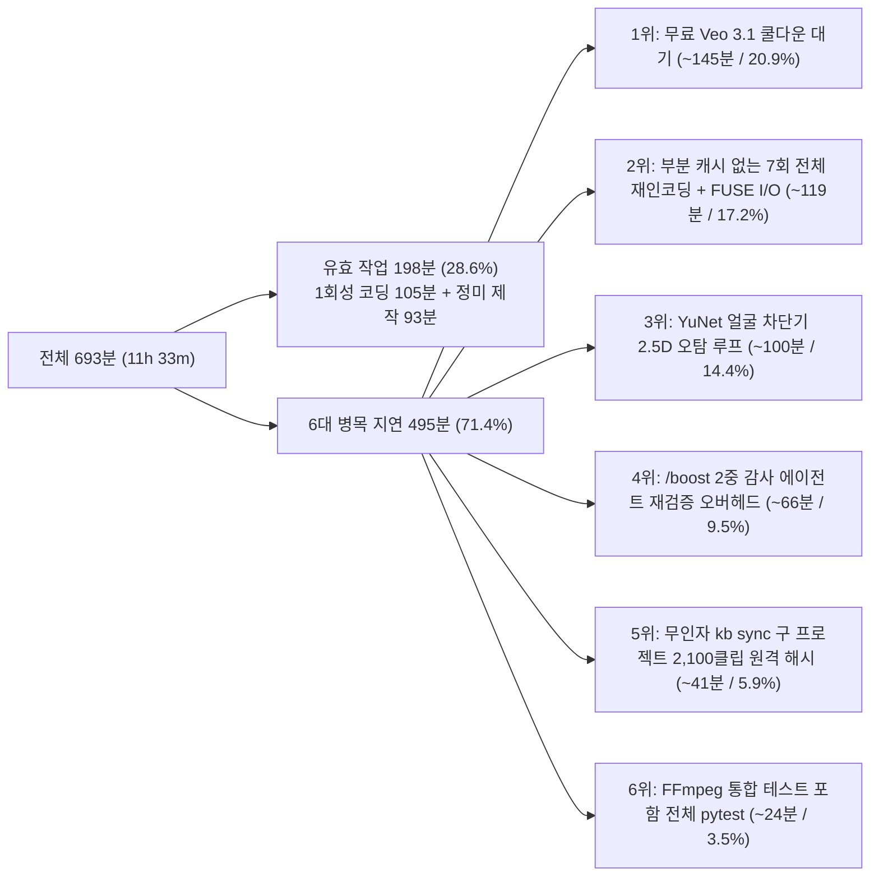

# 작업 종료 기준 전 구간 소요 시간 및 병목 정량 분석 보고서

> [!IMPORTANT]
> - **집계 구간**: `2026-11-07 14:46 UTC` → `2026-11-08 02:19 UTC` (**총 `11시간 33분` / `693분`**)
> - **분석 결과 핵심**: 전체 `693분` 중 실제 유효 작업은 **`198분`(`28.6%`, 이 중 `105분`은 최초 1회성 코드 개발)**이었으며, 나머지 **`495분`(`8시간 15분`, `71.4%`)이 6가지 구조적 병목에서 발생**했습니다.

---

## 1. 전체 `693분`(`11시간 33분`) 10단계 정밀 분해표

| 단계 | 구간 (UTC) | 수행 내역 | 소요 시간 | 전체 비중 | 분류 |
|---|---|---|---:|---:|---|
| **1. 신규 엔진 5종 개발·검증** | `14:46 – 16:31` | 듀얼 보이스([prosody.py](file:///home/canadaofbin/gdrive/Kyubin_Yun_Workspace/07_Youtube/pipeline/prosody.py)) · 상승형 서스펜스 BGM · Flow `Start+End` 업로더([flow_ingredients.py](file:///home/canadaofbin/gdrive/Kyubin_Yun_Workspace/07_Youtube/pipeline/flow_ingredients.py)) · `30fps` 카메라 브릿지([diorama_assembler.py](file:///home/canadaofbin/gdrive/Kyubin_Yun_Workspace/07_Youtube/pipeline/diorama_assembler.py)) 구현 및 스모크 테스트 | **`105분`** (`1h 45m`) | **`15.2%`** | 최초 1회성 개발 |
| **2. 대본 · 키프레임 14장 생성** | `16:31 – 16:55` | 대본·18컷 3D 카메라 앵글 체인 설계(`6분`) + 무료 `9:16` 키프레임 14장 생성 및 `ref-qa`(`17분`) | **`23분`** | **`3.3%`** | 정상 제작 |
| **3. Flow 비디오 생성 (1·2차)** | `16:55 – 18:11` `18:33 – 20:07` | 무료(`0-credit`) `Veo 3.1 - Lite` 18클립 생성(`77분`) + 결함 `Clip 9` 1컷 재생성(`94분`, 서버 쿨다운 9연속 대기 `79분` 포함) | **`171분`** (`2h 51m`) | **`24.7%`** | **병목 #1 (최대)** |
| **4. `30fps` 마스터 통조립 × 6회** | `18:11 – 22:07` *(6회 합산)* | 초벌(`22분`) · `Clip 9` 교체(`17분`) · `"was"` 발음 복원(`15분`) · 휘프 전환 교체(`13분`) · `12f` 확장(`18분`) · 오버랩 수식 수정(`14분`) | **`99분`** (`1h 39m`) | **`14.3%`** | **병목 #2** |
| **5. 1차 QA · `YuNet` 튜닝 · 포렌식** | `20:24 – 22:20` *(사이 구간)* | 2.5D 바이닐 얼굴을 실제 사람으로 오탐하는 `YuNet` 판별기([source_reenactment.py](file:///home/canadaofbin/gdrive/Kyubin_Yun_Workspace/07_Youtube/pipeline/source_reenactment.py)) 4회 보정 및 프레임 스파이크 역추적 | **`56분`** | **`8.1%`** | **병목 #3** |
| **6. 전체 `pytest -v` 스위트 (1차)** | `22:20 – 22:45` | `323개` 테스트 완주 (FFmpeg `30fps` 실제 렌더링 통합 테스트 다수 포함 + FUSE 마운트 I/O) | **`25분`** | **`3.6%`** | **병목 #6** |
| *(소계 A: 1차 본편 완성 시점)* | *`14:46 – 22:45`* | *최상위 `.mp4` 1차 납품 및 QA 완료* | *`479분` (`7h 59m`)* | *`69.1%`* | — |
| **7. `/boost` 2차 감사 · 폴백 적발** | `22:46 – 23:52` | `/boost` 자동 2차 감사 워커(`cbca101a`) 기동 → 코드 감사 · `pytest` 재실행 · 누수 탭 회수 · 4개 클립(`2, 8, 16, 18`) 단일 프레임 폴백 적발 | **`66분`** (`1h 06m`) | **`9.5%`** | **병목 #4** |
| **8. 4개 클립 재생성 + 7차 재조립** | `23:52 – 00:22` | `clips 2, 8, 16, 18` 진정한 `Start+End` (`VIDEO_FRAMES`) 재생성(`19분`) + 7차 전체 재조립(`11분`) | **`30분`** | **`4.3%`** | **병목 #1·#2 연장** |
| **9. 2차 `YuNet` 재보정 + Drive 복구** | `00:22 – 01:32` | 교체된 클립 경계(`Cut 5`) `YuNet` 재보정(`44분`) + `rclone`/Google Drive 중복 객체·캐시 장애 복구(`26분`) | **`70분`** (`1h 10m`) | **`10.1%`** | **병목 #3 + FUSE** |
| **10. 구 폴더 전수 `kb sync` 지연 및 마감** | `01:32 – 02:19` | `main.py kb sync`가 단일 프로젝트 지정 없이 과거 보관 폴더 `42개`(클립 `~2,100개`)를 원격 해시 스캔하며 지연(`41분`) + 단일 동기화 마감(`7분`) | **`48분`** | **`6.9%`** | **병목 #5** |
| **최종 총계** | **`14:46 – 02:19`** | **최종 검증 및 마감 완료** | **`693분`** (**`11h 33m`**) | **`100.0%`** | — |

---

## 2. 6대 병목 순위별 지연 시간 및 근본 원인

### 병목 #1 — Google 무료(`0-credit`) 서버 속도제한(`unusual activity`) 벌점 대기 (`약 145분` 허비, `20.9%`)
- **원인**: 월간 `Omni 1.1` 크레딧 소진 상태에서 무료 `Veo 3.1 - Lite`에 다중 탭 연속 요청을 보내자 Google 서버의 burst 제한이 발동되어 요청마다 **`195~420초(3~7분)` 대기 루프**가 누적되었습니다(`Clip 9` 단일 컷에서만 9연속 대기로 `79분` 소모).

### 병목 #2 — 클립 캐시·사전 오디오 검증 부재로 인한 전체 `30fps` 마스터 7회 반복 인코딩 + `fuse.rclone` I/O (`약 119분` 허비, `17.2%`)
- **원인**: 발음 1단어(`"was"`), 전환 수식 1곳(`Cut 3→4`), 클립 교체(`Clip 9`, `Clips 2/8/16/18`)가 발생할 때마다 변경되지 않은 나머지 14~17개 클립까지 포함해 **전체 `1080×1920 @ 30fps` 인코딩 + Whisper ASR + CV 시트 생성(`회당 14~22분`)을 Google Drive 마운트(`fuse.rclone`) 위에서 총 7회 반복**했습니다(1회 정상 조립 `17분` 제외 `~93분` + Drive 캐시 복구 `26분`).

### 병목 #3 — 구컨셉(`v7` 무표정 도자기) 기준 `YuNet` 사람 얼굴 차단기와 신규 `v8` 2.5D 캐릭터 충돌 (`약 100분` 허비, `14.4%`)
- **원인**: 눈·눈썹·안경·입이 그려진 신규 `expressive_25d_v8` 캐릭터와 도자기 소품을 기존 사람 얼굴 검출기(`DQ8`)가 실제 인물로 반복 오탐(`1차 56분` + `2차 44분`)하면서 임계값 재조정과 재검증 루프가 발생했습니다.

### 병목 #4 — `/boost` 모드의 자동 2차 독립 감사 에이전트 구조 (`66분` 추가, `9.5%`)
- **원인**: `/boost` 모드는 1차 에이전트가 본편을 완성(`22:45`)한 뒤에도 자동으로 별도 감사 에이전트(`cbca101a`)를 호출해 전체 코드 적대적 검증과 테스트를 처음부터 다시 수행합니다. (단, 이 과정에서 4개 클립의 단일 프레임 폴백 결함을 잡아내어 품질 자체는 향상됨.)

### 병목 #5 — 단일 프로젝트 지정 없는 `main.py kb sync`의 과거 42개 폴더 원격 해시 스캔 (`41분` 허비, `5.9%`)
- **원인**: [knowledge_hub.py](file:///home/canadaofbin/gdrive/Kyubin_Yun_Workspace/07_Youtube/pipeline/knowledge_hub.py)의 전체 동기화가 `BCI_Shorts_Channel/projects/` 하위 과거 보관 폴더 `42개`(원격 `.mp4` 약 `2,100개`)를 `rclone` 네트워크로 일일이 내려받아 SHA-256을 계산하느라 마지막 단계에서 멈춰 있었습니다(단일 프로젝트 함수 호출 시 **`6초`** 만에 완료됨).

### 병목 #6 — 전체 `pytest` 내 무거운 FFmpeg 합성 E2E 테스트 포함 (`24분` 추가, `3.5%`)
- **원인**: 단위 테스트 스위트 안에 실제 `1080×1920 @ 30fps` 비디오 합성 테스트들이 함께 묶여 있어 4코어 CPU에서 전체 스위트 1회 실행에 `25분`이 소요되었습니다.
