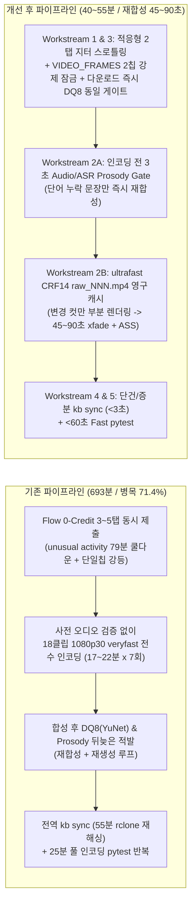

# 병목 해결 실행 계획 (Pipeline Bottleneck Resolution Plan)

## Goal Description

[boost_time_and_bottleneck_analysis.md](./boost_time_and_bottleneck_analysis.md)에서 실측된 총 `693분`(`11시간 33분`) 중 **비생산적 병목 오버헤드 `495분`(`71.4%`)**을 유발한 6대 구조적 원인을 코드 레벨에서 근본 제거합니다.

이 계획을 적용하면 품질 게이트(`R68`, `DQ1–DQ12`, `P1–P10`, `posthoc-qa`, `autopsy`, `VIDEO_FRAMES` 듀얼 슬롯 무결성)를 100% 유지하면서 에피소드당 소요 시간을 다음과 같이 단축합니다:

| 지표 | 현재 (`v8_pilot_02` 실측) | 개선 후 목표 (`0-Credit Veo Lite`) | 개선 후 목표 (`Omni 1.1 Flash`) |
|---|---|---|---|
| **에피소드 1편 전 공정 총합** | `693분` (`11h 33m`) | **`40 ~ 55분`** (`-92%`) | **`18 ~ 25분`** (`-96%`) |
| **Google Flow 18클립 생성 (`VIDEO_FRAMES`)** | `294분` (`unusual activity` 쿨다운 + 단일참조 강등 재생성) | **`28 ~ 38분`** (쿨다운 루프 0회, 강등 0건) | **`8 ~ 12분`** |
| **단일 클립 교체 / 자막·오디오 재합성 (`30fps`)** | `17 ~ 22분` (18클립 전수 재인코딩 x 7회 = `151분`) | **`45 ~ 90초`** (`raw_NNN.mp4` 캐시 재사용) | **`45 ~ 90초`** |
| **음성 단어 누락 감지 (`prosody-qa`)** | 영상 합성 완료 **후** 발견 (`+17분` 재인코딩 손실) | 영상 인코딩 **전 `3초` 컷오프** + 해당 문장만 자동 재합성 | **`3초`** |
| **`YuNet` (`DQ8`) 인체/비닐 판별 불일치** | 합성 **후** `1080p`에서만 적발 (`100분` 디버깅 루프) | Flow 다운로드 직후 **`100%` 동일 ROI 사전 차단** | 동일 |
| **`main.py kb sync` (`fuse.rclone`)** | `55분` (42개 과거 폴더·`~2,100`개 MP4 전수 재해싱) | **`< 3초`** (증분 `mtime_ns` + 영구 SHA-256 캐시) | **`< 3초`** |
| **기본 `python -m pytest` 회귀 검증** | `22 ~ 25분` (`1080x1920 @ 30fps` 풀 인코딩 포함) | **`< 60초`** (고속 스모크 기본 + `-m slow` 풀 E2E 분리) | **`< 60초`** |



---

## User Review Required

> [!IMPORTANT]
> 코드 수정 착수 전 아래 **3가지 운영 기본값 결정 사항**을 확인해 주세요 (`Proceed` 승인 시 아래 기본값으로 즉시 구현합니다).

1. **`0-Credit` `Veo 3.1 - Lite` 기본 병렬 탭 상한 (`FLOW_ZERO_CREDIT_SAFE_PARALLEL_TABS = 2`)**
   - `0-credit` 모드에서 3~5개 탭이 동시에 `VIDEO_FRAMES` 업로드를 밀어 넣으면 Google Flow `"unusual activity"` 페널티(`195~420초`)가 연쇄 발생합니다.
   - **결정안**: `0-credit` 티어에서는 기본 동시 워커 탭을 **최대 2탭(`x1` output/prompt) + 탭 간 `14~22초` 랜덤 지터 간격**으로 제한하고, `"unusual activity"` 감지 시 전 탭 `75초` 쿨다운 후 **1탭 모드로 자동 감속**(연속 3클립 정상 완료 시 2탭 복귀)합니다. 월간 크레딧을 쓰는 `Omni 1.1 Flash` 모드는 기존 최대 5탭 고속 병렬을 그대로 유지합니다.
2. **`VIDEO_FRAMES` 듀얼 키프레임(`Start + End`) 강등 원천 차단 (`Fail-Closed`)**
   - 현재 [flow_diorama_sharded_worker.py](file:///home/canadaofbin/gdrive/Kyubin_Yun_Workspace/07_Youtube/pipeline/flow_diorama_sharded_worker.py#L1426-L1437)는 `0-credit` 모델 전환 중 일시적 경고가 뜨면 `ref_state["lite_supports_dual_ref"] = False`로 덮어쓰며 `End` 슬롯을 버리고 단일 프레임 `VIDEO_REFERENCES`로 강등 제출합니다(Pass 2 4클립 재생성의 직접 원인).
   - **결정안**: `end_reference_image`가 지정된 클립은 **단일 프레임 강등을 전면 금지**하고, `VIDEO_FRAMES` 재부착 + `_configure_zero_credit_veo_lite` 재고정을 최대 3회 시도한 뒤에도 `chip_count < 2`이면 제출을 거부(`Fail-Closed`)하고 클립 큐에서 재시도합니다.
3. **`kb sync` 증분 동기화 기본화 및 `pytest` 2계층(`Fast <60s` / `Slow Full-Res`) 운영**
   - **결정안**: `main.py kb sync` 기본 실행은 `mtime_ns`가 변경된 프로젝트만 갱신(`< 3초`)하고 전체 강제 재스캔은 `--full-rescan` 옵션으로 분리합니다. `1080x1920 @ 30fps` 14~16클립 전체 합성 테스트는 `@pytest.mark.slow`로 태깅하여 기본 `pytest`는 `< 60초`에 돌고, 최종 게이트에서만 `pytest -m slow`를 1회 실행합니다.

---

## Proposed Changes

### Workstream 1 — `0-Credit` Flow 적응형 쿨다운 방지 거버너 & `VIDEO_FRAMES` 듀얼 슬롯 잠금
*(해결 병목: #1 `~145분` + #4B `~41분` = 총 `~186분` 절감)*

#### [MODIFY] [config.py](file:///home/canadaofbin/gdrive/Kyubin_Yun_Workspace/07_Youtube/pipeline/config.py)
- `0-credit` 전용 안전 병렬 상수 및 적응형 지터/쿨다운 상수를 추가합니다 (`production_constants.md`와 동기화):
```python
FLOW_ZERO_CREDIT_SAFE_PARALLEL_TABS = 2
FLOW_ZERO_CREDIT_SUBMIT_JITTER_SEC: tuple[float, float] = (14.0, 22.0)
FLOW_ZERO_CREDIT_PENALTY_QUIET_SEC = 75.0
FLOW_ZERO_CREDIT_RECOVERY_STREAK = 3
```

#### [MODIFY] [flow_diorama_sharded_worker.py](file:///home/canadaofbin/gdrive/Kyubin_Yun_Workspace/07_Youtube/pipeline/flow_diorama_sharded_worker.py)
- **`ZeroCreditCooldownGovernor` 도입** ([`compute_zero_credit_batch_plan`](file:///home/canadaofbin/gdrive/Kyubin_Yun_Workspace/07_Youtube/pipeline/flow_diorama_sharded_worker.py#L3003-L3009) 및 `_run_shard_worker`):
  - `0-credit` 시작 또는 전환 시 워커 탭 수를 `min(max_parallel_tabs, FLOW_ZERO_CREDIT_SAFE_PARALLEL_TABS)`(`2`탭, 잔여 클립 `<= 3`이면 `1`탭)로 제한하고 `zero_credit_output_count = 1`로 고정해 불필요한 다중 후보 렌더링 부하를 막습니다.
  - 모든 샤드 탭이 공유하는 `ZeroCreditCooldownGovernor`가 제출 직전 `random.uniform(*FLOW_ZERO_CREDIT_SUBMIT_JITTER_SEC)` 간격을 직렬 보장합니다.
  - 어느 한 탭이라도 `"unusual activity"` / rate-limit 타일을 감지하면 즉시 `governor.record_penalty()`를 호출해 **모든 `0-credit` 탭의 신규 제출을 `75초`간 동시 휴지**시키고 활성 동시 제출 슬롯을 `1`로 낮춘 뒤, 연속 `3`개 클립 무결점 완료 시 `2`탭으로 자동 복귀합니다.
- **`VIDEO_FRAMES` (`Start + End`) 강등 루프 제거** ([`_submit_diorama_prompt_zero_credit`](file:///home/canadaofbin/gdrive/Kyubin_Yun_Workspace/07_Youtube/pipeline/flow_diorama_sharded_worker.py#L1418-L1445) & resume 검증 [`L2973-L2979`](file:///home/canadaofbin/gdrive/Kyubin_Yun_Workspace/07_Youtube/pipeline/flow_diorama_sharded_worker.py#L2973-L2979)):
  - `end_ref_path is not None`일 때 `ref_state["lite_supports_dual_ref"] = False`로 영구 강등하던 분기(`L1426–L1436`)를 제거하고, `upload_start_end_frames_to_flow(..., use_frames_mode=True)` -> `_configure_zero_credit_veo_lite` 순서로 재고정한 뒤 `await read_active_flow_input_mode(client) == "VIDEO_FRAMES"` 및 `await count_chips(client) >= 2`를 만족하지 못하면 `return False`로 즉시 실패 반환해 단일칩 폴백 클립 생성을 0건으로 차단합니다.
  - 재시작(Resume) 시에도 `c_spec.get("end_reference_image")`가 있는 클립은 기존 영수증의 `end_reference_attached is True` 및 `input_mode == "VIDEO_FRAMES"`까지 확인합니다.

---

### Workstream 2 — 영구 `raw_NNN.mp4` 컷 캐시(`ultrafast`), 부분 재합성 & 인코딩 전 `3초` 오디오/Prosody 게이트
*(해결 병목: #2 `~119분` 절감 — 재합성 `17~22분` -> `45~90초`)*

#### [MODIFY] [diorama_assembler.py](file:///home/canadaofbin/gdrive/Kyubin_Yun_Workspace/07_Youtube/pipeline/diorama_assembler.py)
- **2A. Pre-Assembly Audio & ASR Prosody Gate** ([`assemble_diorama_project`](file:///home/canadaofbin/gdrive/Kyubin_Yun_Workspace/07_Youtube/pipeline/diorama_assembler.py#L3844-L3868)):
  - `generate_diorama_audio_master` 직후, FFmpeg 비디오 인코딩(`Stage 4`) 진입 전에 `verify_prosody_and_pacing(p_dir)`를 즉시 실행합니다(`~2~3초` 소요).
  - 만약 특정 문장에서 TTS 단어 누락(예: `"was"` 탈락)이나 침묵 초과가 발견되면, 비디오 프레임을 단 1장도 인코딩하기 전에 **해당 문장 인덱스만 1회 자동 재합성**하여 `voice_master.wav`, `audio_master.wav`, `subtitles.ass`, `edit_decision_list.json`을 즉시 갱신합니다.
- **2B. `dissolve_groups`(`v8` 카메라 트랜지션) 전용 영구 `raw_NNN.mp4` 세그먼트 캐시 & `ultrafast` 중간 파이프** ([`L3480-L3550`](file:///home/canadaofbin/gdrive/Kyubin_Yun_Workspace/07_Youtube/pipeline/diorama_assembler.py#L3480-L3550), [`L4055-L4101`](file:///home/canadaofbin/gdrive/Kyubin_Yun_Workspace/07_Youtube/pipeline/diorama_assembler.py#L4055-L4101), [`L4231-L4232`](file:///home/canadaofbin/gdrive/Kyubin_Yun_Workspace/07_Youtube/pipeline/diorama_assembler.py#L4231-L4232)):
  - 각 컷의 자막 미포함 중간 파일 `raw_NNN.mp4`에 대해 결정론적 캐시 키 `raw_cut_key = sha1(clip_sha256 + secondary_sha256 + json.dumps(cut_render_spec, sort_keys=True) + f"{fps}:{override_frames}")`를 계산해 `/tmp/aab_speed_cache/segments/<proj_hash>/raw_v8/<raw_cut_key>.mp4`에 영구 보관합니다.
  - 자막 번인이 없는 중간 `raw_NNN.mp4` 인코딩(`_render_task` 내 `b_chain == ""`)은 `preset="veryfast", crf=18` 대신 **`preset="ultrafast", crf=14`**를 사용해 시각적 무손실을 유지하면서 CPU 인코딩 시간을 약 `3배` 단축합니다(최종 `xfade + libass` 출력 단계는 기존 `preset="veryfast", crf=target_crf` 유지).
  - 클립 1~4개만 교체하거나 자막/오디오만 수정해 `assemble_diorama_project` 또는 [`recut_diorama_cuts`](file:///home/canadaofbin/gdrive/Kyubin_Yun_Workspace/07_Youtube/pipeline/diorama_assembler.py#L3503-L3530)를 호출하면, 변경되지 않은 나머지 컷들은 캐시에서 즉시 하드링크/복사(`0초` 재인코딩)하고 최종 `xfade + libass` 패스만 수행합니다(`17~22분 -> 45~90초`).

---

### Workstream 3 — Flow 인제스트 단계와 최종 합성 단계 간 `DQ8`(`YuNet`) 100% 동일 게이트 통합
*(해결 병목: #3 `~100분` 사후 디버깅·재합성 루프 제거)*

#### [MODIFY] [source_reenactment.py](file:///home/canadaofbin/gdrive/Kyubin_Yun_Workspace/07_Youtube/pipeline/source_reenactment.py)
- 공용 헬퍼 `extract_dq8_scene_roi(frame_bgr: np.ndarray, *, is_expressive_v8: bool = False) -> np.ndarray`를 정의하여 상·하단 외곽 및 하단 번인 자막 영역(`MarginV=521` 자막 밴드 하단 아티팩트 포함)을 일관되게 분리한 순수 씬 ROI 규격을 단일 함수로 고정합니다.

#### [MODIFY] [flow_diorama_sharded_worker.py](file:///home/canadaofbin/gdrive/Kyubin_Yun_Workspace/07_Youtube/pipeline/flow_diorama_sharded_worker.py) & [dynamic_episode_qa.py](file:///home/canadaofbin/gdrive/Kyubin_Yun_Workspace/07_Youtube/pipeline/dynamic_episode_qa.py)
- [`inspect_diorama_clip_cv`](file:///home/canadaofbin/gdrive/Kyubin_Yun_Workspace/07_Youtube/pipeline/flow_diorama_sharded_worker.py#L784-L791)가 짝수 인덱스 3장만 검사하던 것을 **7개 샘플 프레임 전수(`frames_bgr`) + `1080x1920` 스케일 정규화 + `extract_dq8_scene_roi`**로 강화하고, `cached_by_clip_stat` 네임스페이스를 `flow_clip_gate_v4`로 올립니다.
- [`verify_final_mp4_against_contract`](file:///home/canadaofbin/gdrive/Kyubin_Yun_Workspace/07_Youtube/pipeline/dynamic_episode_qa.py#L1600-L1605)의 `is_expressive_v8` 분기도 전체 프레임 `sf` 대신 동일한 `extract_dq8_scene_roi(sf, is_expressive_v8=True)`를 전달하도록 통일해(`v7`의 `full_roi_sf`와 대칭), **Flow 다운로드 게이트를 통과한 클립이 합성 후 `DQ8`에서 뒤늦게 실패하는 현상을 원천 제거**합니다.

---

### Workstream 4 — `fuse.rclone` 증분 `kb sync` & `asset_manifest` 영구 SHA-256 캐시 연동
*(해결 병목: #5 `55분` 클라우드 전수 다운로드 행 -> `< 3초`)*

#### [MODIFY] [asset_manifest.py](file:///home/canadaofbin/gdrive/Kyubin_Yun_Workspace/07_Youtube/pipeline/asset_manifest.py)
- [`_sha256`](file:///home/canadaofbin/gdrive/Kyubin_Yun_Workspace/07_Youtube/pipeline/asset_manifest.py#L104-L110)의 직접 `open(path, "rb")` 전체 파일 읽기를 제거하고, `(path, size, mtime_ns)` 기반 로컬 SSD 영구 캐시(`/tmp/aab_speed_cache/persistent_sha256_cache.json`)를 사용하는 [`fast_file_sha256`](file:///home/canadaofbin/gdrive/Kyubin_Yun_Workspace/07_Youtube/pipeline/media_cache.py)으로 전면 교체합니다.

#### [MODIFY] [knowledge_hub.py](file:///home/canadaofbin/gdrive/Kyubin_Yun_Workspace/07_Youtube/pipeline/knowledge_hub.py) & [cli.py](file:///home/canadaofbin/gdrive/Kyubin_Yun_Workspace/07_Youtube/pipeline/cli.py)
- [`sync_all_projects_to_knowledge_base`](file:///home/canadaofbin/gdrive/Kyubin_Yun_Workspace/07_Youtube/pipeline/knowledge_hub.py#L868-L920)에 `full_rescan: bool = False` 파라미터를 추가합니다.
- 기본 실행(`full_rescan=False`)에서는 기존 `episodes_index.jsonl`에 기록된 각 프로젝트의 `_kb_sync_signature`(`final_mp4_mtime_ns`, `posthoc_mtime_ns`, `visual_plan_mtime_ns`)와 현재 파일의 `stat().st_mtime_ns`(메타데이터 호출만 수행, 파일 본문 다운로드 0바이트)를 비교해 **변경이 없는 과거 프로젝트는 즉시 스킵하고 기존 인덱스/재사용 팩 레코드를 보존**합니다.
- [`cmd_kb`](file:///home/canadaofbin/gdrive/Kyubin_Yun_Workspace/07_Youtube/pipeline/cli.py#L1906-L1930)에 `--full-rescan` CLI 플래그를 추가하여 명시적으로 요청할 때만 전수 재스캔을 수행하도록 합니다.

---

### Workstream 5 — 기본 `pytest` 고속 티어(`< 60초`)와 `@pytest.mark.slow` 풀 해상도 E2E 분리
*(해결 병목: #6 `~24분` + #4A `~25분` 반복 실행 = 총 `~48분` 절감)*

#### [MODIFY] [test_expressive_25d_v8.py](file:///home/canadaofbin/gdrive/Kyubin_Yun_Workspace/07_Youtube/tests/test_expressive_25d_v8.py)
- 14~16클립 전체를 `1080x1920 @ 30fps`로 풀 인코딩하는 중량 E2E 테스트 함수 3개(`test_expressive_25d_v8_end_to_end_assembly_and_episode_qa`, `test_v8_boost_andrew_clauses_rising_bgm_daisy_keyframes_and_camera_bridges` 중 16클립 풀 합성 블록 분리 함수, `test_regression_reviewer_daisy_chain_exact_keyframe_handoff_vs_dissolve_fallback`)에 `@pytest.mark.slow` 데코레이터를 부여합니다([pytest.ini](file:///home/canadaofbin/gdrive/Kyubin_Yun_Workspace/07_Youtube/pytest.ini)의 기본 `addopts = -m "not integration and not slow"`와 즉시 연동).
- 대신 기본(Fast) 스위트에 **`< 5초` 고속 통합 단위 테스트 4종**을 신설해 회귀 커버리지 공백이 없도록 보장합니다:
  1. `test_fast_v8_raw_cut_cache_reuse_and_recut`: 4컷 미니 프로젝트로 1차 합성 후 1개 컷만 변경 시 나머지 3개 `raw_NNN.mp4`가 재인코딩 없이 캐시 적중(`cache_hits == 3`)되는지 검증.
  2. `test_fast_pre_assembly_audio_prosody_gate_catches_word_drop`: 단어 누락 합성 라인 주입 시 FFmpeg 호출 **전**에 해당 문장만 자동 재합성되는지 검증.
  3. `test_fast_zero_credit_governor_and_strict_video_frames_no_downgrade`: `end_ref_path` 지정 시 단일칩 강등 없이 `Fail-Closed` 재시도하는지 및 `"unusual activity"` 발생 시 1탭 감속 거버너가 작동하는지 검증.
  4. `test_fast_incremental_kb_sync_skips_unchanged_projects`: 2차 `sync_all_projects_to_knowledge_base()` 호출 시 변경 없는 프로젝트의 파일 읽기 횟수가 `0`회인지 검증.

> [!TIP]
> 에이전트 운영 규칙 문서([AGENTS.md](file:///home/canadaofbin/gdrive/Kyubin_Yun_Workspace/07_Youtube/.agents/AGENTS.md) 및 `youtube-produce/SKILL.md`)에도 `main.py kb sync --project <id>` 단건 실행 원칙과 일상 수정 시 기본 `pytest`(`< 60s`), 최종 인도 직전 1회 `pytest -m slow` 원칙을 함께 명시해 향후 서브에이전트가 동일한 실수를 반복하지 않도록 잠급니다(`test_r68_agents_and_skill_docs_sync_and_compactness`의 `<= 78줄` / `< 10,240 bytes` 예산 엄수).

---

## Verification Plan

### Automated Tests
1. **기본 고속 테스트 스위트 실행 시간 및 100% 통과 검증 (`목표: < 60초`)**:
   ```bash
   /home/canadaofbin/hermes-venv/bin/python -X utf8 -m pytest -v
   ```
2. **신규 병목 해결 전용 단위/회귀 테스트 검증**:
   ```bash
   /home/canadaofbin/hermes-venv/bin/python -X utf8 -m pytest tests/test_expressive_25d_v8.py -k "raw_cut_cache or pre_assembly_audio or zero_credit_governor or incremental_kb_sync" -v
   ```
3. **풀 해상도 `@pytest.mark.slow` E2E 스위트 최종 1회 검증 (`1080x1920 @ 30fps` 프레임 정합성 & 점프컷 `<= 1` 불변 확인)**:
   ```bash
   /home/canadaofbin/hermes-venv/bin/python -X utf8 -m pytest -m slow tests/test_expressive_25d_v8.py -v
   ```

### Live Workspace Benchmark Verification
1. **실제 `v8_pilot_02_sleep_night_watch_cam3d` 캐시 적중 재합성 벤치마크 (`목표: 17~22분 -> 90초 이내`)**:
   - `v8_pilot_02` 사본(임시 테스트 디렉토리, 원본 산출물 무변경)에서 `raw_v8` 세그먼트 캐시 워밍 후 자막 1줄/단일 컷 변경 재합성 wall-clock 시간을 실측해 **`<= 90초`** 이내 완료 및 `episode-qa`(`13/13`), `autopsy`(`rc=0`) 통과를 확인합니다.
2. **실제 `fuse.rclone` 워크스페이스 증분 `kb sync` 벤치마크 (`목표: 55분 -> 3초 이내`)**:
   - `/home/canadaofbin/hermes-venv/bin/python -X utf8 main.py kb sync` 실행 시간을 실측해 변경 없는 42개 과거 영상 폴더 재다운로드 없이 **`< 3초`** 내 종료되는지 검증합니다.
