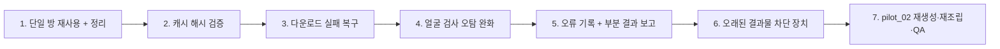

# 버그 수정 계획: Flow 생성기와 pilot_02 결과물 문제

## 목표
폴더 점검에서 나온 버그 9건을 고치고, pilot_02를 **새 15문장 대본 기준으로 처음부터 끝까지 다시 만듭니다**.
지금의 완성본은 옛 18문장 계획(18컷, 68.8초)으로 만든 것입니다.

> [!WARNING]
> `flow_diorama_sharded_worker.py`가 22:13에 작업 담당에 의해 이미 수정되고 있었습니다(보류 지시는 22:13:40에 도착).
> 승인되면 먼저 **이미 바뀐 부분을 확인**하고, 계획과 다른 부분은 되돌리거나 계획에 맞게 정리합니다.

---

## User Review Required

> [!IMPORTANT]
> **오래된 클립을 어떻게 처리할지**: `clip_5`, `clip_8`, `clip_13`은 11월 7일에 만든 클립입니다.
> - **(추천) A안**: 프롬프트·참조 이미지 해시를 비교해 **맞지 않는 클립만** 다시 만듭니다. 비용은 0이지만 대기 시간이 있습니다.
> - B안: 14컷을 모두 다시 만듭니다. 가장 확실하지만 무료 대기열 기준 몇 시간 걸립니다.

> [!CAUTION]
> **Flow 프로젝트 삭제**: 이 에피소드의 중복 `AAB_v8_pilot_02…__clips…` 프로젝트 약 50개를 지웁니다.
> - 남기는 것: 클립을 다 받아온 것을 확인한 뒤의 공식 방 `AAB_v8_pilot_02_sleep_night_watch_cam3d` **1개**.
> - 그 외에는 이 에피소드 이름의 프로젝트만 지우고, 다른 에피소드나 직접 만드신 프로젝트는 건드리지 않습니다.
> - Flow에는 휴지통이 없을 수 있습니다. 삭제는 되돌릴 수 없다고 봐야 합니다.

## Open Questions
1. 오래된 클립 처리: A안과 B안 중 어느 쪽으로 할까요? (추천: A안)
2. 사람 얼굴 검사(YuNet)를 v8 인형 스타일에서 **경고만 하도록** 바꿔도 될까요?
   - 경고만 하면 오탐으로 인한 재생성은 사라집니다. 대신 진짜 사람 얼굴이 섞인 경우는 최종 QA와 사람 눈으로 잡아야 합니다.
   - 추천은 **경고 + 피부색·머리카락 검사를 함께 통과할 때만 실패 처리**입니다.

---

## Proposed Changes



### 1. Flow 방 1개만 쓰기 (중복 프로젝트 문제) — 🔴
#### [MODIFY] flow_diorama_sharded_worker.py
- 현재는 실행할 때 웨이브(재시도 회차)마다 새 프로젝트를 열고 있습니다(점검 기준 2114, 2125–2140, 2148줄).
- 바꿀 점:
  - 실행 시작 시 공식 방 URL을 **한 번만** 정하고, 모든 샤드·웨이브·재시도가 그 URL을 공유합니다.
  - 이전 생성 기록의 URL이 있으면 그것을 먼저 씁니다. 없으면 Flow에서 `AAB_<project_id>` 이름으로 찾고, 그래도 없을 때만 새로 만듭니다.
- 정리 단계(3456–3465줄)는 지울 이름을 `AAB_{slug}__clips`로 찾고 있어서 실제 방 이름과 맞지 않았습니다. 또 `except: pass`로 오류를 숨기고 있었습니다.
  - 공식 방 이름 규칙에 맞춰 고칩니다.
  - **이번 실행에서 자기가 만든 방만** 지우도록 기록을 남깁니다.
  - 실패하면 오류를 로그에 남깁니다.
#### [MODIFY] flow_live_single_worker.py
- 1325줄: "New project" 버튼은 기존 방을 찾을 수 없을 때만 누르게 합니다.

```diff
- if not flow_rate_state.get("canonical_project_url"):
-     url = await allocate_project(...)   # 웨이브마다 새로 생성
+ url = flow_rate_state.setdefault(
+     "canonical_project_url",
+     prev_url or await find_room(room_name) or await allocate_project(room_name),
+ )
```

### 2. 예전 클립 재사용 방지 (Clip 10 이음새 어긋남의 원인) — 🔴
#### [MODIFY] flow_diorama_sharded_worker.py
- 현재 `_pop_next_pending_clip`(2018줄)은 파일이 있고 크기만 충분하면 그 클립을 재사용합니다. 재사용 판단 기준(2048–2053줄)에는 프롬프트나 참조 이미지가 들어 있지 않습니다.
- 바꿀 점:
  - 생성 기록(`flow_provenance_receipt.json`)의 각 클립에 `prompt_sha256`, `start_ref_sha256`, `end_ref_sha256`를 저장합니다.
  - 현재 프롬프트·참조 이미지와 해시가 같을 때만 재사용합니다.
  - 해시가 다르거나 기록이 없으면 그 클립은 `flow_native_clips/_stale/`로 옮기고(삭제하지 않음) 다시 만듭니다.

### 3. 다운로드 실패 시 헛도는 재시도 — 🟠
#### [MODIFY] flow_diorama_sharded_worker.py
- 현재 동작(2708–2712, 2232줄): 다운로드를 놓치면 영상을 바로 새로 생성합니다. 새로고침은 한 번뿐이고, 7초 고정 대기입니다.
- 바꿀 점:
  1. 다운로드를 놓치면 **먼저 Flow 화면에서 이미 렌더링이 끝난 영상을 찾아** 받아옵니다(`seen_tab_srcs` 활용).
  2. 새로고침은 고정 대기 대신 화면이 준비됐는지 확인하고 진행합니다.
  3. 2번 연달아 놓치면 재시도 기회를 소모하지 않고 `download_path_error`라는 별도 오류로 멈춥니다.
- 21:26에 만들어진 `clip_12.mp4`가 어떻게 생겼는지도 추적합니다. QA를 거치지 않고 저장된 것이라면 막습니다.

### 4. 얼굴 검사 오탐 완화 — 🟠
#### [MODIFY] flow_diorama_sharded_worker.py (789–794줄), source_reenactment.py
- 대상은 v8(`expressive_25d_v8`) 스타일입니다.
- YuNet 얼굴 감지만으로 실패 처리하지 않습니다. 피부색 비율이나 머리카락 검사도 함께 걸릴 때만 실패로 봅니다(질문 2의 답에 따름).
- 감지 점수와 위치를 로그에 남깁니다.

### 5. 오류를 숨기는 코드 정리 + 부분 결과 보고 — 🟡
#### [MODIFY] flow_diorama_sharded_worker.py
- `except Exception: pass` 6곳(2073, 2795, 3036, 3435, 3465, 3572줄)을 오류 기록(`logger.exception`)으로 바꿉니다. 생성 기록 저장이 실패하면 경고를 띄웁니다.
- 클립 하나가 실패해도(3409줄) 쓸 수 있는 클립과 실패한 클립 목록을 `flow_partial_summary.json`에 저장한 뒤 멈추게 합니다.

### 6. 오래된 오디오·조립본 차단 장치 — 🔴
#### [MODIFY] diorama_assembler.py, dynamic_episode_qa.py, cli.py
- 조립과 QA 시작 전에 다음을 확인합니다.
  - `script.json`의 해시가 `voice_report.json`에 기록된 대본 해시와 같은지
  - 클립 수가 `visual_plan.json`과 같은지
- 맞지 않으면 다음 메시지를 띄우고 **실행을 거부**합니다: "대본이 바뀌었습니다. 음성부터 다시 만드세요"
- 이 확인은 `--force-stale` 옵션을 줄 때만 건너뜁니다.

### 7. pilot_02 다시 만들기
1. 클립 해시 점검을 실행해 맞지 않는 클립을 다시 생성합니다(A안 기준). 공식 방 1개와 작업 담당 전용 탭만 씁니다.
2. 모든 이음새(`End(이전) == Start(다음)`)의 픽셀 차이가 5 이하인지 확인합니다.
3. 음성 합성(`emma_v7`, 약 200 WPM) → 자막 → 조립(BGM −5dB) 순서로 만듭니다.
4. 전체 QA를 돌립니다: `prosody-qa`, `episode-qa`(DQ1–DQ13), `posthoc-qa`, `autopsy`, `thumbnail`.
5. 루트 완성본 MP4를 교체하고 walkthrough를 갱신합니다.
6. 중복 Flow 프로젝트를 정리하고, 정리 전/후 개수를 보고합니다.

---

## Verification Plan

### Automated Tests
```bash
PYTHONPYCACHEPREFIX=/tmp/aab_pycache /home/canadaofbin/hermes-venv/bin/python -X utf8 -m pytest -q
```
새로 추가할 테스트(`tests/test_flow_worker_bugfixes.py`):
- 웨이브 3번·재시도 2번을 돌려도 프로젝트 생성은 1번만 일어나는지
- 정리 단계가 이번 실행에서 만든 방만 지우는지
- 프롬프트나 참조 이미지 해시가 바뀌면 캐시 클립을 재사용하지 않는지
- 다운로드를 놓치면 화면 재검색을 먼저 하고, 2번 연속이면 `download_path_error`로 멈추는지
- 대본이 바뀐 상태에서는 조립과 QA가 실행을 거부하는지
- 오류를 숨기는 `except Exception: pass`가 남아 있지 않은지(정적 검사)

### Manual Verification
- **Flow 프로젝트 목록**(휴대폰에서도 확인 가능): pilot_02 방이 **1개만** 남았는지 확인해 주세요.
- **완성본 영상**:
  - 전체 길이가 58–88초인지
  - 첫 질문 문장이 약 3초 안에 끝나는지
  - X-Ray 뇌가 10초 안에 처음 나오는지
  - 같은 장소 장면들이 끊김이나 잔상 없이 이어지는지
- 제가 완성본에서 직접 뽑은 프레임 확인용 시트를 함께 보여드립니다.
