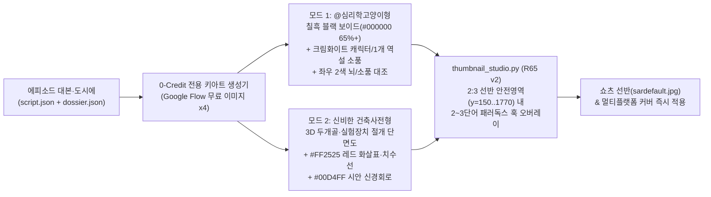

# 경쟁 채널 썸네일 심층 해부 보고서 — `신비한 건축사전` & `@심리학고양이` vs `ALL ABOUT BRAIN (v8)`

실제 유튜브 상위 노출 썸네일 **33종 원본**과 쇼츠 MP4 본편 프레임을 직접 수집하여 컴퓨터 비전(`OpenCV`) 정량 지표와 시각 문법을 전수 비교했습니다.

---

## 1. 실제 수집 썸네일 비교 갤러리 (상위 히트작 실물)

````carousel

<!-- slide -->

<!-- slide -->

<!-- slide -->

````

---

## 2. 두 레퍼런스 채널의 핵심 클릭 공식 해부

### A. `신비한 건축사전` (`@신비한_건축사전_1` · 구독자 82.5만 · 3.5개월 만에 쇼츠 최고 652만 / 롱폼 417만)
- **체급·엔진 일치**: 쇼츠 길이가 **`91~179초` 중장편 스토리텔링 쇼츠**이며, 우하단 워터마크로 확인한 결과 **우리와 동일한 Google Veo / Imagen (Flow 계열) AI 엔진**을 사용 중입니다.
- **시각 공식 1 — "보이지 않는 내부를 칼로 썬 3D 단면도(Cutaway)"**:
  - 지상에는 누구나 아는 일상 공간(아파트·공원·한강·경복궁·폐버스)을 두고, 그 아래 지하·수중·바닥 슬래브를 **직육면체 케이크처럼 절개해 숨겨진 내부 구조(쓰레기층, 수중 말뚝, 누수 균열, 층간소음 충격파)** 를 한 장에 보여줍니다.
- **시각 공식 2 — "`#FF2525` 빨간 화살표·치수선 & `#00D4FF` 네온 시안 포인터"**:
  - 썸네일과 본편 영상 컷 모두에 **입체 빨간 화살표, 빨간 치수선(`2.5m`, `14cm`), 빨간 `✕` vs 초록 `✓`, 네온 시안 물줄기**를 넣어 `0.3초` 만에 시선이 어디를 봐야 하는지 강제 유도합니다.
- **시각 공식 3 — "대각선 Z-패턴 2청크 백색+검정 외곽선 타이포 (`16:9`)"**:
  - 상단 1줄에 몰아넣지 않고, **좌상단(수치·전제: `30층 높이`, `폭 2.5m 한계`, `6만 석인데`) → 중앙 3D 단면도 관통 → 우하단(결론·반전: `쓰레기 산`, `거주 불가`, `18,000석만 오픈`)** 으로 시선이 대각선으로 흐르게 배치합니다.
- **쇼츠(`9:16`) 기술 포렌식**:
  - 쇼츠 10편 모두 별도 이미지 업로드 없이 유튜브가 영상 중간(`t=40~56초`)에서 추출한 프레임(`oar2.jpg`)이 노출됩니다. 그럼에도 652만 뷰가 나오는 이유는 **본편의 핵심 설명 컷들 자체에 3D 단면도와 거대한 빨간 화살표·하이라이트가 들어가 있어 어느 프레임이 잡혀도 완성된 인포그래픽 썸네일처럼 보이기 때문**입니다.

---

### B. `@심리학고양이` (`UCaJkv4faBajjsDGq2YPJN0A` · 구독자 40.4만 · 최고 505만 · 100% `16:9` 롱폼)
> [!NOTE]
> **중요 실증 포인트**: 채널명과 달리 상위 히트작 어디에도 '고양이 캐릭터 그림'은 등장하지 않습니다. 대신 **극단적인 배경 제거 + 단일 역설 오브제**라는 매우 정교한 심리학/뇌과학 썸네일 공식을 씁니다.

- **시각 공식 1 — "`60~82%` 순수 `#000000` 칠흑 배경 (배경 노이즈 완전 삭제)"**:
  - 벽지·가구·창문 같은 배경을 전부 `#000000` 블랙으로 지워버립니다. 덕분에 화면 명도 표준편차(`Luma Std`)가 **`80.5`**(최고 `104.6`)에 달해, 작은 모바일 화면에서도 중앙 피사체가 칼로 오려낸 듯 튀어나옵니다.
- **시각 공식 2 — "모순을 품은 단 1개의 오브제 (또는 1:1 뇌 스캔 대조)"**:
  - 반으로 찢어진 5만원권(`손해의 역설`, 246만), 빨간 20분 vs 파란 5분 쌍둥이 시계(`수면의 역설`, 245만), 구겨진 흰 종이 속 빨간 하트(`호감의 역설`, 218만), **초록 정상 뇌 vs 빨간 과활성 뇌 PET 스캔 비교(`숏폼의 배신`, 106만)**, 수증기 뿜는 새빨간 주전자(`분노의 역설`).
  - 또는 압도적인 실제 신경과학 아카이브 원본 사진(`분리뇌 환자 실험` 505만, `실제 뇌를 든 하버드 뇌과학자` 201만)에는 **글자를 아예 `0자`로 비워** 사진 자체의 기묘함으로 클릭을 끌어냅니다.
- **시각 공식 3 — "제목 동어반복 제로, 하단 초거대 2어절(`OO의 역설 / 배신`)"**:
  - 제목이 `"빨리 자려고 할수록 손해보는 이유"`일 때 썸네일에는 `"빨리 자지 마세요"`라고 중복해서 적지 않고, 하단 전폭을 채우는 순백색 고딕 **단 5글자 `수면의 역설`** 로 압축합니다.

---

## 3. 정량 지표 대조 & 현재 우리 `v8` 마시멜로 썸네일의 4대 패인

| 채널 / 샘플 | 평균 밝기 (`Luma`) | 명도 대비 (`Luma Std`, 높을수록 선명) | 어두운 배경 비율 (`< 55`) | 밝은 하이라이트 비율 (`> 200`) | 고채도 포인트 (`Accent Pop`) |
|---|---:|---:|---:|---:|---:|
| **`신비한 건축사전` (`16:9` Top 10)** | `117.7` | **`69.8`** | `24.1%` | **`19.7%`** | `2.0%` (`#FF2525` 레드 / `#00D4FF` 시안) |
| **`@심리학고양이` (`16:9` Top 10)** | `76.8` | **`80.5` (최고)** | **`60.4%` (`#000000`)** | **`18.5%`** | `3.1%` (원색 단일 오브제) |
| **우리 채널 (`Marshmallow` `VAR A`)** | `75.2` | **`59.4` (최저)** | `46.1%` (어두운 갈색 벽) | **`6.0%` (최저)** | **`1.6%` (포인트 컬러 부재)** |

### 왜 우리 마시멜로 썸네일(`BROKEN TRUST`)은 눈에 안 띄었을까?
1. **빈 식탁 착시 버그 (`Wood-Grain Laplacian Trap`)**: 현재 [thumbnail_studio.py](file:///home/canadaofbin/gdrive/Kyubin_Yun_Workspace/07_Youtube/pipeline/thumbnail_studio.py)는 본편 영상 컷 중 선명도(`Laplacian`) 점수가 높은 프레임을 고르는데, **`cut #1` 화면 절반을 차지하는 '아무것도 안 놓인 빈 원목 식탁'의 나뭇결 텍스처에 만점(`478.7`)을 줘서 1등으로 뽑아버렸습니다.** 정작 마시멜로도, 부러진 크레용도, 뇌도 화면에 없습니다.
2. **황갈색 중간톤 뭉개짐**: 문·벽·바닥·식탁이 모두 비슷한 갈색(`HSV Sat 123.8`, 밝은 픽셀 `6.0%`)이라 모바일 피드 크기(`160px`)로 작아지면 갈색 덩어리로 묻힙니다.
3. **시각 포인터 부재**: `신비한 건축사전`의 빨간 화살표·단면 절개선이나 `@심리학고양이`의 1:1 색상 대조 같은 직관적 단서가 없습니다.
4. **제목 동어반복 카피**: 제목(`Why Broken Promises...`)과 똑같은 의미의 추상 명사(`BROKEN TRUST`)를 상단에 적어 추가 호기심이 생기지 않습니다.

---

## 4. 결정적 기술 발견 & 우리 채널(`v8`) 하이브리드 적용 방법

> [!IMPORTANT]
> **포렌식 핵심 발견 — 우리 채널 쇼츠는 이미 '전용 커스텀 썸네일 PNG 업로드'가 실제 라이브에서 작동하고 있습니다!**
> 마지막 슬라이드(`shorts_forensic_comparison.jpg` 우측 끝)에서 확인되듯, 마시멜로 쇼츠(`soUNqH7UyKw`) 업로드 시 [uploader.py](file:///home/canadaofbin/gdrive/Kyubin_Yun_Workspace/07_Youtube/pipeline/studio/uploader.py)가 올린 커스텀 PNG(`sardefault.jpg`, `2:3` 중앙 크롭 `y = 150..1770`)가 **현재 유튜브 쇼츠 선반에 실제로 정상 노출**되고 있습니다.
> 즉, **본편 영상 프레임을 억지로 캡처해 쓸 필요 없이, Google Flow `0-credit` 이미지 엔진(`Nano Banana` `x4` 무료 배치)으로 '썸네일 전용 초고클릭 키아트'를 따로 뽑아 입힐 수 있습니다!**



### 우리 채널에 바로 적용할 4단계 솔루션 (`신비한 건축사전` × `@심리학고양이` 결합)

1. **본편 캡처 방식 → `0-Credit` 전용 썸네일 키아트 생성으로 전환**:
   - 본편 조립 시 어정쩡한 중간 프레임을 긁어오는 대신, 무료 Flow 이미지 모델로 **썸네일 전용 `9:16` 키아트(`2:3` 크롭 안전영역 `y=180..1740` 중심 설계)** 를 생성합니다 (본편 프레임 추출은 백업용으로만 사용하되 나뭇결 착시를 막도록 전경·배경 분리도 점수로 교체).
2. **두 채널의 장점을 합친 2가지 전용 비주얼 아키타입 도입**:
   - **Archetype 1 (`Dark-Void Paradox` — `@심리학고양이` 공식)**: 배경의 `65%+`를 순수 `#000000` 칠흑 스포트라이트로 비우고, 중앙에 **극명한 표정의 2.5D 크림화이트 캐릭터 + 딱 1개의 역설 소품/좌우 뇌 비교**만 배치합니다.
     - *예: `Ep #4 (공포 못 느끼는 환자)`* → 칠흑 배경 속 초록 독사를 태연하게 쥔 흰 손(`0% FEAR`) vs 빨간 `35% CO2` 호흡 마스크와 붉게 폭발하는 뇌간 경보(`INSTANT PANIC`).
   - **Archetype 2 (`3D X-Ray Cutaway + Red Pointer` — `신비한 건축사전` 공식)**: 실험 장치나 두개골 내부를 3D 단면으로 절개해 보여주고, 파이프라인(Pillow/OpenCV)에서 **선명한 `#FF2525` 빨간 입체 화살표 · 치수 콜아웃(`0.2s DELAY`, `35% CO2`) · `✕ / ✓` 마크**를 깔끔하게 얹습니다.
     - *예: `Ep #5 (간지럼 로봇 실험)`* → 왼손 레버와 오른손 로봇 브러시 사이를 잇는 회로 단면 + 빨간 절개 포인터(`+0.2 SEC DELAY`) + 소뇌 예측 차단이 풀리며 번쩍이는 감각피질.
3. **본편 쇼츠 컷에도 `신비한 건축사전`식 시각 포인터 확대 적용**:
   - 현재 `R71` 유리 뇌 콜아웃뿐 아니라, 핵심 실험 메커니즘 컷에 깔끔한 `#FF2525` 레드 / `#00D4FF` 시안 방향 화살표·수치 스탬프를 활용하면 피드 자동 미리보기에서도 시선을 즉시 붙잡을 수 있습니다.
4. **제목 동어반복 금지 — 2~3단어 패러독스 카피 공식 (`R65 v2`)**:
   - 제목을 요약·반복하는 대신 `@심리학고양이`처럼 **`THE FEAR PARADOX`**, **`WILLPOWER LIE`**, **`0.2 SEC TRICK`** 같은 2~3단어 역설/수치 카피를 하단 다크 존(`y=1380..1560`) 또는 대각선 2청크로 굵고 선명하게 배치합니다.
