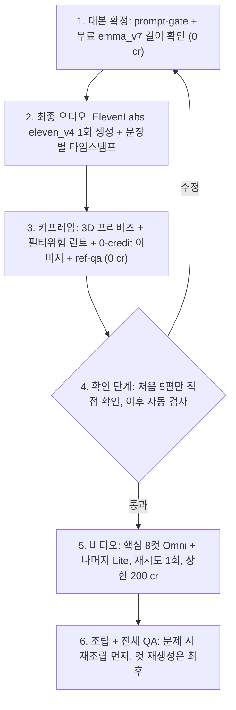

# 크레딧 손실 최소화 제작 순서 v2.1 (가격·효율·정확성 균형안)

## 1. 오디오 먼저 vs 영상 먼저 — 판단

| 기준 | **오디오 먼저 → 영상** | 영상 먼저 → 오디오 |
|---|---|---|
| **가격** | 오디오가 바뀌어도 편당 `~$0.12` 수준 재생성으로 끝남. 비싼 영상은 확정된 대본·길이에 맞춰 **한 번만** 생성 | 영상에 맞춰 내레이션 길이를 맞추려면 오디오를 여러 번 재생성해야 함. 대본이 바뀌면 **영상까지 다시 생성** (컷당 `20` cr) |
| **효율** | Flow 클립은 항상 `8`초로 생성되고 문장은 평균 `~3.4`초라서 **영상을 오디오 길이에 맞춰 자르기만 하면 됨** (추가 작업 없음) | `eleven_v4`는 속도 조절(`speed`)을 지원하지 않고, 채널 규칙상 오디오 늘이기/줄이기(WSOLA)도 금지 → 길이 맞추기가 사실상 재생성뿐 |
| **정확성** | ElevenLabs 타임스탬프로 문장 구간·자막이 `ms` 단위로 정확히 고정되고, 이를 기준으로 컷 편집 | 영상 길이에 억지로 맞춘 내레이션은 호흡·속도가 부자연스러워짐 |
| **구현 난이도** | **현재 파이프라인이 이미 오디오 기준 마스터 클락(R58) 구조** → 순서 변경 작업 없음 | 파이프라인 구조를 뒤집어야 함 |

> [!IMPORTANT]
> **결론: 오디오 먼저가 가격·효율·정확성 모두에서 유리하고, 이미 구현되어 있어 가장 쉽습니다.**
> 오디오 먼저 방식의 유일한 위험은 "영상을 보고 나서 대본을 고치고 싶어지는 경우"인데, 이는 영상 생성 전에 **무료 키프레임으로 그림을 먼저 확인**하는 단계로 막을 수 있습니다.

---

## 2. Omni 사용 방식 — 더 쉬운 방법으로 단순화

이전 안(v2)은 "전 컷을 무료 Lite로 먼저 만든 뒤 좋은 컷만 Omni로 다시 만들기"였는데, 다시 검토해 보니 더 단순한 방법이 낫습니다.

| 방식 | 구현 난이도 | 크레딧 | 제작 시간 | 정확성 |
|---|---|---|---|---|
| A. 전 컷 Omni | 쉬움 (현재 그대로) | 편당 `400–500` cr | 빠름 | 높음 |
| B. 전 컷 Lite 드래프트 → 일부 Omni 재생성 (v2 안) | **어려움** (비교·교체 로직 필요) | 편당 `160–200` cr | **느림** (Lite는 저우선순위라 대기 길고, 해당 컷은 2번 생성) | 높음 |
| **C. 처음부터 컷별 엔진 지정 (권장)** | **쉬움** (컷마다 엔진 태그만 추가) | **편당 `160–200` cr** | 빠름 (각 컷 1번만 생성) | 높음 |

- **방식 C**: 대본 단계에서 핵심 컷(훅 Cut `1–3`, 핵심 반전 컷, X-Ray 뇌 클립 `2`컷 등 최대 `8`컷)에 `engine: omni` 태그를 달고, 나머지는 처음부터 무료 Lite로 생성합니다.
- Omni 컷이 품질 검사에서 실패하면 **1회만 재시도**하고, 그래도 실패하면 Lite로 생성합니다.
- 편당 상한 `200` cr에 도달하면 남은 컷은 자동으로 Lite로 전환합니다.

---

## 3. 최종 제작 순서 (6단계)

| 단계 | 비용 | 소요 시간 (예상) |
|---|---|---|
| 1. 대본 확정 | `0` | `~10`분 |
| 2. 최종 오디오 | 편당 `~1,500–1,800`자 | `~1`분 |
| 3. 키프레임 | `0` | `~30–60`분 (35장) |
| 4. 확인 단계 | `0` | 처음 `5`편만 `~3`분 |
| 5. 비디오 | 편당 `160–200` cr | Omni 컷은 빠르고, Lite 컷은 대기열에 따라 변동 |
| 6. 조립·QA | `0` | `~10`분 |

**월 30편 기준 예상**: Omni `4,800–6,000` cr (전 컷 Omni 대비 약 `60%` 절감) + ElevenLabs `~54,000`자 (Creator `121k`의 `~45%`, 남는 분량은 이월).

---

## 4. 구현 작업 (최소 4개로 축소)

| # | 작업 | 난이도 | 효과 |
|---|---|---|---|
| 1 | **컷별 엔진 태그 + 편당 Omni 상한 + 재시도 1회 제한** (`visual_plan`의 `engine` 필드 + `credit_guard`) | 낮음 | 크레딧 약 `60%` 절감, 실패 반복 차단 |
| 2 | **필터위험 사전 린트** (`prompt-gate`에 위험 표현·피부톤 배경 경고 추가) | 낮음 | Pilot #3의 `kf_04` 8회 실패 같은 낭비 방지 |
| 3 | **확인 단계 정지 옵션** (`--stop-after keyframes`, 컨택트시트 자동 생성) | 낮음 | 크레딧 쓰기 전 마지막 확인 |
| 4 | **ElevenLabs `eleven_v4` 오디오 백엔드** (잔량 확인 → 1회 생성 → 사용량 기록 → 실패 시 `emma_v7` 폴백) | 중간 | 음질·정확성 향상 (API 키 필요) |

> [!NOTE]
> v2 안의 "Lite 드래프트 후 Omni 재생성(방식 B)"과 별도 크레딧 장부 파일은 구현 부담 대비 효과가 작아 제외했습니다. 사용량은 기존 리포트에 한 줄로 기록합니다.
