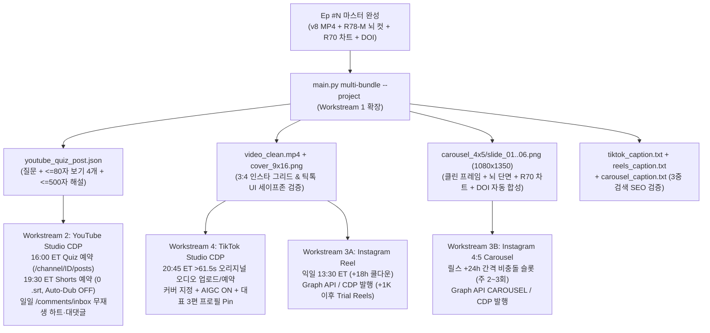

# 3대 플랫폼 전수 진위 검증 리포트 & 파이프라인 상세 구현 계획서

> [!CAUTION]
> **전수 팩트체크 결과 핵심 요약**: 기존 플레이북 24개 항목을 2025/2026 공식 플랫폼 문서(Google Support, Meta Graph API `v21.0+`, TikTok Studio/CRP 규정) 및 로컬 코드베이스([publish.py](file:///home/canadaofbin/gdrive/Kyubin_Yun_Workspace/07_Youtube/pipeline/publish.py), [uploader.py](file:///home/canadaofbin/gdrive/Kyubin_Yun_Workspace/07_Youtube/pipeline/studio/uploader.py), [community.py](file:///home/canadaofbin/gdrive/Kyubin_Yun_Workspace/07_Youtube/pipeline/studio/community.py), [instagram_card_builder.py](file:///home/canadaofbin/gdrive/Kyubin_Yun_Workspace/07_Youtube/pipeline/instagram_card_builder.py), [instagram_uploader.py](file:///home/canadaofbin/gdrive/Kyubin_Yun_Workspace/07_Youtube/pipeline/studio/instagram_uploader.py), [tiktok_uploader.py](file:///home/canadaofbin/gdrive/Kyubin_Yun_Workspace/07_Youtube/pipeline/studio/tiktok_uploader.py))와 교차 검증한 결과, **그대로 구현했을 때 전체 음소거·이중 자막 오염·수익화 박탈을 유발하는 치명적 함정 7건**을 식별하여 즉시 제거/교정했습니다.

---

## PART 1. 24개 전 항목 Zero-Hallucination 진위 검증 매트릭스

### 1-1. 즉시 폐기·교정해야 할 오류 및 함정 (`❌` / `⚠️` 7건)

| # | 플랫폼 · 항목 | 기존 주장 | 공식 스펙 교차 검증 결과 (Fact-Check) | 최종 처분 |
|---|---|---|---|---|
| **1** | **TikTok ⑦** `1~3%` 초저볼륨 트렌딩 사운드 | 미스터리 트렌딩 음원을 `1~3%` 볼륨으로 깔아 음원 유입 확보 | **`❌ 치명적 함정`**: ① 메이저 음반사(UMG·Sony·Warner) 음원은 **60.0초 라이선스 상한**이 걸려 있어 `62~86초`인 우리 영상에 첨부 시 **영상 전체(내레이션 포함)가 자동 음소거**됨. ② `1%` 볼륨도 파형 Content ID에 100% 적발되어 **`Creator Rewards`(`>60s` 수익화) 자격 박탈**. ③ 데스크톱 `tiktokstudio`에는 듀얼 볼륨 슬라이더 자체가 없음(개인/크리에이터 계정 유지 주장은 **`✅ 사실`**). | **트렌딩 음원 혼합 영구 금지** (`100%` 오리지널 `Siren`+자체 BGM 고정, 크리에이터 계정 유지) |
| **2** | **YouTube ②** 영문 `.srt` 소프트 자막 동시 첨부 | `.srt`를 별도 업로드해 검색 색인 및 번역 품질 향상 | **`❌ 심각한 UX 충돌`**: ① 우리 `v8` 영상은 이미 하단 중앙(`MarginV=521`, `102pt`)에 대형 영문 ASS 자막이 번인되어 있어, `.srt` 업로드 시 모바일 `CC` 켜짐 시청자에게 **자막 2개가 겹쳐 보이는 참사** 발생. ② 유튜브는 `#audio-language=en-US` 설정만으로 `Siren` 음성을 자동 `asr` 색인하며, 전문 용어는 설명란·태그로 이미 색인됨([config.py](file:///home/canadaofbin/gdrive/Kyubin_Yun_Workspace/07_Youtube/pipeline/config.py#L2138)도 `CC` 업로드 기본 `False` 잠금). | **번인 ASS 쇼츠 `.srt` 업로드 금지 (`0`개 유지)** |
| **3** | **YouTube ③** 다국어 자동 더빙 (`Auto-Dubbing` / `MLA`) | 자동 더빙 언어별 리텐션 선별 및 `Siren` 다국어 트랙 업로드 | **`⚠️ 조건부 사실이나 역효과 위험`**: 쇼츠에도 `Auto-Dubbing`과 커스텀 `MLA`가 확장된 것은 **사실**이나, 화면 한복판에 **거대한 영문 `102pt` 자막과 영문 `R70` 차트가 박힌 상태**에서 스페인어·한국어 더빙 음성이 나오면 시청각 인지 부조화 + `"Auto-dubbed"` 배지로 초반 이탈이 급증함. | **번인 자막 쇼츠에서는 `Auto-Dubbing` OFF 고정** (클린 플레이트 `16:9` 롱폼 개시 시 `MLA` 도입) |
| **4** | **YouTube ⑤** `Hype (하이프)` 기능 | 500 구독자 및 YPP 달성 즉시 쇼츠에 활용 | **`❌ 포맷 대상 오류`**: Google 공식 규정(`answer/15333273`)상 `Hype`는 `YPP + 500~50만 구독자` 조건뿐 아니라 **공개 7일 이내 일반 롱폼(`16:9`) 동영상 전용**이며, **쇼츠(`Shorts`)는 100% 제외**됨. | **롱폼 재개 시점까지 제외** |
| **5** | **YouTube ⑥** 채널 홈 비구독자 트레일러에 대표 쇼츠 지정 | 채널 트레일러 슬롯에 최고 리텐션 쇼츠 배치 | **`❌ 포맷 대상 오류`**: `YouTube Studio -> 맞춤설정 -> 홈 탭`(`editing/sections`)의 트레일러 영상 선택창(`ytcp-video-pick-dialog`)은 **`16:9` 가로 영상만 허용하고 쇼츠를 필터링하여 선택 불가**. | 트레일러 비워두고 **`인기 Shorts` + `Shorts` + `게시물(Posts)` 선반(Shelf) 배치**로 교정 |
| **6** | **YouTube ⑦** `24h` 후 `Viewed < 65%` 쇼츠 썸네일 교체 (`Test & Compare`) | `24h` 이후 `sardefault.jpg` 썸네일 교체로 2차 파동 유도 | **`❌ 노출 지면 오해`**: ① `Test & Compare` A/B 테스트는 **롱폼 전용**(`answer/13861714`). ② 데스크톱 `/video/<id>/edit`에서 쇼츠 커스텀 썸네일 업로드/교체는 가능하며 이미 [uploader.py](file:///home/canadaofbin/gdrive/Kyubin_Yun_Workspace/07_Youtube/pipeline/studio/uploader.py#L2985-L3033) Step 12.5가 `Ep #8`(`Atd0Pi9HPg4`) 포함 전편에 적용 중이나, 커스텀 썸네일은 **검색·채널 홈·구독 탭에만 뜨고 쇼츠 피드(`87%` 유입)에는 절대 노출되지 않음**. 즉 썸네일 교체로 쇼츠 피드 `Viewed %`는 바꿀 수 없음. | **초기 1회 커스텀 썸네일 업로드 현행 유지** (`Viewed < 65%`는 **제목 아키타입 교정**만 유효) |
| **7** | **Instagram ⑦** `Notes (노트)` 주기적 갱신 | DM 상단 및 릴스 노트로 흥미 유발 | **`❌ 폐지·도달 0 기능`**: ① 릴스/피드 위 `Content Notes`는 **2025년 4월 인스타그램이 공식 폐지·삭제**함. ② DM 상단 `Notes`는 **맞팔로워(`내가 팔로우백한 팔로워`) 또는 친한 친구에게만 노출**되어 팔로잉 `0`인 공식 채널에서는 노출수가 정확히 `0`임. | **완전 폐기** |

---

### 1-2. 사용자 보류 지정 항목 (`⏸️ 구현 제외` 2건)

| 플랫폼 · 항목 | 상태 | 비고 |
|---|---|---|
| **Instagram ②** 스토리 하이라이트 (`Highlights` 4폴더 고정) | **`⏸️ 보류 (ON HOLD)`** | 사용자 인라인 코멘트 지시에 따라 이번 구현 및 운영 계획에서 제외 |
| **Instagram ⑥** 댓글 트리거 자동 DM (`ManyChat` Meta API) | **`⏸️ 보류 (ON HOLD)`** | 사용자 인라인 코멘트 지시에 따라 이번 구현 및 운영 계획에서 제외 |

---

### 1-3. 즉시 100% 코드·CDP·공식 API 자동화 가능 항목 (`✅` — 현재 `<100` 구독자/팔로워 단계 즉시 적용)

| # | 플랫폼 · 기능 | 공식 스펙 & 기술적 경계 검증 결과 | 현재 코드베이스 상태 |
|---|---|---|---|
| **Y1** | **YouTube 커뮤니티 `Quiz Post` 예약 발행** | **`✅ 사실 (`0` 구독자 해금 완료)`**: `고급 기능(Advanced Features)` 활성화 채널은 구독자 수 무관 즉시 사용 가능(질문 + `2~4`개 보기 각 `<=80자` + 정답 지정 + 해설 `<=500자`, 데스크톱 예약 지원). **중요 기술 포인트**: Data API v3 엔드포인트 없음(`Won't Fix`). Studio에서 작성 클릭 시 `www.youtube.com/channel/<ID>/posts?show_create_dialog=1`(`ytd-backstage-post-dialog-renderer`)로 이동하며, 목록 검증은 `studio.youtube.com/channel/<ID>/content/posts`에서 수행. *(단, 이미지 포스트에 음악을 넣어 쇼츠 피드에 태우는 기능은 모바일 앱 전용)* | [community.py](file:///home/canadaofbin/gdrive/Kyubin_Yun_Workspace/07_Youtube/pipeline/studio/community.py)는 영상 댓글 전용 — **신규 `community_posts.py` 구현 필요** |
| **Y2** | **YouTube `Studio 댓글함` 무재생 하트 & 대댓글** | **`✅ 사실 (`R75` 자기 조회 `AVD=0s` 100% 방어)`**: `studio.youtube.com/channel/<ID>/comments/inbox`는 정적 `` 썸네일만 렌더링하고 `<video>` 태그를 로드하지 않아 재생 오염이 `0`임(우측 썸네일 클릭만 차단하면 완벽 안전). *(단, 신규 최상위 댓글 작성 및 `고정(Pin)` 버튼은 `/comments/inbox`에 없으므로 초기 `R35` 고정 댓글은 기존 `community.py` 유지)* | 미구현 — **신규 `comments_inbox.py` 구현 필요** |
| **Y3** | **YouTube 채널 홈 선반(`Shorts` / `인기 Shorts` / `Posts`) & 자동 더빙 가드** | **`✅ 사실`**: `studio.youtube.com/.../editing/sections`에서 쇼츠 선반 구성 가능 + [uploader.py](file:///home/canadaofbin/gdrive/Kyubin_Yun_Workspace/07_Youtube/pipeline/studio/uploader.py#L2502) `inspect_auto_dubbing_settings`로 자동 더빙 상태 점검 및 OFF 잠금 가능. | 점검 함수 구현 완료 — **OFF 잠금 & 홈 선반 점검 확장** |
| **I1** | **Instagram `4:5 (1080×1350)` 6장 뇌과학 요약 캐러셀 자동 발행** | **`✅ 사실 (단, `4:5` 해상도 필수 & 무음 발행)`**: ① **해상도 함정 주의**: 모바일 프로필 격자는 `3:4`로 보이지만 **Graph API와 데스크톱 웹은 `3:4 (0.75)` 비율 업로드를 거부**하고 `4:5 (1080×1350, 0.80)`~`1.91:1`만 허용함! 따라서 **`1080×1350 (4:5)`으로 생성하되 좌우 마진을 `90px`로 두어 중앙 `1012×1350 (3:4)` 그리드 크롭 안에 모든 텍스트를 가두는 것**이 정답. ② **오디오 함정 주의**: 연속 배경음악은 모바일 앱 전용이며, 1번 슬라이드만 MP4로 넣으면 2번 PNG로 넘길 때 소리가 뚝 끊김 -> 깔끔한 **무음 6장 PNG 캐러셀**을 Graph API(`media_type=CAROUSEL`, 클라우드 IP 차단 면역) + CDP 폴백으로 발행. | [instagram_card_builder.py](file:///home/canadaofbin/gdrive/Kyubin_Yun_Workspace/07_Youtube/pipeline/instagram_card_builder.py) 렌더러 존재하나 에피소드 자동 추출 및 [instagram_uploader.py](file:///home/canadaofbin/gdrive/Kyubin_Yun_Workspace/07_Youtube/pipeline/studio/instagram_uploader.py) `CAROUSEL` 업로더 미연결 — **연결 구현 필요** |
| **I2** | **Instagram 무워터마크 릴스 + `3:4` 그리드 안전 커버** | **`✅ 사실`**: 무워터마크 `video_clean.mp4` + `9:16` 커버 중앙 `3:4`(`1080×1440`, 상하 `240px` 제외 `y=240..1680`) 안전영역 검증 시 모바일 `Adjust preview` 수동 조작 없이도 프로필 그리드에 완벽 정렬됨(방금 낮춘 `Ep #8` 옵션 1 `y=296..1240`도 이미 통과!). | 업로더 구축 완료 — **커버 `3:4` 세이프존 자동 검증기 추가** |
| **T1** | **TikTok 커스텀 커버 + 프로필 상단 고정 3개(`Pin to profile`) + 예약 발행** | **`✅ 사실`**: 커스텀 커버 업로드는 [tiktok_uploader.py](file:///home/canadaofbin/gdrive/Kyubin_Yun_Workspace/07_Youtube/pipeline/studio/tiktok_uploader.py#L1086-L1109)에 이미 구현 완료. 추가로 데스크톱 `tiktok.com/@allaboutbrain_official` 영상 우측 `...` 메뉴에서 **`Pin to profile`(최대 3개)** 및 `tiktokstudio/upload` 내 **예약 발행(`Schedule`)** 모두 데스크톱 CDP로 100% 자동화 가능! | 커버 완료 — **예약 발행 & 프로필 3개 고정 추가** |
| **T2** | **TikTok 3중 검색 SEO 일치 (비로그인 공개 자동완성 연동)** | **`✅ 사실 (로그인 창 스크래핑 회피 조건)`**: 로그인된 `tiktokstudio/inspiration`을 봇으로 긁으면 `secsdk-captcha` 위험이 있고 팔로워 검색어는 `1,000+` 팔로워 제한이 있음. 대신 **비로그인 외부 공개 검색 자동완성 API**에서 키워드를 뽑아 ① 첫 3초 대사(`S1`), ② 커버 텍스트, ③ 캡션 첫 문장 3곳에 일치시키면 안전하게 검색 유입 극대화 가능. | 캡션 빌더 완료 — **공개 검색어 추출 & 3중 일치 검증 추가** |

---

### 1-4. 모바일 앱 전용 수동 영역 (`📱 API/데스크톱 웹 미지원` — 억지 자동화 금지 4건) & 팔로워 해금 대기 (`⏳` 3건)

- **모바일 앱 전용 (`📱` — 원하실 때만 스마트폰으로 10~30초 수동 실행, 코드 자동화 제외)**:
  1. **Instagram 스토리 + `투표(Poll)`/`퀴즈(Quiz)` 스티커 & 릴스 공유 스티커**: Graph API `STORIES`는 비즈니스 계정 플랫 미디어 전용(스티커 불가)이며 데스크톱/모바일웹에도 스티커 트레이가 없음.
  2. **Instagram 프로필 상단 3개 고정(`Pin to your profile`) & 캐러셀 배경음악**: 데스크톱 웹 `...` 메뉴에 고정 버튼 없음(모바일 앱에서 10초 내 고정 가능).
  3. **TikTok 고정 논쟁 댓글(`Pin comment`) & 댓글 영상 답글 스티커(`Video Reply`)**: PC 웹/TikTok Studio에는 댓글 `Pin` 버튼이 없음(모바일 앱 댓글 길게 누르기 전용). *단, 댓글 본문 초안은 `multi-bundle`이 자동 생성.*
  4. **TikTok `Photo Mode` 슬라이드 업로드**: 데스크톱 `tiktokstudio/upload`는 비디오 전용이며 `Photo Mode`는 CRP 수익이 `\$0`이므로 현재 `<100` 팔로워 구간에서는 `>60s` 영상에 집중(원할 때만 인스타 `4:5` 슬라이드 6장을 폰에서 업로드).
- **팔로워 달성 즉시 자동 켜짐 마일스톤 (`⏳`)**:
  1. **`Instagram 1,000+ 팔로워` -> `Trial Reels` 자동화**: 데스크톱 웹에는 토글이 없지만 **공식 Graph API에 `trial_params={"graduation_strategy": "SS_PERFORMANCE"}` 파라미터가 존재**함을 확인! 지금 코드에 팔로워 수 게이트(`>=1,000`)와 함께 미리 심어두면 해금 즉시 100% 무인 작동.
  2. **`TikTok 10,000+ 팔로워` -> `Creator Playlists` & `Creator Rewards Program`**: `10K` 달성 시 데스크톱 `tiktokstudio/upload`에 `Add to playlist` 드롭다운이 열리므로 그때 CDP 셀렉터 활성화.
  3. **`Instagram 공지 채널(Broadcast Channel)`**: 팔로워 해금 후 모바일 앱 전용 운영.

---

## PART 2. 실제 구현 상세 엔지니어링 설계서 (`4 Workstreams`)

### 통합 에셋 & 시차 발행 아키텍처 (`1 Episode → 5 Automated Deliverables`)

---

### Workstream 1. `multi-bundle` v2 올인원 파생 에셋 자동 생성기 (`@Operator`)
- **수정 파일**:
  - [instagram_card_builder.py](file:///home/canadaofbin/gdrive/Kyubin_Yun_Workspace/07_Youtube/pipeline/instagram_card_builder.py)
  - [publish.py](file:///home/canadaofbin/gdrive/Kyubin_Yun_Workspace/07_Youtube/pipeline/publish.py) (`export_multi_platform_bundle`)
  - [cli.py](file:///home/canadaofbin/gdrive/Kyubin_Yun_Workspace/07_Youtube/pipeline/cli.py) (`multi-bundle` 옵션 확장)
- **상세 구현 명세**:
  1. **`extract_episode_carousel_slides(project_dir: Path) -> list[CardSlide]` 신설** ([instagram_card_builder.py](file:///home/canadaofbin/gdrive/Kyubin_Yun_Workspace/07_Youtube/pipeline/instagram_card_builder.py)):
     - 번인 자막이 입혀지기 **전** 원본 클립(`03_visuals/flow_native_clips/clip_*.mp4`) 및 `05_assembly/chart_previews/`에서 추가 크레딧 `0`원으로 고화질 스틸 6장을 자동 추출해 `1080×1350 (4:5)` 6슬라이드 카드뉴스 생성:
       - `Slide 01 (THE PARADOX)`: Act 1 대표 인간 컷 + 파라독스 훅 헤드라인
       - `Slide 02 (CLINICAL CASE)`: Act 1/2 사건 세팅 컷 + 실제 환자/실험 배경 요약
       - `Slide 03 (INSIDE THE BRAIN)`: `R78-M` `#27D8FF` 3D 뇌 시뮬레이터 핵심 컷 + 회로 메커니즘
       - `Slide 04 (THE DATA / BROKEN RELAY)`: `R70-M` 데이터 스탬프 합성 이미지(또는 2번째 뇌 컷) + 핵심 수치·비유
       - `Slide 05 (YOUR BRAIN DAILY)`: Act 5 일상 뇌과학 적용 컷 + 핵심 교훈
       - `Slide 06 (SOURCE & DEBATE)`: 다크 시안 브레인 앵커 + 논쟁 질문 + `Study: Author (Year) · DOI` + `SAVE & SEND` 콜아웃
     - **`3:4` 그리드 안전 마진 상향**: `4:5 (1080×1350)` 좌우 여백을 기존 `72px` → **`90px`(`x = 90..990`)**로 강화하여 인스타 모바일 `3:4` 그리드 크롭(`x = 34..1046`) 내부에서도 좌우 `56px` 여유 확보.
  2. **`build_youtube_community_quiz_payload(project_dir: Path) -> dict` 신설** ([publish.py](file:///home/canadaofbin/gdrive/Kyubin_Yun_Workspace/07_Youtube/pipeline/publish.py)):
     - `02_script/script.json` 및 도시에(`research_dossiers/<slug>/`) 기반으로 `06_publish/multi_platform_bundle/youtube_quiz_post.json` 생성:
       - `question`: 본편 스포일러 없는 뇌과학 호기심 질문 (`<= 240`자, `?` 종결, 금칙어 필터 통과)
       - `options`: `4`개 객관식 보기 (**각 보기 `<= 80`자 하드 검증**, 정답 1개 `is_correct: true`)
       - `explanation`: 정답 투표 즉시 노출되는 뇌 회로 요약 + 검증 `DOI` + 당일 저녁 쇼츠 예고 (`<= 450`자, 유튜브 상한 `500`자 이내)
       - `recommended_offset_minutes`: `-210` (본편 `19:30 ET` 공개 3.5시간 전인 **`16:00 ET`**)
  3. **플랫폼별 세이프존 & 안전 락 검증 (`validate_multi_platform_safe_zones`)**:
     - `cover_9x16.png` 텍스트 영역이 인스타 `3:4` 세로 크롭(`y = 240..1680`) 및 틱톡 UI 안전영역(`상단 130px`, `하단 300px`, `우측 140px` 회피) 안에 들어오는지 자동 검증.
     - `upload_checklist.json`에 `youtube_upload_srt_cc: false`, `tiktok_trending_sound_prohibited: true`, `primary_search_keyword` 3중 일치 결과를 명시 기록.

---

### Workstream 2. YouTube 커뮤니티 `Quiz Post` 예약기 & `Studio 댓글함` 무재생 엔진 (`@Operator`)
- **신규/수정 파일**:
  - `pipeline/studio/community_posts.py` (**신규**)
  - `pipeline/studio/comments_inbox.py` (**신규**)
  - [uploader.py](file:///home/canadaofbin/gdrive/Kyubin_Yun_Workspace/07_Youtube/pipeline/studio/uploader.py) (`Auto-Dubbing` OFF 잠금 & 채널 홈 선반 점검 함수 추가)
  - [cli.py](file:///home/canadaofbin/gdrive/Kyubin_Yun_Workspace/07_Youtube/pipeline/cli.py) (`studio-quiz`, `studio-inbox` 서브커맨드 추가)
- **상세 구현 명세**:
  1. **`YouTubeCommunityPostManager` (`pipeline/studio/community_posts.py`)**:
     - 격리된 백그라운드 임대 탭(`leased_cdp_tab` + `PRE_DOCUMENT_AUTOPLAY_KILL_JS`)에서 `https://www.youtube.com/channel/UC4FeioYYv9X04Di07_MfZ7g/posts?show_create_dialog=1` 접속.
     - `ytd-backstage-post-dialog-renderer` 내부에서 **`Quiz` 탭 선택 -> 질문 입력 -> 보기 4개 입력(`<=80`자) -> 정답 라디오 체크 -> 해설(`<=500`자) 입력**.
     - `Post` 우측 드롭다운 화살표 -> `Schedule post` -> 브라우저 타임존 자동 변환(`16:00 ET`) -> `Schedule` 클릭.
     - 이후 `https://studio.youtube.com/channel/UC4FeioYYv9X04Di07_MfZ7g/content/posts` 테이블에서 예약(`Scheduled`) 상태 행을 교차 검증하고 `06_publish/community_quiz_receipt.json` 저장.
     - CLI: `python -X utf8 main.py studio-quiz --project <id> [--schedule "YYYY-MM-DD 16:00 ET"] [--dry-run]`
  2. **`StudioCommentsInboxManager` (`pipeline/studio/comments_inbox.py`)**:
     - 오직 `https://studio.youtube.com/channel/UC4FeioYYv9X04Di07_MfZ7g/comments/inbox`에서만 동작(`watch?v=` 및 `/shorts/` 네비게이션 클릭 차단 스크립트 주입으로 **`R75` 자기 조회 `0`회 절대 보장**).
     - `--scan-only`: 미응답 시청자 댓글 수집 및 짧은 후속 질문형 영문 대댓글 초안(`pending_comment_replies.json`) 생성.
     - `--apply-approved`: 승인된 항목에 크리에이터 하트(`ytcp-comment-creator-heart`) + 대댓글 등록.
     - CLI: `python -X utf8 main.py studio-inbox [--scan-only | --apply-approved] [--dry-run]`
  3. **채널 `Auto-Dubbing` OFF 확인 및 채널 홈 선반 구성**:
     - `main.py studio-settings --check-auto-dubbing` 실행 후 번인 영문 자막 쇼츠 기간 동안 `Allow automatic dubbing`이 켜져 있으면 OFF로 잠그는 `--lock-auto-dubbing-off` 옵션 추가.
     - `editing/sections`에서 불가능한 쇼츠 트레일러 대신 `Popular Shorts` + `Shorts` + `Posts` 선반 활성 상태 점검.

---

### Workstream 3. Instagram `4:5` 캐러셀 자동 발행기 & `Trial Reels` 게이트 연동 (`@Operator`)
- **수정 파일**:
  - [instagram_uploader.py](file:///home/canadaofbin/gdrive/Kyubin_Yun_Workspace/07_Youtube/pipeline/studio/instagram_uploader.py)
  - [cli.py](file:///home/canadaofbin/gdrive/Kyubin_Yun_Workspace/07_Youtube/pipeline/cli.py) (`ig-publish` 서브커맨드 추가)
- **상세 구현 명세**:
  1. **공식 Graph API 캐러셀 발행 함수 (`publish_instagram_carousel_graph_api`)**:
     - 클라우드 서버 IP(`AS396982`) 레이트리밋(`1675004`) 없이 동작하는 공식 `graph.instagram.com/v21.0/{ig_user_id}/media` 3단계 파이프라인:
       1. 슬라이드 2~10장 이미지 비율 검증(`0.80 <= w/h <= 1.91`, `1080×1350` 통과 / `3:4` 사전 차단).
       2. 개별 슬라이드 컨테이너 생성(`image_url=..., is_carousel_item=true`).
       3. 부모 컨테이너 생성(`media_type="CAROUSEL", children="id1,id2,...", caption=...`) -> `status_code == "FINISHED"` 폴링 -> `/media_publish` 호출 -> `06_publish/instagram_carousel_receipt.json` 기록.
  2. **데스크톱 CDP 캐러셀 폴백 (`upload_instagram_carousel_cdp`)**:
     - Graph API 토큰 미설정 시 `div[role='dialog']` 내 다중 이미지 첨부 + 비율 `4:5` 선택 + `Add AI label` ON + `Share` 자동화(오디오 끊김 버그를 막기 위해 MP4 혼용 없이 순수 PNG 슬라이드만 첨부).
  3. **`Trial Reels` 마일스톤 파라미터 선탑재 (`publish_instagram_reel_graph_api`)**:
     - `trial_graduation_strategy: Literal["SS_PERFORMANCE", "MANUAL"] | None = None` 인자 추가. 호출 시 `GET /{ig_user_id}?fields=followers_count`를 먼저 조회해 `< 1,000` 팔로워 구간에서는 안전하게 일반 릴스로 폴백(또는 `SKIPPED_BELOW_1000_FOLLOWERS` 반환)하고, `1,000`명 돌파 즉시 `trial_params` 활성화.
  - CLI: `python -X utf8 main.py ig-publish --project <id> --kind reel|carousel [--engine auto|graph-api|cdp] [--dry-run]`

---

### Workstream 4. TikTok 예약·프로필 상단 고정(`x3`)·공개 검색어 SEO & 일일 스케줄러 통합 (`@Operator` · `@Research` · `@QA_Scheduler`)
- **수정 파일**:
  - [tiktok_uploader.py](file:///home/canadaofbin/gdrive/Kyubin_Yun_Workspace/07_Youtube/pipeline/studio/tiktok_uploader.py)
  - [researcher.py](file:///home/canadaofbin/gdrive/Kyubin_Yun_Workspace/07_Youtube/pipeline/researcher.py)
  - [qa_scheduler.py](file:///home/canadaofbin/gdrive/Kyubin_Yun_Workspace/07_Youtube/pipeline/studio/qa_scheduler.py) & [SKILL.md](file:///home/canadaofbin/gdrive/Kyubin_Yun_Workspace/07_Youtube/.agents/skills/qa-scheduler/SKILL.md)
  - [cli.py](file:///home/canadaofbin/gdrive/Kyubin_Yun_Workspace/07_Youtube/pipeline/cli.py) (`tiktok-publish`, `tiktok-pin-profile` 서브커맨드 추가)
- **상세 구현 명세**:
  1. **TikTok Studio 예약 발행 & 오리지널 오디오 하드 락** ([tiktok_uploader.py](file:///home/canadaofbin/gdrive/Kyubin_Yun_Workspace/07_Youtube/pipeline/studio/tiktok_uploader.py)):
     - `upload_tiktok_video_cdp`에 `schedule_at_utc: datetime | None = None` 옵션 추가(`Schedule` 토글 + 날짜/시간 피커 조작).
     - `duration_sec >= 60.0` 검증 + 상업 음원 무첨부(100% 자체 오디오) + `[data-e2e="cover_container"]` 커스텀 커버 + `[data-e2e="aigc_container"]` ON 유지 + `secsdk-captcha` 감지 시 즉시 정지 불변식 준수.
  2. **TikTok 프로필 대표 영상 3칸 고정 자동화 (`sync_tiktok_pinned_videos_cdp`)**:
     - `https://www.tiktok.com/@allaboutbrain_official`에서 지정된 대표 영상(`<= 3`개) 우측 `...` 메뉴 -> `Pin to profile` 클릭 및 상단 `Pinned` 배지 확인.
  3. **비로그인 공개 검색어 자동완성 수집기** ([researcher.py](file:///home/canadaofbin/gdrive/Kyubin_Yun_Workspace/07_Youtube/pipeline/researcher.py) — `@Research` 관할):
     - 로그인 세션을 건드리지 않고 공개 검색 자동완성 엔드포인트에서 뇌과학/심리 실제 검색 구문을 추출해 에피소드 기획 시 `primary_search_keyword`로 주입.
  4. **`qa-scheduler` 일일 시차 실행표 고도화** ([qa_scheduler.py](file:///home/canadaofbin/gdrive/Kyubin_Yun_Workspace/07_Youtube/pipeline/studio/qa_scheduler.py) — `@QA_Scheduler` 관할):
     - 매일 `08:00 KST` 점검 시 에피소드당 5대 자동 발행 슬롯을 충돌 없이 편성:
       - `D-Day 16:00 ET`: **YouTube Quiz Post** (본편 `3.5h` 전 예열)
       - `D-Day 19:30 ET`: **YouTube Short** (`>=3h` 웜업, `0` `.srt`, `Auto-Dub OFF`)
       - `D-Day 20:45 ET`: **TikTok `>61.5s` Video** (`>=20h` 쿨다운, 오리지널 오디오, 3중 검색 SEO)
       - `D+1 13:30 ET`: **Instagram Clean Reel** (`+18h` 시차, `>=18h` 쿨다운)
       - `D+2 13:30 ET` (주 2~3회 비릴스일): **Instagram `4:5` 6-Slide Carousel** (릴스와 최소 `18~24h` 간격 분리로 도달 잠식 방지)

---

### Workstream 5. 전 모듈 단위 테스트 (`pytest`) & `Ep #8` 실증 번들 생성 (`@Operator` + `@QA_Scheduler`)
- `tests/test_multi_platform_bundle_v2.py`: 6장 `4:5 (1080×1350)` 슬라이드 생성, `x=90..990` 그리드 세이프존, `youtube_quiz_post.json` 보기 `<=80`자/해설 `<=500`자 검증, `.srt`/트렌딩음원 차단 플래그 검증.
- `tests/test_youtube_community_and_inbox.py`: `ytd-backstage-post-dialog-renderer` 파서/스케줄러 dry-run 및 `/comments/inbox` `watch?v=` 클릭 차단 검증.
- `tests/test_instagram_carousel_and_trial_gate.py`: Graph API `CAROUSEL` 컨테이너 호출 모킹(`3:4` 거부 검증 포함) 및 `<1,000` 팔로워 `Trial Reels` 안전 폴백 검증.
- `Ep #8`(`v8_ep08_capgras_imposter_delusion_r77`) 대상 `main.py multi-bundle` 실제 실행으로 6장 캐러셀 PNG + 유튜브 퀴즈 JSON 즉시 추출 및 시각 검수!

---

## 실행 분배 계획 (승인 즉시 착수)

1. **`@Operator` (`1f9808d4-ebac-4b58-a570-45c8f1f00a85`)**: Workstream 1~5 핵심 파이프라인 코드 구현, `pytest` 통과, `Ep #8` `4:5` 6장 캐러셀 + 당일 `16:00 ET` 유튜브 퀴즈 게시물 실증 세팅 및 `Auto-Dubbing` 상태 라이브 점검.
2. **`@Research` (`ffbdfca1-9c07-48b3-9b1e-3e3045d67c0c`)**: 비로그인 공개 검색 자동완성 기반 뇌과학/심리 고수요 키워드 뱅크(`search_seo_keyword_bank.json`) 구축(차기 `Ep #9`부터 3중 SEO 즉시 투입).
3. **`@QA_Scheduler` (`ef8185bb-5afd-4859-4859-b697-2fe07f1ecf1c`)**: 신규 5-에셋 시차 스케줄링 규칙 및 금지 가드(`0` `.srt`, `0` 틱톡 상업음원, `Auto-Dubbing OFF`) 라이브 감사 연동.
