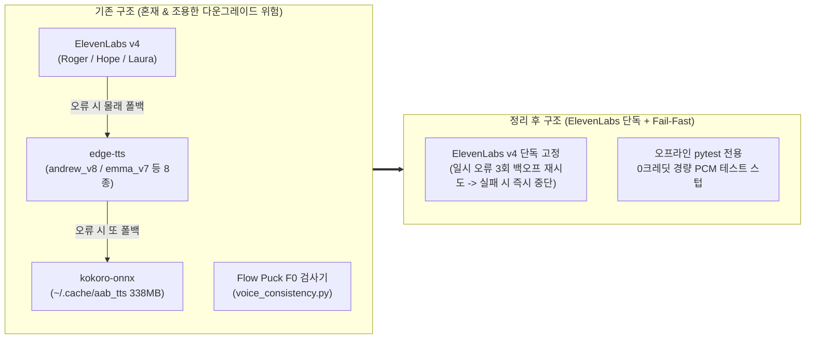

# ElevenLabs 단일 음성 엔진 고정 & 레거시 TTS 전면 정리 계획서 (`/plan`)

## Goal Description

채널 보이스가 **ElevenLabs `eleven_v4` 3인 캐스트(`Roger` 내레이터 + `Hope` 연구자 + `Laura` Mini-Cortex)**로 완전 전환되었음에도, 로컬 디스크와 코드베이스 곳곳에 과거 실험 단계의 음성 엔진 3종(**`kokoro-onnx` 로컬 모델 `338 MB`**, **`edge-tts` 8개 구형 프리셋**, **초기 Google Flow 클립 자체 `Puck` 보이스 F0 판별기**)이 그대로 남아 있습니다.

특히 현재 [`pipeline/voice_fallback.py:1878-1901`](file:///home/canadaofbin/gdrive/Kyubin_Yun_Workspace/07_Youtube/pipeline/voice_fallback.py#L1878-L1901)에는 ElevenLabs API 일시 오류 시 **에피소드를 중단하지 않고 몰래 구형 단일 기계음(`edge_tts` → `kokoro-onnx`)으로 자동 다운그레이드해 렌더링해 버리는 위험한 폴백 경로**가 살아 있습니다.

본 계획은 **불필요한 모델 가중치(`338 MB`)·패키지·레거시 음성 코드·구형 문서를 일괄 정리**하고, 프로덕션에서는 **오직 ElevenLabs `eleven_v4`만 동작(일시 네트워크 오류 시 자동 재시도 후 실패 시 즉시 중단)**하도록 단일화합니다.



---

## User Review Required

> [!IMPORTANT]
> **정리 범위 및 안전장치 핵심 요약**
> 1. **디스크 & 가상환경 패키지 정리 (`338 MB+` 즉시 확보)**:
>    - `~/.cache/aab_tts/` 폴더 삭제 (`kokoro-v1.0.onnx` `311 MB` + `voices-v1.0.bin` `27 MB` = **`338 MB`**).
>    - `hermes-venv`에서 미사용 TTS 패키지 4종 제거: `kokoro-onnx`, `edge-tts`, `espeakng-loader`, `phonemizer`.
>    - **보존 대상**: `onnxruntime`은 자막 정렬용 `faster-whisper`와 PDF 도구(`pymupdf`)가 함께 사용 중이므로 **절대 삭제하지 않고 그대로 유지**합니다.
> 2. **위험한 자동 다운그레이드(Silent Fallback) 완전 차단**:
>    - 프로덕션 실행 중 ElevenLabs 쿼터 부족이나 API 장애가 발생하면 구형 `edge-tts`/`kokoro` 음성으로 몰래 바꿔치기하지 않고, **일시적 네트워크/429 오류는 최대 3회 자동 재시도한 뒤 그래도 실패하면 명확한 에러와 함께 즉시 정지(Fail-Fast)**합니다.
> 3. **과거 완료된 에피소드(`diorama_01..07`) 호환성**:
>    - 이미 렌더링 완료된 구형 `v7` 영상들의 `voice_report.json` / `knowledge_base` 기록을 읽을 때 에러가 나지 않도록 **과거 프리셋 이름 문자열 목록(`HISTORICAL_LEGACY_VOICE_PRESET_IDS`)만 읽기 전용 상수로 남기고**, 실제 합성 실행 코드는 전부 삭제합니다.
> 4. **시점 조율 (`@Operator` 작업 보호)**:
>    - 현재 `@Operator`에서 `Ep #4` · `Ep #5` 제작이 돌아가고 있으므로, 진행 중인 작업과 파일 충돌이 나지 않도록 `@Operator`의 현재 배치 단계 완료 직후(또는 안전한 유휴 시점) 순차 반영합니다.

---

## Proposed Changes

### Component 1: 로컬 캐시(`338 MB`) 및 미사용 Python 패키지 제거

- **캐시 삭제**: `/home/canadaofbin/.cache/aab_tts` (`kokoro-v1.0.onnx`, `voices-v1.0.bin` 총 `338 MB`) 영구 삭제.
- **패키지 제거 (`hermes-venv` 및 [requirements.txt](file:///home/canadaofbin/gdrive/Kyubin_Yun_Workspace/07_Youtube/requirements.txt))**:
  - `kokoro-onnx==0.6.1`, `espeakng-loader==0.2.4`, `phonemizer==3.4.0`, `edge-tts==7.3.1` 언인스톨 및 의존성 목록에서 제거.
  - `faster-whisper==1.2.1` 및 `onnxruntime==1.31.0` 정상 import 스모크 검증.

---

### Component 2: ElevenLabs 단독 엔진 고정 & 레거시 합성 코드 제거

#### [MODIFY] [elevenlabs_tts.py](file:///home/canadaofbin/gdrive/Kyubin_Yun_Workspace/07_Youtube/pipeline/elevenlabs_tts.py)
- `synthesize_elevenlabs_v4_sentence()`에 일시적 네트워크 타임아웃 및 HTTP `429`/`500`/`502`/`503`/`504` 응답에 대한 지수 백오프 재시도(`최대 3회`, `1.5s -> 3.0s -> 6.0s`)를 추가해 일시적 순단으로 빌드가 깨지지 않도록 보강합니다 (단, `401` 인증 오류나 잔여 크레딧 부족은 즉시 중단).

#### [MODIFY] [voice_fallback.py](file:///home/canadaofbin/gdrive/Kyubin_Yun_Workspace/07_Youtube/pipeline/voice_fallback.py)
1. **조용한 다운그레이드 제거**:
   - `lines 1878-1901`의 `except ElevenLabsUnavailableError:` → `edge_tts` 폴백 블록을 제거하고 예외를 그대로 상위로 전파합니다.
2. **레거시 합성 엔진 코드 삭제**:
   - `_kokoro()`, `_ensure_kokoro_files()`, `_resolve_kokoro_voice()`, `synthesize_line()`(Kokoro 전용) 제거.
   - `_synthesize_edge_tts_lines()`, `_synthesize_edge_tts_act_continuous_lines()` 및 `lines 1902-2145`의 `edge_tts`/`kokoro` 분기 전면 삭제.
   - 구형 Flow 클립 내장 보이스 교체용 `synthesize_tts_track()`, `resolve_voice_track()` 제거 (현재 모든 Flow 비디오 프롬프트는 `100%` `"Silent voice track."`이며 마스터 오디오가 단일 클럭임).
3. **오프라인 테스트 스텁 (`allow_test_stub`)**:
   - `pytest` 단위 테스트에서 실제 ElevenLabs 크레딧을 `0`원도 쓰지 않고 오디오 길이·자막·EDL 조립을 검증할 수 있도록, `pre_synthesized_lines` 또는 명시적 `allow_test_stub=True`일 때만 동작하는 순수 `numpy` 결정론적 테스트 파형 생성기만 남깁니다.

#### [DELETE] [voice_consistency.py](file:///home/canadaofbin/gdrive/Kyubin_Yun_Workspace/07_Youtube/pipeline/voice_consistency.py) & [MODIFY] [cli.py](file:///home/canadaofbin/gdrive/Kyubin_Yun_Workspace/07_Youtube/pipeline/cli.py), [main.py](file:///home/canadaofbin/gdrive/Kyubin_Yun_Workspace/07_Youtube/main.py)
- 과거 Google Flow 클립마다 생성되던 `Puck` 내장 음성의 피치 편차를 재던 `pipeline/voice_consistency.py`와 `main.py voice-check` 서브커맨드, `--engine kokoro|edge-tts` CLI 선택지를 정리합니다.
- `--voice-preset` 기본값 및 도움말을 `elevenlabs_v4`(`cast_registry.json` 3인 캐스트) 기준으로 통일합니다.

#### [MODIFY] [config.py](file:///home/canadaofbin/gdrive/Kyubin_Yun_Workspace/07_Youtube/pipeline/config.py)
- `VOICE_FALLBACK_MODEL_URL`, `VOICE_FALLBACK_VOICES_URL`, `VOICE_FALLBACK_MODEL_DIR`, `VOICE_FALLBACK_VOICE`, `VOICE_FALLBACK_SPEED`, `DIORAMA_TTS_VOICE`, `PUCK_F0_RANGE_HZ`, `VOICE_F0_*` 상수 제거.
- `DIORAMA_VOICE_PRESETS`에서 구형 `edge-tts` 프리셋 8종(`andrew_v7`, `andrew_v8`, `emma_v7`, `ava_v7`, `aria_v7`, `christopher_v7`, `foil_v8`, `guy_foil_v8`) 및 각 프리셋 안의 `"kokoro_voice"`, `"fallback_preset"` 키를 제거하고 `elevenlabs_v4*` 프리셋만 유지합니다.
- 과거 완료 프로젝트 메타데이터 검증용 `HISTORICAL_LEGACY_VOICE_PRESET_IDS: frozenset[str]` 읽기 전용 상수를 둡니다.

---

### Component 3: 스킬·룰 문서 및 테스트 스위트 동기화

#### [MODIFY] [AGENTS.md](file:///home/canadaofbin/gdrive/Kyubin_Yun_Workspace/07_Youtube/.agents/AGENTS.md), [audio_assembly_rules.md](file:///home/canadaofbin/gdrive/Kyubin_Yun_Workspace/07_Youtube/.agents/rules/audio_assembly_rules.md), [neuro_diorama_rules.md](file:///home/canadaofbin/gdrive/Kyubin_Yun_Workspace/07_Youtube/.agents/rules/neuro_diorama_rules.md), [production_constants.md](file:///home/canadaofbin/gdrive/Kyubin_Yun_Workspace/07_Youtube/.agents/rules/production_constants.md), [youtube-produce/SKILL.md](file:///home/canadaofbin/gdrive/Kyubin_Yun_Workspace/07_Youtube/.agents/skills/youtube-produce/SKILL.md), [youtube-script/SKILL.md](file:///home/canadaofbin/gdrive/Kyubin_Yun_Workspace/07_Youtube/.agents/skills/youtube-script/SKILL.md)
- `R13`/`R49` 규칙 및 스킬 문서에서 `kokoro-onnx`, `edge-tts`, `--voice-preset emma_v7`/`andrew_v8`, `voice-check` 안내를 모두 제거하고 `elevenlabs_v4` 단일 엔진 + `cast_registry.json` 기준으로 현행화합니다 (`AGENTS.md` `< 10,240 bytes` 유지).

#### [MODIFY] `tests/` (레거시 TTS 테스트 교체 및 Fail-Fast 검증 추가)
- 구형 `voice_consistency` / `kokoro` / `edge_tts` 전용 테스트를 정리하고, 아래 검증을 포함하는 `tests/test_elevenlabs_strict_single_engine.py`를 추가·갱신합니다:
  1. `ElevenLabsUnavailableError` 발생 시 `edge-tts`/`kokoro`로 폴백하지 않고 즉시 예외가 발생하는지 검증.
  2. 일시적 HTTP `429`/`503` 응답 시 백오프 재시도 후 정상 복구되는지 모킹 검증.
  3. `kokoro_onnx` / `edge_tts` 패키지가 설치되어 있지 않아도 전체 `pytest` 스위트가 `0`크레딧 오프라인으로 통과하는지 검증.

---

## Verification Plan

### Automated Tests
```bash
# 1. kokoro-onnx / edge-tts 미설치 및 faster-whisper 정상 동작 확인
/home/canadaofbin/hermes-venv/bin/python -X utf8 -c "
import importlib.util, faster_whisper
assert importlib.util.find_spec('kokoro_onnx') is None
assert importlib.util.find_spec('edge_tts') is None
print('Clean venv + faster_whisper OK')
"

# 2. 코드베이스 내 잔존 kokoro / edge_tts import 0건 확인 및 전체 테스트 실행
/home/canadaofbin/hermes-venv/bin/python -X utf8 -m pytest -v
```
