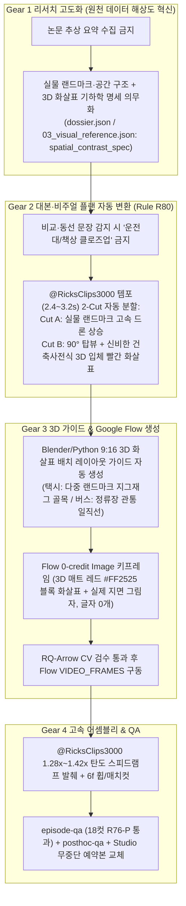

# `Ep #9` 런던 택시 즉각 리컷 & `Rule R80` (`신비한 건축사전` 3D 입체 화살표 × `@RicksClips3000` 고속 전환) 전 파이프라인 업그레이드 계획서

## Goal Description

이번 계획은 대표님께서 짚어주신 **3가지 핵심 본질**을 검증된 포렌식 수치로 통합하여, **① 내일 밤(`2026-11-16 19:30 ET`) 공개 예정인 `Ep #9`(런던 택시 vs 버스)를 가장 먼저 업그레이드**하고, **② 이후 제작될 `30편` 골든 큐 및 `@Topic_Radar` 주간 크론 전체에서 동일한 초고밀도 시각 디테일이 100% 자동으로 생성되도록 Gear 1~4 파이프라인을 구조적으로 고도화**합니다.

### 사전 포렌식 검증 결과 3가지 (추측 제로 실측 확인)

1. **질문 ① — `신비한 건축사전`의 빨간 화살표는 AI인가, 후보정 합성인가?**
   - **검증 결론: 대표님 말씀이 100% 맞습니다. 2D 후보정 합성이 아니라 `Google AI (Imagen/Flow 키프레임 + Veo/Flow I2V)`로 생성한 '3D 입체 구조물 화살표'입니다.**
   - 기존 아카이브 원본 프레임([short_06_ostLZ4fcWmk.jpg](file:///home/canadaofbin/gdrive/Kyubin_Yun_Workspace/07_Youtube/artifacts_archive/02_Research/thumb_benchmark_media/arch_dict/short_06_ostLZ4fcWmk.jpg), [short_07_X8dWzt0bEHw.jpg](file:///home/canadaofbin/gdrive/Kyubin_Yun_Workspace/07_Youtube/artifacts_archive/02_Research/thumb_benchmark_media/arch_dict/short_07_X8dWzt0bEHw.jpg)) 확인 결과, 우측 하단에 Google AI(`✦`) 워터마크가 찍혀 있으며 빨간 화살표(`#FF2525`)가 두께감 있는 3D 매트 블록 형태로 **지면·수면 위에 실제 태양 그림자(Drop Shadow)**를 드리우고 건물에 자연스럽게 가려집니다(Occlusion).
   - **비결 및 우리의 구현 방식**: 텍스트 프롬프트만으로 선을 그리게 한 것이 아니라, **`9:16` 시작/종료 키프레임 이미지(`VIDEO_FRAMES`) 단계에서 아예 도로 협곡 바닥에 '두꺼운 3D 입체 빨간 화살표/경로 리본(글자 0개)'을 구조물처럼 구워 넣은 뒤 Flow 비디오로 구동**한 것입니다. (평면 2D 선을 사후 합성하면 그림자가 없어 값싼 파워포인트 스티커처럼 붕 뜨지만, **Blender/Python 기하 가이드 → Flow 3D 입체 화살표 키프레임 → Flow I2V** 방식을 쓰면 `신비한 건축사전`과 동일한 3D 그림자·입체감이 살아나고, 글자 라벨이 필요할 때만 우리 파이썬 레이어로 얹어 `"Title Casefe"` 같은 AI 오타까지 0%로 막을 수 있습니다.)

2. **질문 ② — `@RicksClips3000` ("3000" 채널) 카메라 전환 속도 실측 기준**
   - 아카이브 포렌식 리포트([ricksclips3000_shorts_report.md](file:///home/canadaofbin/gdrive/Kyubin_Yun_Workspace/07_Youtube/artifacts_archive/02_Research/ricksclips3000_shorts_report.md), [ricks_clips_character_motion_lexicon.md](file:///home/canadaofbin/gdrive/Kyubin_Yun_Workspace/07_Youtube/artifacts_archive/02_Research/ricks_clips_character_motion_lexicon.md)) 실측 결과:
     * **샷 전환 주기**: **`2.4초 ~ 3.4초 / 샷`** (현재 `Ep #9`의 `C09=5.03s`, `C10=6.00s`보다 **약 2배 빠른 타격감**)
     * **속도 곡선**: 등속 이동이 아니라 **`0.4~0.9초` 탄도 임펄스 가속(`1.25x~1.42x` 스피드램프, `Burst >= 3.2x`) 후 `1.2~1.8초` 클린 홀드**로 정보를 각인시킵니다.
   - 이를 `Ep #9`의 `Act 4`(`42.50s..53.53s`, 총 `11.03s`)에 그대로 이식해 기존 밋밋한 2컷(`5.03s + 6.00s`)을 **`@RicksClips3000` 템포의 4컷 마이크로 릴레이(`2.50s + 2.53s + 2.80s + 3.20s`)**로 분할합니다.

3. **질문 ③ — 왜 Gear 1(리서치 정보 수집)의 구체성과 품질이 모든 것을 결정하는가?**
   - 기존 `Ep #9`가 택시(`C09`)와 버스(`C10`) 모두 *"운전대 잡고 앉아 있는 마네킹"*이라는 평범한 화면으로 나온 근본 원인은 **AI 비디오 모델 탓이 아니라 Gear 1 도시에의 `03_visual_reference.json`이 "택시와 버스를 비교한다"는 추상적 요약만 담고 있었지, "런던아이 랜드마크 간 비정형 골목 지그재그 경로 vs 빨간 버스정류장 간 고정 일직선 대로"라는 구체적 실물 공간·기하학 데이터를 수집하지 않았기 때문**입니다(`Garbage-In -> Generic-Out`).
   - 따라서 앞으로 모든 영상이 이런 디테일을 갖추려면 **Gear 1 리서치 단계부터 논문 속 실험 변인을 '실제 랜드마크/사물 A vs B + 3D 입체 화살표 궤적 기하학(`zigzag` / `straight` / `severed` / `split`)'으로 강제 구조화**해야 합니다.



---

## User Review Required

> [!IMPORTANT]
> **실행 순서 및 안전 원칙 확인**
> 1. **실행 1순위 (`Ep #9` 런던 택시 영상 최우선 수정 및 예약 교체)**:
>    - 기존 검증 완료된 `Siren` 마스터 오디오(`83.10s`)와 뇌 시뮬레이터 7컷(`39.67%`)은 `--preserve-audio` 및 세그먼트 캐시로 **100% 보존**하여 음성·자막 싱크 흔들림 없이 `Act 4`(`42.50s..53.53s`)의 `C09`·`C10`을 **4개의 초고밀도 드론+탑뷰 3D 입체 화살표 컷(총 `16컷 -> 18컷`)**으로 리컷합니다.
>    - 수정본이 전 QA 게이트를 100% 통과하면, 내일 `19:30 ET` 예약 슬롯(`2026-11-16_slot4`)에 새 마스터 MP4를 예약 등록(`p4ou90cHt50` 앵커 연결 + `R65 v4` 썸네일 유지)하고 **아직 미공개 상태인 기존 예약 드래프트(`7lKtSWvTmpw`)는 즉시 `Delete forever` 영구 삭제**하여 `Private = 0` 원칙(`R75`)을 지킵니다 (금일 `21:30 UTC` 동결 시각 이전에 충분한 여유를 두고 완료).
> 2. **실행 2순위 (차기 에피소드용 `Rule R80` 파이프라인 영구 탑재 & 30편 큐 일괄 보강)**:
>    - `Ep #9` 교체 완료 직후, 방금 구축한 `30편` 골든 큐([topic_priority_queue.json](file:///home/canadaofbin/gdrive/Kyubin_Yun_Workspace/07_Youtube/BCI_Shorts_Channel/topic_priority_queue.json))와 `@Topic_Radar` 주간 크론에도 동일한 `spatial_contrast_spec`(`3D 입체 화살표 + 랜드마크 드론 릴레이`) 스키마를 자동 주입해 `Ep #10`부터 사람 개입 없이 똑같은 디테일이 나오도록 고정합니다.

---

## Open Questions

> [!TIP]
> 별도 수정 요청 없이 **Proceed(`진행`)**를 눌러주시면 아래 권장 기본값으로 즉시 진행합니다:
> 1. **`Ep #9` 수정 범위**: 핵심 비교 구간인 `Act 4`(`C09` 택시 `5.03s` → `C09A 런던아이 드론 상승 2.50s` + `C09B 런던 탑뷰 3D 빨간 지그재그 화살표 2.53s` / `C10` 버스 `6.00s` → `C10A 빨간 버스정류장 드론 상승 2.80s` + `C10B 런던 탑뷰 3D 빨간 일직선 화살표 3.20s`)를 최우선 교체합니다. (원하시면 초반 `C02` 25,000개 거리 소개 컷도 탑뷰 컷으로 함께 교체 가능합니다.)
> 2. **3D 화살표 스타일**: `신비한 건축사전` 실측 레퍼런스([short_06_ostLZ4fcWmk.jpg](file:///home/canadaofbin/gdrive/Kyubin_Yun_Workspace/07_Youtube/artifacts_archive/02_Research/thumb_benchmark_media/arch_dict/short_06_ostLZ4fcWmk.jpg), [short_07_X8dWzt0bEHw.jpg](file:///home/canadaofbin/gdrive/Kyubin_Yun_Workspace/07_Youtube/artifacts_archive/02_Research/thumb_benchmark_media/arch_dict/short_07_X8dWzt0bEHw.jpg))와 동일한 **두꺼운 무광 코랄-레드(`#FF2525`) 3D 돌출 블록 화살표(실제 도로 지면 그림자 포함, AI 깨진 글자 0개)**로 생성합니다.

---

## Proposed Changes

### Component 1: `Rule R80` 공간·3D 입체 화살표 문법 및 `@RicksClips3000` 고속 전환 상수 정의

#### [MODIFY] [config.py](file:///home/canadaofbin/gdrive/Kyubin_Yun_Workspace/07_Youtube/pipeline/config.py)
- `EXPRESSIVE_V8_VISUAL_GRAMMARS`에 `spatial_3d_arrow_diorama` 추가.
- `EXPRESSIVE_V8_DRONE_CAMERA_MOVES` 및 `EXPRESSIVE_V8_3D_FLIGHT_MOVES`에 `drone_landmark_ascend` (랜드마크 근접 스윕 후 수직 상승) 및 `topdown_3d_route_glide` (`90°` 탑뷰 3D 입체 화살표 추적) 등록 (`dynamic_episode_qa.py:2640`의 휴먼 바스트 모션 예외 처리와 자동 연동).
- `@RicksClips3000` 카메라 전환 속도 상수 신설:
  ```python
  EXPRESSIVE_V8_SPATIAL_RELAY_MIN_CUT_SEC = 2.20  # Allows 2.4s-3.2s @RicksClips3000 2-cut micro-relays inside R76-P
  R80_3D_ARROW_ACCENT_HEX = "#FF2525"
  R80_SPATIAL_FLIGHT_SPEED_RAMP_RANGE = (1.24, 1.42)
  ```

---

### Component 2: `Blender / Python` 3D 입체 화살표 레이아웃 가이드 & `RQ-Arrow` 키프레임 검수기

AI가 택시 노선을 직선으로 잘못 그리거나 건물 지붕 위를 뚫고 지나가는 현상을 막기 위해, **기하학적으로 정확한 `9:16` 구조 가이드**를 생성하고 키프레임의 빨간 화살표 형태를 OpenCV로 검증합니다.

#### [NEW] [spatial_arrow_guide.py](file:///home/canadaofbin/gdrive/Kyubin_Yun_Workspace/07_Youtube/pipeline/spatial_arrow_guide.py)
- 4대 `R80` 공간 아키타입별 `9:16` 참조 레이아웃 PNG 및 `Google Flow` 무오타(`Zero-Text`) 3D 입체 화살표 프롬프트 구문 자동 생성:
  1. `adaptive_landmark_zigzag`: 3~4개 원형 랜드마크 비콘 핀을 경유하며 도로 협곡을 따라 `90°`/대각선으로 최소 5회 이상 꺾여 전진하는 두꺼운 3D 매트 레드(`#FF2525`) 돌출 화살표 군집 + 미니어처 블랙캡.
  2. `fixed_linear_corridor`: 동일 도시 스케일 대로변 정중앙을 관통하는 **단 1개의 자 대고 그은 듯한 일직선 3D 매트 레드(`#FF2525`) 돌출 화살표 트랙** + 정류장 마커 3개 + 빨간 2층 버스.
  3. `doorway_boundary_sever` (차기 `#04` 문지방 효과용): 방 A에서 문틀 경계선을 넘는 순간 끊어지는 3D 화살표.
  4. `dual_speed_race_lanes` (차기 `#18` 통증 관문용): 고속 시안 3D 화살표(`100 m/s`)가 저속 레드 화살표(`2 m/s`)를 추월해 관문을 닫는 3D 트랙.
- OpenCV 기반 `verify_r80_arrow_keyframe_geometry(img_path, mode)`:
  - HSV 고채도 레드 마스크(`#FF2525`) 추출 후 스켈레톤 경로의 **굴곡도(`tortuosity = arc_length / chord_length`)**를 계산하여 `adaptive_landmark_zigzag`는 `tortuosity >= 1.35` (다중 굴절 확인), `fixed_linear_corridor`는 `tortuosity <= 1.08` (직선성 확인)을 만족하는 키프레임만 채택.

#### [MODIFY] [real_world_reference_builder.py](file:///home/canadaofbin/gdrive/Kyubin_Yun_Workspace/07_Youtube/pipeline/real_world_reference_builder.py)
- `URBAN_SETTING_LANDMARK_MAP`에 `london_eye_thames_wheel` (*London Eye giant cantilevered observation wheel beside the River Thames embankment*) 및 `london_red_bus_stop_roundel` (*iconic London red bus stop flag post, glass shelter, and red double-decker bus lane*) 건축 디테일 프리셋 추가.

---

### Component 3: Gear 2 프롬프트 빌더 · Gear 4 `@RicksClips3000` 어셈블러 & QA 게이트 연동

#### [MODIFY] [flow_prompt_builder.py](file:///home/canadaofbin/gdrive/Kyubin_Yun_Workspace/07_Youtube/pipeline/flow_prompt_builder.py) & [prompt_quality_v5.py](file:///home/canadaofbin/gdrive/Kyubin_Yun_Workspace/07_Youtube/pipeline/prompt_quality_v5.py)
- `spatial_3d_arrow_diorama` 프롬프트 컴포저 추가 (`[r77_hardware_ban]`을 통과하도록 `camera`/`drone`/`lens` 하드웨어 명사 없이 순수 시점 이동 동사 `High-altitude aerial sweep... soaring steeply upward...` / `Vertical ninety-degree bird's-eye view looking straight down into sunlit London Portland-stone street canyons... thick solid matte-crimson 3D extruded directional arrows resting physically on the asphalt casting crisp sunlight shadows, zero text, zero letters`로 조립).
- `validate_r76_brain_simulator_and_pacing_contract` ([prompt_quality_v5.py](file:///home/canadaofbin/gdrive/Kyubin_Yun_Workspace/07_Youtube/pipeline/prompt_quality_v5.py#L2918-L2925)) 및 [dynamic_episode_qa.py](file:///home/canadaofbin/gdrive/Kyubin_Yun_Workspace/07_Youtube/pipeline/dynamic_episode_qa.py#L469)에서 `spatial_3d_arrow_diorama` / `spatial_relay_cut=True` 컷의 최소 길이를 `EXPRESSIVE_V8_SPATIAL_RELAY_MIN_CUT_SEC` (`2.20s`)로 허용하여 `2.50s`·`2.53s` 고속 전환이 `R76-P` 게이트를 정식 통과하도록 반영.
- `compile_episode_qa_contract`에서 `spatial_3d_arrow_diorama` 컷은 캐릭터 클로즈업 대신 도시·화살표 시그니처로 분류.

#### [MODIFY] [diorama_assembler.py](file:///home/canadaofbin/gdrive/Kyubin_Yun_Workspace/07_Youtube/pipeline/diorama_assembler.py)
- 한 문장에 복수의 클립(`sentence_index == c["sentence_index"]`인 `[Cut A 드론, Cut B 탑뷰]` 페어)이 매핑될 때 해당 문장의 오디오 스팬(`5.03s` / `6.00s`)을 `split_weight` 비율(`48% : 52%`)로 정확히 분할하고, `@RicksClips3000` 스타일 **`1.28x~1.38x` 탄도 스피드램프 구간 발췌 + `6프레임` 고속 상승 매치컷**을 자동 적용.

---

### Component 4: Gear 1 리서치 파이프라인 영구 업그레이드 (`Ep #10 ~ #39` 전체 적용)

#### [MODIFY] [research_dossier.py](file:///home/canadaofbin/gdrive/Kyubin_Yun_Workspace/07_Youtube/pipeline/research_dossier.py) & [youtube-research/SKILL.md](file:///home/canadaofbin/gdrive/Kyubin_Yun_Workspace/07_Youtube/.agents/skills/youtube-research/SKILL.md) & [youtube-script/SKILL.md](file:///home/canadaofbin/gdrive/Kyubin_Yun_Workspace/07_Youtube/.agents/skills/youtube-script/SKILL.md)
- `Schema v2` 도시에의 `03_visual_reference.json`에 **`spatial_contrast_spec`** 표준 필드 도입:
  - 단순 실내 대화/착석 묘사만 있는 씬 구성을 경고하고, 핵심 실험 대조 구간(Act 3~4)에 **`landmark_or_object_a` vs `landmark_or_object_b` + `arrow_3d_mode` (`adaptive_landmark_zigzag` / `fixed_linear_corridor` / `doorway_boundary_sever` / `dual_speed_race_lanes` / `split_hemisphere_watch`)** 명세를 자동 시드(`diorama_seed_from_dossier`)하도록 연결.
- [weekly_topic_research_runner.py](file:///home/canadaofbin/gdrive/Kyubin_Yun_Workspace/07_Youtube/scripts/weekly_topic_research_runner.py) 및 신규 배치 스크립트로 현재 `topic_priority_queue.json`의 **30개 도시에 전수에 맞춤형 `spatial_contrast_spec`을 일괄 주입** (예: `#04` 문지방 효과 = 거실→문틀 통과 순간 끊어지는 3D 빨간 화살표, `#06` 5,000보 걷기 = 공원 다중 산책로 3D 화살표, `#18` 통증 관문 = `100 m/s` 고속 화살표가 `2 m/s` 통증 화살표를 앞질러 게이트 차단).

---

### Component 5: `Ep #9` (`v8_ep09_maguire_london_taxi_hippocampus`) 실전 리컷 및 Studio 예약 교체

#### [MODIFY] [visual_plan.json](file:///home/canadaofbin/gdrive/Kyubin_Yun_Workspace/07_Youtube/BCI_Shorts_Channel/projects/v8_ep09_maguire_london_taxi_hippocampus/02_script/visual_plan.json)
- 기존 16클립 중 `Clip 09`(`5.03s` 운전석 팔 걸치기)와 `Clip 10`(`6.00s` 버스 핸들 돌리기)을 아래 **4개 `@RicksClips3000` 속도(`2.50s~3.20s`) 릴레이 클립(총 `18클립`)**으로 교체:
  - **`Clip 09` (`2.50s`, Sent 9 앞절)**: 템스강변 **런던아이(London Eye) 대관람차** 옆을 스치듯 돌며 하늘 위로 빠르게 솟구치는 3D 에이리얼 풀백 (`drone_landmark_ascend`).
  - **`Clip 10` (`2.53s`, Sent 9 뒷절)**: `90°` 수직 탑뷰 런던 미니어처 거리 협곡 — 랜드마크 비콘 핀들 사이를 일방통행 골목 따라 **지그재그로 빠르게 꺾여 달리는 선명한 3D 매트 레드(`#FF2525`) 입체 화살표 궤적 + 블랙캡** (`topdown_3d_route_glide`).
  - **`Clip 11` (`2.80s`, Sent 10 앞절)**: 런던 거리의 **빨간 버스정류장 표지판(Roundel Bus Stop)과 정차한 빨간 2층 버스**에서 하늘 위로 수직 상승하는 고속 풀백 (`drone_landmark_ascend`).
  - **`Clip 12` (`3.20s`, Sent 10 뒷절)**: 동일한 `90°` 수직 탑뷰 런던 대로 — 정류장 3곳을 관통하는 **단 하나의 꼿꼿한 일직선 3D 매트 레드(`#FF2525`) 입체 화살표 트랙** 위로 빨간 2층 버스가 방향 전환 없이 곧장 직진 (`topdown_3d_route_glide`) → 직후 *"Fixed Bus Line → Back Map Flat"* 유리 뇌 컷으로 직결!

---

## Verification Plan

### Automated Tests
1. **단위 및 회귀 테스트**:
   ```bash
   /home/canadaofbin/hermes-venv/bin/python -X utf8 -m pytest -v tests/test_expressive_25d_v8.py tests/test_short_linker.py
   ```
   (+ 신규 `tests/test_r80_spatial_arrow_diorama.py`: 3D 화살표 굴곡도 `RQ-Arrow` 검수기, 2-Cut 문장 분할 EDL 타이밍 보존, `R76-P` `2.20s` 공간 릴레이 게이트 검증)
2. **`Ep #9` 전 구간 프로덕션 QA 게이트 (100% 통과 필수)**:
   ```bash
   /home/canadaofbin/hermes-venv/bin/python -X utf8 main.py prompt-gate --dir BCI_Shorts_Channel/projects/v8_ep09_maguire_london_taxi_hippocampus
   /home/canadaofbin/hermes-venv/bin/python -X utf8 main.py diorama-assemble --project v8_ep09_maguire_london_taxi_hippocampus --preserve-audio
   /home/canadaofbin/hermes-venv/bin/python -X utf8 main.py episode-qa --project v8_ep09_maguire_london_taxi_hippocampus
   /home/canadaofbin/hermes-venv/bin/python -X utf8 main.py posthoc-qa --project v8_ep09_maguire_london_taxi_hippocampus
   /home/canadaofbin/hermes-venv/bin/python -X utf8 main.py autopsy --project v8_ep09_maguire_london_taxi_hippocampus
   ```
3. **30편 골든 큐 도시에 전수 검증**:
   ```bash
   /home/canadaofbin/hermes-venv/bin/python -X utf8 scripts/build_golden_slate_and_verify_30.py
   ```

### Manual Verification
1. `Ep #9` 리컷 완성 직후 **`18컷` 전체 콘택트 시트**와 **`Act 4` (`런던아이 드론 → 탑뷰 지그재그 3D 빨간 화살표` vs `버스정류장 드론 → 탑뷰 일직선 3D 빨간 화살표`) 프레임 비교 슬라이드**를 `walkthrough.md` 아티팩트에 첨부해 시각적 완성도와 그림자 입체감을 바로 확인하실 수 있게 제시합니다.
2. YouTube Studio `/videos/short`에서 신규 `Ep #9`가 `2026-11-16 19:30 ET` `Scheduled` + `p4ou90cHt50` 앵커 연결 상태로 정상 등록되고, 구 미공개 드래프트(`7lKtSWvTmpw`)가 영구 삭제되어 `Private = 0`이 유지되었는지 확인합니다.
