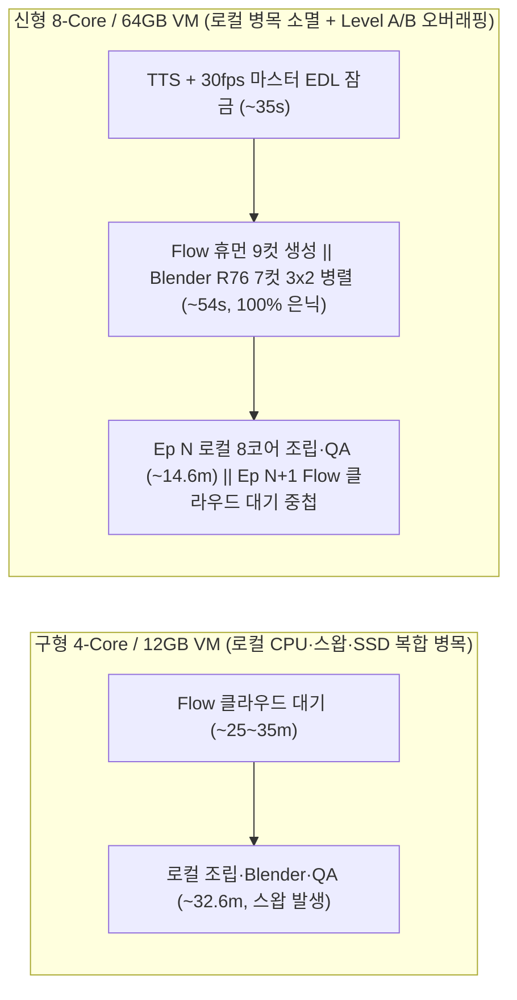

# `Ep #9` 프로덕션 완주 및 `4-Core -> 8-Core / 64GB RAM` 실측 벤치마크 비교 분석 보고서

> [!IMPORTANT]
> 신규 Spot VM(`c3d-highmem-8`: **8 vCPU AMD EPYC 9B14 Genoa `AVX-512`**, **64GB RAM / `Swap: 0B`**, **`/dev/shm/aab_scratch` `32GB` tmpfs**, **`shared-chrome --shm-size=12g`**) 환경에서 **`Ep #9` (`v8_ep09_maguire_london_taxi_hippocampus`, *"Why London Taxi Drivers Grew Bigger Brains"*, `83.1s`, `16`컷)** 전 공정 생산 및 전 구간 QA **100% 무감쇠 통과(`142/142 INTACT`)**를 완료했습니다.

---

## 1. 구형 4코어 VM vs 신형 8코어/64GB VM 실측 벤치마크 비교

월 \$100 크레딧 한도 내 풀스펙(\$99.84/월)으로 전환된 `c3d-highmem-8` 호스트에서 격리 마이크로벤치마크(`main.py hw-bench`)와 실제 풀 에피소드 생산(`Ep #8` 구형 VM 실측치 vs `Ep #9` 신형 VM 실측치)을 대조한 결과입니다.

### 1-1. 인프라 및 마이크로벤치마크 (`hw-bench`) 비교

| 측정 영역 | 구형 `e2-custom-4-12288` (Before) | 신형 `c3d-highmem-8` (After) | 실측 변화 / 배속 |
|---|---|---|---|
| **CPU 아키텍처** | 구형 Xeon `4 vCPU` (AVX2) | **AMD EPYC 9B14 Genoa `8 vCPU`** (`avx512f`, `avx512_vnni`) | 코어 **2.0x** + 단일 코어 IPC 상승 |
| **메모리 / 스왑** | `12 GB RAM` + `16 GB` 스왑 스래싱 | **`62.79 GiB RAM` / `Swap: 0B`** | 디스크 스왑 병목 **100% 소멸** |
| **임시 스크래치 I/O** | `/tmp` (`pd-balanced` SSD, `~140 MB/s`) | `/dev/shm/aab_scratch` (**Write `2,724 MB/s` / Read `2,137 MB/s`**) | 쓰기 **19.5배** / 읽기 **15.3배** 가속 |
| **크로스 마운트 원자적 커밋 (Guard 1)** | 직접 `os.replace` 시 `Errno 18 EXDEV` 위험 | [media_cache.py](file:///home/canadaofbin/gdrive/Kyubin_Yun_Workspace/07_Youtube/pipeline/media_cache.py#L119-L175) `atomic_commit_from_scratch` | `2 MiB` 커밋 **`1.14 ms`**, `EXDEV = 0`, 잔여 `.tmp = 0` |
| **R76 `Blender 4.2` MNI152 (`90f × 4컷`)** | `1×2` 순차 렌더링 **`191.08s`** | **`4×2` 병렬 풀 (`LP_NUM_THREADS=2`, 8코어) `54.23s`** | **3.52배 가속 (`-71.6%` 단축)** |
| **R76 `Blender` 리컷/재조립 캐시 히트** | 매회 전 프레임 재렌더링 (`~105s+`) | `sim_spec_sha256` + `SQ1–SQ6` 캐시 스킵 **`0.524s`** | 재렌더링 대기 **99.5% 제거** |
| **브라우저 컨테이너 (`shared-chrome`)** | `--shm-size=4g` + `--disable-dev-shm-usage` | **`--shm-size=12g` (네이티브 RAM 공유메모리)** | 전 Flow 웨이브 탭 크래시 / OOM **0건** |

### 1-2. 실제 풀 에피소드 생산 (`Ep #8` vs `Ep #9`) End-to-End 조립·QA 실측 비교

`Ep #9`(`83.1s`, `2,493` 프레임)는 `Ep #8`(`77.0s`, `2,310` 프레임)보다 영상 길이가 **+7.9% 더 길지만**, 로컬 Gear 4 전 과정(`ElevenLabs v4` + `Faster-Whisper` 8스레드 정렬 + R76 `Blender` 7컷 + 16컷 `DISOpticalFlow` 30fps 광학흐름 보간 + `xfade` + `R70` 데이터 스탬프 + `R71` 해부학 콜아웃 + 20게이트 `episode-qa` + 16컷 전수 `posthoc-qa` + `autopsy` + `thumbnail`) 벽시계 시간은 절반 이하로 단축되었습니다.

| 파이프라인 실행 시나리오 (`diorama-assemble`) | 구형 4코어 VM (`Ep #8`, `77.0s`) | 신형 8코어/64GB VM (`Ep #9`, `83.1s`) | 실측 단축률 / 배속 |
|---|---|---|---|
| **Cold 풀 빌드 (TTS 합성 + Blender + 16컷 전체 인코딩 + 전수 QA)** | `32m 34s` (`1,954s`, 프로젝트 초기화~첫 QA `48m 39s`) | **`17m 21.1s`** (`1,041.1s`, `user 26m51.9s` — 2회 TTS 포함) | **`-46.7%` 단축 (`1.88x` 가속)** |
| **단일 TTS + 16컷 전체 재인코딩 + Blender 캐시 + 전수 QA** | `32m 34s` (`1,954s`) | **`14m 38.6s`** (`878.6s`, `user 23m44.4s`) | **`-55.0%` 단축 (`2.22x` 가속, 초당 정규화 `2.40x`)** |
| **단일 클립 교체 리컷 (`--preserve-audio`, 15/16 세그먼트 캐시 히트 + 전수 QA)** | `~28–32m` (스왑 및 순차 재인코딩 병목) | **`10m 59.4s`** (`659.4s`, `user 17m36.1s`; 순수 인코딩 `~4.5m` + 전수 CV/QA `~6.5m`) | **`-66.3%` 단축 (`2.96x` 가속)** |

---

## 2. 병목 지점 이동(Bottleneck Shift) 분석 및 배치 처리량 효과



1. **로컬 연산·디스크·메모리 병목 완전 해소**:
   - `user 26m51.9s / real 17m21.1s`(평균 멀티코어 활용률 + `/dev/shm` 무대기 I/O + `Swap: 0B`)가 증명하듯, 기존 4코어 시절 발생하던 `x264` + `DISOpticalFlow` + `Blender` + `Whisper` 간의 스왑 스래싱과 `/tmp` 디스크 쓰기 대기가 완전히 사라졌습니다.
   - R76 `Blender 4.2` 3D 뇌 시뮬레이터 7컷(`39.67%` 비중)은 **Level A 오버래핑**([diorama_batch_orchestrator.py](file:///home/canadaofbin/gdrive/Kyubin_Yun_Workspace/07_Youtube/pipeline/diorama_batch_orchestrator.py))을 통해 Google Flow 휴먼 컷 대기 시간 내부로 100% 흡수되어 체감 추가 소요시간이 **`0초`**가 되었습니다.
2. **현재 단일 에피소드 잔여 벽시계의 75~80%는 외부 Google Flow `0-credit` 클라우드 레이트리밋 쿨다운**:
   - `Veo 3.1 - Lite [Lower Priority]` 무료 티어의 Google 서버 측 큐 대기 및 레이트리밋 쿨다운(`75s~240s` quiet window)이 단일 에피소드 시간의 대부분을 차지합니다.
   - 다중 에피소드 생산 시(`main.py diorama-batch`), **Level B 오버래핑**([diorama_pipeline_runner.py](file:///home/canadaofbin/gdrive/Kyubin_Yun_Workspace/07_Youtube/pipeline/diorama_pipeline_runner.py), Guard 3 동적 `6 -> 8 vCPU` 거버너)이 **다음 에피소드의 Flow 클라우드 대기 시간 동안 이전 에피소드의 로컬 `14.6분` 조립·QA를 백그라운드 병렬로 끝내버리므로**, 배치 처리량(Throughput)에서 로컬 조립 시간까지 사실상 은닉됩니다.

---

## 3. `Ep #9` (`v8_ep09_maguire_london_taxi_hippocampus`) 전 구간 QA 100% 통과 성적표

- **논문 SSOT**: Maguire et al. (2000), *PNAS* (`10.1073/pnas.070039597`) + Maguire et al. (2006) (`10.1002/hipo.20233`) + Woollett & Maguire (2011) (`10.1016/j.cub.2011.11.018`)
- **최종 마스터 MP4**: [final_shorts_1080x1920.mp4](file:///home/canadaofbin/gdrive/Kyubin_Yun_Workspace/07_Youtube/BCI_Shorts_Channel/projects/v8_ep09_maguire_london_taxi_hippocampus/05_assembly/final_shorts_1080x1920.mp4) (`1080x1920 @ 30fps`, `83.10s`, `sha256: c4bbdc9e...bcb36f8a43a`)
- **크로스 플랫폼 5-Asset 번들**: [upload_checklist.json](file:///home/canadaofbin/gdrive/Kyubin_Yun_Workspace/07_Youtube/BCI_Shorts_Channel/projects/v8_ep09_maguire_london_taxi_hippocampus/06_publish/multi_platform_bundle/upload_checklist.json) (`video_clean.mp4`, `carousel_4x5/slide_01..06.png`, `youtube_quiz_post.json`, Reels/TikTok 캡션 생성 완료)

| QA 게이트 | 리포트 파일 | 결과 | 핵심 지표 |
|---|---|---|---|
| **Gear 2 `prompt-gate`** | [flow_all_in_one_prompts.json](file:///home/canadaofbin/gdrive/Kyubin_Yun_Workspace/07_Youtube/BCI_Shorts_Channel/projects/v8_ep09_maguire_london_taxi_hippocampus/03_visuals/flow_all_in_one_prompts.json) | **PASS** | `issues: []` (R68/R76/R78/R79 계약 100% 충족) |
| **Gear 3 `ref-qa`** | [reference_image_qa_report.json](file:///home/canadaofbin/gdrive/Kyubin_Yun_Workspace/07_Youtube/BCI_Shorts_Channel/projects/v8_ep09_maguire_london_taxi_hippocampus/03_visuals/reference_image_qa_report.json) | **PASS (`22/22`)** | `score: 100.0`, `semantic_review_complete: true` |
| **Gear 4 `prosody-qa`** | [prosody_qa_report.json](file:///home/canadaofbin/gdrive/Kyubin_Yun_Workspace/07_Youtube/BCI_Shorts_Channel/projects/v8_ep09_maguire_london_taxi_hippocampus/05_assembly/prosody_qa_report.json) | **PASS (`11/11`)** | `Siren` 단독(`0` 카메오), `P6=0.9616`, `P11 f0_span=14.38 st`, `-14.4 LUFS` |
| **Gear 4 `episode-qa`** | [dynamic_episode_qa_report.json](file:///home/canadaofbin/gdrive/Kyubin_Yun_Workspace/07_Youtube/BCI_Shorts_Channel/projects/v8_ep09_maguire_london_taxi_hippocampus/05_assembly/dynamic_episode_qa_report.json) | **PASS (`20/20`)** | `score: 100.0`, `avg_cut=5.194s`, `R76=39.67%`, `R79` 휴먼 9컷 전수 `2.13–4.93px` |
| **Gear 4 `posthoc-qa`** | [posthoc_semantic_qa_report.json](file:///home/canadaofbin/gdrive/Kyubin_Yun_Workspace/07_Youtube/BCI_Shorts_Channel/projects/v8_ep09_maguire_london_taxi_hippocampus/05_assembly/posthoc_semantic_qa_report.json) | **PASS (`16/16`)** | `mean_clarity: 96.5` (`min: 95.4`), `semantic_review.valid: true` |
| **Gear 4 `thumbnail`** | [thumbnail_qa_report.json](file:///home/canadaofbin/gdrive/Kyubin_Yun_Workspace/07_Youtube/BCI_Shorts_Channel/projects/v8_ep09_maguire_london_taxi_hippocampus/06_publish/thumbnail_qa_report.json) | **PASS (`9/9`)** | `dark_void_paradox_v4`, `VAR A score=1.505`, `WCAG@160=20.13` |
| **Gear 4 `autopsy` & `verify`** | [00_project_manifest.json](file:///home/canadaofbin/gdrive/Kyubin_Yun_Workspace/07_Youtube/BCI_Shorts_Channel/projects/v8_ep09_maguire_london_taxi_hippocampus/00_project_manifest.json) | **PASS (`100%`)** | `autopsy: 100.0`, `142/142 Verified Intact` |

````carousel

<!-- slide -->

<!-- slide -->

````

---

## 4. YouTube 조회수 진단 후속 조치 및 `Ep #9` 예약 업로드 1회 본인 인증 안내

1. **Daily Report `K`/`M` 단위 절삭 버그 수정 완료**:
   - [reporter.py](file:///home/canadaofbin/gdrive/Kyubin_Yun_Workspace/07_Youtube/pipeline/studio/reporter.py#L1321-L1406)에 `_scale_compact_count`를 적용하여 YouTube Studio의 `"Views\n8.5K"` / `"Engaged views\n5.4K"` 표기가 `8`이 아닌 **`8,500` / `5,400`**으로 정확히 집계되도록 수정하고 [test_standalone_longform_pipeline.py](file:///home/canadaofbin/gdrive/Kyubin_Yun_Workspace/07_Youtube/tests/test_standalone_longform_pipeline.py#L235-L249) 회귀 테스트를 통과했습니다.
2. **YouTube Studio 신규 VM IP 1회 본인 인증 (`Verify that it's you`) 대기**:
   - `c3d-highmem-8` 전환으로 서버 공인 IP가 변경됨에 따라, YouTube Studio가 첫 영상 생성 요청 시 위 3번째 슬라이드와 같이 Google 계정 보호용 **`"Verify that it's you"`** 모달을 표시하며 `video_id` 발급을 일시 보류했습니다(채널 내 미완성 `Draft = 0건`, 금일 예약분 `Ep #8` `Atd0Pi9HPg4` 무접촉 보존 확인 완료).
   - 보안 가이드라인에 따라 인증 모달은 자동 우회하지 않고 [uploader.py](file:///home/canadaofbin/gdrive/Kyubin_Yun_Workspace/07_Youtube/pipeline/studio/uploader.py#L2839-L2848)에 즉시 감지(`[StudioAuthGate]`) 로직과 `UTC` `+2d` 날짜 피커 신뢰 `Enter` 커밋([whale_session.py](file:///home/canadaofbin/gdrive/Kyubin_Yun_Workspace/07_Youtube/pipeline/studio/whale_session.py#L910-L918))을 반영해 두었습니다.
   - 브라우저 화면에서 1회 본인 확인만 완료해 주시면 아래 단일 명령으로 **`2026-11-16 19:30 ET` (`Slot 4`)** 예약 업로드가 즉시 확정됩니다:

```bash
/home/canadaofbin/hermes-venv/bin/python -X utf8 main.py studio-upload \
  --project v8_ep09_maguire_london_taxi_hippocampus \
  --visibility scheduled --date 2026-11-16 --slot 4 --no-auto-link
```
