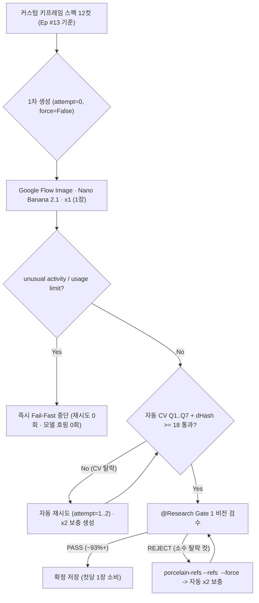

# Implementation Plan: Google Flow 레퍼런스 이미지 `x1` 1차 생성 + 탈락 컷 전용 `x2` 보충 전환 (`100%` Google Flow 네이티브)

## Goal Description

최근 48시간(`2026-11-18 ~ 11-20`) 동안 `Ep #9–#12` 리메이크 4편과 `Canonical v1.1/v1.2` 생성 과정에서 `FLOW_ZERO_CREDIT_IMAGE_BATCH_COUNT = 4` (`x4` 고정)로 인해 **매 프롬프트마다 4장씩 생성해 3장을 폐기**했고, 단기간에 **`450~500`장+**의 `0-credit` 이미지가 누적되면서 Google Flow의 일일/롤링 한도(`"We noticed some unusual activity"` / 수동 클릭 포함 차단)에 도달했습니다.

반면 정본 라이브러리(`99`슬롯) 도입 이후 실측 Gate 1 통과율은 **`93~100%`**(`Ep #11` `36/36` 1차 전원 통과, `Canonical v1.2` `14/15` 1차 통과)에 달합니다. 따라서 **외부 API를 전혀 사용하지 않고(`100%` Google Flow 네이티브 유지)**, 전역 이미지 생성 기본값을 **`1차 x1` + `ref-qa`/Gate 1 탈락 컷만 `x2` 보충**으로 전환하여 에피소드당 이미지 생성량을 **약 `85%` 감축**합니다(`Ep #10` `100`장 → `Ep #13` 예상 `~14`장).



---

## User Review Required

> [!IMPORTANT]
> **확정 전 확인 부탁드리는 4가지 핵심 결정 사항**
> 1. **범위 (`1번만` 적용)**: 컷당 생성 배수 축소(`1차 x1` + `탈락 컷만 x2`)만 적용하며, **일일 강제 생성 상한 가드레일(이전 제안 2번)은 추가하지 않습니다.**
> 2. **100% Google Flow 네이티브 잠금 (`API 사용 안 함`)**: `DEFAULT_REENACT_IMAGE_BACKEND = "flow"`, `REENACT_IMAGE_BACKENDS = ("flow",)`를 그대로 유지하며 Gemini/Vertex 유료 API 연동 코드는 일절 추가하지 않습니다.
> 3. **썸네일 `R65 v4` 키아트 배수 (`1`프롬프트/편)**: 현재 `thumbnail_studio.py`에 `batch_count=4`가 하드코딩되어 있습니다. 썸네일은 에피소드당 딱 `1`회만 생성되므로 **`x2` (2장 중 1장 선택, 기존 대비 50% 절감)**로 낮추는 것을 권장합니다. *(썸네일도 `x1`을 원하시면 코멘트로 알려주십시오.)*
> 4. **Flow 자연 쿨다운 존중 (`~24시간` 호출 `0`건)**: 이번 코드 수정 및 `pytest` 검증은 **100% 비-Flow 오프라인 작업**으로만 진행합니다. `Ep #11`(오늘 `11/20 19:30 ET`)과 `Ep #12`(내일 `11/21 19:30 ET`)가 이미 예약되어 있으므로, 사용자께서 수동 1클릭 정상 복구를 확인해 주시기 전까지 Google Flow 호출을 `0`건으로 유지합니다.

---

## Proposed Changes

### 1. Config SSOT (`pipeline/config.py`)

#### [MODIFY] [config.py](file:///home/canadaofbin/gdrive/Kyubin_Yun_Workspace/07_Youtube/pipeline/config.py)
- `FLOW_ZERO_CREDIT_IMAGE_BATCH_COUNT`: `4` → **`1`** (전역 1차 생성 기본값 `x1`)
- `FLOW_ZERO_CREDIT_IMAGE_RETRY_BATCH_COUNT = 2` 신규 추가 (CV 탈락 재시도 및 `--force` / Gate 1 반려 컷 표적 재생성 전용 `x2`)
- `FLOW_ZERO_CREDIT_IMAGE_THUMBNAIL_BATCH_COUNT = 2` 신규 추가 (`R65 v4` 썸네일 키아트 전용 `x2`)
- 공용 결정 헬퍼 `resolve_flow_image_batch_count(batch_count=None, *, is_retry=False, force=False, retry_batch_count=None) -> int` 추가:
  ```python
  FLOW_ZERO_CREDIT_IMAGE_BATCH_COUNT = 1           # 1st-pass default: x1 (saves ~75-86% daily Flow image volume)
  FLOW_ZERO_CREDIT_IMAGE_RETRY_BATCH_COUNT = 2     # Retry / Gate 1 rejected targeted regen: x2
  FLOW_ZERO_CREDIT_IMAGE_THUMBNAIL_BATCH_COUNT = 2 # R65 v4 hero thumbnail keyart (1 prompt/ep): x2

  def resolve_flow_image_batch_count(
      batch_count: int | None = None,
      *,
      is_retry: bool = False,
      force: bool = False,
      retry_batch_count: int | None = None,
  ) -> int:
      """Resolves Google Flow 0-credit Image batch size: explicit override > retry/force x2 > 1st-pass x1."""
      if batch_count is not None:
          return max(1, min(4, int(batch_count)))
      if is_retry or force:
          eff_retry = FLOW_ZERO_CREDIT_IMAGE_RETRY_BATCH_COUNT if retry_batch_count is None else int(retry_batch_count)
          return max(1, min(4, eff_retry))
      return max(1, min(4, int(FLOW_ZERO_CREDIT_IMAGE_BATCH_COUNT)))
  ```

---

### 2. Flow Image Engine & Fail-Fast Protection (`pipeline/flow_ingredients.py`)

#### [MODIFY] [flow_ingredients.py](file:///home/canadaofbin/gdrive/Kyubin_Yun_Workspace/07_Youtube/pipeline/flow_ingredients.py)
코드 정밀 조사 중 발견된 **3가지 잠재 버그**를 함께 차단합니다:
1. **`x1` 요청 시 이전 `x4` 잔류 방지 (`L1116–1119`)**:
   - 기존 코드는 `localStorage.outputCount`가 이전 `4`로 남아 있어도 `zero_credit_ok = True`를 통과시켜 `x1` 대신 `x4`가 제출될 위험이 있었습니다.
   - `ls_count = int(ls_now.get("outputCount") or cand_n)`가 **`ls_count <= target_batch`**(즉 `x1` 요청 시 반드시 `1`)일 때만 통과하도록 엄격 검증합니다.
2. **결과 슬라이스 과수집 차단 (`L1401`)**:
   - 기존 `new_urls = new_urls[: max(eff_batch, 4)]`를 **`new_urls = new_urls[:eff_batch]`**로 수정해 `x1` 요청 시 인접 구형 타일이 섞여 들어오는 일을 방지합니다.
3. **`"unusual activity"` 즉시 감지 및 Fail-Fast (`L1374–1397`)**:
   - 기존 `usage_limit_hit` 조건에 `"unusual activity"`가 누락되어 있었습니다.
   - `"unusual activity"` 감지 시 즉시 `reason="flow_unusual_activity_blocked"`를 반환해 호출부가 **재시도 `0`회 · 다른 모델 호핑 `0`회**로 즉시 중단하도록 잠급니다.

---

### 3. Reference Pack & Reenactment Orchestration (`pipeline/source_reenactment.py`, `pipeline/porcelain_anchor_pack.py`)

#### [MODIFY] [source_reenactment.py](file:///home/canadaofbin/gdrive/Kyubin_Yun_Workspace/07_Youtube/pipeline/source_reenactment.py)
- `translate_porcelain_keyframes_async` / `translate_porcelain_keyframes`의 `batch_count: int | None = None` 및 `retry_batch_count: int = FLOW_ZERO_CREDIT_IMAGE_RETRY_BATCH_COUNT` 지원.
- 컷별 루프(`L1745–1850`):
  - 시도 횟수를 `range(4)` → **`range(3)`**으로 축소(`1차 x1` + 최대 `2회 x2` = 최악의 경우에도 `5`장, 기존 `4×4=16`장 대비 69% 축소).
  - 매 시도마다 `attempt_batch = resolve_flow_image_batch_count(batch_count, is_retry=(attempt > 0), force=force, retry_batch_count=retry_batch_count)` 적용:
    - 정상 1차 생성(`attempt == 0, force == False`): **`x1`**
    - CV(`Q1..Q7` / `dHash`) 실패 후 자동 재시도(`attempt >= 1`): **`x2`**
    - Gate 1 반려 컷 표적 재생성(`force=True` / `--refs <id>`): **`x2`**
  - `miss_reason == "flow_unusual_activity_blocked"` 반환 시 **모델 교체(`fallback_models`) 없이 즉시 전체 배치 중단**(`rl_models.update(fallback_models)` + `break`).

#### [MODIFY] [porcelain_anchor_pack.py](file:///home/canadaofbin/gdrive/Kyubin_Yun_Workspace/07_Youtube/pipeline/porcelain_anchor_pack.py)
- `ensure_porcelain_reference_pack` / `ensure_expressive_v8_reference_pack`:
  - `batch_count: int | None = None` 및 `only_ref_ids: set[str] | None = None` 파라미터 추가.
  - Gate 1에서 일부 컷만 반려됐을 때 `porcelain-refs --project <id> --refs kf_c05,kf_c12 --force`로 **반려 컷만 표적 `x2` 재생성**할 수 있도록 연결(통과 컷은 `0`회 재생성).

---

### 4. CLI & Hardcoded `batch_count=4` Callers (`pipeline/cli.py`, `pipeline/thumbnail_studio.py`, `pipeline/longform_refs.py`, `pipeline/real_world_reference_builder.py`, `scripts/run_ig_card_pilot.py`)

#### [MODIFY] [cli.py](file:///home/canadaofbin/gdrive/Kyubin_Yun_Workspace/07_Youtube/pipeline/cli.py)
- `reenact-refs` (`L1117, L2501`), `porcelain-refs` (`L1129, L2525`), `longform-refs` (`L1239, L2750`):
  - `--batch-count` 기본값을 하드코딩 `4` → **`None`** (`auto: 1st-pass x1, retry/force x2`)으로 변경.
  - `porcelain-refs`에 `--refs` (콤마 구분 표적 `ref_id` 재생성) 옵션 추가.
  - CLI 도움말의 `x4` 표기를 `x1 first-pass / x2 retry`로 갱신.

#### [MODIFY] [thumbnail_studio.py](file:///home/canadaofbin/gdrive/Kyubin_Yun_Workspace/07_Youtube/pipeline/thumbnail_studio.py)
- `L974`, `L1008`의 하드코딩 `batch_count=4` → **`FLOW_ZERO_CREDIT_IMAGE_THUMBNAIL_BATCH_COUNT`** (`2`)로 변경.

#### [MODIFY] [longform_refs.py](file:///home/canadaofbin/gdrive/Kyubin_Yun_Workspace/07_Youtube/pipeline/longform_refs.py) & [real_world_reference_builder.py](file:///home/canadaofbin/gdrive/Kyubin_Yun_Workspace/07_Youtube/pipeline/real_world_reference_builder.py) & [run_ig_card_pilot.py](file:///home/canadaofbin/gdrive/Kyubin_Yun_Workspace/07_Youtube/scripts/run_ig_card_pilot.py)
- `longform_refs.py`: `attempt == 0` → `x1`, `attempt >= 1` / `force=True` → `x2` + `flow_unusual_activity_blocked` fail-fast 동일 적용.
- `real_world_reference_builder.py`: `FLOW_ZERO_CREDIT_IMAGE_BATCH_COUNT` (`1`) 자동 상속 확인 및 독스트링 갱신.
- `scripts/run_ig_card_pilot.py` (`L135`): 하드코딩 `batch_count=4` → `FLOW_ZERO_CREDIT_IMAGE_BATCH_COUNT` (`1`).

---

### 5. Rules & Documentation Parity (`.agents/rules/`, `.agents/skills/`, `.agents/AGENTS.md`)

#### [MODIFY] [production_constants.md](file:///home/canadaofbin/gdrive/Kyubin_Yun_Workspace/07_Youtube/.agents/rules/production_constants.md) · [reference_depiction_rules.md](file:///home/canadaofbin/gdrive/Kyubin_Yun_Workspace/07_Youtube/.agents/rules/reference_depiction_rules.md) · [visual_prompt_spec.md](file:///home/canadaofbin/gdrive/Kyubin_Yun_Workspace/07_Youtube/.agents/rules/visual_prompt_spec.md) · [AGENTS.md](file:///home/canadaofbin/gdrive/Kyubin_Yun_Workspace/07_Youtube/.agents/AGENTS.md)
- `production_constants.md`의 `FLOW_ZERO_CREDIT_IMAGE_BATCH_COUNT`를 `` `1` ``로 동기화하고 `FLOW_ZERO_CREDIT_IMAGE_RETRY_BATCH_COUNT` (`` `2` ``), `FLOW_ZERO_CREDIT_IMAGE_THUMBNAIL_BATCH_COUNT` (`` `2` ``) 행 추가 (`test_production_constants_md_ssot_parity_for_r66_r67_and_zero_credit` 1:1 정합 유지).
- `reference_depiction_rules.md`, `visual_prompt_spec.md`, `AGENTS.md`의 `x4` 표기를 **`x1` 1차 생성 + 탈락 컷 전용 `x2` 보충**으로 무충돌 갱신. *(규칙 문서 `AGENTS.md`는 승인 후 CEO가 1줄 동기화, 나머지 파이프라인·규칙·테스트는 `@Operator`가 일괄 수행)*

---

### 6. Execution Governance (`R83 v2`)

- **승인 전**: 코드 수정 `0`건, Google Flow 호출 `0`건.
- **승인 후**:
  1. `@YouTube_CEO`가 [`@Operator`](conversation://1f9808d4-ebac-4b58-a570-45c8f1f00a85)에 본 계획 구현을 `send_message`로 위임 (`0` Flow 브라우저 호출 잠금).
  2. `@Operator`가 `inherit` 코딩 서브에이전트 + `flash` `pytest` 서브에이전트로 구현 후 `R83-8-V` 1차 자체 검수를 거쳐 `[FLOW_X1_X2_DIET_DONE]` 보고.
  3. `@YouTube_CEO`가 독립 읽기 전용 검증(`pytest` 재실행 + 하드코딩 `batch_count=4` 잔여 grep `0`건 확인) 후 PASS 시 Walkthrough 아티팩트를 갱신하고 보고.

---

## Verification Plan

### Automated Tests (`0` Google Flow Browser Calls)
1. **기존 테스트 갱신 (`tests/test_source_reenactment_qa.py`, `tests/test_master_upgrade_review_fixes.py`)**:
   - `FLOW_ZERO_CREDIT_IMAGE_BATCH_COUNT == 1`, `FLOW_ZERO_CREDIT_IMAGE_RETRY_BATCH_COUNT == 2`, `DEFAULT_REENACT_IMAGE_BACKEND == "flow"` 단언 검증.
   - `_FakeFlowImageCDPClient`가 클릭된 `x{cand_n}`을 `outputCount`에 반영하도록 보완.
2. **신규 단위·회귀 테스트 추가 (`tests/test_flow_image_x1_x2_retry_policy.py`)**:
   - `resolve_flow_image_batch_count()`: 1차(`None`) → `1`, `is_retry=True` → `2`, `force=True` → `2`, 명시적 `--batch-count 3` → `3`.
   - `configure_flow_zero_credit_image_mode(..., batch_count=1)`: Flow `localStorage.outputCount`가 `4`에 고정되어 있으면 **Fail-Closed (`RuntimeError`)** 검증 (조용히 `x4` 제출되는 사고 원천 차단).
   - `generate_flow_image_batch(..., batch_count=1)`: 반환 URL 슬라이스가 정확히 `<= 1`개로 제한되고, `"We noticed some unusual activity"` 에러 카드 감지 시 `reason == "flow_unusual_activity_blocked"` 즉시 반환 검증.
   - `translate_porcelain_keyframes_async`: 1차 시도(`attempt=0`)는 `batch_count=1`, CV 실패 후 2차 재시도(`attempt=1`)는 `batch_count=2`, `flow_unusual_activity_blocked` 발생 시 **재시도 `0`회·모델 호핑 `0`회 즉시 중단** 검증.
   - `production_constants.md` SSOT 패리티 + 전체 코드베이스 하드코딩 `batch_count=4` 잔존 `0`건 확인.
3. **실행 명령어**:
   ```bash
   /home/canadaofbin/hermes-venv/bin/python -X utf8 -m pytest tests/test_flow_image_x1_x2_retry_policy.py tests/test_source_reenactment_qa.py tests/test_master_upgrade_review_fixes.py -q
   /home/canadaofbin/hermes-venv/bin/python -X utf8 -m pytest --ignore=tests/test_blender_brain_sim.py -q
   ```

### Manual Verification (After ~24h Cooldown)
- 사용자께서 하루 정도 자연 쿨다운 후 NoVNC에서 수동 1클릭 정상 복구를 확인해 주시면, `Ep #13` (`12`컷 커스텀 키프레임)을 첫 파일럿으로 실행하여:
  1. Flow 설정 팝업이 **`Image · 9:16 · x1 · 0 credits`**로 잡히는지 확인
  2. `12`컷 1차 생성이 총 **`12`장**만 소비하는지 확인(탈락 컷만 `--refs <id> --force`로 `x2` 보충)
