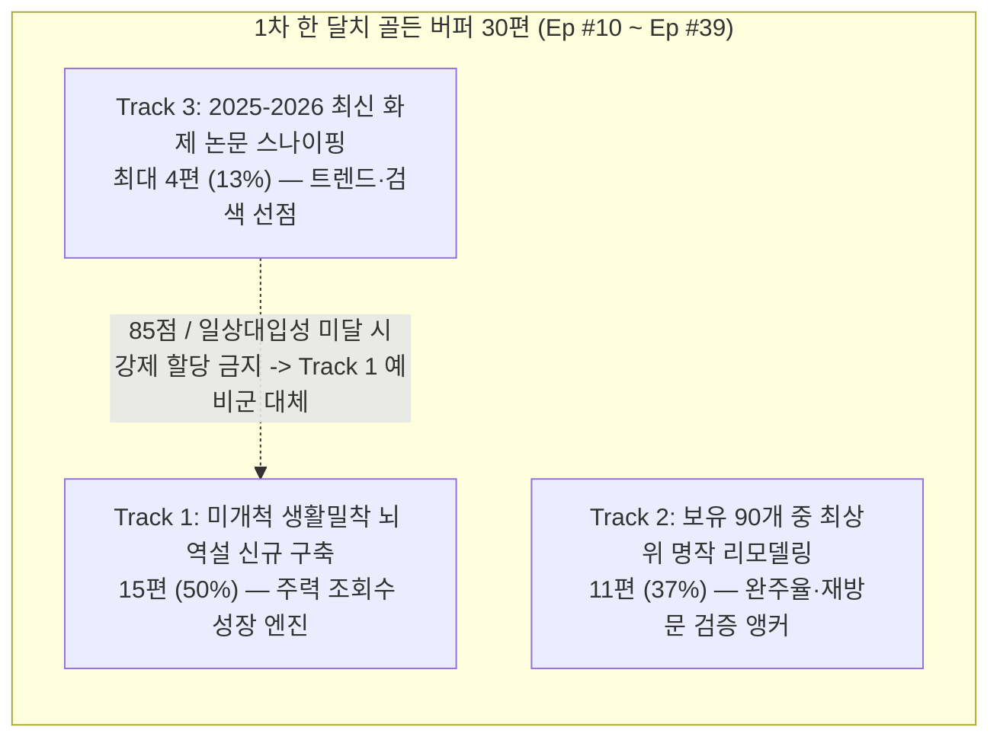

# ALL ABOUT BRAIN 하이 퀄리티 주제 리서치 최종 확정 마스터 계획서 (`v3 — 30편 일괄 구축 + 주간 자동 스케줄링`)

> [!IMPORTANT]
> **확정된 운영 체제 요약**
> - **1차 초기 확보 물량**: **`30편` (4주 한 달치 완제품 `Schema v2` 골든 버퍼 — `Ep #10 ~ Ep #39`)**
> - **장기 운영 방식**: **하이브리드 자동 롤링 엔진** (`지금 30편 즉시 구축` + **`매주 1회 정기 스케줄링`**으로 주간 실측 조회수 데이터를 반영해 소진분 **`7편씩` 자동 리서치·충원 및 우선순위 재정렬**)

---

## 1. 총 11대 무결점 검증 관문 (기존 7대 보완 + `30편/스케줄링` 전용 4대 안전장치 추가)

한 달치 `30편` 대량 구축과 주간 자동 스케줄링을 결합할 때 새로 생길 수 있는 **4가지 운영 리스크(8~11번)**까지 모두 설계에 반영했습니다.

| 구분 | # | 검증 관문 (Gate) | 핵심 방어 로직 |
|---|---|---|---|
| **콘텐츠·타겟 정합성** | **1** | **미국 성인(`35–65세+` `78%`) 타겟 게이트** | 대학 기숙사·아동 실험 프레이밍 배제 → 수면 분절·새벽 각성·건망증·만성 통증·자동 습관 등 성인 실생활 공감 100% 소재만 채택 |
| **기술·파이프라인 호환** | **2** | **`31개` MNI152 3D 뇌 아틀라스 호환** | [anatomy_map.py](file:///home/canadaofbin/gdrive/Kyubin_Yun_Workspace/07_Youtube/pipeline/anatomy_map.py) 정규 `31개` 영역 `resolve_region()` 100% 매칭 강제 (미등록 해부학 용어 에러 원천 차단) |
| **레거시 오염 차단** | **3** | **구형 `researcher.py`(`v4`) 우회 수집** | 구형 `30초 실사/HUD/BCI` 템플릿 대신 PubMed + Crossref REST API 직접 수집기로 `Schema v2`(`R75`/`R78`) 직결 생성 |
| **플랫폼·생성 안전성** | **4** | **Flow & 쇼츠 피드 안전 필터 (`Gate 0`)** | 폭력·범죄·유아 울음·동물 학대·시체 망상 소재 영구 격리 (`Veo 3.1`/`Omni 1.2` 리젝션 및 비구독 피드 제한 방지) |
| **학술 신뢰도 방어** | **5** | **재현성 위기(`Replication`) 교차 검증** | `2015년 이후` 재현 논문·메타분석 또는 최신 fMRI 검증 필수 확인 (철회/재현 실패 논문 무비판 인용 금지) |
| **호흡·분량 적합성** | **6** | **`18단어` 실험 세팅 압축 테스트** | 초등 6학년 수준 영어 1문장(`<= 18단어`)으로 실험 규칙이 설명되지 않는 복잡한 설계 즉시 탈락 (`68–84초` 쇼츠 최적화) |
| **시드·멀티플랫폼 확장** | **7** | **상위 앵커 연쇄 시딩 & 5-Asset 저장성** | 채널 상위 앵커(`2,023회`·`1,617회`·`1,250회`·`527회`)와 직결되는 시리즈 구조 + 인스타 6장 캐러셀·커뮤니티 퀴즈 전환성 동시 평가 |
| **30편 장기 버퍼 신선도** | **8** | **고정 날짜 대신 '동적 우선순위 큐' 운영** | `30편`을 한 달 전 날짜로 못 박지 않고 `topic_priority_queue.json`(`1~30순위`)으로 관리 → **매주 터진 영상 도메인에 맞춰 남은 대기열 순서를 자동 재정렬** |
| **재고 비대화·중복 방지** | **9** | **버퍼 상한(`35개`) 승강제 & 10일 중복 금지** | 매주 `+7편` 충원 시 큐가 `35개`를 넘으면 **하위 점수(`88점 미만`) 주제를 퇴출하고 고득점(`90점+`) 신작으로 교체** (품질 하한선 매주 상승 + 10일 내 동일 뇌회로 연속 배치 금지) |
| **브라우저 충돌 제로** | **10** | **일일 리포트 직후 순수 API 시간대 분리** | 주간 스케줄러는 **매주 월요일 `09:30 UTC`**(`08:00` 일일 리포트 완료 직후)에 **로컬 리포트 JSON 읽기 + 외부 무료 학술 API만 호출** (`shared-chrome` CDP 접속 **0회**) |
| **대량 구축 품질 균일화** | **11** | **5-도메인 병렬 워커 분할 (`6편 × 5팀`)** | 단일 에이전트가 30편을 연속 작성할 때 생기는 후반부 품질 저하를 막기 위해 **도메인별 전문 서브에이전트 5개가 각 `6편씩`만 전담 집필 후 중앙 코드 게이트 통과** |

---

## 2. 1차 확보 `30편` 한 달치 포트폴리오 설계 (`15 : 11 : 4` 황금 비율)

`85점 / 100점` 미만은 가차 없이 탈락시키며, 아래 **3-트랙 `30편` 완제품 도시에**를 구축합니다.

| 트랙 | 편수 | 세부 도메인 배분 및 대표 후보군 (`35–65세+` 미국 성인 공감 중심) |
|---|---|---|
| **Track 1: 신규 생활밀착 뇌 역설** | **`15편` (`50%`)** | • **수면·야간 뇌(`4편`)**: 새벽 3시 각성 루프, 수면 놀람증(절벽 추락 움찔), 스누즈 버튼 9분 수면 관성, 20분 낮잠 vs 60분 낮잠 뇌안개 역설 • **기억·노화 방어(`4편`)**: 문지방 건망증(방에 들어간 이유 망각), 데자뷔 전두엽 사실확인기, 30년 전 노래 vs 5초 전 이름 망각, 설단 현상(입안에서만 맴도는 단어) • **자동습관·집중(`4편`)**: 주머니 속 유령 진동 착각, 머릿속 노래 무한반복(귀벌레), 위기 순간 슬로모션 기억 착각, 샤워 중 아이디어 폭발(DMN 전환) • **신체·통증·감정(`3편`)**: 사회적 거절과 실제 신체 통증 회로(dACC), 전염성 하품·가려움 거울회로, 가짜 약인 줄 알고 먹어도 통증이 주는 오픈라벨 플라시보 |
| **Track 2: 보유 90개 중 최상위 리모델링** | **`11편` (`37%`)** | 기존 `90개` 전수 채점 후 최상위 `11편`만 선별해 성인 시점 + `R78-M` `#27D8FF` 뇌회로 + `R79-M` 소품 액션으로 전면 개조: ① `호텔 첫날밤 좌뇌 절반 불침번` ② `하얀 곰 사고억제 리바운드` ③ `연인 손잡기 통증 경보 차단` ④ `3인칭 자기이름 편도체 냉각` ⑤ `부딪힌 정강이 문지르기 통증 관문 차단` ⑥ `미완성 과업 새벽 잔류(자이가르닉)` ⑦ `60초 고무손 내 몸 착각` ⑧ `입모양이 귀를 속이는 맥거크 착각` ⑨ `장소 맥락 기억(수중 암기 실험)` ⑩ `안면실인증(내 얼굴이 낯선 뇌)` ⑪ `시각 포만감 착각(검증 원전 한정)` |
| **Track 3: `2025–2026` 최신 논문 스나이핑** | **`최대 4편` (`13%`)** | 최근 1년 내 `Nature` / `Science` / `PNAS` / `Current Biology` / `Sleep` 등에 발표된 인간 뇌과학 연구(수면 중 인간 뇌 노폐물 파동 최신 영상, 중년 유산소/걷기와 해마 용적 최신 임상, 야간 스마트폰 빛 노출과 우울·대사 회로, 초가공식품과 보상회로 둔화 등) 중 **85점 이상 통과작만 최대 4편 채택** *(미달 시 Track 1 예비 후보로 대체)* |

---

## 3. 단계별 실행 공정표 (총 6단계 — 브라우저 무간섭 · 병렬 고속 처리)

### Phase 0. 중복·안전·해부학 블랙리스트 잠금 (`~2분`)
- 기공개·예약 `22편`의 모든 케이스·DOI(`16개+`) 블랙리스트 생성, [anatomy_map.py](file:///home/canadaofbin/gdrive/Kyubin_Yun_Workspace/07_Youtube/pipeline/anatomy_map.py) 정규 `31개` 뇌 영역 검증기 및 `Gate 0`(Flow 위험 소재 & `R75` 금지 `BCI/AI` 태그 차단기) 로드.

### Phase 1. 내부 `90개` 도시에 전수 채점 & 외부 영미권 바이럴 공식 매칭 (`~8분`)
- `@Research` 영미권 인기 쇼츠 훅·제목 패턴 결합 + 파이썬 전수 감사 스크립트로 보유 미제작 `90개` 도시에에 6축 100점 스코어 부여.
- 상위 **`11개` 리모델링 대상(`Track 2`)** 확정 및 저효율 교과서·위험 도시에 보류(`quarantine`) 분리 → `BCI_Shorts_Channel/reports/research/dossier_90_triage_audit.json` 저장.

### Phase 2. `Track 1` & `Track 3` 학술 API 대량 탐색 및 `19편` 확정 (`~12분`)
- PubMed E-utilities + Crossref REST API로 신규 일상 역설 후보 `22개` + `2025–2026` 최신 화제 논문 후보 `12개`(총 `34개` 후보군) 메타데이터·초록·재현 논문 일괄 수집.
- **Zero-Hallucination DOI 검증** + **18단어 압축 테스트** + **6축 채점(`>= 85점`)**을 통과한 최상위 **`19편`(`Track 1` 15편 + `Track 3` 최대 4편)** 최종 확정 → 총 `30편` 라인업 및 `180개+` 검증 DOI 확정.

### Phase 3. 5-워커 병렬 `Schema v2` `30편` 완제품 도시에 구축·리모델링 (`~25~35분`)
- 도메인별 전문 서브에이전트 **5개 워커(`각 6편 전담`)**를 병렬 가동하여 `30편` 전수 `Schema v2` 8종 파일(`dossier.json`, `01_sources.json` ~ `07_longform_outline.json`) 완성:
  - 모든 도시에에 **`R78-M` `#27D8FF` 31개 아틀라스 회로 상태(`active/silenced/severed`)**, **`R79-M` 소품 물리 동작(`State-A -> State-B`)**, **`R70-M` 데이터 스탬프 프리셋**, **`R75` 청정 키워드** 내장.

### Phase 4. 중앙 4중 자동화 QA 게이트 전수 검증 (`~5분`)
- `30편` 전체에 대해 일괄 검증 스크립트 실행:
  1. `main.py dossier validate --slug <slug> --require-v2` → **`30/30 ready: True` (`errors: 0`)**
  2. 전 문헌 Crossref DOI 실재성 `100%` 확인 (`환각 DOI = 0`)
  3. `06_brain_link.json` 전 뇌 영역 `resolve_region()` `31/31` 호환 `100%` 통과
  4. `R75` 금지 테크 태그 및 Flow 안전 금칙어 `0건` 통과

### Phase 5. 동적 우선순위 큐(`Rank #1~#30`) & 주 1회 자동 롤링 스케줄러 가동 (`~5분`)
1. **마스터 우선순위 큐 및 4주 편성표 생성**:
   - `BCI_Shorts_Channel/topic_priority_queue.json` 및 `BCI_Shorts_Channel/reports/research/golden_slate_30_master.md` 생성 (`Rank #1 ~ #30` 점수순 정렬, 10일 내 동일 회로 연속 등장 방지 스페이싱, 에피소드별 `R65 v4` 썸네일 좌/우 컨셉 + 상위 Anchor `Related video` ID 사전 매핑 완료).
2. **주 1회 정기 자동 리서치 스케줄러 구축 및 등록**:
   - 재사용 실행 스크립트 `scripts/weekly_topic_research_runner.py` 작성 (매주 최근 7일 일일 리포트 성과 기반 큐 재정렬 + 최신 논문/일상 역설 스캔 + 상위 `7편` 후보 발굴·검증 리포트 생성 + 큐 상한 `35개` 승강제 관리).
   - 상시 크론 데몬(`schedule` 도구 `IsDaemon=True`, **매주 월요일 `09:30 UTC`**) 등록 및 `@Research` 채팅방 SSOT 연동 완료 (원하실 경우 채팅창의 `/schedule` 명령으로도 언제든 조회·조정 가능).

---

## 4. 실행 승인 확인

- **목표 물량**: **완제품 `Schema v2` 도시에 `30편` (`15 : 11 : 4`)** 일괄 완성 + **주 1회(`+7편/주`) 롤링 스케줄러 상시 가동**
- **안전 보장**: 개인 브라우저 탭(`CDP 9222`) 무접촉, 유료 API 비용 `\$0`, 전 문헌 실증 DOI `100%` 검증

이대로 **Proceed(`진행`)** 주시면 즉시 Phase 0부터 Phase 5까지 전 공정을 가동하겠습니다!
