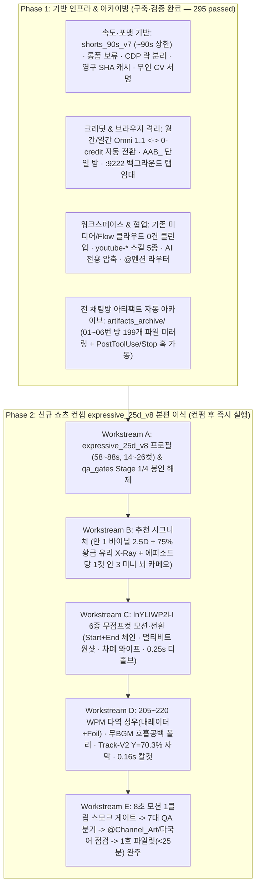

# ALL ABOUT BRAIN (`07_Youtube`) 통합 마스터 실행 계획서 (`v3` — 컨펌 대기본)

> [!IMPORTANT]
> **현재 상태: 계획 수립 완료 · 실행 전 컨펌 대기 (`Read-Only`)**
> 지금까지 논의·검증한 **모든 요구사항(속도 병목 제거 · 월간 크레딧 자동 티어 · 탭 탈취 차단 · 폴더/스킬 경량화 · 전 채팅방 아티팩트 자동 아카이빙 · `@RicksClips3000` 및 `lnYLIWP2l-I` 모션/장면전환 이식 · 추천 시그니처 캐릭터 `안 1 + 안 3 결합형` · 보완 포인트 4종)**을 단 하나의 마스터 실행 계획으로 통합했습니다. 승인(`Proceed` 또는 `"진행해"`) 주시기 전까지 추가 코드 변경은 일절 수행하지 않습니다.

---

## 1. 전체 마스터 아키텍처 & 완료/대기 현황 요약

---

## 2. 전 채팅방 보고서·아티팩트 자동 아카이브 현황 및 보강 계획

요청하신 **"프로젝트 폴더 내 별도 아카이브 폴더 복사 + 다른 채팅방 포함 + 앞으로도 자동 동기화"** 기능은 현재 워크스페이스에 구축·연동되어 실시간 작동 중이며, 컨펌 후 아래 마무리 보강까지 함께 처리합니다.

### 2.1 현재 구축·동기화 완료 상태 (`artifacts_archive/`)
- **아카이브 루트 및 통합 목차**: [INDEX.md](file:///home/canadaofbin/gdrive/Kyubin_Yun_Workspace/07_Youtube/artifacts_archive/INDEX.md) (`42`개 마크다운 보고서 + `157`개 이미지/차트 = 총 **`199`개 파일** 미러링 완료, 상대 경로 이미지 링크 자동 변환 적용)
  - `01_YouTube_CEO/`: 본 채팅방 보고서 4종([benchmark_success_formula_report.md](file:///home/canadaofbin/gdrive/Kyubin_Yun_Workspace/07_Youtube/artifacts_archive/01_YouTube_CEO/benchmark_success_formula_report.md), [signature_character_comparison_report.md](file:///home/canadaofbin/gdrive/Kyubin_Yun_Workspace/07_Youtube/artifacts_archive/01_YouTube_CEO/signature_character_comparison_report.md), [walkthrough.md](file:///home/canadaofbin/gdrive/Kyubin_Yun_Workspace/07_Youtube/artifacts_archive/01_YouTube_CEO/walkthrough.md), `implementation_plan.md`) + 미디어 `20`개
  - `02_Research/`: 3대 벤치마크 채널 원본 분석 보고서 `3`종 + 미디어 `19`개
  - `03_Daily_Report/`: 일일 성장/개별 영상 리포트 `24`종 + 차트 `85`개
  - `04_Headquarters/`: 파이프라인 엔지니어링 문서 `9`종 + 미디어 `20`개
  - `05_Channel_Art/`: 신규 v8 아바타·배너 리포트([channel_art_v8_renewal_report.md](file:///home/canadaofbin/gdrive/Kyubin_Yun_Workspace/07_Youtube/artifacts_archive/05_Channel_Art/channel_art_v8_renewal_report.md)) `1`종 + 에셋 `8`개
  - `06_Report_Redesign/`: 리포트 스키마 설계본 `1`종 + 차트 `5`개
- **실시간 자동 동기화 메커니즘 (앞으로도 영구 작동)**:
  - 프로젝트 훅([.agents/hooks.json](file:///home/canadaofbin/gdrive/Kyubin_Yun_Workspace/07_Youtube/.agents/hooks.json)) 및 전역 훅(`~/.gemini/config/hooks.json`)에 `PostToolUse`(`write_file`, `edit_file`, `generate_image` 등)와 `Stop` 이벤트가 연결되어 있어, **어느 유튜브 채팅방(신규 생성 채팅방 및 서브에이전트 포함)에서든 아티팩트가 작성·수정되는 즉시 [sync_artifacts_archive.py](file:///home/canadaofbin/gdrive/Kyubin_Yun_Workspace/07_Youtube/scripts/sync_artifacts_archive.py)가 `artifacts_archive/`로 자동 복사하고 `INDEX.md`를 갱신**합니다.
  - [.rgignore](file:///home/canadaofbin/gdrive/Kyubin_Yun_Workspace/07_Youtube/.rgignore) 및 [.ignore](file:///home/canadaofbin/gdrive/Kyubin_Yun_Workspace/07_Youtube/.ignore)에 `artifacts_archive/`가 등록되어 있어 아카이브가 아무리 커져도 코드 검색 속도(`<1s`)는 느려지지 않습니다.

### 2.2 컨펌 후 추가 보강할 사항 (Workstream 0)
1. `scratch/` 예외 규칙으로 제외되어 있던 실측 로그(`telemetry.json`)를 `signature_cast/telemetry.json`으로 승격해 `01_YouTube_CEO` 보고서 내 모든 링크를 100% 휴대용 상대 경로로 완결합니다.
2. Phase 1 완료분 + `artifacts_archive/` 전체 상태를 깔끔한 Git 체크포인트로 먼저 기록한 뒤 Phase 2 코드 개조에 착수합니다.

---

## 3. Phase 2 상세 구현 계획 (`expressive_25d_v8` + `안 1 + 안 3 결합형`)

### Workstream A — 신규 프로필(`expressive_25d_v8`) 정의 & 기존 QA 하드락 해제
- **대상 파일**: [config.py](file:///home/canadaofbin/gdrive/Kyubin_Yun_Workspace/07_Youtube/pipeline/config.py), [production_constants.md](file:///home/canadaofbin/gdrive/Kyubin_Yun_Workspace/07_Youtube/.agents/rules/production_constants.md), [qa_gates.py](file:///home/canadaofbin/gdrive/Kyubin_Yun_Workspace/07_Youtube/pipeline/qa_gates.py)
- **구현 내용**:
  1. `EXPRESSIVE_25D_V8_STYLE_PROFILE = "expressive_25d_v8"` 및 `SHORTS_EXPRESSIVE_V8_PROFILE = "shorts_expressive_v8"` 추가:
     - 목표 런타임 **`58.0 ~ 88.0초`** (허용 `55.0 ~ 89.5초`, 하드 상한 `<= 90.0초`, 롱폼 `LONGFORM_DEFERRED = True` 유지)
     - 클립 수 **`14 ~ 26개`** (`8.0s` Flow 생성 후 `1.8 ~ 7.8s` 멀티비트 가변 활용 → **1편당 총 생성·조립 시간 `15~25분` 달성**)
     - 단어 수 **`175 ~ 290단어`**, 발화 속도 **`205 ~ 220 WPM`** (허용 `185 ~ 235 WPM`)
  2. [qa_gates.py](file:///home/canadaofbin/gdrive/Kyubin_Yun_Workspace/07_Youtube/pipeline/qa_gates.py) 블로커 해소:
     - Stage 1(`schema_v7_diorama_ssot_lock`, `L222-257`)이 `porcelain_cinematic_v7`과 신규 `expressive_25d_v8`을 모두 정식 프로필로 인정하도록 확장(기존 `v7` 회귀 테스트 `295개` 100% 보존).
     - Stage 4(`run_intent_content_qa`, `L914-948`)가 구버전 3분 쇼츠 기준(`430단어` 최소치) 대신 `resolve_shorts_format_profile()`을 참조하도록 수정.

---

### Workstream B — 확정 시그니처 캐릭터(`안 1 + 안 3 결합형`) 고정 & Flow 멀티칩 안정화
- **대상 파일**: [porcelain_anchor_pack.py](file:///home/canadaofbin/gdrive/Kyubin_Yun_Workspace/07_Youtube/pipeline/porcelain_anchor_pack.py), [flow_ingredients.py](file:///home/canadaofbin/gdrive/Kyubin_Yun_Workspace/07_Youtube/pipeline/flow_ingredients.py), [diorama_pipeline_runner.py](file:///home/canadaofbin/gdrive/Kyubin_Yun_Workspace/07_Youtube/pipeline/diorama_pipeline_runner.py)
- **구현 내용**:
  1. **마스터 레퍼런스 시트 영구 등재**: 검증 완료된 `opt1_sheet`와 `opt3_cameo_sheet`를 `BCI_Shorts_Channel/reference_style_anchors/expressive_25d_v8_refs/`(`species_opt1_sheet.png`, `cameo_opt3_sheet.png`)로 승격.
  2. **`안 1 + 안 3 결합형` 조건화 규칙**:
     - **일반 컷 (에피소드의 ~93%, 1칩 고속 모드 `~34.5s`)**: `species_opt1_sheet.png` 단독 첨부 → 매끈한 3D 매트 크림화이트 바이닐 두상·손 + 차콜블랙 2D 카툰 눈·눈썹·입 표정 연기 + 시대/상황별 3D 의상 착용.
     - **`[0 ~ 70%]` 뇌 내부 CG 금지 & `[70 ~ 85%]` `75%` 황금 분할선 유리 X-Ray 오픈**: 초반 70%까지는 인간 드라마·갈등에만 집중하고, 클라이맥스(`"You see..."`) 2~3컷에서만 이마 황금 링 분할선이 열리며 투명 크리스탈 돔 속 **4색 입체 뇌 스위치**(또는 수면 에피소드용 좌/우 반구 부분 X-Ray)가 발광하도록 강제.
     - **이스터에그 컷 (에피소드당 정확히 `1컷`, 2칩 모드)**: 비극적이지 않은 중·원경 씬 딱 1곳(`cameo_easter_egg: true`)에만 `[species_opt1_sheet.png, cameo_opt3_sheet.png]`를 붙여 선반·타이머·협탁·머그컵 구석에 **`4cm` 4색 발광 미니 뇌(`Mini-Cortex`)**를 숨김 → 댓글창 타임스탬프 찾기 놀이 유도.
  3. **`Start+End` 2비트 멀티키프레임 해금 & `flow_ingredients.py` 안정화**:
     - [porcelain_anchor_pack.py](file:///home/canadaofbin/gdrive/Kyubin_Yun_Workspace/07_Youtube/pipeline/porcelain_anchor_pack.py#L769)에서 막혀 있던 `end_reference_image` 삭제 로직을 `expressive_25d_v8`에서 해제해, 크레딧 보유 시(`Omni 1.1 Flash`) `Start + End` 공유 키프레임 체인을 네이티브 구동하고 `0-credit`(`Veo 3.1 - Lite`)에서는 듀얼칩 지원 여부에 따라 자동 폴백.
     - 프로토타입 생성 중 발견된 `.cdk-overlay-backdrop` / `<flow-add-menu-popover-content>` 잔류 및 `.jpg` 저장 시 PNG 바이트 복사 버그 3건을 [flow_ingredients.py](file:///home/canadaofbin/gdrive/Kyubin_Yun_Workspace/07_Youtube/pipeline/flow_ingredients.py) 본선에 이식.

---

### Workstream C — `lnYLIWP2l-I` & `@RicksClips3000` 영상 모션 · 6종 무점프컷 전환 · 대본/제목 공식
- **대상 파일**: [depiction_rules.py](file:///home/canadaofbin/gdrive/Kyubin_Yun_Workspace/07_Youtube/pipeline/depiction_rules.py), [flow_prompt_builder.py](file:///home/canadaofbin/gdrive/Kyubin_Yun_Workspace/07_Youtube/pipeline/flow_prompt_builder.py), [prompt_quality_v5.py](file:///home/canadaofbin/gdrive/Kyubin_Yun_Workspace/07_Youtube/pipeline/prompt_quality_v5.py), [publish.py](file:///home/canadaofbin/gdrive/Kyubin_Yun_Workspace/07_Youtube/pipeline/publish.py), [diorama_batch_orchestrator.py](file:///home/canadaofbin/gdrive/Kyubin_Yun_Workspace/07_Youtube/pipeline/diorama_batch_orchestrator.py), [sanitize_scheduled_metadata.py](file:///home/canadaofbin/gdrive/Kyubin_Yun_Workspace/07_Youtube/pipeline/studio/sanitize_scheduled_metadata.py)
- **구현 내용**:
  1. **단일 `8.0s` 클립 내 2~3비트 연속 모션 & 카메라 워킹**:
     - 짧은 단발 컷을 남발하지 않고 한 클립 안에서 `동작 A → 카메라 패닝/줌 → 동작 B`까지 연속 수행(최장 `5.8~7.8s` 원샷 허용)해 컷 수와 렌더 시간을 절반으로 단축.
  2. **`lnYLIWP2l-I` 역설계 기반 6종 하이브리드 전환(`transition_out`) 스키마**:
     - `daisy_chain_bridge` (`End(i) = K_{i+1} = Start(i+1)` 공유 키프레임 휩틸트·패닝·포털 줌인·낮밤 조명 모핑)
     - `occlusion_wipe` (연기·구름·어두운 문틈/포구 100% 차폐 순간 전환)
     - `action_impact_cut` (물리 충돌·문 닫힘 + 호흡 공백 폴리 타격 동기화 컷)
     - `dissolve_6f` (시대/장소 점프용 `0.25s` 고속 선형 크로스 디졸브 — 네이티브 `24fps` 기준 `6프레임`, 패닝 저더 제로)
     - `match_cut_bridge` / `split_screen_wipe` (선택적 피사체 매치컷 및 대조 분할)
  3. **대문자 영문 소품 스텐실 개방 (`diegetic_text_allowlist`)**:
     - `CELL P-618`, `15:00`, `03:00`, `HOT SHOT` 등 클립별 선언된 `1~2단어` 굵은 대문자 소품 라벨은 프롬프트 자동 삭제에서 면제.
  4. **대본 & 패키징 성공 공식 (`R68`)**:
     - `0.00s` 연도·학술명 없는 즉각적 기행(엔진 A 60%) 또는 2인칭 일상 위기(엔진 B 40%) → 비웃는 조롱 대사(`Foil`) → `"Wait, what?"` 역전 → `75%` `"You see..."` 4색 뇌 스위치 + 생활 사물 비유 1개 → 요약 없는 역설 결말.
     - 본문에서는 유명 실험 별칭을 의도적으로 생략해 ‘댓글 해설단’을 유도하고, **고정 댓글(`R35`)에 원문 논문 DOI와 토론 질문**을 박제.
     - 제목은 `4~8단어`(`<= 55자`) 보통명사/역설형(*Why Pink Prison Cells Backfired*, *Your Brain's 3 AM Night Watch*), 설명란/제목 해시태그 `0개` 자동 적용.

---

### Workstream D — 다역 성우(`205~220 WPM`) · 무BGM 호흡공백 폴리 · Track-V2 자막 · `0.16s` 칼컷 조립
- **대상 파일**: [prosody.py](file:///home/canadaofbin/gdrive/Kyubin_Yun_Workspace/07_Youtube/pipeline/prosody.py), [voice_fallback.py](file:///home/canadaofbin/gdrive/Kyubin_Yun_Workspace/07_Youtube/pipeline/voice_fallback.py), [diorama_assembler.py](file:///home/canadaofbin/gdrive/Kyubin_Yun_Workspace/07_Youtube/pipeline/diorama_assembler.py)
- **구현 내용**:
  1. **하이텐션 다역 보이스 (`expressive_us_v8`)**:
     - 기존 3기어 척추(`rush +20%`, `brisk +16%`, `stamp +10%`) 위에서 평균 **`205~220 WPM`** 달성.
     - 문장별 `speaker` 필드 지원: 메인 내레이터(`emma_v7`)와 극 중 비웃는 조롱역/내면 대사(`Foil`, 대비되는 무료 US Neural 남성/서브 보이스)를 분리해 초반 5초 대사 타격감 극대화.
  2. **멜로디 BGM `0%` + `-30 dBFS` 공간 앰비언스 + 호흡 공백 절차적 물리 폴리(Foley)**:
     - 연속 멜로디 배경음악을 끄고 `-30 dBFS` 현장 공기음(Room tone)을 바닥에 깐 뒤, 문장 사이 숨 고르기 구간(`gap_windows`: `0.24~0.38s`) 및 전환 지점에 외부 유료 효과음 없이 결정론적으로 합성된 물리 타격 폴리(`thud`, `whoosh`, `click`, `pop`, `crystal_shimmer`, `heartbeat_thump`)를 자동 배치. 마스터 음압 **`-14.0 LUFS` (`TP <= -1.5 dBTP`)** 준수.
  3. **오디오 싱크 밀림 `0.000s` Track-V1 `xfade` → Track-V2 자막 분리 조립**:
     - `dissolve_6f`(`0.25s`) 직전 클립 렌더 시 정확히 `+6프레임` 여유분을 선확보해 `xfade` 결합 후에도 전체 영상 프레임 수가 `audio_master.wav`와 1프레임 오차 없이 일치하도록 설계.
     - Track-V1 전환 결합 완료 후 상위 Track-V2 패스에서 `AAB Condensed Black`(`Fontsize=102`, **`ASS MarginV=521` = 실측 하단 여백 `544px` / `Y_center = 70.31%`**, 핵심 1단어 `#FFE600` 강조, 상단 챕터 배너 `0개`) 자막을 번인해 디졸브 중에도 자막이 `100%` 선명하게 유지.
  4. **무아웃트로 `0.16~0.25s` 루프 칼컷**:
     - [diorama_assembler.py](file:///home/canadaofbin/gdrive/Kyubin_Yun_Workspace/07_Youtube/pipeline/diorama_assembler.py#L1253-L1290)가 강제로 붙이던 `outro_sky_card` 컷과 `OutroTitle` 자막, `2.2s` BGM 테일을 `expressive_25d_v8`에서 완전히 비활성화해 마지막 단어 직후 **`0.20s` 칼컷**으로 `0.00s` 첫 장면에 자동 루프 연결.

---

### Workstream E — `8초` 실물 모션 스모크 게이트 · 7대 QA 분기 · `@Channel_Art`/스튜디오 연동 · 파일럿 완주
1. **본편 전 `8초` 모션 1클립 스모크 테스트 게이트 (보완 포인트 4)**:
   - 전체 에피소드를 돌리기 전, Google Flow에서 `안 1` 캐릭터의 **검은 2D 만화 눈·입 표정 변화 + 황금 분할선 유리 X-Ray 4색 뇌 스파크**가 실제 `8.0s` 비디오(`Start+End`)에서도 외형 붕괴 없이 매끄럽게 움직이는지 1클립 선검증 후 합격 즉시 본편 배치로 진입.
2. **7대 자동 QA 게이트 `expressive_25d_v8` 분기 & 신규 단위 테스트(`tests/test_expressive_25d_v8.py`)**:
   - YuNet 얼굴 게이트(실사 피부 `skin_ratio <= 0.08`일 때 매트 바이닐 위 검은 만화 눈·입 허용), MSER 소품 스텐실 허용, 야간(`03:00`)/어둠 차폐 루마 하한 예외, `DQ3`(`70~85%` 뇌 등장 검증)·`DQ5`(분할화면 선택화)·`DQ_CAMEO`(에피소드당 미니 뇌 카메오 1회 검증)·`DQ10`(`MarginV=521` 자막 검증), 멀티비트 컷 길이(`<=5.8~7.8s`) 및 `P8` 발화 비율 임계치 보정.
   - 기존 `295개` 테스트 + 신규 `test_expressive_25d_v8.py` 전수 통과 검증.
3. **채널 브랜딩(`@Channel_Art`) · 다국어 오디오 트랙 · 기존 영상 노출 정리 (보완 포인트 2 & 3)**:
   - `@Channel_Art`에서 준비된 신규 시그니처 프로필(`avatar_v8_opt1_hero.png`) 및 배너(`banner_v8_opt1_cinema_2560x1440.png`) 적용 체크리스트 연동.
   - YouTube Studio 설정(`studio-settings`)에서 **다국어 오디오(자동 더빙) 트랙 활성화 여부** 점검 기능 추가, 그리고 기존 업로드작 중 고효율 `84~88초` 일상 쇼츠(*Sleep*, *Habits*)는 유지하고 저효율 3분 구컨셉 영상은 신규 파일럿 공개 시점에 맞춰 단계적 `Unlisted` 전환 검토.
4. **1호 파일럿 쇼츠 엔드투엔드 제작 (`< 25~30분` 목표 실증)**:
   - 준비된 `Schema v2` 도시에 중 **`v2_sleep_first_night_hemisphere_watch`** (*낯선 곳 첫날밤 새벽 3시 각성 — 좌반구 수면 vs 우반구 X-Ray 보초 현상*) 또는 **엔진 A *Pink Prison Cell (`CELL P-618`)***을 1호 파일럿으로 선정해 대본 → 레퍼런스 → Flow 비디오(`AAB_<project_id>` 단일 방 + 완료 후 클라우드 자동 삭제) → 조립 → 전체 QA 통과본 `.mp4` 1편을 무인 완주합니다.

---

## 4. 컨펌 전 최종 확인 포인트 (기본 권장안 세팅 완료)

그냥 **"이대로 진행해"**(또는 `Proceed` 클릭)라고만 답해주시면 아래 **기본 권장 설정**으로 즉시 Workstream 0 → E까지 일괄 실행합니다. 바꾸고 싶은 항목이 있으실 때만 번호로 말씀해 주세요:

1. **프레임레이트**: 기본 **`24fps` 네이티브 유지 (`0.25s = 6프레임` 디졸브, 패닝 저더 제로)** *(대안: `30fps` 강제 변환)*
2. **채널 배너 & 구컨셉 영상 정리**: `@Channel_Art`의 [배너 1안](file:///home/canadaofbin/gdrive/Kyubin_Yun_Workspace/07_Youtube/artifacts_archive/05_Channel_Art/banner_v8_opt1_cinema_2560x1440.png) + [프로필 1안](file:///home/canadaofbin/gdrive/Kyubin_Yun_Workspace/07_Youtube/artifacts_archive/05_Channel_Art/avatar_v8_opt1_hero.png) 채택, 기존 3분 구컨셉 영상은 파일럿 완성 후 컨펌을 거쳐 `Unlisted` 전환
3. **1호 파일럿 에피소드 주제**: **1순위 `새벽 3시 낯선 침대 반쪽 뇌 보초 현상` (`v2_sleep_first_night_hemisphere_watch`)** *(대안: `핑크 독방 15분의 역설 CELL P-618`)*
