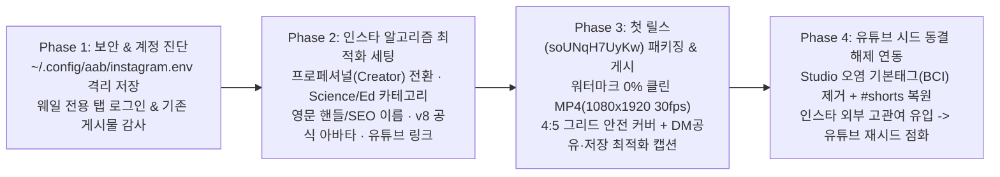

# 인스타그램 공식 채널 세팅(`seoul_nightstreet` → `ALL ABOUT BRAIN`) 및 첫 릴스(`soUNqH7UyKw`) 업로드 실행 계획

## Goal Description

기존 인스타그램 계정(`seoul_nightstreet`)을 **미국·글로벌 영어권(`en-US`) 타겟 뇌과학·심리학 전문 릴스 채널(`ALL ABOUT BRAIN`)**로 완전히 리브랜딩·최적화하고, 첫 릴스로 [`v8_pilot_03_marshmallow_trust_previs`](file:///home/canadaofbin/gdrive/Kyubin_Yun_Workspace/07_Youtube/BCI_Shorts_Channel/projects/v8_pilot_03_marshmallow_trust_previs/06_publish/multi_platform_bundle/upload_checklist.json) (`https://www.youtube.com/shorts/soUNqH7UyKw`, *"Why Broken Promises Crash Your Self-Control"*) 클린 무워터마크 원본(`1080x1920 @ 30fps`)을 업로드합니다.

또한 방금 유튜브 저조회수 원인 감사에서 적발된 **YouTube Studio 기본 태그 오염(`BCI / neural interface / neurotech`가 모든 심리 영상에 자동 삽입되던 현상)** 정리를 함께 병행하여, **유튜브 쇼츠 ↔ 인스타그램 릴스 양방향 시드 순환 엔진**을 구축합니다.

---

## 1. 인스타그램 초기 세팅 필수 항목 전수 분석 (Why Each Setting Matters)

인스타그램 릴스 추천 알고리즘(특히 팔로워가 적은 초기 계정의 비팔로워 Explore/Reels 탭 배포)은 **① 계정 아이디·이름·소개글의 언어/주제 신호**, **② 기존 게시물과의 카테고리 일관성**, **③ 워터마크 없는 고화질 원본 업로드**, **④ 평균 시청 시간 및 DM 공유(`Sends`)·저장(`Saves`) 비율**로 초기 테스트 풀을 결정합니다.

| 구분 | 현재 상태 (`Before`) | 목표 세팅 (`After` — 미국 뇌과학·심리학 최적화) | 알고리즘적 이유 |
| :--- | :--- | :--- | :--- |
| **1. 계정 유형** | 개인 또는 일반 계정 | **프로페셔널 → 크리에이터(`Creator`) 계정** 카테고리: **`Science, Technology & Engineering`** (또는 `Education`, 프로필 라벨 숨김 가능) | 비팔로워 도달률·평균 시청시간·리플레이 인사이트 해금 및 과학·교양 관심사 그래프 배정 |
| **2. 사용자 이름 (`@핸들`)** | `seoul_nightstreet` | **`allaboutbrain.official`** (중복 시 `allaboutbrainhq` / `allaboutbrain.us`) | `seoul_nightstreet` 상태 그대로 올리면 한국·야경·거리사진 풀로 오분류됨 (유튜브와 동일 브랜드 통일) |
| **3. 이름 (`Name` 검색 필드)** | 기존 이름 | **`ALL ABOUT BRAIN \| Neuroscience & Psychology`** | 인스타 검색창에서 `Neuroscience`, `Psychology`, `Brain` 검색 시 상단 노출되는 핵심 SEO 슬롯 |
| **4. 프로필 사진 (`1:1`)** | 기존 이미지 | 공식 `v8` 아바타 [avatar_v8_opt1_hero.png](file:///home/canadaofbin/gdrive/Kyubin_Yun_Workspace/07_Youtube/artifacts_archive/06_Channel_Art/avatar_v8_opt1_hero.png) (`1024×1024`) | 다크 재킷 + 황금 분할선 + 4색 크리스탈 발광 뇌 디자인으로 유튜브·인스타 100% 동일 아이덴티티 확보 |
| **5. 소개글 (`Bio`, `<=150자`)** | 기존 소개글 / 국문 | **100% 미국 영문 3줄 구조**: `🧠 Weirdest true experiments in neuroscience & psychology` `📄 100% peer-reviewed studies (DOI verified)` `👇 Full brain breakdowns on YouTube` | 한글을 완전히 배제해 영미권(`en-US`) 오디언스 매칭을 고정하고 학술 신뢰성(`DOI verified`) 즉시 각인 |
| **6. 외부 프로필 링크** | 없음 | **`https://www.youtube.com/@AllAboutBrainOfficial`** (제목: `ALL ABOUT BRAIN YouTube`) | 인스타 릴스 시청자를 유튜브 채널로 유입시켜 유튜브의 초기 시드 대기(`Shown 0`)를 깨뜨리는 교차 퍼널 |
| **7. 기존 비주제 게시물** | `seoul_nightstreet` 기존 사진/릴스 (유무 확인) | **삭제(`Delete`) 절대 금지 → `보관(Archive)` 처리** | 게시물 대량 삭제는 인스타 스팸/봇 패널티를 유발하므로, 알고리즘·방문자 눈에서만 깔끔히 숨기는 `보관(Archive)` 사용 |
| **8. 언어 & 화질 옵션** | 기본값 | 웹/계정 언어 **`English (US)`** 고정 + 원본 클린 `1080×1920 @ 30fps` MP4 직투입 (유튜브 다운로더 재압축본 절대 사용 금지) | 워터마크·재인코딩 열화 방지 및 북미 언어 그래프 고정 |

---

## User Review Required

> [!WARNING]
> **보안 및 로그인 안전 수칙**:
> - 전달해 주신 비밀번호는 코드베이스나 마크다운 파일에 절대 평문 저장하지 않고, 서버 로컬 보안 경로(`/home/canadaofbin/.config/aab/instagram.env`, 권한 `600`)에만 격리 보관합니다.
> - 웨일 브라우저에서 첫 로그인 시 인스타그램이 **이메일 또는 휴대폰 6자리 보안코드(2FA / Suspicious Login Check)**를 요구할 수 있습니다. 보안 인증 화면이 뜨면 가이드라인에 따라 임의 우회 없이 즉시 대기하고 코드 입력을 요청드리겠습니다.

---

## Open Questions

1. **인스타그램 아이디(`@Username`) 변경 승인**: 기존 `seoul_nightstreet` 아이디를 **`allaboutbrain.official`** (사용 중일 경우 `allaboutbrainhq`)로 바로 변경해도 될까요?
2. **기존 게시물 처리 방식**: 만약 `seoul_nightstreet` 계정에 예전 사진이나 릴스가 남아 있다면, 삭제하지 않고 안전하게 **`보관(Archive)`** 처리하여 프로필 그리드를 뇌과학 전용으로 비워도 될까요?
3. **`soUNqH7UyKw` 릴스 커버(썸네일) 선택**:
   - 현재 번들 폴더의 기존 커버([cover_9x16.png](file:///home/canadaofbin/gdrive/Kyubin_Yun_Workspace/07_Youtube/BCI_Shorts_Channel/projects/v8_pilot_03_marshmallow_trust_previs/06_publish/multi_platform_bundle/cover_9x16.png))는 업그레이드 전 구버전(`BROKEN TRUST` 민머리 마네킹)입니다.
   - **(권장)** 인스타그램 프로필 `3:4 / 4:5` 중앙 그리드에서도 한눈에 실험 의미가 읽히도록 **`R65 v4` 스타일 신규 커버(`PROMISE KEPT` vs `LIED TO: ATE 4X FASTER!` + 실제 표정 & 3D 뇌 컷어웨이)**로 새로 뽑아서 올릴까요, 아니면 기존 `cover_9x16.png` 그대로 빠르게 올릴까요?
4. **유튜브 시드 동결 원인 동시 수리 승인**: 방금 발견된 YouTube Studio `업로드 기본값(Upload Defaults)`의 오염 태그(`BCI, neural interface, AI, neurotech`) 제거 및 신규 영상 `#shorts` + 에피소드 맞춤 심리 태그 적용도 `@Operator`가 함께 수정하도록 지시할까요?

---

## Proposed Changes

### 1. 인스타그램 설정·업로드 자동화 모듈 및 보안 환경 구성
#### [NEW] `~/.config/aab/instagram.env` (Git 추적 제외 로컬 시크릿, `chmod 600`)
- `IG_USERNAME`, `IG_PASSWORD` 격리 저장 (코드 내 하드코딩 0%).

#### [NEW] [instagram_uploader.py](file:///home/canadaofbin/gdrive/Kyubin_Yun_Workspace/07_Youtube/pipeline/studio/instagram_uploader.py) & [MODIFY] [main.py](file:///home/canadaofbin/gdrive/Kyubin_Yun_Workspace/07_Youtube/main.py)
- 기존 CDP 탭 격리 규칙(`about:blank` 신규 탭 생성 → `targetId` 단독 제어 → 작업 후 자체 탭만 정리, 사용자 탭·Google Flow 탭 절대 비접촉)을 그대로 따르는 인스타그램 웹 자동화 CLI(`main.py ig-setup`, `main.py ig-upload --project <id>`) 구현:
  1. `ig-setup`: 로그인 상태 확인(2FA 발생 시 안전 정지 및 알림) → 프로페셔널 크리에이터 전환 여부 점검 → 프로필 아바타([avatar_v8_opt1_hero.png](file:///home/canadaofbin/gdrive/Kyubin_Yun_Workspace/07_Youtube/artifacts_archive/06_Channel_Art/avatar_v8_opt1_hero.png)), `@핸들`, SEO `Name`, 영문 3줄 `Bio`, 유튜브 채널 외부 링크 세팅 및 검증 스크린샷 저장.
  2. `ig-upload --project v8_pilot_03_marshmallow_trust_previs`:
     - 원본 클린 비디오: [`05_assembly/final_shorts_1080x1920.mp4`](file:///home/canadaofbin/gdrive/Kyubin_Yun_Workspace/07_Youtube/BCI_Shorts_Channel/projects/v8_pilot_03_marshmallow_trust_previs/05_assembly/final_shorts_1080x1920.mp4) (`1080×1920`, `30fps`, `119.5s`, 워터마크 없음 — 유튜브에서 재다운로드하지 않고 로컬 마스터 직투입!)
     - 릴스 전용 캡션 업그레이드 ([publish.py](file:///home/canadaofbin/gdrive/Kyubin_Yun_Workspace/07_Youtube/pipeline/publish.py#L1679-L1688)): 첫 줄 90자 이내 호기심 질문(`"Why did kids eat the marshmallow 4x faster after ONE broken promise? 🧠"`) + 핵심 뇌 기제(`nucleus accumbens` 보상 경보 vs `prefrontal cortex` 충동 브레이크) + 학술 출처(`Celeste Kidd et al., 2013, Cognition · DOI: 10.1016/j.cognition.2012.08.004`) + 인스타 핵심 시그널인 **DM 공유 & 저장 유도 CTA** + 정밀 해시태그 5개(`#neuroscience #psychology #brainfacts #selfcontrol #humanbehavior`) + `AI label` 설정.
     - 게시 완료 후 실제 릴스 고유 URL 추출 및 `06_publish/instagram_publish_receipt.json` 기록.

---

### 2. 유튜브 초기 시드 배포 복구 패치 (YouTube Upload Defaults & Tag Sanitization)
#### [MODIFY] [uploader.py](file:///home/canadaofbin/gdrive/Kyubin_Yun_Workspace/07_Youtube/pipeline/studio/uploader.py) & [publish.py](file:///home/canadaofbin/gdrive/Kyubin_Yun_Workspace/07_Youtube/pipeline/publish.py)
- YouTube Studio `Settings -> Upload defaults`에 남아 있던 초기 `['BCI', 'neural interface', 'AI', 'neurotech']` 기본 태그를 정리하고, 업로드 시 각 에피소드의 실제 주제 태그(`psychology`, `fear`, `sleep`, `habits`, `memory` 등) + `#shorts`가 정확히 반영되도록 수정.
- 크리에이터 로그인 브라우저에서 게시 직전/직후 `/shorts/<id>` 재생 페이지를 열어 `0.0s` 이탈 셀프 조회수를 발생시키는 동작을 원천 차단(모든 검증은 Studio 내부 관리 URL에서만 수행).

---

## Verification Plan

### Automated Verification
- `pytest -v`로 신규 인스타그램 캡션/번들 빌더 및 유튜브 태그 정화 로직 단위 테스트 통과 확인.
- 업로드 영수증 `BCI_Shorts_Channel/projects/v8_pilot_03_marshmallow_trust_previs/06_publish/instagram_publish_receipt.json` 생성 확인.

### Manual / Visual Verification
- 세팅 완료된 인스타그램 프로필 화면(새 핸들, 아바타, 영문 Bio, 유튜브 외부 링크) 및 첫 릴스 게시 완료 화면 스크린샷을 캡처하여 결과 리포트로 제출합니다.
