# Final Master Implementation Plan: `ALL ABOUT BRAIN` 통합 파이프라인 업그레이드 · 고정 에셋 바이블 · 토큰 최적화 아키텍처

## Goal Description

[`@Deep_Research`](conversation://8c666be9-5bad-43d9-b91a-e7ba2b936c62)의 2건 심층 감사([Report 1: mr miro · inkbeat-shorts · Semantic IDs · YouTube 정책](../04_Deep_Research/deep_research_miro_inkbeat_semantic_id_report.md) · [Report 2: 에이전트 아키텍처 & 파이프라인 토큰 최적화](../04_Deep_Research/deep_research_agent_and_pipeline_token_optimization_report.md))와 CEO 독립 검증 결과를 모두 통합하여, **Google Flow 호출 `0`건 · 외부 유료 API `0`건** 상태로 아래 3대 축을 한 번에 무충돌 업그레이드합니다.

1. **토큰 아키텍처 개혁 (`Tier S-1 & S-2`)**: `always_on` 4중 중복 제거(`-57%` 매 턴 기본 토큰), `AGENTS.md` 순수 매핑 허브화(`8.4KB → ~3.4KB`), `.agents/rules/*.md` `18 → 24` 초경량 원자 룰 세분화(파일당 `<= 3.5KB`, 로딩당 `-65~83%`) + 실측된 스테일 모순(`64pt/MarginV=521`, `Hope/Laura`, 은퇴 `xray_brain75_master`, `Omni 1.1`, `6-room`) 전수 제거.
2. **고정 에셋·레퍼런스 마스터 바이블 영구 보관 (`docs/`)**: 코드·규칙뿐 아니라 **`99`개 SHA-256 잠금 정본 에셋(`v1+v1.1+v1.2`) + `Ep #31` 원조 4장 + `15`개 컨택트 시트 + 신규 Golden Style 시트 + `v1_2` 기각 10건 네거티브 오답 노트 + 폰트 4종 + Solo `Siren`/BGM/연기 사전 + 지식 뱅크 6종**을 자동 생성기(`scripts/build_locked_assets_bible.py`)와 `pytest` 드리프트 잠금으로 영구 관리.
3. **파이프라인 품질·Semantic ID 방어·토큰 오프로딩 업그레이드**:
   - Flow 오디오/립싱크 금지 가드(`FLOW_CAMERA_HARDWARE_NEGATIVE_GUARD` 통합, 기존 테스트 회귀 `0`건) · 2.5D 선택적 색채 대비 · `push-in ↔ pull-back` & 히어로 `35–45%` 로우 앵글 · 4단 대본 감정 곡선 · 컷 내부 4×3 플리커 검출 · 적대적 약점 우선 Gate 1/2 + Semantic ID 5대 방어 가드레일.
   - `main.py qa-summary` & `--summary` 출력 압축(`-94~96%` 툴 출력 토큰) + Gemini 타일 임계치 맞춤 `1536×1536` 12-up 시트 / `<=384×384` 불량 크롭 2단계 VLM 검수(`-88~91%` 비전 토큰, 품질 저하 `0%`).

```mermaid
flowchart LR
    subgraph P1["Phase 1: 토큰 & 매핑 개혁 (CEO + @Operator)"]
        A1["always_on 4중 중복 제거 (-57%/turn)"]
        A2["AGENTS.md 순수 매핑 (~3.4KB)"]
        A3[".agents/rules 18->24 원자 룰 (<=3.5KB) + 스테일 모순 0화"]
        A4["youtube-script/SKILL.md v7 레거시 분리"]
    end

    subgraph P2["Phase 2: 고정 에셋 & 파이프라인 바이블 (@Operator)"]
        B1["scripts/build_locked_assets_bible.py"]
        B2["docs/LOCKED_ASSETS_AND_REFERENCES_BIBLE.md (99슬롯+오답노트+폰트/음성/BGM)"]
        B3["docs/assets_preview/ALL_ABOUT_BRAIN_GOLDEN_STYLE_SHEET.jpg"]
        B4["docs/ALL_ABOUT_BRAIN_MASTER_PIPELINE.md (8대 섹션 마스터 블루프린트)"]
    end

    subgraph P3["Phase 3: 파이프라인 품질 & 토큰 오프로딩 (@Operator)"]
        C1["P0-1/2/3: 오디오·립싱크 가드 + 선택적 색채 대비 + 적대적 Gate1/2 + Semantic ID 5가드"]
        C2["P1-4/5/6: 35-45% 히어로 로우앵글 + 4단 대본 + 4x3 1프레임 플리커 검출"]
        C3["CLI qa-summary / --summary (-95% 출력) + 1536x1536/384x384 2단계 VLM 시트 (-90% 비전)"]
    end

    subgraph P4["Phase 4: 자동 정합 잠금 & CEO Gate 3 검증"]
        D1["pytest: 양방향 매핑 + <=3.8KB 토큰 상한 + 99슬롯 SHA-256 + 603+ 전체 스위트"]
    end

    P1 --> P2 --> P3 --> P4
```



---

## User Review Required

> [!IMPORTANT]
> **승인 전 확인 부탁드리는 3가지 경계 사항**
> 1. **글로벌 규칙 파일(`~/.gemini/config/rules/job_research_handoff_rule.md`, `2,946 B` / `~736 tok/turn`) 범위 한정 여부**:
>    - 현재 `04_Internship` 취업 리서치 규칙이 전역 `always_on`으로 걸려 있어 `07_Youtube` 7개 방의 모든 턴마다 `~736` 토큰을 쓰고 있습니다.
>    - **추천**: 해당 파일의 frontmatter를 `alwaysApply: false` + `trigger: model_decision` (`description: "Load ONLY when researching UK/London part-time jobs, internships, or drafting job applications"`)으로 바꾸면, 취업 방에서는 똑같이 자동 작동하면서 유튜브 7개 방에서는 매 턴 `736` 토큰이 영구 절감됩니다. *(유지하길 원하시면 코멘트로 알려주십시오.)*
> 2. **기존 과거 아티팩트 폴더(`CEO 370개` / `Daily_Report 229개`) 정리 제외**:
>    - 안전을 위해 이번 계획에서는 **기존 아티팩트 파일을 단 1개도 삭제하지 않습니다.** (`0` 파일 삭제, 신규 생성·정합화만 수행)
> 3. **Google Flow 호출 `0`건 · `100%` Flow 네이티브 유지**:
>    - 본 계획 전체는 **100% 비-Flow / 비-브라우저 오프라인 작업**입니다. 외부 유료 API 연동 코드는 추가하지 않으며, Flow는 사용자께서 수동 1클릭 복구를 확인해 주실 때까지 `0`건 정지를 유지합니다.

---

## Proposed Changes

### Phase 1. `always_on` 다이어트 · `AGENTS.md` 순수 매핑화 · `.agents/rules/` `18→24` 마이크로 세분화

#### [MODIFY] [post_compaction_context_recovery_rule.md](file:///home/canadaofbin/.gemini/config/rules/post_compaction_context_recovery_rule.md) · [governance_roles.md](file:///home/canadaofbin/gdrive/Kyubin_Yun_Workspace/07_Youtube/.agents/rules/governance_roles.md) · [AGENTS.md](file:///home/canadaofbin/gdrive/Kyubin_Yun_Workspace/07_Youtube/.agents/AGENTS.md) *(CEO 소유 거버넌스)*
- **`post_compaction_context_recovery_rule.md`** (`9,385 B` → **`~2.4 KB`**): 7개 채팅방 표·R83 세부 조항의 3중 복붙을 제거하고, 핵심 원칙(컴팩팅 후 `/query` 원문 복원 · 7방 체제 포인터 → `governance_roles.md` · 최상위 MP4 배치 · `100%` Flow 뇌 불변 잠금)만 압축 유지.
- **`governance_roles.md`** (`3,812 B` → **`~2.7 KB`**): 유일한 `always_on` 7-채팅방 헌장 SSOT (`R83-1..8`, `G1–G4`, `R83-8-V`, **`Delta Receipt <= 400 tok`** 보고 규격 추가).
- **`AGENTS.md`** (`8,403 B` → **`~3.4 KB` 순수 라우팅 매핑 테이블**):
  - Section 1·2의 중복 설명 제거 → 1줄 채널 좌표 + 5-Gear 스킬 표(`qa-scheduler` 포함 6개 전수) + **`24`개 마이크로 룰 1:1 매핑 표** + `docs/` 마스터 바이블 포인터로 순수 매핑 역할에 100% 집중.
  - 실측된 매핑 오류 10건 전수 교정(`6-room`→`7-room`, `Omni 1.2/1.1`→`Omni 1.2`, 미존재 `R46` 제거, `production_constants.md`·`qa-scheduler` 누락 보완, 깨진 `18.md` 참조 제거).

#### [MODIFY] / [NEW] / [DELETE] `.agents/rules/*.md` (`18 → 24` 원자 룰, 모든 `model_decision` 파일 `<= 3.5 KB`)
| 기존 비대 파일 (바이트) | 세분화 결과 (목표 `1.4 ~ 3.2 KB` / 파일) | 제거되는 중복·모순 |
|---|---|---|
| `channel_operations_rules.md` (`9,840 B`) | `metadata_contract_rules.md` (`R8–R10`, `R68-D`) + `project_storage_rules.md` (`R11–R12`, `R19/R28/R29`, Flow/FUSE) | `R83` 중복 **`5,563 B`** 삭제 (`governance_roles.md`로 단일화) |
| `neuro_diorama_pacing_brain_r76_r86.md` (`8,789 B`) | `hook_pacing_beatcard_rules.md` (`R82`, `R86`, `R87-H`) + `arrows_callouts_motion_rules.md` (`R77`, `R78-H/V`, `R79-M`, `R80/R87-A`, `R81`) | `R78-M` 은퇴 앵커 `xray_brain75_master`/`ref_r78m_cut05` 제거; `R87` frontmatter 누락 해소 |
| `neuro_diorama_v8_world_data_r66_r75.md` (`7,898 B`) | `archival_reenactment_rules.md` (`R66/R67`) + `data_stamp_charts_rules.md` (`R70/R70-M`, `R71/R71-B`) + `real_world_drone_refs_rules.md` (`R68`, `R72/R72-R`, `R73`) | `MarginV=521`/`64pt` 잔재 제거 → `510`/`82pt`/`#FFE600` |
| `neuro_diorama_core_r56_r65.md` (`6,949 B`) | `diorama_assembly_subtitles_rules.md` (`R56–R61`) + `episode_qa_triage_rules.md` (`R62–R64`) + `thumbnail_r65_rules.md` (`R65 v4`) | 썸네일 작업 시 핵심 조립·QA 규칙 불필요 로딩 제거 |
| `research_dossier_rules.md` (`5,398 B`) | `research_dossier_v2_rules.md` (`R44`, `R44-D/M`) + `knowledge_hub_asset_manifest_rules.md` (`R50`, `R50-B`) | 도시에 작성 vs 지식 허브 분리 |
| `brain_depiction_rules.md` (`4,479 B`) & `reference_depiction_rules.md` (`3,574 B`) | 각각 **`<= 3.4 KB`** 압축 정리 + `ep31_orig_*` 통일 (`xray_brain75_master` 제거) | 중복 표현 압축 및 `Semantic ID` 5가드 반영 |
| `production_constants.md` (`15,185 B`, direct-read) | `trigger` 없음 유지(평소 `0` tok) + 상단 Active Core Locks 정합 유지 | `test_source_reenactment_qa.py` / `test_expressive_25d_v8.py` 100% 호환 |

#### [MODIFY] [youtube-script/SKILL.md](file:///home/canadaofbin/gdrive/Kyubin_Yun_Workspace/07_Youtube/.agents/skills/youtube-script/SKILL.md) · [youtube-produce/SKILL.md](file:///home/canadaofbin/gdrive/Kyubin_Yun_Workspace/07_Youtube/.agents/skills/youtube-produce/SKILL.md)
- `youtube-script/SKILL.md` (`12.5 KB` → `~5.5 KB`): `Hope`/`Laura`/`Mini-Cortex` 모순 문장 및 `v7` 레거시 가이드를 **[NEW] `.agents/skills/youtube-script/references/legacy_v7.md`**로 분리하고, **4단 감정 곡선(충격 도입 → 역설/난관 → 뇌 메커니즘 → 1줄 반전 클로징)** + `15초당 1핵심 팩트` 무음 체크 추가.
- `youtube-produce/SKILL.md`: 스테일 `MarginV=521` / `64pt` / `#FFFFFF` / `1–2w` → **`MarginV=510` / `82pt` / `#FFE600` / `<=3w` + `118pt HookTitle`** 교정.

---

### Phase 2. 영구 보관 고정 에셋 바이블 & 전체 파이프라인 마스터 문서 (`docs/`)

#### [NEW] [build_locked_assets_bible.py](file:///home/canadaofbin/gdrive/Kyubin_Yun_Workspace/07_Youtube/scripts/build_locked_assets_bible.py)
디스크 실물 파일과 `manifest.json`을 읽어 결정론적으로 마스터 바이블과 시각 기준 시트를 생성/검증(`--check`)하는 스크립트(`0` Flow / `0` 네트워크):
- `canonical_assets/{v1,v1_1,v1_2}/manifest.json` (`99` 잠금 + `J04` 보류) 전수 SHA-256 대조
- `v1/_reference_31_O2CmlKOk/*.png` (`Ep #31` 원조 4장) + 기존 컨택트 시트 `15`장 색인
- 폰트 4종(`AABCondensed-Black.ttf`, `Inter-Variable.ttf`, `PatrickHand-Regular.ttf`, `Caveat-Variable.ttf`), Solo `Siren`(`eXpIbVcVbLo8ZJQDlDnl`) + BGM 2곡(`120s`, `65s`) + `expression_acting_lexicon.json`, `reusable_packs/` 6종 JSON(`1.28 MB`) 전수 SHA-256·엔트리 집계
- Pillow로 **`docs/assets_preview/ALL_ABOUT_BRAIN_GOLDEN_STYLE_SHEET.jpg`** (`Ep #31` 4장 + `J01/A01/A02/A14/B05/B09/D01/K03/K05/K06/C01b/I01/I02` 대표 룩 카나리 시트) 자동 렌더링

#### [NEW] [LOCKED_ASSETS_AND_REFERENCES_BIBLE.md](file:///home/canadaofbin/gdrive/Kyubin_Yun_Workspace/07_Youtube/docs/LOCKED_ASSETS_AND_REFERENCES_BIBLE.md)
- **§1. 수치형 스타일 가이드 (`Style Guide with Numbers`)**: 16진수 팔레트, 안전영역, `118pt HookTitle`, `82pt ASS`, `PatrickHand 82–84px`, 히어로 `~35–45%` 프레이밍, 컷/10s 페이싱.
- **§2. Golden Style Canary Sheet + `Ep #31` 원조 4장 + `15`개 컨택트 시트 색인**.
- **§3. `Canonical v1 + v1.1 + v1.2` `100`슬롯 전수 카탈로그**: `slot_id`, 용도, **사용 방식(`Ingredients 전용` vs `Start+End 페어` vs `Turnaround 시작금지`)**, **`Semantic ID` 변주 규칙**, 클릭 경로, `SHA-256[:12]`.
- **§4. 네거티브 오답 노트 (`v1_2` 기각 `10`건 `excluded_reasons` + `J04` 보류 사유)** — 향후 동일 결함 재생성 방지.
- **§5. 오디오·음성(`Siren`)·BGM·연기 사전 · 폰트 4종 · 지식 뱅크 6종 전수 목록**.

#### [NEW] [ALL_ABOUT_BRAIN_MASTER_PIPELINE.md](file:///home/canadaofbin/gdrive/Kyubin_Yun_Workspace/07_Youtube/docs/ALL_ABOUT_BRAIN_MASTER_PIPELINE.md)
사람과 AI가 함께 보는 8대 섹션 마스터 블루프린트(4대 DNA + `"Mute & Hide Name Test"` · 7-채팅방 `R83 v2` · 5-Gear 지도 · 4단 대본 + `R87-H` · Flow 프롬프트 + `Omni 1.2`/`x1→x2` · 후처리/음성/`R65 v4` · 3중 Gate/Lock 1–5/적대적 검수 · 멀티플랫폼 배포).

---

### Phase 3. 파이프라인 품질 · Semantic ID 방어 · 토큰 오프로딩 업그레이드 (`0` Flow 호출)

#### [MODIFY] [depiction_rules.py](file:///home/canadaofbin/gdrive/Kyubin_Yun_Workspace/07_Youtube/pipeline/depiction_rules.py) · [flow_prompt_builder.py](file:///home/canadaofbin/gdrive/Kyubin_Yun_Workspace/07_Youtube/pipeline/flow_prompt_builder.py) · [porcelain_anchor_pack.py](file:///home/canadaofbin/gdrive/Kyubin_Yun_Workspace/07_Youtube/pipeline/porcelain_anchor_pack.py)
- **`P0-1` 오디오·립싱크 금지 가드 (테스트 회귀 `0`건 설계)**:
  - `depiction_rules.py:1486` `FLOW_CAMERA_HARDWARE_NEGATIVE_GUARD`에 `"No voiceover, no narration, no background music, no lip movement."`를 통합 → `test_credit_safe_pipeline.py:386`의 `prompt_core.endswith("Silent voice track.")` 및 `(18, 64)` 단어 수 캡과 **100% 호환** 유지!
- **`P0-2` 2.5D 선택적 색채 대비 & 서사 조명 아크**:
  - 일반 생활/실험실 컷 앵커에 `"muted low-saturation backdrop isolating the vivid full-color hero prop"` 반영(`desaturated_grayscale_v7` 충돌 금지) + Act별 조명 톤 변화 힌트 반영.
- **`P1-4` 히어로 `35–45%` 로우 앵글(`hero_low_angle`) & `push-in ↔ pull-back` 교차**:
  - `R77` 금지어 `"dolly"`를 절대 쓰지 않고 `disembodied push-in` ↔ `smooth pull-back`으로 변주.

#### [MODIFY] [qa_gates_rules.md](file:///home/canadaofbin/gdrive/Kyubin_Yun_Workspace/07_Youtube/.agents/rules/qa_gates_rules.md) · [camera_choreography_rules.md](file:///home/canadaofbin/gdrive/Kyubin_Yun_Workspace/07_Youtube/.agents/rules/camera_choreography_rules.md)
- **`P0-3` 적대적 약점 우선 검수 & `Semantic ID` 5대 방어 가드**:
  - `@Research` Gate 1/2 검수 시 칭찬 생략 → 가장 큰 결함부터 `Wrong / Exact Where / What Instead` 3요소 기재 + `"Mute & Hide Name Test"` 체크 의무화.
  - 정본 `99`슬롯 `0%` 직삽입(화풍 `Ingredients` 전용) + 매 편 고유 기관/소품/DOI 스탬프 3종 델타 + `J01–J06` 연속 순환 잠금.

#### [MODIFY] [posthoc_semantic_qa.py](file:///home/canadaofbin/gdrive/Kyubin_Yun_Workspace/07_Youtube/pipeline/posthoc_semantic_qa.py)
- **`P1-6` 컷 내부 4×3 1프레임 휘도 플리커 검출기 추가**:
  - `inkbeat-shorts/flicker.py` 원리를 이식해 컷 내부 인접 프레임 4×3 그리드 휘도 스파이크를 경량 검출(계획된 `whip_pan`/`portal_zoom`/경계 프레임 제외, `Tier-2` 리포트 + 극단 스파이크 경고).

#### [MODIFY] [cli.py](file:///home/canadaofbin/gdrive/Kyubin_Yun_Workspace/07_Youtube/pipeline/cli.py) & [NEW] [render_vlm_triage_sheets.py](file:///home/canadaofbin/gdrive/Kyubin_Yun_Workspace/07_Youtube/scripts/render_vlm_triage_sheets.py)
- **`Tier A-1` Python 오프로딩 (`--summary` & `main.py qa-summary`)**:
  - `cmd_posthoc_qa` (`cli.py:2208` `slim_out`) 패턴을 `episode-qa`, `video-autopsy`, `ref-qa`, `dossier validate`에 `--summary` 플래그로 확대 + `main.py qa-summary --project <id>` 신설(140KB+ 대용량 JSON 대신 `<= 1.5 KB` 결함 요약 JSON 출력, `-94~96%` 툴 출력 토큰 절감).
- **`Tier S-3` Coarse-to-Fine 2단계 VLM 시트 빌더 (`scripts/render_vlm_triage_sheets.py`)**:
  - Gemini 이미지 타일 임계치(`aistudio.google.com/docs/tokens`)에 맞춰 1차 스크리닝용 **`1536×1536` 12-up 정사각 컨택트 시트(`~1,032–1,120 tok/시트`)**와 2차 불량 확대용 **`<=384×384` 크롭(`258 tok`)** 자동 생성 (`Gate 1/2` 비전 토큰 `-88~91%`, 품질 저하 `0%`).

---

### Phase 4. 자동 정합·회귀 테스트 잠금 (`tests/`)

#### [MODIFY] 기존 9개 룰 참조 테스트 + [NEW] [test_rules_mapping_and_token_budget.py](file:///home/canadaofbin/gdrive/Kyubin_Yun_Workspace/07_Youtube/tests/test_rules_mapping_and_token_budget.py) + [NEW] [test_master_docs_and_assets_bible_parity.py](file:///home/canadaofbin/gdrive/Kyubin_Yun_Workspace/07_Youtube/tests/test_master_docs_and_assets_bible_parity.py)
- **양방향 매핑 & 토큰 예산 잠금 (`test_rules_mapping_and_token_budget.py`)**:
  - `AGENTS.md` `2.0–4.5 KB` 순수 매핑 확인, 모든 `.agents/rules/*.md` `model_decision` 파일 **`<= 3,800 B` (~950 tok)** 상한, `AGENTS.md` ↔ `.agents/rules/*.md` **100% 1:1 양방향 일치**(`0` 고아 파일, `0` 깨진 링크), 스테일 토큰(`MarginV=521`, `64pt` v8, `xray_brain75_master`, `Hope`/`Laura` 현역 혼입) **`0`건** 검증.
- **에셋 바이블 정합 잠금 (`test_master_docs_and_assets_bible_parity.py`)**:
  - `99` 잠금 Canonical 슬롯 SHA-256 + 폰트 4종 + BGM 2곡 + `Ep #31` 4장 + `15` 컨택트 시트 + `Golden Style Sheet` 실존 및 문서 일치 검증.
- **파이프라인 업그레이드 테스트**: `P0-1` (`test_credit_safe_pipeline.py` 통과 + `No voiceover/lip movement` 포함 확인), `P1-6` 플리커 검출 단위 테스트, `qa-summary` 출력 크기(`<= 2.5 KB`) 및 `render_vlm_triage_sheets.py` `1536×1536` / `<=384×384` 출력 치수 테스트.

---

## Execution Governance (`R83 v2`)

- **승인 전**: 코드·문서 수정 `0`건, Flow 호출 `0`건.
- **승인 후**:
  1. **Phase 1-A (CEO 직접 — 소유 거버넌스 3파일 + 선택 시 `job_research_handoff_rule.md`)**: `post_compaction_context_recovery_rule.md`, `governance_roles.md`, `AGENTS.md` 압축·매핑 교정.
  2. **Phase 1-B ~ Phase 4 ([`@Operator`](conversation://1f9808d4-ebac-4b58-a570-45c8f1f00a85) 위임, `0` 브라우저 / `0` Flow)**:
     - 파일 분리 `inherit` 코딩 서브에이전트(① `.agents/rules/` 세분화 + 스킬 정리 + 9개 기존 테스트 동기화 ② `docs/` 생성기 + 바이블 + Golden Style Sheet ③ 파이프라인 `P0/P1` + `qa-summary` + `render_vlm_triage_sheets.py` + 신규 테스트) → `flash` 전체 `pytest` 워커 → `@Operator` VP `R83-8-V` 1차 검수.
  3. **CEO Gate 3 독립 검증**: `pytest` 재실행 + `ALL_ABOUT_BRAIN_GOLDEN_STYLE_SHEET.jpg` 육안 검수 + `always_on` & 룰 바이트 실측 대조 → PASS 시 Walkthrough 보고.

---

## Verification Plan

### Automated Tests (`0` Browser / `0` Flow Calls)
```bash
/home/canadaofbin/hermes-venv/bin/python -X utf8 scripts/build_locked_assets_bible.py --check
/home/canadaofbin/hermes-venv/bin/python -X utf8 -m pytest tests/test_rules_mapping_and_token_budget.py tests/test_master_docs_and_assets_bible_parity.py tests/test_credit_safe_pipeline.py tests/test_chatroom_mention.py -q --tb=short
/home/canadaofbin/hermes-venv/bin/python -X utf8 -m pytest --ignore=tests/test_blender_brain_sim.py -k "not blender_render" -q --tb=short
```

### Manual Verification
- `docs/assets_preview/ALL_ABOUT_BRAIN_GOLDEN_STYLE_SHEET.jpg` 육안 확인.
- `docs/LOCKED_ASSETS_AND_REFERENCES_BIBLE.md` & `docs/ALL_ABOUT_BRAIN_MASTER_PIPELINE.md` 클릭 링크 및 가독성 확인.
- `.agents/AGENTS.md` 및 `.agents/rules/*.md` 변경 전/후 바이트·토큰 절감 실측표 확인.
