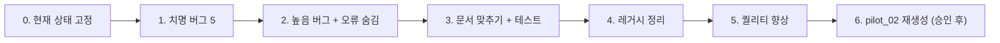

# 전체 마스터 계획: 파이프라인 안정화 + ricksclip3000 수준 따라잡기

## 목표
1. **파이프라인 안정화**: 영상을 망치거나 시간·작업을 날리는 버그를 먼저 고칩니다. 규칙 문서와 코드를 맞추고, 테스트를 실제로 믿을 수 있게 만듭니다.
2. **퀄리티 향상**: [benchmark_gap_report.md](./benchmark_gap_report.md)에서 찾은 격차 중 효과가 큰 5가지를 반영합니다.
3. **영상 생성은 맨 마지막(6단계)**, 승인을 받은 뒤에만 합니다.

### 근거 자료
- 전체 코드 점검: 버그 26건 (치명 5 / 높음 11 / 중간 10), 규칙 문서와 코드 불일치 13건
- 현재 테스트 결과: **331개 통과 / 4개 실패**. 실패 4개는 모두 실제 버그나 불일치 때문입니다.
- 앞선 Flow 버그 점검 9건 ([bugfix_plan.md](./bugfix_plan.md))
- 벤치마크 격차 보고서

> [!NOTE]
> **현재 상태**
> - 모든 작업을 멈췄고, 실행 중인 프로세스는 0개입니다.
> - 보류 지시 전에 이미 반영된 것:
>   - Flow 중복 프로젝트 정리 (55개 → 0개)
>   - Flow 버그 수정 초안: 방 1개만 쓰기, 클립 해시 검사, 오래된 오디오 차단, 다운로드 재스캔, 얼굴 검사 완화
> - 이 초안 때문에 생긴 테스트 실패가 2개 있습니다. 테스트용 가짜 파일 크기가 최소 크기(1MB)보다 작은 문제입니다.



---

## User Review Required

> [!NOTE]
> **확정 (22:53, 벤치마크와 부딪히는 부분은 기존 의견을 철회하고 벤치마크 방식으로 결정)**
> - **결정 1 — 오프닝**: 행동 오프닝으로 완전히 전환합니다.
>   - 첫 문장은 이상한 행동이나 사건을 12단어 이하로 씁니다.
>   - 첫 10프레임 안에 카메라가 움직이고, 첫 컷은 1.5초 이하입니다.
>   - 2인칭 질문 + 공감 문장 강제 규칙(`OPENING_QUESTION_*`, `OPENING_EMPATHY_*`)과 "You're not alone" 같은 정보 없는 문장은 없앱니다.
> - **결정 2 — 핵심 공개 시점**: "4번째 문장·15초 이내" 규칙을 없애고, 영상의 60–80% 지점에 공개합니다. 시청자 질문은 내레이션에서 빼고 고정 댓글로 옮깁니다.
> - **결정 3 — 목소리 (제외 확정, 23:01)**: 음성 엔진·성우 교체는 **이번 계획에서 제외**하고 기존 무료 TTS 구성을 그대로 유지합니다 (향후 별도 검토).
> - **결정 4 — BGM**: −5dB 하향을 되돌리고, −25에서 −18 dBFS로 끝까지 계속 커지게 합니다(끝에서 줄이지 않음).
> - 이미 만든 [narration_restructure_plan.md](./narration_restructure_plan.md)의 질문·공감 오프닝 부분과 pilot_02의 15문장 A안 대본은 **폐기**합니다. 6단계에서 새 규칙으로 다시 씁니다.

> [!CAUTION]
> **결정 5 — 레거시 파일**: 10월에 쓰던 `pipeline/` 파일 13개(`assembly.py`, `audio.py`, `visuals.py`, `smoketest.py`, `pipeline/test_*.py` 등)를 **Google Drive 휴지통**으로 옮겨도 될까요? 30일 안에는 복구할 수 있습니다.

---

## 0단계 — 현재 상태 고정 (5분)
- 지금까지 바뀐 65개 파일과, git에 아직 등록되지 않은 R68 테스트(`tests/test_expressive_25d_v8.py`, 30개 테스트)를 체크포인트 커밋으로 저장합니다. 문제가 생기면 이 시점으로 되돌릴 수 있습니다.
- 커밋에서 빼는 것: 영상·이미지 파일, `/tmp`, 레거시 13개.

## 1단계 — 치명 버그 5건 🔴
| # | 버그 | 위치 | 수정 |
|---|---|---|---|
| C1 | **장면 전환 시 영상이 1컷에서 끊기고 소리만 이어짐** (테스트로 재현됨: 5.87초 중 영상은 1.4초만 남음) | [diorama_assembler.py](file:///home/canadaofbin/gdrive/Kyubin_Yun_Workspace/07_Youtube/pipeline/diorama_assembler.py) 3309–3358, 4371–4475줄 | 컷을 만든 뒤 프레임 수를 확인합니다. 원본 클립 끝 근처에서는 잘라내는 위치를 조정하고 부족한 만큼 마지막 프레임으로 채웁니다. 전환 위치가 컷 끝을 넘으면 실패로 처리합니다. |
| C2 | **업로드가 실패해도 "업로드 완료" 기록을 남김** → 해당 에피소드가 영원히 게시 완료로 처리됨 | `studio/uploader.py` 1536–1855줄 | 버튼 클릭이나 입력란 대기가 실패하면 즉시 오류를 냅니다. 180초 시간 초과 시에도 오류를 냅니다. 실제 영상 ID를 확인한 경우에만 기록을 남깁니다. |
| C3 | **다른 에피소드가 쓰는 임시 폴더를 지움** (`/tmp/aab_reenact`, `slug=None`) | `diorama_batch_orchestrator.py` 1170줄, `cli.py` 1052·1089줄, `source_reenactment.py` 1644줄 | 해당 에피소드 이름(slug)이 있어야만 지우게 합니다. |
| C4 | **동시에 돌아가는 에피소드끼리 임시 클립 파일 이름이 겹침** | `flow_diorama_sharded_worker.py` 3047·3148줄 | 파일 이름에 프로젝트 이름과 프로세스 번호(pid)를 넣습니다. |
| C5 | **탭 사용 기록(lease) 파일을 읽다 실패하면 모든 탭 기록을 지움**, 잠금이 실패해도 잠금 없이 그대로 씀 | `cdp_tab_lease.py` 57–194줄 (같은 문제가 `storage.py`, `asset_manifest.py`, `knowledge_hub.py`, `media_cache.py`, `reporter.py`에도 있음) | 파일을 읽지 못하면 기록을 지우지 않고 다시 시도합니다. 잠금에 실패하면 실행을 멈춥니다. 폴더 권한은 `1777`로 바꿉니다. |

## 2단계 — 높음 버그 + 오류를 숨기는 코드 🟠
- **탭 관련**
  - Studio 탭을 사용 기록 없이 가져다 쓰는 문제: 사용자가 연 탭까지 이동시킵니다.
  - watchdog가 다른 작업의 탭을 닫는 문제
  - 탭을 연 다음 사용 기록을 남기는 순서 문제
- **Flow 관련**
  - 참조 이미지를 `/tmp`에 둔 뒤 다른 작업이 지워버리는 경쟁 문제
  - 잠금 파일이 Google Drive 위에 있는 문제
  - 9:16 화면 비율 설정 실패를 무시하는 문제
  - `bugfix_plan.md`의 미완료 항목: 실행 끝에 자기 실행에서 만든 방만 정리, 다운로드 실패 시 재스캔
- **품질 검사(QA) 관련**
  - DQ6 검사가 오류를 무시하고 통과로 처리하는 문제
  - 자동 검사(autopsy)가 감점 45점을 건너뛰는 문제
  - v8 영상인데 길이 상한이 118초로 적용되는 문제: 89.5초로 고칩니다.
  - 게시 전 QA 묶음에서 빠진 검사(P1–P10, RQ, Q)를 추가하고, 자기 자신과 비교하는 SHA 검사를 고칩니다.
- **운영 관련**
  - 업로드 대기열(`staging_queue.json`)이 원자적으로 저장되지 않는 문제: 임시 파일에 쓴 뒤 교체하고 잠금을 겁니다. 파일이 손상돼 있으면 빈 대기열로 덮어쓰지 않습니다.
  - `--precheck-only`(사전 점검)가 원본 자료 파일을 덮어쓰는 문제
  - 이미 완성된 `andrew_v8` 에피소드를 미완성으로 판단해 다시 만드는 문제
- **오류 숨김**
  - 위험한 `except: pass` 약 40곳을 오류 기록으로 바꿉니다. 대상은 상태 저장, 잠금, FFmpeg, TTS, QA, 업로드, 썸네일 부분입니다.
  - 전체 329곳 중 나머지(종료 처리 등 무해한 곳)는 그대로 둡니다.

## 3단계 — 규칙 문서 맞추기 + 테스트 신뢰성 🟡
- **문서와 코드 불일치 13건 수정**
  - 원칙: 기준은 `config.py`입니다. 단, 코드가 잘못된 경우(전환 길이 10프레임 하드코딩)는 코드를 고칩니다.
  - 주요 항목:
    - 문서에 빠진 전환 방식 `occlusion_wipe` 추가
    - SKILL 문서에 남은 옛 값 수정 (뇌 등장 0–70%, 205–220 WPM)
    - CLI에 표시되는 화면 속도 24fps → 30fps
    - Studio 4번 슬롯 시간 정리 (코드 19:30 ET vs 문서 20:00 ET → 어느 쪽이 맞는지 확인 후 통일)
    - DQ 검사 수 14개 반영
    - `production_constants.md`에 빠진 상수 45개 추가
  - `AGENTS.md`는 78줄, 10,240바이트를 넘지 않게 유지합니다.
- **테스트 정리**
  - 실패 테스트 4개 해결: 문서 동기화, 장면 전환 끊김(C1), 테스트용 가짜 파일 크기 2건
  - 항상 통과하는 `or True` 검사 제거
  - 실제 작업 폴더에 파일을 쓰는 테스트를 임시 폴더로 격리
  - 디스크에 특정 프로젝트가 있어야만 돌아가는 테스트에 건너뛰기 처리
  - R68 테스트의 예시 데이터를 새 15문장 구조로 교체
  - **새 회귀 테스트 6종**: 업로드 시간 초과, Studio 탭 격리, 대기열 원자 저장, 임시 파일 범위, 사전 점검 시 파일 변경 없음, 컷 프레임 수

## 4단계 — 폴더 정리 + 레거시·하드코딩 정리
원칙:
- **먼저 목록만 만들고 보여드린 뒤** 옮깁니다(dry-run → 승인 → 실행).
- 삭제가 아니라 **Google Drive 휴지통**(30일 복구 가능) 또는 `_archive/`로 이동합니다.
- 기존 규칙을 지킵니다: 심볼릭 링크 금지, 대량 삭제는 `rclone` 사용.
- `diorama_01..07` 게시본과 `backup_pilot02_andrew_v8/`은 건드리지 않습니다.

### 4-1. 목록 만들기 (읽기 전용)
- 폴더별 용량, 파일 수, 마지막 수정일, git 등록 여부, 코드에서 참조하는지(`grep`)를 표로 만듭니다 → `folder_cleanup_inventory.md`
- 분류 기준:
  - **유지**: 코드에서 참조함, 게시본, 최근 30일
  - **보관(`_archive/`)**: 기록용 보고서, 오래된 차트
  - **휴지통**: 레거시 코드, 임시 파일, 캐시

### 4-2. 현재 확인된 정리 대상
| 위치 | 대상 | 처리 (안) |
|---|---|---|
| 루트 | `produce_psychology_batch.py` (10월 레거시, 77KB) | 휴지통 (참조 없으면) |
| 루트 | `final_shorts_v8_pilot_01/02*.mp4` (합계 약 150MB) | 각 프로젝트 `06_publish/`에 같은 파일이 있으면 루트 사본은 휴지통. 루트에는 최신 완성본 1개만 두는 규칙 |
| 루트 | `__pycache__/`, `.pytest_cache/` | 삭제 (`PYTHONPYCACHEPREFIX=/tmp`로 다시 생기지 않게 함) |
| `pipeline/` | 10월 레거시 13개 (`assembly.py`, `audio.py`, `visuals.py`, `smoke*.py`, `colab_runner.py`, `batch_psychology_production.py`, `pipeline/test_*.py` 5개) + BOM 문법 오류 2개 | 휴지통 (결정 5) |
| `research_dossiers/*/` | `.tmp_*_flow_all_in_one_prompts.json` 같은 원자적 쓰기 잔여물 | 휴지통. 쓰기 코드는 실패해도 임시 파일을 지우도록 수정 |
| `BCI_Shorts_Channel/reports/daily/` | 10/15–10/31 차트 PNG 수십 개 (git 미등록) | `reports/archive/2026-10/`로 이동. 최신 7일만 `daily/`에 둠 |
| `BCI_Shorts_Channel/` 바로 아래 | `diorama_batch_20_status.json`, `wave_production_status.json` 등 상태 파일 | `BCI_Shorts_Channel/state/`로 모으고 코드 경로 수정 |
| `scripts/` vs `BCI_Shorts_Channel/scripts/` | 스크립트 폴더 2개 | 하나로 합치기 (참조 확인 후) |
| `news/` vs `research/news/` | 비슷한 폴더 2개 | 하나로 합치기 (참조 확인 후) |
| `projects/` | **106개 프로젝트**: `boost_01..05`, `diorama_01..83+` 대량 배치, 중복 이름 (`diorama_01_hm_lab_B_dynamic` vs `diorama_01_patient_hm_hippocampus`) 등. 게시 7개 외 대부분 미게시·중단 | 게시본·v8 파일럿·현재 대기열은 유지. 나머지는 상태별로 분류: 오디오·조립까지 끝나 재사용 가능 / 폐기 스타일(v5–v7 실패작) / 빈 껍데기. 분류에 따라 `projects/_archive/` 또는 휴지통 (목록 승인 후) |
| `artifacts_archive/` | 중복 백업, 오래된 대화 산출물 | `INDEX.md` 기준으로 중복만 정리 |
| `/tmp` | `aab_*`, `rf_*.jpg` 잔여물 | 실행 중인 작업이 없을 때만 정리 (C3·C4 수정과 같이) |

### 4-3. 다시 어질러지지 않게 하기
- `.gitignore`, `.rgignore`, `.ignore` 갱신: 캐시, 임시 파일, 루트 MP4, `reports/daily/*.png`
- `scripts/workspace_hygiene.py --check`를 테스트에 추가합니다. 루트에 허용 목록 외 파일이 있거나 `pipeline/`에 테스트 파일이 있거나 `.tmp_*`가 남아 있으면 실패합니다.
- 이전 Windows 경로(`C:\Users\yunky`, `g:\My Drive`)와 `/home/seluser` 같은 고정 경로를 설정값으로 바꿉니다.
- 쓰지 않는 import(`publish.py`)를 제거하고, AI 고지 문구는 `config.py` 값을 쓰게 합니다.

## 5단계 — 벤치마크 격차 줄이기 (영상 생성 없이 코드·규칙만, 음성 제외)
| 우선순위 | 항목 | 바꿀 곳 | 지금 → 바꾼 뒤 |
|---|---|---|---|
| 1 | 첫 3초 | `OPENING_*` 상수, `prompt_quality_v5.py` | 질문 강제 → 결정 1에 따름. 첫 컷 1.5초 이하, 첫 10프레임 안에 카메라 움직임, 정보 없는 문장 금지 |
| 2 | 카메라 | `flow_ingredients.py`, `porcelain_anchor_pack.py`, R14-D | 느린 밀기 위주 → Flow 시작·끝 프레임으로 3D 비행, 비행 구간 2.8–3.5배 속도, 3D 비행 비율 50% 이상 |
| 3 | 컷 속도·전환 | `EXPRESSIVE_V8_*CUT*`, `MAX_ALPHA_DISSOLVE_FRAMES`, `MAX_STYLED_TRANSITIONS`, R68 클립 수 | 컷당 4.9초, 14컷 → 평균 2.4–3.4초, 최대 4.5초, 20–26컷. 배경 디졸브 8–15프레임을 컷의 약 50%에 사용 |
| 4 | 이야기 구조 | `CORE_REVEAL_*`, R57, R1 | 강의형 → 결정 2에 따름. 반대 인물 + 실패 장면 넣기, 내레이션에서 이름·숫자·전문용어 빼기, 클라이맥스에서 끊는 엔딩 |
| 5 | **프롬프트 맥락 나누기** (프리비즈 노하우 ③) | [flow_prompt_builder.py](file:///home/canadaofbin/gdrive/Kyubin_Yun_Workspace/07_Youtube/pipeline/flow_prompt_builder.py), `prompt_quality_v5.py` | 참조 이미지가 있는 클립도 194단어로 방·조명·재질을 반복 묘사 → 외형·배경은 이미지에 맡기고 **카메라 이동 + 동작 + 표정·손동작만 30–60단어**. 중복 묘사가 있으면 실패하는 검사 추가 |
| 추가 | 색감·장소 | 월드 스타일·조명 고정값, 새 검사 추가 | 장소 6곳 이상(실외·확대샷 포함), 최소 밝기·채도 검사, 캐릭터와 배경 대비 |
| 추가 | BGM·효과음 | `EXPRESSIVE_V8_BGM_*` | 결정 4에 따름. 카메라 비행·전환에 효과음 자동 배치 |
| 추가 | 자막 | 자막 설정값 | 102px 노란 강조 → 60–70px 흰색, 1–2단어 |

- 각 항목마다 QA 검사를 함께 추가합니다. 예: 컷 평균 길이, 첫 컷 길이, 오프닝 방식, 밝기, 장소 수.

## 5.5단계 — 3D 프리비즈 키프레임 생성기 ([previs_workflow_analysis.md](./previs_workflow_analysis.md))
목표: 카메라 격차(🔴)를 유료 도구 없이 줄입니다. 반토막AI의 프리비즈 원리를 Google Flow 무료 흐름에 맞게 바꿔 적용합니다.

1. **Blender 휴대용 버전 설치** (`~/opt/blender`, root 권한 불필요, 약 300–400MB). 렌더는 CPU Workbench(단색) 엔진을 씁니다.
2. **`visual_plan.json`에 `previs` 항목 추가**
   - 카메라 시작·끝 (위치, 바라보는 점, 화각)
   - 인물 더미 위치와 색
   - 소품 상자 크기
   - 장소 덩어리
   - 앞 컷의 `camera_end`를 다음 컷의 `camera_start`로 자동 복사합니다(이음새가 정확해짐).
3. **[NEW] `pipeline/previs_blender.py`**: 위 정보로 Blender 스크립트를 만들고 백그라운드로 렌더합니다. 결과는 시작·끝 프리비즈 PNG(9:16)입니다.
   - 노하우 ① 빼기: 사람은 3덩어리, 소품은 실제 크기 상자
   - 노하우 ② 색 표시: 흰 인형색, 뇌 4색과 겹치지 않는 팔레트에서 색을 고르고, 색과 대상 연결을 저장
4. **`translate_porcelain_keyframes` 확장**: 가이드 입력에 프리비즈 PNG를 받게 합니다(참조 최대 2장: 프리비즈 + 캐릭터 시트). 프롬프트는 "구도는 첨부 1, 보라=주인공(첨부 2)"처럼 색과 대상만 연결합니다.
5. **이후 흐름**: 만든 시작·끝 키프레임으로 기존 `VIDEO_FRAMES` 생성을 그대로 씁니다.
6. **PoC 기준** (영상 생성이 필요하므로 **6단계 승인 때 함께 실행**)
   - 2–3컷으로 지금 방식과 비교합니다.
   - 측정 항목: 클립당 시도 횟수, 얼굴 오탐 횟수, 이음새 MAE, 카메라 앵글 다양성
   - 기준을 통과하면 기본 방식으로 채택합니다.
7. **테스트**: Blender가 없는 환경에서는 건너뛰기. 카메라 연결 규칙, 색 팔레트 충돌, 스크립트 생성 결과를 확인합니다.

> [!NOTE]
> Google Flow에는 동작 참조 **영상**을 넣는 기능이 없습니다. 영상에서 보여준 Seedance식 "프리비즈 영상 → 동작 복사"는 쓸 수 없고, **시작·끝 프리비즈 이미지** 방식으로만 적용합니다. 시작과 끝 사이의 움직임은 여전히 Veo가 채웁니다.

## 6단계 — pilot_02 재생성 (별도 승인 후에만)
1. 새 규칙에 맞춰 대본과 화면 계획을 다시 씁니다.
2. 바뀐 클립만 다시 생성합니다. Flow 방 1개만 쓰고, 무료 엔진을 우선합니다.
3. 음성 → 조립 → 전체 QA 순서로 진행합니다.
4. ricksclip3000과 숫자로 다시 비교합니다: 컷 길이, 첫 컷 시간, 억양 폭, 밝기.

---

## Verification Plan

### Automated Tests
```bash
PYTHONPYCACHEPREFIX=/tmp/aab_pycache /home/canadaofbin/hermes-venv/bin/python -X utf8 -m pytest -q
```
- 단계마다 실행합니다. 목표는 **실패 0개**, 실제 작업 폴더 파일 변경 0개입니다.
- 1단계 C1은 `test_fast_v8_raw_cut_cache_reuse_and_recut`가 통과하고, 실제 영상 길이가 소리 길이와 같은지 확인합니다.
- 모든 Python 파일의 문법 검사와 `AGENTS.md` 크기 검사를 함께 합니다.

### Manual Verification
- 각 단계가 끝나면 바뀐 파일 목록과 테스트 수를 보고합니다.
- 5단계가 끝나면 새 규칙 수치표(지금 → 바뀐 뒤 → 벤치마크)를 보여드립니다.
- 6단계는 완성본 프레임 시트와 벤치마크 비교표로 확인해 주세요.

## 예상 소요
| 단계 | 예상 시간 |
|---|---|
| 0–1단계 | 약 1–2시간 |
| 2단계 | 약 2–3시간 |
| 3–4단계 (폴더 정리 포함) | 약 3시간 |
| 5단계 | 약 3–4시간 |
| 5.5단계 (프리비즈 생성기, 영상 생성 제외) | 약 3–4시간 |
| 6단계 | Flow 무료 대기열 기준 수 시간 |
