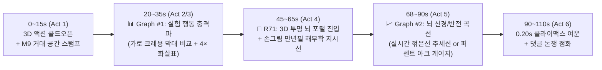

# 📊 쇼츠 리텐션 극대화를 위한 멀티-그래프(`R70-M`: 에피소드당 2~3회) 전략 분석 리포트

> [!IMPORTANT]
> **핵심 결론 (Executive Summary)**
> `60~118초` 스토리텔링 쇼츠에서 **손그림 그래프(`Data Stamp`)를 영상당 최소 2회(행동 실험 충격파 1회 + 후반부 뇌 메커니즘/반전 데이터 1회)** 배치하는 전략은 **초중반(`20~30초`)과 후반(`60~80초`)의 2대 리텐션 이탈 구간(Drop-off Valley)을 동시에 방어하는 가장 강력한 시각적 무기**입니다.
> 단, **똑같은 모양의 막대그래프가 2번 반복되면 시청자의 시각적 신선도(Novelty)가 반감**되므로, **① 배치 타이밍(최소 `18초` 이상 간격)**과 **② 그래프 형태(막대 비교 vs 꺾은선 추세선 vs 퍼센트 원형 아크 게이지)를 서로 다르게 변주하는 `R70-M (Multi-Beat Data Stamp)` 아키텍처**로 적용해야 리텐션 상승 효과가 극대화됩니다.

---

## 1. 왜 손그림 그래프(`Data Stamp`)가 쇼츠 리텐션을 잡아주는가?

유튜브 쇼츠에서 시청자가 화면을 넘기는(Swipe-away) 가장 큰 이유는 **"시각적 익숙함(Visual Habituation)"** 때문입니다. 같은 3D 디오라마 캐릭터와 공간이 `15~20초` 이상 이어지면 뇌의 시각 피질이 자극에 둔감해지는데, 이때 우리의 `R70 v2` 히어로 그래프가 등장하면 **3가지 심리·신경학적 리텐션 락(Lock)**이 동시에 작동합니다.

| 리텐션 작동 원리 | 시각·청각 메커니즘 | 시청자 뇌의 반응 (Retention Effect) |
| :--- | :--- | :--- |
| **① 시각적 패턴 인터럽트** *(Visual Pattern Interrupt)* | 상단 배경(`Y = 10%..62%`)이 영화처럼 부드럽게 아웃포커싱(`gblur=sigma=14` + `35%` 암전)되면서 고대비 크레용/잉크 스트로크가 등장 | 3D 캐릭터 씬에 익숙해진 시각 주의력(Bottom-Up Salience)을 즉시 리셋하여 **엄지손가락 스와이프 충동을 멈춤** |
| **② 실시간 드로잉 서스펜스** *(Zeigarnik Drawing Loop)* | 완성된 표를 한 번에 띄우지 않고, `축(Axis) → 대조군 → 실험군 → 베지어 곡선 화살표 → 배수 원형 루프(4×)` 순으로 **실시간 드로잉** | 선이 끝까지 그려지고 최종 숫자가 찍힐 때까지 **"결과를 눈으로 확인하고 싶은 완주 본능(자이가르닉 효과)"** 유발 (`+3.5~4.5초` 체류 연장) |
| **③ 이중 부호화 & 권위 증명** *(Dual-Coding Proof)* | 내레이터(`Roger`/`Hope`)가 숫자를 발음하는 정확한 타이밍에 시각적 격차(크레용 막대/곡선)와 하단 `Study: Author (Year)`가 동시 각인 | 귀로 듣는 스토리와 눈으로 보는 과학적 증거가 결합되어 **"아하! 모먼트(도파민 보상)" 및 댓글/공유 전환율 급증** |

---

## 2. 현재 파이프라인(`R70 v2` + `R71`) 진단: 무엇이 준비되어 있고 무엇을 넓혀야 하는가?

현재 코드베이스([pipeline/data_stamp_overlay.py](file:///home/canadaofbin/gdrive/Kyubin_Yun_Workspace/07_Youtube/pipeline/data_stamp_overlay.py), [pipeline/config.py](file:///home/canadaofbin/gdrive/Kyubin_Yun_Workspace/07_Youtube/pipeline/config.py#L774-L780))를 정밀 진단한 결과는 다음과 같습니다:

1. **상한선(`MAX`)은 이미 `2회`까지 허용되어 있음**:
   - [pipeline/config.py](file:///home/canadaofbin/gdrive/Kyubin_Yun_Workspace/07_Youtube/pipeline/config.py#L774)에 `DATA_STAMP_MAX_PER_EPISODE = 2`로 설정되어 있고, `composite_data_stamps_on_video()`([pipeline/data_stamp_overlay.py](file:///home/canadaofbin/gdrive/Kyubin_Yun_Workspace/07_Youtube/pipeline/data_stamp_overlay.py#L809-L923))도 복수의 그래프 리스트(`resolved_stamps`)를 순회하며 FFmpeg 필터 체인으로 합성할 수 있는 구조입니다.
2. **현재 1회만 나오고 있던 원인 2가지**:
   - **원인 A (`seed` 단계 단일 반환)**: `seed_default_data_stamps_from_dossier()`([pipeline/data_stamp_overlay.py](file:///home/canadaofbin/gdrive/Kyubin_Yun_Workspace/07_Youtube/pipeline/data_stamp_overlay.py#L926-L967))가 대본 문장 중 숫자가 2개 이상 포함된 **첫 번째 문장 1개만 찾고 즉시 `return`**하도록 작성되어 있었습니다.
   - **원인 B (차트 모양이 `bar_compare` 1종류뿐임)**: 현재 `render_data_stamp_rgba_frame()`([pipeline/data_stamp_overlay.py](file:///home/canadaofbin/gdrive/Kyubin_Yun_Workspace/07_Youtube/pipeline/data_stamp_overlay.py#L458-L768))은 **가로 막대 비교(`bar_compare`)** 한 가지 레이아웃만 그립니다. 만약 한 영상에서 똑같은 가로 막대그래프가 2번 나오면 두 번째 그래프에서는 시청자가 "아까 본 그래픽이네"라고 느껴 리텐션 방어력이 약해집니다.

---

## 3. 에피소드당 `2~3회` 그래프 배치 마스터 공식 (`Dual/Triple Retention Bridge`)

`75~115초` 분량의 쇼츠에서 리텐션 곡선이 꺾이는 지점은 정해져 있습니다. 이 **2대 이탈 지점**에 맞춰 서로 다른 역할과 모양의 그래프 2개(그리고 중간의 `R71` 3D 뇌 해부학 도해 1개)를 배치하면 영상 전체가 **빈틈없는 시각적 징검다리**가 됩니다.

### 📍 구간별 상세 배치 전략

| 순서 | 등장 시점 (비율 / 초) | 배치 액트 | 그래프 역할 (Narrative Role) | 추천 차트 아키타입 | 시청자 리텐션 효과 |
| :--- | :--- | :--- | :--- | :--- | :--- |
| **Graph #1** *(필수 1차)* | **`25% ~ 38%`** *(약 `18s ~ 34s`)* | **Act 2 후반 ~ Act 3 초반** *(실험 결과 첫 공개)* | **Behavioral Shock (행동 실험 결과 격차)** 대조군 vs 실험군의 압도적인 행동 차이 증명 | **Archetype A (`bar_compare`)** 가로 크레용/잉크 막대 + 손목 스냅 화살표 + `4×` 루프 | 초반 훅(Cold Open)의 약발이 떨어지는 **`25초` 1차 이탈 구간(First Dip) 완벽 방어** |
| *(Brain Bridge)* | *`50% ~ 62%`* *(약 `45s ~ 62s`)* | *Act 4 (뇌 메커니즘)* | ***R71 Anatomical Callout (3D 투명 뇌 지시선)*** *유리 뇌 내부 핵심 부위(`PFC`, `Amygdala` 등) 핀포인트* | *3D Glass Brain + 만년필 지시선 라벨* | *중반부 시점을 3D 방 안에서 **투명 뇌 내부 우주**로 전환하며 2차 환기* |
| **Graph #2** *(필수 2차)* | **`65% ~ 82%`** *(약 `60s ~ 88s`)* | **Act 4 후반 ~ Act 5** *(핵심 반전 / 일상 법칙)* | **Neural Trajectory or Takeaway Ratio** 시간에 따른 뇌 신호/호르몬 급변 곡선 또는 후속 연구의 결정적 비율(`%`) | **Archetype B (`line_trajectory`)** 또는 **Archetype C (`arc_gauge_ring`)** | 시청자가 "결론 다 알았네" 하고 나가려는 **`70%` 후반부 이탈 구간(Late Drop-off) 재점화** |

> [!TIP]
> **`90초 이상(95~118초)` 에피소드의 경우 — `3회(Triple Beat)` 확장 가능!**
> 러닝타임이 `95초`를 넘는 에피소드에서는 **[초반 12s `M9` 3D 배경 메트릭 스탬프] → [28s `Graph #1` 막대 비교] → [55s `R71` 뇌 해부학 지시선] → [78s `Graph #2` 꺾은선/아크 그래프]** 조합을 통해, **매 `20~25초`마다 완전히 새로운 형태의 시각적 데이터 쾌감**을 줄 수 있습니다.

---

## 4. 시각적 피로도를 0%로 만드는 4대 손그림 그래프 아키타입 (`R70-M Chart Suite`)

한 영상에 그래프가 2번 이상 나와도 매번 새롭고 직관적으로 느껴지도록, 기존의 손그림 질감(`draw_tapered_hand_stroke`, 크레용 왁스 입자, 만년필 압력 테이퍼링, `PatrickHand`/`Caveat` 손글씨 폰트)을 그대로 공유하는 **4가지 차트 아키타입**을 설계했습니다.

| 아키타입 코드 | 차트 형태 | 최적의 데이터 유형 | 실시간 드로잉 연출 (0.0s → 3.5s) |
| :--- | :--- | :--- | :--- |
| **1. `bar_compare`** *(현재 구현 완료)* | **가로 크레용/잉크 막대 비교 + 손목 스냅 화살표** | 두 집단의 **배수(`4×`, `3.2×`) 또는 절대 수치(`3 min` vs `12 min`)** 비교 | 좌측 수직 축 드로잉 → 코랄색 짧은 막대 → 민트색 긴 막대 → 첫 막대 끝에서 두 번째 막대 끝으로 자연스러운 베지어 화살표 + `4×` 손글씨 타원 루프 |
| **2. `line_trajectory`** *(신규 추가 1순위)* | **2-라인 시간 추세 / 갈림길 꺾은선 그래프** *(Diverging / Crash Curve)* | 시간에 따른 **뇌 활성도 급락, 도파민/코르티솔 스파이크, 학습 곡선 격차** (`Day 1 → Day 30`, `Before → After`) | 하단 시간 축(X축) + 좌측 축(Y축) 드로잉 → 기준선(점선 크레용)과 실험선(굵은 형광 민트/코랄 실선)이 좌→우로 동시에 달리며 극적으로 벌어짐 → **변곡점(Crash/Peak Point)에 손그림 별표/동그라미 + `"Drop -68%!"` 화살표 콜아웃** |
| **3. `arc_gauge_ring`** *(신규 추가 2순위)* | **대형 손그림 원형/반원 퍼센트 아크 게이지** *(Hand-Sketched Donut Gauge)* | **단일 퍼센트(`%`) 또는 압도적 비율 데이터** (예: `"86% of adults failed"`, `"92% accuracy"`, `"7 out of 10"`) | 화면 상단 중앙에 회색 분필 밑그림 원호가 깔린 뒤, 굵은 크레용/마커 호(Arc)가 시계방향으로 `0% → 86%`까지 쾌속 회전하며 채워짐 → **원 정중앙에 거대한 `86%` 손글씨가 카운트업 후 이중 밑줄(`Double Underline`) 스탬프** |
| **4. `split_seesaw`** *(신규 추가 3순위)* | **전두엽(이성) vs 편도체(충동) 밸런스 시소 / 임계선 미터** | 뇌의 **두 영역 간 힘의 역전(Override)**이나 **임계점(Threshold) 돌파**를 설명할 때 | 중앙 삼각형 받침대(Fulcrum) 위에 손그림 시소 막대가 그려지고, 좌측(`Prefrontal Brake`)과 우측(`Dopamine Impulse`) 웨이트가 떨어지며 한쪽으로 쿵 기울어지는 직관적 역학 다이어그램 |

---

## 5. 대본(`script.json`) 및 도시에(`Dossier`)에서 항상 2개 이상의 그래프 데이터를 뽑아내는 법

*"논문 하나에 그래프를 그릴 만한 숫자가 1개밖에 없으면 어떡하지?"*라는 문제가 생기지 않도록, 우리 파이프라인의 **3-Layer Dossier (`01_sources.json`, `02_core_facts.json`, `06_brain_link.json`)** 구조에서 **항상 2개의 검증된 수치 비트**를 추출하는 규칙을 수립합니다:

1. **Graph #1 데이터 소스 (`Layer 1: Primary Experiment Metric`)**:
   - 주인공이 겪은 핵심 실험/사건의 **행동 수치 비교** (예: 로체스터 마시멜로 실험의 `3분` vs `12분`, 스탠퍼드/밀그램/수면 실험의 참가자 행동 비율 또는 시간).
2. **Graph #2 데이터 소스 (`Layer 2/3: Brain Mechanism or Replication/Follow-up Metric`)**:
   - 모든 `Schema v2` 도시에는 이미 `DOSSIER_MIN_SOURCES = 6` 및 `DOSSIER_MIN_CORE_FACTS = 8` 규칙에 따라 **최소 6개의 논문(`Primary DOI` + `Follow-up/Replication DOI`)과 8개의 수치화된 팩트**를 보유하고 있습니다!
   - 따라서 두 번째 그래프는 다음 3가지 중 하나에서 100% 추출할 수 있습니다:
     - **옵션 A (동일 논문의 2차 지표)**: 1차 그래프가 '대기 시간(`3m vs 12m`)'이었다면, 2차 그래프는 '**끝까지 20분을 버틴 아이들의 비율(`29% vs 64%`)**' (`arc_gauge_ring`).
     - **옵션 B (뇌 영상/생리학 지표)**: fMRI/EEG 후속 논문에서 밝혀진 '**전두엽/선조체 신호 활성도 변화 곡선**' (`line_trajectory`).
     - **옵션 C (10년/40년 뒤 추적 연구 결과)**: 성인이 된 후의 학업/스트레스/건강 격차 데이터 (`bar_compare` 또는 `line_trajectory`).

---

## 6. 과유불급(시각적 피로)을 막는 5대 황금 안전장치 (`R70-M Guardrails`)

그래프를 2번 이상 넣을 때 영상이 산만해지거나 본편 3D 애니메이션을 가리지 않도록 다음 **5가지 수학적 게이트**를 적용합니다:

1. **최소 시간 간격 (`DATA_STAMP_MIN_GAP_SEC = 18.0s` & `>= 4 Sentences`)**:
   - Graph #1이 끝난 시점(`end_sec`)으로부터 최소 `18.0초`(또는 최소 4문장) 이내에는 Graph #2가 등장할 수 없도록 강제합니다.
2. **차트 모양 중복 금지 (`Zero Consecutive Same Chart Type`)**:
   - `stamp[0]["chart"] != stamp[1]["chart"]`를 기본 원칙으로 삼아, 첫 번째가 `bar_compare`이면 두 번째는 자동으로 `line_trajectory` 또는 `arc_gauge_ring`으로 렌더링합니다.
3. **`R71` 3D 뇌 지시선과의 충돌 방지 (`Zero Overlap with Anatomy Callouts`)**:
   - 3D 투명 뇌 컷에서 `R71` 해부학 지시선 라벨이 떠 있는 구간(`[t0, t1]`)과 `R70` 그래프 구간이 겹치면 글자가 겹쳐 보일 수 있으므로, 조립기(`diorama_assembler.py`)가 두 오버레이 사이에 **최소 `2.0초`의 클린 버퍼**를 자동으로 보장합니다.
4. **후반부 그래프는 더 경쾌하게 (`Adaptive Draw Duration`)**:
   - 초중반 **Graph #1**은 `3.4s ~ 4.2s` 동안 서서히 그려지며 서스펜스를 만들고, 후반부 **Graph #2**는 시청자의 빠른 호흡에 맞춰 **`2.5s ~ 3.2s` 동안 1.25배 더 빠르게(Snappy)** 그려진 뒤 딱 `0.5s` 홀드하고 빠지도록 템포를 차별화합니다.
5. **하단 자막(`Y = 73%`) 100% 보호**:
   - 두 그래프 모두 상단 히어로 영역(`Y = 10%..62%`) 안에서만 아웃포커싱 블러(`sigma=14`)와 함께 그려지며, 하단 자막 영역(`Y >= 68%`)은 100% 선명하게 유지됩니다.

---

## 7. 파이프라인 코드 업그레이드 로드맵 (승인 시 즉시 구현 항목)

다음 영상 제작(11월 17일 크레딧 리셋 전후)에 바로 적용할 수 있도록 아래 4개 모듈만 깔끔하게 확장하면 됩니다:

| 대상 파일 | 업그레이드 내용 |
| :--- | :--- |
| **[pipeline/config.py](file:///home/canadaofbin/gdrive/Kyubin_Yun_Workspace/07_Youtube/pipeline/config.py)** | • `DATA_STAMP_MIN_PER_EPISODE = 2`, `DATA_STAMP_MAX_PER_EPISODE = 3` 상향 • `DATA_STAMP_MIN_GAP_SEC = 18.0` (두 그래프 간 최소 간격) • `DATA_STAMP_ALLOWED_CHARTS = ("bar_compare", "line_trajectory", "arc_gauge_ring")` 추가 |
| **[pipeline/data_stamp_overlay.py](file:///home/canadaofbin/gdrive/Kyubin_Yun_Workspace/07_Youtube/pipeline/data_stamp_overlay.py)** | • `render_line_trajectory_rgba_frame()` (시간 추세 2-라인 꺾은선 + 변곡점 화살표) 추가 • `render_arc_gauge_rgba_frame()` (퍼센트 원형/반원 크레용 게이지 + 중앙 카운트업 숫자) 추가 • `seed_default_data_stamps_from_dossier()`가 에피소드 전반부(`25~40%`)와 후반부(`65~85%`)에서 **서로 다른 차트 아키타입으로 최소 2개의 스탬프**를 자동 추출하도록 고도화 • `validate_data_stamps()`에 `>= 2`개 검증, `>= 18.0s` 간격 검증, 연속 동일 차트 방지 룰 추가 |
| **[pipeline/diorama_assembler.py](file:///home/canadaofbin/gdrive/Kyubin_Yun_Workspace/07_Youtube/pipeline/diorama_assembler.py)** | • `resolve_data_stamp_windows()`와 `resolve_anatomy_callout_windows()`(`R71`) 간 시간축 충돌 자동 회피(`>= 2.0s` 클린 버퍼) 연동 |
| **[tests/test_data_stamp_overlay.py](file:///home/canadaofbin/gdrive/Kyubin_Yun_Workspace/07_Youtube/tests/test_data_stamp_overlay.py)** | • `bar_compare` + `line_trajectory` + `arc_gauge_ring` 3종 렌더링 검증 및 에피소드당 `>= 2` 멀티-그래프 자동 시딩/간격 QA 유닛 테스트 추가 |
