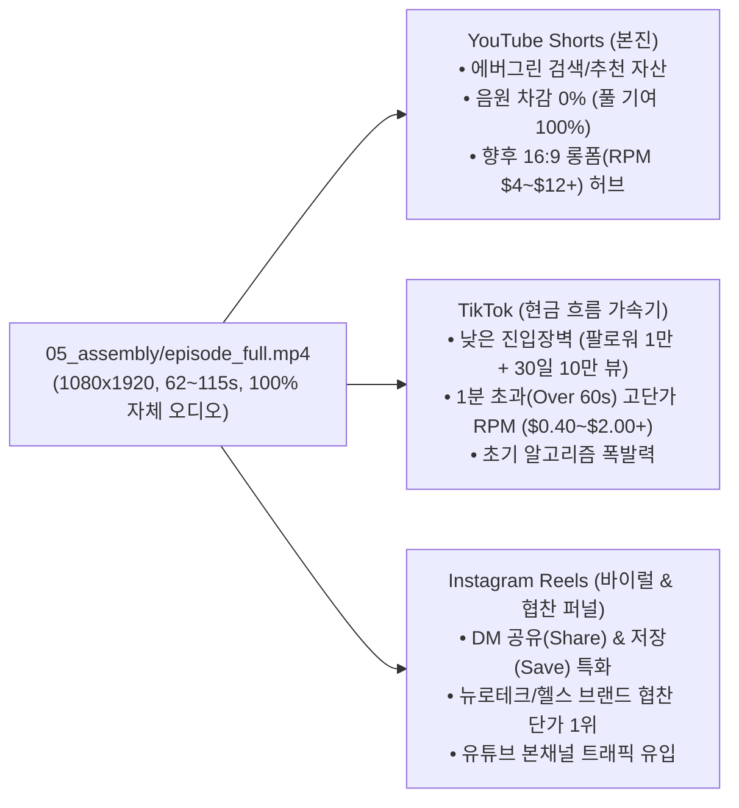

# ALL ABOUT BRAIN — 틱톡(TikTok) & 인스타그램 릴스(Reels) 확장 타당성 및 리스크 분석 보고서

**작성일**: 2026-11-10 | **작성 주체**: [`@YouTube_CEO`](conversation://b57c97a8-6324-4c31-a2bb-16b25e28dd55)
**대상 채널**: `@AllAboutBrainOfficial` ([AGENTS.md](file:///home/canadaofbin/gdrive/Kyubin_Yun_Workspace/07_Youtube/.agents/AGENTS.md)) | **기준 파이프라인**: `expressive_25d_v8` (`Schema v8.3` + `R70-M` + `R71`)

---

## 1. Executive Summary (핵심 결론)

> [!IMPORTANT]
> **판단: "추가 제작비 `$0`(한계비용 제로)로 기대 수익과 도달률을 2.5~4배 증폭시킬 수 있으므로 틱톡·인스타그램 확장은 즉시 병행하는 것이 유리합니다. 단, 틱톡의 VPN 보안 제재(`Security Issue`)와 안티봇 탐지를 피하기 위해 운영 원칙을 엄격히 분리해야 합니다."**

현재 우리 파이프라인이 생산하는 마스터 영상(`05_assembly/episode_full.mp4`)은 **`1080x1920 @ 30fps`, `60~118초`, 100% 오리지널 오디오, 워터마크 제로** 사양으로, 별도의 재편집 없이 **유튜브 쇼츠·틱톡·인스타그램 릴스 3대 플랫폼의 최고 대우 조건을 동시에 만족**합니다.

---

## 2. 왜 유리한가? — 5대 전략적 이점 (Strategic Advantages)

### ① 현금 흐름(Cash Flow) 시점 단축 및 직접 RPM 극대화 (TikTok)
- **진입 장벽 1/100 수준**: 유튜브 쇼츠(YPP)는 구독자 1,000명과 **최근 90일 유효 조회수 1,000만 회**가 필요하지만, 틱톡 `Creator Rewards Program`은 팔로워 10,000명과 **최근 30일 조회수 10만 회**만 충족하면 즉시 수익 창출이 시작됩니다.
- **숏폼 최고 수준의 직접 RPM**: 유튜브 쇼츠의 영미권 평균 RPM이 `$0.15 ~ $0.30` 수준인 반면, 틱톡의 1분 초과 오리지널 교육/과학 콘텐츠는 유효 조회수(For You 피드 5초 이상 시청) 1,000회당 **`$0.40 ~ $2.00+`**의 높은 보상을 지급합니다.

### ② 우리 `expressive_25d_v8` 포맷과의 구조적 완벽 궁합
1. **틱톡의 'Over 1 Minute(`> 60.0s`)' 필수 조건 자동 충족**:
   - 틱톡은 `60초` 이하 영상에는 조회수가 수천만 회가 나와도 **`$0`**을 지급합니다.
   - 많은 숏폼 채널들이 20~40초 영상을 만들다 보니 틱톡에서 수익을 못 내지만, 우리 `v8` 에피소드는 이미 **`62~115초` 스토리텔링 구조**([production_constants.md](file:///home/canadaofbin/gdrive/Kyubin_Yun_Workspace/07_Youtube/.agents/rules/production_constants.md))로 설계되어 있어 전 에피소드가 고단가 정산 대상이 됩니다.
2. **100% 자체 제작 오디오(`elevenlabs_v4` + `music_v2_5`)의 독점적 이점**:
   - **유튜브 쇼츠**: 상업 음원 사용 시 크리에이터 풀 기여분의 50~67%가 음원사로 빠지지만, 우리는 **100% 자체 보이스+스코어**를 사용하여 차감 없이 100% 인정받습니다.
   - **틱톡 & 릴스**: 상업 음원 저작권 만료로 인한 **영상 음소거(Mute) 리스크가 0%**이며, 향후 브랜드 협찬이나 비즈니스 기능 연동 시에도 음원 라이선스 제약이 전혀 없습니다.
3. **고밀도 오리지널리티로 'AI 저품질 필터' 완벽 통과**:
   - 틱톡과 유튜브 모두 단순 이미지 슬라이드쇼나 저품질 AI 양산형 영상을 수익화에서 배제(`Unoriginal Content`)합니다.
   - 반면 우리 파이프라인은 **Blender 3D Previs(`E1-E8`) + Google Flow 2.5D 디오라마 + `R70-M` 수제 크레용 데이터 차트 + `R71` 3D 글래스 브레인 해부학 콜아웃 + 3인 성우 다큐 내레이션**이 결합되어 플랫폼의 고품질 추가 보상(`Additional Rewards`) 기준에 부합합니다.

### ③ 알고리즘 포트폴리오 분산 (Algorithmic Risk Hedging)
- 동일한 영상이라도 플랫폼마다 핵심 추천 시그널이 다릅니다:
  - **YouTube Shorts**: 초기 스와이프 방어율(`Viewed vs Swiped away`) + 장기 검색/관련 영상 연동
  - **TikTok**: 1분 이상 영상의 **절대 시청 지속 시간(Watch Time)** 및 완시율(Completion Rate)
  - **Instagram Reels**: 친구에게 보내는 **DM 공유(Shares)** 및 나중에 보기 위한 **저장(Saves)**
- 유튜브에서 초기 시드 배정이 아쉽게 멈춘 에피소드가 틱톡이나 릴스에서는 수백만 뷰를 기록하며 채널 전체의 히트작 타율을 높여줍니다.

### ④ 인스타그램 릴스를 통한 '고단가 브랜드 협찬' 및 팬덤 자산화
- 뇌과학·행동심리·집중력·수면 도메인("마시멜로 실험의 반전", "뇌가 에너지를 쓰는 법" 등)은 인스타그램에서 **"친구에게 DM으로 공유하기 좋은 지적인 콘텐츠"**로 작동합니다.
- 팔로워 1만~5만 명 구간만 진입해도 헬스테크, 뉴로테크, 생산성 앱, 교육 기업으로부터 들어오는 **브랜드 협찬(`Branded Content`) 단가가 3대 플랫폼 중 가장 높으며**, 프로필 링크를 통해 유튜브 본채널로 고관여 시청자를 유입시킬 수 있습니다.

### ⑤ 무단 도용(Freebooting) 원천 차단 및 원본 IP 선점
- 유튜브 쇼츠에서만 활동할 경우, 해외 리업로더들이 우리 영상을 무단 다운로드해 틱톡과 인스타그램에 먼저 올려 조회수와 수익을 가로채는 일이 빈번하게 발생합니다.
- 공식 계정(`@AllAboutBrainOfficial`)으로 3대 플랫폼에 동시 배포하면 **원본 오디오(Original Audio) 및 최초 업로드 타임스탬프**를 우리가 선점하여 사칭·도용 계정을 자동으로 무력화할 수 있습니다.

---

## 3. 핵심 리스크(Risks) 정밀 분석 및 완화 전략 (Risk Matrix)

| 리스크 항목 | 치명도 | 발생 원인 | 핵심 완화 및 방어 전략 (Mitigation) |
| :--- | :---: | :--- | :--- |
| **R1. 틱톡 VPN 사용 시 `Security Issue` 수익 박탈** | **상 (Critical)** | 미국 시청자 타겟팅을 위해 VPN/데이터센터 IP 사용 시 틱톡 안티프로드가 위치 조작·봇으로 판정해 정산 동결 및 영구 퇴출 | **VPN 절대 금지.** 한국은 이미 틱톡 Creator Rewards 공식 지원국이므로 **한국 정식 계정(실명·세금 일치) + 클린 국내 IP**로 운영하고 영어 콘텐츠 메타데이터로 자연 도달 유도 |
| **R2. 웹 브라우저 자동화(CDP) 봇 탐지 및 섀도우밴** | **상 (Critical)** | 틱톡·인스타그램 웹 업로더는 Playwright/CDP 자동 클릭에 대한 핑거프린트 탐지가 매우 엄격함 (적발 시 조회수 `0` 고정) | **자동 브라우저 업로드 지양.** 파이프라인은 `publish_bundle`(MP4+커버+캡션) 생성까지만 자동화하고, 업로드는 **모바일 앱 수동 업로드(1분 소요) 또는 공식 API**만 사용 |
| **R3. `58~59.9초` 영상의 틱톡 수익 `$0` 누락** | **중 (Medium)** | 현재 `v8` 최소 길이가 `58.0s`여서 `60.0s` 미달 영상 발생 시 틱톡 정산에서 100% 제외됨 | 에피소드 어셈블리 최소 길이 상수를 **`61.5초`(`>= 61.5s`)**로 상향하여 모든 에피소드가 틱톡 수익화 자격을 자동 확보하도록 고정 |
| **R4. AI 생성 콘텐츠(AIGC) 라벨 미공시 페널티** | **중 (Medium)** | 틱톡·릴스에서 AI 생성 영상 라벨 미체크 시 노출 제한 또는 Creator Rewards 자격 박탈 | 업로드 시 3대 플랫폼 모두 **공식 `AI-generated content` 공시 토글 필수 체크** (공시 자체는 도달률·수익에 페널티 없음) |
| **R5. 플랫폼별 UI 세이프존(Safe Zone) 침범** | **중하 (Low-Med)** | 틱톡·릴스의 우측 버튼 스택(`우측 120~190px`)이 유튜브보다 넓어 차트/라벨 우측 끝이 가려질 위험 | 자막(`MarginV=650`)은 이미 안전. `R70-M` 차트 및 `R71` 해부학 라벨의 우측 여백을 **`X <= 920px`**(또는 상단 `Y = 200~850px` 배치)로 유지 |
| **R6. 멀티 플랫폼 운영 피로도 및 본진 분산** | **중하 (Low-Med)** | 3개 플랫폼 개별 편집·관리 시 제작 속도 저하 우려 | **YouTube-First 원칙**: 모든 기획·렌더링·QA는 유튜브 기준으로 1회만 수행하고, 틱톡/릴스는 동일 마스터 MP4를 그대로 미러링 |

---

### 리스크 상세 해설: 가장 주의해야 할 2가지 함정

> [!CAUTION]
> **함정 1: "미국 시청자에게 노출시키려고 VPN을 켜고 틱톡을 올리는 행위"**
> - 많은 크리에이터들이 영미권 노출을 위해 상업용 VPN을 켜고 틱톡에 접속하지만, 틱톡은 **유심(SIM) 국가 코드 + 기기 하드웨어 ID + 데이터센터 IP 대역 + 세금/신분증 거주지**를 교차 검증합니다.
> - VPN 사용이 감지되면 팔로워 1만 명을 달성해 수익 신청을 하거나 정산을 받을 때 **`Security Issue` (보안 문제)** 사유로 수익이 전액 몰수되고 프로그램에서 퇴출됩니다.
> - **올바른 해법**: 한국은 틱톡 `Creator Rewards Program` 공식 지원 국가입니다. **VPN 없이 한국 정식 네트워크와 본인 명의 계정**으로 운영하되, 영상 오디오·자막·캡션·해시태그를 100% 영어로 유지하면 초기 테스트 후 미국·영국 등 글로벌 영어권 시청자 피드로 정상 확장됩니다. (별도 해외 유심 전용 공기계를 쓰더라도 상업용 VPN은 절대 켜면 안 됩니다.)

> [!WARNING]
> **함정 2: "유튜브처럼 CDP(`9222` 포트)로 틱톡·인스타 웹 업로드를 자동화하는 행위"**
> - 유튜브 스튜디오는 크리에이터의 브라우저 워크플로우에 관대하지만, 틱톡 웹 스튜디오와 인스타그램 웹은 자동화 스크립트(CDP DOM 조작)를 스팸 봇으로 간주해 **첫 영상부터 조회수 `0~10회`에 가두는 섀도우밴(Shadowban)**을 겁니다.
> - 따라서 코드 파이프라인(`06_publish`)은 **업로드용 완성 폴더(`episode_full.mp4`, `thumbnail.png`, `tiktok_caption.txt`, `reels_caption.txt`)를 만들어 주는 것까지만 담당**하고, 실제 업로드는 스마트폰이나 정식 세션에서 직접 올리는 것이 계정 안전과 초기 도달률에 압도적으로 유리합니다.

---

## 4. 우리 파이프라인의 UI 세이프존(Safe Zone) 호환성 진단

현재 [production_constants.md](file:///home/canadaofbin/gdrive/Kyubin_Yun_Workspace/07_Youtube/.agents/rules/production_constants.md)에 정의된 화면 레이아웃과 3대 플랫폼 공용 세이프존(`1080x1920`)을 비교한 결과입니다:

| 화면 요소 | 3대 플랫폼 공용 안전 기준 | 현재 `ALL ABOUT BRAIN` 설정값 | 호환 판정 |
| :--- | :--- | :--- | :---: |
| **하단 자막 (Subtitles)** | 하단에서 최소 `650px` 이상 띄울 것 (`Y <= 1270px`) | `DIORAMA_SUBTITLE_MARGIN_V = 650` ([production_constants.md](file:///home/canadaofbin/gdrive/Kyubin_Yun_Workspace/07_Youtube/.agents/rules/production_constants.md#L180)) | **완벽 호환 (수정 불필요)** |
| **상단 차트/헤드라인 (`R70-M`)** | 상단 검색바(`0~220px`) 피할 것 | `DATA_STAMP_Y_FRAC_RANGE = (0.10, 0.62)` (`Y = 192~1190px`) | **양호** (상단 마진 `0.12`로 미세 조정 시 더욱 안전) |
| **우측 여백 (`R70-M` / `R71`)** | 우측 아이콘 컬럼(`X = 900~1080px`, `Y = 850~1450px`) 피할 것 | 중앙 카드 및 좌우 대칭 콜아웃 배치 | **주의** (`Y > 850px` 구간에서는 우측 텍스트가 `X <= 910px` 안쪽에 오도록 유지) |
| **영상 총 길이 (Duration)** | 틱톡 수익화 필수 조건: **`> 60.0s`** | `58.0s ~ 118.0s` (`<= 120.0s`) | **`58~60s` 구간만 보완 필요** (`>= 61.5s` 권장) |

---

## 5. 단계별 실행 로드맵 제안 (Recommended Action Plan)

1. **즉시 적용 가능한 파이프라인 가드 (선택 사항)**:
   - 에피소드 목표 최소 길이를 `58.0s`에서 **`61.5s`**로 상향하여, 향후 생산되는 모든 `v8` 에피소드가 틱톡 `Creator Rewards Program`의 1분 초과 조건을 100% 만족하도록 설정.
   - `06_publish` 단계에서 유튜브 업로드와 동시에 `06_publish/multi_platform_bundle/` 안에 **틱톡용 캡션(SEO 키워드 + 3~5개 니치 해시태그)**과 **인스타그램 릴스용 캡션(공유/저장 유도 콜투액션 + DOI 요약)**을 자동 생성.
2. **계정 개설 및 초기 파일럿 배포**:
   - `@AllAboutBrainOfficial` 동일 핸들로 틱톡(개인 계정 — 비즈니스 계정은 Creator Rewards 신청 불가) 및 인스타그램(크리에이터 계정) 개설.
   - 이미 검증된 `v8` 파일럿 에피소드 중 1분 이상 분량의 마스터 MP4부터 순차 업로드하며 초기 도달률 및 시청자 국가 분포 모니터링.
