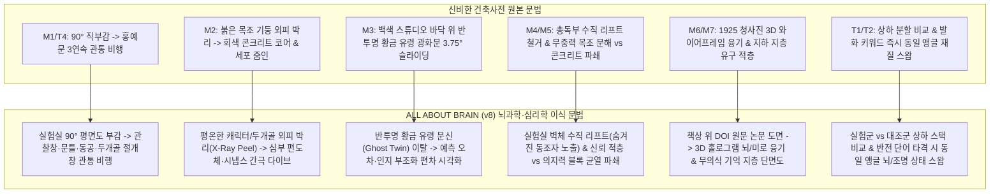

# `신비한 건축사전` (`_73R9pQF5oM`) 분석 리포트 연동 및 `@AllAboutBrainOfficial` 이식 전략 보고서

- **원본 분석 출처**: 대화방 [`conv_3aa5c914`](conversation://3aa5c914-3040-488f-8057-f9c44d70b0cc) — [_73R9pQF5oM_motion_and_transition_report.md](../conv_3aa5c914/_73R9pQF5oM_motion_and_transition_report.md) 및 원시 데이터셋 [_73R9pQF5oM_scene_motion_and_transitions.json](../conv_3aa5c914/_73R9pQF5oM_scene_motion_and_transitions.json) (`343.33s`, `10,300f @ 30fps`, `167개 샷` · `166개 전환` 전수 추출)
- **연계 문서**: [pilot03_v2_polish_plan.md](./pilot03_v2_polish_plan.md) (계획 1 — 현재 진행본) · [next_episode_v8_2_master_plan.md](./next_episode_v8_2_master_plan.md) (계획 2 — 다음 주제 에피소드 적용본)

> [!IMPORTANT]
> **가장 결정적인 포렌식 발견 — "모델 한계가 아니라 8초 클립 운용법의 차이였다"**
> `신비한 건축사전` 역시 순수 3D 수작업이 아니라 **우리와 동일한 `24.00fps` 네이티브 `8.0s` 상한 AI 비디오 엔진(`Google Flow / Veo 3.1` 계열)**으로 제작되었습니다(`30fps` 타임라인 내 `3:2:2:2:2` 중복 프레임 `22.74%`, 단일 샷 최장 `8.00s`, `00:06s` 프롬프트 지시어 `"in Title Case"` → `"Title Casefe"` 노출 물증).
> 그런데도 어색함이나 유령 현상이 전혀 없는 이유는 **① `8초` 클립을 늘리지 않고 가장 완벽한 `1.7~2.1초` 알짜 구간만 발췌**하며, **② 복잡한 인간 전신 관절 연기 대신 '구조물 해체·단면 박리·유령 모형 슬라이딩' 같은 강체(Rigid-Body) 디오라마 물리로 스토리를 시각화**했기 때문입니다.

---

## 1. 타 채팅방 리포트 핵심 실측 데이터 & 시각화 요약

````carousel

<!-- slide -->

<!-- slide -->

````

---

## 2. `신비한 건축사전` vs 우리 `ALL ABOUT BRAIN (Pilot #3)` 5대 정량 격차 진단

| 비교 축 | `신비한 건축사전` (`_73R9pQF5oM` 실측) | 우리 채널 현재 (`Pilot #3` 실측) | 왜 격차가 발생했는가? (핵심 원인 & 해법) |
|---|---|---|---|
| **① 샷 길이 & 클립 발췌율** | 평균 **`2.06s`** · 중앙값 **`1.73s`** (`8s` 중 상위 **`25%`**만 사용) | 평균 **`6.64s`** · 최장 `12.5s` (`8s` 클립을 슬로모션으로 늘려 사용) | Veo/Flow 클립은 초반 `0.5~2.8s`가 가장 선명하고 후반 `4.5~8.0s`에서 관절·형태 왜곡이 증가함. **슬로모션(`pts > 1.0`)을 금지하고 `1.6~2.6s` 알짜 구간만 발췌**하면 어색함이 즉시 사라짐 |
| **② 컷 전환 동기화 기준** | 마침표 경계 **`9.0%`** vs **문장 중간 키워드 타격 `91.0%`** | 문장 경계(`S01..S20` 마침표 단위) **`100%`** | 첫 문장 *"나무처럼 생긴 콘크리트가 42년 동안 서 있던 자리가 있습니다"* 하나를 **`1.50s(전진) → 2.17s(정지 디테일) → 1.53s(후진 리빌)` 3컷**으로 쪼개 명사·숫자 발화 순간에 화면을 타격함 |
| **③ 캐릭터 vs 물리 오브젝트 비중** | 인간은 **손 클로즈업(`1.5s`)·창문 실루엣**으로만 등장, 본편 `90%+`는 **건축물·단면·유령 모형 물리** | 18컷 중 **16컷에서 캐릭터 전신/상반신 관절 연기**를 6~10초간 지속 요구 | AI 비디오 모델의 최대 약점(인체 다관절 장기 연기)을 정면으로 건드렸음. **캐릭터는 `1.5~2.2s` 표정·손 리액션 인서트로 압축**하고, 심리·뇌 메커니즘은 **디오라마 해체·단면·유령 분신 물리**로 치환해야 함 |
| **④ 카메라 벡터 분업** | **Z축(`Push-In`/`Pull-Out`) `59.3%`** + **삼각대 고정+피사체 모션 `19.8%`** + 수직 틸트 `12%` | 캐릭터 연기와 복합 카메라 회전/패닝이 한 클립에 동시 중첩 | **60 / 20 / 20 분업 법칙**: 공간 몰입은 Z축 직진(`60%`)으로 밀어붙이고, 구조 분해·수치 비교 컷(`20%`)에서는 **카메라를 완전 고정(`locked_static`)**해 정보 가독성과 물리 안정성을 확보 |
| **⑤ 전환 문법 & 텍스트 처리** | **칼컷(`Hard Cut`) `84.3%`** (`140/166`), 시대 점프에만 `12~20f` 디졸브(`10.2%`) / 인씬 AI 영문 텍스트 사용(`"Title Casefe"` 오타 발생) | 반투명 디졸브 남발(`9/17 = 53%`)로 방 잔상 발생 / 인씬 AI 글자 `0%` + 프로그래매틱 오버레이(`R70/R71`) | **칼컷 `85%+` 원칙**(계획 1에 이미 반영 완료!) + **개구부 포털(`T4`)·동일 앵글 상태 스왑(`T2`)**을 도입하되, 텍스트는 AI 오타 위험이 없는 **우리의 프로그래매틱 손그림/타이포 레이어 우위**를 유지 |

---

## 3. 8대 무빙(`M1~M8`) & 7대 전환(`T1~T7`)의 뇌과학·심리학 쇼츠 1:1 이식 설계

건축 다큐멘터리의 문법을 `@AllAboutBrainOfficial`의 **실험실 디오라마 + 해부학 뇌** 세계관으로 직결 번역한 연출 사전입니다.



### 핵심 이식 레시피 상세 (`Google Flow` 프롬프트 직결)

1. **`M3` → 반투명 황금 유령 분신 (`Ghost Twin Prediction-Error Diagram`)**
   - **해결하는 문제**: 캐릭터가 "기대했다가 실망하는 내면 심리"를 어색한 팔다리 연기로 표현할 필요가 없어집니다.
   - **연출**: 깔끔한 백색/슬레이트 스튜디오 바닥(`45°` 아이소메트릭) 위에서 본체 캐릭터는 그대로 앉아 있고, **반투명하게 빛나는 황금색 유령 분신(`translucent golden silhouette`)**이 바닥의 붉은 궤적 띠를 따라 미끄러져 분리되며 `기대 행동(12분 대기)`과 `실제 붕괴(3분 포기)`의 간극을 한눈에 보여줍니다.
2. **`M4 + M5` → 실험실 수직 리프트 리빌 & 고정 카메라 물리 비유 (`Lid-Lift & Locked Studio Shatter`)**
   - **연출 (`M4`)**: 밀그램·애쉬·마시멜로 실험에서 전환 시 디졸브 대신 **실험실 가벽과 천장이 하늘 위로 수직 상승해 사라지며(`lifts straight upward`)** 벽 너머 관찰실의 연구원이나 숨겨진 실험 장치가 드러납니다.
   - **연출 (`M5`)**: 어두운 스튜디오 배경 + **삼각대 완전 고정(`locked tripod camera`)** 상태에서, 억지 참기(`Broken Trust`)는 회색 블록에 붉은 균열이 퍼지며 산산조각 나고, 신뢰 기반 통제(`Kept Trust`)는 정교한 모듈 블록이 무중력처럼 깔끔히 맞물립니다.
3. **`M6` → DOI 실제 논문 청사진 3D 융기 (`Verified Paper-to-3D Extrusion`)**
   - **연출**: 우리 채널의 최대 무기인 **`R1` 실제 학술 논문(DOI)**을 시각적 스펙터클로 승화합니다. 책상 위 실험 도면 클로즈업에서 **하얀 3D 와이어프레임 뇌/실험실이 솟아오르며(`3D wireframe rising upward from vintage study blueprint`)** 시안·골드 신경망으로 채워집니다.
4. **`T2 + T4` → 어두운 개구부 포털(`Dark-Aperture Portal`) & 동일 앵글 상태 스왑(`Same-Angle State Swap`)**
   - **연출 (`T4`)**: 방문 틀, 일방향 관찰거울의 어두운 테두리, 혹은 캐릭터의 **검은 동공** 속으로 고속 `Push-In`하여 화면 좌우가 어두워지는 프레임을 경계로 다음 공간(해부학 뇌 내부)으로 무봉합 관통합니다.
   - **연출 (`T2`)**: 동일한 `Start Frame` 구도(`hist_corr >= 0.90`)에서 반전 키워드(*"불신이었습니다"*, *"4배 차이"*)가 발화되는 정확한 프레임에 실험실 조명·소품 상태·뇌 발광 색상이 칼컷으로 즉시 뒤바뀝니다.

---

## 4. 크레딧 추가 소모 없이 `2.0초` 고속 타격 리듬을 만드는 파이프라인 구현안

`60~90초` 쇼츠에서 평균 `2.1초` 컷 호흡(`30~38컷`)을 만들 때 클립을 38개 생성하면 크레딧과 시간이 2배로 들지만, 아래 **3가지 편집·생성 기법**을 결합하면 **기존과 동일한 `16~20개` 클립 예산으로 `32~38컷` 다큐멘터리 밀도**를 구현할 수 있습니다.

| 모듈 | 구현 메커니즘 | 코드 반영 대상 |
|---|---|---|
| **1. `1-Clip Dual-Harvest` (`ABA` 교차 발췌)** | `Start + End` 궤적이 다른 `8.0s` 클립(`M1` 부감→지상 다이브, `M6` 도면→3D 융기) 1개에서 **초반 알짜 `1.8s`(`0.3~2.1s`)**와 **후반 알짜 `2.0s`(`5.4~7.4s`)** 두 구간을 뽑아 사이에 다른 인서트 컷(`B`)을 끼워 넣음 (`A₁ → B → A₂`). 어색해지기 쉬운 중간 변형 구간(`2.5~5.0s`)을 자연스럽게 버리면서 유효 컷 수를 **크레딧 추가 `0`으로 1.7배 확대** | [`diorama_assembler.py`](file:///home/canadaofbin/gdrive/Kyubin_Yun_Workspace/07_Youtube/pipeline/diorama_assembler.py) (`build_diorama_edl`) |
| **2. `R58-K` 단어 타임스탬프 타격 커터** | 문장 마침표(`sentence_spans`)에만 묶이지 않고, 정렬된 단어 타임스탬프에서 **숫자·대조 접속사·핵심 명사(`Yet`, `4 times`, `concrete`, `amygdala`)** 발화 시작점에 하드컷을 자동 스냅 (`91%` 문장 내부 키워드 컷 재현, `pts > 1.0` 슬로모션 늘리기 전면 금지) | [`diorama_assembler.py`](file:///home/canadaofbin/gdrive/Kyubin_Yun_Workspace/07_Youtube/pipeline/diorama_assembler.py), [`prosody.py`](file:///home/canadaofbin/gdrive/Kyubin_Yun_Workspace/07_Youtube/pipeline/prosody.py) |
| **3. 뉴로-아키텍처 6대 스튜디오 문법 & `60/20/20` 카메라 쿼터** | `visual_plan` 생성 시 캐릭터 전신 연기 컷 비중을 **`<= 35%` (`1.5~2.2s` 표정·손 인서트 위주)**로 제한하고, 나머지 `65%`에 `axial_portal_dive`(`M1/T4`), `xray_peel_micro`(`M2`), `ghost_twin_offset`(`M3`), `lid_lift_reveal`(`M4`), `locked_exploded_vs_shatter`(`M5`), `blueprint_3d_extrusion`(`M6`)을 배정. 카메라 벡터는 **Z축 `60%` · 삼각대 고정 물리 `20%` · 부감/틸트 `20%`**로 강제 | [`flow_prompt_builder.py`](file:///home/canadaofbin/gdrive/Kyubin_Yun_Workspace/07_Youtube/pipeline/flow_prompt_builder.py), [`camera_choreography_rules.md`](file:///home/canadaofbin/gdrive/Kyubin_Yun_Workspace/07_Youtube/.agents/rules/camera_choreography_rules.md) |
| **4. 4대 연속성 사슬 & 무결점 오버레이 결합** | 컷 전환 `85%+`를 칼컷으로 유지하되 인접 샷을 **`Push→Push` 탄성 계승** 또는 **`고속 비행 → 삼각대 고정 다이어그램` 시선 진정**으로 체이닝. `신비한 건축사전`의 유일한 약점인 AI 인씬 텍스트 오타(`"Title Casefe"`)는 우리의 프로그래매틱 **손그림 HERO 그래프(`R70 v2`) & 만년필 해부학 지시선(`R71`)**으로 무결점 대체 | [`data_stamp_overlay.py`](file:///home/canadaofbin/gdrive/Kyubin_Yun_Workspace/07_Youtube/pipeline/data_stamp_overlay.py), [`anatomy_label_overlay.py`](file:///home/canadaofbin/gdrive/Kyubin_Yun_Workspace/07_Youtube/pipeline/anatomy_label_overlay.py) |

---

## 5. 단계별 적용 로드맵 (현재 `Pilot #3 v2` vs `다음 주제 에피소드 #4`)

1. **[즉시 완료 가능 — 계획 1: `Pilot #3 v2`](./pilot03_v2_polish_plan.md)** *(코드 구현 95% 완료 상태)*:
   - `신비한 건축사전`의 원칙과 정확히 일치하는 **반투명 알파 디졸브 전면 제거(`85%+` 칼컷화)**, **`framerate` 블렌딩 및 배속 울렁임 제거**, **`Clip 13·14` `--engine omni` 실제 3D 반투명 해부학 뇌(`M2` 박리·투시 계열) + 손그림 지시선**, **ElevenLabs `music_v2_5` BGM**, **손그림 HERO 그래프**를 그대로 마무리해 기존 캐릭터 클립 재촬영 없이 `Pilot #3 v2`를 즉시 출고합니다.
2. **[차기 에피소드 전면 탑재 — 계획 2 확장: `Episode #4 (v8.2 + 뉴로-아키텍처 문법)`](./next_episode_v8_2_master_plan.md)**:
   - 기존 계획 2(캐릭터 자연 무빙 & 2.5D 표정 연기)에 이번 `신비한 건축사전` 핵심 공식 4가지(**① 평균 `2.0s` 단어 키워드 타격 컷 & `1-Clip Dual-Harvest`, ② 캐릭터 전신 연기 축소 + `M1~M7` 디오라마 물리/유령 분신/논문 3D 융기, ③ `60/20/20` Z축·고정삼각대 분업, ④ `T2/T4` 상태 스왑 & 포털 관통 전환**)를 통합하여 다음 주제 에피소드부터 완전히 새로운 다큐멘터리 급 몰입감으로 제작합니다.
