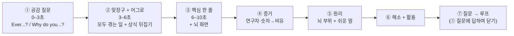

# 내레이션 구성 개편 계획 (`expressive_25d_v8` 채널 규칙 + `v8_pilot_02` 새 대본)

## 목표
현재 v8 내레이션은 **빽빽하고, 공식처럼 들리고, 핵심이 늦게 나옵니다.** 이 계획은 두 가지를 합니다.
1. 대본 규칙(검사기·상수·문서)을 **"자연스럽게 들리고 핵심을 먼저 말하는"** 구조로 바꿉니다.
2. 그 규칙으로 `v8_pilot_02` 새 대본을 씁니다.

목소리는 이미 확정된 **Emma 1인 내레이터**입니다.

> [!NOTE]
> 지금 돌아가는 `/boost` 서브에이전트에게는 **내레이션·대본 관련 변경을 이 계획이 승인될 때까지 보류**하라고 전달해 두었습니다. 보이스·BGM·전환 정리 작업은 계속 진행 중입니다. pilot_02 최종 재합성과 Flow 재생성은 새 대본이 확정된 뒤에 실행합니다.

---

## 1. 현재 내레이션 진단 (`v8_pilot_02`, 실측)

| # | 문제 | 근거 | 원인이 되는 규칙 |
|---|---|---|---|
| **N1** | **너무 빽빽함** | 69.7초에 18문장 · 평균 216 WPM (Emma 버전 236) · 문장 사이 간격 0.24초 | `SHORTS_EXPRESSIVE_V8_SENTENCE_COUNT_MIN = 14`, WPM 목표 `205–220`, 간격 `0.24–0.38s`, rush 기어 `+20%` |
| **N2** | **같은 패턴 3번 반복** | 반박역 대사 → "Wrong/Except" 뒤집기가 직원(S4) → 조교(S8) → 친구(S12)로 세 번 나옴 | 반박역 ≥ 1 필수 규칙(지금은 선택으로 완화됨). 반복 횟수 상한은 없음 |
| **N3** | **핵심이 늦게 나옴** | "왼쪽 뇌가 보초를 선다"가 S9(30초)에 처음 나오고, X-Ray 뇌는 S14(51초)에 처음 보임 | `EXPRESSIVE_V8_BRAIN_REVEAL_WINDOW_FRAC = (0.70, 0.85)`, `You see`는 대본 후반부에만 허용 |
| **N4** | **억지로 끼운 표현** | "Wait, what", "Except", "You see"가 문맥보다 검사 통과를 위해 들어감 | [`validate_script_spine_v8`](file:///home/canadaofbin/gdrive/Kyubin_Yun_Workspace/07_Youtube/pipeline/prompt_quality_v5.py#L452-L464)가 이 표현들이 없으면 FAIL |
| **N5** | **곁가지** | S10 고래·새(화면은 돌고래), S11 연구소가 첫날 데이터를 버림 → 핵심 흐름과 멀고 화면과도 어긋남 | 핵심과 연결되는지 확인하는 규칙 없음 |
| **N6** | **어색한 문어체** | `cannot` ×2, "your skull just flipped on a night patrol", "Sea whales" | 축약형·구어체 검사 없음 |
| **N7** | **첫 부분에 공감대가 없음** | S1이 "호텔 첫날밤 3시에 눈이 번쩍!"이라는 **남의 장면 묘사**입니다. 시청자가 "어, 나도 그래" 하고 자기 일로 받아들이는 순간이 없고, 질문도 없습니다 | S1은 상황 + `!` 공식만 있고, 공감·질문·도발 요소는 요구하지 않음 |

---

## 2. 새 내레이션 구조 — 오프닝 3단 + 본문



### 오프닝 3단 (첫 10초) — 공감 → 어그로 → 핵심
| 비트 | 시간 | 역할 | 규칙 |
|---|---|---|---|
| ① **공감 질문** | 0–3초 | 시청자가 **자기 경험**을 떠올리게 함 | **2인칭(`you`) 질문**으로 시작(`Ever…?`, `Why do you…?`, `Have you noticed…?`). 누구나 겪는 **일상 장면** 하나를 담음. 14단어 이하. 연도·기관·전문용어 금지 |
| ② **맞장구 + 어그로** | 3–6초 | "나만 그런 게 아니구나" + "어? 그게 아니라고?" | 짧은 맞장구(`You're not alone.`, `Almost everyone does.`)에 이어 **흔한 핑계를 대놓고 부정**합니다(`And no, it's not the bed.`). 문장 1–2개, 각 10단어 이하 |
| ③ **핵심 한 줄** | 6–10초 | 진짜 이유를 한 방에 | 놀라운 사실을 쉬운 말로 말합니다. **이 컷에서 X-Ray 뇌가 처음 등장**합니다. 늦어도 4문장째, 15초 안에 나와야 합니다 |

- **⑦ 루프:** 마지막에 ① 질문에 대한 답으로 돌아가 닫습니다. 그러면 처음 질문 → 끝에서 답이 되어 다시 보고 싶어지는 루프가 됩니다.

### 본문 비트
| 비트 | 문장 수 | 규칙 |
|---|---|---|
| ④ 증거 | 3–4 | 연구자 이름 + 숫자 1개 이상 + `[숫자] → [비유]` 1회. 반박-뒤집기는 **최대 1회**(② 어그로 포함) |
| ⑤ 원리 | 2–3 | 뇌 부위를 말하면 바로 쉬운 말로 다시 말함(유지). `You see`는 **권장**이고 필수가 아님 |
| ⑥ 해소·활용 | 2 | "그래서 어떻게 되나 / 내 생활에 무슨 의미인가" |
| ⑦ 질문 → 루프 | 2 | 댓글 유도 질문 1개 + ① 질문에 답하며 닫는 마지막 줄. 요약형 마무리 금지(유지) |

**리듬 규칙**
- **13–16문장 / 180–215단어 / 약 200 WPM / 문장 사이 0.32–0.45초**를 목표로 합니다. 예상 길이는 약 62–68초입니다.
- 한 문장에는 새 정보를 **하나만** 넣습니다. 22단어를 넘기지 않습니다(유지 18 → 22로 완화).
- 구어체를 씁니다. `cannot` / `do not` / `it is` 같은 비축약형은 경고로 잡습니다.
- 모든 문장은 핵심(③)과 이어져야 합니다. 대본 작성 시 각 문장에 `beat` 태그를 달고, 검사기가 태그 없는 문장을 경고로 잡습니다.

---

## 3. `v8_pilot_02` 새 대본 초안 (15문장, 공감 질문 오프닝)

> [!IMPORTANT]
> 사실관계는 **기존 도시에(Tamaki·Sasaki 2016, Current Biology)와 기존 대본에 있던 내용만** 썼습니다. 고래·상어 표현은 화면(돌고래)에 맞춰 "Dolphins and some birds"로 바꿨습니다. 오프닝 ②의 "Almost everyone does"는 수면 연구에서 널리 알려진 **'첫날밤 효과(first-night effect)'**를 쉬운 말로 옮긴 것입니다. 이 연구 자체가 이 현상을 다룹니다.

### 오프닝 후보 (Q4에서 하나 고르기)
| 안 | ① 공감 질문 (0–3초) | ② 맞장구 + 어그로 (3–6초) | ③ 핵심 (6–10초) |
|---|---|---|---|
| **A (추천)** — 경험 질문 | Ever sleep terribly your first night in a hotel? | You're not alone. And no, it's not the bed. | Half of your brain stayed awake on purpose — standing guard. |
| **B** — '왜' 질문 | Why do you wake up at 3 AM in every new hotel room? | It's not jet lag. It's not the pillow. | Your brain posted a night guard — and it's only half asleep. |
| **C** — 대비 질문 | Why do sirens never wake you at home, but a hotel hallway does? | Everyone blames the bed. Wrong. | Half of your brain is on night patrol. |

- **A:** 가장 넓게 공감됩니다. 거의 모든 사람이 겪은 일이고, ②의 "it's not the bed"가 흔한 핑계를 뒤집어 어그로 역할을 합니다.
- **B:** 상황이 가장 구체적입니다(03:00 시계 화면과 바로 맞음). 다만 "새 호텔방마다 3시에 깬다"는 공감 범위가 A보다 좁습니다.
- **C:** 기존 S1·S2 대비를 질문 하나로 합쳤습니다. 문장이 길어 첫 3초에 다 들리지 않을 위험이 있습니다.

### 전체 대본 (A안 기준, 15문장)
| # | 비트 | 문장 | 기어 | 화면 (Flow) |
|---|---|---|---|---|
| S1 | ① 공감 질문 | Ever sleep terribly your first night in a hotel? | stamp | 기존 Cut 1 (03:00 시계, 번쩍 깨는 주인공) |
| S2 | ② 맞장구 | You're not alone. | brisk | 기존 Cut 2 전반 |
| S3 | ② 어그로 | And no, it's not the bed. | rush | 기존 Cut 2 후반 (침대 클로즈업) |
| S4 | ③ **핵심** | Half of your brain stayed awake on purpose — standing guard. | stamp | **NEW** 얼굴 → X-Ray 뇌 줌인 (좌반구 붉게 / 우반구 푸르게) |
| S5 | ④ 증거 | Scientist Yuka Sasaki scanned thirty-five sleepers over their first two nights in a lab. | brisk | 기존 Cut 5 (수면실) |
| S6 | ④ | On night one, the right side sank into deep, quiet sleep. | brisk | 기존 Cut 6 |
| S7 | ④ | But the left side? It stayed light, like a guard on watch. | stamp | **NEW** 수면실 → 뇌 좌반구 보초 (키프레임 체인) |
| S8 | ④ 숫자→비유 | Play a strange sound, and that left side woke people three times faster — like a tripwire! | rush | 기존 Cut 9 |
| S9 | ④ 확장 | Dolphins and some birds do the same, sleeping with one half of the brain at a time. | brisk | 기존 Cut 10 (돌고래) |
| S10 | ⑤ 원리 | You see, a network on your left side stays on duty all night. | brisk | 기존 Cut 14 (X-Ray) |
| S11 | ⑤ | Your sound center keeps scanning, ready to wake you if anything changes. | brisk | 기존 Cut 15 |
| S12 | ⑥ 해소 | By night two in the same room, the guard stands down, and both halves rest. | brisk | 기존 Cut 16 (깨는 장면 전에서 자름) |
| S13 | ⑥ 활용 | That's why sleep labs often toss out the first night's data. | brisk | 기존 Cut 11 |
| S14 | ⑦ 질문 | So on your next trip, would you pack your own pillowcase — or let the guard keep watch? | stamp | 기존 Cut 17 |
| S15 | ⑦ 루프 | Because that bad first night? That's half your brain keeping you safe. | rush | 기존 Cut 18 → S1 루프 (S1 질문에 답) |

**바뀐 점 요약**
- 첫 6초가 **공감 질문 → 맞장구 → 핵심(핑계) 뒤집기**가 됩니다. 기존에는 남의 장면 묘사 → 대비였습니다.
- 마지막 S15가 S1 질문("왜 첫날밤 잠을 못 잘까?")에 답하며 닫혀서, 처음과 끝이 이어지는 루프가 됩니다.
- 18문장 → **15문장**입니다(약 185–195단어). 짧은 문장 S2·S3이 들어가서 문장 수는 하나 늘었지만 단어 수는 거의 같습니다.
- 핵심 발견: 30초 → **약 6–8초(S4)**, 뇌 첫 등장: 51초 → **약 6–8초**입니다.
- 반박-뒤집기는 3회 → **1회**(S3 "it's not the bed")만 남았습니다.
- 빠지는 기존 컷: Cut 3(공중에 뜬 베개), Cut 4(프런트 직원), Cut 7·8(조교), Cut 12·13(친구·발소리)입니다.
- 새로 생성하는 컷: **2개**(S4, S7)입니다. 나머지는 기존 클립을 재사용합니다.

---

## User Review Required

> [!WARNING]
> **대본 규칙이 바뀌는 범위가 큽니다.** 앞으로 모든 `expressive_25d_v8` 에피소드에 적용됩니다.
> - `Wait, what` / `Except` / `You see` 필수 → **권장(경고만)**
> - **신규 필수 (오프닝):** S1은 **시청자에게 묻는 2인칭 공감 질문**이어야 함(≤ 14단어). 상황 묘사로 시작하려면 `opening_mode: "situation"`으로 명시
> - **신규 필수:** 핵심 한 줄이 4문장째 안에 있어야 함 + 그 컷이 뇌 화면이어야 함
> - **신규 상한:** 반박-뒤집기 패턴 최대 1회 (오프닝 어그로 포함)
> - 뇌 공개 구간 `70–85%` → **"첫 뇌는 15초 안 + 원리 구간 1회 이상"**
> - 문장 수 하한 14 → **12**

> [!CAUTION]
> pilot_02에서 컷 구성이 바뀌므로 **Flow 클립 2개를 새로 생성**해야 합니다(S3, S6). `--engine auto` 규칙을 따릅니다. 월 크레딧이 남아 있으면 Omni, 0이면 0-크레딧 Veo Lite를 씁니다. 키프레임 체인 방식은 진행 중인 `/boost` 작업 범위와 연결됩니다.

## Open Questions

> [!IMPORTANT]
> **Q1. 말하기 속도** — Pilot #1 Emma는 236 WPM이었습니다(좋다고 하신 버전).
> - **(추천) 약 200 WPM:** 기어를 `rush +14% / brisk +10% / stamp +4%`로, 간격을 0.32–0.45초로 바꿉니다. 같은 Emma 음색이고 숨 쉴 틈만 생깁니다.
> - **Pilot #1과 같은 속도 유지 (+20/+16/+10%):** 이 경우 14문장으로는 약 52초가 되어 최소 길이(55초)보다 짧습니다. 그래서 16–17문장이 필요합니다.
>
> **Q2. 오프닝 안 선택** — §3의 A(경험 질문, 추천) / B('왜' 질문) / C(대비 질문) 중 어느 쪽으로 할까요? 섞어도 됩니다. 예: A의 ① + B의 ③.
>
> **Q3. 새 대본 초안 자체** — 위 15문장에서 빼거나 바꾸고 싶은 문장이 있으면 알려 주세요.
>
> **Q4. 어그로 강도** — ②를 어느 정도로 할까요?
> - **(추천) 핑계 뒤집기:** "And no, it's not the bed." — 시청자를 공격하지 않고 상식만 뒤집습니다.
> - **강하게:** "Everyone blames the bed. Wrong." — 더 도발적이지만, 반박-뒤집기 1회 예산을 여기서 다 씁니다.

---

## Proposed Changes

### ① 상수 (SSOT)
#### [MODIFY] [config.py](file:///home/canadaofbin/gdrive/Kyubin_Yun_Workspace/07_Youtube/pipeline/config.py)
```diff
-SHORTS_EXPRESSIVE_V8_WORD_COUNT_MIN = 175
-SHORTS_EXPRESSIVE_V8_WORD_COUNT_MAX = 290
-SHORTS_EXPRESSIVE_V8_SENTENCE_COUNT_MIN = 14
+SHORTS_EXPRESSIVE_V8_WORD_COUNT_MIN = 160
+SHORTS_EXPRESSIVE_V8_WORD_COUNT_MAX = 240
+SHORTS_EXPRESSIVE_V8_SENTENCE_COUNT_MIN = 12
+SHORTS_EXPRESSIVE_V8_SENTENCE_COUNT_TARGET: tuple[int, int] = (13, 15)
+SHORTS_EXPRESSIVE_V8_SENTENCE_WORDS_MAX = 22
-EXPRESSIVE_V8_GAP_WINDOW_RANGE_SEC = (0.24, 0.38)
-EXPRESSIVE_V8_WPM_TARGET_RANGE = (205.0, 220.0)
-EXPRESSIVE_V8_WPM_ALLOWED_RANGE = (185.0, 235.0)
+EXPRESSIVE_V8_GAP_WINDOW_RANGE_SEC = (0.32, 0.50)
+EXPRESSIVE_V8_WPM_TARGET_RANGE = (190.0, 210.0)      # (Q1)
+EXPRESSIVE_V8_WPM_ALLOWED_RANGE = (175.0, 225.0)
 EXPRESSIVE_V8_PROSODY_GEAR_RATES = {
-    "rush": "+20%", "brisk": "+16%", "stamp": "+10%",
+    "rush": "+14%", "brisk": "+10%", "stamp": "+4%",
 }
 EXPRESSIVE_V8_PROSODY_GEARS = {
-    "rush":  {..., "gap_before": 0.24},
-    "brisk": {..., "gap_before": 0.26},
-    "stamp": {..., "gap_before": 0.32},
+    "rush":  {"tempo": 1.14, ..., "gap_before": 0.32},
+    "brisk": {"tempo": 1.10, ..., "gap_before": 0.36},
+    "stamp": {"tempo": 1.04, ..., "gap_before": 0.45},
 }
-EXPRESSIVE_V8_BRAIN_REVEAL_WINDOW_FRAC = (0.70, 0.85)
+EXPRESSIVE_V8_CORE_REVEAL_MAX_SENTENCE = 4            # core finding by S4 (after question + empathy/aggro)
+EXPRESSIVE_V8_OPENING_QUESTION_MAX_WORDS = 14         # S1 relatable 2nd-person question
+EXPRESSIVE_V8_OPENING_EMPATHY_MAX_WORDS = 10          # S2/S3 empathy + aggro lines
+EXPRESSIVE_V8_OPENING_QUESTION_STARTERS: tuple[str, ...] = (
+    "ever ", "why do you", "why does your", "have you", "do you", "what if you", "how come you",
+)
+EXPRESSIVE_V8_CORE_REVEAL_MAX_SEC = 15.0              # ...and first brain clip by 15s
+EXPRESSIVE_V8_BRAIN_REVEAL_WINDOW_FRAC = (0.45, 0.85) # mechanism brain clip(s)
+EXPRESSIVE_V8_MAX_MYTH_FLIPS = 1
+EXPRESSIVE_V8_ADVISORY_PIVOT_MARKERS = True           # 'Wait, what' / 'You see' → warnings only
```
Base rate `EXPRESSIVE_V8_PROSODY_BASE_RATE`도 `+16%` → `+10%`로 바꿉니다.

---

### ② 대본 검사기
#### [MODIFY] [prompt_quality_v5.py](file:///home/canadaofbin/gdrive/Kyubin_Yun_Workspace/07_Youtube/pipeline/prompt_quality_v5.py) — `validate_script_spine_v8`
- 반환값을 `issues`(FAIL)와 `advisories`(경고)로 나눕니다. 기존 호출처([L1125](file:///home/canadaofbin/gdrive/Kyubin_Yun_Workspace/07_Youtube/pipeline/prompt_quality_v5.py#L1125))와 호환되도록, 기존 함수는 `issues`만 돌려주고 새 함수 `validate_script_spine_v8_report()`가 둘 다 돌려줍니다.
```python
# FAIL (issues)
- S1 연도/기관 시작                         (유지)
- [NEW] S1 공감 질문: 2인칭(you/your) + '?' 종결 + ≤ 14단어
        (S1을 `!` 상황 묘사로 쓰려면 script.json `opening_mode: "situation"`으로 명시해야 하고, 이 경우 경고만 띄움)
- [NEW] 오프닝 S2–S3(최대 2문장)은 각 ≤ 10단어 — 공감·어그로 줄은 짧게
- 요약형 마무리                             (유지)
- 생략 실험 별명 언급                        (유지)
- [NEW] core_reveal_sentence_index 미지정 또는 > EXPRESSIVE_V8_CORE_REVEAL_MAX_SENTENCE
- [NEW] myth-flip 패턴 > EXPRESSIVE_V8_MAX_MYTH_FLIPS
        (foil 문장 수 + "Wrong/Nope/Not quite/Except" 시작 문장 수)
- [NEW] 문장 > SHORTS_EXPRESSIVE_V8_SENTENCE_WORDS_MAX 단어
# WARN (advisories)
- 'Wait, what' / 'But here's' / 'Except' 피벗 없음   (FAIL → 경고)
- 'You see' 원리 브리지 없음                        (FAIL → 경고)
- [NEW] 비축약 문어체 (cannot, do not, it is ...)
- [NEW] beat 태그 없는 문장 (핵심과 연결 불명)
- [NEW] 오프닝에 공감 표현(you're not alone / almost everyone / we all ...) 없음
- [NEW] 마지막 줄이 S1 질문의 핵심 단어를 다시 쓰지 않음 (질문 → 답 루프 약함)
```
- `script.json`에 새 필드 두 개를 받습니다: `core_reveal_sentence_index`(int), `sentence_beats`(list[str]: `question|empathy|aggro|core|evidence|mechanism|payoff|cta_question|loop`), `opening_mode`(`question` 기본 / `situation`).

#### [MODIFY] [dynamic_episode_qa.py](file:///home/canadaofbin/gdrive/Kyubin_Yun_Workspace/07_Youtube/pipeline/dynamic_episode_qa.py) — `DQ3_anatomy_to_brain_sync`
- 렌더된 영상에서 첫 뇌 컷 시작 ≤ `EXPRESSIVE_V8_CORE_REVEAL_MAX_SEC`이고, 그 컷이 `core_reveal_sentence_index` 문장과 겹치는지 확인합니다. 원리 구간 뇌 컷은 `(0.45, 0.85)` 안에 1개 이상 있어야 합니다.

#### [MODIFY] [prosody QA](file:///home/canadaofbin/gdrive/Kyubin_Yun_Workspace/07_Youtube/pipeline/config.py#L1018) — `P3`/`P8`
- 새 WPM·간격 범위를 상수에서 읽습니다(코드 로직은 상수를 따라가므로 바꿀 것이 없음, 테스트로 확인).

---

### ③ 대본 작성 스킬·규칙 문서
#### [MODIFY] [youtube-script SKILL.md](file:///home/canadaofbin/gdrive/Kyubin_Yun_Workspace/07_Youtube/.agents/skills/youtube-script/SKILL.md)
- **오프닝 3단(공감 질문 → 맞장구+어그로 → 핵심)**과 본문 비트, 리듬 규칙, 새 필드(`core_reveal_sentence_index`, `sentence_beats`, `opening_mode`), 금지 패턴(반박-뒤집기 2회 이상, 곁가지, 시청자를 탓하는 어그로)을 짧게 적고 좋은 예·나쁜 예를 한 쌍 넣습니다.
- 공감 질문 템플릿 5종을 넣습니다: `Ever…?` / `Why do you…?` / `Have you noticed…?` / `What if your…?` / `How come you…?`
#### [MODIFY] [neuro_diorama_rules.md](file:///home/canadaofbin/gdrive/Kyubin_Yun_Workspace/07_Youtube/.agents/rules/neuro_diorama_rules.md) (R68 항목), [production_constants.md](file:///home/canadaofbin/gdrive/Kyubin_Yun_Workspace/07_Youtube/.agents/rules/production_constants.md), [AGENTS.md](file:///home/canadaofbin/gdrive/Kyubin_Yun_Workspace/07_Youtube/.agents/AGENTS.md) L72
- R68 문구를 갱신합니다: `58–88s`는 유지, `13–15문장 · ~200 WPM · 0.32–0.50s 간격 · core≤S3/15s · myth-flip≤1`. AGENTS.md는 `≤78줄 / <10,240B`를 지킵니다.

---

### ④ `v8_pilot_02` 적용
#### [MODIFY] `projects/v8_pilot_02_sleep_night_watch_cam3d/02_script/script.json`
- §3의 15문장(A안, Q2–Q4 반영)으로 교체합니다. `acts`는 6막에서 오프닝 3단 + 본문 비트 매핑으로 바꾸고, `sentence_beats`, `opening_mode: "question"`, `core_reveal_sentence_index: 4`, `foil_sentence_indices: []`를 넣습니다.
- 기존 `script.json`은 `02_script/script_v1_18s_backup.json`으로 보관합니다.
#### [MODIFY] `03_visuals/visual_plan.json` · `flow_all_in_one_prompts.json`
- 15문장을 14컷으로 매핑합니다(S2·S3은 기존 Cut 2를 나눠 씀). 재사용 12컷, 신규 2컷(S4, S7)입니다. 신규 2컷은 `/boost`의 키프레임 체인 방식으로 프롬프트를 만듭니다.
#### 실행 순서
`prompt-gate` → 신규 2컷 `porcelain-refs` → `diorama-flow --engine auto --clips 4,7` → `diorama-assemble --voice-preset emma_v7` → QA 4종

---

## Verification Plan

### Automated Tests
```bash
# 1) 대본 검사기 단위 테스트 (신규·변경)
PYTHONPYCACHEPREFIX=/tmp/aab_pycache /home/canadaofbin/hermes-venv/bin/python -X utf8 -m pytest \
  tests/test_expressive_25d_v8.py -k "spine or narration or core_reveal or myth_flip or opening" -v
# 2) 상수·문서 parity + 전체 fast 스위트 (기준: 327 passed / 0 failed)
PYTHONPYCACHEPREFIX=/tmp/aab_pycache /home/canadaofbin/hermes-venv/bin/python -X utf8 -m pytest -q
# 3) pilot_02 새 대본 사전 검사
main.py prompt-gate --dir BCI_Shorts_Channel/projects/v8_pilot_02_sleep_night_watch_cam3d/03_visuals
```
**[NEW] 테스트**
- 기존 18문장 pilot_02 대본 → myth-flip 3회로 **FAIL**해야 합니다.
- 새 15문장 대본(A안) → **PASS** + advisories 0개여야 합니다.
- S1이 질문이 아닌 대본(`opening_mode` 미지정) → **FAIL**, `opening_mode: "situation"` → PASS + 경고여야 합니다.
- S1이 15단어 이상이거나 3인칭(`he/she/they`) 질문인 대본 → **FAIL**이어야 합니다.
- core가 S5에 있는 대본 → **FAIL**해야 합니다.
- `Wait, what`이 없는 대본 → PASS + 경고 1개여야 합니다.

### 합격 기준 (pilot_02 재합성본)
| 항목 | 기준 |
|---|---|
| 문장 / 단어 | 13–16 / 160–240 |
| 길이 | 58–88초 (예상 62–68초) |
| WPM / 간격 | 190–210 (허용 175–225) / 평균 ≥ 0.32초 |
| 오프닝 | S1 = 2인칭 질문, 첫 질문 끝 ≤ 3초, 어그로 줄 끝 ≤ 6초 |
| 핵심·뇌 | 핵심 문장 ≤ S4, 첫 뇌 컷 시작 ≤ 10초 (상한 15초) |
| QA | `prosody-qa 10/10`, `episode-qa` 전 게이트, `posthoc-qa` 전 컷, `autopsy 100` |

### Manual Verification
- 새 MP4를 Pilot #1과 비교해 들어 주세요. 확인할 부분: 첫 3초에 "어, 나도 그래"가 되는지, 6초 안에 "어? 침대 탓이 아니라고?" 하고 궁금해지는지, 숨 쉴 틈이 있는지, 마지막 줄이 첫 질문에 답하며 닫히는지.
