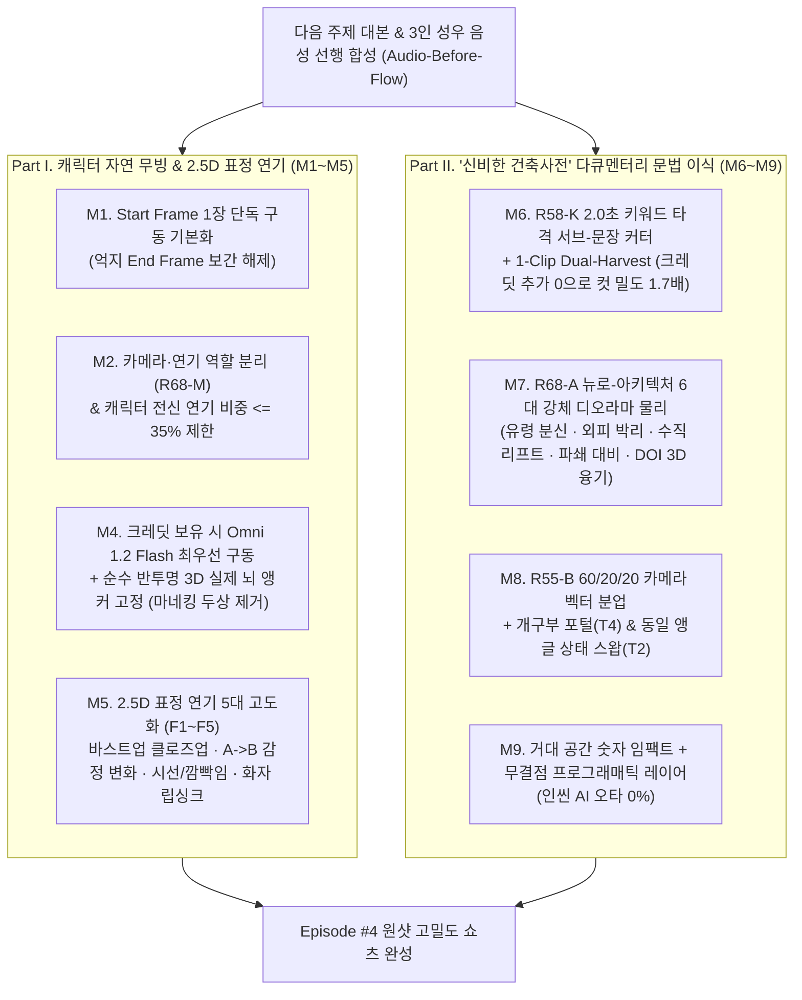

# [계획 2 — 다음 주제 영상부터 적용] `v8.2` 캐릭터 자연 무빙 · 2.5D 표정 연기 · `신비한 건축사전` 다큐 문법 통합 마스터 플랜

**범위 구분**:
- 오디오(`ElevenLabs Music v2.5`), 편집기 뿌연 블렌딩·유령 디졸브 제거, 해부학 3D 뇌(`Clip 13·14`), 대형 손그림 HERO 그래프는 **[계획 1 — 지금 진행 (`pilot03_v2_polish_plan.md`)]**에서 바로 처리합니다.
- **이 계획(계획 2)**은 Pilot #3의 기존 캐릭터 클립 16개를 다시 뽑지 않도록, **다음 주제 에피소드(#4) 착수 시점부터 적용**하는 차세대 연출·편집 마스터 플랜입니다:
  1. **Part I (`M1~M5`)**: 캐릭터 관절 어색함 근본 제거 & 2.5D 차콜 잉크 표정 연기(`F1~F5`) 고도화
  2. **Part II (`M6~M9`)**: [`신비한 건축사전` (`_73R9pQF5oM`, 167샷 포렌식)](./mysterious_architecture_integration_report.md) 핵심 메커니즘 전면 이식 — **`2.0s` 단어 키워드 타격 편집 · 6대 강체 디오라마 물리 치환 · `60/20/20` 카메라 분업 · 개구부 포털 & 상태 스왑 전환**

---

## 배경 진단: 왜 같은 `Google Flow / Veo` 엔진인데 퀄리티 차이가 났는가?

1. **Pilot #3 내부 대조 ([`flow_provenance_receipt.json`](file:///home/canadaofbin/gdrive/Kyubin_Yun_Workspace/07_Youtube/BCI_Shorts_Channel/projects/v8_pilot_03_marshmallow_trust_previs/03_visuals/flow_provenance_receipt.json))**: 이종 구도 `Start + End` 2장 강제 보간(몸이 억지로 끌려가며 변형), 급격한 3D 카메라 비행과 복합 관절 동작의 동시 충돌, `8초` 클립을 `11~12초`로 늘린 슬로모션이 어색함의 원인이었습니다.
2. **`신비한 건축사전` (`_73R9pQF5oM`) 외부 포렌식 대조**: 동일하게 `24fps` 네이티브 `8.0s` AI 비디오 엔진(`Veo 3.1 / Flow` 계열)을 쓰면서도 **① `8초` 클립 중 가장 선명한 초반 `1.7~2.1초(상위 25%)`만 발췌**해 마침표가 아닌 **발화 명사·숫자 키워드(`91%` 문장 중간 컷)**에 타격하고, **② 인간 전신 관절 연기를 최소화하는 대신 '단면 박리·유령 모형 슬라이딩·수직 리프트·논문 도면 3D 융기' 같은 강체(Rigid-Body) 디오라마 물리로 심리와 구조를 시각화**해 어색함을 원천 차단했습니다.



---

## Part I. 캐릭터 무빙 자연화 & 2.5D 표정 연기 고도화 (`M1–M5`)

### M1. `Start Frame` 단독 구동 기본화 (`End Frame` 강제 보간 해제)
- **대상 파일**: [porcelain_anchor_pack.py](file:///home/canadaofbin/gdrive/Kyubin_Yun_Workspace/07_Youtube/pipeline/porcelain_anchor_pack.py), [flow_prompt_builder.py](file:///home/canadaofbin/gdrive/Kyubin_Yun_Workspace/07_Youtube/pipeline/flow_prompt_builder.py)
- 캐릭터 연기 클립은 `populate_expressive_v8_reference_contract(..., daisy_chain_keyframes=False)`를 기본값으로 적용 (`EXPRESSIVE_V8_DAISY_CHAIN_END_FRAME_DEFAULT = False`).
- 각 캐릭터 클립은 `Start Frame` 1장만 첨부하고 `end_reference_image = None`으로 두어 억지 신체 구겨 넣기(Morphing)를 원천 차단합니다. *(단, 아래 `M7`의 무인 건축·도면 변환 컷(`M1` 부감→지상, `M6` 도면→3D 융기)에서만 선택적으로 `Start+End` 2장 보간 허용)*

### M2. ‘캐릭터 연기 컷’과 ‘고속 3D 비행 컷’ 역할 분리 규칙 (`R68-M`)
- **대상 파일**: [depiction_rules.py](file:///home/canadaofbin/gdrive/Kyubin_Yun_Workspace/07_Youtube/pipeline/depiction_rules.py), [prompt_quality_v5.py](file:///home/canadaofbin/gdrive/Kyubin_Yun_Workspace/07_Youtube/pipeline/prompt_quality_v5.py)
- **캐릭터 등장 비중 상한(`<= 35%`) & `1.5~2.2s` 타이트 인서트 집중**: 캐릭터에게 7초간 전신 팬터마임을 시키지 않고, **짧고 강렬한 바스트업 표정 리액션·손 클로즈업(`1.5~2.2s`)**으로만 기용합니다.
- **캐릭터 컷 허용 카메라**: `gentle_push_in`, `clean_pullback_reveal`, 완만한 `orbital_3d_arc_sweep`, `locked_tripod` + **1컷 1단일 물리 동작** 제한.
- **고속 3D 비행 컷 (`portal_dive_flight`, `crane_swoop_dive`, `axial_portal_dive`)**: 공간 관통 브릿지·실험실 평면 다이브·해부학 뇌 진입 컷 전용으로 분리합니다.

### M3. `Audio-Before-Flow` 사전 시계 고정 (슬로모션 억지 늘림 `0%`)
- **대상 파일**: `pipeline/cli.py` (`diorama-episode` / `precheck`)
- Google Flow 클립 생성 **전에** ElevenLabs 3인 성우 음성과 단어별 타임스탬프를 먼저 확정합니다.
- 모든 컷에서 **`pts_ratio > 1.0` (슬로모션 늘리기)을 전면 금지**하고, 원본 `8.0s` 클립의 자연 정속(`1.0x ~ 1.12x`) 알짜 구간만 재단합니다.

### M4. 일일 50 크레딧 `Omni 1.1 Flash` 우선 라우팅
- **대상 파일**: [flow_diorama_sharded_worker.py](file:///home/canadaofbin/gdrive/Kyubin_Yun_Workspace/07_Youtube/pipeline/flow_diorama_sharded_worker.py)
- 샤드 생성 순서를 **`캐릭터 바스트업/손 핵심 연기 컷` + `3D 해부학 뇌 / 강체 분해 핵심 컷` 최우선(`Omni 1.1 Flash` 1080p)**으로 라우팅합니다.

### M5. 2.5D 차콜 잉크 ‘표정 연기(Facial Acting)’ 5대 고도화 (`F1–F5`)
- **`F1` ‘초기 표정(Start) → 변화 표정(Action)’ 2단계 감정 아크 분리**: `Start Frame`은 사건 직전의 초기 감정(State A)으로 그리고, 비디오 프롬프트에 자극 직후의 변화 동사(State A → State B: 예: *빠르게 두 번 깜빡이더니 눈썹이 처짐*)를 명시해 스티커처럼 굳은 표정을 해결합니다.
- **`F2` 바스트업 표정 문법 `expressive_reaction_closeup` 신설** ([config.py](file:///home/canadaofbin/gdrive/Kyubin_Yun_Workspace/07_Youtube/pipeline/config.py)): 얼굴 비중 `30~45%` 바스트업 샷을 정식 문법으로 추가하고 에피소드당 감정 피크에 **`3~4컷` 의무 배정**합니다.
- **`F3` `[NEW] expression_acting_lexicon.json` (12종 감정 연기 사전)**: 단순 `"eyes widen"` 반복 대신 `double-blink`, `pupil dart`, `asymmetric cocked brow`, `half-lidded charcoal eye-bags`, `pinpoint pupils + temple sweat drop` 등 12종 마이크로 액팅 어휘를 자동 주입합니다.
- **`F4` 시선 이동(Saccade) + 고개 미세 각도(Head Micro-Take) 1:1 결합**: 모든 표정 변화에 `10-degree head tilt`, `subtle chin tuck`, `micro-flinch back`을 결합해 달걀형 3D 헤드 볼륨과 2D 잉크 표정이 함께 살아 움직이게 합니다.
- **`F5` 멀티보이스 화자 연동 입 모양 규칙 (`Speaker-Synced Mouth Rule`)**: 현장 캐릭터(`Hope` 연구원, `Laura` 미니 코텍스) 대사 문장에는 `animated 2D ink mouth speaking expressively`를, 내레이터(`Roger`) 해설 문장에는 `closed/non-speaking reactive 2D ink mouth`를 강제합니다.

---

## Part II. `신비한 건축사전` 다큐멘터리 모션·전환 문법 이식 (`M6–M9`)

### M6. `R58-K` `2.0초` 키워드 타격 서브-문장 커터 & `1-Clip Dual-Harvest`
- **대상 파일**: [diorama_assembler.py](file:///home/canadaofbin/gdrive/Kyubin_Yun_Workspace/07_Youtube/pipeline/diorama_assembler.py), [prosody.py](file:///home/canadaofbin/gdrive/Kyubin_Yun_Workspace/07_Youtube/pipeline/prosody.py)
- **문장 중간 키워드 타격(`Keyword-Beat Cut`)**: 문장 마침표마다 기계적으로 자르는 현행 방식(`평균 6.64s`)에서 벗어나, 한 문장 안에서도 **숫자·반전 접속사·핵심 명사(`Yet`, `1 second`, `amygdala`, `4 times`) 발화 시작 타임스탬프**에 칼컷을 스냅해 **목표 컷 중앙값 `1.8~2.2s` (`60~75초` 기준 `28~36컷`)** 다큐멘터리 타격감을 구현합니다.
- **크레딧 방어 공식 — `1-Clip Dual-Harvest` (`A₁ → B → A₂` 교차 발췌)**:
  - 클립 생성 개수는 기존과 동일한 **`16~20개`**로 유지하면서, 시작·끝 구도가 변하는 클립(부감→눈높이 다이브, 논문 도면→3D 홀로그램 융기 등) 1개에서 **초반 알짜 `1.8s`(`0.3~2.1s`)**와 **후반 알짜 `2.0s`(`5.4~7.4s`)** 두 구간을 분리 발췌하고 사이에 리액션/인서트 컷(`B`)을 끼워 넣습니다.
  - AI 변형이 생기기 쉬운 어중간한 중간 구간(`2.5~5.0s`)을 자연스럽게 버리면서 **추가 크레딧 `0`으로 유효 컷 수를 `1.7배` 확보**합니다.

### M7. `R68-A` 뉴로-아키텍처 6대 강체 디오라마 물리 문법 (`Object-Physics Substitution`)
- **대상 파일**: [config.py](file:///home/canadaofbin/gdrive/Kyubin_Yun_Workspace/07_Youtube/pipeline/config.py), [flow_prompt_builder.py](file:///home/canadaofbin/gdrive/Kyubin_Yun_Workspace/07_Youtube/pipeline/flow_prompt_builder.py), [depiction_rules.py](file:///home/canadaofbin/gdrive/Kyubin_Yun_Workspace/07_Youtube/pipeline/depiction_rules.py)
- 캐릭터 관절 연기 부담을 `<= 35%`로 줄이고, 나머지 **`>= 65%` 본편 컷**을 AI 비디오 엔진이 가장 완벽하고 세련되게 렌더링하는 **6대 강체·단면 디오라마 물리 문법**으로 채웁니다:

| 신규 문법 ID | 원본 (`신비한 건축사전`) | 우리 뇌과학·심리학 쇼츠 연출 (`Google Flow` 구현 공식) |
|---|---|---|
| **`axial_portal_dive`** | `M1/M8` `90°` 직부감 → 3문 일직선 관통 비행 | 실험실 `90°` 평면도 직부감에서 지면 눈높이로 급강하해 **열린 실험실 문·관찰창·캐릭터 동공·두개골 절개창을 일직선으로 관통 비행** |
| **`xray_peel_micro`** | `M2` 목조 기둥 박리 → 콘크리트 코어 & 세포 줌인 | 평온한 캐릭터 외피나 실험실 벽이 **깔끔한 단면도(`clean cutaway`)로 벗겨지며** 붉게 박동하는 편도체 노출 → 시냅스 간극 신경전달물질 미시 다이브 |
| **`ghost_twin_offset`** | `M3` 백색 스튜디오 위 황금 유령 광화문 `3.75°` 슬라이딩 | 무채색 스튜디오 바닥(`45°` 부감) 위 본체 캐릭터 옆에서 **반투명 황금 유령 분신(`translucent golden silhouette`)**이 바닥 붉은 궤적 띠를 따라 미끄러져 분리되며 **`예측 오차`·`3인칭 자기 거리두기`·`인지 부조화`** 시각화 |
| **`lid_lift_reveal`** | `M4` 총독부 건물 층별 수직 상승 철거 리빌 | 디졸브 전환 대신 **실험실 가벽과 천장이 하늘 위로 수직 상승해 사라지며(`lifts straight upward`)** 벽 뒤 숨겨진 동조자·관찰실 연구원 노출 |
| **`locked_exploded_vs_shatter`** | `M5` 무중력 목조 분해 부유 vs 콘크리트 균열 파쇄 | **삼각대 완전 고정(`locked_static`) + 무배경 스튜디오**: 건강한 전전두엽 통제는 모듈 블록이 공중에 정교히 정렬 부유 ↔ 불안·억지 의지력은 회색 블록에 붉은 거미줄 균열이 퍼지며 파쇄 낙하 |
| **`blueprint_3d_extrusion`** | `M6/M7` `1925` 도면 3D 홀로그램 융기 & 지하 유구 적층 | 책상 위 **실제 DOI 학술 논문 도면/뇌스캔 시트**에서 **백색 3D 와이어프레임 뇌·실험 장치가 수직 융기**하며 시안·골드 빛 충전 + 무의식 기억 지층 단면 적층(`memory trench cutaway`) |

### M8. `R55-B` `60 / 20 / 20` 카메라 벡터 분업 & 4대 연속성 전환 문법 (`T1·T2·T4`)
- **대상 파일**: [camera_choreography_rules.md](file:///home/canadaofbin/gdrive/Kyubin_Yun_Workspace/07_Youtube/.agents/rules/camera_choreography_rules.md), [diorama_assembler.py](file:///home/canadaofbin/gdrive/Kyubin_Yun_Workspace/07_Youtube/pipeline/diorama_assembler.py)
- **카메라 벡터 쿼터 강제**:
  1. **Z축 깊이 이동 (`Push-In` / `Pull-Out`) `55~60%`**: 좌우 패닝(`<= 10%`)을 억제하고 전진 몰입·후진 전모 공개를 주력으로 사용.
  2. **삼각대 고정 + 피사체 단독 물리 (`Locked Static + Subject Physics`) `>= 20%`**: 분해·파쇄·수치 슬라이딩 시 카메라 흔들림을 `0`으로 잠가 정보 가독성 극대화.
  3. **수직 부감 / 틸트 (`Bird's-Eye` / `Tilt`) `~20%`**: 공간 배치와 지층/뇌 단면 해부용.
- **전환 문법 (`Hard Cut >= 85%`, `12~18f` 선형 디졸브는 시대/막 대전환에만 `<= 10%` 허용)**:
  - **`G1·G2` 연속성 체이닝**: `Push-In → Push-In` Z축 탄성 계승 및 `고속 관통 비행 직후 → 삼각대 고정 다이어그램` 시선 진정 교차.
  - **`T4` 어두운 개구부 포털(`Dark-Aperture Portal`)**: 문틀·일방향 관찰거울 테두리·검은 동공이 화면 좌우 암부를 채우는 프레임을 경계로 다음 공간으로 무봉합 관통.
  - **`T2` 동일 앵글 상태 스왑(`Same-Angle State Swap`, `hist_corr >= 0.90`)**: 반전 키워드 타격 순간 동일 화각 위에서 실험실 조명·재질·뇌 발광 상태만 즉시 스왑.
  - **`T1` 상하 스택 비교 와이프(`Split-Screen Stack Comparison`)**: 실험군과 대조군을 상하 2단으로 동시에 미세 `Pull-Out` 비교.

### M9. 거대 공간 숫자 임팩트 + 무결점 프로그래매틱 오버레이 결합
- **대상 파일**: [data_stamp_overlay.py](file:///home/canadaofbin/gdrive/Kyubin_Yun_Workspace/07_Youtube/pipeline/data_stamp_overlay.py), [anatomy_label_overlay.py](file:///home/canadaofbin/gdrive/Kyubin_Yun_Workspace/07_Youtube/pipeline/anatomy_label_overlay.py)
- `신비한 건축사전`의 대형 공간 수치 연출(`"3.75°"`, `"42 Years"`)의 시각적 임팩트는 흡수하되, AI 비디오 모델이 글자를 직접 그리다 일으키는 프롬프트 오타(`"Title Casefe"`)를 원천 차단하기 위해 **`R56` 인씬 AI 글자 `0%` 원칙**을 고수하고 우리의 **손그림 HERO 그래프(`R70 v2`) · 해부학 만년필 지시선(`R71`) · 깊이 마스크 대형 숫자 스탬프**로 100% 무결점 합성합니다.

---

## 다음 에피소드(#4) 후보 주제 (계획 1 완료 후 착수)

1. **(강력 추천 — `M3` 황금 유령 분신 문법과 100% 직결!) `v2_anxiety_kross_third_person_amygdala`**
   - *발표·면접 직전 속으로 ‘내 이름(3인칭)’을 부르면 단 1초 만에 편도체 불안 경보가 꺼지는 이유* (`anxiety` / 미시간대 Ethan Kross 발표 스트레스 fMRI 실험 — **본체 캐릭터에서 반투명 황금 유령 분신이 한 걸음 빠져나오며(`ghost_twin_offset`) 붉은 편도체 경보가 시안빛 전전두엽 통제로 스왑(`T2`)되는 완벽한 시각 매칭!**)
2. **`v2_relationships_coan_handholding_pain_grid`**
   - *사랑하는 사람의 손을 잡으면 두 뇌파가 동기화되고 통증이 절반으로 줄어드는 이유* (`relationships` / 버지니아대 Coan fMRI 실험)
3. **`v2_memory_loftus_false_alibi_engram`**
   - *성인 25%에게 없던 ‘5살 쇼핑몰 미아’ 가짜 기억을 심은 실험과 해마 재조립* (`memory` / 워싱턴대 Loftus 실험 — `M7` 기억 지층 단면 적층과 직결)

---

## Verification Plan (다음 에피소드 #4 착수 시)
```bash
/home/canadaofbin/hermes-venv/bin/pytest tests/test_expressive_25d_v8.py tests/test_credit_safe_pipeline.py -q
```
- `test_start_frame_only_and_camera_acting_separation` (`M1`, `M2`, `M5`)
- `test_keyword_beat_subsentence_cutter_and_dual_harvest` (`M6`: 문장 중간 키워드 스냅, 중앙값 `<= 2.4s`, `pts_ratio <= 1.0` 슬로모션 `0%`)
- `test_neuro_architecture_grammar_and_camera_vector_quota` (`M7`, `M8`: 강체 디오라마 문법 `>= 60%`, Z축 `>= 55%`, 삼각대 고정 물리 `>= 20%`, 알파 디졸브 `<= 10%`)
