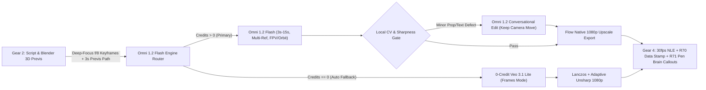

# Gemini Omni 1.2 Flash 분석 및 초선명 3D 카메라(FPV Flythrough · Orbit) 파이프라인 업그레이드 계획

## Goal Description

사용자가 의도한 핵심 연출인 **공간 관통 FPV 드론 샷(`FPV Flythrough`)** 및 **피사체 중심 3D 궤도 회전(`3D Orbit`)** 무빙을 **모션 블러 없이 면도날처럼 선명하게(Tack-Sharp)** 구현하고, 2026년 11월 출시된 **Gemini Omni 1.2 Flash (`macaron_cookie`)** 의 6대 신규 기능을 `ALL ABOUT BRAIN` 파이프라인(`Gear 2 ~ Gear 4`)에 전면 반영합니다.

### 1. 왜 기존 Pilot #3의 일부 Orbit / FPV 컷(`Cut 3, 5, 17`)만 흐릿해졌는가? (원인 규명)

기존 에피소드 18개 컷 중 13개 컷은 선명(`Laplacian med = 114 ~ 251`)했으나, 유독 `Cut 3`(`med=25.9`), `Cut 5`(`med=66.7`), `Cut 17`(`med=42.8`)에서 심한 블러가 발생한 원인은 **Orbit/FPV 무빙 자체가 불가능해서가 아니라 3가지 파이프라인 병목이 겹쳤기 때문**입니다:

1. **강제 매크로 아웃포커싱 키프레임 순환 버그 ([porcelain_anchor_pack.py](file:///home/canadaofbin/gdrive/Kyubin_Yun_Workspace/07_Youtube/pipeline/porcelain_anchor_pack.py#L547-L552))**:
   - `daisy_cam_progression[(idx - 1) % 4]`가 매 4번째 순서마다 무조건 `object_portal_macro`(*"deep background room depth"* → 얕은 심도 `f/1.4` 배경 보케 블러 유발)를 배정하고 이를 다음 컷의 `over_shoulder_orbit`(와이드 2인 샷)와 `Start + End`로 묶어버렸습니다.
   - 결과적으로 **초점이 나간 소품 접사(`Start`) ↔ 180° 반대편 와이드 2인 샷(`End`)** 사이를 억지로 모핑하면서 중간 프레임 전체가 뭉개졌습니다.
2. **크레딧이 남아 있는데도 `0-credit` `Veo 3.1 - Lite` (`720p`)로 강제 강등 ([flow_prompt_builder.py](file:///home/canadaofbin/gdrive/Kyubin_Yun_Workspace/07_Youtube/pipeline/flow_prompt_builder.py#L1730-L1794))**:
   - `omni_tier: "hero"` 및 `FLOW_OMNI_HERO_MAX_CLIPS = 8` 제한 때문에 `FPV` / `Orbit` 고난도 3D 무빙 컷들이 `engine="zero-credit"`(`Veo 3.1 - Lite`)으로 밀려났습니다.
3. **Google Flow `720p` 프리뷰 스트림 직접 추출 ([flow_diorama_sharded_worker.py](file:///home/canadaofbin/gdrive/Kyubin_Yun_Workspace/07_Youtube/pipeline/flow_diorama_sharded_worker.py#L1758-L1815))**:
   - Flow 캔버스의 `<video src>`(`720x1280` 프리뷰)만 가져온 뒤 FFmpeg에서 `1080x1920`으로 `1.5배` 강제 확대하면서 미세 윤곽선이 한 번 더 부드러워졌습니다.

---

### 2. Gemini Omni 1.2 Flash (`macaron_cookie`) 향상점 분석 및 파이프라인 매핑

| 영역 | Omni 1.1 Flash (기존) | **Omni 1.2 Flash (신규 업그레이드)** | **우리 파이프라인 업그레이드 적용점** |
| :--- | :--- | :--- | :--- |
| **① 3D 카메라 제어** | 급격한 3D 이동 시 점프컷·모션 스미어 발생 | **연속 FPV 드론 트래킹(Flythrough), 정밀 피사체 궤도 회전(Orbit), 매끄러운 풀백** 네이티브 제어 | **`v8.2` Sharp 3D Cinema Rig**: 전 구간 `f/8` 딥포커스 프로브 렌즈 + 고속 셔터(모션블러 억제) + **Nodal Gaze-Lock Orbit (`35°~45°`)** 및 **Z축 공간 관통 FPV Flythrough** 프리셋 적용 |
| **② 최대 생성 길이** | 최대 `10s` (레퍼런스 첨부 시 `8s` 고정), `4/6/8/10s` 프리셋만 지원 | **최대 `15s` 연속 생성 (`3s ~ 15s`, `1초` 단위 정밀 지정)** | **단일 원테이크 포털 다이브 (`10s~12s`) & 문장 맞춤 길이 렌더링**: 방 안 캐릭터 → 투명 유리 두개골 돔 관통 → 반투명 3D 뇌 진입까지 **끊김 없는 10~12초 FPV 원테이크** 구현 + 짧은 문장은 `4s~6s`로 생성해 크레딧 절감 |
| **③ 해상도 업스케일** | `720p` 다운로드 후 로컬 FFmpeg 확대 | **Draft (`360p`/`720p`) → Native Upscale (`1080p` / `4K`)** 워크플로우 내장 | **Flow 네이티브 `1080p` 수확기 탑재**: CV QA 통과 컷 다운로드 시 Flow UI의 `Download -> Upscaled (1080p)`를 우선 호출하여 진짜 `1080x1920` 원본 화질 확보 |
| **④ 멀티 레퍼런스** | 이미지 1~2장 중심, 앵글 회전 시 의상/소품 흔들림 | **최대 `6~10장` 이미지 Ingredients + `3초` 모션 레퍼런스 영상** 동시 고정 | **다중 앵커 + Blender 3D Previs 모션 가이드**: `캐릭터 시트 + 공간 마스터 + 핵심 소품 + 반투명 3D 뇌` 동시 고정 및 고난도 FPV/Orbit 컷에 **3초 Blender Previs 카메라 패스 MP4** 주입 지원 |
| **⑤ 크레딧 효율** | 초당 단가 높음 (`200cr` 캡으로 8컷만 Omni 허용) | **생성 단가 약 30% 절감** + 초 단위 동적 과금 | **크레딧 보유 시 전 컷 `Omni 1.2 Flash` 우선 사용**: 인위적인 8컷 `zero-credit` 강등 해제 (`크레딧 > 0`일 때 모든 컷, 특히 `FPV`/`Orbit`/`Brain` 100% `Omni 1.2 Flash` 구동, `0 cr` 도달 시에만 `Veo 3.1 - Lite` 폴백) |
| **⑥ 대화형 영상 편집** | 미세 결함 발생 시 처음부터 재뽑기(좋은 카메라 무빙 유실) | **Multi-Turn Conversational Video Editing** (카메라 궤적은 유지한 채 조명·소품·배경 텍스트만 수정) | **카메라 무빙 보존형 QA 리페어 패스**: 멋진 FPV/Orbit 궤적이 뽑혔으나 배경 글자·소품 미세 오류가 있을 때 재생성 대신 **In-Place 대화형 편집**으로 1턴 교정 |



---

## User Review Required

> [!IMPORTANT]
> **크레딧 운용 정책 전환 확인 (`8컷 제한 해제 → 크레딧 보유 시 전 컷 Omni 1.2 Flash 우선`)**
> 기존 파이프라인은 에피소드당 `FLOW_OMNI_HERO_MAX_CLIPS = 8` 상한을 두어 나머지 10~12개 컷을 크레딧이 남아 있어도 `0-credit` `Veo 3.1 - Lite`로 보냈습니다. 요청하신 *"크레딧 있을 땐 옴니 1.2로 해"* 원칙에 맞춰, `--engine auto` 실행 시 **계정 크레딧이 남아 있는 동안은 에피소드 전 컷(특히 모든 FPV Flythrough · 3D Orbit · 반투명 뇌 포털 컷)을 `Omni 1.2 Flash`로 생성**하고, 잔여 크레딧이 부족해질 때만 `0-credit`으로 자동 전환하도록 변경합니다.

---

## Open Questions

> [!TIP]
> 아래 2가지 연출·운용 옵션만 확인해 주시면 승인 즉시 코드 업그레이드와 **Pilot #3 (`v8_pilot_03_marshmallow_trust_previs`) 완성본 재렌더링**을 한 번에 실행합니다:
> 1. **유리 두개골 돔 → 반투명 3D 뇌 전환 방식 (`Cut 13`)**:
>    - **옵션 A (추천 — Omni 1.2 네이티브 FPV 포털 다이브)**: 첨부해 주신 유리 돔 캐릭터 이미지([media_1794277271409_ef9e912c.jpg](file:///home/canadaofbin/.gemini/antigravity-cli/brain/b57c97a8-6324-4c31-a2bb-16b25e28dd55/.user_uploaded/media_1794277271409_ef9e912c.jpg))를 `Start Frame`으로, 승인하신 반투명 3D 인간 뇌(`cand_03`)를 `End Frame`으로 걸고 **Omni 1.2 Flash (`10s` `portal_dive_flight`)** 로 카메라가 실제 FPV 드론처럼 캐릭터의 투명 유리 두개골 돔을 뚫고 반투명 3D 인간 뇌 속으로 빨려 들어간 뒤 펜 지시선(`Nucleus Accumbens`)이 그어지게 생성
>    - **옵션 B (하이브리드 줌 + 디졸브)**: 기존 유리 돔 클립에서 1.65초 줌인 후 새로 뽑은 반투명 3D 뇌 클립으로 디졸브 전환
> 2. **Pilot #3 (`마시멜로 테스트`) 무빙 배정**:
>    - 흐릿했던 `Cut 3`(`"one sweet"`), `Cut 5`(마시멜로 앞 갈등), `Cut 17`(체크마크 클라이맥스)을 단순 줌인이 아니라 원래 의도하신 **초선명 `3D Orbit` (`Cut 3, 17`)** 및 **테이블 위 공간을 가로지르는 `FPV Flythrough` (`Cut 5`)** 로 `Omni 1.2 Flash` + `1080p`로 뽑을까요?

---

## Proposed Changes

### Component 1: Omni 1.2 Flash 스펙 · 3~15초 가변 길이 · 크레딧 라우팅 (`Config & Engine Router`)

#### [MODIFY] [config.py](file:///home/canadaofbin/gdrive/Kyubin_Yun_Workspace/07_Youtube/pipeline/config.py)
- `FLOW_VIDEO_MODEL_PROFILES["Omni 1.2 Flash"]` 업데이트:
  - `durations`: `tuple(f"{s}s" for s in range(3, 16))` (`3s ~ 15s` 1초 단위 지원)
  - `max_sec`: `15`, `max_sec_with_ingredient`: `15`, `max_ingredients`: `8`, `supports_native_1080p_upscale`: `True`, `supports_conversational_edit`: `True`
- `Omni 1.2 Flash` 30% 단가 인하 반영 및 크레딧 보유 시 전 컷 우선 라우팅 상수 추가:
  - `FLOW_OMNI_PRIORITY_3D_CAMERA_MOVES = ("fpv_3d_flight", "fpv_flythrough_portal", "orbital_3d_arc_sweep", "portal_dive_flight", "crane_swoop_dive", "dolly_zoom_vertigo")`
  - `FLOW_OMNI_PREFER_NATIVE_1080P_DOWNLOAD = True`
  - `FLOW_OMNI_EPISODE_CREDIT_CAP = 600` (기존 `200` → 18~22컷 에피소드 전 컷을 `Omni 1.2 Flash`로 커버 가능하도록 상향; 계정 잔여 크레딧 소진 시 기존 서킷브레이커가 즉시 `0-credit` 전환)

```python
FLOW_VIDEO_MODEL_PROFILES: dict[str, dict] = {
    "Omni 1.2 Flash": {
        "durations": tuple(f"{s}s" for s in range(3, 16)),
        "ui_preset_durations": ("4s", "6s", "8s", "10s", "12s", "15s"),
        "max_sec": 15,
        "max_sec_with_ingredient": 15,
        "max_ingredients": 8,
        "supports_native_1080p_upscale": True,
        "supports_conversational_edit": True,
        "model_family_id": "macaron_cookie",
        "zero_credit": False,
    },
    ...
}
```

#### [MODIFY] [flow_prompt_builder.py](file:///home/canadaofbin/gdrive/Kyubin_Yun_Workspace/07_Youtube/pipeline/flow_prompt_builder.py)
- `assign_hero_omni_engines` 개선:
  - `omni_tier` 기본값을 `"full_when_credited"`(`"auto"`)로 두어 크레딧 보유 시 인위적인 `"zero-credit"` 태그 강제 주입을 제거합니다.
  - `hero` 절약 모드를 명시적으로 켠 경우에도 `FLOW_OMNI_PRIORITY_3D_CAMERA_MOVES`(`fpv_3d_flight`, `orbital_3d_arc_sweep`, `portal_dive_flight`)를 **Priority 1**로 배정해 고난도 3D 무빙이 절대 저화질 모델로 빠지지 않게 보장합니다.
- 문장 발화 길이(`estimated_speech_sec`) 및 포털 전환 여부에 따라 `Omni 1.2 Flash` 타깃 길이를 `4s ~ 12s`(예: 일반 컷 `6s/8s`, 유리 돔 → 반투명 뇌 원테이크 포털 다이브 컷 `10s`)로 자동 산출하는 `resolve_omni_12_target_duration_sec()` 추가.

---

### Component 2: 모션 블러 제로 `FPV Flythrough` & `3D Nodal Orbit` 카메라 리그 (`Previs + Anchor + Prompt`)

#### [MODIFY] [previs_blender.py](file:///home/canadaofbin/gdrive/Kyubin_Yun_Workspace/07_Youtube/pipeline/previs_blender.py)
- `CAMERA_MOVE_PREVIS_PRESETS` 정밀 튜닝:
  - **`orbital_3d_arc_sweep` (3D Nodal Orbit)**: 기존 `Δx = 3.10m`(`[-1.55 -> +1.55]`, 과도한 횡이동으로 얼굴 스미어 유발)를 **`40° Nodal Target-Locked Arc` (`[-0.92, -2.15, 1.34] -> [+0.88, -2.15, 1.30]`, `look_at`을 캐릭터 눈 높이 `[0.0, 0.05, 1.16]`에 완전 고정)** 으로 보정합니다. 피사체 얼굴은 화면 중심에 날카롭게 고정되고 전경 소품과 배경 책장/창문만 역방향으로 회전하며 강력한 입체 패럴랙스를 만듭니다.
  - **`fpv_3d_flight` (FPV Spatial Flythrough)**: 광축(Z축) 직진 관통 궤적(`pos: [-0.12, -3.10, 1.42] -> [0.02, -1.08, 1.12]`, `fov_deg: 56° -> 48°`)으로 설정하여 문틀·책상 스탠드·소품 사이 공간을 가로질러 피사체 앞으로 매끄럽게 파고들도록 설계합니다.
- **3초 Blender Previs 카메라 패스 MP4 생성기 (`render_previs_motion_guide_mp4`) 추가**:
  - `Omni 1.2 Flash`의 모션 레퍼런스 기능을 활용할 수 있도록 `camera_start -> camera_end`를 30fps 코사인 이징으로 보간한 `3.0s` 워크벤치 프리비즈 가이드 영상을 선택적으로 생성합니다.

#### [MODIFY] [porcelain_anchor_pack.py](file:///home/canadaofbin/gdrive/Kyubin_Yun_Workspace/07_Youtube/pipeline/porcelain_anchor_pack.py)
- `daisy_cam_progression`에서 얕은 심도 배경 흐림을 유발하던 `object_portal_macro`(*"deep background room depth"*)를 제거하고, **전 구간 `f/8` 딥포커스 시네마 앵글 4종**으로 교체:
  1. `eye_level_medium` (아이레벨 미디엄, 전·배경 딥포커스)
  2. `fpv_aperture_wide` (전경 문틀/소품 프레이밍을 포함한 와이드 FPV 출발 구도, 전 구간 팬포커스)
  3. `three_quarter_orbit_left` (좌측 35° 오빗 딥포커스 구도)
  4. `three_quarter_orbit_right` (우측 35° 오빗 딥포커스 구도)
- **Cross-Scale Morph 차단 가드**:
  - 클로즈업 손 컷(`expressive_hands_closeup`)과 와이드 룸 컷 사이에는 무리한 `Start + End` 데이지체인을 걸지 않고, **동일 스케일·동일 공간 내 연속 3D 궤적(`Orbit Left -> Orbit Right`, `FPV Wide -> Medium Subject`, `Glass Dome Character -> Translucent 3D Brain`)** 에만 `Start + End` 보간을 연결합니다.

#### [MODIFY] [depiction_rules.py](file:///home/canadaofbin/gdrive/Kyubin_Yun_Workspace/07_Youtube/pipeline/depiction_rules.py)
- `EXPRESSIVE_V8_COMPACT_CAMERA_DESCRIPTORS`를 `Omni 1.2 Flash`의 카메라 제어 어휘 + **고속 셔터 무블러(`tack-sharp deep focus, crisp fast-shutter clarity`)** 규약으로 고도화:
  - `fpv_3d_flight`: `"Agile FPV drone flythrough gliding cleanly through foreground room space toward the subject in tack-sharp deep focus"`
  - `orbital_3d_arc_sweep`: `"Smooth 3D nodal orbit sweeping 40 degrees around the subject with strong room parallax and tack-sharp focus on the face"`
  - `portal_dive_flight`: `"Continuous FPV 3D portal flight diving straight through the crystal glass cranium dome into the translucent 3D brain"`

---

### Component 3: Google Flow 네이티브 `1080p` 업스케일 다운로드 · 멀티 레퍼런스 · 대화형 편집 (`Gear 3 Worker`)

#### [MODIFY] [flow_live_single_worker.py](file:///home/canadaofbin/gdrive/Kyubin_Yun_Workspace/07_Youtube/pipeline/flow_live_single_worker.py) & [flow_ingredients.py](file:///home/canadaofbin/gdrive/Kyubin_Yun_Workspace/07_Youtube/pipeline/flow_ingredients.py)
- `ensure_manual_video_916_mode`가 `Omni 1.2 Flash` 선택 시 `target_duration`(`4s ~ 15s`)을 동적으로 설정하도록 확장.
- `Omni 1.2 Flash` `Ingredients` 모드에서 최대 `6장`의 일관성 레퍼런스(`species_opt1_sheet` + `location_master` + `hero_prop` + `translucent_brain_ref`) 첨부 헬퍼 추가.

#### [MODIFY] [flow_diorama_sharded_worker.py](file:///home/canadaofbin/gdrive/Kyubin_Yun_Workspace/07_Youtube/pipeline/flow_diorama_sharded_worker.py)
- **네이티브 `1080p` 업스케일 수확 (`_download_newest_ready_tile`)**:
  - 기존: 캔버스 `<video src>`(`720x1280`) 직접 fetch 또는 `Download -> 720p` 클릭.
  - 변경: 후보 선별(`CV QA` + **최소 선명도 게이트 `median_laplacian >= 85.0`**) 후 최종 채택된 타일에 대해 Flow 메뉴의 `Download -> Upscaled (1080p)`(계정 티어 지원 시 `1080p`, 미노출/타임아웃 시 `720p` + 고품질 Lanczos 언샵 폴백)를 실행하여 네이티브 `1080x1920` MP4를 저장합니다.
- **프레임 단위 모션블러 스파이크 검출기 (`inspect_diorama_clip_cv`)**:
  - 평균 선명도뿐 아니라 **중간 구간 최저 선명도(`p15_center_laplacian`)** 를 검사하여, 중간에 뭉개지는 모핑 블러 클립을 자동 탈락시키고 재시도합니다.
- **대화형 부분 편집 훅 (`refine_clip_via_flow_conversational_edit`)**:
  - 카메라 무빙(`max_frame_diff`, `p15_sharpness`)은 우수하지만 `in_scene_garbled_text_run` 등 경미한 소품 결함만 감지된 경우, 타일의 Edit 프롬프트로 `"Keep the exact 3D camera movement and characters; remove any text markings on background surfaces"`를 전송해 카메라 무빙을 살린 채 교정합니다.

---

### Component 4: Pilot #3 (`v8_pilot_03_marshmallow_trust_previs`) 즉시 적용 및 완성 (`Gear 3 ~ Gear 4`)

#### [MODIFY] [visual_plan.json](file:///home/canadaofbin/gdrive/Kyubin_Yun_Workspace/07_Youtube/BCI_Shorts_Channel/projects/v8_pilot_03_marshmallow_trust_previs/03_visuals/visual_plan.json) & [anatomy_label_overlay.py](file:///home/canadaofbin/gdrive/Kyubin_Yun_Workspace/07_Youtube/pipeline/anatomy_label_overlay.py)
- **초선명 FPV Flythrough & 3D Orbit 적용 (`Omni 1.2 Flash` + `1080p`)**:
  - `Cut 3` (`"one sweet"`): 딥포커스 키프레임 기반 **`orbital_3d_arc_sweep` (40° Nodal 3D Orbit)** — 마시멜로 접시와 노란 스웨터 캐릭터 주위를 부드럽게 도는 입체 궤도 샷 (모션블러 제로)
  - `Cut 5`: 테이블 위 공간을 가로질러 마시멜로와 캐릭터의 갈등 표정 앞으로 파고드는 **`fpv_3d_flight` (FPV Flythrough)**
  - `Cut 17`: 아침 햇살 책상 공간에서 체크마크 노트로 회전하며 들어가는 **`orbital_3d_arc_sweep` (3D Orbit)**
- **유리 두개골 돔 → 반투명 3D 인간 뇌 자연스러운 전환 + 펜 지시선 (`Cut 13 -> Cut 14`)**:
  - `Cut 13`: 첨부해 주신 유리 돔 캐릭터 장면([media_1794277271409_ef9e912c.jpg](file:///home/canadaofbin/.gemini/antigravity-cli/brain/b57c97a8-6324-4c31-a2bb-16b25e28dd55/.user_uploaded/media_1794277271409_ef9e912c.jpg))에서 투명 유리 돔 내부로 FPV 다이브하여 반투명 3D 인간 뇌(`cand_03`)로 전환 후, 손글씨 만년필 지시선으로 **`Nucleus Accumbens / (Reward Center)`** 표시
  - `Cut 14`: 측면 반투명 3D 인간 뇌(`cand_02`) 위에서 시안-블루 신호 점등과 함께 손글씨 만년필 지시선으로 **`Prefrontal Cortex / (Impulse Brake)`** 표시

---

## Verification Plan

### Automated Tests
1. 파이프라인 단위 테스트 전체 실행 (`< 60s`):
   ```bash
   /home/canadaofbin/hermes-venv/bin/python -X utf8 -m pytest \
     tests/test_expressive_25d_v8.py \
     tests/test_shorts90s_cdp_lease_and_flow_workspace.py \
     tests/test_pipeline_hardening_audit.py \
     tests/test_credit_safe_pipeline.py -q
   ```
2. 프롬프트 및 레퍼런스 게이트 검증:
   ```bash
   /home/canadaofbin/hermes-venv/bin/python -X utf8 main.py prompt-gate --dir BCI_Shorts_Channel/projects/v8_pilot_03_marshmallow_trust_previs
   /home/canadaofbin/hermes-venv/bin/python -X utf8 main.py ref-qa --project v8_pilot_03_marshmallow_trust_previs
   ```
3. 에피소드 어셈블리 및 전수 QA 게이트(`posthoc-qa`, `episode-qa`, `autopsy`):
   ```bash
   /home/canadaofbin/hermes-venv/bin/python -X utf8 main.py diorama-assemble --project v8_pilot_03_marshmallow_trust_previs
   /home/canadaofbin/hermes-venv/bin/python -X utf8 main.py posthoc-qa --project v8_pilot_03_marshmallow_trust_previs
   /home/canadaofbin/hermes-venv/bin/python -X utf8 main.py episode-qa --project v8_pilot_03_marshmallow_trust_previs
   ```

### Manual Verification
1. 완성된 `final_shorts_v8_pilot_03_marshmallow_trust_previs_v3.mp4`에서:
   - `Cut 3`, `Cut 5`, `Cut 17`의 **FPV Flythrough / 3D Orbit 무빙 연속성** 및 중간 프레임 선명도(`p15 Laplacian >= 85`, 블러 전후 비교 이미지 제공) 확인
   - `Cut 13 ~ 14`에서 **유리 두개골 돔 캐릭터 → 반투명 3D 인간 뇌 진입 전환** 및 **손글씨 펜 지시선(`Nucleus Accumbens`, `Prefrontal Cortex`)** 타이밍·가독성 확인
   - Google Flow 대시보드에 `AAB_v8_pilot_03_marshmallow_trust_previs` 프로젝트 방과 생성 클립들이 삭제 없이 깔끔하게 유지되어 있는지 확인
