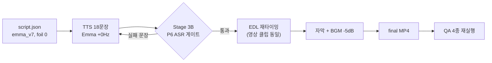

# v8_pilot_02 문제점 분석 & 수정 계획 (Emma 1인 내레이터 + 영상 편집 정리)

## 목표
`v8_pilot_02` (`69.73s`, `30fps`)를 두 방향으로 고칩니다.
- **오디오:** Pilot #1에서 좋았던 **Emma (`emma_v7`) 1인 내레이터**로 다시 만듭니다. 같은 설정을 채널 `v8` 기본값으로도 바꿉니다.
- **영상:** 기존 Flow 클립은 그대로 두고 **편집만** 고칩니다. 겹침 전환, 화면·내용 불일치, AI 오류 구간이 대상입니다.

1단계는 **크레딧 0**입니다. 재생성이 필요한 부분은 2단계(선택)로 분리했습니다.

---

## 1. 현재 영상 문제점 (실측)

| # | 문제 | 실측 근거 | 체감 영향 |
|---|---|---|---|
| **A1** | **피치를 올린 남성 보이스** | `andrew_v8` = Andrew `+16Hz` 피치 + `male_expressive_v8` EQ (Pilot #1 Emma는 `+0Hz` 원음) | 목소리가 얇고 들뜬 '광고 톤'으로 들려 Emma보다 덜 자연스러움 |
| **A2** | **서브 캐릭터 목소리 3회 교차** | `foil_sentence_indices = [4, 8, 12]` → `en-US-SteffanNeural` (`-3Hz`) | 문장 4·8·12에서 화자가 갑자기 바뀌어 흐름이 끊김. 대사도 3인칭 서술("The front clerk grins…")이라 화자 교체의 근거가 약함 |
| **A3** | **문장 사이 BGM 바닥이 높음** | 문장 사이 무음 구간 레벨: Pilot #1 `-32.7 / -31.5 dBFS` → Pilot #2 `-24.1 / -20.7 dBFS` (**약 10dB 상승**), LRA `1.9 LU` (`max_pause 0.0s`, 숨 쉴 틈 없음) | 상승형 BGM(`-25 → -18 dBFS`)이 목소리 대역을 덮어서 후반으로 갈수록 내레이션이 탁하게 들림 |
| **A4** | **문장별 속도 편차가 큼** | WPM `159 ~ 300` (평균 `233`), 최고 `+20%` rush 기어 | Andrew `+16Hz`와 겹쳐 일부 문장이 다급하게 들림. Pilot #1 Emma도 같은 기어(`187~280`, 평균 `236`)였지만 원음 피치라 편안하게 들렸음 |
| **A5** | **TTS로 읽기 어색한 문구** | `cannot` ×2 (S10, S12 — 축약 없는 문어체), `Sea whales` (S10 — 화면 Cut #10은 **도자기 돌고래**) | 말투가 딱딱하고, 자막과 화면이 맞지 않음 |
| 참고 | 하드 스파이크 1회 (`29.6s`) | 의도된 반전 임팩트 컷 | **유지** (수정 대상 아님) |
| 참고 | 다른 영상과 비교한 음량 폭(LRA) | 공개본 `diorama_01/07` `3.1~3.3 LU`, Pilot #1 `1.4 LU`, Pilot #2 `1.9 LU` | 숏츠의 압축된 음량 폭은 정상 범위입니다. 문제는 음량 폭 자체가 아니라 **문장 사이를 채우는 BGM 바닥**(A3)입니다 |

> [!NOTE]
> Pilot #1에도 서브 캐릭터(`GuyNeural`) 대사가 **1회** 있었습니다. Pilot #2는 이것을 **3회**로 늘리면서 끊김이 두드러졌습니다. 이번 계획은 선택하신 대로 서브 캐릭터를 **0회**로 둡니다.

> [!NOTE]
> QA는 모두 통과했습니다(`prosody-qa 10/10`, `posthoc-qa 18/18`, `autopsy 100`). 이번 문제는 게이트가 잡지 못하는 **청감(목소리 톤·화자 교체·BGM 마스킹)** 쪽입니다.

---

## 2. 현재 영상(비주얼) 문제점 — 최종 MP4 프레임 실측

> [!WARNING]
> 앞서 보고에 넣었던 검수 시트(`pilot02_sheet_01~03`)와 전환 스트립은 **최종 MP4(11/8 00:17)보다 이전 빌드(11/7 18:28·22:08)**에서 만든 것입니다. 자막 문장도 최종본과 다릅니다(S7·S12·S18). 아래 분석은 모두 **최종 MP4에서 새로 뽑은 프레임** 기준입니다.

````carousel

<!-- slide -->

````

| # | 문제 | 실측 근거 | 체감 영향 |
|---|---|---|---|
| **V1** | **유령처럼 겹치는 전환** | `portal_crash_zoom_10f`가 실제로는 줌이 아니라 반투명 크로스페이드(`xfade=fade`)로 구현돼 있습니다([diorama_assembler.py L4148](file:///home/canadaofbin/gdrive/Kyubin_Yun_Workspace/07_Youtube/pipeline/diorama_assembler.py#L4142-L4170)). Cut 5·10·11·12·13·14·15·16 시작 프레임에서 이전 장면 인물 얼굴이 다음 장면 위에 반투명하게 겹칩니다. 예: 프런트 직원 얼굴 위에 수면실, 코트 남자 위에 X-Ray 뇌 | 화면이 흐릿하고 지저분해 보입니다. "카메라 브릿지"가 아니라 이중 노출처럼 보입니다 |
| **V2** | **전환 효과가 너무 많음** | 경계 17곳이 **전부** 효과 전환입니다(portal 4 · whip 4 · daisy 5 · occlusion 2 · impact 1 · match 1 · dissolve 1). 여기에 모든 컷이 카메라 이동(`locked 0%`)이어서 화면이 쉬지 않습니다 | 피로감이 쌓이고, 정작 중요한 반전 순간("Wait", "Wrong", "You see")이 묻힙니다 |
| **V3** | **중반 15초가 같은 방 반복** | Cut 5–8(`14.5–29.6s`)이 같은 수면실 콘솔, 같은 인물 3명입니다. 핵심 발견("왼쪽 뇌는 깨어 있다", S6–S9)을 뇌로 보여주지 않고, X-Ray 뇌는 `50.9s`에야 처음 나옵니다 | 이탈이 가장 많은 구간에서 그림이 바뀌지 않고, 핵심 메시지가 시각적으로 전달되지 않습니다 |
| **V4** | **화면과 내레이션이 맞지 않음** | Cut 10: 화면은 돌고래 + 설명 없는 무지개색 Mini-Cortex 캐릭터인데, 내레이션은 "Sea whales and wild birds… sharks"입니다(새·상어는 화면에 없음). Mini-Cortex가 Cut 11 시작까지 남아 "Sleep labs even…"과 겹칩니다 | 시청자가 뭘 봐야 할지 헷갈립니다 |
| **V5** | **내용과 반대되는 장면** | Cut 16 끝(`~63.5s`): 내레이션은 "the guard stands down and both halves rest"(푹 잔다)인데 화면은 주인공이 03:00 시계 앞에서 **놀라서 깨는** 장면입니다. Cut 17로 넘어가는 daisy 브릿지 때문입니다 | 메시지와 그림이 정반대가 됩니다 |
| **V6** | **AI 생성 오류 (공중에 뜬 베개)** | Cut 3 끝~Cut 4 시작(`~10.4–10.9s`): 베개가 주인공 머리 위 공중에 떠 있습니다 | 어색하고 저품질로 보입니다 |
| **V7** | **QA가 이 문제들을 못 잡음** | `posthoc-qa`가 18컷 모두 Intent `92` / Sync `94`로 같은 점수를 매겼습니다(기본값 그대로). 겹침 전환(V1)과 내용 반대(V5)는 아예 검사하지 않습니다 | 영상 품질을 "100점 통과"로 잘못 보고했습니다 |

---

## User Review Required

> [!IMPORTANT]
> **채널 `v8` 기본 보이스가 `andrew_v8` + `foil_v8`에서 `emma_v7` 1인으로 바뀝니다.** 이후 `dossier seed` / `diorama-episode`로 만드는 모든 `expressive_25d_v8` 에피소드에 적용됩니다. 이미 공개된 `diorama_01..07`(`andrew_v7`)은 **건드리지 않습니다**.

> [!WARNING]
> R68 스크립트 게이트의 **"foil 대사 ≥ 1개 필수"** 조건을 **선택 사항**으로 완화합니다. foil 프리셋(`foil_v8`, `guy_foil_v8`) 자체는 지우지 않으므로, 나중에 원하면 다시 켤 수 있습니다.

## Open Questions

> [!IMPORTANT]
> **Q1. BGM 레벨** — 계획에는 `v8` BGM 곡선 전체를 **-5dB** 낮추는 안(`-25/-18/-24.5` → `-30/-23/-29.5 dBFS`)이 들어 있습니다. 문장 사이 레벨이 대략 `-26 dBFS` 안팎(Pilot #1과 #2의 중간)이 되는 수준입니다. 이렇게 진행할까요, 아니면 BGM은 그대로 둘까요?
>
> **Q2. 문구 3곳 수정** (A5) — 자막도 같이 바뀝니다. 진행할까요?
> - S10 `Sea whales and wild birds…` → `Dolphins and wild birds…` (화면 Cut #10 돌고래와 일치)
> - S10 `…so sharks cannot sneak up.` → `…so sharks can't sneak up.`
> - S12 `…cannot foam plugs and dark curtains trick that alarm?` → `…can't foam plugs and dark curtains trick that alarm?`
>
> **Q3. 영상 수정 범위** — 아래 두 단계 중 어디까지 할까요?
> - **(추천) 1단계만 — 크레딧 0:** 기존 클립을 그대로 쓰면서 편집만 고칩니다. 전환을 정리하고(V1·V2), 클립 in/out을 조정합니다(V4·V5·V6). QA 게이트 보강(V7)도 포함합니다.
> - **1단계 + 2단계 — Flow 재생성 1~2클립:** Cut 7을 "왼쪽 뇌는 깨어 있고 오른쪽은 잠든" X-Ray 뇌 클립으로 교체해서 V3를 해결합니다. `--engine auto`로 생성하므로, 월 크레딧이 남아 있으면 Omni를, 0이면 0-크레딧 Veo Lite를 씁니다. 선택하면 Cut 3(공중에 뜬 베개)도 다시 생성합니다.
>   - ⚠️ 현재 R68은 X-Ray 뇌를 영상 길이의 `70–85%` 구간에만 두도록 정하고 있습니다. 2단계를 고르시면 이 배치 규칙에 "핵심 발견 구간 1회 허용" 예외를 추가해야 합니다.

---

## Proposed Changes

### ① 채널 기본값 (SSOT)

#### [MODIFY] [config.py](file:///home/canadaofbin/gdrive/Kyubin_Yun_Workspace/07_Youtube/pipeline/config.py)
```diff
-EXPRESSIVE_V8_VOICE_PRESET = "andrew_v8"
+EXPRESSIVE_V8_VOICE_PRESET = "emma_v7"          # 2026-11-08 user A/B: Emma (Pilot #1) preferred over Andrew +16Hz
 EXPRESSIVE_V8_FOIL_VOICE_PRESET = "foil_v8"
-EXPRESSIVE_V8_FOIL_SENTENCE_RANGE: tuple[int, int] = (3, 4)
+EXPRESSIVE_V8_FOIL_SENTENCE_RANGE: tuple[int, int] = (0, 0)   # single-narrator default; foil optional
+EXPRESSIVE_V8_REQUIRE_FOIL = False
 ...
-EXPRESSIVE_V8_BGM_START_DBFS = -25.0
-EXPRESSIVE_V8_BGM_PEAK_DBFS = -18.0
-EXPRESSIVE_V8_BGM_TAIL_DBFS = -24.5
+EXPRESSIVE_V8_BGM_START_DBFS = -30.0            # (Q1) -5 dB: keeps narration on top
+EXPRESSIVE_V8_BGM_PEAK_DBFS = -23.0
+EXPRESSIVE_V8_BGM_TAIL_DBFS = -29.5
```
- `andrew_v8` / `foil_v8` / `guy_foil_v8` 프리셋 정의는 **남겨 둡니다** (명시적으로 지정하면 계속 사용 가능).
- Emma의 가속(`expressive_us_v8` 기어 `+10/+16/+20%`)은 **Pilot #1과 똑같이 유지**합니다. 사용자가 좋다고 한 버전이 그 설정입니다.

#### [MODIFY] [prompt_quality_v5.py](file:///home/canadaofbin/gdrive/Kyubin_Yun_Workspace/07_Youtube/pipeline/prompt_quality_v5.py#L428-L448) — `validate_script_spine_v8`
```diff
-    if not has_foil:
+    if not has_foil and EXPRESSIVE_V8_REQUIRE_FOIL:
         issues.append("[spine_v8] multi-role dialogue requires >= 1 'foil' sentence ...")
```
`sentence_speakers` 길이와 역할 검증은 그대로 남깁니다.

#### [MODIFY] [research_dossier.py](file:///home/canadaofbin/gdrive/Kyubin_Yun_Workspace/07_Youtube/pipeline/research_dossier.py#L984-L995)
- v8 시드에 `"foil_sentence_indices": []`를 명시합니다. `voice_preset`은 위 상수를 그대로 따라가므로 `emma_v7`이 됩니다.

#### [MODIFY] [voice_fallback.py](file:///home/canadaofbin/gdrive/Kyubin_Yun_Workspace/07_Youtube/pipeline/voice_fallback.py#L138-L171)
- 태그 없는 v8 계획이 `EXPRESSIVE_V8_VOICE_PRESET`(→ `emma_v7`)로 자동 해석되도록 docstring을 갱신합니다. 로직은 상수를 따라가므로 바꿀 것이 없습니다.
- `foil_sentence_indices`가 비어 있으면 Steffan을 합성하지 않습니다. 현재 코드도 이렇게 동작하며, 테스트로 고정합니다.

---

### ② `v8_pilot_02` 프로젝트 데이터

#### [MODIFY] `projects/v8_pilot_02_sleep_night_watch_cam3d/02_script/script.json`
```diff
-"voice_preset": "andrew_v8",
-"foil_voice_preset": "foil_v8",
-"foil_sentence_indices": [4, 8, 12],
+"voice_preset": "emma_v7",
+"foil_sentence_indices": [],
```
- Q2를 승인하시면 S10·S12 문구 3곳도 함께 수정합니다 (`acts[].sentences`와 `sentences` 양쪽).

#### 백업 (비파괴)
- 기존 Andrew 버전 MP4와 `04_audio/`를 `artifacts_archive/01_YouTube_CEO/backup_pilot02_andrew_v8/`에 복사해서 A/B 비교용으로 보관합니다.

---

### ③ 재합성 (오디오 + 자막 + ⑤ 편집 수정 반영)

```bash
PYTHONPYCACHEPREFIX=/tmp/aab_pycache /home/canadaofbin/hermes-venv/bin/python -X utf8 main.py \
  diorama-assemble --project v8_pilot_02_sleep_night_watch_cam3d --voice-preset emma_v7
```
1. Emma로 TTS 18문장을 다시 합성합니다. Stage 3B 사전 오디오 게이트(`P6_asr_by_gear`)를 인코딩 전에 통과해야 합니다.
2. 오디오가 마스터 클럭이므로(R58) 새 문장 길이에 맞춰 EDL 컷 타이밍을 다시 맞춥니다. 영상 클립은 같고 in/out만 바뀝니다. 예상 길이는 `~64–66s`입니다(Pilot #1 Emma `64.04s` 기준).
3. 자막(ASS)과 BGM 곡선을 다시 생성하고 최종 MP4를 만듭니다. 컷 길이가 바뀌어 `raw_v8` 캐시가 대부분 미스 나므로 콜드 빌드 기준 약 4분이 걸립니다.
4. 루트 바로보기 파일 [final_shorts_v8_pilot_02_sleep_night_watch_cam3d.mp4](file:///home/canadaofbin/gdrive/Kyubin_Yun_Workspace/07_Youtube/final_shorts_v8_pilot_02_sleep_night_watch_cam3d.mp4)와 artifact 사본을 새 버전으로 교체합니다.



---

### ⑤ 영상 편집 수정 — 1단계 (크레딧 0, 기존 클립 그대로)

#### [MODIFY] [diorama_assembler.py](file:///home/canadaofbin/gdrive/Kyubin_Yun_Workspace/07_Youtube/pipeline/diorama_assembler.py) — v8 EDL 전환 선택 + `_v8_track_v1_spec`
**V1·V2 전환 정리:** 기본은 **하드컷**으로 바꾸고, 의미 있는 순간 4곳에만 효과를 남깁니다.

| 경계 | 순간 | 전환 |
|---|---|---|
| S2 → S3 | 훅 대비 ("Quit blaming…") | `whip_pan_blur` (6f) |
| S6 → S7 | "Wait, what happened…" | `whip_pan_blur` (6f) |
| S8 → S9 | "Wrong —" | `action_impact_cut` (하드컷 + 펀치인, 유지) |
| S13 → S14 | "You see" → X-Ray 뇌 | `portal_crash_zoom` → **실제 줌**(xfade `zoomin`, 6f) |
| 나머지 13곳 | — | 하드컷. `daisy_chain`은 두 클립 경계가 원래 이어지는 경우(MAE < 11)에만 겹침 없이 이어 붙임 |

```diff
 if tr_n == "portal_crash_zoom_10f":
-    return "fade", int(EXPRESSIVE_V8_PORTAL_ZOOM_FRAMES)
+    return "zoomin", min(6, int(EXPRESSIVE_V8_PORTAL_ZOOM_FRAMES))
 if tr_n == "whip_pan_blur_8f":
-    return "smoothleft", max(12, int(EXPRESSIVE_V8_WHIP_PAN_FRAMES))
+    return "smoothleft", min(6, int(EXPRESSIVE_V8_WHIP_PAN_FRAMES))
 ...
 if tr_n == "daisy_chain_bridge":
     ...  # MAE < 11 → seamless join (unchanged)
-    return "fade", int(EXPRESSIVE_V8_DISSOLVE_8_FRAMES)
+    return "", 0          # no ghosting crossfade; hard cut
```
- **[NEW]** 상수(`config.py`): `EXPRESSIVE_V8_MAX_STYLED_TRANSITIONS = 4`, `EXPRESSIVE_V8_MAX_OVERLAP_FRAMES = 6`
- `DQ5`의 `all_cuts_have_camera_move`는 유지합니다. 카메라 이동은 클립 안의 움직임이라 겹침과는 별개입니다.

#### [MODIFY] `v8_pilot_02` EDL 컷 in/out 조정 (V4·V5·V6)
EDL은 Emma 재합성 후 자동으로 다시 만들어집니다. 그 결과에 아래 조정을 `edl_overrides`로 적용합니다.
- **V5:** Cut 16은 주인공이 깨어나기 **전**에서 끊습니다. 소스 out-point를 앞당기고, 남는 길이는 컷 앞쪽 in-point를 당겨 채웁니다. 16→17은 하드컷으로 바꿉니다.
- **V4:** Cut 11 in-point를 Mini-Cortex가 화면에서 빠진 뒤로 옮깁니다(약 `+1.0s`). Cut 10 내레이션은 Q2의 `Dolphins…` 수정으로 화면과 맞춥니다. `sharks`는 `predators`로 바꿀 것을 함께 제안합니다.
- **V6:** Cut 3 out-point를 베개가 뜨기 전으로 당기고, Cut 4 in-point도 같이 옮깁니다.
- 클립 길이가 모자라면 해당 항목은 건너뛰고 보고합니다. 이 경우 2단계 재생성 후보가 됩니다.

#### [MODIFY] QA 보강 (V7)
- **[NEW] 게이트 `DQ13_transition_hygiene`** ([dynamic_episode_qa.py](file:///home/canadaofbin/gdrive/Kyubin_Yun_Workspace/07_Youtube/pipeline/dynamic_episode_qa.py)): 효과 전환이 4개를 넘거나 겹침이 6프레임을 넘으면 FAIL합니다. 실제 MP4에서 컷 경계 ±8f를 샘플링해 이중 노출(두 장면 히스토그램이 섞인 프레임이 4프레임 이상 연속)을 찾아내면 FAIL합니다.
- **[MODIFY]** [posthoc_semantic_qa.py](file:///home/canadaofbin/gdrive/Kyubin_Yun_Workspace/07_Youtube/pipeline/posthoc_semantic_qa.py): 시트에 들어가는 `Spoken` 텍스트를 `04_audio/voice_report.json`의 `sentence_spans`(실제 렌더 문장)에서 읽고, 시트를 만드는 MP4의 SHA-256을 시트에 찍습니다. 이전 빌드 시트가 섞이는 일을 막기 위해서입니다.

### ⑥ 영상 수정 — 2단계 (선택, Q3에서 고르시면)
- `03_visuals`에 Cut 7 교체 프롬프트 1개를 추가합니다. 내용은 "주인공 머리 속 크리스털 X-Ray 뇌, 좌반구 붉게 깨어 있음 / 우반구 푸르게 잠듦"이고, Cut 14 X-Ray 레퍼런스를 재사용합니다. `porcelain-refs`·`prompt-gate`를 통과한 뒤 `diorama-flow --engine auto --clips 7`로 생성합니다.
- R68 문서와 `DQ3`에 "핵심 발견 구간 X-Ray 1회 허용" 예외를 추가합니다.
- 생성 후 1단계와 같은 절차로 재조립하고 QA를 다시 돌립니다.

---

### ⑦ 테스트 & 문서 동기화
- **[NEW]** fast 테스트: `DQ13_transition_hygiene`가 효과 전환 5개 이상 / 겹침 7프레임 이상인 합성 EDL을 FAIL시키는지 확인합니다. 또 posthoc 시트의 `Spoken` 텍스트가 `voice_report.json`과 일치하는지 확인합니다.

#### [MODIFY] [test_expressive_25d_v8.py](file:///home/canadaofbin/gdrive/Kyubin_Yun_Workspace/07_Youtube/tests/test_expressive_25d_v8.py)
- L898–942: 시드 `voice_preset == "andrew_v8"` → `"emma_v7"`로 바꾸고, `foil_sentence_indices == []`를 확인합니다.
- L1356–1359: 태그 없는 v8 해석 결과 → `emma_v7`.
- **[NEW]** foil이 없는 v8 스크립트가 `validate_script_spine_v8`를 통과하고, foil이 없으면 Steffan을 합성하지 않는지 확인하는 fast 테스트를 1개 추가합니다.
- 명시적 `foil_sentence_indices: [4, 7, 12]`를 쓰는 기존 테스트(L1435, L1462)는 **그대로 둡니다** (선택 기능 회귀 방지).

#### [MODIFY] 문서 (상수 parity 테스트 대상)
- [AGENTS.md](file:///home/canadaofbin/gdrive/Kyubin_Yun_Workspace/07_Youtube/.agents/AGENTS.md) L8·L72: `andrew_v8`+`foil_v8` → `emma_v7` 1인 (`foil_v8` optional). `≤78줄 / <10,240B` 제한을 지킵니다.
- [production_constants.md](file:///home/canadaofbin/gdrive/Kyubin_Yun_Workspace/07_Youtube/.agents/rules/production_constants.md), [neuro_diorama_rules.md](file:///home/canadaofbin/gdrive/Kyubin_Yun_Workspace/07_Youtube/.agents/rules/neuro_diorama_rules.md) (R68 보이스·BGM dBFS), [youtube-produce SKILL.md](file:///home/canadaofbin/gdrive/Kyubin_Yun_Workspace/07_Youtube/.agents/skills/youtube-produce/SKILL.md), [youtube-script SKILL.md](file:///home/canadaofbin/gdrive/Kyubin_Yun_Workspace/07_Youtube/.agents/skills/youtube-script/SKILL.md)

---

## Verification Plan

### Automated Tests
```bash
# 1) 변경 영역 fast 테스트
PYTHONPYCACHEPREFIX=/tmp/aab_pycache /home/canadaofbin/hermes-venv/bin/python -X utf8 -m pytest \
  tests/test_expressive_25d_v8.py tests/test_voice_presets_and_us_prosody.py tests/test_neuro_diorama_v7.py -q
# 2) 전체 fast 스위트 (기준: 327 passed / 0 failed)
PYTHONPYCACHEPREFIX=/tmp/aab_pycache /home/canadaofbin/hermes-venv/bin/python -X utf8 -m pytest -q
# 3) 재합성본 QA
main.py prosody-qa / episode-qa / posthoc-qa / autopsy --project v8_pilot_02_sleep_night_watch_cam3d
```

### 수치 합격 기준 (재합성본)
| 항목 | 기준 |
|---|---|
| `voice_report.json` | `voice = en-US-EmmaMultilingualNeural`, `pitch +0Hz`, `foil_voice = null`, 화자 1명 |
| 문장 사이 BGM 레벨 (Q1 승인 시) | `-26 dBFS` 이하 (현재 `-24.1 / -20.7`) |
| 길이 | `58–88s` (R68), 예상 `~64–66s` |
| QA | `prosody-qa 10/10`, `episode-qa 13/13`, `posthoc-qa` 전 컷 PASS, `autopsy 100` |
| 영상 원본 클립 | `03_visuals/flow_native_clips/*` SHA-256 변경 없음 (1단계 기준, Flow 재생성 0) |
| 효과 전환 / 겹침 | 효과 전환 `≤ 4`, 겹침 `≤ 6f`, 이중 노출 프레임 `0` (`DQ13`) |
| 화면·내용 | Cut 16 끝에 깨는 장면 없음, Cut 11 시작에 Mini-Cortex 없음, Cut 3–4에 뜬 베개 없음 (새로 뽑은 프레임 시트로 확인) |

### Manual Verification
- 새 MP4와 백업한 Andrew 버전, Pilot #1을 직접 들어 보고 비교해 주세요. 확인할 부분: 목소리 톤, 화자가 끊기지 않는지, 후반 BGM이 내레이션을 덮지 않는지.
