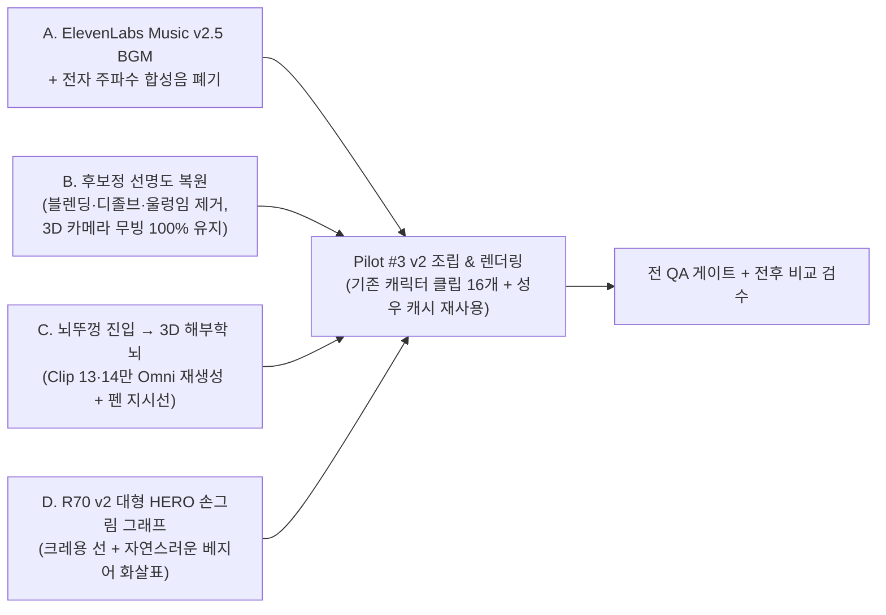
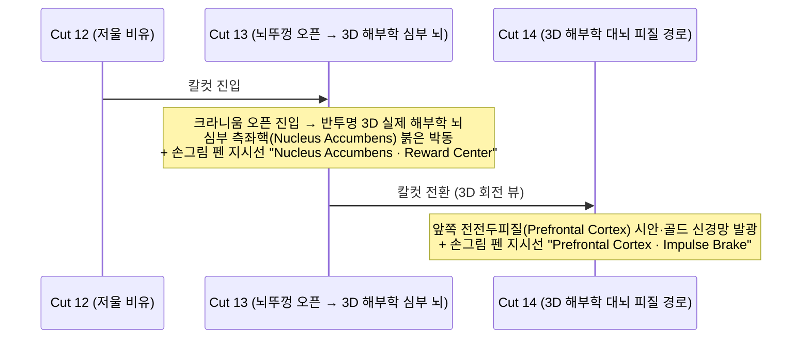

# [계획 1 — 지금 진행] Pilot #3 v2 폴리시 & 파이프라인 업그레이드 (오디오 · 선명도 · 해부학 뇌 · 손그림 HERO 그래프)

**범위 구분**:
- **이 계획(계획 1 — 지금 바로 실행)**: ① ElevenLabs `music_v2_5` 배경음악 + 전자 주파수음 제거, ② 뿌연 화면(`framerate` 블렌딩)·유령 겹침(`dissolve` → 칼컷, 클립 내부 3D 카메라 무빙은 100% 유지)·배속 울렁임(`v8_curve_ramp`) 제거, ③ 일일 50 크레딧 **`Omni 1.1 Flash`**로 뇌 컷 2개(Clip 13·14)만 **뇌뚜껑 오픈 → 실제 3D 해부학 뇌 + 펜 지시선 설명**으로 업그레이드, ④ **대형 HERO 손그림 크레용·펜 그래프(`Y=10%~62%`) + 자연스러운 손그림 화살표** 적용 → **Pilot #3 v2 완성**.
- **캐릭터 연기/관절 모션 자연화**(`Start Frame` 단독 구동, 카메라·연기 분리 등 전체 캐릭터 클립 생성 방식 변경)는 기존 클립 16개를 다시 뽑지 않도록 **[계획 2 — 다음 주제 영상 적용]**으로 완전히 분리했습니다.



---

## User Review Required

> [!IMPORTANT]
> **크레딧 및 재생성 범위 최소화**
> - **기존 캐릭터 클립(Clip 1~12, 15~18) 및 3인 성우 음성은 재생성 없이 100% 그대로 재사용**합니다.
> - **Google Flow**: 일일 50 크레딧 중 **해부학 3D 뇌 클립 2개(`Clip 13, 14`)만 `--engine omni` (`Omni 1.1 Flash`)로 생성**합니다.
> - **ElevenLabs**: 공식 `POST /v1/music` (`model_id="music_v2_5"`, `force_instrumental=True`, 잔여 `129,119 / 131,000` 크레딧)로 2분 다큐멘터리 BGM을 생성하고 `bgm_bank/`에 영구 캐싱합니다.

---

## Proposed Changes

### A. 오디오 — 전자 주파수음 폐기 & ElevenLabs `music_v2_5` 다큐멘터리 BGM 도입

- **원인**: [`_synthesize_expressive_v8_ambience_and_foley`](file:///home/canadaofbin/gdrive/Kyubin_Yun_Workspace/07_Youtube/pipeline/diorama_assembler.py#L2935-L2955)의 `np.sin` 사인파 드론 비브라토 수식(`freq * (1 + vib) * t_sec`)에서 편차가 시간 `t`에 비례해 폭주하며 후반부 전자 사이렌 음을 유발함 + 고주파 사인 효과음(`click`, `crystal_shimmer`).

#### [NEW] `pipeline/elevenlabs_music.py`
- `synthesize_or_load_elevenlabs_bgm(mood_id, duration_sec, sr=48000)`:
  - `POST https://api.elevenlabs.io/v1/music?output_format=mp3_48000_192` (`model_id="music_v2_5"`, `force_instrumental=True`).
  - 무드 프리셋(`curious_marimba_strings` — 따뜻한 펠트 피아노·피치카토 현악·마림바 다큐멘터리 스코어 등 4종) + `BCI_Shorts_Channel/knowledge_base/reusable_packs/bgm_bank/` SHA-256 디스크 캐시.
  - 오프라인 폴백용 함수에서도 위상 수식을 적분형(`2π·f·t − (f·v/4.1)·cos(2π·4.1·t)`)으로 교정 및 `-40 dBFS` 룸톤 지원.

#### [MODIFY] [config.py](file:///home/canadaofbin/gdrive/Kyubin_Yun_Workspace/07_Youtube/pipeline/config.py) & [diorama_assembler.py](file:///home/canadaofbin/gdrive/Kyubin_Yun_Workspace/07_Youtube/pipeline/diorama_assembler.py)
- `EXPRESSIVE_V8_BGM_MODE = "elevenlabs_music"`, `EXPRESSIVE_V8_SYNTH_TONAL_FOLEY = False`.
- BGM에 **보컬 포켓 EQ(`1.8kHz -3.5dB`)** 및 **다이나믹 덕킹(성우 발화 중 `-21.5 dBFS`, 막 전환 호흡 `-16.5 dBFS`)** 적용, 사인파 `click`/`crystal_shimmer` 제거.

---

### B. 화질·전환 후보정 복원 — 뿌연 화면 & 유령 겹침 제거 (3D 카메라 무빙 100% 유지)

| 제거 대상 (편집기 후보정 필터) | 코드 위치 | 변경 내용 | 클립 내부 3D 카메라 무빙 |
|---|---|---|---|
| 슬로모션 `framerate` 50:50 알파 블렌딩 | [`diorama_assembler.py:3549`](file:///home/canadaofbin/gdrive/Kyubin_Yun_Workspace/07_Youtube/pipeline/diorama_assembler.py#L3549) | `framerate=interp_start=0:interp_end=255` 제거 → 프레임 반투명 비빔 없이 원본 화질 유지 | **100% 그대로 유지** |
| 장면 간 반투명 알파 `dissolve` (`xfade`) | [`diorama_assembler.py:4633`](file:///home/canadaofbin/gdrive/Kyubin_Yun_Workspace/07_Youtube/pipeline/diorama_assembler.py#L4633) | `dissolve_6f/8f/12f/15f`, `match_cut_bridge` 반투명 오버랩 제거 → **깔끔한 칼컷(Hard Cut)** | **100% 그대로 유지** |
| `v8_curve_ramp` 사인파 배속 울렁임 | [`diorama_assembler.py:3636`](file:///home/canadaofbin/gdrive/Kyubin_Yun_Workspace/07_Youtube/pipeline/diorama_assembler.py#L3636) | `0.7x ↔ 1.5x` 임의 가감속 OFF (`EXPRESSIVE_V8_CURVE_RAMP = False`) → 균일한 정속 재생 | **훨씬 매끄러워짐** |

---

### C. 뇌뚜껑 오픈 진입 → 실제 3D 해부학 반투명 뇌 + 손그림 펜 지시선 (`--engine omni`)



#### [MODIFY] [config.py](file:///home/canadaofbin/gdrive/Kyubin_Yun_Workspace/07_Youtube/pipeline/config.py) & [anatomy_map.py](file:///home/canadaofbin/gdrive/Kyubin_Yun_Workspace/07_Youtube/pipeline/anatomy_map.py)
- `EXPRESSIVE_V8_BRAIN_XRAY_STYLE`을 장난감 뇌에서 **실제 대뇌 피질 주름(gyri/sulci)·소뇌·뇌간·투명 심부 구조가 정밀하게 보이는 3D 반투명 글래스 해부학 뇌**로 업그레이드.
- [`ANATOMY_FUNCTION_MAP`](file:///home/canadaofbin/gdrive/Kyubin_Yun_Workspace/07_Youtube/pipeline/anatomy_map.py)에 부위별 정규화 화면 앵커 좌표(`screen_anchor`) 추가.

#### [NEW] `pipeline/anatomy_label_overlay.py`
- 발광하는 실제 해부학 부위에서 텍스트 여백까지 **손그림 만년필 지시선(Leader Line)**이 0.35초 동안 쓱 그어진 뒤 손글씨풍 부위 설명 라벨이 뜨는 오버레이 엔진 (AI 글자 깨짐 `0%`).

#### Pilot #3 뇌 컷 생성
- `main.py diorama-flow --project v8_pilot_03_marshmallow_trust_previs --clips 13,14 --engine omni` 실행 (일일 크레딧 `Omni 1.1 Flash` 사용).

---

### D. `R70 v2` — 손그림 크레용·펜 **대형 HERO** 그래프 + 자연스러운 화살표

| 항목 | 기존 (v1) | 업그레이드 (v2 HERO) |
|---|---|---|
| **크기 / 위치** | `Y 18%–40%` (작은 상단 카드) | **`Y 10%–62%` (높이 ≈ 1,000px, 폭 90% — 화면의 주인공)** |
| **배경 처리** | 어두운 반투명 남색 UI 박스 | 네모 박스 완전 폐기 → **배경 영상 자동 블러(`gblur=14`) + 35% 디밍 포커스 풀** |
| **막대 표현** | 매끈한 컴퓨터 도형 | **크레용 브러시 스트로크** (종이결 입자 노이즈·거친 테두리, 왼→오른쪽 실시간 색칠) |
| **`4×` 강조** | 노란 알약 UI 버튼 | **자연스러운 손그림 곡선 화살표(`3 min → 12 min`) + 손글씨 `4×` 둘레 1.3바퀴 열린 타원** |
| **서체** | 고딕체(`AABCondensed`) | 오픈소스 OFL 손글씨 폰트 번들 (`PatrickHand-Regular.ttf` / `Caveat`) |
| **노출 시간** | 4.2초 | `S13` 문장 전체 + `0.6초` 홀드 |

**자연스러운 손그림 화살표 상세 규격 (`data_stamp_overlay.py`)**:
1. **비대칭 3차 베지어 곡선**: 기계적인 원호 금지 — 손목 궤적처럼 비대칭 제어점을 사용하고 `12 min` 끝점 바로 앞에서 살짝 못 미치게 멈춤.
2. **필압 테이퍼링**: 시작(가늘게) → 중간(굵게) → 끝(살짝 가늘게) 굵기 변화.
3. **속도 & 손떨림**: `ease-in-out` 드로잉 속도 + 고정 seed 저주파 미세 손떨림(`±1.5px`, 프레임 간 지터 없음).
4. **비대칭 두 획 화살촉**: 대칭 삼각형 금지 — 몸통 완성 `0.08초` 뒤 길이·각도가 서로 다른 두 획(`26px/32°`, `20px/40°`) 추가.
5. **`4×` 열린 타원**: 완벽한 원 대신 살짝 기울어진 비대칭 타원을 `1.3바퀴` 감싸 그리고 시작·끝을 열어둠.

#### [MODIFY] [data_stamp_overlay.py](file:///home/canadaofbin/gdrive/Kyubin_Yun_Workspace/07_Youtube/pipeline/data_stamp_overlay.py), [posthoc_semantic_qa.py](file:///home/canadaofbin/gdrive/Kyubin_Yun_Workspace/07_Youtube/pipeline/posthoc_semantic_qa.py), [dynamic_episode_qa.py](file:///home/canadaofbin/gdrive/Kyubin_Yun_Workspace/07_Youtube/pipeline/dynamic_episode_qa.py)
- 위 스트로크 엔진 및 배경 포커스 풀 합성 구현, 데이터 스탬프·해부학 지시선 구간 QA 정식 화이트리스트 연동.

---

## Verification Plan

### Automated Tests
```bash
/home/canadaofbin/hermes-venv/bin/pytest tests/test_credit_safe_pipeline.py tests/test_expressive_25d_v8.py -q
```
- `test_bgm_vibrato_phase_bounded` & `test_elevenlabs_music_v25_payload_and_bank_cache`
- `test_no_framerate_blend_in_v8_filtergraph` (블렌딩·알파 디졸브·배속 울렁임 0 검증)
- `test_data_stamp_hero_progressive_strokes` & `test_arrow_natural_stroke` (굵기 분산 `> 0`, 화살촉 길이 차 `>= 15%`, 원호 피팅 오차 `>= 2px`)
- `test_anatomy_label_anchor_resolves` (`nucleus accumbens`, `prefrontal cortex` 펜 지시선 렌더링 검증)

### Pilot #3 v2 Assembly & Delivery
- 기존 원본 `final_shorts_v8_pilot_03_marshmallow_trust_previs.mp4`는 백업 보존하고, 업그레이드 완성본을 **`final_shorts_v8_pilot_03_marshmallow_trust_previs_v2.mp4`**로 출력.
- `posthoc-qa`, `autopsy`, `episode-qa`, `prosody-qa` 전 게이트 통과 및 손그림 HERO 그래프 4단계 드로잉 프레임 + 해부학 3D 뇌 지시선 프레임 스냅샷 제공 (`walkthrough.md` 포함).
