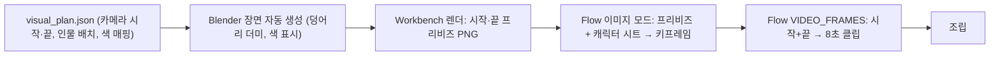

# 프리비즈(Previs) 방식 분석: 반토막AI 영상 → 우리 Google Flow 파이프라인

- 대상 영상: 「아스트라 + 블렌더 + 힉스필드 조합으로 AI 비용 반토막 내는 법」 (반토막AI, 12분 45초)
- 근거: 자막 전체를 읽었습니다. 화면은 직접 보지 않았습니다.

## 1. 영상 핵심 요약

### 출발점: 비용의 본질은 재생성
- 10초짜리 한 컷을 건지려고 평균 **약 42번** 생성한다고 합니다(Higgsfield 자료 기준, 컷당 30만 원 이상).
- 모델 값을 반으로 깎아도 재생성 횟수가 그대로면 비용은 줄지 않습니다.
- 그래서 **재생성 횟수를 줄이는 것**이 핵심입니다. 그 방법이 프리비즈(미리 시각화)입니다.

### 실패 원인: 맥락이 섞임 (2:07)
- 원본 영상의 생김새, 넣은 이미지, 프롬프트 세 가지가 한꺼번에 들어가면 AI가 무엇을 따라야 할지 몰라서 섞어 버립니다.
- 예: 귀가 큰 동물을 귀가 작은 동물로 바꾸려 해도 원본 귀를 따라갑니다.

### 해결 흐름
1. **원본을 마네킹 영상으로 바꿉니다** (Wan 3.0, 2:57). 외모·옷·배경을 지우고 움직임, 카메라, 컷만 남깁니다.
2. 여기에 얼굴·옷·장소 사진을 따로 붙이고, "영상은 움직임만 참고하고 겉모습은 가져오지 마라"라고 씁니다.
3. Seedance로 한 번에 생성합니다. **77크레딧 고정**으로, 기존 200–300크레딧보다 적게 듭니다.

### 영상 AI 프리비즈의 한계 (3:51)
- 동작을 바꾸고 싶으면 프리비즈 영상을 다시 뽑아야 해서, 결국 크레딧이 또 듭니다.
- 그래서 **Blender로 프리비즈를 만듭니다**. Codex에서 Astra에게 말로 시키면 Blender 장면을 만들어 줍니다. 고칠 때는 영상 크레딧 없이 토큰만 듭니다.

### 노하우 3가지 (6:01–7:35)
| 노하우 | 내용 | 이유 |
|---|---|---|
| **① 빼기** | 사람은 하체·상체·머리 **세 덩어리**, 제품은 **실제 크기 상자**로만 만듭니다 | 어중간하게 자세히 만들면 AI가 그 형태를 그대로 따라갑니다. 토큰도 낭비됩니다 |
| **② 색으로 표시** | 바꿀 대상마다 다른 색을 칠합니다 (여자=보라, 수비수=노랑, 관중=청록, 선글라스=주황). 실제 들어갈 색과 겹치면 안 됩니다 | 프롬프트에 "보라=여자"처럼 연결하면, 어느 사진을 누구에게 입힐지 헷갈리지 않습니다 |
| **③ 나누기** | 프리비즈 = 어디서·어느 각도로·언제 / **사진** = 얼굴·옷 / **텍스트** = 손동작·표정·질감 | 한 가지 정보를 여러 곳에 겹쳐 주면 섞입니다 |

### 최종 생성 (8:37–9:35)
- Astra가 이미지 올리는 순서와 완성 프롬프트를 만들어 줍니다.
- 프롬프트는 "카메라·동작은 프리비즈를 따르라" 한 줄에, 프리비즈가 못 담는 것(손 동작)만 덧붙입니다.

### 이미지 프리비즈 (9:45–10:33)
- 꼭 Blender가 아니어도 됩니다. 초안에서는 연출만 보고 자유롭게 뽑습니다.
- 마음에 드는 연출이 나오면 그걸 프리비즈 이미지(마네킹)로 바꾸고, 제품·모델·배경 이미지를 넣어 실사화합니다.

### 한계 (10:35)
- 생김새는 결국 넣는 이미지가 정합니다. 컷마다 같은 인물·제품 이미지를 준비하는 일은 따로 해야 합니다.
- 회전 장면이라면 상자 앞뒤를 다른 색으로 칠하고, 뒷모습 사진도 넣어야 합니다.

## 2. 우리 파이프라인과 대조

| 영상의 요소 | 우리 현재 상태 | 그대로 쓸 수 있나 |
|---|---|---|
| 프리비즈 **영상**을 동작 참조로 넣기 (Seedance) | Google Flow(Veo 3.1)에는 **동작 참조 영상을 넣는 칸이 없습니다**. 시작+끝 이미지(`VIDEO_FRAMES`)나 참조 이미지(`VIDEO_REFERENCES`)만 넣을 수 있습니다 | ❌ → **"시작·끝 프리비즈 이미지 2장"으로 바꿔서** 적용 |
| 이미지 프리비즈 → 실사화 | **같은 구조가 이미 있습니다**: `translate_porcelain_keyframes`([source_reenactment.py](file:///home/canadaofbin/gdrive/Kyubin_Yun_Workspace/07_Youtube/pipeline/source_reenactment.py) 1287줄)는 실제 사건 재현 영상(Track A)에서 `가이드 이미지 + 캐릭터/배경 참조` 2장을 Flow 무료 이미지 모드에 넣어 키프레임을 만듭니다 | ✅ **가이드 이미지를 실제 사건 사진 대신 3D 더미 렌더로 바꾸면 됩니다** |
| 키프레임 이어붙이기 | 이미 구현돼 있습니다 (`End(앞 컷) == Start(다음 컷)`) | ✅ 프리비즈 카메라를 컷 사이에 이어지게 맞추면 원테이크 비행이 됩니다 |
| ③ 나누기 | ❌ **위반 중**: pilot_02 Clip 1 프롬프트가 **194단어(1,312자)**인데, 첨부 이미지에 이미 있는 방·조명·재질을 다시 길게 묘사합니다 | ✅ 바로 고칠 수 있습니다 (코드만 수정) |
| ② 색 표시 | 없습니다. 모든 인물이 같은 흰색 인형 재질이라 누가 누구인지 구분이 약합니다 | ✅ 더미 색과 프롬프트를 연결하면 됩니다 |
| Blender | **설치돼 있지 않습니다**. GPU도 없습니다(CPU 4코어, RAM 11GB) | △ 휴대용 Blender를 받아서 **Workbench(단색) 렌더러**로 돌리면 CPU에서도 이미지 1장에 약 1초 수준으로 예상됩니다(추정) |
| Astra/Codex 스킬 | 우리는 Codex를 쓰지 않습니다. 대신 **우리 파이프라인이 `visual_plan.json`에서 장면 스크립트를 자동으로 만들면 됩니다** | ✅ 대화 대신 규칙 기반으로 생성 |

### 제약
1. **참조 이미지는 최대 2장**입니다(가이드 1장 + 캐릭터/배경 1장, 현재 구현 기준).
   - 인물이 여러 명인 컷은 색 표시 + 인물 묶음 시트 1장으로 해결해야 합니다.
   - 아니면 인물 2명 이하로 구도를 잡아야 합니다.
2. 프리비즈 이미지는 **구도와 카메라 위치만** 잡아 줍니다. 시작과 끝 사이의 실제 움직임은 Veo가 채웁니다. 영상 수준의 동작 정밀도는 기대하기 어렵습니다.
3. Flow에서 이미지 변환이 생기면서 단계가 하나 늘어납니다. 무료지만 대기 시간이 추가됩니다.

## 3. 기대 효과 (벤치마크 격차 기준)

| 격차 항목 | 지금 | 프리비즈 적용 후 (목표) |
|---|---|---|
| 카메라 🔴 | 대부분 눈높이 중간샷, 느린 밀기 | 탑다운→로우앵글, 포털 다이브, 180° 회전처럼 **수치로 정한 카메라 위치**에서 시작·끝 프레임을 만듦 |
| 장소·스케일 다양성 🟠 | 장소 4곳 미만 | 더미 장면에서 거리·스케일을 마음대로 바꿀 수 있음 |
| 재생성 횟수 | 클립당 최대 5회 시도 + 얼굴 오탐 | 구도가 확정된 상태에서 생성하므로 감소를 기대 (추정). **PoC에서 측정** |
| 컷 이음새 | 이어붙이기 일부 어긋남 (MAE 82) | 앞 컷 끝 카메라와 다음 컷 시작 카메라를 **같은 값으로 렌더**하므로 이음새가 정확해짐 |

## 4. 제안 설계

1. **계획 스키마 확장**: 각 컷에 `previs`를 추가합니다.
   - 카메라 시작·끝 (위치, 바라보는 점, 화각)
   - 인물 더미 위치와 색
   - 소품 상자 크기
   - 장소 덩어리(바닥·벽·큰 가구)
2. **[NEW] `pipeline/previs_blender.py`**: 위 정보로 Blender 파이썬 스크립트를 만들고 백그라운드로 실행합니다(`blender -b -P`). 노하우 ①②를 강제합니다.
   - 사람은 3덩어리
   - 색은 금지색(흰 인형색, 뇌 4색)과 겹치지 않는 팔레트에서 고름
   - 9:16 해상도로 렌더
3. **이음새 맞추기**: 앞 컷의 `camera_end`를 다음 컷의 `camera_start`에 그대로 복사합니다.
4. **이미지 변환**: `translate_porcelain_keyframes`의 가이드 입력을 프리비즈 PNG로 바꿀 수 있게 확장합니다. 프롬프트는 "구도·카메라는 첨부 1을 따르고, 보라 덩어리=주인공(첨부 2)"처럼 **색과 대상만 연결**합니다.
5. **노하우 ③ 적용**: [flow_prompt_builder.py](file:///home/canadaofbin/gdrive/Kyubin_Yun_Workspace/07_Youtube/pipeline/flow_prompt_builder.py)를 고칩니다.
   - 참조 이미지가 붙은 클립은 외형·배경 묘사를 빼고 **카메라 이동 + 동작 + 표정·손동작만 30–60단어**로 씁니다.
   - 새 QA 검사를 추가합니다: 첨부 이미지가 있는데 외형 묘사가 중복되면 실패.
6. **측정**: 클립별 시도 횟수, 얼굴 오탐 횟수, 이음새 MAE, 카메라 앵글 다양성을 기록합니다. 지금 방식과 비교합니다.

## 5. 위험과 대응
| 위험 | 대응 |
|---|---|
| Flow 이미지 변환이 더미 색이나 덩어리 형태를 따라가 버림 (영상에서 말한 "어중간한 디테일" 문제) | 덩어리를 최대한 단순하게 유지하고, 프롬프트에 "덩어리는 위치 표시일 뿐"이라고 명시합니다. PoC에서 바로 확인합니다 |
| Blender 다운로드 용량 (약 300–400MB), CPU 렌더 속도 | Workbench 엔진과 저해상도(540×960) 렌더면 충분합니다. 디스크 여유는 46GB입니다 |
| 참조 이미지 2장 제한 | 인물 묶음 시트 1장 또는 컷당 주요 인물 2명 이하 규칙 |
| 시작·끝 사이 움직임은 여전히 Veo가 결정함 | 이동이 큰 비행은 컷을 나누거나 중간 키프레임을 추가합니다 |
