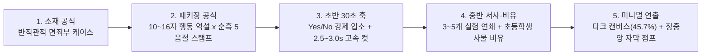

# `@심리학고양이` (`UCaJkv4faBajjsDGq2YPJN0A`) 영상 해부 & 5대 성공 공식 보고서

> [!IMPORTANT]
> **`@Research` 실측 요약 (`190편` 전수 메타데이터 + 대표 히트작 `6편` MP4 `87,811 프레임`·오디오·자막 해부)**:
> 쇼츠 `0편`, 오직 **주 1회(목요일 밤 20~22시 KST) `8~10분` 16:9 롱폼 단일 포맷**만으로 **구독자 `40.4만 명` · 공개 `168편` 누적 `4,809만 회`(평균 `28.6만 회`, 최다 `505만 회`)**를 달성했습니다. 초기 5개월(`Era 1`, 33편) 동안 교과서적 상담심리 에세이로 중앙값 `3,495회`에 머물렀으나, **기묘한 신경학적 결손 아카이브**와 **일상 노력의 배신을 찌르는 '역설(`~할수록 손해보는/해야 하는 이유` × `OO의 역설/배신`)' 공식**으로 전환한 뒤 최근(`Era 4`) 평균 조회수 **`51.3만 회`**로 폭발했습니다.

---

## 0. `심리학고양이 5대 성공 공식 (The Winning Formula)`



| 공식 축 | 핵심 메커니즘 (정식화) | 실측 증거 및 타율 격차 (`190편 전수 + 6편 MP4 실측`) |
|---|---|---|
| **① 소재/케이스 공식**<br>*(Counter-Intuitive Exoneration)* | **"내 일상적 고통(불면·후회·눈치·과잉생각)은 의지 박약이 아니라 뇌의 구조적 분열·진화적 착각 때문이었다"**는 **과학적 면죄부**를 주는 실증 실험·임상 케이스만 채택 (추상적 상담론 배제) | - **역설·뇌결손 케이스**: 최고 **`5,050,568회`** (`#147` 분리뇌)<br>- **초기 상담 에세이(`Era 1`, 33편)**: 중앙값 **`3,495회`** (최대 **5,886배 격차**) |
| **② 제목×썸네일 호기심 갭**<br>*(Zero-Redundancy Paradox Gap)* | **제목(`10~16자`)**은 `[2인칭 행동 역설: ~할수록 손해보는 / ~해야 하는 이유]`, **썸네일**은 `순흑(#000000) 배경 + 단일 은유 오브제 + 5음절 스탬프(OO의 역설 / OO의 배신)` 또는 `무텍스트 충격 실사`. **제목과 썸네일 단어 중복 `0%`** | - **역설형 제목(`n=24`)**: 중앙값 **`369,856회`** vs **방법론(`~하는 법`, `n=8`)**: 중앙값 **`5,668회`** (**`65.2배` 격차**)<br>- 동일 수면 주제: `생각을 끄고 잠드는 법`(`3.1만`) vs `빨리 자려고 할수록 손해보는 이유`×`수면의 역설`(`248만`, **`78.8배`**) |
| **③ 초반 30초 훅 공식**<br>*(2nd-Person Lab Immersion)* | 인사말 `0초`. `0.0s`부터 **① Yes/No 자가진단 강제 입소**, **② 2인칭 `'당신'` 실험실 착석 POV**, **③ 기괴한 임상 환자 대사 + 8.3초 침묵 여백** 중 직행. 초반 30초 컷 전환 **`2.50~3.00s`(본편 대비 `1.5~1.87배` 고속)** | - `#147`(`505만`), `#039`(`246만`): `0:00~0:09` 구간 유튜브 **`Most Replayed` 1위(`val=1.00`)**<br>- `#002`(`248만`): 초반 30초 11컷(`2.50s/컷`), `0:19`에 실제 행진곡 음원 `2.63s` 삽입 |
| **④ 중반 빌드업·비유 공식**<br>*(Multi-Lab Chain + Elementary Analogy)* | 단일 논문이 아니라 **`3~5개 독립 실험`을 징검다리 연쇄 배치**해 통념 퇴로를 막고, 중반(`50~65%`)에 **초등학생도 1초 만에 이해하는 일상 사물 비유**로 치환한 뒤 후반(`68~90%`)에 오늘 밤 바로 쓸 `3가지 행동 규칙` 제시 | - 반구 과각성 → **`침실 성벽의 보초병 3명`** (`#002`)<br>- 투명성 착각 → **`내 머릿속 감독판 vs 남이 보는 극장판`** (`#004`)<br>- 좌뇌 작화증 → **`가림막 뒤 스피드퀴즈`** (`#147`)<br>- 해마-편도체 분리 → **`기억 서커스 & 폭주 기관차`** (`#082`) |
| **⑤ 미니멀 연출·편집 공식**<br>*(Dark Canvas + Center Subtitle Jump)* | 전체 화면의 **`45.7%`가 다크 캔버스(순흑 암전 `16.3%` + 다크 미니멀 도해 `29.4%`)**. 핵심 질문·전환점마다 **배경을 100% 순흑(`#000000`)으로 끄고 하단(`y=86%`) 명조체 자막을 화면 정중앙(`y=50%`, 무박스)으로 순간이동**시켜 시선(`Saccade`) 강제 리셋 | - **`8~10분(480~599s)` 미드롤 구간(`n=66`)**: 평균 **`506,916회`** (`5분 미만` 평균 `20,238회` 대비 **`25.0배`**)<br>- 정중앙 자막 점프 비율: 러닝타임의 **`5.4% ~ 13.9%`** |

````carousel

<!-- slide -->

<!-- slide -->

````

---

## 1. 채널 정량 프로파일 & '쌍둥이 영상 A/B 비교' (`최대 1,144배 격차`)

### 1.1 시대별(`Era 1~4`) 진화 궤적
| 시대 | 기간 (`편수`) | 합산 조회수 (`비중`) | 구간 평균 | 구간 중앙값 | 결정적 변화 |
|---|---|---:|---:|---:|---|
| **Era 1** | `2023.06~10` (`33편`) | 217,008회 (`0.5%`) | 6,576회 | **3,495회** | 학술 용어 나열 + 교과서 상담 에세이로 철저히 외면 |
| **Era 2** | `2023.11~2024.12` (`44편`) | 15,089,272회 (`31.4%`) | 342,938회 | **164,326회** | `#151`(`201만`), `#147`(`505만`) 기묘한 뇌손상·분리뇌 실화로 폭발 |
| **Era 3** | `2025.01~12` (`47편`) | 12,127,128회 (`25.2%`) | 258,024회 | **153,033회** | 하버드/실화 후킹 + 자극적 남녀 진화심리 22편 멤버십 분리 |
| **Era 4** | `2026.01~11` (`44편`) | **22,568,700회 (`46.9%`)** | **`512,925회`** | **`276,430회`** | **`10~16자 역설 제목` × `순흑 5음절 스탬프 썸네일`** 공식 완성 |

### 1.2 똑같은 논문을 다루고도 프레이밍 차이로 갈린 '쌍둥이 A/B 비교'
| 동일 학술 소재 | 저성과 영상 (실패 프레이밍) | 메가히트 영상 (성공 프레이밍) | 조회수 배율 | 폭발 원인 |
|---|---|---|---:|---|
| **타인 시선·호감 착각** | `#176` *인포자도 1등급 만드는 '이것'* (`1,918회`) | `#004` *당신이 생각보다 호감인 이유* × `호감의 역설` (**`2,194,661회`**) | **`1,144.2배`** | 시청자 비하('인포자') 제거 → **'상대는 이미 당신을 좋아한다(Liking Gap)'는 면죄부 + 거짓말 카드게임 POV** |
| **만족자 vs 극대화자** | `#128` *경쟁에 지친 뉴욕 명문대 교수가 병원의 황당한 실수로...* (`5,095회`) | `#039` *손해보며 살아야 하는 이유* × `손해의 역설` (**`2,464,458회`**) | **`483.7배`** | 42자 3인칭 서술형 → **12자 2인칭 역설 명령형 + 연봉 `+20%` 미끼 뒤 우울증 `7.3배` 카운터펀치** |
| **애착이론 (불안·회피)** | `#180` *회피형과 불안형은 대체 무슨 장점이 있을까?* (`2,557회`) | `#042` *불안형이 절대 이길 수 없는 이유* × `연애는 도박이다` (**`517,380회`**) | **`202.3배`** | 교과서 강의 → **포커 도박 메타포 + 손실 회피 자극** |
| **불면증·수면 강박** | `#045` *생각을 끄고 잠드는 법* (`31,515회`) | `#002` *빨리 자려고 할수록 손해보는 이유* × `수면의 역설` (**`2,482,642회`**) | **`78.8배`** | 뻔한 `~하는 법` → **'빨리 자려 애쓸수록 더 못 잔다'는 역설적 배신 프레이밍** |
| **분리뇌·다중 자아** | `#009` *당신 안에 N명이 사는 이유* (`165,144회`) | `#147` *당신이 사실 2명인 이유 (feat. 노벨상)* (**`5,050,568회`**) | **`30.6배`** | 추상적 `N명`보다 물리적 **`2명` + 노벨상 권위 + 무텍스트 실험실 아카이브 실사** |

---

## 2. 대표 히트작 6편 본편 영상(`87,811 프레임`) · 편집 · 오디오 실측 해부

| 실측 항목 | `#147` 분리뇌 (`505만`) | `#002` 수면의 역설 (`248만`) | `#039` 손해의 역설 (`246만`) | `#004` 호감의 역설 (`219만`) | `#151` 뇌과학자 (`201만`) | `#082` 클라이브 (`138만`) |
|---|---:|---:|---:|---:|---:|---:|
| **총 길이 / 총 프레임** | `492.7s` / `14,781f` | `578.9s` / `17,368f` | `481.4s` / `14,429f` | `480.0s` / `14,400f` | `538.7s` / `16,161f` | `489.1s` / `14,672f` |
| **초반 30초 평균 컷 길이** | **`3.00s`** (`9 cuts`) | **`2.50s`** (`11 cuts`) | **`3.75s`** (`7 cuts`) | **`2.73s`** (`10 cuts`) | **`3.75s`** (`7 cuts`) | `4.29s` (`6 cuts`) |
| **본편 전체 평균 컷 길이** | `5.60s` (`87 cuts`) | `3.89s` (`148 cuts`) | **`3.09s`** (`155 cuts`) | `4.07s` (`117 cuts`) | `4.68s` (`114 cuts`) | `4.75s` (`102 cuts`) |
| **① 순흑 암전 텍스트 화면 (`>=85% Black`)** | `9.8%` | `12.8%` | **`18.1%`** | **`18.0%`** | `9.1%` | **`24.6%`** |
| └─ *정중앙(`y=50%`) 명조 점프 프레임* | *`7.8%`* | *`11.0%`* | *`10.9%`* | *`12.5%`* | *`5.4%`* | *`13.9%`* |
| **② 다크 미니멀 도해 (`50~85% Black`)** | `22.6%` | `28.6%` | **`31.3%`** | `28.3%` | `20.1%` | **`34.0%`** |
| **다크 캔버스 합계 (`① + ②`)** | `32.4%` | **`41.4%`** | **`49.4%`** | **`46.3%`** | `29.2%` | **`58.6%`** |
| **③ 실제 다큐/흑백 아카이브/일기 스캔** | **`26.9%`** | `7.0%` | `14.3%` | `9.5%` | `12.1%` | `12.9%` |
| **④ 컬러 실사 B-Roll / 일러스트** | `40.7%` | `51.6%` | `36.3%` | `44.2%` | `58.7%` | `28.5%` |
| **내레이션 공백 (`>=0.75s`) 횟수** | **`15회` (`최대 11.7s`)** | `1회` (`2.6s` 행진곡) | `1회` (`1.2s`) | `0회` *(엔딩 패딩 제외)* | `3회` (`6.6s` 음파탐지) | **`6회` (`7.3s` 일기장)** |

### 본편 영상 연출 3대 시그니처 기법
1. **`Black-Frame Eye-Tracking Reset` (순흑 암전 + 정중앙 자막 순간이동)**:
   - 평소(`~83%`)에는 하단(`y≈86%`) 반투명 검정 박스 명조 자막을 유지하다가, 핵심 질문·반전 문장(`5.4~13.9%`)에서 **배경을 100% 순흑(`#000000`)으로 끄고 자막을 정중앙(`y=50%`, 무박스)으로 점프**시켜 시청자 동공을 강제 리셋합니다.
2. **3색 제한 초미니멀 실험 도해 (`Pure Black + White/Red/Blue`)**:
   - 순흑 바탕 위에 흰색 사람 아이콘 4개(`6skfikfyY_M 38s`), 빨강/회색 막대 2개(`q7txH0EJW-M 90s`), 포스트잇 1장(`q7txH0EJW-M 210s`)만 띄워 시각 피로를 줄이고 내레이션 몰입도를 극대화합니다.
3. **충격 아카이브 구간 무음 `(괄호 해설)` vs 역설 시리즈 무휴지 압축 호흡**:
   - 충격적 실제 실험 영상(양손 다른 그림 그리는 분리뇌 환자, 혀 차는 소리로 자전거 타는 전맹 시각장애인)에서는 **내레이션을 `6~11초`간 완전히 끄고 `(왼손으로는 네모를 오른손으로는 원을)` 같은 소괄호 무음 자막**만 띄웁니다. 반면 실사 아카이브가 적은 '역설' 시리즈는 침묵을 `0~1회`로 깎고 `3.09~4.07초` 고속 컷으로 밀어붙입니다.

---

## 3. 우리 채널 미보유 · Crossref DOI 검증 완료 차기 에피소드 후보 TOP 10

기존 `research_dossiers/`(`110개`) 및 `projects/`(`44개`) 전수 대조를 거쳐 중복 `0%`로 선별된 즉시 제작 가능 케이스입니다.

| 순위 | 추천 도시에 슬러그 | 논문 · 저널 · **Crossref 검증 DOI** | 핵심 역설 & `R70 Data Stamp` 수치 | `@심리학고양이` 검증 조회수 |
|---:|---|---|---|---|
| **1** | `scullin_bedtime_todo_list_sleep` | **Scullin et al. (2018)** *J. Exp. Psychol. Gen.* (`10.1037/xge0000374`) + **Ansfield et al. (1996)** (`10.1016/0005-7967(96)00031-9`) | 취침 전 '완료한 일' 적기(`24.9분` 입면) vs **'내일 할 일(To-Do)' 적기(`15.5분` 입면, `9.4분` 단축)** + 빨리 자려 애쓸수록 각성 폭발 | **`2,482,642회`** (`#002`) |
| **2** | `gilbert_reversible_choice_paradox` | **Gilbert & Ebert (2002)** *JPSP* (`10.1037/0022-3514.82.4.503`) | 하버드 사진 수업 '5일 교환 가능' 선호율 `66%`, 그러나 실제 만족도는 **교환 불가 그룹이 압도적 우위(`90 vs 68`)** | **`2,464,458회`** (`#039`) |
| **3** | `boothby_liking_gap_illusion` | **Boothby et al. (2018)** *Psychol. Sci.* (`10.1177/0956797618783714`) + **Gilovich et al. (1998)** (`10.1037/0022-3514.75.2.332`) | 5분 대화 후 예상 호감도(`4.92`) < **실제 호감도(`5.49`)**; 거짓말 발각 예상(`48.8%`) vs **실제 발각(`25.6%`)** (`감독판 vs 극장판`) | **`2,194,661회`** (`#004`) |
| **4** | `thaler_blind_echolocation_visual_cortex` | **Thaler, Arnott & Goodale (2011)** *PLOS ONE* (`10.1371/journal.pone.0020162`) | 전맹 시각장애인이 혀 차는 반향음만으로 자전거 주행 시 청각피질이 아닌 **1차 시각피질(`V1`)이 점화** | **`2,008,694회`** (`#151` `Most Replayed` 1위) |
| **5** | `mani_mullainathan_scarcity_iq_drop` | **Mani, Mullainathan, Shafir & Zhao (2013)** *Science* (`10.1126/science.1238041`) | 자동차 수리비 **`\$1,500` 청구서 질문**만으로 직후 지능 테스트 **`13~14 IQ 포인트` 급락** (완전 밤샘 `-13점`과 동일) | **`1,333,906회`** (`#085`) |
| **6** | `ramachandran_anosognosia_caloric_vestibular` | **Ramachandran (1995)** *Consciousness & Cognition* (`10.1006/ccog.1995.1002`) | 왼팔 마비를 끝까지 부정하던 뇌졸중 환자의 **왼쪽 귀에 얼음물 `10ml`** 주입 시 10분간 마비를 즉시 인정 | **`1,245,391회`** (`#095`) |
| **7** | `wilson_solitude_electric_shock_dmn` | **Wilson et al. (2014)** *Science* (`10.1126/science.1250830`) | 빈방 15분 고독 실험에서 **남성 `67%` · 여성 `25%`가 지루함을 못 견뎌 자발적으로 전기충격 버튼 클릭** | **`1,062,545회`** (`#038`) |
| **8** | `white_carlson_batman_alter_ego_cape` | **White et al. (2017)** *Child Development* (`10.1111/cdev.12695`) | 아이패드 유혹 옆 지루한 과제 수행 시 1인칭(`28.5%`) 대비 **배트맨 망토 3인칭 자문 그룹(`55.2%`) 인내력 `2배`** | **`912,251회`** (`#017`) |
| **9** | `wolford_gazzaniga_pigeon_overthinking` | **Wolford, Miller & Gazzaniga (2000)** *J. Neurosci.* (`10.1523/JNEUROSCI.20-06-j0003.2000`) | `80:20` 무작위 불빛 예측에서 **비둘기(`80%`)가 없는 규칙을 찾으려 애쓰는 인간 성인(`68%`)을 완파** | **`854,895회`** (`#043`) |
| **10** | `costa_keysar_foreign_language_dilemma` | **Costa et al. (2014)** *PLOS ONE* (`10.1371/journal.pone.0094842`) | 육교 트롤리 딜레마에서 모국어(`18%`) 대비 **제2언어(외국어) 사고 시 공리주의 선택 `44%`(`2.4배`) 급증** | **`770,123회`** (`#032`) |

---

## 4. `@AllAboutBrainOfficial` (`v8` 쇼츠 & 향후 롱폼) 즉시 이식 전략

1. **제목 × `R65 v4` 썸네일 `Zero-Redundancy` 결합**:
   - 제목(`R68` 4~8단어)은 **2인칭 행동 역설**(`"Why Trying to Sleep Faster Backfires"`, `"Why Keeping Your Receipt Ruins Happiness"`), `R65 v4` 썸네일 상·하단 2~3단어 스탬프는 **실험 조건 대조**(`"20-MIN TRYING: AWAKE"` vs `"5-MIN LIST: ASLEEP!"`)로 분리해 **단어 중복 `0%` 호기심 갭**을 형성합니다. (사물 은유형 소재에는 `R65 v4` `dark_void_paradox_v4` 프로파일 선택 가능)
2. **초반 S1~S3 `Double-Turn Counter-Punch` + 2인칭 소환**:
   - `case_stamp` 첫 문장(S1)에서 직관적 행동/이득을 던진 직후, S2(`Yet/But`)에서 역설적 뇌 역풍 수치와 `"and you do it every night"` 2인칭 연결을 결합합니다.
3. **`2-Study Micro-Chain` × `R70 Data Stamp` (`2회/편`) × `Physical Analogy Totem`**:
   - 쇼츠 1편(`~95~115s`) 안에서 **Act 2(`15~35s`) `Chart 1`** + **Act 4(`55~75s`) `Chart 2`** 2단 실험 스탬프를 터뜨리고(`DATA_STAMP_HERO_MODE` 배경 블러·암전으로 시선 중앙 리셋 효과 구현), Act 3 핵심 해부 공개 직후 **`expressive_literal_analogy` 물리적 3D 비유 소품(보초병 망루, 감독판 필름 릴 등)** 1개를 고정 배치합니다.
4. **Act 6 `Exoneration Flip` (과학적 면죄부 엔딩)**:
   - 마지막 2문장을 단순 요약 대신 **"당신의 잘못이 아니라 뇌의 서툰 보호 본능이었다"**는 면죄부 반전 + 오늘 밤 당장 해볼 수 있는 단일 행동 스위치로 마무리합니다.
