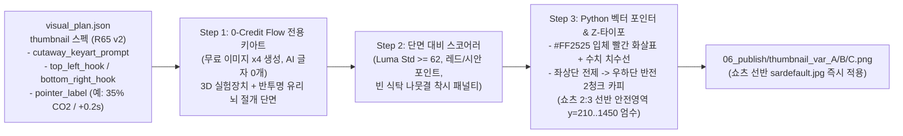

# Rule `R65 v2` 구현 계획서 — `'신비한 건축사전'`형 3D 절개 단면 키아트 & 포인터 썸네일 스튜디오

## Goal Description

선택해 주신 **2번(`신비한 건축사전`형)** 공식을 우리 채널(`@AllAboutBrainOfficial`, `expressive_25d_v8`)의 **쇼츠(`9:16`, 선반 `2:3` 크롭 `sardefault.jpg`) 및 향후 롱폼(`16:9`)** 파이프라인에 이식합니다.

기존 `R65` ([thumbnail_studio.py](file:///home/canadaofbin/gdrive/Kyubin_Yun_Workspace/07_Youtube/pipeline/thumbnail_studio.py))는 본편 영상 컷 중 선명도(`Laplacian`)가 높은 프레임을 단순 캡처해 상단 중앙에 1줄 텍스트만 얹는 방식이라, 나뭇결 식탁 같은 빈 배경이 1등으로 뽑히고(`Wood-Grain Trap`) 구조적 호기심이 전혀 생기지 않았습니다.

**`R65 v2`**는 유료 크레딧 소모가 `0`인 **Google Flow 무료 이미지 모델(`FLOW_ZERO_CREDIT_IMAGE_MODEL`, `x4` 배치)** 로 **썸네일 전용 '3D 두개골·실험장치 절개 단면도(Cutaway X-Ray)' 클린 키아트**를 별도 생성한 뒤, 파이썬 벡터 엔진(`Pillow`/`OpenCV`)으로 **오타 없는 칼선 `#FF2525` 빨간 화살표·치수 콜아웃**과 **대각선 Z-패턴 2청크 영문 훅**을 합성해 `thumbnail_var_{A,B,C}.png`로 출력합니다.



---

## User Review Required

> [!IMPORTANT]
> **`'신비한 건축사전'` 공식을 미국 뇌과학 쇼츠에 맞춘 4대 설계 핵심**
> 1. **AI 깨진 글자 원천 차단 (2계층 분리 렌더링)**:
>    - Google Flow 무료 이미지 생성 단계에서는 **순수 3D 절개 단면도 비주얼(실험 소품 + 반투명 두개골/뇌 내부 `#FF2525` 레드 · `#00D4FF` 시안 발광 경로)** 만 텍스트 없이 깔끔하게 뽑습니다.
>    - **빨간 화살표, 절개 치수선(`+0.2s`, `35% CO2`), `✕ / ✓` 배지, 대각선 2청크 카피**는 100% 파이썬 코드(`Pillow` 벡터 레이어)로 그려 글자 깨짐이 `0%`입니다.
> 2. **유튜브 쇼츠 선반 `2:3` 크롭(`y = 150..1770`) & 하단 제목 가림 회피 기하학**:
>    - 실제 유튜브 쇼츠 탭은 `1080x1920`의 상하 `150px`씩을 자르고, 하단(`y = 1520..1770`)에 흰색 영상 제목을 겹쳐 띄웁니다.
>    - 따라서 대각선 Z-패턴 배치를 **좌상단(`y = 220..360`) ↘ 중앙 3D 절개 단면 + 빨간 화살표(`y = 400..1220`) ↘ 우하단(`y = 1260..1440`, 유튜브 하단 제목 바로 위 안전지대!)** 로 정밀 고정해 모바일 피드에서 글자가 절대 잘리거나 겹치지 않게 합니다.
> 3. **크레딧 비용 `0`원 유지**:
>    - 썸네일 전용 키아트는 월간 비디오 크레딧을 쓰지 않는 **무료(`0-credit`) 이미지 모드(`x4` 배치, 약 15~20초 소요)** 만 사용합니다 (오프라인 테스트나 `--keyart-mode frame` 실행 시에는 개선된 본편 단면/뇌 컷 스코어러로 자동 폴백).
> 4. **적용 대상**:
>    - 승인 시 구현 완료 즉시 현재 `@Operator`에서 마무리 중인 **`Ep #4`(`v8_ep04_patient_sm_fearless_amygdala`)와 `Ep #5`(`v8_ep05_ucl_tickle_delay_robot`)의 최종 썸네일부터 바로 이 방식으로 생성**합니다!

---

## `Ep #4` · `Ep #5` 적용 레이아웃 설계 미리보기

````carousel
```text
[Ep #4: v8_ep04_patient_sm_fearless_amygdala]
영상 제목: Why One Breath Terrified a Fearless Woman

┌──────────────────────────────────────┐ (y=0..150 선반 상단 크롭 밖)
│ ═════════ 2:3 쇼츠 선반 상단 경계 ═════════ │ y=150
│                                      │
│  ZERO SNAKE FEAR                     │ ← 좌상단 청크 1 (순백색 + 12px 검정 외곽선)
│                                      │
│      [3D 아이소메트릭 절개 단면 키아트]      │
│   초록 뱀 앞에서도 꺼져 있는 회색 편도체(✕)  │
│   vs 투명 호흡 마스크 관을 타고 두개골 심부  │
│   뇌간(Brainstem)으로 꽂히는 붉은 경보 광선  │
│                                      │
│         ━━━▶ [ 35% CO2 ALARM ]       │ ← #FF2525 입체 빨간 화살표 + 수치 콜아웃
│                                      │
│                     1 BREATH PANIC   │ ← 우하단 청크 2 (#FFE14A 노랑/백색 강조, y=1280..1430)
│                                      │
│  (유튜브 쇼츠 선반 제목 오버레이 비움 구역)  │ y=1520..1770
└──────────────────────────────────────┘
```
<!-- slide -->
```text
[Ep #5: v8_ep05_ucl_tickle_delay_robot]
영상 제목: Why a 0.2-Second Delay Makes You Ticklish (UCL 로봇 실험)

┌──────────────────────────────────────┐ (y=0..150 선반 상단 크롭 밖)
│ ═════════ 2:3 쇼츠 선반 상단 경계 ═════════ │ y=150
│                                      │
│  YOUR OWN HAND                       │ ← 좌상단 청크 1 (순백색 + 12px 검정 외곽선)
│                                      │
│      [3D 아이소메트릭 절개 단면 키아트]      │
│   테이블 위 왼손 조이스틱 ──(절개 단면)──▶  │
│   테이블 아래 끊어진 신호 간격 + 오른손 붓   │
│   ──▶ 반투명 두개골 속 소뇌(#00D4FF 시안)   │
│       예측 차단 해제 & 감각피질 붉은 스파크  │
│                                      │
│        ┣━━ +0.2s DELAY ━━┫ ━━▶       │ ← #FF2525 빨간 치수선(Ruler) + 포인터 화살표
│                                      │
│                   TRICKS YOUR BRAIN  │ ← 우하단 청크 2 (#FFE14A 노랑/백색 강조, y=1280..1430)
│                                      │
│  (유튜브 쇼츠 선반 제목 오버레이 비움 구역)  │ y=1520..1770
└──────────────────────────────────────┘
```
````

---

## Proposed Changes

### Component 1: `R65 v2` 스키마 및 상수 정의

#### [MODIFY] [config.py](file:///home/canadaofbin/gdrive/Kyubin_Yun_Workspace/07_Youtube/pipeline/config.py) & [production_constants.md](file:///home/canadaofbin/gdrive/Kyubin_Yun_Workspace/07_Youtube/.agents/rules/production_constants.md)
- 쇼츠 선반 `2:3` 크롭(`y = 150..1770`) 및 하단 제목 회피 안전영역 상수 추가:
  - `THUMB_SHORTS_SHELF_CROP_Y: tuple[int, int] = (150, 1770)`
  - `THUMB_V8_Z_TOP_Y_RANGE: tuple[int, int] = (215, 395)` (좌상단 전제 청크)
  - `THUMB_V8_Z_BOT_Y_RANGE: tuple[int, int] = (1240, 1445)` (우하단 반전 청크 — 유튜브 선반 하단 제목 `y >= 1520` 완전 회피)
  - `THUMB_POINTER_RED_RGB = (255, 37, 37)` (`#FF2525`), `THUMB_POINTER_CYAN_RGB = (0, 212, 255)` (`#00D4FF`), `THUMB_ACCENT_YELLOW_RGB = (255, 225, 74)` (`#FFE14A`)
- `THUMB_INTENT_BONUS` 개편: `cutaway_xray = 1.0`, `brain_badge = 0.95`로 상향해 폴백 프레임 선택 시에도 빈 식탁 대신 3D 유리 뇌·단면 컷이 최우선 선택되도록 교정.

---

### Component 2: `0-Credit` 3D 절개 단면 키아트 생성기 + 벡터 포인터/Z-타이포 렌더러

#### [MODIFY] [thumbnail_studio.py](file:///home/canadaofbin/gdrive/Kyubin_Yun_Workspace/07_Youtube/pipeline/thumbnail_studio.py)
1. **빈 식탁 나뭇결 착시(`Wood-Grain Laplacian Trap`) 교정 (`compute_image_metrics` & `score_candidate`)**:
   - 단순 전역 `Laplacian` 고주파 점수 대신 **(a) 명도 표준편차(`Luma Std`, 목표 `>= 62.0`)**, **(b) 고채도 레드/시안 포인터 픽셀 존재감(`accent_pop`)**, **(c) 중앙 전경 대 주변 배경 명도·색상 분리도(`fg_bg_separation`)** 를 핵심 가중치로 반영하고, 단조로운 황갈색 대면적 텍스처(`Hue 12..30°` 고밀도 엣지)에는 패널티를 부여합니다.
2. **`build_cutaway_keyart_prompt(plan, script, dossier)` & `generate_zero_credit_thumb_keyart()` 신설**:
   - `visual_plan["thumbnail"]["cutaway_keyart_prompt"]`가 있으면 사용하고, 없으면 에피소드의 핵심 실험 소품 + `R71` 반투명 3D 유리 두개골/뇌 단면 + `#FF2525` 코랄레드 / `#00D4FF` 시안 내부 발광 경로를 결합한 **무텍스트 3D 아이소메트릭/절개 단면 키아트 프롬프트(`22~42단어`)** 를 자동 생성합니다.
   - 기존 Google Flow 무료 이미지 파이프라인(`source_reenactment.translate_porcelain_keyframes` / `FLOW_ZERO_CREDIT_IMAGE_MODEL` `9:16` `x4` 배치)을 호출해 `06_publish/keyart_candidates/keyart_01..04.png` 4장을 `0`크레딧으로 뽑고 상위 3장을 `Variant A/B/C` 베이스로 채택합니다 (`cdp` 오프라인 및 `pytest` 환경에서는 개선된 본편 단면/뇌 컷 프레임으로 안전하게 폴백).
3. **`render_cutaway_pointer_and_z_overlay()` 신설 (`신비한 건축사전` 레이아웃 엔진)**:
   - **시각 포인터 레이어 (`pointer_spec`)**:
     - 이미지 내 `#FF2525` 레드 / `#00D4FF` 시안 발광 중심점(또는 `pointer_target_xy`)을 자동 탐지해, 외곽선과 그림자가 살아있는 **굵은 `#FF2525` 입체 방향 화살표 / 치수 보조선(`┣━━ +0.2s ━━┫`) + 간결한 수치/부위 스탬프(`35% CO2`, `+0.2s DELAY`, `✕` / `✓`)** 를 얼굴·메인 텍스트와 겹치지 않는 각도로 정밀 작도합니다.
   - **대각선 Z-패턴 2청크 타이포그래피 (`top_left_hook` + `bottom_right_hook`)**:
     - `top_left_hook` (`1~3단어`, 좌상단 `x=68, y=230`): 순백색 `#FFFFFF` + `12px` `#0A0F18` 외곽선 + 소프트 다크 쿠션.
     - `bottom_right_hook` (`1~3단어`, 우하단 우측 정렬 `x=1012, y=1310`): `#FFE14A` 웜 옐로우(또는 `#FFFFFF`) + `12px` `#0A0F18` 외곽선 + 소프트 다크 쿠션.
     - `16:9` 롱폼(`render_longform_4k_thumbnails`)에도 동일한 좌상단 → 우하단 Z-패턴 2청크 + 빨간 포인터 모드를 함께 지원합니다.
4. **QA 게이트(`TQ1-TQ9`) 업그레이드**:
   - `2:3` 쇼츠 선반 크롭(`y=150..1770`) 및 하단 제목 오버레이 금지 구역(`y > 1480`) 침범 여부 검증(`TQ4`), 상·하 2청크 모두 `160px` 축소 프리뷰에서 `WCAG >= THUMB_MIN_TEXT_CONTRAST` 충족 검증(`TQ1`), 포인터와 텍스트 박스 간 비충돌 검증(`TQ9`) 추가 (`write_contact_sheet`의 노란 가이드 박스도 실제 유튜브 쇼츠 선반 규격인 **`2:3` `y=150..1770`** 및 하단 제목 마스킹 존 표시로 정확히 교정!).

---

### Component 3: CLI · 스킬 · 룰 동기화 및 `Ep #4 · Ep #5` 즉시 적용

#### [MODIFY] [cli.py](file:///home/canadaofbin/gdrive/Kyubin_Yun_Workspace/07_Youtube/pipeline/cli.py), [diorama_batch_orchestrator.py](file:///home/canadaofbin/gdrive/Kyubin_Yun_Workspace/07_Youtube/pipeline/diorama_batch_orchestrator.py), [youtube-script/SKILL.md](file:///home/canadaofbin/gdrive/Kyubin_Yun_Workspace/07_Youtube/.agents/skills/youtube-script/SKILL.md), [neuro_diorama_rules.md](file:///home/canadaofbin/gdrive/Kyubin_Yun_Workspace/07_Youtube/.agents/rules/neuro_diorama_rules.md), [AGENTS.md](file:///home/canadaofbin/gdrive/Kyubin_Yun_Workspace/07_Youtube/.agents/AGENTS.md)
- `main.py thumbnail --project <id> [--generate-keyart | --keyart-only | --frames-only]` 옵션 지원 및 `diorama-episode` / `diorama-assemble` 시 `v8` 에피소드에 `R65 v2` 자동 연결.
- `youtube-script` 스킬의 `visual_plan["thumbnail"]` 작성 규격에 `cutaway_keyart_prompt`, `top_left_hook`, `bottom_right_hook`, `pointer_label`, `pointer_style` (`"red_arrow"` | `"dimension_ruler"` | `"check_cross"`) 표준화.
- `Ep #4` 및 `Ep #5`에 `R65 v2` 3D 절개 단면 키아트 썸네일을 실제 생성해 컨택트 시트로 시각 검증.

---

## Verification Plan

### Automated Tests
```bash
/home/canadaofbin/hermes-venv/bin/python -X utf8 -m pytest -q \
  tests/test_r65_v2_cutaway_thumbnail_studio.py \
  tests/test_expressive_25d_v8.py
```
- Z-패턴 2청크(`top_left_hook` + `bottom_right_hook`) 및 `#FF2525` 화살표/치수선이 `2:3` 쇼츠 선반 안전영역(`y=150..1480`) 안에 100% 들어오고 서로 겹치지 않는지 검증.
- 빈 원목 식탁 프레임 vs 3D 단면/유리 뇌 프레임 대결 시 단면 프레임이 1위로 선택되는지 회귀 검증.

### Visual Verification
- `Ep #4` · `Ep #5`의 `06_publish/thumbnail_contact_sheet.png`를 직접 열어 `1080x1920` 원본과 `160px` 쇼츠 선반(`2:3` 크롭 + 하단 제목 영역 표시) 양쪽에서 `'신비한 건축사전'`급 단면 호기심과 시인성이 나오는지 육안 검수.
