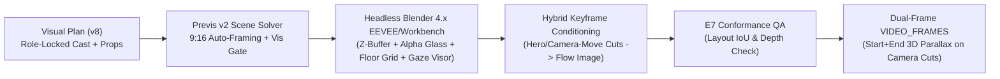

# `R65 v4` (0.3초 의미 전달형) 쇼츠 썸네일 시안 & `3D Previs v2` 업그레이드 설계안

> [!IMPORTANT]
> **피드백 반영 완료 (`"이 썸네일이 뭘 뜻하는 건지 알 수 있어야지"`)**: 직전 시안은 뇌와 마스크·손이 책상 위에 따로 떠 있어 내용을 모르는 시청자가 무슨 상황인지 알 수 없었습니다. 아래 **수정 시안(`R65 v4`)**은 **① 실제 인물의 극적인 표정 대조(무표정 vs 패닉 / 무덤덤 vs 폭소) + ② 사람 머리 내부에 뚫린 3D 뇌 투시 단면창 + ③ 박스 없는 깔끔한 2~3단어 대조 라벨(`NO FEAR` vs `1 BREATH: PANIC!`, `BY MYSELF` vs `BY ROBOT!`)**로 0.3초 만에 역설이 읽히도록 전면 재설계했습니다. 확인 후 **Proceed**를 눌러 주시면 `@Operator`에게 즉시 배정합니다.

---

## Part 1. `R65 v4` 0.3초 의미 전달형 3D 두개골 투시 대조 썸네일

### 1.1 수정 완료 시안 (`R65 v4`) vs 이전 시안 비교

````carousel

<!-- slide -->

<!-- slide -->

<!-- slide -->

````

| 구분 | `Ep #4` (`Why One Breath Terrified a Fearless Woman`) | `Ep #5` (`Why a Delayed Robot Can Tickle You`) |
|---|---|---|
| **상단 `50%` (예상 밖 무반응)** | **`NO FEAR`** — 독사가 얼굴 코앞에서 송곳니를 드러내도 **완전 무표정한 여성** + **머리 속 차갑게 꺼진 회색 3D 뇌 단면** | **`BY MYSELF`** — 스스로 턱 밑을 노란 깃털로 문질러도 **전혀 안 간지러운 무덤덤한 남성** + **머리 속 잠잠한 회색 3D 뇌 단면** |
| **하단 `50%` (역설적 폭발 반응)** | **`1 BREATH: PANIC!`** — 동일 여성이 호흡 마스크로 숨 한 번 쉬자 **눈이 커지며 가슴을 부여잡는 극심한 공포 표정** + 호스를 타고 올라오는 **3D 입체 빨간 화살표** + **붉게 폭발하는 머리 속 뇌간 단면** | **`BY ROBOT!`** — 로봇팔이 노란 깃털로 목을 건드리자 **참지 못하고 박장대소하는 동일 남성** + **시안·붉은 스파크가 터지는 머리 속 3D 소뇌/감각피질 단면** + **3D 빨간 화살표** |
| **촌스러운 요소 제거 & UI 안전성** | 흰색 마네킹 인형 `0개`, 2D 캡슐 박스 `0개`, 하단 `22%`(`y >= 1500`) 무문자 확보로 유튜브 쇼츠 흰색 제목과 겹침 `0%` | 흰색 마네킹 인형 `0개`, 2D 캡슐 박스 `0개`, `'신비한 건축사전'` `#7(시공 직후 / 6개월 후)` 방식의 좌상단 깔끔한 흰색+검정 외곽선 단문 라벨만 적용 |

### 1.2 [`pipeline/thumbnail_studio.py`](file:///home/canadaofbin/gdrive/Kyubin_Yun_Workspace/07_Youtube/pipeline/thumbnail_studio.py) `R65 v4` (`in_skull_cutaway_split_v4`) 변경 명세

1. **마네킹 레퍼런스 차단 + 동일 인물 극단 표정 대조 락 (`L793-L800`)**
   - `_generate_zero_credit_thumb_keyart_async()`에서 `cast_*.png`(무표정 흰색 마네킹) 첨부를 완전 제거(`conditioning_paths=None`)하고, **동일 실제 인물의 상·하 `50/50` 표정 대조(`deadpan calm` vs `visceral panic / hysterical laughter`) + 두개골 내부 외과적 3D 뇌 단면창(`in-skull surgical 3D cutaway window`) + 3D 입체 빨간 화살표** 구도를 기본 템플릿으로 고정합니다.
2. **PPT식 박스·하단 배너 폐지 → 좌상단 클린 2~3단어 대조 라벨 (`L994-L1203`)**
   - 어색했던 파이썬 2D 화살표·`[35% CO2]` 필 박스·하단 텍스트 벽을 전면 삭제하고, 각 분할 패널 좌상단 여백(`y ≈ 60`, `y ≈ 1000`)에만 `<= 3단어` 초단문 대조 라벨(흰색 볼드 산세리프 + 깔끔한 검정 스트로크, 박스 없음)을 배치하며, 하단 `y = 1500..1920` 영역은 유튜브 쇼츠 제목 표시용으로 100% 비워 둡니다.
3. **`TQ1–TQ9` 품질 게이트 개편**
   - 밝은 스튜디오 주광(`Mean Luma >= 110`), 상·하단 뇌 단면 발화 색채 대비(무채색 비활성 vs 적색/시안 발화), 얼굴/표정 가시성, 하단 제목 영역(`y >= 1500`) 텍스트 침범 `0%`를 자동 검증합니다.
4. **예약 완료된 `Ep #4`(`7W8zIOMKPrQ`, 내일 `09:30 KST` 공개) · `Ep #5`(`ut1wde0d19o`) 즉시 반영**
   - 검증 완료된 신규 `R65 v4` 썸네일을 `Ep #4 · Ep #5`의 `06_publish/thumbnail_var_A.png`에 반영하고 YouTube Studio에서 예약 슬롯(`19:30 ET` = `09:30 KST`, `draft_count = 0`) 유지 상태로 즉시 교체합니다.

---

## Part 2. `3D Previs` 실측 포렌식 진단 & `Previs v2` 업그레이드 설계

실제 `Ep #4` 제작 시 생성된 프리비즈 원본(`S01_start` ~ `S08_end`)과 [`visual_plan.json`](file:///home/canadaofbin/gdrive/Kyubin_Yun_Workspace/07_Youtube/BCI_Shorts_Channel/projects/v8_ep04_patient_sm_fearless_amygdala/03_visuals/visual_plan.json), [`pipeline/previs_blender.py`](file:///home/canadaofbin/gdrive/Kyubin_Yun_Workspace/07_Youtube/pipeline/previs_blender.py), [`pipeline/porcelain_anchor_pack.py`](file:///home/canadaofbin/gdrive/Kyubin_Yun_Workspace/07_Youtube/pipeline/porcelain_anchor_pack.py)를 정밀 대조한 결과, **왜 지금 프리비즈가 제 성능을 못 내고 있었는지 결정적인 원인 6가지**가 밝혀졌습니다.


### 2.1 현행 3D Previs 6대 병목 (실측 증거)

| # | 포렌식 발견 사항 | 실제 발생 현상 (`ep04_previs_audit_grid.jpg` & 코드 위치) |
|---|---|---|
| **1** | **렌더링만 해놓고 Flow에 미전달 (`Dead-Weight Compute`)** | `Ep #4 · #5`에서 클립별 `S01..S20_start/end_previs.png`(`40장`)를 렌더링했지만, `daisy_chain_keyframes: False`일 때 [`porcelain_anchor_pack.py`](file:///home/canadaofbin/gdrive/Kyubin_Yun_Workspace/07_Youtube/pipeline/porcelain_anchor_pack.py#L742)가 방 단위 대표 앵커(`ref_loc_*`, `previs_guide_png: None`)만 생성해 **Flow에는 단 1장의 프리비즈도 전달되지 않았습니다.** |
| **2** | **실제 Blender 미설치(`is_blender_available() == False`) + 불투명 유리창 버그(`S07`)** | 리눅스 호스트에 `blender` 바이너리가 없어 `100%` 순수 파이썬 OpenCV 폴백([`_render_workbench_cpu_frame`](file:///home/canadaofbin/gdrive/Kyubin_Yun_Workspace/07_Youtube/pipeline/previs_blender.py#L755))으로 돌고 있었습니다. 투명도(Alpha) 처리가 없다 보니 **`S07_start / S07_end`의 `'관찰창 유리(observation_glass_frame)'`가 거대한 불투명 회색 콘크리트 벽으로 렌더링되어 뒤쪽 신경학자들을 100% 가려버렸습니다!** |
| **3** | **`9:16` 세로 화각 수식 착시(`수평 FOV 20.8°`)로 캐릭터 반토막 잘림** | `S01_start`(`fov_deg=36°`)를 세로 기준으로 투영하면서 `9:16` 화면의 실제 **가로 화각이 `20.8°`(거리 3m에서 가로폭 불과 `1.1m`)**로 좁아져, `x = ±0.46m`에 선 보라색·초록색 캐릭터가 좌우 프레임 밖으로 반토막 잘렸습니다(`S01_start`, `S04_start`, `S06`). |
| **4** | **클립별 소품 배열 전멸(`props: []`) + 빈 상자 코앞 줌인(`S02_end`)** | `v8` `visual_plan.json`의 소품 텍스트가 클립별 `previs.props`로 추출되지 않아 `20개` 전 클립이 `props: []`였습니다(독사 테라리움·산소마스크·로봇팔·깃털 실루엣 전무). 그 결과 `S02_end` 카메라는 빈 회색 테이블 상자 코앞(`34cm`)과 보라색 몸통 사각형만 찍었습니다. |
| **5** | **컷 간 캐릭터 색상/위치 뒤바뀜 & 복수 인원 단일 블록 병합** | `S01`에선 의사가 보라색·환자 S.M.이 초록색인데, 이어지는 `S02`에선 환자 S.M.이 갑자기 보라색으로 바뀌며 의사 좌표(`x=-0.41`)를 물려받았습니다. 또한 `S07`의 `"two neurologists"`는 1개의 블록으로 뭉개졌습니다. |
| **6** | **머리 시선 방향·바닥 원근 그리드 부재 + `E7` 구도 QA 미호출** | 머리가 무방향 2D 동그라미라 Flow가 앞모습/뒷모습/옆모습을 구분하지 못하고, 바닥 격자·접지 그림자가 없어 발이 공중에 떠 보입니다. 또한 이미 구현된 [`previs_conformance_qa()`](file:///home/canadaofbin/gdrive/Kyubin_Yun_Workspace/07_Youtube/pipeline/previs_blender.py#L1377)(`E7` IoU 검증)는 프로덕션 호출처가 `0곳`입니다. |

---

### 2.2 `3D Previs v2` 6단계 업그레이드 아키텍처



1. **업그레이드 P1 — 포터블 Headless `Blender 4.x` 설치 + 시선 바이저·원근 바닥 격자·반투명 유리 지원**
   - `~/opt/blender/blender`에 공식 리눅스 포터블 Blender(Headless Workbench/EEVEE)를 설치해 `is_blender_available() == True`를 활성화하고, 백업 CPU 렌더러에도 **진짜 Z-버퍼 + 알파 블렌딩(`glass` 블록 `alpha=0.22`)**을 추가해 `S07` 같은 콘크리트 유리창 사고를 원천 제거합니다.
   - 캐릭터 머리에 **정면 시선 방향 바이저(코/방향 밴드)**와 바닥 **`0.5m` 원근 체커/그리드 + 발밑 접지 그림자(Contact Shadow)**를 넣어 Google Flow가 **카메라 높낮이(하이앵글/로우앵글)와 인물 시선 방향**을 정확히 읽게 만듭니다.
2. **업그레이드 P2 — `9:16` 전용 `Auto-Framing Frustum Solver` & 불량 프리비즈 자동 차단 게이트**
   - `9:16` 실제 수평 화각 $\text{HFOV} = 2 \arctan\!\left(\frac{9}{16}\tan\frac{\text{VFOV}}{2}\right)$ 기준으로 모든 활성 캐릭터·소품의 3D 바운딩 박스가 화면 좌우·상하 **`12%` 안전 여백** 안에 들어오도록 카메라 거리(`y`)와 `look_at`을 자동 보정합니다 (`S01/S04/S06` 잘림 해결).
   - **Previs Visibility Gate**: 렌더 직후 ① 활성 캐릭터/소품 픽셀 비중 `< 8%`(`S07` 빈 벽) 또는 ② 단일 블록 화면 점유율 `> 60%`(`S02_end` 몸통 벽) 감지 시 카메라 거리를 자동 후퇴시켜 재렌더링합니다.
3. **업그레이드 P3 — 에피소드 고정 `Role-Color Lock` + 복수 인원 분리 + 핵심 소품 복합 실루엣(`Compound Prop Shapes`)**
   - 에피소드 전체에서 주인공(`Teal/Emerald`), 연구자(`Royal Violet`), 보조 인물/로봇(`Amber Gold`)의 프리비즈 색상을 끝까지 고정하고, `"two neurologists"` 같은 복수 명사는 자동으로 2구의 독립 마네킹(`x = -0.32, +0.32`)으로 분리 배치합니다.
   - 프롬프트/도시에에서 클립별 활성 소품을 자동 추출하고, 단순 네모 상자 대신 **`brain_cutaway`(반구+뇌간), `snake_terrarium`(유리 수조+코일 튜브), `mask_tube`(마스크 콘+호스), `robot_arm`(베이스+2관절 암), `chair`, `monitor`** 복합 실루엣 프리미티브를 추가합니다.
4. **업그레이드 P4 — `v8` 하이브리드 Previs 키프레임 실전 배선 ([`porcelain_anchor_pack.py`](file:///home/canadaofbin/gdrive/Kyubin_Yun_Workspace/07_Youtube/pipeline/porcelain_anchor_pack.py))**
   - `20컷` 전부를 무겁게 데이지체인으로 돌리는 대신, **구도·동선이 핵심인 컷(2인 대면 컷, 클로즈업 실험 컷, 큰 카메라 이동 컷 — 에피소드당 핵심 `6~10컷`)**은 방 마스터(`ref_loc_*`) + 검증된 `previs_guide_png`를 함께 넣어 **컷 전용 구도 키프레임**을 생성하도록 배선을 복구합니다.
5. **업그레이드 P5 — [`reference_image_qa.py`](file:///home/canadaofbin/gdrive/Kyubin_Yun_Workspace/07_Youtube/pipeline/reference_image_qa.py) 내 `E7` `previs_conformance_qa` 가동**
   - 프리비즈가 첨부된 키프레임이 실제 생성 후 프리비즈 구도(좌우 인물 배치·구도 중심)와 어긋나면 자동 재생성하며, 프리비즈용 보라/초록 마네킹 색상이 최종 키프레임에 번진 경우(`Previs Color Leak`) 즉시 탈락시킵니다.
6. **업그레이드 P6 — 핵심 카메라 무브 컷 `Start + End` (`VIDEO_FRAMES`) 3D 패럴랙스 가동**
   - `orbital_arc`, `crane_swoop`, `portal_dive` 등 입체 카메라 워크가 지정된 하이라이트 컷(`에피소드당 3~5컷`)에는 같은 3D 씬에서 뽑은 `(Start_Previs -> Start_KF)`와 `(End_Previs -> End_KF)` 두 장을 Flow `VIDEO_FRAMES` 시작·끝 슬롯에 동시에 넣어, 단순 2D 줌인이 아닌 **진짜 3D 카메라 궤적 이동**을 구현합니다.

---

## 3. 실행 순서 (`@Operator` 배정 계획)

1. **Step 1 (최우선 — 내일 `09:30 KST` 공개 전 완료)**: [`pipeline/thumbnail_studio.py`](file:///home/canadaofbin/gdrive/Kyubin_Yun_Workspace/07_Youtube/pipeline/thumbnail_studio.py)를 `R65 v4`(`in_skull_cutaway_split_v4`: 실제 인물 표정 대조 + 두개골 내부 3D 뇌 단면 투시 + 무박스 2~3단어 라벨)로 업그레이드하고, 예약된 `Ep #4`(`7W8zIOMKPrQ`) · `Ep #5`(`ut1wde0d19o`)의 썸네일을 신규 `R65 v4`로 교체 + DOM 검증(`draft_count = 0` 유지).
2. **Step 2 (`3D Previs v2` 업그레이드)**: 포터블 Blender 4.x 설치 및 [`pipeline/previs_blender.py`](file:///home/canadaofbin/gdrive/Kyubin_Yun_Workspace/07_Youtube/pipeline/previs_blender.py) · [`pipeline/porcelain_anchor_pack.py`](file:///home/canadaofbin/gdrive/Kyubin_Yun_Workspace/07_Youtube/pipeline/porcelain_anchor_pack.py) · [`pipeline/reference_image_qa.py`](file:///home/canadaofbin/gdrive/Kyubin_Yun_Workspace/07_Youtube/pipeline/reference_image_qa.py) `P1~P6` 업그레이드 + 단위 테스트 검증 후 `Ep #6` 제작부터 즉시 적용(하루 1편 `19:30 ET` = `09:30 KST` 연속 예약 유지).
