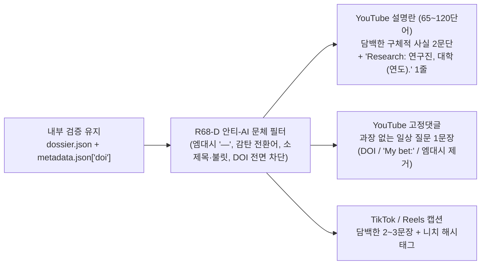

# Rule `R68-D` 구현 계획서 (v3) — AI 티 제로(Zero AI-Smell) 담백한 설명란 & 고정댓글 전환

## Goal Description

기존 학술 템플릿(`"Documentary case briefing on..."`, `https://doi.org/...`)뿐 아니라, 이전 초안에 들어갔던 **엠대시(`—`), 과장된 감탄형 전환어(`"When you first hear about..."`, `"What's wild is..."`, `"Turns out..."`), 마지막 문단의 훈계조 교훈 마무리(`"So if you ever..., slow your exhale"`), 본문 하단의 `"Visuals and voice were created with AI..."` 문구**는 모두 전형적인 AI 생성 글의 흔적(AI-smell)을 남깁니다.

**Rule `R68-D` (v3)**는 이러한 AI 상투어와 문장 부호 버릇을 코드 게이트로 원천 차단하고, 실제 과학 유튜버가 직접 적듯 **담백하고 구체적인 평서문 2문단(`65~120단어`) + 짧은 연구 출처 1줄**로 설명란을 구성합니다. (AI 합성 여부는 본문 텍스트에 따로 적지 않고 YouTube Studio 공식 체크박스 `"Altered or synthetic content" = Yes` 하나로 깔끔하게 처리합니다.)



---

## User Review Required

> [!IMPORTANT]
> **AI 느낌 제거(`Zero AI-Smell`) 핵심 규칙 5가지**
> 1. **엠대시(`—`, `--`) · 세미콜론 · 콜론 소제목 · 불릿(`•`) 전면 금지**: 마침표(`.`)와 쉼표(`,`)만 쓰는 자연스러운 사람 문장만 허용합니다.
> 2. **ChatGPT 특유의 수사적 추임새 하드 차단**: `"Turns out"`, `"What's wild is"`, `"Here's the catch"`, `"When you first hear about"`, `"sounds like a superpower"`, `"you're not imagining things"`, `"what happened next"`, `"bring stories to life"` 등 AI 클리셰 구문이 하나라도 들어가면 `prompt-gate`에서 즉시 반려합니다.
> 3. **억지 '실생활 교훈/처방' 문단 삭제**: AI 글 특유의 `"그러니 다음에 ~할 때는 ~해보세요"` 식 마무리 대신, 실험에서 밝혀진 흥미로운 사실 자체로 담백하게 끝맺습니다.
> 4. **본문 내 AI 문구 제거**: 설명란 텍스트 안에 `"Visuals and voice were created with AI..."`를 넣지 않습니다 (YouTube Studio 업로더의 공식 `"Altered or synthetic content" = Yes` 설정만 유지).
> 5. **적용 범위**: 이미 게시된 `v8_pilot_03`은 건드리지 않고, 현재 제작 중인 **`Ep #4` · `Ep #5`부터 즉시 적용**합니다.

---

## 차기작 2편(`Ep #4` · `Ep #5`) 실제 문안 미리보기

````carousel
```text
[Ep #4: v8_ep04_patient_sm_fearless_amygdala — YouTube Description]

Patient S.M. lived for decades with rare damage to both sides of her amygdala, the part of the brain usually linked to fear. Doctors at the University of Iowa took her to exotic pet stores, handed her live snakes, showed her horror movies, and walked her through a haunted house. She stayed curious the whole time and never once felt scared.

That changed in a breathing lab. One harmless breath of 35% carbon dioxide gave her a full panic attack in seconds, the first fear she had felt since childhood. Outside threats go through the amygdala, while suffocation alarms sit much deeper in the brainstem, which explains why sudden panic can hit your body even when the room around you looks completely safe.

Research: Feinstein et al., University of Iowa (2011, 2013).
```
<!-- slide -->
```text
[Ep #5: v8_ep05_ucl_tickle_delay_robot — YouTube Description]

Try tickling your own palm and nothing happens, even if someone else barely touches the exact same spot and you lose it.

A team at UCL tested why by having volunteers move a plastic lever with their left hand to stroke their right palm with a soft foam brush. When the brush moved right away, it barely felt like anything because the cerebellum already knew the touch was coming and turned the sensation down. Once the researchers added a 0.2 second delay between the two hands, the brain stopped recognizing the touch as its own, and people started laughing from their own hand.

Research: Blakemore et al., University College London (1998, 1999).
```
<!-- slide -->
```text
[Ep #4 & Ep #5 — Pinned Comment Preview]

Ep #4 Pinned Comment:
Have you ever had your heart start pounding out of nowhere when nothing scary was going on around you?

---

Ep #5 Pinned Comment:
Are you super ticklish, or can you keep a straight face no matter what?
```
````

---

## Proposed Changes

### Component 1: 안티-AI 클리셰(`R68-D`) 상수 정의

#### [MODIFY] [config.py](file:///home/canadaofbin/gdrive/Kyubin_Yun_Workspace/07_Youtube/pipeline/config.py)
- 설명란 단어 범위(`55~135w`) 및 AI 티가 나는 문장부호·상투어 차단 목록 정의:
```python
R68D_DESCRIPTION_WORD_RANGE: tuple[int, int] = (55, 135)
R68D_BANNED_AI_CLICHES: tuple[str, ...] = (
    "—",
    " -- ",
    "documentary case briefing on",
    "at the circuit level",
    "measured neural protocol",
    "primary peer-reviewed source",
    "source & verification:",
    "turns out,",
    "what's wild is",
    "here's the catch",
    "here is the catch",
    "when you first hear about",
    "sounds like a superpower",
    "movie superpower",
    "what happened next",
    "you're not imagining things",
    "bring real brain",
    "crafted with ai",
    "created with ai",
    "visuals and voice",
    "what didn't fit",
    "how to use this today",
    "delve",
    "testament to",
    "game-changer",
)
```

---

### Component 2: 담백한 설명란 · 무(無)DOI 고정댓글 · 멀티플랫폼 캡션 빌더

#### [MODIFY] [publish.py](file:///home/canadaofbin/gdrive/Kyubin_Yun_Workspace/07_Youtube/pipeline/publish.py)
1. **`_scrub_experiment_nicknames()` 교정**: `"measured neural protocol"` 기계적 치환어를 자연스러운 `"this experiment"`로 교체합니다.
2. **`format_v8_viewer_story_description()` & `validate_v8_viewer_description()` 신설**:
   - `script_doc["viewer_description"]`을 렌더링(없을 경우 `dossier.json`의 구체적 사실 문장 2문단 + `Research: <Author> et al., <Institution> (<Year>).` 1줄로 합성, 엠대시 자동 쉼표 정규화 포함).
   - `validate_v8_viewer_description()` 하드 검증:
     - `https://doi.org/` 또는 `10.\d{4,9}/` 포함 시 `FAIL` (`PRE_R68H_FROZEN_V8_PROJECTS` 제외).
     - `R68D_BANNED_AI_CLICHES` (엠대시 `—`, AI 추임새, AI 자가고지 문구 등) 포함 시 `FAIL`.
     - 불릿(`•`, `-`, `*`) 및 콜론 소제목 줄 포함 시 `FAIL`.
     - 해시태그(`#`) 및 한글 포함 시 `FAIL`.
3. **`build_expressive_v8_pinned_comment()` 간소화**:
   - DOI 링크, `"My bet:"` 접두어, 엠대시(`—`), 강제 카메오 문구 부착을 빼고 담백한 일상 질문 1문장(원할 때만 선택적 `cameo_prompt`)으로 출력합니다.
4. **`export_multi_platform_bundle()` 동기화**:
   - TikTok / Instagram Reels 캡션에서도 DOI와 AI 상투어를 제거하고 담백한 본문 + 니치 해시태그만 남깁니다 (`metadata.json["ai_content_declaration"] = True` Studio 플래그는 그대로 유지).

#### [MODIFY] [diorama_batch_orchestrator.py](file:///home/canadaofbin/gdrive/Kyubin_Yun_Workspace/07_Youtube/pipeline/diorama_batch_orchestrator.py), [community.py](file:///home/canadaofbin/gdrive/Kyubin_Yun_Workspace/07_Youtube/pipeline/studio/community.py), [prompt_quality_v5.py](file:///home/canadaofbin/gdrive/Kyubin_Yun_Workspace/07_Youtube/pipeline/prompt_quality_v5.py)
- `v8` 에피소드 설명란·고정댓글 생성 경로를 `R68-D` 빌더로 연결하고, `CommunityManager`의 DOI 재부착을 끄며, `prompt-gate`에서 안티-AI 문체 검증을 수행합니다.

---

### Component 3: 스킬(`natural_script` 원칙 반영)·룰·테스트 동기화 및 `Ep #4 · Ep #5` 적용

#### [MODIFY] [youtube-script/SKILL.md](file:///home/canadaofbin/gdrive/Kyubin_Yun_Workspace/07_Youtube/.agents/skills/youtube-script/SKILL.md), [neuro_diorama_rules.md](file:///home/canadaofbin/gdrive/Kyubin_Yun_Workspace/07_Youtube/.agents/rules/neuro_diorama_rules.md), [channel_operations_rules.md](file:///home/canadaofbin/gdrive/Kyubin_Yun_Workspace/07_Youtube/.agents/rules/channel_operations_rules.md), [youtube_studio_operations.md](file:///home/canadaofbin/gdrive/Kyubin_Yun_Workspace/07_Youtube/.agents/rules/youtube_studio_operations.md), [AGENTS.md](file:///home/canadaofbin/gdrive/Kyubin_Yun_Workspace/07_Youtube/.agents/AGENTS.md)
- `youtube-script` 작성 지침에 **엠대시 금지·감탄형 전환어 금지·교훈 강요 금지·구체적 평서문 2문단 원칙**을 명시합니다.

#### [NEW] [test_r68d_viewer_story_description.py](file:///home/canadaofbin/gdrive/Kyubin_Yun_Workspace/07_Youtube/tests/test_r68d_viewer_story_description.py)
- 엠대시(`—`), AI 클리셰, DOI 링크, 불릿 유입 시 하드 차단되는지 단위 테스트로 검증하고 `Ep #4` · `Ep #5`에 적용합니다.

---

## Verification Plan

### Automated Tests
```bash
/home/canadaofbin/hermes-venv/bin/python -X utf8 -m pytest -q \
  tests/test_r68d_viewer_story_description.py \
  tests/test_r68h_case_stamp_hook.py \
  tests/test_expressive_25d_v8.py \
  tests/test_multi_platform_bundle.py
```
