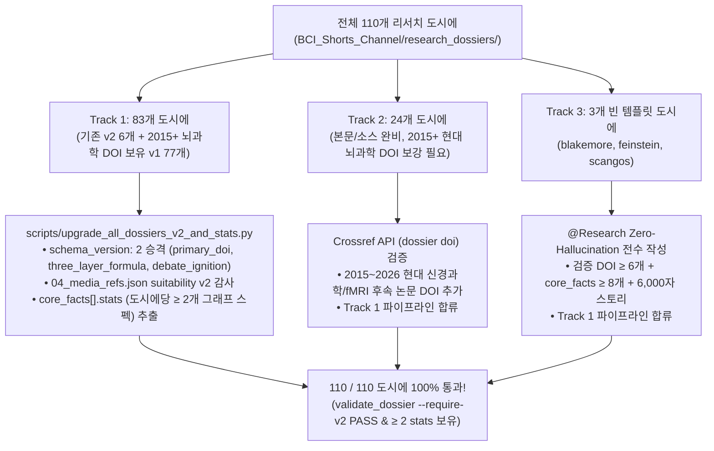

# R70-M v3 마스터 플랜: 손그림 차트 엔진 (`Box · Violin · Scatter · 조합 그래프 · Concept 모드`) & 전체 110개 도시에 `Schema v2 + stats` 전수 업그레이드

## 목표
1. 이전 보고서([multi_graph_retention_strategy_report.md](./multi_graph_retention_strategy_report.md))의 부정확한 부분을 실제 코드 기준으로 바로잡습니다 (§1).
2. 연구 수치 형식에 맞춰 **bar / box / violin / scatter / line 등 15종 레이어**를 자동 또는 수동으로 선택하고, **복합 그래프(레이어 겹치기 `raincloud`, `scatter_fit` 등 + `2x1` 2단 패널)**를 그리는 손그림 차트 엔진을 구축합니다 (§3~§5).
3. 통계·수학 개념 설명 시 자유롭게 쓸 수 있는 **`illustrative` 모드(화면 태그: `"Concept"`)**와 논문 요약치 기반 **`derived` 모드**, 원문 수치 기반 **`study` 모드**를 지원합니다 (§3).
4. **전체 110개 리서치 도시에(`BCI_Shorts_Channel/research_dossiers/`) 전수 감사 결과**를 바탕으로, 아직 `Schema v1`에 머물러 있는 104개 도시에를 포함한 **110개 전체 주제를 `Schema v2` + `R70-M stats`로 100% 업그레이드**합니다 (§6).

**확정된 사용자 결정 사항**
- **Box / Violin / Scatter 및 조합 그래프**: 모두 구현하며 통계·수학적 설명 시 자유롭게 사용 가능하도록 지원.
- **개념 설명용(`illustrative`) 화면 태그**: **`"Concept"`** 으로 확정.
- **에피소드당 최소 2개 규칙**: 차단 대신 **경고(Warning)만** 출력.
- **도시에 업그레이드 범위**: 5개 샘플이 아닌 **전체 110개 모든 주제 전수 진행**.

---

## 1. 이전 보고서 정정 (코드 대조 검증 결과)

| # | 보고서 주장 | 실제 코드 확인 결과 | 판정 |
|---|---|---|---|
| 1 | 최대 2개, 합성기는 여러 개 지원 | [config.py](file:///home/canadaofbin/gdrive/Kyubin_Yun_Workspace/07_Youtube/pipeline/config.py) `DATA_STAMP_MAX_PER_EPISODE = 2`, `composite_data_stamps_on_video()`가 리스트를 순회하며 합성 | ✅ 정확 |
| 2 | "시딩 함수가 첫 문장만 반환해서 1개만 나옴" | `seed_default_data_stamps_from_dossier()`는 **호출하는 곳이 0곳**. `research_dossier.py`는 `data_stamps: []`로 빈 리스트를 시딩함. Pilot #3 스탬프는 수동 작성 | ❌ 정정 완료 |
| 3 | 차트가 `bar_compare` 한 종류뿐 | 렌더러가 `chart` 필드를 읽지 않고 가로 막대(최대 3개)만 그림 | ✅ 정확 |
| 4 | 0–15s "`M9` 공간 스탬프" | `resolve_spatial_metric_stamps()`가 FFmpeg 합성 경로에 아직 연결되지 않음 | ❌ 정정 완료 |
| 5 | "`+3.5~4.5초` 체류", "25초·70% 이탈" | 출처가 없는 추정치 | ⚠️ 가설로 표기 후 Studio 데이터로 검증 |
| 6 | `tests/test_data_stamp_overlay.py` 수정 | 해당 테스트 파일이 존재하지 않음 | ❌ 신규 생성(`NEW`)으로 변경 |
| 7 | `R71` 뇌 해부도 라벨과의 시간축 충돌 회피 필요 | `dynamic_episode_qa.py`는 모션 검사 면제용으로만 `top_overlay_spans`를 사용하며 충돌 방지 로직은 없음 | ✅ 정확 (구현 예정) |
| 8 | 자막 `Y≈73%`, 상단 블러 영역 `0–66%` | `1399px` (`72.9%`), `blur_h = 0.66·H` | ✅ 정확 |

---

## 2. 전체 110개 도시에 최신 업데이트 현황 & 수치 형식 스캔 결과

### 2.1 "이미 다른 주제들은 최신으로 다 업데이트되어 있는가?" — 전수 감사 결과

`BCI_Shorts_Channel/research_dossiers/` 내 **전체 110개 도시에**를 `validate_dossier(require_schema_v2=True)` 기준으로 전수 스캔한 결과는 다음과 같습니다:

| 구분 | 도시에 수 | 상세 상태 | 업그레이드 조치 (§6) |
|---|---:|---|---|
| **① `Schema v2` 완료** | **6개** | `glymphatic_sleep_toxins`, `v2_anxiety_kross_...`, `v2_habits_marshmallow_...`, `v2_memory_loftus_...`, `v2_relationships_coan_...`, `v2_sleep_first_night_...` (`validate_dossier --require-v2` 통과) | `core_facts[].stats` (그래프용 수치 블록 ≥ 2개) 추가 |
| **② `Schema v1` (본문·소스·2015+ 뇌과학 DOI 완비)** | **77개** | `01_sources.json`(≥ 6개 소스 & 2015년 이후 현대 뇌과학 DOI 보유), `core_facts`(≥ 8개), `02_master_story.md`(≥ 6,000자), `03~07` 파일이 모두 완비되어 있으나, `dossier.json` 최상단에 `schema_version: 2` 메타 필드(`primary_doi`, `three_layer_formula`, `debate_ignition`)만 누락된 상태 | 기존 검증된 소스/팩트로부터 `Schema v2` 메타 필드 자동 승격 + `04_media_refs.json` v2 감사 + `core_facts[].stats` ≥ 2개 구조화 |
| **③ `Schema v1` (본문 완비, 2015+ 현대 뇌과학 DOI 보강 필요)** | **24개** | 고전 심리학/신경학 논문 소스와 팩트(≥ 8개)는 완비되어 있으나, `Schema v2` 필수 요건인 **2015년 이후 현대 신경과학/fMRI 후속 논문 DOI**가 `01_sources.json`에 없거나 미디어 적합성 감사(`suitability_schema_version: 2`)가 누락된 상태 | Crossref API로 각 주제의 2015~2026년 검증된 현대 뇌과학 후속 논문 DOI 1~2건 추가 + `Schema v2` 승격 + `stats` ≥ 2개 구조화 |
| **④ 초기 빈 템플릿 (Skeleton)** | **3개** | `blakemore_cerebellar_tickle_prediction`, `feinstein_patient_sm_fearless_amygdala`, `scangos_closed_loop_depression_dbs` (`sources = 0`, `core_facts = 0`) | Crossref 검증 DOI ≥ 6개 + `core_facts` ≥ 8개 + 마스터 스토리(≥ 6,000자) + `Schema v2` + `stats` 전수 작성 |
| **합계** | **110개** | **현재 `Schema v2` 통과: 6/110개 · `stats` 보유: 0/110개** | **목표: 110/110개 전수 `Schema v2` + `stats` 완료** |

### 2.2 도시에 내 연구 수치 보고 형식 분포 (1,412개 팩트 스캔)

| 수치 보고 형식 | 팩트 수 | 도시에 수 | 매칭 차트 프리셋 |
|---|---:|---:|---|
| 전후 / 조건 비교 (`before/after`, `baseline`) | 248 | 90 | `slope_paired`, `bar_compare` |
| 퍼센트 (`%`, `percent`) | 243 | 73 | `arc_gauge`, `bar_compare`, `dot_array` |
| 배수 (`×`, `twice`, `-fold`) | 94 | 59 | `bar_compare` (+ 베지어 배수 화살표) |
| 시계열 / 시간 경과 (`over time`, `days later`) | 77 | 54 | `line`, `line_band`, `curve_marker` |
| 생리·물리 단위 (`ms`, `Hz`, `mph`, `bpm`) | 64 | 26 | `bar_compare`, `range_band` |
| 표본 비율 (`x of y`, `1 of 14`) | 24 | 14 | `dot_array` |
| 집단 평균 (`mean`, `average`) | 27 | 21 | `bar_compare`, `bar_points_error`, `raincloud` (`derived`) |
| 범위 / 중앙값 (`range`, `median`) | 8 | 8 | `range_band`, `box` |
| 상관계수 (`r = 0.79`, `r²`) | 5 | 5 | `scatter_fit` (`derived` / `study`) |

---

## 3. 핵심 설계: 3가지 데이터 모드 (`study` · `derived` · `illustrative`)

연구 팩트의 정확성(Zero-Hallucination)을 지키면서도 Box, Violin, Scatter 및 수학/통계 그래프를 **언제든 자유롭게** 쓸 수 있도록 3가지 모드를 지원합니다.

| 모드 | 사용 목적 | 데이터 생성 방식 | 화면 표시 라벨 | DOI 요구 |
|---|---|---|---|---|
| **`study`** | 논문에 보고된 정확한 수치/사분위수/원자료 시각화 | 논문 수치를 그대로 사용 | `Study: Author (Year)` | 필수 |
| **`derived`** | 논문에 보고된 요약 통계(평균±SD, 범위, 상관계수 `r`)를 바탕으로 **분포(Box/Violin/Raincloud)나 산점도(Scatter) 형태를 재현**할 때 | 보고된 파라미터 + 명시된 통계 모형(`normal`, `truncated_normal`, `bivariate_normal`) + 고정 `seed` | `Modeled from reported stats · Author (Year)` | 필수 |
| **`illustrative`** | **통계·수학·뇌과학 개념 설명** (예: 정규분포, 상관 vs 인과, 망각곡선 수식, 시그모이드 역치, 프로스펙트 손실회피 곡선 등) | 수식 또는 분포 파라미터로 결정론적 생성 (`seed` 고정) | 우상단 손글씨 태그 **`Concept`** | 불필요 |

> [!IMPORTANT]
> - **`illustrative` 모드(`"Concept"` 태그)**에서는 논문 DOI 제약 없이 **모든 레이어(Box, Violin, Scatter, 수식 곡선, 복합 패널)를 100% 자유롭게** 사용할 수 있습니다. 단, 시청자가 실제 실험 데이터와 혼동하지 않도록 우상단에 손글씨 **`Concept`** 배지가 자동으로 렌더링됩니다.

---

## 4. 손그림 차트 엔진 아키텍처 (`pipeline/charts/`)

### 4.1 15종 손그림 레이어 (`DATA_STAMP_LAYER_TYPES`)

기존 `pipeline/data_stamp_overlay.py`의 크레용/잉크펜 스트로크 엔진(`draw_tapered_hand_stroke`, 종이 질감 마스크, 손글씨 폰트 `PatrickHand` / `Caveat`)을 공유하여 화풍을 100% 통일합니다.

| 분류 | 레이어 타입 | 시각적 연출 및 특징 |
|---|---|---|
| **비교 (Comparison)** | `bar` | 가로/세로 손그림 막대 (2~4그룹) + 베지어 곡선 비교 화살표 + 타원 루프(`4×`) |
|  | `error` | 평균 막대 또는 점 위에 그려지는 손그림 `I`-자형 오차막대 (`SD`, `SE`, `95% CI`) |
|  | `slope` | 좌측(`Before` / `Control`)에서 우측(`After` / `Intervention`)으로 이어지는 전후 비교 기울기 선 |
|  | `dot_array` | `14명 중 1명`(`1 of 14`) 등을 직관적으로 보여주는 손그림 원형 도트 그리드 (`n <= 100`, 해당 개수 컬러 점등) |
|  | `arc_gauge` | `0% -> 86%`까지 시계방향으로 채워지는 크레용/마커 원호 게이지 + 정중앙 카운트업 숫자 |
| **분포 (Distribution)** | `points` | 그룹별 개별 데이터 포인트 (고정 `seed` 지터 스웜/스트립 플롯) |
|  | `box` | 손그림 사분위수 박스(`Q1~Q3`) + 굵은 중앙값(`Median`) 가로선 + `min~max` 수염(Whisker) |
|  | `violin` | `scipy.stats.gaussian_kde`로 계산된 확률밀도 윤곽선을 양쪽(또는 반쪽 Half-Violin) 손그림 곡선으로 드로잉 + 내부 반투명 크레용 해칭 |
|  | `histogram` | 구간(Bin)별 빈도를 손그림 기둥으로 순차 상승 드로잉 |
|  | `density` | 부드러운 확률밀도 곡선 (정규분포 종 모양, 이봉분포, 왜도 분포 등) |
| **관계 (Relationship)** | `scatter` | `(x, y)` 산점도 도트 클라우드 (최대 120점, 좌→우 또는 랜덤 순서로 팝업 드로잉) |
|  | `regression` | 산점도 위를 가로지르는 손그림 회귀 추세선(직선/곡선) + `r = 0.79` 손글씨 콜아웃 |
| **추세·수식 (Trend & Math)** | `line` | 다중 계열 시계열 꺾은선 (`1~3`개 라인이 좌→우로 달리며 벌어짐 + 변곡점 마커) |
|  | `band` | 추세선이나 범위 주변을 감싸는 반투명 크레용 음영 밴드 (`CI` 또는 `min~max` 범위) |
|  | `function_curve` | 수학·인지과학 함수 곡선: `exp_decay`(망각곡선), `sigmoid`(의식 점화/역치), `normal_pdf`(가우시안), `prospect_value`(카너먼 손실회피 S-곡선), `power`, `log`, `inverted_u`(여키스-도슨 각성 곡선) |

### 4.2 복합 그래프 (Composite & Multi-Panel)

1. **단일 축 다중 레이어 조합 (13종 프리셋 `DATA_STAMP_PRESETS`)**:
   - `raincloud`: **Half-Violin (`violin`) + Box (`box`) + Jittered Points (`points`)** — 현대 심리학·신경과학 논문에서 가장 많이 쓰는 분포+요약 결합 그래프!
   - `box_points`: **Box (`box`) + 개별 점 (`points`)**
   - `violin_box`: **양쪽 Violin (`violin`) + 내부 미니 Box (`box`)**
   - `bar_points_error`: **막대 (`bar`) + 개별 점 (`points`) + 오차막대 (`error`)**
   - `scatter_fit`: **산점도 (`scatter`) + 회귀선 (`regression`) + 신뢰 밴드 (`band`)**
   - `line_band`: **시계열 꺾은선 (`line`) + 오차/범위 밴드 (`band`)**
   - `hist_density`: **히스토그램 (`histogram`) + 밀도 곡선 (`density`)**
   - `curve_marker`: **수학 함수 곡선 (`function_curve`) + 변곡점/임계점 마커 (`points`) + 화살표 콜아웃**
   - 단일 프리셋: `bar_compare`, `dot_array`, `arc_gauge`, `slope_paired`, `line`, `range_band`, `box`, `violin`
2. **2단 멀티 패널 (`layout: "2x1"`)**:
   - 상단 히어로 영역(`Y = 10%..62%`)을 위/아래 2개 서브 패널로 분할하여, 예컨대 **[상단 패널: 실험 행동 결과 `bar` (`study`)] + [하단 패널: 뇌 시그모이드 역치 곡선 `function_curve` (`illustrative` · `Concept`)]**를 한 화면에서 위→아래 순서로 그려낼 수 있습니다.
3. **레이어별 순차 빌드업 타임라인 (`reveal_at`)**:
   - 복합 그래프가 한꺼번에 복잡하게 뜨지 않도록, `0.0 -> 1.0` 진행도에 따라 **[축 드로잉] → [점/막대/산점도] → [박스/바이올린 윤곽 또는 회귀선] → [화살표 & 핵심 수치 하이라이트]** 순으로 단계별 드로잉됩니다.

---

## 5. 자동 라우팅 및 검증 규칙 (`validate_data_stamps`)

### 5.1 검증 규칙 (차단 vs 경고 분리)

| 코드 | 검증 항목 | 수준 |
|---|---|---|
| **R70-M1** | `preset` / `layers` 타입 유효성, 필수 필드, 모바일 가독성 상한(패널 ≤ 2, 패널당 레이어 ≤ 3, 그룹 ≤ 4, 산점도 점 ≤ 120) | **차단 (Error)** |
| **R70-M2** | `study` / `derived` 모드: 유효한 DOI + `source_citation` 필수, 핵심 수치 중 최소 1개가 해당 대본 문장에서 발화됨(`"1 of 14"`, `"one in fourteen"` 등 자연어 매칭 포함) | **차단 (Error)** |
| **R70-M3** | `illustrative` 모드: 우상단 **`"Concept"`** 태그 자동 부착, 가짜 DOI 기재 금지 | **차단 (Error)** |
| **R70-M4** | 수치 무결성: 퍼센트 `0..100`, `k <= n`, `SD >= 0`, `|r| <= 1`, 사분위수 `min <= q1 <= median <= q3 <= max` | **차단 (Error)** |
| **R70-M5** | v8 에피소드 내 `data_stamps` 개수 `< 2`개 | **경고만 (Warning)** |
| **R70-M6** | 스탬프 간 간격: 문장 간격 `< 4`문장 또는 시간 간격 `< 18.0s` (단, 시간 구간이 직접 겹치면 차단) | **경고만 (Warning)** |
| **R70-M7** | 한 에피소드 내 동일한 차트 프리셋 연속 사용 | **경고만 (Warning)** |
| **R70-M8** | `R71` 3D 뇌 해부학 지시선 라벨과 `2.0s` 버퍼 이내 근접 시 조립기(`diorama_assembler.py`)가 오프셋 조정 또는 `R71` 콜아웃 자동 생략 | **자동 회피** |

---

## 6. 전체 110개 도시에 `Schema v2 + R70-M stats` 전수 업그레이드 계획

단 5개가 아니라 **채널의 전체 110개 도시에 모두** 언제든 에피소드로 즉시 제작할 수 있도록 3-Track 일괄 업그레이드를 수행합니다.



1. **Track 1 (`83`개 도시에: 기존 `v2` 6개 + `>=2015` DOI 보유 `v1` 77개)**:
   - 이미 `01_sources.json`에 검증된 고전 실험 DOI와 2015년 이후 현대 신경과학 DOI가 모두 들어 있으므로, 이를 연결해 `three_layer_formula`, `primary_doi`, `everyday_domain`, `debate_ignition`, `04_media_refs.json` (`suitability_schema_version: 2`)을 채우고 `core_facts` 내 수치 팩트들을 분석해 도시에당 **최소 2개 이상의 서로 다른 차트 프리셋용 `stats` 블록**을 자동 생성·검증합니다.
2. **Track 2 (`24`개 도시에: `>=2015` 현대 신경과학 DOI 추가 필요)**:
   - Crossref API를 통해 각 도시에 주제와 직결되는 2015년 이후 실제 동료심사 신경과학/뇌영상 논문 DOI를 조회·검증하여 `01_sources.json`에 추가한 뒤 Track 1과 동일하게 `Schema v2` 및 `stats`를 완성합니다.
3. **Track 3 (`3`개 빈 스켈레톤 도시에: `blakemore_cerebellar_tickle_prediction`, `feinstein_patient_sm_fearless_amygdala`, `scangos_closed_loop_depression_dbs`)**:
   - 실제 논문 DOI(`Blakemore et al. 1998 Nature Neuroscience` 등, `Feinstein et al. 2011 Current Biology / 2013 Nature Neuroscience`, `Scangos et al. 2021 Nature Medicine`)와 후속 연구 6건 이상, 핵심 팩트 8건 이상, 마스터 스토리 6,000자 이상, 시각 레퍼런스 및 뇌 부위 링크를 전수 작성해 110개 중 단 하나의 구멍도 없게 만듭니다.

---

## 7. 변경 및 신규 파일 목록

### 설정 및 차트 엔진 코어
#### [MODIFY] [config.py](file:///home/canadaofbin/gdrive/Kyubin_Yun_Workspace/07_Youtube/pipeline/config.py)
- `DATA_STAMP_MIN_PER_EPISODE = 2` (경고 전용), `DATA_STAMP_MAX_PER_EPISODE = 3`
- `DATA_STAMP_ILLUSTRATION_TAG = "Concept"`
- `DATA_STAMP_MODES`, `DATA_STAMP_LAYER_TYPES` (15종), `DATA_STAMP_PRESETS` (13종), 가독성 및 홀드 시간 상수 추가

#### [NEW] [pipeline/charts/__init__.py](file:///home/canadaofbin/gdrive/Kyubin_Yun_Workspace/07_Youtube/pipeline/charts/__init__.py)
#### [NEW] [pipeline/charts/spec.py](file:///home/canadaofbin/gdrive/Kyubin_Yun_Workspace/07_Youtube/pipeline/charts/spec.py)
- `ChartSpec` / `PanelSpec` / `LayerSpec` 정규화 및 13종 프리셋 전개기
#### [NEW] [pipeline/charts/data_prep.py](file:///home/canadaofbin/gdrive/Kyubin_Yun_Workspace/07_Youtube/pipeline/charts/data_prep.py)
- `study` / `derived` / `illustrative` 데이터 준비기 (`normal`, `truncated_normal`, `bivariate_normal`, `gaussian_kde`, 사분위수, OLS 회귀직선 및 신뢰대, 7종 수학·인지 함수 곡선)
#### [NEW] [pipeline/charts/axes.py](file:///home/canadaofbin/gdrive/Kyubin_Yun_Workspace/07_Youtube/pipeline/charts/axes.py)
- 단일 패널 및 `2x1` 2단 패널 레이아웃 좌표계, 손그림 축·눈금·라벨 드로잉
#### [NEW] [pipeline/charts/layers.py](file:///home/canadaofbin/gdrive/Kyubin_Yun_Workspace/07_Youtube/pipeline/charts/layers.py)
- 15종 레이어(`bar`, `error`, `slope`, `dot_array`, `arc_gauge`, `points`, `box`, `violin`, `histogram`, `density`, `scatter`, `regression`, `line`, `band`, `function_curve`) 프로그레시브 손그림 렌더러
#### [NEW] [pipeline/charts/compose.py](file:///home/canadaofbin/gdrive/Kyubin_Yun_Workspace/07_Youtube/pipeline/charts/compose.py)
- 멀티 레이어 및 멀티 패널 합성, `reveal_at` 순차 빌드업, 우상단 **`"Concept"`** 배지 / 하단 `Study:` · `Modeled:` 각주 렌더링

### 기존 파이프라인 연동
#### [MODIFY] [data_stamp_overlay.py](file:///home/canadaofbin/gdrive/Kyubin_Yun_Workspace/07_Youtube/pipeline/data_stamp_overlay.py)
- 기존 `bar_compare` 단일 스키마는 100% 하위 호환 유지, 신규 프리셋/레이어/패널 스키마는 `pipeline.charts`로 디스패치
- `validate_data_stamps(..., return_warnings=False)` 확장 (차단 에러와 경고 분리)
- `seed_data_stamps_from_dossier()` 다중 차트 시딩 구현

#### [MODIFY] [research_dossier.py](file:///home/canadaofbin/gdrive/Kyubin_Yun_Workspace/07_Youtube/pipeline/research_dossier.py)
- `core_facts[].stats` 선택적 스키마 검증 및 `dossier seed` 시 `seed_data_stamps_from_dossier()` 자동 연동

#### [MODIFY] [diorama_assembler.py](file:///home/canadaofbin/gdrive/Kyubin_Yun_Workspace/07_Youtube/pipeline/diorama_assembler.py)
- `R70` 데이터 스탬프와 `R71` 뇌 해부학 지시선 간 `2.0s` 버퍼 충돌 자동 회피 및 `overlay_conflicts_resolved` 기록

#### [MODIFY] [prompt_quality_v5.py](file:///home/canadaofbin/gdrive/Kyubin_Yun_Workspace/07_Youtube/pipeline/prompt_quality_v5.py) & [cli.py](file:///home/canadaofbin/gdrive/Kyubin_Yun_Workspace/07_Youtube/pipeline/cli.py)
- `prompt-gate`에서 스탬프 경고를 차단 에러와 분리 출력
- `main.py chart-preview` CLI 서브커맨드 추가

### 전체 110개 도시에 업그레이드 스크립트 & 데이터
#### [NEW] [scripts/upgrade_all_dossiers_v2_and_stats.py](file:///home/canadaofbin/gdrive/Kyubin_Yun_Workspace/07_Youtube/scripts/upgrade_all_dossiers_v2_and_stats.py)
- 전체 110개 도시에의 `Schema v2` 승격, 미디어 적합성 v2 감사, `core_facts[].stats` 구조화 및 전수 검증 실행 스크립트
#### [MODIFY] `BCI_Shorts_Channel/research_dossiers/*/dossier.json`, `01_sources.json`, `04_media_refs.json` (110개 도시에)

### 문서 및 리포트 동기화
#### [MODIFY] [neuro_diorama_rules.md](file:///home/canadaofbin/gdrive/Kyubin_Yun_Workspace/07_Youtube/.agents/rules/neuro_diorama_rules.md), [production_constants.md](file:///home/canadaofbin/gdrive/Kyubin_Yun_Workspace/07_Youtube/.agents/rules/production_constants.md), [AGENTS.md](file:///home/canadaofbin/gdrive/Kyubin_Yun_Workspace/07_Youtube/.agents/AGENTS.md), `SKILL.md`
#### [MODIFY] [multi_graph_retention_strategy_report.md](./multi_graph_retention_strategy_report.md)

---

## 8. 검증 계획 (Verification Plan)

### 자동 테스트
#### [NEW] `tests/test_chart_engine.py`
- 15종 레이어 + 13종 복합 프리셋(`raincloud`, `violin_box`, `scatter_fit`, `2x1` 패널 등) + `"Concept"` 태그 렌더링 검증
- 하단 자막 보호 영역(`Y >= 68%`) `alpha == 0` 검증 및 결정론적 `seed` 재현성 검증
#### [NEW] `tests/test_data_stamp_validation.py`
- `study` / `derived` / `illustrative`(`"Concept"`) 모드별 검증 규칙, 경고 전용(`min 2`) 동작, `R71` 충돌 회피, 전체 110개 도시에 `validate_dossier(require_schema_v2=True)` 및 `stats` 시딩 테스트

```bash
/home/canadaofbin/hermes-venv/bin/python -X utf8 -m pytest \
  tests/test_chart_engine.py \
  tests/test_data_stamp_validation.py \
  tests/test_v8_3_omni12_master_upgrade.py \
  tests/test_expressive_25d_v8.py \
  tests/test_neuro_diorama_v6.py -q
```

### 시각적 수동 확인 (Visual Contact Sheet)
- 구현 직후 Box, Violin, Raincloud, Scatter+Regression, Dot Array, Slope, Arc Gauge, Math Function Curve(`Concept`), `2x1` 복합 패널을 실제 9:16 디오라마 배경 위에 렌더링한 **고해상도 차트 갤러리 시트 PNG**를 생성해 아티팩트로 제시합니다.
