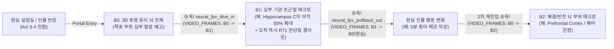

# `Rule R74`: 3D 뇌 내부 FPV 고속 다이브 & 왕복 릴레이 (`B0 ↔ B1` Neural Portal Relay) 구현 계획

## 1. 문제 진단 및 기대 효과 (Why This Solves Our Mid-Video Retention Gap)

현재 우리 파이프라인의 뇌 설명 구간(`expressive_xray_brain`) 코드를 전수 점검한 결과, 왜 지금까지 뇌 장면이 정적으로 느껴졌는지 정확한 원인이 확인되었습니다:

1. **[porcelain_anchor_pack.py](file:///home/canadaofbin/gdrive/Kyubin_Yun_Workspace/07_Youtube/pipeline/porcelain_anchor_pack.py#L560-L562)의 `Start+End` 제외 락**: `select_dual_parallax_highlight_cuts()`가 `expressive_xray_brain` 클립을 `VIDEO_FRAMES`(`Start + End` 키프레임 보간) 대상에서 명시적으로 제외(`continue`)하고 있었습니다.
2. **단일 원거리 뇌 전체 샷(`B0`) 반복 고정** ([porcelain_anchor_pack.py](file:///home/canadaofbin/gdrive/Kyubin_Yun_Workspace/07_Youtube/pipeline/porcelain_anchor_pack.py#L738-L787)): `hippocampus`(해마)처럼 측두엽 깊숙이 숨어 있는 부위를 설명할 때도 카메라가 뇌 안으로 파고들지 못하고, 1m 밖에서 뇌 전체(`ref_xray_brain_9x16.png`)만 띄워둔 채 미세한 `gentle_push_in`만 반복했습니다.

이 구간에 제안해 주신 **`Rule R72`식 고속 드론 다이브(`B0 뇌 전체 → 슈욱! 투명 피질 관통 → B1 해마 초근접 매크로 설명 → 슈욱! 밖으로 이탈 후 인물 반응 → 다시 슈욱! 재진입`)**를 도입하면 세 가지 결정적 효과가 발생합니다:
- **초반(`R72` 건물 드론 진입) + 중후반(`R74` 뇌 심부 FPV 다이브)의 완벽한 대칭**: 보통 과학 쇼츠에서 조회수가 꺾이는 `35~65초` 메커니즘 설명 구간이 정적인 도표 대신 **롤러코스터형 공간 이동 체험**으로 바뀝니다.
- **위치 감각 + 디테일 동시 해결**: 뇌 전체(`B0`)에서 출발해 해마(`B1`) 코앞까지 파고들기 때문에 시청자가 *"뇌의 어느 깊숙한 곳에 있는지"*와 *"어떻게 생겨서 어떻게 작동하는지"*를 2초 만에 직관적으로 체감합니다.
- **인물 연기와 뇌 기제의 입체적 호흡**: 뇌 속에 갇혀 강의하지 않고, **뇌 심부 진입(원인 확인) → 밖으로 빠져나와 현실 인물의 행동 변화 → 다시 다른 뇌 부위로 재진입(반전·해결 확인)**하며 몰입감을 끝까지 유지합니다.

---

## 2. 핵심 기술 난제 및 해결 설계 (4 Engineering Safeguards)

> [!IMPORTANT]
> Google Flow(`Omni 1.2 Flash` / `Veo 3.1`)에서 뇌 내부 고속 비행을 구현할 때 발생할 수 있는 **4가지 기술적 함정**을 설계 단계에서 원천 차단합니다:
> 1. **생체 조직/혈관 혐오감 방지 (`Rule R56` Zero-Flesh 엄수)**: 카메라가 뇌 속으로 들어갈 때 붉은 살점·젖은 조직으로 변질되지 않도록, 외피는 **투명/반투명 건축용 보로실리케이트 크리스탈 유리 주름(`frosted architectural crystal-glass cortical ribs`)**, 내부 목표 기관(`Hippocampus`, `Amygdala` 등)은 **자체 발광 광학 유리 구조물(`luminous optical-glass structure`)**로 고정합니다.
> 2. **왕복 이음새 제로화 (`Exact Shared Keyframe Relay`)**: 들어갈 때(`Start = B0` → `End = B1_hippocampus`), 안에서 설명할 때(`Start = B1_hippocampus`), 빠져나올 때(`Start = B1_hippocampus` → `End = B0` 또는 인물 컷) **동일한 `B0`·`B1` 레퍼런스 PNG를 정확히 공유**하여 프레임 점프 없이 매끄럽게 이어집니다.
> 3. **해부학적 진입 방향 정확도 (`Blender 3D Neural Previs`)**: 해마는 옆쪽 관자놀이 심부로, 전두엽은 이마 정면 안쪽으로, 소뇌는 뒤통수 아래쪽으로 정확히 파고들도록 `Blender 4.2` 프리비즈에 3D 반투명 뇌 셸과 부위별 실제 해부학 3D 좌표를 내장합니다.
> 4. **고속 비행 중 텍스트 분리 (`Arrival-Locked R71 Callout`)**: 카메라가 `슈욱!` 날아가는 `0.0~1.25초` 동안에는 글자가 화면에서 미끄러지지 않도록 비워두고, **목표 부위(`B1`) 코앞에 도착해 멈추는 순간(`t >= 1.25s` 또는 매크로 홀드 컷)** 만년필 지시선(`Hippocampus · Memory Hub`)이 꽂히도록 동기화합니다.

---

## 3. Open Questions (사용자 확인 요청)

1. **에피소드당 뇌 다이브 왕복 횟수 기본값**:
   - **패턴 A (권장 — `2회 왕복`: 진입 → 설명 → 이탈 후 인물 행동 → 재진입)**: 말씀해 주신 것처럼 ① *문제 발생 시 뇌 전체에서 `부위 1(예: 해마/편도체)`로 슈욱 들어가 설명* → ② *슈욱 빠져나와 현실 인물의 실험/행동 변화 묘사* → ③ *다시 슈욱 들어가 `부위 2(예: 전두엽)` 또는 변화된 상태를 확인하고 빠져나오는* **2사이클 구성(총 3~4컷)**을 기본으로 할까요? (단일 부위 짧은 에피소드는 1회 왕복 허용, 뇌 내부 연속 체류는 최대 `3컷 / 7.5초` 이하로 제한해 지루함 방지)
2. **`슈욱!` 전환 시 미세 입체 음향(`Subtle Velvet Glass-Whoosh`) 동시 적용 여부**:
   - 뇌 안으로 파고들고 빠져나올 때 나레이션 방해 없이(`-21 dBFS` 저역 필터링) 부드러운 공기·크리스탈 공간 이동음(`0.36초`)을 함께 넣어 체감 몰입도를 극대화할지 확인 부탁드립니다.

---

## 4. Proposed Changes

### 1. 뇌 내부 FPV 카메라 무브 & `Rule R74` 상수 정의
#### [MODIFY] [config.py](file:///home/canadaofbin/gdrive/Kyubin_Yun_Workspace/07_Youtube/pipeline/config.py)
- 신규 뇌 전용 3D 비행 카메라 무브 추가 (`EXPRESSIVE_V8_NEURAL_DIVE_MOVES`):
  - `"neural_fpv_dive_in"` (`B0` 뇌 전체 → 투명 피질 벽 통과 → `B1` 심부 기관 초근접 매크로 고속 진입, 피크 속도 구간 `0.40~2.45s` 하베스트)
  - `"neural_macro_orbit_hold"` (`B1` 심부 기관 눈앞에서 신경 펄스 발화·점멸 관찰 + `R71` 만년필 라벨 표시)
  - `"neural_fpv_pullback_out"` (`B1` 심부 기관 → 투명 피질 밖 `B0` 뇌 전체 또는 현실 인물 헤드 컷어웨이로 고속 후진 이탈)
  - `"neural_tract_relay_flight"` (`B1` 부위 A에서 발광 신경 섬유 다발을 따라 `B0` 경유 → `B2` 부위 B로 이동)
- `EXPRESSIVE_V8_REQUIRE_NEURAL_DIVE_RELAY = True` (신규 `R74` 에피소드에서 정적인 단일 원거리 뇌 샷만 나열하는 것을 차단하고 최소 1회 이상의 `Dive-In` + `Pullback-Out` 왕복 강제, 연속 뇌 컷 상한 `EXPRESSIVE_V8_MAX_CONSECUTIVE_BRAIN_CUTS = 3`).

---

### 2. 부위별 3D 해부학 공간 좌표 & 매크로 콜아웃 앵커 확장
#### [MODIFY] [anatomy_map.py](file:///home/canadaofbin/gdrive/Kyubin_Yun_Workspace/07_Youtube/pipeline/anatomy_map.py) & [anatomy_label_overlay.py](file:///home/canadaofbin/gdrive/Kyubin_Yun_Workspace/07_Youtube/pipeline/anatomy_label_overlay.py)
- `ANATOMY_SCREEN_ANCHORS` 각 뇌 부위(`hippocampus`, `amygdala`, `prefrontal cortex`, `anterior cingulate cortex`, `nucleus accumbens`, `basal ganglia`, `thalamus`, `hypothalamus`, `cerebellum`, `brainstem`, `insula` 등 18종)에 다음 메타데이터 추가:
  - `pos_3d_brain_xyz`: 반투명 뇌 모델 내부의 실제 해부학적 3D 좌표 및 최적 카메라 진입 각도(`approach_azimuth_deg`, `approach_elevation_deg`)
  - `macro_visual_desc`: `B1` 초근접 매크로 키프레임 생성용 정밀 시각 묘사 (예: `hippocampus` → *"giant luminous warm amber-gold C-shaped crystal seahorse ridge filling the center of the deep temporal glass chamber, framed by out-of-focus translucent frosted-glass cortical gyri walls on the left and right edges"*)
  - `macro_anchor_xy` & `macro_label_xy`: `B1` 초근접 화면(`45~60%` 확대 상태) 전용 만년필 지시선 좌표
- [anatomy_label_overlay.py](file:///home/canadaofbin/gdrive/Kyubin_Yun_Workspace/07_Youtube/pipeline/anatomy_label_overlay.py#L38-L84) 업데이트:
  - `camera_move == "neural_fpv_dive_in"` 단독 컷에서는 비행 완료 시점(`portal_entry_sec = 1.25s`) 이후에만 `macro_anchor_xy`로 라벨을 찍거나, 직후 이어지는 `neural_macro_orbit_hold` 컷에서 흔들림 없이 또렷하게 표시. `neural_fpv_pullback_out` 후진 이탈 컷에서는 라벨 미표시로 깔끔한 속도감 확보.

---

### 3. Blender 3D 반투명 뇌 프리비즈(`Previs v2.3`) & `B0 ↔ B1` 공유 키프레임 생성기
#### [MODIFY] [previs_blender.py](file:///home/canadaofbin/gdrive/Kyubin_Yun_Workspace/07_Youtube/pipeline/previs_blender.py) & [porcelain_anchor_pack.py](file:///home/canadaofbin/gdrive/Kyubin_Yun_Workspace/07_Youtube/pipeline/porcelain_anchor_pack.py)
- **Blender 3D Neural Cutaway 가이드**: `expressive_xray_brain` 클립 중 `neural_fpv_dive_in` / `neural_fpv_pullback_out`에 대해 `0.20`-알파 반투명 3D 대뇌 반구 셸 + 목표 부위 발광 3D 메쉬를 렌더링하여 `B0`(외부 전경 `1.35m`)와 `B1`(피질 내부 심부 `0.24m` 매크로) 3D 구도 가이드를 자동 생성.
- **[porcelain_anchor_pack.py](file:///home/canadaofbin/gdrive/Kyubin_Yun_Workspace/07_Youtube/pipeline/porcelain_anchor_pack.py#L541-L788) 릴레이 바인딩 개편**:
  - `select_dual_parallax_highlight_cuts()`의 뇌 클립 제외 코드 제거 → `neural_fpv_dive_in` 및 `neural_fpv_pullback_out` 클립을 최우선 `VIDEO_FRAMES`(`Start + End`) 슬롯으로 자동 배정:
    * **진입 컷(`Dive-In`)**: `reference_image = ref_brain_B0_wide_9x16.png` → `end_reference_image = ref_brain_B1_<region>_macro_9x16.png`
    * **설명 홀드 컷(`Macro Hold`, 선택)**: `reference_image = ref_brain_B1_<region>_macro_9x16.png` (`single_start_frame_lock = True`)
    * **이탈 컷(`Pullback-Out`)**: `reference_image = ref_brain_B1_<region>_macro_9x16.png` → `end_reference_image = ref_brain_B0_wide_9x16.png` (또는 직후 현실 실험실 인물 `Start` 키프레임!)

---

### 4. 프롬프트 빌더, 고속 구간 하베스팅 및 입체 공간 이동음(`-21 dBFS`) 어셈블리
#### [MODIFY] [flow_prompt_builder.py](file:///home/canadaofbin/gdrive/Kyubin_Yun_Workspace/07_Youtube/pipeline/flow_prompt_builder.py), [depiction_rules.py](file:///home/canadaofbin/gdrive/Kyubin_Yun_Workspace/07_Youtube/pipeline/depiction_rules.py), [diorama_assembler.py](file:///home/canadaofbin/gdrive/Kyubin_Yun_Workspace/07_Youtube/pipeline/diorama_assembler.py), [prompt_quality_v5.py](file:///home/canadaofbin/gdrive/Kyubin_Yun_Workspace/07_Youtube/pipeline/prompt_quality_v5.py)
- `18~45w` Prompt Diet 내에서 유리 피질 전경 패럴랙스를 명시한 다이브/이탈 프롬프트 템플릿 추가 (*"Fast FPV macro probe camera plunges straight through translucent frosted-glass outer cortex folds into the deep chamber until the glowing amber-gold C-shaped hippocampus fills the frame, zero wet tissue, zero text."*).
- [diorama_assembler.py](file:///home/canadaofbin/gdrive/Kyubin_Yun_Workspace/07_Youtube/pipeline/diorama_assembler.py#L2959-L2975): `neural_fpv_dive_in`, `neural_fpv_pullback_out`, `fpv_window_portal_breach` 컷 전환 지점에 `-21 dBFS` 대역통과 벨벳 에어·글래스 스우시(`0.36s`, 보이스오버 완전 보호) 자동 믹싱 및 피크 속도 구간(`0.40~2.55s`) 우선 트리밍 적용.
- 스킬 및 룰 문서 동기화 ([SKILL.md](file:///home/canadaofbin/gdrive/Kyubin_Yun_Workspace/07_Youtube/.agents/skills/youtube-script/SKILL.md), [neuro_diorama_rules.md](file:///home/canadaofbin/gdrive/Kyubin_Yun_Workspace/07_Youtube/.agents/rules/neuro_diorama_rules.md), [AGENTS.md](file:///home/canadaofbin/gdrive/Kyubin_Yun_Workspace/07_Youtube/.agents/AGENTS.md) `< 10,240 bytes`).

---

## 5. Verification Plan

### Automated Verification
- 신규 단위 테스트 [`tests/test_r74_neural_fpv_dive_relay.py`](file:///home/canadaofbin/gdrive/Kyubin_Yun_Workspace/07_Youtube/tests/test_r74_neural_fpv_dive_relay.py):
  1. `B0 -> B1_hippocampus -> B0 -> B2_prefrontal_cortex` 공유 키프레임(`Start/End` `VIDEO_FRAMES`) 1:1 정합성 검증
  2. Blender 3D 반투명 뇌 + 심부 기관(`hippocampus`, `amygdala`, `prefrontal cortex`) 프리비즈 렌더링 및 가시성 검증
  3. `R71` 만년필 콜아웃이 고속 비행 구간(`0~1.25s`)을 피해 `B1` 매크로 앵커에 정확히 표시되는지 검증
  4. `PRE_R74_FROZEN_V8_PROJECTS` 하위 호환 및 전체 `pytest -v` 100% 통과 검증

### Visual Proof Verification
- 실제 `B0(뇌 전체) -> B1(해마 초근접 매크로) -> B0/현실 이탈 -> B2(전두엽 매크로)` 프리비즈 & 키프레임 릴레이 시트(`r74_neural_dive_relay_proof.png`)를 생성하여 시각적으로 검수합니다 (현재 `@Operator`가 진행 중인 `Ep #7` 작업 진행 단계에 맞춰 `Ep #7` 뇌 구간 즉시 반영 또는 직후 `Ep #8`부터 무중단 적용).
