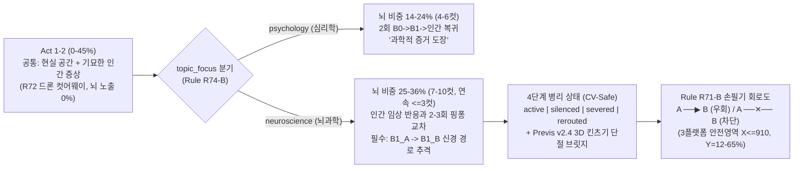

# Rule `R74-B` & `R71-B` — 심리학 vs 뇌과학 맞춤형 연출 분기, 4단계 뇌 병리 상태(`켜짐/꺼짐/단절/우회`), 2-노드 신경 경로 오버레이 및 `Ep #8` 플래그십 구현 계획

## 배경 및 목표 (Goal Description)

현재 `expressive_25d_v8` 파이프라인(`R68` + `R71` + `R72` + `R73` + `R74`)을 전수 코드 감사한 결과, 전반부 인간 행동 고정과 중후반 `B0 <-> B1` 3D 뇌 다이브의 기본 골격(`80%`)은 이미 작동하고 있으나, **정통 뇌과학·임상 신경학 에피소드**에서 시청자에게 *"신호가 정확히 어디서 막히고 어디로 우회했는지"*를 직관적으로 각인시키기 위한 4가지 핵심 장치가 비어 있음을 확인했습니다.

1. **주제별 연출 분기 부재**: [prompt_quality_v5.py](file:///home/canadaofbin/gdrive/Kyubin_Yun_Workspace/07_Youtube/pipeline/prompt_quality_v5.py#L2028-L2062)가 심리학 에피소드(`Ep #7`)와 정통 뇌과학 에피소드에 동일한 최소 조건(`dive >= 1`, `pullback >= 1`)만 적용하며, 뇌과학 편에서 핵심인 부위 간 신호 추격(`neural_tract_relay_flight`)이나 뇌 컷 밀도(`25~36%`)를 구분하지 않습니다.
2. **`'밝게 켜짐(Active)'` 일변도의 뇌 프롬프트 + 잠재적 CV 게이트 충돌**: [anatomy_map.py](file:///home/canadaofbin/gdrive/Kyubin_Yun_Workspace/07_Youtube/pipeline/anatomy_map.py#L308-L578)와 [porcelain_anchor_pack.py](file:///home/canadaofbin/gdrive/Kyubin_Yun_Workspace/07_Youtube/pipeline/porcelain_anchor_pack.py#L1288-L1291)의 모든 `B1` 초근접 프롬프트가 `"giant luminous ... glowing"`으로 고정되어 있어 뇌 손상·절단·억제 케이스에서도 손상 부위가 밝게 빛납니다. 반대로 이를 단순 암전 처리하면 [reference_image_qa.py](file:///home/canadaofbin/gdrive/Kyubin_Yun_Workspace/07_Youtube/pipeline/reference_image_qa.py#L720-L850)(`Q2` `luma >= 32`, `Q4` `porcelain_ratio >= 0.04`, `Q6` `biolum >= 0.005`) 및 [posthoc_semantic_qa.py](file:///home/canadaofbin/gdrive/Kyubin_Yun_Workspace/07_Youtube/pipeline/posthoc_semantic_qa.py#L632-L636)(`R64` `brain_highlight_chroma >= 6.0`)에서 오탐 탈락하는 잠재 버그가 존재합니다.
3. **단일 점(`1-Node`)만 찍는 `R71` 해부학 콜아웃**: [anatomy_label_overlay.py](file:///home/canadaofbin/gdrive/Kyubin_Yun_Workspace/07_Youtube/pipeline/anatomy_label_overlay.py#L74-L90)가 `neural_tract_relay_flight` 컷에서도 도착 부위 1곳만 표시하여, 뇌과학 편의 하이라이트인 **`부위 A ──▶ 부위 B (신호 우회)`** 및 **`부위 A ──✕── 부위 B (신호 단절)`** 시각 지도를 그리지 못합니다.
4. **신경학 핵심 부위 13곳의 전용 3D 좌표 누락**: [anatomy_map.py](file:///home/canadaofbin/gdrive/Kyubin_Yun_Workspace/07_Youtube/pipeline/anatomy_map.py#L18-L218) `ANATOMY_FUNCTION_MAP` 31개 부위 중 `corpus callosum`(뇌량), `fusiform face area`(안면인식), `Broca's / Wernicke's area`(언어), `parietal cortex`(두정엽), `optic nerve`(시신경) 등 13개 신경학 핵심 부위가 `ANATOMY_SCREEN_ANCHORS`에 빠져 generic fallback으로 처리됩니다.

본 계획은 기존 `Ep #1~#7` 및 `450+` 회귀 테스트와의 하위 호환성을 100% 유지하면서 **`Rule R74-B` & `Rule R71-B`**를 구축하고, 곧바로 첫 정통 뇌과학 플래그십 **`Ep #8`** 제작까지 연결합니다.



---

## User Review Required

> [!IMPORTANT]
> **1. 전반부(`0~45%`) 인간 행동 우선 법칙 및 연속 `3컷` 상한선 유지**
> 뇌과학(`topic_focus="neuroscience"`) 모드에서도 초반 스와이프 이탈 방지를 위해 **첫 `45%` 구간에는 뇌 모형 등장을 금지**하고, 중후반부에서 뇌 비중을 `25~36%`로 높이되 **연속 뇌 컷은 최대 `3컷`(`~6~8초`)으로 제한**하여 반드시 중간에 실제 환자/피실험자의 소름 돋는 임상 행동 반응 컷을 핑퐁 교차 편집합니다.

> [!NOTE]
> **2. 오디오 전문용어 상한(`R73-3`: 에피소드당 어려운 해부학 용어 최대 `2개`) 유지**
> 뇌과학 편에서 시각적으로는 `3개` 부위의 경로(`예: 얼굴인식 패치 ──✕── 편도체 / 청각피질 ──▶ 편도체`)를 보여주더라도, **음성 대본(`script.json`)에서는 어려운 라틴어/해부학 용어를 기존처럼 최대 `2개`로 제한**하고 나머지는 쉬운 일상 영어(`"face-recognition patch"`, `"hearing center"`)로 발화합니다. [anatomy_map.py](file:///home/canadaofbin/gdrive/Kyubin_Yun_Workspace/07_Youtube/pipeline/anatomy_map.py#L280-L287)의 `region_named_in()`이 이미 일상 영어 별칭 매칭을 지원하므로 귀로는 술술 들리고 눈으로는 정밀한 해부학 회로도가 보이는 구조를 달성합니다.

---

## Open Questions

> [!IMPORTANT]
> **업그레이드 완료 직후 제작할 정통 뇌과학 플래그십 `Ep #8` 주제를 선택해 주세요 (`62~84초` 타겟):**
> 1. **`(Recommended)` 카프그라 '복제인간' 망상 (`capgras_imposter_delusion`, `DOI: 10.1098/rspb.1997.0062`, UCSD Ramachandran)**
>    - **훅**: *"교통사고 후 어머니 얼굴을 1초 만에 알아보면서 '저 여자는 내 어머니 복제인간이야!'라고 우기던 아들이, 왜 전화로 목소리만 들으면 즉시 진짜 어머니라고 반겼을까?"*
>    - **신규 `R74-B` 100% 활용**: `Fusiform Face Area [켜짐] ──✕── Amygdala [단절/꺼짐]`(얼굴 형태는 알지만 감정 신호가 끊김) -> 전화 통화 임상 반전 + 피부전도도(`R70` 차트) -> `Auditory Cortex ──▶ Amygdala [우회 점등]`을 한 편에 완벽 구현.
> 2. **맹시 미스터리 (`blindsight_subcortical_vision`, `DOI: 10.1093/brain/97.1.709`, Oxford Weiskrantz)**
>    - **훅**: *"시각피질 손상으로 눈앞이 100% 암흑인 환자가 왜 복도 장애물을 단 한 번도 안 부딪치고 피하며, 안 보이는 불빛을 90% 이상 정확히 손가락으로 찌를까?"* (`Visual Cortex [꺼짐]` vs `Optic Nerve ──▶ Parietal / Amygdala [무의식 우회로]`).
> 3. **외계인 손 증후군 (`alien_hand_syndrome`, `DOI: 10.1001/archneur.1981.00510110043004`)**
>    - **훅**: *"오른손이 셔츠 단추를 잠그자마자 자기 왼손이 달려들어 단추를 뜯어내는 환자"* (`Corpus Callosum [킨츠기 단절]` 좌우뇌 통신 두절).

---

## Proposed Changes

### 1. 상수 및 주제별 분기 스펙 (`Rule R74-B` Config & Auto-Inference)

#### [MODIFY] [config.py](file:///home/canadaofbin/gdrive/Kyubin_Yun_Workspace/07_Youtube/pipeline/config.py)
- `EXPRESSIVE_V8_TOPIC_FOCUSES = ("psychology", "neuroscience")` 및 기본 자동 추론 헬퍼 `resolve_expressive_v8_topic_focus(plan, script_doc=None, dossier_brain_link=None)` 추가 (`visual_plan["topic_focus"]` 명시값 우선 -> `06_brain_link.json["visual_mode"] == "NEURO_BIOLOGY"` 또는 `visual_plan["visual_mode"] == "NEURO_BIOLOGY"` 시 `"neuroscience"` 자동 라우팅).
- 모드별 뇌 비중 및 등장 구간 상수 정의 (`PRE_R74B_FROZEN_V8_PROJECTS`에 `v8_pilot_01..03` + `v8_ep04..07` 등록하여 기존 에피소드 100% 보존):
  ```python
  EXPRESSIVE_V8_TOPIC_FOCUSES: tuple[str, ...] = ("psychology", "neuroscience")
  EXPRESSIVE_V8_PSYCH_BRAIN_CLIP_RATIO_RANGE: tuple[float, float] = (0.12, 0.26)
  EXPRESSIVE_V8_NEURO_BRAIN_CLIP_RATIO_RANGE: tuple[float, float] = (0.24, 0.38)
  EXPRESSIVE_V8_NEURO_BRAIN_REVEAL_WINDOW_FRAC: tuple[float, float] = (0.45, 0.88)
  EXPRESSIVE_V8_NEURAL_STATES: tuple[str, ...] = ("active", "silenced", "severed", "rerouted")
  R71_CALLOUT_MODES: tuple[str, ...] = ("single_region", "pathway_relay", "pathway_severed")
  ```

---

### 2. `31/31` 완전 3D 뇌 좌표 아틀라스 & CV-안전 4단계 병리 프롬프트 엔진

#### [MODIFY] [anatomy_map.py](file:///home/canadaofbin/gdrive/Kyubin_Yun_Workspace/07_Youtube/pipeline/anatomy_map.py)
- `ANATOMY_FUNCTION_MAP`에 등록된 전체 **31개** 표준 부위 중 `ANATOMY_SCREEN_ANCHORS`에 빠져 있던 **13개 부위**(`fusiform face area`, `corpus callosum`, `Broca's area`, `Wernicke's area`, `parietal cortex`, `premotor cortex`, `frontal lobe`, `temporal lobe`, `ventral tegmental area`, `optic nerve`, `retina`, `cochlea`, `white matter`)의 정밀 3D 좌표(`pos_3d_brain_xyz`), 진입 각도(`approach_azimuth_deg`, `approach_elevation_deg`), `9:16` 화면 앵커(`anchor_xy`, `macro_anchor_xy`) 및 유리 해부학 묘사를 100% 완비합니다.
- **CV 게이트(`Q2`/`Q4`/`Q6`/`R64`) 및 Flow 안전 필터(`R56`/`R66`) 100% 호환 4단계 `build_neural_state_macro_desc()` 추가**:
  - `active`: 기존 고휘도 광학 유리 발광 유지.
  - `silenced` *(꺼짐/억제)*: 중심 타겟 부위는 불이 꺼진 반투명 문스톤-화이트·슬레이트 붕규산 크리스탈 유리(`S <= 40, V >= 145` -> `Q4` 도자기/크리스탈 비율 및 `Q2` 밝기 `>= 32` 통과)로 고요히 멈춰 있고, 외곽 정상 피질 리브에만 은은한 앰버-골드/시안 광선(`>= 1.5%` 면적 -> `Q6` `biolum >= 0.005` 및 `R64` `chroma >= 6.0` 통과)이 흘러 대비를 이룸.
  - `severed` *(단절/병변)*: 크리스탈 신경 다발 중앙을 가로지르는 선명한 킨츠기 골드 균열선(`#D4AF37`) 앞에서 진입하던 시안-블루 광학 펄스가 정지하고 건너편 허브는 어두운 서리 유리로 남음 (`"particles"`, `"sparks"`, `"blood"`, `"slicing"` 등 금지·민감 토큰 0개).
  - `rerouted` *(우회 활성화)*: 어두운 서리 유리 장벽을 우회해 아치를 그리며 타겟 허브를 강렬한 앰버-골드·크림슨 광선으로 점등시키는 우회 신경교 묘사.

#### [MODIFY] [porcelain_anchor_pack.py](file:///home/canadaofbin/gdrive/Kyubin_Yun_Workspace/07_Youtube/pipeline/porcelain_anchor_pack.py) & [flow_prompt_builder.py](file:///home/canadaofbin/gdrive/Kyubin_Yun_Workspace/07_Youtube/pipeline/flow_prompt_builder.py)
- 클립의 `neural_state` (`"active" | "silenced" | "severed" | "rerouted"`)를 읽어 `B1` 매크로 레퍼런스 이미지 ID를 상태별로 분리(`active`는 기존 `ref_brain_B1_<slug>_macro_9x16.png` 유지, 비활성/단절/우회는 `ref_brain_B1_<slug>_<state>_macro_9x16.png`)하여 한 에피소드 안에서 같은 부위가 `꺼짐 -> 우회 점등`으로 변할 때 키프레임 캐시가 충돌하지 않도록 보장합니다.
- `ExpressiveV8PromptComposer`에서 `neural_state`에 맞는 2-비트 광학 상태 변화를 `18~45단어` Prompt Diet 규격 내로 자동 조합합니다.

---

### 3. `Previs v2.4` 3D 신경 다발 브릿지 & 킨츠기 단절 지오메트리

#### [MODIFY] [previs_blender.py](file:///home/canadaofbin/gdrive/Kyubin_Yun_Workspace/07_Youtube/pipeline/previs_blender.py)
- `_build_r74_neural_cutaway_previs_spec()` 업그레이드:
  - `neural_tract_relay_flight` (`anc_a -> anc_b`) 또는 `end_brain_region` 지정 시 두 3D 해부학 좌표 `t_a`, `t_b` 사이를 잇는 3D 원기둥 신경 다발(`neural_tract_bridge`)을 생성합니다.
  - `neural_state == "severed"`일 때는 다발 정중앙에 `0.04m` 간격과 `#D4AF37` 골드 단절 디스크(`kintsugi_fault_disc`)를 배치하고 도착 허브 구체를 어두운 슬레이트 톤(`#5B6778`)으로 렌더링하여, Google Flow `Image` 및 `VIDEO_FRAMES`가 신호 단절 위치와 카메라 궤적을 정확히 인식하도록 가이드합니다.

---

### 4. `Rule R71-B` 손필기 2-노드 신경 경로(`──▶`) & 회로 단절(`──✕──`) 오버레이

#### [MODIFY] [anatomy_label_overlay.py](file:///home/canadaofbin/gdrive/Kyubin_Yun_Workspace/07_Youtube/pipeline/anatomy_label_overlay.py) & [diorama_assembler.py](file:///home/canadaofbin/gdrive/Kyubin_Yun_Workspace/07_Youtube/pipeline/diorama_assembler.py)
- `resolve_anatomy_callout_windows()` 확장:
  - `single_region` (기본): 기존 단일 부위 포인터 링 + 손글씨 리더선 유지 (`neural_state == "silenced"`일 때 부제에 `(Signal Offline)` 등 직관적 상태 표기 지원).
  - `pathway_relay` (`neural_tract_relay_flight` & `neural_state in ("active", "rerouted")` 시 자동 활성화): 상단 안전 영역(`Y = 14%..34%`, `X = 56..900px`)에 좌->우 만년필 드로잉 애니메이션으로 **`[출발 부위] ──▶ [도착 부위]` + 하단 짧은 기능 요약(`Voice Shortcut Fires!`)**을 그리고 양쪽 3D 허브에 듀얼 포인터 링을 연결합니다.
  - `pathway_severed` (`neural_state == "severed"` 및 `end_brain_region` 존재 시 자동 활성화): **`[출발 부위] ── ✕ ── [차단된 부위]`** 손필기 경로선과 중앙 크림슨/골드 `✕` 차단 마크 + `(Link Severed)` 캡션을 순차 드로잉합니다.
- **잠재 충돌 원천 차단**:
  - 기존 `R71`과 동일한 하드 클리핑 마스크(`X = 48..910px`, `Y = 12%..65%` 외부 `alpha == 0`)를 그대로 적용하여 틱톡/릴스 우측 아이콘(`X > 910px`), 하단 자막(`Y >= 68%`), `R70-M8` 차트 최소 `2.0초` 간격, `DQ9` AI 텍스트 오탐 면제(`has_anatomy_callout = True`)와 100% 호환됩니다.

---

### 5. 검증 게이트 및 마스터 룰 문서 동기화

#### [MODIFY] [prompt_quality_v5.py](file:///home/canadaofbin/gdrive/Kyubin_Yun_Workspace/07_Youtube/pipeline/prompt_quality_v5.py) & [dynamic_episode_qa.py](file:///home/canadaofbin/gdrive/Kyubin_Yun_Workspace/07_Youtube/pipeline/dynamic_episode_qa.py)
- 비동결 신규 `v8` 에피소드(`not in PRE_R74B_FROZEN_V8_PROJECTS`)에서 `topic_focus == "neuroscience"`일 때:
  1. 뇌 클립 비율이 `EXPRESSIVE_V8_NEURO_BRAIN_CLIP_RATIO_RANGE`(`24%~38%`) 안에 있는지 검증,
  2. 첫 뇌 클립이 `45%` 이후(`EXPRESSIVE_V8_NEURO_BRAIN_REVEAL_WINDOW_FRAC`)에 등장하는지 검증,
  3. 연속 뇌 컷이 `<= 3`컷(`EXPRESSIVE_V8_MAX_CONSECUTIVE_BRAIN_CUTS`)이며 사이사이에 인간 행동 컷이 교차되는지 검증,
  4. 최소 `1개` 이상의 `neural_tract_relay_flight`(`brain_region -> end_brain_region`)와 병리/우회 케이스 시 비기본 `neural_state`(`silenced`/`severed`/`rerouted`)가 지정되었는지 자동 검증합니다.

#### [MODIFY] [neuro_diorama_rules.md](file:///home/canadaofbin/gdrive/Kyubin_Yun_Workspace/07_Youtube/.agents/rules/neuro_diorama_rules.md), [production_constants.md](file:///home/canadaofbin/gdrive/Kyubin_Yun_Workspace/07_Youtube/.agents/rules/production_constants.md), [SKILL.md](file:///home/canadaofbin/gdrive/Kyubin_Yun_Workspace/07_Youtube/.agents/skills/youtube-script/SKILL.md), [AGENTS.md](file:///home/canadaofbin/gdrive/Kyubin_Yun_Workspace/07_Youtube/.agents/AGENTS.md)
- `R74-B` / `R71-B` 규격을 SSOT 문서에 반영 (`AGENTS.md`는 기존 `R71`·`R74` 행 인플레이스 업데이트로 총 줄 수 `76줄 <= 100줄` 유지).

---

## Verification Plan

### Automated Tests
1. **신규 단위 테스트 작성 (`tests/test_r74b_neuro_pathway_and_states.py`)**:
   - `ANATOMY_FUNCTION_MAP` 31개 전 부위가 `ANATOMY_SCREEN_ANCHORS`에 고유 3D 좌표로 100% 매핑되는지 검증 (`0` generic fallback).
   - `active / silenced / severed / rerouted` 4단계 프롬프트가 `sanitize_scene()` 후 금지·민감 토큰 없이 생성되며, 합성 테스트 프레임이 `reference_image_qa.py`(`Q2`, `Q4`, `Q6`)와 `posthoc_semantic_qa.py`(`brain_highlight_chroma >= 6.0`)를 모두 통과하는지 검증.
   - `Previs v2.4` CPU 렌더러가 `neural_tract_relay_flight` + `severed` 조합에서 3D 신경 다발 및 중앙 단절 디스크를 `9:16` 프레임 안에 정확히 렌더링하는지 검증.
   - `anatomy_label_overlay.py`의 `pathway_relay`(`──▶`) 및 `pathway_severed`(`──✕──`) 프레임이 `X = 48..910px`, `Y = 12%..65%` 밖에서 `alpha == 0`을 엄격히 지키는지 검증.
   - `prompt_quality_v5.py`가 `topic_focus="psychology"`(`Ep #7` 포함)와 `topic_focus="neuroscience"`를 정확히 분기 검증하고 기존 `Ep #1~#7`이 100% 통과하는지 검증.
2. **전체 회귀 테스트 실행**:
   ```bash
   /home/canadaofbin/hermes-venv/bin/python -X utf8 -m pytest tests/test_r74b_neuro_pathway_and_states.py -v
   /home/canadaofbin/hermes-venv/bin/python -X utf8 -m pytest -v
   ```

### Manual & Live Episode Verification (`Ep #8`)
1. 선택하신 `Ep #8` 정통 뇌과학 에피소드를 `@Operator`를 통해 풀 파이프라인(`R72 × R73 × R74-B × R71-B × R75`, `<= 86s`)으로 제작합니다.
2. `B1` 단절/우회 레퍼런스 PNG 및 최종 MP4에서 손필기 `──✕──` / `──▶` 회로도와 인간 임상 장면 간 핑퐁 교차 편집을 시각 검수(`read_file` 스트립 시트 확인)한 뒤, YouTube(`2026-11-15` 프라임 슬롯 예약) 및 멀티플랫폼 번들까지 준비하여 walkthrough 리포트로 보고합니다.
