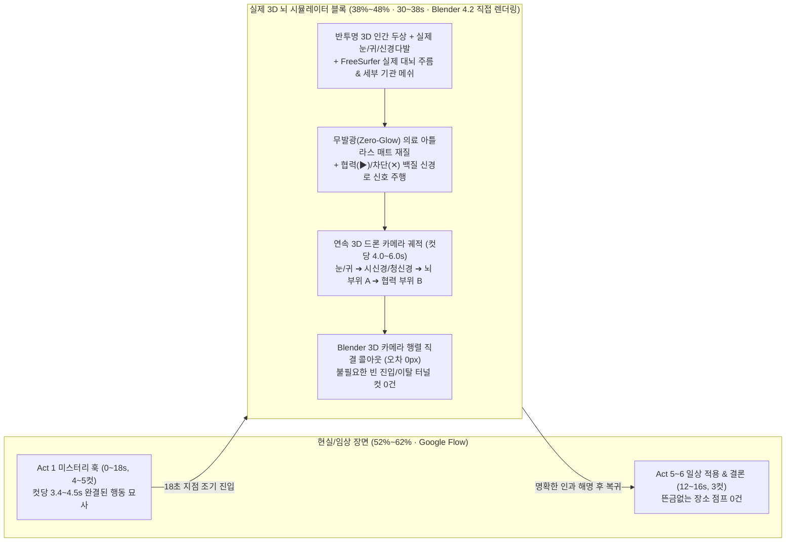

# Rule R76 마스터 설계안 — `Siren` 단독 내레이션 × 실제 3D 뇌 시뮬레이터 엔진(`Blender 4.2`) × 노이즈 제로(`Anti-Noise`) 컷 연출 개편

> [!IMPORTANT]
> **인스타그램 자동 업로드 즉시 정지 완료**: 백그라운드 예약 타이머(`task-6500`)를 즉시 취소하여 추가 업로드가 `0건` 상태로 안전하게 멈춰 있습니다. 현재 `/plan` 검토 단계이므로 승인(`Proceed`) 전까지 코드베이스와 YouTube Studio 상태는 일절 변경하지 않았습니다.

---

## 1. 대표님 아이디어 타당성 검증 (결론: 핵심 방향 4가지 모두 타당 + 리텐션 안전장치 1가지 보완)

| 제안 항목 | 타당성 판정 | 데이터·구조적 근거 및 보완 포인트 |
|---|---|---|
| **① `Siren` 단독 성우 체제 (`100% Solo Narrator`)** | **매우 타당 (즉시 도입 권장)** | `Ep #7`/`Ep #8`에서 내레이터(`Roger`) 도중 1~2문장만 다른 성우(`Laura`/`Hope`)가 끼어드는 구조([prompt_quality_v5.py](file:///home/canadaofbin/gdrive/Kyubin_Yun_Workspace/07_Youtube/pipeline/prompt_quality_v5.py#L1047-L1050) `EXPRESSIVE_V8_REQUIRE_FOIL`)가 오히려 다큐멘터리 몰입을 깨고 산만함을 유발했습니다. `Ep #7` 테스트에서 검증된 `Siren`(`eXpIbVcVbLo8ZJQDlDnl`, `160.5 WPM`, ASR 명료도 `100%`) 단독 톤으로 통일하면 청각 노이즈가 사라집니다. |
| **② 심리학·뇌과학 구분 없이 뇌 메커니즘 비중 대폭 확대 (`38%~48%`)** | **타당 (단, 초반 `0~18초` 휴먼 훅 안전장치 필수)** | 기존 [config.py](file:///home/canadaofbin/gdrive/Kyubin_Yun_Workspace/07_Youtube/pipeline/config.py#L2591-L2595)는 심리학 에피소드의 뇌 비중을 `12%~26%`(`Ep #7` 기준 후반 `12.6초`뿐)로 제한했습니다. 그러나 모든 심리 현상(선택 후회, 방관자 효과, 착각 등)은 결국 **감각기관 → 뇌 회로 협력/충돌**로 작동하므로 심리학도 뇌 시뮬레이터 비중을 **`38%~48%`(`~30~38초`)**로 통합하는 것이 채널 정체성(`ALL ABOUT BRAIN`)에 완벽히 부합합니다. **⚠️ 유일한 리텐션 보완점**: `0~18초`(`첫 22%~26%`)부터 곧바로 해부학 모형만 나오면 일반 시청자가 '딱딱한 생물 강의'로 느끼고 이탈(`Swiped Away`)할 위험이 있습니다. 따라서 **초반 `0~18초`(`4~5컷`)는 현실 인간 실험/사건 미스터리로 강하게 잡고, `18초` 지점부터 일찍 3D 뇌 시뮬레이터로 진입해 중반부 전체(`30~38초`)를 깊이 있게 끌고 가는 구조**가 최적입니다. |
| **③ AI 티 나는 발광(Glow) 제거 + 실제 3D 뇌 시뮬레이터(감각기관 연결 + 드론샷)** | **핵심 돌파구 (엔진 전환으로 100% 해결 가능)** | 지금까지 뇌 장면이 가짜처럼 보인 근본 원인은 **확산형 비디오 AI(`Google Flow`)에게 뇌 내부를 상상해서 그리게 했기 때문**입니다. 인간/현실 장면만 `Google Flow`를 쓰고, **뇌 장면 100%는 로컬 `Blender 4.2`에서 실제 해부학 3D 메쉬(반투명 두상 + 눈/시신경·귀/청신경 + 실제 대뇌 피질 주름 + 해마·편도체·시상 등 세부 기관)로 직접 렌더링**하면 AI 특유의 네온 빛번짐·가짜 튜브가 원천 박멸되고 정확한 위치·모양·협력 경로를 드론 카메라로 유영하듯 보여줄 수 있습니다. |
| **④ 쬐끔 보여주고 넘어가는 '시각적 노이즈' 제거 (`Anti-Noise` 컷 호흡)** | **정확한 진단 (현재 가장 치명적인 편집 결함)** | 영상 길이를 `115초 → 75~78초`(`16문장`)로 줄이면서 기존 최소 컷 수 규칙(`SHORTS_EXPRESSIVE_V8_CUT_COUNT_MIN = 28`, [config.py](file:///home/canadaofbin/gdrive/Kyubin_Yun_Workspace/07_Youtube/pipeline/config.py#L1561))을 그대로 두는 바람에, **1문장(`4.7초`)이 강제로 `1.6초 + 2.1초` 두 조각으로 쪼개지는 현상**이 발생했습니다. `1문장 = 1완결 장면`(`평균 3.8~4.6초`, 뇌 시뮬레이터 드론샷 `4.0~6.0초`)으로 개편해야 시청자가 장면을 온전히 이해합니다. |

---

## 2. 현행 영상(`Ep #7` · `Ep #8`) 정밀 부검 — 어디가 왜 '노이즈'와 'AI 가짜 뇌'처럼 보였는가?

실제 조립 완료된 [Ep #7 EDL](file:///home/canadaofbin/gdrive/Kyubin_Yun_Workspace/07_Youtube/BCI_Shorts_Channel/projects/v8_ep07_harvard_reversible_choice_paradox/05_assembly/edit_decision_list.json) (`78.47s`, `30컷`)과 [Ep #8 EDL](file:///home/canadaofbin/gdrive/Kyubin_Yun_Workspace/07_Youtube/BCI_Shorts_Channel/projects/v8_ep08_capgras_imposter_delusion/05_assembly/edit_decision_list.json) (`75.87s`, `29컷`)을 프레임 단위로 전수 부검한 결과, 다음 **3가지 구조적 결함**이 확인되었습니다.

### 결함 A — `2.4초 미만` 초단타 쪼개기(`Micro-Cut Noise`) & 뜬금없는 장소 순간이동
- **`Ep #7` (`78.47초` / `16문장` / `30컷`)**: 전체 `30컷` 중 **`2.4초 미만` 초단타 컷이 무려 `12개`(`40%`)**였습니다.
  - **`Cut 01`(`1.67s`) → `Cut 02`(`2.10s`)**: 첫 문장(*"Harvard students picked one art print..."*) 도중 학생이 액자 두 개를 든 모습을 **단 `1.67초`**만 비추고 곧장 야외 나무 장면(`2.10초`)으로 넘어갑니다. 시청자가 두 사진을 인지하기도 전에 화면이 바뀝니다.
  - **`Cut 05`(`1.90s`) → `Cut 06`(`2.20s`) → `Cut 07`(`1.80s`) → `Cut 08`(`2.27s`)**: `8.1초` 동안 방·복도·앵글이 4번 연속 바뀌어 피사체 행동이 끝맺음되지 않습니다.
  - **`Cut 22`(`1.70s`, `neural_fpv_pullback_out`)**: 뇌에서 빠져나오는 장면이 `1.70초` 만에 스쳐 지나가 단순 모션 블러 노이즈처럼 보입니다.
- **`Ep #8` (`75.87초` / `16문장` / `29컷`)**: 전체 `29컷` 중 **`2.4초 미만` 컷이 `9개`**이며, 맥락 없는 장소 점프가 발생했습니다.
  - **`Cut 11`(`1.63s`, 해변 산책로) → `Cut 12`(`1.93s`, 병원 진료실 의자)**: 문장 6(*"To his gut, Mom felt just like a random stranger."*) 하나를 읽는 도중 병원 진료실에서 **갑자기 `1.63초` 동안 바닷가 해변 산책로**가 끼어들었다가 다시 병원 의자(`1.93s`)로 돌아옵니다([Ep #8 visual_plan.json](file:///home/canadaofbin/gdrive/Kyubin_Yun_Workspace/07_Youtube/BCI_Shorts_Channel/projects/v8_ep08_capgras_imposter_delusion/03_visuals/visual_plan.json)). 이는 개방감 비율(`R72` 야외 비율 쿼터)을 억지로 채우려다 발생한 전형적인 **시각 노이즈**입니다.
  - **`Cut 15`(`2.30s`, `Mini-Cortex` 장난감 카메오)**: 심각한 임상 미스터리 직후 뇌 모형 장난감이 `Laura` 목소리로 끼어들며 흐름을 끊습니다.

### 결함 B — 뇌 분량의 `44%`가 '설명 없는 진입/이탈 터널 이동'으로 낭비됨
- **`Ep #8` 뇌 컷 전수 분석 (`총 8컷 = 22.87초`, 전체의 `30.1%`)**:
  - 이 중 절반인 **`4컷`(`Cut 17` `2.20s` 진입, `Cut 23` `2.63s` 이탈, `Cut 25` `2.27s` 재진입, `Cut 27` `2.93s` 재이탈 = 합계 `10.03초`, 뇌 시간의 `44%`)**이 라벨도 없고 해부학적 설명도 없는 단순 줌인/줌아웃 터널 전환 컷이었습니다.
  - 정작 핵심 메커니즘인 `Fusiform ──✕── Amygdala` 단절(`Cut 18` `3.00s`)이나 `Auditory ──▶ Amygdala` 우회(`Cut 22` `3.17s`)는 각 `3초` 남짓만 스쳐 지나가, 시청자가 **"뇌 어디에 붙어 있는 부위인지, 왜 끊어졌는지"** 관찰할 여유가 없었습니다.
- **`Ep #7` 뇌 컷 분석 (`총 5컷 = 12.63초`, 전체의 `16.1%`)**:
  - `78.5초` 영상에서 `50.8초`가 지나서야 처음 뇌가 등장했고, 순수하게 뇌 부위를 관찰하는 시간은 `Cut 20`(`3.37s`) + `Cut 21`(`2.53s`) + `Cut 25`(`2.53s`) = **단 `8.4초`**에 불과했습니다.

### 결함 C — 뇌가 왜 실제 시뮬레이터가 아니라 'AI 판타지 발광체'처럼 보였는가?
1. **원시 도형(`UV Sphere`) + 비디오 AI 환각**: [previs_blender.py](file:///home/canadaofbin/gdrive/Kyubin_Yun_Workspace/07_Youtube/pipeline/previs_blender.py#L1680-L1760)가 실제 뇌 주름 메쉬가 아닌 허공의 작은 구체 2개(`radius=0.049`)와 원기둥만 그려 `Google Flow`에 넘겼고, `Flow`가 이를 애니메이션화하면서 **우주 속 황금 동전(`Ep #8 Cut 16`), 빛나는 플라즈마 구슬(`Cut 22`), 유리 배관 속에 갇힌 뇌(`Cut 26`)**로 변형시켰습니다([ep08_assembled_frames_audit.png](./ep08_assembled_frames_audit.png) 참고).
2. **프롬프트·QA 게이트의 발광 강제**: [porcelain_anchor_pack.py](file:///home/canadaofbin/gdrive/Kyubin_Yun_Workspace/07_Youtube/pipeline/porcelain_anchor_pack.py#L1239-L1330)가 `"giant luminous"`, `"glowing crimson"`, `"sapphire-blue"`, `"borosilicate crystal"` 토큰을 주입했고, [reference_image_qa.py](file:///home/canadaofbin/gdrive/Kyubin_Yun_Workspace/07_Youtube/pipeline/reference_image_qa.py#L845) (`Q6 biolum`) 및 [posthoc_semantic_qa.py](file:///home/canadaofbin/gdrive/Kyubin_Yun_Workspace/07_Youtube/pipeline/posthoc_semantic_qa.py#L632)가 높은 네온 채도를 요구했습니다.
3. **두상(Head)·감각기관(눈/귀) 기준점 부재**: 투명한 인간 머리 윤곽과 눈(시신경)·귀(달팽이관/청신경)가 함께 보이지 않아, 해당 부위가 **이마 뒤인지, 뒤통수인지, 귀 안쪽 깊은 곳인지** 위치 감각이 전혀 전달되지 않았습니다.

---

## 3. 사용자 결정 필요 사항 (Open Questions — 승인 전 확인)

> [!WARNING]
> 아래 3가지 의사결정 포인트에 대해 의견(또는 기본 권장안 그대로 `진행`)을 주시면 즉시 `@Operator`에게 구현을 지시합니다.

1. **`Mini-Cortex` 장난감 카메오 컷 완전 폐지 여부 (권장: 함께 폐지)**
   - 성우를 `Siren` 100% 단독으로 통일하면서, 영상 중간에 1컷씩 강제 삽입되던 `Mini-Cortex` 피규어 카메오 규칙([dynamic_episode_qa.py](file:///home/canadaofbin/gdrive/Kyubin_Yun_Workspace/07_Youtube/pipeline/dynamic_episode_qa.py#L767-L770) `cameo_clips != 1`)도 함께 해제하여 진지한 다큐멘터리·뇌 시뮬레이터 톤으로 일원화할까요?
2. **`Rule R76` 엔진 구축 직후 첫 적용·검증 대상 에피소드 선택**
   - **(권장) 옵션 A — `Ep #8` (`capgras_imposter_delusion` v2) 전면 리빌드**: 방금 지적해주신 **'눈(시신경 → 후두엽 시각피질 → 방추상얼굴영역 ──✕── 편도체 단절) vs 귀(달팽이관 → 청각피질 ──▶ 편도체 정상 연결) + 전두엽 검증 실패'** 구조가 3D 감각기관-뇌 시뮬레이터 드론샷을 검증하기에 가장 완벽한 케이스입니다. `Ep #7`(`하버드 사진 선택 역설`: 눈 → 시각피질 → 전대상피질 결함 스캐너 vs 복내측전전두엽 만족도 합성기)까지 연속 리빌드할지도 선택 가능합니다.
   - **옵션 B — 신규 `Ep #9` (`맹시 Blindsight` — 눈은 멀었는데 장애물을 피하는 환자: 눈 → 시신경 → 제1시각피질 `[손상/오프라인]` vs 상구 `Superior Colliculus` → 편도체 무의식 우회 회로)**로 첫 제작.
3. **현재 YouTube Studio에 예약(`Scheduled`)된 기존 `Ep #7`(`11/14 19:30 ET`) · `Ep #8`(`11/15 19:30 ET`) 처리 방향**
   - 새 `Rule R76`(`Siren` 단독 + 실제 3D 뇌 시뮬레이터 + 노이즈 제거 편집) 버전이 완성될 때까지 기존 `Ep #7`·`Ep #8`의 예약을 잠시 `Unlisted`(보류)로 돌리고 새 버전으로 교체 업로드할까요, 아니면 기존 예약분은 두고 다음 편부터 적용할까요? *(인스타그램·틱톡 미업로드분 역시 새 버전 기준으로 맞출 수 있습니다.)*

---

## 4. `Rule R76` 핵심 아키텍처 및 파일별 변경 계획

### Component 1 — `100% Solo Siren` 보이스 락 & 카메오 정리
- **대상 파일**:
  - [config.py](file:///home/canadaofbin/gdrive/Kyubin_Yun_Workspace/07_Youtube/pipeline/config.py)
  - [elevenlabs_tts.py](file:///home/canadaofbin/gdrive/Kyubin_Yun_Workspace/07_Youtube/pipeline/elevenlabs_tts.py#L36-L115)
  - [prompt_quality_v5.py](file:///home/canadaofbin/gdrive/Kyubin_Yun_Workspace/07_Youtube/pipeline/prompt_quality_v5.py#L1040-L1060)
  - [dynamic_episode_qa.py](file:///home/canadaofbin/gdrive/Kyubin_Yun_Workspace/07_Youtube/pipeline/dynamic_episode_qa.py#L760-L775)
- **설계 내용**:
  - `DEFAULT_CAST_REGISTRY["cast"]["narrator"]` 기본 성우를 **`Siren` (`voice_id = "eXpIbVcVbLo8ZJQDlDnl"`, `eq_profile = "female_studio"`)**으로 승격하고, 에피소드 전 문장(`100%`)을 `narrator`(`Siren`) 단일 보이스로 합성합니다.
  - `EXPRESSIVE_V8_SOLO_NARRATOR_DEFAULT = True`, `EXPRESSIVE_V8_REQUIRE_FOIL = False`, `EXPRESSIVE_V8_REQUIRE_CAMEO = False`를 도입해 다른 성우(`Laura`, `Hope`, `Roger`) 강제 끼어들기와 장난감 카메오 강제 규칙을 해제합니다.
  - 문장 역할(`hook`, `mechanism`, `payoff`)에 따른 미세 속도·쉼표 호흡(`prosody.py` `0.42s` 반전 포즈 등)은 그대로 유지하여 단조로움 없이 생생한 스토리텔링을 구현합니다.

### Component 2 — 실제 3D 뇌 시뮬레이터 엔진 (`Blender 4.2` 결정론적 렌더링, `Google Flow` 뇌 생성 폐지)
- **신규 및 수정 파일**:
  - `pipeline/assets/neuro_atlas_3d/` (**[NEW]** 오픈 라이선스 실제 3D 해부학 메쉬 번들)
  - `pipeline/brain_simulator_blender.py` (**[NEW]** `Blender 4.2.23 LTS` `BLENDER_EEVEE_NEXT`/`CYCLES` 기반 `1080x1920 @ 30fps` 실제 3D 뇌 시뮬레이터 렌더러)
  - [anatomy_map.py](file:///home/canadaofbin/gdrive/Kyubin_Yun_Workspace/07_Youtube/pipeline/anatomy_map.py)
  - [anatomy_label_overlay.py](file:///home/canadaofbin/gdrive/Kyubin_Yun_Workspace/07_Youtube/pipeline/anatomy_label_overlay.py)
  - [diorama_assembler.py](file:///home/canadaofbin/gdrive/Kyubin_Yun_Workspace/07_Youtube/pipeline/diorama_assembler.py)
  - [reference_image_qa.py](file:///home/canadaofbin/gdrive/Kyubin_Yun_Workspace/07_Youtube/pipeline/reference_image_qa.py) & [posthoc_semantic_qa.py](file:///home/canadaofbin/gdrive/Kyubin_Yun_Workspace/07_Youtube/pipeline/posthoc_semantic_qa.py)
- **핵심 기술 사양**:
  1. **실제 해부학 3D 메쉬 번들 (`Zero Sphere Approximation`)**:
     - `FreeSurfer fsaverage` 표준 뇌 좌표계(`MNI152` mm 단위) 기반의 **실제 대뇌 좌·우 반구 피질 주름(Gyri/Sulci) 3D 표면 메쉬** 및 영역별 분할(`Destrieux`/`DK` 파셀레이션: `제1시각피질 V1`, `방추상얼굴영역 FFA`, `제1청각피질 A1`, `전대상피질 ACC`, `복내측전전두엽 vmPFC`, `배외측전전두엽 dlPFC`, `운동/체성감각피질`, `뇌섬엽 Insula` 등).
     - 실제 입체 형상을 가진 **피질하 세부 기관 3D 메쉬**: `편도체(Amygdala)`, `해마(Hippocampus C자 능선)`, `시상(Thalamus)`, `선조체/측좌핵(Striatum/Nucleus Accumbens)`, `상구(Superior Colliculus)`, `뇌량(Corpus Callosum)`, `뇌간(Brainstem)`, `소뇌(Cerebellum)`.
     - **반투명 3D 인간 두상(Head/Cranium Silhouette) + 감각기관 3D 메쉬**: `안구(Eyeballs) + 망막 + 시신경(Optic Nerve) + 시신경교차(Optic Chiasm) + 시삭(Optic Tract)`, `외이/내이 달팽이관(Cochlea) + 청신경(Auditory Nerve)`. 이제 시청자가 **"눈에서 들어온 정보가 머리 뒤쪽 시각피질로 갔다가 아래쪽 얼굴인식 영역과 편도체로 어떻게 전달되는지"** 정확한 공간 위치로 한눈에 봅니다.
  2. **AI 발광(Glow) 제로 — 실제 의학용 3D 뇌 시뮬레이터(`Complete Anatomy` / `3D Brain Atlas` 급) 셰이더**:
     - 배경: 깔끔한 다크 슬레이트 메디컬 스튜디오(`#141923`, 미세 깊이 그라데이션, 네온 입자·번개·유리 촉수·블룸 `0%`).
     - 비활성 대뇌 피질 & 두상: 반투명 매트 아나토미컬 아이보리-토프(`#D8D2C9`, `alpha=0.22` X-ray 단면) + 옅은 두상 윤곽(`alpha=0.10`)을 상시 유지해 뇌 속 깊은 부위를 볼 때도 **머리 앞/뒤/위/아래 방향감**이 절대 깨지지 않습니다.
     - 활성·협력·차단 부위 표현: 눈부신 형광 네온 대신 **매트 클리니컬 아틀라스 컬러**(활성 주역 부위 `Matte Coral #D64545`, 협력 파트너 부위 `Clinical Cerulean #2B7BBA`, 감각 입력·중계 허브 `Warm Ochre #D49A2A`, 손상/오프라인 부위 `Muted Slate #6E7885`)와 해부학 경로를 따라 모델링된 **3D 백질 신경다발(`White-Matter Tract` 튜브)** 위를 매끄럽게 이동하는 방향성 신호 마커로 인과관계를 명확히 시각화합니다.
  3. **연속 3D 드론 카메라 워크 (`Drone Trajectory Choreography`)**:
     - 빈 진입/이탈 컷으로 시간을 낭비하지 않고, 한 컷(`4.0~6.0초`, `120~180프레임 @ 30fps`) 안에서 가상 3D 드론 카메라가 `Bezier` 곡선을 따라 부드럽게 비행합니다:
       - `sensory_to_brain_drone` *(감각기관 → 신경 → 뇌 목표 부위 연속 추적 드론샷: 예: 눈 → 시신경 → 후두엽 시각피질)*
       - `circuit_cooperation_drone` *(뇌 부위 A → 백질 신경로 → 협력/차단 부위 B 궤도 드론샷: 예: 방추상얼굴영역 ──✕── 편도체)*
       - `global_system_orbit_drone` *(두상 반투명 전체 뷰에서 전전두엽·변연계 등 다중 협력 네트워크 조망 드론샷)*
  4. **`0.0 px` 오차 실시간 3D 투영 라벨링**:
     - 드론 카메라가 움직이는 매 프레임마다 Blender의 `world_to_camera_view` 행렬로 각 해부학 부위의 정확한 2D 화면 좌표를 JSON(`camera_track.json`)으로 추출하여 [anatomy_label_overlay.py](file:///home/canadaofbin/gdrive/Kyubin_Yun_Workspace/07_Youtube/pipeline/anatomy_label_overlay.py)가 지시선을 그립니다. 드론이 회전해도 지시선 끝점이 실제 뇌 부위 중심에 **`0.0 px` 오차로 완벽히 고정**됩니다.
  5. **심리학·뇌과학 통합 뇌 시뮬레이터 비중 락 (`38%~48%`)**:
     - [config.py](file:///home/canadaofbin/gdrive/Kyubin_Yun_Workspace/07_Youtube/pipeline/config.py)에서 심리학(`12~26%`)과 뇌과학(`24~38%`)으로 나뉘어 있던 기준을 **`EXPRESSIVE_V8_UNIFIED_BRAIN_SIM_DURATION_RATIO_RANGE = (0.38, 0.48)`** (초반 진입 시점 `18%~28%` 구간, 즉 `~15~20초` 지점 진입)로 통합하고, 연속 뇌 시뮬레이터 컷 제한(`EXPRESSIVE_V8_MAX_CONSECUTIVE_BRAIN_CUTS = 3` → `6`)을 해제해 끊김 없는 심층 설명을 보장합니다.
     - 결정론적 Blender 시뮬레이터 컷은 `Google Flow` 확산 모델용 발광 검사(`Q6 biolum`, `R64` 네온 채도 하한) 대신 **해부학 메쉬 가시성·신경로 연결성·카메라 궤적 연속성 QA(`SQ1~SQ6`)**로 검증합니다.

### Component 3 — 노이즈 제로(`Anti-Noise`) 장면 완결성 & 편집 호흡 개편
- **대상 파일**:
  - [config.py](file:///home/canadaofbin/gdrive/Kyubin_Yun_Workspace/07_Youtube/pipeline/config.py#L1545-L1575)
  - [prompt_quality_v5.py](file:///home/canadaofbin/gdrive/Kyubin_Yun_Workspace/07_Youtube/pipeline/prompt_quality_v5.py)
  - [dynamic_episode_qa.py](file:///home/canadaofbin/gdrive/Kyubin_Yun_Workspace/07_Youtube/pipeline/dynamic_episode_qa.py#L1510-L1620)
  - [diorama_assembler.py](file:///home/canadaofbin/gdrive/Kyubin_Yun_Workspace/07_Youtube/pipeline/diorama_assembler.py)
- **설계 내용 (`Rule R76-P`)**:
  - **총 컷 수 하향 및 컷당 호흡 대폭 확대**:
    - 기존 `75~78초`당 `28~30컷`(`평균 2.5초`, 최단 `1.63초`) → **`16~20컷`(`평균 3.8~4.6초`)**으로 재설계합니다.
    - `SHORTS_EXPRESSIVE_V8_CLIP_COUNT_MIN`: `22 → 15`, `SHORTS_EXPRESSIVE_V8_CUT_COUNT_MIN`: `28 → 15`, `EXPRESSIVE_V8_FIRST_15S_MIN_CUTS`: `5 → 3`.
    - **최소 컷 길이 하드 플로어(`Hard Floor`)**: 인간 드라마/현실 컷 최소 **`>= 2.8초`**(권장 `3.4~4.6초`), 3D 뇌 시뮬레이터 드론 컷 **`3.8~6.0초`**. (`1.6~2.2초`짜리 스쳐 지나가는 마이크로 컷 원천 금지!)
  - **`1문장 = 1완결 시각 행동` 원칙**:
    - 한 문장을 억지로 2개의 다른 장소 클립으로 쪼개는 행위를 금지합니다. 특히 `Ep #8 Cut 11`(`1.63초` 해변 산책 순간이동) 같은 맥락 이탈 컷을 막기 위해, 동일 시퀀스(예: 병원 진찰 시퀀스) 내에서는 공간 연속성을 유지하고 야외 비율(`R72`) 쿼터는 스토리상 자연스러운 야외 시퀀스(예: 도입부 사건 현장, 결말부 일상 장면)에서만 충족하도록 완화(`>= 35%` 인간 컷 대비 `>= 25%` 및 맥락 우선)합니다.
  - **각 인간 컷의 '단일 초점(Single Clear Subject & Action)' 프롬프트 규율**:
    - 모든 현실 컷은 `누가(1명 주 피사체) + 무엇을 보거나 만지며 + 어떤 명확한 결과 행동이 끝나는지`가 `3.5~4.5초` 안에 또렷이 완결되도록 구성합니다.

---

## 5. 기존(`Ep #8 v1`) vs 개편안(`Rule R76 v2`) 직관 비교

| 항목 | 기존 `Ep #8 v1` (`R74-B`) | 개편 `Rule R76` 적용 시 |
|---|---|---|
| **성우 구성** | `Roger` + 중간에 `Laura`(`Mini-Cortex` 장난감) 끼어듦 | **`Siren` 100% 단독 내레이션** (일관된 몰입감) |
| **총 컷 수 / 평균 길이** | `29컷` / 평균 `2.61초` (`2.4초 미만` 초단타 `9컷`, 최단 `1.63초`) | **`17~19컷` / 평균 `4.1~4.5초`** (인간 `>=2.8s`, 뇌 드론샷 `4.0~6.0s`) |
| **문장당 장면 집중도** | 1문장 도중 병원 → 해변(`1.63s`) → 병원으로 순간이동 노이즈 | **1문장 = 1완결 장면** (맥락 이탈 순간이동 `0건`) |
| **뇌 분량 비중 (심리학/뇌과학 공통)** | 심리학 `16%`(`12.6s`) / 뇌과학 `30%`(`22.8s`, 그중 `44%`가 빈 터널 이동) | **심리학·뇌과학 모두 순수 메커니즘 설명 `38%~48%`(`30~38초`)** |
| **뇌 시각 품질 & 공간감** | `Google Flow` AI가 만든 빛나는 구슬·유리관·우주 동전 환각 | **`Blender 4.2` 실제 해부학 3D 시뮬레이터** (반투명 두상 + 눈/귀 신경 + 실제 뇌 주름·기관 + 무발광 매트 아틀라스) |
| **카메라 & 라벨 정확도** | 정적 2D 추정 좌표 + 급격한 터널 줌인/아웃 | **감각기관→뇌 부위 연속 3D 드론 비행 + 3D 행렬 직결 라벨(`0px` 오차)** |

---

## 6. 검증 계획 (Verification Plan)

1. **단위 및 통합 테스트 (`pytest -v`)**:
   - 신규 `tests/test_r76_brain_simulator_and_pacing.py` 작성:
     - `Siren` 단독 캐스트(`100% narrator`) 및 `foil`/`cameo` 비강제 검증.
     - 실제 3D 해부학 메쉬(`FreeSurfer` 대뇌 피질 + 피질하 기관 + 두상 + 눈/시신경 + 귀/청신경) 로드, `MNI` 해부학 상대 위치 정합성(예: 전전두엽 `Y >` 시각피질 `Y`, 안구 → 시신경교차 → 시각피질 연결 연속성), 무발광 매트 셰이더 및 `Blender 4.2` `30fps` 드론 렌더링·`camera_track.json` `0px` 투영 정확도 검증.
     - `Rule R76-P` 안티-노이즈 페이싱 게이트(`min_cut >= 2.8s`, 뇌 드론샷 `>= 3.8s`, 심리학/뇌과학 통합 뇌 비중 `38%~48%`, 빈 터널 컷 `0건`) 검증.
   - 기존 전체 테스트 스위트 회귀 통과 확인.
2. **실제 에피소드 리빌드 & 프레임/영상 대조 검수**:
   - 승인해주신 타깃 에피소드(예: `Ep #8 v2` 및/또는 `Ep #7 v2`)를 `Rule R76`으로 풀 렌더링하여 최상위 폴더(`/home/canadaofbin/gdrive/Kyubin_Yun_Workspace/07_Youtube/`)와 아티팩트에 배치하고, **기존 버전 vs 신규 `Rule R76` 버전의 뇌 시뮬레이터 드론샷 프레임·컷 호흡 비교 시트**를 함께 보고드립니다.
