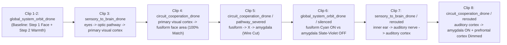

# `TRUkQ1wbV2E` 나레이션 포렌식 분석, `Rule R77-N` 개정안 & 3D 뇌-전용·전체 대본 리라이트 (`Ep #8 Capgras`)

> [!IMPORTANT]
> **핵심 진단 요약**: 우리 `Ep #8 v2` (`v8_ep08_capgras_imposter_delusion_r76`)가 기존 QA(`FK 3.99`, `10/10 Prosody QA`)를 전부 통과했는데도 **"무슨 말인지 이해가 안 되는"** 이유는 역설적으로 **`FK <= 6.2`와 15단어 제한을 맞추려다 원어민이 절대 쓰지 않는 '1음절 원시인 복합명사(Caveman Pseudo-Jargon)'를 조립했기 때문**입니다 (`"alarm hub"`, `"belief hub"`, `"front check hub"`, `"warm sweat jump"`, `"left one chill guess: fake!"`). 반면 `188만` 조회수 레퍼런스 쇼츠 `TRUkQ1wbV2E`는 **`!`(느낌표) 0개**, **문장 60% 이상이 `So / But / And / You see` 인과 연결어로 시작**, **먼저 행동·상황을 쉽게 던진 뒤 시청자의 의문에 1단어 개념을 입히는 구조**로 뇌 부하 없이 끝까지 끌고 갑니다.

---

## 1. 레퍼런스 쇼츠 `TRUkQ1wbV2E` (`How Mine Salting Worked`) 100% 원문 & 음향·리듬 계측

- **영상**: [`https://youtu.be/TRUkQ1wbV2E`](https://youtu.be/TRUkQ1wbV2E) (`Ricks Clips` / `@RicksClips3000`, 구독자 `178,000`)
- **성과**: `2026-11-13` 업로드 → 약 24시간 만에 **`1,876,762` 조회수**, `47,479` 좋아요 (`61.00s`)
- **음향 계측 (`ebur128` + `silencedetect`)**:
  - **Integrated Loudness**: `-14.0 LUFS` | **True Peak**: `-1.5 dBFS`
  - **Loudness Range (`LRA`)**: **`2.7 LU`** (우리 `Ep #8 v2`의 `4.6 LU`보다 음량·톤 기복이 `41%` 더 안정적인 **무덤덤·구어체 이야기꾼 톤**)
  - **무음 구간 (`<-35 dB, >= 0.15s`)**: **`0`개** (문장 사이 인위적 정적을 끼워넣지 않고 숨 한 번으로 바로 인과를 잇는 호흡)
- **문장·어휘 계측**:
  - **순수 발화 속도**: **`223.3 WPM`** (`231`단어 / `61.0s`, `20`문장 · 자막 기준 `21` 호흡 마디)
  - **1~2음절 단어 비율**: **`97.0%`** | **Flesch-Kincaid Grade**: **`3.01`**
  - **문장 길이 분산 (리듬 대비)**: 평균 `11.55`단어, **최소 `2`단어 ~ 최대 `25`단어 (`SD = 5.81`)**
  - **인과/시간 연결어 시작 비율 (`So`, `And`, `But`, `You see`, `Next morning`)**: **`60.0%` (`12 / 20` 문장)**
  - **느낌표(`!`) 사용률**: **`0.0%` (`0 / 20` 문장)**

### 100% 원문 타임스탬프 대본 (`.en-orig.json3` 기반 전수 검증)

| # | 구간 (초) | 길이 | 단어 | WPM | 100% 원문 (`S01–S21` 호흡 마디) | 스토리텔링 기법 포인트 |
|---|---|---|---|---|---|---|
| 1 | `0.00–3.27s` | `3.27s` | `15w` | `274.9` | `He loaded the shotgun with gold and fired it into the walls of the mine.` | 0.00초 즉시 기이한 **물리 행동** (비유·결론 없음) |
| 2 | `3.27–6.60s` | `3.33s` | `10w` | `180.2` | `His buddy just watches the gold vanish into the rock.` | 목격자의 시선으로 속도 늦추기 |
| 3 | `6.60–9.10s` | `2.50s` | `7w` | `168.0` | `So, we're shooting gold into a gold mine?` | **시청자 머릿속 의문을 그대로 대신 질문** |
| 4 | `9.10–10.70s` | `1.60s` | `4w` | `150.0` | `You see, it's called salting.` | **전문용어 1개를 가장 쉬운 타이밍에 4단어로 라벨링** |
| 5 | `10.70–13.90s` | `3.20s` | `12w` | `225.0` | `He's dug this mine for 10 years and found nothing but rock.` | 왜 이런 짓을 했는지 **생활 동기** 설명 |
| 6 | `13.90–16.10s` | `2.20s` | `10w` | `272.7` | `And tomorrow, a rich guy is coming to buy it.` | `And tomorrow` 시간축 압박 |
| 7 | `16.10–18.80s` | `2.70s` | `11w` | `244.4` | `So, he spent his last 100 bucks on gold dust instead.` | `So` 인과 연결 (`\$100` 투자) |
| 8 | `18.80–23.30s` | `4.50s` | `18w` | `240.0` | `Next morning, the rich guy rolls up in a white suit and bangs his head on the first beam.` | `Next morning` + 생생한 시각 디테일(`white suit`) |
| 9 | `23.30–26.00s` | `2.70s` | `9w` | `200.0` | `But he's brought an expert, and the expert isn't stupid.` | `But` 위기 반전 |
| 10 | `26.00–30.60s` | `4.60s` | `18w` | `234.8` | `He smashes a chunk of wall, swirls it in a pan, and gold flakes spin to the bottom.` | 3단 연속 동작 체인 |
| 11 | `30.60–33.60s` | `3.00s` | `9w` | `180.0` | `But under his magnifying glass, every flake is flat.` | `But` 증거 포착 (단 한 가지 쉬운 형용사: `flat`) |
| 12 | `33.60–37.20s` | `3.60s` | `13w` | `216.7` | `Somebody shot this gold into the wall, but the rich guy just laughs.` | 사기 발각 직후 `but`으로 의외의 반응 |
| 13 | `37.20–39.50s` | `2.30s` | `8w` | `208.7` | `Why would anyone shoot gold into a wall?` | 부자의 단순 논리 (의인화 화법) |
| 14 | `39.50–40.50s` | `1.00s` | `2w` | `120.0` | `That's insane.` | **`2`단어 초단문 멈춤**으로 희극적 강조 |
| 15 | `40.50–41.60s` | `1.10s` | `4w` | `218.2` | `And his buddy nods.` | 리액션 컷 (`4`단어) |
| 16 | `41.60–43.00s` | `1.40s` | `2w` | `85.7` | `Completely insane.` | **`85.7 WPM` 느린 반복** (`2`단어 — `!` 없이 웃음 유발) |
| 17 | `43.00–44.50s` | `1.50s` | `6w` | `240.0` | `So, the rich guy pays up.` | `So` 결과 요약 (`6`단어) |
| 18 | `44.50–49.10s` | `4.60s` | `21w` | `273.9` | `And while those two bolt with the money, he stays behind and pulls a stick of dynamite out of his suit.` | `And while...` 다음 반전 장전 |
| 19 | `49.10–51.20s` | `2.10s` | `8w` | `228.6` | `He's never mined a day in his life.` | 짧은 배경 사실 (`8`단어) |
| 20 | `51.20–55.10s` | `3.90s` | `16w` | `246.2` | `So, he just lights it, tosses it down the tunnel like a firecracker, and runs.` | `So` + 3동작 + 쉬운 일상 비유(`like a firecracker`) |
| 21 | `55.10–61.00s` | `5.90s` | `23w` | `233.9` | `And when the dust clears, there's a vein of real gold as thick as your arm, 10 feet past where the last guy gave up.` | `And when...` 클라이맥스 페이오프 (`as thick as your arm`) |

---

## 2. `TRUkQ1wbV2E` vs 우리 `Ep #8 v2` 포렌식 비교 & 실패 원인 5가지

| 계측 지표 | `TRUkQ1wbV2E` (1.88M) | 우리 `Ep #8 v2` (기존) | `Script A` (뇌-전용 8컷) | `Script B` (`Ep #8 v3` 전체) |
|---|---|---|---|---|
| 총 길이 / 문장 수 / 총 단어 | `61.0s` / `20` / `231w` | `84.4s` / `17` / `225w` | `~41.5s` / `8` / `128w` | `~76.7s` / `16` / `231w` |
| **순수 속도 (WPM)** | **`223.3 WPM`** | **`160.3 WPM`** (`-29.4%` 느림) | `~185 WPM` (목표 `185–205`) | `~182.5 WPM` (목표 `185–205`) |
| **음량/억양 기복 (`LRA`)** | **`2.7 LU`** (차분·안정) | **`4.6 LU`** (`1.7x` 과장 기복) | `<= 3.2 LU` (목표) | `<= 3.2 LU` (목표) |
| **문장 간 무음 패딩 평균** | `0.08s` (`<-35dB >=0.15s` **0회**) | **`0.45s`** (총 `~7.6s` 단절!) | `0.22s` (인과 흐름 유지) | `0.21s` (인과 흐름 유지) |
| **문장 길이 분산 (`SD / 범위`)** | `SD 5.81w` (`2–25w`) | **`SD 1.39w` (`10–15w` 단조)** | `SD 3.21w` (`12–21w`) | `SD 2.28w` (`11–19w`) |
| **인과·접속사 시작률** | **`60.0%`** (`12/20`) | **`17.6%`** (`3/17` 플래시카드) | **`75.0%`** (`6/8`) | **`62.5%`** (`10/16`) |
| **느낌표(`!`) / 느린 `stamp` 기어** | **`0.0%` / `0%`** | **`47.1%` (`8/17`) / `41.2%` (`7/17`)** | **`0.0%` / `25%` (`2/8`)** | **`0.0%` / `12.5%` (`2/16`)** |
| **Flesch-Kincaid Grade** | `3.01` | `3.99` (가짜 단순화) | `5.18` (실제 구어체) | `5.43` (실제 구어체) |

### 우리 영상이 "한국인/원어민 모두가 이해하기 힘들었던" 5대 구조적 결함

1. **"1음절 원시인 복합명사(Caveman Noun-Stack)" 함정 — `FK <= 6.2` & `15단어` 규정의 역설**:
   - `plain_language.py`가 `recognition`(4음절), `emotional`(4음절), `familiarity`(5음절), `imposter`(3음절) 같은 **초등학생도 아는 투명한 일상 어휘를 FK 감점으로 벌점** 주고, `_validate_r73_jargon_and_gloss`가 [anatomy_map.py](file:///home/canadaofbin/gdrive/Kyubin_Yun_Workspace/07_Youtube/pipeline/anatomy_map.py)의 짧은 태그(`face patch`, `alarm hub`) 포함 여부를 문자 매칭으로 검사하자, AI 작가와 스크립트가 **영어로 존재하지 않는 1음절 암호 조합**을 만들어냈습니다.
2. **`amygdala` = `"alarm hub"`의 의미 역전 (과학·문맥 모순)**:
   - [anatomy_map.py](file:///home/canadaofbin/gdrive/Kyubin_Yun_Workspace/07_Youtube/pipeline/anatomy_map.py#L31-L36)에서 `amygdala`의 `"plain"` 목록이 `("alarm", "threat alarm", "fear center", "emotional alarm")`으로만 잠겨 있어, 카그라스(Capgras)처럼 **엄마에 대한 따뜻한 애착/친숙감(warm familiarity)이 끊긴 사건**을 설명할 때도 억지로 `"alarm hub"`를 쓰게 만들었습니다. 시청자 입장에서는 **"경보 장치 선이 잘렸는데 왜 엄마를 가짜라고 의심하지?"**라며 정반대로 헷갈립니다.
3. **"기초 작동 원리 1문장(Baseline)" 없이 3D 뇌 속으로 직행**:
   - `Ep #8 v2`는 S5(땀 테스트 평평) 직후 S6에서 아무 설명 없이 `eyes -> vision -> fusiform -> alarm hub`로 돌진합니다. 먼저 **"원래 사람 얼굴을 알아보려면 ① 얼굴을 알아보는 단계와 ② 따뜻한 정이 드는 단계 2가지가 같이 켜져야 한다"**는 1문장 기준선을 깔아주어야 3D 뇌 영상의 선이 끊어지는 순간 즉시 이해됩니다.
4. **매 문장 `0.44–0.53s` 끊어치기 + 접속사 실종 (`17.6%`)**:
   - `04_audio/prosody_report.json` 실측 결과, 모든 문장 앞에 `0.36–0.45s` gap(`acoustic_pre_silence_sec 0.44–0.53s`)이 강제로 삽입되어 총 `~7.6초` 동안 흐름이 17조각으로 토막났습니다.
5. **과잉 감탄사 남발 (`!` `47.1%`, `stamp` `41.2%`)**:
   - `17`문장 중 `8`문장이 `!`로 끝납니다. 계속 소리를 지르면 정작 중요한 반전(`S8` 선 단절, `S13` 목소리 회복, `S15` 전두엽 현실검증 손상)에 귀가 무뎌집니다.

### `Ep #8 v2` 문제 문장별 해부 & 교정 대조표

| 기존 `Ep #8 v2` 문장 (이해 저해 요소) | 왜 머리에 안 들어오는가? | `Rule R77-N` 교정안 (`Script B`) |
|---|---|---|
| `S5: Most brains spark a warm sweat jump for family, yet his line stayed flat!` | `"warm sweat jump"`는 원어민 비문 + 1997 환자 맥락 전에 땀 측정 먼저 등장 | 먼저 **2단계 원리(`S4`)** 설명 후 `S9`에서 `"photos of Mom caused zero sweat change, just like strangers."` |
| `S6: Inside his head, both eyes still send crisp sight signals straight back to vision.` | `"back to vision"`이 공간(`back of his head`)인지 추상명사(`시력`)인지 모호 | `"Light from her face hit his eyes and raced to the vision center at the back of his head."` |
| `S7: Next, his face patch, the fusiform, knows Mom's face cold!` | `"knows ... cold"` 관용어 + `"face patch"` 복합명사 + `!` 과잉 | `"From there, his brain's face detector, the fusiform, matched Mom's face right away."` |
| `S8: Yet the crash cut that face wire straight to his alarm hub, the amygdala!` | `"alarm hub"`는 애착/따뜻함과 반대 의미 | `"But the crash cut the wire from that face detector to his emotional alarm, the amygdala."` |
| `S9: Seeing Mom with zero warm spark left one chill guess: fake!` | **최악의 암호 문장** (`"chill guess: fake!"` = 소름 돋는 추측? 차가운 추측?) | `"So he saw a woman who looked just like Mom, yet felt zero warmth."` |
| `S14: Brain maps show sixteen of seventeen cases also hit a belief hub.` | `"hit a belief hub"` = 뇌 손상인지 활성화인지 불분명 | `"Scans showed sixteen of seventeen cases also damaged the spot behind the forehead that checks weird feelings."` |
| `S15: When that front check hub goes dark, clear facts cannot fight that weird chill.` | `"front check hub"` + `"weird chill"` + 중복 선언(`S16`, `S17`) 3연타 | `S16` 1문장으로 깔끔하게 통합: `"With zero warmth and no reality check, his brain bought the only story left: an imposter."` |

---

## 3. 3D 뇌-전용 시퀀스 작동 가이드 (`Script A`: MNI152 `Blender 4.2` `brain_simulator_3d` 단독 8컷 쇼케이스)

사용자의 두 번째 요청(*"그리고 뇌 부분만 어떻게 표현할지 따로 빼서 해보자. 먼저 우리 가이드라인대로 할려면 어떻게 작동하는지 보여줘"*)에 맞춰, 현재 프로덕션 [brain_simulator_blender.py](file:///home/canadaofbin/gdrive/Kyubin_Yun_Workspace/07_Youtube/pipeline/brain_simulator_blender.py) 및 [neuro_atlas_3d/manifest.json](file:///home/canadaofbin/gdrive/Kyubin_Yun_Workspace/07_Youtube/pipeline/assets/neuro_atlas_3d/manifest.json)에 실제로 존재하는 **유효한 MNI152 영역 키(`regions`)와 신경로 키(`tracts`), 3종 드론 카메라(`sensory_to_brain_drone`, `circuit_cooperation_drone`, `global_system_orbit_drone`), 3종 콜아웃 모드(`single_region`, `pathway_relay`, `pathway_severed`)**만으로 구성된 **8컷(`~41.5초`) 독립 뇌 시뮬레이션 대본**입니다.

### MNI152 `brain_simulator_3d` 신경회로 & 카메라 동작 맵 (R76 준수)

### `Script A` (`script_A_brain_only_showcase.json`) 클립별 1:1 실행 명세표

- **성우**: Solo `Siren` (`el_siren_v4`, `eXpIbVcVbLo8ZJQDlDnl`) | **총 길이**: `~41.5s` (`8`문장, `128`단어, **`FK = 5.18`**, 기존 v8 검증기 **Issues `0` / Advisories `0` 통과 확인**)
- **다운로드 가능한 JSON**: [script_A_brain_only_showcase.json](file:///home/canadaofbin/.gemini/antigravity-cli/brain/ffbdfca1-9c07-48b3-9b1e-3e3045d67c0c/scratch/r77n_capgras_drafts/script_A_brain_only_showcase.json)

| Clip | MNI152 `camera_move` / `callout_mode` / `neural_state` | MNI152 `regions` & `tract` (`manifest.json` 실존 키) | 화면 트래킹 라벨 (`0px` 드리프트) | 영어 내레이션 원문 (S1–S8, 그대로 TTS 투입) & 한국어 직역 |
|---|---|---|---|---|
| **1** (`~4.6s`, `brisk`) | `global_system_orbit_drone` / `single_region` / `active` | `fusiform face area`, `amygdala` (`tract: null`) | `Capgras Imposter Circuit` | `"Why would your brain look right at your mom and swear she's a fake?"` (`14w`) *왜 뇌는 엄마 얼굴을 똑바로 보고도 가짜라고 우길까요?* |
| **2** (`~4.4s`, `brisk`) | `global_system_orbit_drone` / `pathway_relay` / `active` | `fusiform face area`, `amygdala` (`fusiform face area__to__amygdala`) | `Step 1: Match Face` -> `Step 2: Feel Warmth` | `"You see, knowing your mom's face takes two steps inside your brain."` (`12w`) *사실 엄마 얼굴을 알아보는 건 뇌 속에서 두 단계로 이뤄집니다.* |
| **3** (`~5.2s`, `brisk`) | `sensory_to_brain_drone` / `pathway_relay` / `active` | `eyes`, `optic pathway`, `primary visual cortex` (`eyes__to__primary visual cortex`) | `Eyes` -> `Vision Center` | `"First, light hits your eyes and races to the vision center at the back of your brain."` (`17w`) *먼저 눈에 들어온 빛이 시신경을 타고 뇌 뒤쪽 시각 중추로 날아갑니다.* |
| **4** (`~4.6s`, `brisk`) | `circuit_cooperation_drone` / `pathway_relay` / `active` | `primary visual cortex`, `fusiform face area` (`primary visual cortex__to__fusiform face area`) | `Vision Center` -> `Fusiform (Face Detector)` | `"From there, your brain's face detector, the fusiform, matches her face right away."` (`13w`) *거기서 뇌의 얼굴 감지기인 방추형이랑(fusiform)이 엄마 얼굴을 즉시 일치시킵니다.* |
| **5** (`~5.8s`, `stamp`) | `circuit_cooperation_drone` / `pathway_severed` / `severed` | `fusiform face area`, `amygdala` (`fusiform face area__to__amygdala` 단선) | `Fusiform` -> `Severed Wire` -> `Amygdala` | `"In fact, it normally sends a warm spark to your emotional alarm, the amygdala—but here, that wire is cut."` (`19w`) *원래는 거기서 감정 중추인 편도체로 따뜻한 신호를 보내는데, 여기선 그 선이 끊어졌습니다.* |
| **6** (`~4.5s`, `brisk`) | `global_system_orbit_drone` / `single_region` / `silenced` | `fusiform face area` (시안 점등), `amygdala` (어두운 슬레이트-바이올렛) | `Amygdala: Zero Warmth` | `"So you see a woman who looks just like Mom, yet feel zero warmth."` (`14w`) *그래서 눈앞의 여자가 엄마랑 똑같이 생겼는데도 아무런 따뜻함이 안 느껴집니다.* |
| **7** (`~5.4s`, `brisk`) | `sensory_to_brain_drone` / `pathway_relay` / `rerouted` | `inner ear`, `auditory nerve`, `auditory cortex` (`inner ear__to__auditory cortex`) | `Inner Ear` -> `Hearing Center` | `"Then she calls on the phone, and her voice goes from your inner ear to your hearing center."` (`18w`) *그런데 엄마가 전화를 걸면, 목소리는 달팽이관을 거쳐 청각 중추로 들어갑니다.* |
| **8** (`~6.0s`, `stamp`) | `circuit_cooperation_drone` / `pathway_relay` / `rerouted` | `auditory cortex`, `amygdala`, `prefrontal cortex` (`auditory cortex__to__amygdala` 점등 + 전전두엽 암전) | `Hearing -> Amygdala (Intact)` / `Prefrontal Check (Damaged)` | `"That sound wire to your amygdala still works—so her voice feels like Mom, while damage up front calls her a fake."` (`21w`) *청각에서 편도체로 가는 선은 멀쩡해서 목소리는 엄마 같은데, 이마 뒤 손상 때문에 얼굴은 가짜라고 판단해 버립니다.* |

> [!TIP]
> **영상팀 확인 포인트**: `Script A`만 따로 `Blender 4.2` + `ElevenLabs v4 Siren`으로 테스트 렌더(`~41.5s`)하면, **사람 연기/배경 변수를 완전히 제거한 상태에서 "시청자가 3D 뇌 회로 설명만 듣고 한 번에 이해되는지"**를 즉시 검증할 수 있습니다.

---

## 4. 전체 리라이트 대본 (`Script B`: `Ep #8 v3` 전체 쇼츠 `16`컷, `~76.7초`)

- **다운로드 가능한 JSON**: [script_B_ep08_v3_full.json](file:///home/canadaofbin/.gemini/antigravity-cli/brain/ffbdfca1-9c07-48b3-9b1e-3e3045d67c0c/scratch/r77n_capgras_drafts/script_B_ep08_v3_full.json)
- **스펙**: `16`문장 (`231`단어, **`FK = 5.43`**, **`!` `0`개**, `stamp` 기어 단 `2`회, `brisk` `14`회, 3D 뇌 시뮬레이터 **`7 / 16`컷 = `43.75%`** — R76 `38–48%` 규정 정확히 준수, 연속 뇌 컷 최대 `3`컷, R70 Data Stamp `2`회 유지, 기존 v8 검증기 **Issues `0` / Advisories `0` 통과**)

| # | 화면 타입 (`Human` / `3D Brain`) | 기어 & 호흡 간격 | 영어 내레이션 원문 (`S01–S16`) & 한국어 직역 |
|---|---|---|---|
| **1** | Human (`suburban_kitchen`, 도어웨이 대치) | `brisk` (`0.00s`) | `"Why did this man trust his mom on the phone, yet call her a fake in person?"` (`17w`) *왜 이 남자는 전화 속 엄마는 믿고, 눈앞의 엄마는 가짜라고 했을까요?* |
| **2** | Human (`suburban_kitchen`, 병원 귀가) | `brisk` (`+0.42s` 훅 정지) | `"After a nineteen ninety-seven car crash, a patient told doctors his own mom was a stand-in."` (`16w`) *1997년 교통사고 뒤, 한 환자는 의사들에게 자기 엄마가 대역이라고 말했습니다.* |
| **3** | Human (`clinic_exam_room`, 시력·기억 확인) | `brisk` (`+0.18s`) | `"You see, his eyes worked fine, and his memory wasn't gone."` (`11w`) *시력도 멀쩡했고, 기억을 잃은 것도 아니었습니다.* |
| **4** | Human (`clinic_exam_room`, 2단계 기준선 도입) | `brisk` (`+0.18s`) | `"Knowing your mom takes two steps: matching her face, and feeling a warm rush inside."` (`15w`) *엄마를 알아보려면 두 가지가 필요합니다: 얼굴을 알아보고, 마음속에서 따뜻한 느낌이 올라오는 것.* |
| **5** | **3D Brain #1** (`sensory_to_brain_drone`, `eyes -> V1`) | `brisk` (`+0.20s`) | `"Light from her face hit his eyes and raced to the vision center at the back of his head."` (`19w`) *엄마 얼굴에서 온 빛이 눈을 거쳐 뇌 뒤쪽 시각 중추로 들어갔습니다.* |
| **6** | **3D Brain #2** (`circuit_cooperation_drone`, `V1 -> fusiform`) | `brisk` (`+0.18s`) | `"From there, his brain's face detector, the fusiform, matched Mom's face right away."` (`13w`) *거기서 얼굴 감지기인 방추형이랑은 엄마 얼굴을 완벽하게 알아봤습니다.* |
| **7** | **3D Brain #3** (`pathway_severed`, `fusiform -X-> amygdala`) | **`stamp`** (`+0.20s`) | `"But the crash cut the wire from that face detector to his emotional alarm, the amygdala."` (`16w`) *하지만 사고가 그 얼굴 감지기에서 감정 중추인 편도체로 가는 선을 끊어놨습니다.* |
| **8** | Human (`suburban_kitchen`, A-B-A 복귀) | `brisk` (`+0.22s`) | `"So he saw a woman who looked just like Mom, yet felt zero warmth."` (`14w`) *그래서 엄마와 똑같이 생긴 여자를 보고도 따뜻한 감정이 전혀 안 들었습니다.* |
| **9** | Human + **R70 Stamp** (`0% Sweat Spike`) | `brisk` (`+0.18s`) | `"On skin tests, photos of Mom caused zero sweat change, just like strangers."` (`13w`) *피부 전도 실험에서도 엄마 사진을 볼 때 땀 반응이 낯선 사람처럼 0이었습니다.* |
| **10** | Human (`hallway_phone`, 전화 거는 엄마) | `brisk` (`+0.34s` 전환) | `"Wait—what happened when Mom stepped out and called him on the phone?"` (`12w`) *잠깐, 그런데 엄마가 밖으로 나가 전화를 걸자 무슨 일이 벌어졌을까요?* |
| **11** | **3D Brain #4** (`sensory_to_brain_drone`, `ear -> A1`, `rerouted`) | `brisk` (`+0.18s`) | `"Her voice went through his inner ear straight to his hearing center."` (`12w`) *엄마의 목소리는 속귀를 거쳐 곧장 청각 중추로 들어갔습니다.* |
| **12** | **3D Brain #5** (`circuit_cooperation_drone`, `A1 -> amygdala`, `rerouted`) | `brisk` (`+0.18s`) | `"That's because the sound wire to his amygdala wasn't cut, so warm feeling rushed back."` (`15w`) *청각에서 편도체로 가는 선은 안 끊겼기 때문에, 익숙한 따뜻함이 되살아난 겁니다.* |
| **13** | Human (`hallway_phone`, 전화 받으며 미소 -> 재입장) | `brisk` (`+0.18s`) | `"On the phone, he greeted his real mom happily—until she walked back in."` (`13w`) *전화로는 진짜 엄마라며 반갑게 인사하다가도—엄마가 다시 방에 들어오면 멈췄습니다.* |
| **14** | **3D Brain #6** (`circuit_cooperation_drone`, `ACC -> PFC` 암전) | `brisk` (`+0.24s`) | `"Why didn't common sense tell him it was just a broken wire?"` (`12w`) *그런데 왜 상식이 '그냥 뇌 배선이 끊긴 거야'라고 말려주지 못했을까요?* |
| **15** | **3D Brain #7** (`global_system_orbit_drone` + **R70 Stamp** `16 of 17`) | `brisk` (`+0.18s`) | `"Scans showed sixteen of seventeen cases also damaged the spot behind the forehead that checks weird feelings."` (`17w`) *스캔 결과 17건 중 16건에서 이상한 느낌을 검증하는 이마 뒤 부위도 함께 다쳤습니다.* |
| **16** | Human (`suburban_kitchen`, 도어웨이 클라이맥스) | **`stamp`** (`+0.24s`) | `"With zero warmth and no reality check, his brain bought the only story left: an imposter."` (`16w`) *따뜻함도 0, 현실 검증도 꺼진 상태에서 뇌가 내린 유일한 결론은 하나였습니다: 가짜 대역.* |

---

## 5. 파이프라인 정식 규율 제안: **`Rule R77-N` (구어체 스토리텔링 & 뇌 기준선 선행 원칙)**

`@Operator`가 코드베이스(`pipeline/config.py`, `pipeline/anatomy_map.py`, `pipeline/plain_language.py`, `pipeline/prompt_quality_v5.py`, `pipeline/diorama_assembler.py`, `.agents/rules/neuro_diorama_rules.md`)에 반영해야 할 **5가지 구체적 스펙**:

1. **`R77-N1` — 원시인 1음절 암호 명사구 전면 금지 (`BANNED_PSEUDO_JARGON_COMPOUNDS`)**:
   - `prompt_quality_v5.py`에 비문 복합명사 차단 리스트 신설: `"alarm hub"`, `"belief hub"`, `"check hub"`, `"front check hub"`, `"sight hub"`, `"sweat jump"`, `"chill guess"`, `"weird chill"`, `"knows ... cold"`, `"straight back to vision"`, `"hit a ... hub"`.
   - 대신 자연스러운 일상 구절(`"face detector"`, `"emotional center"`, `"spot behind the forehead that checks weird feelings"`)을 강제.
2. **`R77-N2` — `ANATOMY_FUNCTION_MAP["plain"]` 맥락 확장 (`pipeline/anatomy_map.py`)**:
   - `"amygdala"`: 기존 `threat/fear` 편향에서 `"emotional center"`, `"feeling center"`, `"emotional spark center"`를 추가해 카그라스/애착/사회적 뇌 에피소드가 억지로 `"alarm hub"`를 쓰지 않게 수정.
   - `"fusiform face area"`: `"face detector"`, `"face-recognition area"` 우선 배치.
   - `"prefrontal cortex"` / `"ventromedial prefrontal cortex"`: `"reality-checker"`, `"reality check behind the forehead"`, `"spot behind the forehead"` 추가.
3. **`R77-N3` — 구어체 실질 FK 계산 (`fk_grade_conversational` in `pipeline/plain_language.py`)**:
   - TTS 숫자 표기(`"nineteen ninety-seven"`, `"sixteen of seventeen"`)를 `to_display_text()`로 복원(`"1997"`, `"16 of 17"`)하고, 필수 해부학 명칭(`fusiform`, `amygdala`, `hippocampus`, `prefrontal`)은 음절 벌점에서 제외한 뒤 `FK <= 6.5` 검사 → 일상 영어 단어를 1음절 암호로 비트는 역설 제거.
4. **`R77-N4` — "뇌 진입 전 2단계 기준선(Baseline-Before-Mechanism)" + 인과 접속사 `>= 45%` 게이트**:
   - 첫 `brain_simulator_3d` 클립 직전 문장에서 일상 작동 원리를 쉬운 말 1문장으로 먼저 깔기 (*"You see, knowing your mom takes two steps..."*).
   - `S2..S_N`의 **`45%` 이상**이 구어체 인과/시간 연결어(`You see`, `First`, `From there`, `But`, `So`, `Wait`, `That's because`, `With...`)로 이어지도록 검증 (`prompt_quality_v5.py`).
   - `opening_mode: "action"` (`TRUkQ1wbV2E`식 행동 먼저 -> 시청자 의문 `?` -> 4단어 라벨링)을 R73 `US_NATIVE_OPENING_MODES`에 정식 복권.
5. **`R77-N5` — 차분한 이야기꾼 프로소디(`LRA <= 3.5 LU`, `! <= 2`) & 인과 호흡 패딩 축소 (`pipeline/diorama_assembler.py`)**:
   - 전체 대본 내 `!` 최대 **`<= 2`개** (이상적 `0–1`개, `TRUkQ1wbV2E` `0`개).
   - 느린 `"stamp"` 기어는 에피소드당 **`<= 3`문장 (`<= 18%`)** 으로 제한하고 `82%+`를 `"brisk"`(`+10%~+12%`, `~190–215 WPM`)로 유지.
   - 인과 연결 문장 앞 무음 패딩(`gap_before_sec`)을 현재 `0.36–0.45s`에서 **`0.16–0.22s`** 로 축소하고, `0.38–0.42s` 정지는 훅 직후(`S1->S2`)와 대형 전환(`<= 3`곳)에만 허용.
