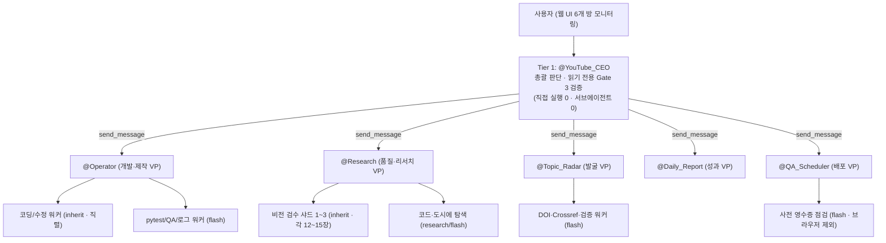
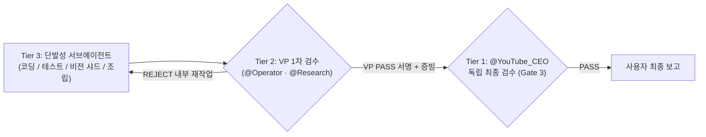

# ALL ABOUT BRAIN — `R83 v2` 분야별 CEO(Domain VP) + 단발성 서브에이전트 토큰 효율화 개편 계획

**목표**: 기존 **6개 웹 UI 채팅방 가시성**과 **`@YouTube_CEO` 독립 검증 원칙(`R83-5..7`)**은 그대로 유지하면서, 5개 전문 작업방(`@Operator`, `@Research`, `@Topic_Radar`, `@Daily_Report`, `@QA_Scheduler`)이 **각 분야의 CEO(Domain VP)**처럼 깔끔한 의사결정·요약 컨텍스트만 유지하고 무거운 실행·대량 이미지 검수·로그 분석을 **단발성 서브에이전트(`invoke_subagent`)**에 위임하도록 개편해 **토큰 소비와 `/compact` 빈도를 `40~70%` 절감**합니다.

---

## 1. 왜 토큰이 절감되는가 (메커니즘)

- **현재 병목 (`R83 v1`)**:
  - `@Operator` 메인 방에 수천 줄짜리 `pytest`·FFmpeg·CDP DOM 로그가 누적되어 매 턴 입력 토큰이 눈덩이처럼 증가.
  - `@Research` 메인 방에 `35~45`장 고해상도 PNG(`Gate 1/2`, `Canonical v1.2`) 비전 토큰이 영구 적재되어 잦은 `/compact` 유발.
- **개편 후 (`R83 v2`)**:
  - 단발성 서브에이전트가 원시 로그·대량 이미지를 자기 독립 컨텍스트 안에서 처리한 뒤 **구조화된 결과 요약·판정 JSON·파일 경로(수십 줄)만 VP 방에 보고하고 즉시 종료**.
  - 종료 즉시 원시 터미널 로그와 비전 이미지 토큰이 100% 폐기되어 VP 메인 방은 항상 가볍고 선명한 상태를 유지합니다.

---

## 2. 3-Tier 계층 아키텍처 (`R83 v2`)

- **Tier 1 (`@YouTube_CEO`)**: 변경 없음 — 사용자 의도 정렬, 계획 수립·승인, 5개 VP 방 `send_message` 위임, 읽기 전용 사후 검증(`R83-5..7`)만 수행(서브에이전트 `0`).
- **Tier 2 (5개 웹 UI 분야별 VP)**: 사용자가 웹 UI에서 실시간으로 보는 5개 공식 채팅방. 각 VP는 작업 분해·서브에이전트 발주·결과 검토·최종 서명·`[*_DONE]` 보고만 깔끔하게 관리.
- **Tier 3 (단발성 서브에이전트, `nesting_depth=1`)**: `tests/test_chatroom_mention.py`가 이미 `nesting_depth=1`을 최상위 채팅방 목록에서 자동 제외하므로 6개 웹 UI 방 구조가 오염되지 않음.

---

## 3. 방별 위임 규칙 & 모델 등급 매트릭스 (`Model Right-Sizing`)

| 분야별 VP | VP가 직접 소유하는 판단·책임 | 서브에이전트 위임 가능 작업 | 모델 등급 (`Model`) | 병렬 한도 |
| :--- | :--- | :--- | :---: | :---: |
| **`@Operator`** | 아키텍처 설계, 최종 `[*_DONE]` 증거 조립, 브라우저 Flow 실행 조정 | ① 모듈 단위 코드 구현/수정 ② `pytest`·`episode-qa`·`prosody-qa`·`verify` 실행 및 실패 로그 요약 ③ 대량 JSON/시트/아카이브 동기화 | ① `inherit` ② `flash` ③ `flash_lite` | 코드 쓰기: **파일 분리 또는 직렬 `1`** 브라우저(Flow): **직렬 `1`** 읽기/테스트: 최대 `2` |
| **`@Research`** | 훅/화살표 설계 판단, **반려 보드 직접 육안 재확인**, Gate 1/2 최종 JSON 서명 | ① 대량 고해상도 이미지 1차 검수 샤드 (`12~15`장/샤드, 예: `v1.2` `45`장 → `3`샤드) ② 코드베이스·경쟁채널·도시에 데이터 수집 (`research`) | ① **`inherit` 필수** (`flash` 금지) ② `flash` / `research` | 비전 샤드: **최대 `3` 병렬** (읽기 전용이라 충돌 `0`) |
| **`@Topic_Radar`** | 7필러·5도메인 최종 균형 및 `30–35` 버퍼 선정 | Crossref/PubMed DOI 조회, `dossier validate --require-v2` 일괄 스캔 | `flash` | 최대 `2` |
| **`@Daily_Report`** | `07:00 UTC` 크론 실행, 최종 신호등 판정 및 회귀 경보 발송 | 기본 단일 패스 유지 (초대형 히스토리 감사 시에만 `flash` 읽기 워커) | `flash` (선택) | 브라우저: **VP 단독 직렬 `1`** |
| **`@QA_Scheduler`** | `08:00 UTC` `HOLD/GO` 최종 판정, Studio/IG/TikTok 실제 업로드 | 업로드 전 영수증·SHA·메타데이터 사전 점검 (비브라우저 읽기 전용) | `flash_lite` | 브라우저 업로드: **VP 단독 직렬 `1`** |

---

## 4. 2중 검수 피라미드 (`R83-8-V`: `@Operator`·`@Research` 1차 서브에이전트 검수 의무)

사용자 지시에 따라 **각 분야 VP(`@Operator`, `@Research`)가 자기 방 서브에이전트의 산출물을 1차로 직접 검수(`Verify-Before-Relay`)한 뒤에만** 상위(`@YouTube_CEO` 또는 타 VP)로 넘기도록 2중 검수 구조를 확립합니다.

- **`@Operator` VP의 서브에이전트 1차 검수 의무**:
  - 코딩·테스트·번들·조립 서브에이전트가 보고한 결과를 그대로 전달 금지.
  - `@Operator` VP가 직접 **① `git diff`·핵심 변경 라인 확인, ② `pytest`/CLI exit code 및 실패 0건 재확인, ③ 생성 시트·렌더 프리뷰 1차 육안 점검 및 SHA-256 일치 확인** 후 결함이 있으면 **방 내부에서 서브에이전트에 즉시 재작업 지시** → 통과본만 `@Research` / `@YouTube_CEO`에 제출.
- **`@Research` VP의 서브에이전트 1차 검수 의무**:
  - 비전 검수 샤드(`12~15`장/샤드) 및 데이터 분석 서브에이전트가 올린 판정을 그대로 서명 금지.
  - `@Research` VP가 직접 **① 모든 `REJECT` 및 경계선 후보 보드 원해상도 재확인, ② `PASS` 샘플 스팟체크 및 프롬프트 복붙 여부(`>=70%` 금지) 검증, ③ 시청자 상식 3대 필드(`silent_3s_scroll_stop`, `narration_visual_logic_match`, `thumbnail_to_0s_promise_kept`) 최종 확인** 후 미흡한 샤드는 내부 재검수 지시 → 통과본에만 최종 JSON 서명.
- **기대 효과**: 저품질 초안이 `@YouTube_CEO`까지 올라와 왕복 반려되는 토큰 낭비를 원천 차단하고, `@YouTube_CEO`는 깔끔히 정제된 최종본만 독립 Gate 3 검증해 속도와 품질을 동시에 극대화합니다.

---

## 5. 과거 사고 재발을 막는 4대 필수 안전장치 (`R83-8` 신설)

> [!CAUTION]
> 아래 4개 안전장치를 어기면 탭 충돌·비전 오탐·파일 덮어쓰기·좀비 세션이 재발하므로 `R83-8` 하드 규칙으로 잠급니다.

1. **`G1` — 브라우저(CDP `9222`) 단일 라이터 잠금 (`Single Browser Lock`)**:
   - Google Flow · YouTube Studio · Instagram · TikTok 브라우저 조작은 **절대 2개 이상 서브에이전트가 동시에 접근 금지** (항상 직렬 `1`개, `cdp_tab_manager.py` 전용 탭 리스 준수).
2. **`G2` — 비전·코딩 모델 등급 강제 (`Model Tier Quality Lock`)**:
   - Gate 1 / Gate 2 / `Canonical` 고해상도 이미지 검수 샤드와 핵심 `pipeline/*.py` 코드 작성에는 **`flash` / `flash_lite` 사용 금지 (`inherit` 필수)**.
   - `@Research` VP는 서브에이전트 판정을 맹신하지 않고 **모든 `REJECT` / 경계 케이스 보드를 직접 눈으로 최종 확인한 뒤** `reference_semantic_review.json` / `posthoc_semantic_review.json`에 서명.
3. **`G3` — 동시 파일 쓰기 금지 (`Disjoint Write Lock`)**:
   - `07_Youtube/`(`fuse.rclone`)에서 같은 파일에 2개 워커가 동시에 쓰지 못하도록 쓰기 서브에이전트는 서로 겹치지 않는 파일만 담당하거나 직렬 실행.
4. **`G4` — CLI `agy -p` 영구 금지 & 단발성 종료·가시성 의무**:
   - 비가시 CLI 백그라운드 세션(`agy -p`)은 계속 `0`건 금지.
   - 모든 서브에이전트는 **단발성(크론·데몬 생성 금지)**으로 결과를 반환하고 즉시 종료하며, VP 채팅방은 매 위임마다 `1`줄 발주 기록 + 최종 검증 영수증을 남겨 사용자가 6개 웹 UI 방에서 전체 흐름을 100% 파악할 수 있게 유지.

---

## 6. 수정 대상 파일 & 적용·검증 절차

`R83-5` 예외 조항(CEO 소유 거버넌스 문서는 사용자 명시 승인 시 CEO가 직접 개정)에 따라 승인 즉시 아래 4개 CEO 소유 파일 + `AGENTS.md` 1줄을 개정합니다:

| # | 파일 경로 | 변경 내용 |
| :---: | :--- | :--- |
| 1 | [post_compaction_context_recovery_rule.md](file:///home/canadaofbin/.gemini/config/rules/post_compaction_context_recovery_rule.md) | `Strict 6-Room Lock`을 **`6-Room Domain VP + Ephemeral Subagent Charter (R83 v2)`**로 개정 (`@YouTube_CEO` 서브에이전트 0 유지, 5개 VP 방 단발성 서브에이전트 + 4대 안전장치 명시, CLI `agy -p` 영구 금지 유지) |
| 2 | [governance_roles.md](file:///home/canadaofbin/gdrive/Kyubin_Yun_Workspace/07_Youtube/.agents/rules/governance_roles.md) | `always_on` 크기 예산(`< 3.5 KB`)을 지키며 `R83-8 Domain VP Subagent Rules (G1–G4)` 핵심 표 추가 |
| 3 | [channel_operations_rules.md](file:///home/canadaofbin/gdrive/Kyubin_Yun_Workspace/07_Youtube/.agents/rules/channel_operations_rules.md) | `R83-1` 업데이트 및 `R83-8` 상세 명세 추가 |
| 4 | [chatrooms.json](file:///home/canadaofbin/gdrive/Kyubin_Yun_Workspace/07_Youtube/.agents/chatrooms.json) | `governance.allow_vp_ephemeral_subagents: true`, `forbid_hidden_subagents_in_ceo: true`, `forbid_cli_print_workers: true` 및 방별 `subagent_policy` 필드 추가 (`6`개 활성 방 구조 무변경) |
| 5 | [AGENTS.md](file:///home/canadaofbin/gdrive/Kyubin_Yun_Workspace/07_Youtube/.agents/AGENTS.md) | Section 2 1줄 동기화 (`0` CLI `agy -p`, VP ephemeral subagents per `R83-8`, `< 8 KB` 유지) |

### 적용 직후 검증 & 첫 실전 투입
1. `PYTHONPATH=. /home/canadaofbin/hermes-venv/bin/pytest -q tests/test_chatroom_mention.py` 재실행 (`PASS` 확인) 및 규칙 파일 용량 예산 확인(`governance_roles.md < 4 KB`, `AGENTS.md < 8 KB`).
2. 5개 VP 채팅방 전체에 `[R83_V2_VP_SUBAGENT_CHARTER]` 브로드캐스트.
3. **즉시 실전 효과 확인**: 현재 대기 중인 **`@Research`의 `Canonical v1.2` `45`장 검수**를 **`15`장 × `3` `inherit` 비전 샤드**로, **`@Operator`의 `R87` 전체 `pytest` 실행**을 **`flash` 테스트 워커**로 바로 가동해 토큰 절감과 속도를 동시에 체감합니다.
