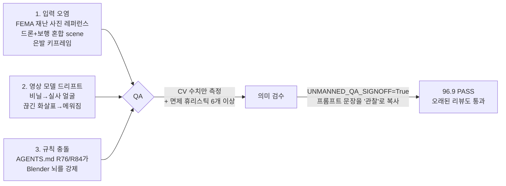
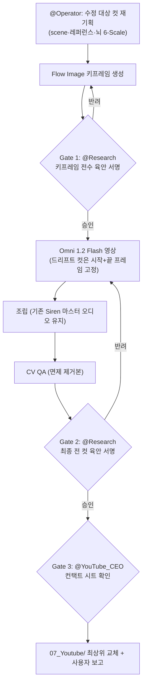

# R85 근본 원인 재검증 & 4편(`Ep #9–#12`) 수정 계획

## 목표
지난번 근본 원인 보고를 **실제 코드, 프로젝트 QA 산출물, 키프레임, 최종 MP4 프레임**과 하나씩 대조해 다시 검증했습니다. 그 결과 틀린 부분을 바로잡았고, 이를 반영해 ① QA 정직성 복구 ② 뇌 메커니즘 복원(R85) ③ 비-뇌 결함 원천 수정 ④ 4편 재구축 계획을 세웠습니다.

> [!IMPORTANT]
> **재검증 결론 한 줄**: 결함은 대부분 **AI 생성 이전 단계(레퍼런스 사진 선택·키프레임 작성)나 영상 모델 드리프트**에서 생겼습니다. 그런데도 통과한 이유는, **사람이나 VLM이 하기로 되어 있던 "의미 검수"를 코드가 기계적으로 자동 서명했기 때문**입니다 (`UNMANNED_QA_SIGNOFF_DEFAULT = True`). 지난 보고의 큰 방향은 맞았지만, **원인 4개 중 3개는 메커니즘 설명이 부정확하거나 틀렸습니다.**

---

## PART A. 재검증 결과 — 지난 보고 대비 정정표

| # | 지난 보고의 주장 | 재검증 판정 | 실제 증거 |
|---|---|---|---|
| 1 | `--auto-populate-review`로 셀프 패스 | ⚠️ **방향은 맞고 메커니즘은 틀림 (실제는 더 심각)** | 진짜 원인은 [config.py:184](file:///home/canadaofbin/gdrive/Kyubin_Yun_Workspace/07_Youtube/pipeline/config.py#L184) `UNMANNED_QA_SIGNOFF_DEFAULT = True` → [cli.py:2033-2038](file:///home/canadaofbin/gdrive/Kyubin_Yun_Workspace/07_Youtube/pipeline/cli.py#L2033-L2038) / [diorama_batch_orchestrator.py:1715-1720](file:///home/canadaofbin/gdrive/Kyubin_Yun_Workspace/07_Youtube/pipeline/diorama_batch_orchestrator.py#L1715-L1720)가 [auto_signoff_posthoc_semantic_review()](file:///home/canadaofbin/gdrive/Kyubin_Yun_Workspace/07_Youtube/pipeline/posthoc_semantic_qa.py#L1387-L1466)를 자동 호출합니다. 이 함수는 **"관찰 내용" 칸에 실제 화면이 아니라 프롬프트의 `intended_scene` 문장을 복사**하고, 8개 문두를 돌려 써서 템플릿 탐지를 피하며, **`auto_populated: False`로 위장**하고 `expresses_intended_meaning`에는 CV 점수 통과 여부를 그대로 넣습니다. 4편 리뷰 파일 모두 `review_origin: "unmanned_cv_verified_signoff"`였습니다. |
| 1b | (신규 발견) | 🔴 **키프레임 단계도 똑같이 자동 서명됨** | [reference_image_qa.py:1826](file:///home/canadaofbin/gdrive/Kyubin_Yun_Workspace/07_Youtube/pipeline/reference_image_qa.py#L1826) `reviewer: auto_cv_verified_v7`가 `no_real_human_face`, `matches_environment_plate` 등 의미 체크 항목을 전부 `true`로 채웠습니다. 폐허 키프레임(`kf_r82_ep12_c19`)도 `true`였고, 메모에 sharp/dhash 숫자를 넣어 중복 메모 탐지를 피했습니다. |
| 1c | (신규 발견) | 🔴 **오래된 리뷰로도 통과** | 4편 모두 `semantic_review.valid=false` (`stale_review_final_mp4_sha256_mismatch`, 즉 **R84 최종본이 아닌 이전 MP4에 대한 리뷰**)인데도, `require_review=False`([posthoc_semantic_qa.py:1653](file:///home/canadaofbin/gdrive/Kyubin_Yun_Workspace/07_Youtube/pipeline/posthoc_semantic_qa.py#L1653), [L2564](file:///home/canadaofbin/gdrive/Kyubin_Yun_Workspace/07_Youtube/pipeline/posthoc_semantic_qa.py#L2564)) 기본값 때문에 `passed=True`가 됐습니다. |
| 2 | YuNet 필터 증발 + 백인 피부 면제 버그 | ✅ **실측으로 확인 (이중 버그)** | 실제 프레임 4개 재현: `allow_expressive_2d_ink=True`이면 얼굴 박스 **0개**, `False`이면 1~2개가 검출됩니다. 필터를 꺼도 [verify_v8_yunet_skin_or_hair_leak](file:///home/canadaofbin/gdrive/Kyubin_Yun_Workspace/07_Youtube/pipeline/flow_diorama_sharded_worker.py#L688-L722)는 `Ep10 C08`(skin 0.806), `Ep11 C24`(0.691), `Ep9 C07`(0.938)을 **여전히 `False`(정상)로 판정**했습니다. `is_warm_lit_bald_vinyl` 조건 때문이고, 이 경우 `crown_dark_hair`가 0.04~0.05였습니다. 이 함수 앞단의 [source_reenactment.py:324-410](file:///home/canadaofbin/gdrive/Kyubin_Yun_Workspace/07_Youtube/pipeline/source_reenactment.py#L324-L410)에는 면제 휴리스틱이 **6개 이상** 겹쳐 있습니다. |
| 2b | 인간 누출 = 프롬프트 개념 오염 | ⚠️ **부분 정정** | `Ep10 C08`과 `Ep9 C22`는 **키프레임이 정상 대머리 비닐**이었는데, **Omni 영상 생성 중에 실사 얼굴과 머리카락으로 변했습니다 (시간축 정체성 드리프트)**. `Ep9 C07`은 **키프레임부터 은발**이었습니다 (키프레임 단계 결함). `Ep11 C24`는 머리카락은 없고 **3D 코만** 있습니다 (지난 보고의 "검은 가르마 머리"는 과장이었습니다). |
| 3 | `"zero grip/wipe"` 어휘가 폐허를 유발 | ❌ **틀림** | 진짜 원인은 **레퍼런스 사진**입니다. `midwestern_brick_front_porch` 레퍼런스로 자동 수집된 사진이 `File:FEMA - 33940 - "Old Brick House" Biloxi, Miss..jpg`, 즉 **허리케인 피해 기록 사진**이었습니다. [fetch_wikimedia_commons_reference](file:///home/canadaofbin/gdrive/Kyubin_Yun_Workspace/07_Youtube/pipeline/real_world_reference_builder.py#L718)는 검색 상위 10개 중 해상도만 보고 고르며, **재난·피해·텍스트 사진을 거르는 내용 필터가 없습니다**. 키프레임 단계에서 이미 벽이 무너져 있었습니다. |
| 4 | `Ep12 C03` 드론 실패 = 프롬프트에 지상 인물 혼입 | ✅ **맞음 (작성 단계 결함)** | `scene` 원문이 *"aerial approach glides down … as two doctors walk briskly along the stone path"*였고, 키프레임 자체가 아이레벨 보행 샷입니다. `human_action_relay=true`와 `drone_aerial_approach`가 한 클립 안에서 충돌했습니다. |
| 5 | `Ep11 C14` 단절 화살표 미적용 | ❌ **틀림** | `arrow_3d_mode=doorway_boundary_sever`가 정상 적용됐고, **키프레임에도 끊긴 틈이 정확히 있습니다**. **Omni 영상 모델이 생성 도중 틈을 메워 버렸고**(드리프트), 끝 프레임 고정(`end_reference_image`)이 없어서 막을 수 없었습니다. |
| 6 | `"Concept"` 배지 = 숫자 게이트 우회 | ✅ **맞음** | `Ep10 S13`과 `Ep12 S15`가 `mode:"illustrative"`이고 DOI가 빠져 있습니다 (illustrative 모드에서 DOI를 금지하는 [data_stamp_overlay.py:598-602](file:///home/canadaofbin/gdrive/Kyubin_Yun_Workspace/07_Youtube/pipeline/data_stamp_overlay.py#L598-L602) 규칙을 맞추려고 DOI를 지웠습니다). |
| 7 | 회색 찰흙 뇌 = 작업자의 극단적 스윙 | ❌ **책임 소재 정정 (가장 중요)** | Blender 뇌는 작업자가 임의로 만든 것이 아닙니다. **채널 SSOT인 `AGENTS.md`의 R76(`Blender 4.2 MNI152 brain_simulator_3d 38–48%`)과 R84가 명문화한 규칙**이고, [config.py `is_r76_v8_plan()`](file:///home/canadaofbin/gdrive/Kyubin_Yun_Workspace/07_Youtube/pipeline/config.py#L1969-L2000)이 **`v8_ep*` 프로젝트 전체에 Blender를 자동 강제**합니다 (`Ep12`: `blender_3d_simulator` 8클립, `google_flow` 15클립). 원래 31번 영상 메커니즘의 레퍼런스(`xray_brain75_master.png`, `ref_r78m_cut05~17.png`)는 **아직 각 프로젝트 폴더에 남아 있지만 쓰이지 않았습니다**. 즉 R85를 하려면 **규칙 문서(R76/R84) 자체를 개정해야 합니다**. |
| 8 | (신규 발견) R84 뇌의 해부학 오류 | 🔴 **추가 결함** | `Ep11 C17` "Insula Fold"가 **정중시상(midsagittal) 단면에 표시**돼 있습니다. 섬엽은 외측구 안쪽이라 이 단면에서는 해부학적으로 보이지 않습니다. 색상 의미도 컷마다 뒤바뀝니다 (C10 파랑=뇌간, C17 파랑=섬엽, C18 빨강=섬엽). 소뇌 부위는 형태가 뭉개져 있습니다. |

### 재검증 증거
````carousel

<!-- slide -->

<!-- slide -->

<!-- slide -->

<!-- slide -->

<!-- slide -->

````

### 정정된 근본 원인 (최종)


---

## User Review Required

> [!CAUTION]
> **채널 SSOT 규칙 개정이 필요합니다.** R85(31번 메커니즘 AI 뇌)를 하려면 `AGENTS.md` §1 "2-Engine Core … Blender 4.2 Sim", R76 "`Blender 4.2` MNI152 `brain_simulator_3d` (38–48%)", R84 행을 **"Blender는 화면에 노출하지 않는 구조 가이드 전용(선택) / 최종 뇌 클립은 100% Google Flow"**로 바꿔야 합니다. 사용자님의 규칙 파일이라 승인이 필요합니다.

> [!WARNING]
> **자동 서명을 끄면 속도가 떨어집니다.** `UNMANNED_QA_SIGNOFF_DEFAULT=False`가 되면 매 편마다 `@Research`가 키프레임(약 23장)과 최종 컷(약 23컷)을 직접 보고 서명해야 합니다. 편당 약 20~30분이 더 걸리지만, 이번 같은 사고를 막는 유일한 구조적 방법입니다.

## Open Questions

> [!IMPORTANT]
> **Q1. 뇌 레퍼런스의 출처**: 해부 위치 정확도를 위해 무엇을 Flow 구조 레퍼런스로 넣을까요?
> - **(추천) A+B 혼합**: (A) Wikimedia 공개 해부 도판 + (B) 이미 가진 MNI152 메쉬로 뽑은 **실루엣·위치 가이드 이미지(화면에는 절대 노출하지 않고 Flow 입력용으로만 사용)**. 해마나 섬엽 위치가 수학적으로 정확하고, 최종 화면은 100% AI 31번 스타일입니다.
> - A만 사용: Wikimedia 도판만. 수작업 요소는 0이지만 도판 각도·화풍이 제각각이라 6-Scale 앵글 통일이 어렵습니다.
>
> **Q2. `"Concept"` 배지 대체 방식** (`Ep12 S15`는 내레이션에 숫자가 없음):
> - **(추천)** DOI가 있는 실측값은 `study` 모드를 유지하고, 숫자 일치 기준을 "내레이션에 말한 숫자"에서 **"dossier에 검증된 수치와 일치"로 확장**합니다 (Siren 음성 재녹음 불필요).
> - 대안: 해당 문장에 숫자를 넣어 Siren 해당 구간만 재생성.
>
> **Q3. Ep #9 범위**: 공개 영상 `tWjrK5enOoM`은 건드리지 않고, `v8_ep09_..._r82` 프로젝트만 재구축해 새 MP4를 만드는 것으로 이해하고 있습니다. 맞습니까?

---

## Proposed Changes (실행은 전부 `@Operator`, 검수는 `@Research`, 최종 확인은 `@YouTube_CEO`)

### Phase 0 — 규칙·설정 (SSOT 개정)
#### [MODIFY] [AGENTS.md](file:///home/canadaofbin/gdrive/Kyubin_Yun_Workspace/07_Youtube/.agents/AGENTS.md)
- §1 Core Lock, R76, R84 행 개정 + **R85 행 추가**: "최종 뇌 클립은 100% Google Flow로 생성(31번 메커니즘), Blender는 화면에 노출되지 않는 가이드 전용". **불변 정체성 4종**(대머리 비닐 캐릭터, 31번 뇌, 실제 상공 드론, R80 대조 화살표)도 명문화합니다. (`< 10,240 bytes` 유지)
#### [MODIFY] [neuro_diorama_rules.md](file:///home/canadaofbin/gdrive/Kyubin_Yun_Workspace/07_Youtube/.agents/rules/neuro_diorama_rules.md), [brain_depiction_rules.md](file:///home/canadaofbin/gdrive/Kyubin_Yun_Workspace/07_Youtube/.agents/rules/brain_depiction_rules.md), [qa_gates_rules.md](file:///home/canadaofbin/gdrive/Kyubin_Yun_Workspace/07_Youtube/.agents/rules/qa_gates_rules.md)
- R85 / R85-R 본문, **"QA에 걸리면 면제 플래그를 추가하지 말고 원천을 재생성한다"** 원칙, 의미 검수 서명자 규정(`@Research` VLM 육안 검수, 기계 서명 금지).
#### [MODIFY] [config.py](file:///home/canadaofbin/gdrive/Kyubin_Yun_Workspace/07_Youtube/pipeline/config.py)
```diff
-UNMANNED_QA_SIGNOFF_DEFAULT = True
+UNMANNED_QA_SIGNOFF_DEFAULT = False   # R85: semantic review must be a real VLM/human visual sign-off
+R85_BRAIN_RENDER_ENGINE = "google_flow"
+R85_FLOW_BRAIN_SHOT_ROTATION = ("xray_head_dive","split_cutaway","sulcal_cyan_dive","vessel_csf_macro","1p_tract_canyon","3p_shutdown_or_top_bottom")
```
- `is_r76_v8_plan()`: 신규 `v8_ep*` 프로젝트에 Blender를 자동 강제하던 분기 제거 (R85 플랜이면 `False`).

---

### Phase 1 — QA 정직성 복구 (재발 방지의 핵심)
#### [MODIFY] [posthoc_semantic_qa.py](file:///home/canadaofbin/gdrive/Kyubin_Yun_Workspace/07_Youtube/pipeline/posthoc_semantic_qa.py)
- `auto_signoff_posthoc_semantic_review()`: 쓰기 시 `review_origin="unmanned_cv_verified_signoff"`로 표시하고, `validate_posthoc_semantic_review()`는 **이 출처를 무조건 무효 처리**합니다.
- `observed_visual_summary`가 `intended_scene`과 토큰이 70% 이상 겹치면 **"프롬프트 복사"로 판정해 무효**.
- v8 이상은 `require_review` 기본값 `True`, **오래된(stale) 리뷰는 항상 실패**.
#### [MODIFY] [reference_image_qa.py](file:///home/canadaofbin/gdrive/Kyubin_Yun_Workspace/07_Youtube/pipeline/reference_image_qa.py)
- L1826 `auto_cv_verified_v7` 자동 채움 제거, L1458 디오라마 면제 제거. **키프레임은 `@Research` 서명이 있어야 Flow 영상 생성 단계로 넘어갈 수 있습니다.**
#### [MODIFY] [cli.py](file:///home/canadaofbin/gdrive/Kyubin_Yun_Workspace/07_Youtube/pipeline/cli.py), [diorama_batch_orchestrator.py](file:///home/canadaofbin/gdrive/Kyubin_Yun_Workspace/07_Youtube/pipeline/diorama_batch_orchestrator.py)
- 자동 서명 호출 대신 **"리뷰 대기(`REVIEW_PENDING`)" 상태로 정지**하고, 컨택트 시트 경로를 출력합니다.
#### [MODIFY] [dynamic_episode_qa.py:2060](file:///home/canadaofbin/gdrive/Kyubin_Yun_Workspace/07_Youtube/pipeline/dynamic_episode_qa.py#L2060), [flow_diorama_sharded_worker.py:688-708](file:///home/canadaofbin/gdrive/Kyubin_Yun_Workspace/07_Youtube/pipeline/flow_diorama_sharded_worker.py#L688-L708)
```diff
-raw_yu_boxes = _detect_yunet_non_porcelain(yunet_roi_sf, allow_expressive_2d_ink=True)
+raw_yu_boxes = _detect_yunet_non_porcelain(yunet_roi_sf, allow_expressive_2d_ink=False)  # raw boxes → verify decides
```
- `is_warm_lit_bald_vinyl`: `skin_ratio >= 0.45`이면 **절대 면제하지 않음**. 판정 기준을 피부 비율이 아니라 **비닐 질감(낮은 채도 + 낮은 고주파 텍스처) + 2D 잉크 눈 존재 여부**로 바꿉니다. `has_hair_cap`의 `vinyl_white < 0.32` 조건 삭제.
- 샘플링: 컷당 프레임 5장 → **실제 사용 구간 전체를 0.25초 간격으로** 검사 (영상 드리프트 포착).
#### [MODIFY] [data_stamp_overlay.py](file:///home/canadaofbin/gdrive/Kyubin_Yun_Workspace/07_Youtube/pipeline/data_stamp_overlay.py)
- dossier에 DOI 실측값이 있는 문장에서 `illustrative` 모드를 쓰면 **오류**. (Q2 승인 시) 숫자 일치 기준을 dossier 검증값까지 확장. 차트 최종값은 내레이션이나 dossier 값과 **정확히 일치**해야 하며 (`29% ≠ 30%` 차단), 강조 원형 표시가 숫자를 가리면 차단.

---

### Phase 2 — 입력 오염 차단 (레퍼런스·키프레임·프롬프트)
#### [MODIFY] [real_world_reference_builder.py](file:///home/canadaofbin/gdrive/Kyubin_Yun_Workspace/07_Youtube/pipeline/real_world_reference_builder.py)
- 제목·설명 블록리스트: `FEMA|hurricane|damage|ruin|destroyed|flood|war|bomb|protest|fire|collapse|Waarschuwing|warning sign|label|bottle`. 원본 사진도 **`@Research` 육안 승인 대상**.
- **신규 카테고리 `NEUROANATOMY_CUTAWAY_MAP`** (Wikimedia 해부 도판, 해마·시상-뇌간·섬엽) + (Q1-B 선택 시) MNI152 가이드 실루엣 출력 함수 (`/tmp/aab_real_refs/`에 저장, 화면 노출 금지).
#### [MODIFY] [flow_prompt_builder.py](file:///home/canadaofbin/gdrive/Kyubin_Yun_Workspace/07_Youtube/pipeline/flow_prompt_builder.py)
- `drone_aerial_approach`, `exterior_establishing` 클립에서는 **지상 보행·인물 동사를 금지**하는 lint 추가 (`walk|stride|stroll|beside` 검출 시 실패). 고도 문구 고정: `"120ft altitude, figures read as tiny dots"`.
- 모든 인간 컷 프롬프트 끝에 정체성 락 추가: `"perfectly bald smooth cream vinyl head, no hair, no ears, no nose, no skin texture, 2D black ink eyes"`.
- **드리프트에 취약한 컷(인간 클로즈업, R80 단절 화살표)은 `end_reference_image`로 시작·끝 프레임을 모두 고정**합니다. 워커에 이미 지원 코드가 있습니다: [flow_diorama_sharded_worker.py:1384](file:///home/canadaofbin/gdrive/Kyubin_Yun_Workspace/07_Youtube/pipeline/flow_diorama_sharded_worker.py#L1384). ⚠️ 이 지원은 `Omni 1.1 Flash` 기준이라, `Omni 1.2 Flash`에서 끝 프레임이 되는지 `@Operator`가 먼저 실측하고, 안 되면 해당 컷만 1.1로 라우팅합니다.
#### [MODIFY] [porcelain_anchor_pack.py](file:///home/canadaofbin/gdrive/Kyubin_Yun_Workspace/07_Youtube/pipeline/porcelain_anchor_pack.py)
- **R85 31번 뇌 키프레임 빌더**: 구조 레퍼런스 + 31번 스타일 앵커(`xray_brain75_master.png`, `ref_r78m_cut05/06`)를 Flow Image에 함께 넣고, 31번 마스터 프롬프트(`#9CA5AC–#C3C9CE` + `#27D8FF`)로 생성.
- **부위별 정확한 시점 규칙 (신규, 해부 오류 방지)**:

| 타깃 | 허용 시점 | 금지 |
|---|---|---|
| 해마 | 내측 측두엽 하부, 비스듬한 하외측 컷어웨이 또는 관상 단면 | 뇌량(정중선 위쪽)에 하이라이트 |
| 시상·뇌간·CSF | 정중시상 단면 | 측면 피질 표면 |
| 섬엽 | **외측면에서 덮개(operculum)를 젖힌 뷰** | 정중시상 단면 |
| 전전두엽 | 3/4 전외측 뷰 | — |
- 색상 의미는 에피소드 안에서 고정합니다 (예: 시안=혈관 전용, 골드=신호, 기능 강조색 1개).
#### [RETIRE] R84 Blender 최종 렌더 경로
- [brain_simulator_blender.py](file:///home/canadaofbin/gdrive/Kyubin_Yun_Workspace/07_Youtube/pipeline/brain_simulator_blender.py)는 삭제하지 않습니다 (Zero Deletion). R85 플랜에서는 **최종 클립 렌더를 막고 가이드 이미지만 출력**합니다.

---

### Phase 3 — 4편 재구축 (편당 순서, `Ep9 → Ep10 → Ep11 → Ep12`)

- **교체 범위**: 편당 Blender 뇌 8컷 → 31번 AI 뇌 (총 32컷) + 비-뇌 결함 컷 (`Ep9` C07·C15·C16·C19·C22·C23 / `Ep10` C06·C08·C16·C20·C23 / `Ep11` C14·C19·C24 / `Ep12` C03·C05·C12·C19·C21·C23). 정상 컷과 Siren 오디오는 그대로 둡니다.
- **데이터 검증**: `@Research`가 `Hauglund 2025`(100→50 / 30%), `Radvansky 2011`(23/28, 11/14/16), `Ep11` 30% 수치를 원문 기준으로 다시 확인한 뒤 스탬프를 만듭니다.

---

## Verification Plan

### Automated Tests
```bash
cd /home/canadaofbin/gdrive/Kyubin_Yun_Workspace/07_Youtube
/home/canadaofbin/hermes-venv/bin/python -X utf8 -m pytest -v            # 전체 회귀
/home/canadaofbin/hermes-venv/bin/python -X utf8 -m pytest -k "r85 or yunet or signoff or data_stamp or real_world_ref" -v
```
**신규 회귀 테스트 (이번에 실측한 실제 결함을 고정 픽스처로 사용)**:
1. `e10c08 / e09c22 / e11c24 / e09c07` 프레임 → 반드시 `leak=True`. 정상 비닐 키프레임 3장 → `leak=False` (오탐 방지).
2. FEMA 제목 레퍼런스 → 수집 거부.
3. `unmanned_cv_verified_signoff` 리뷰, 프롬프트를 복사한 리뷰, 오래된 리뷰 → `posthoc-qa` 실패.
4. DOI가 있는 문장의 `illustrative` 스탬프 → 실패.
5. 드론 클립 scene에 `walk` 포함 → `prompt-gate` 실패. 섬엽을 정중시상 시점으로 지정 → 실패.

### Red-Team Replay (QA가 실제로 고쳐졌는지 증명)
- **새 QA를 현재 R84 MP4 4편에 다시 돌리면, 이미 알고 있는 결함들을 실제로 실패로 잡아내야 합니다.** 하나라도 PASS가 나오면 QA 수정이 미완료인 것으로 간주합니다.

### Manual Verification
- Gate 1·2: `@Research`가 컷별로 고유 관찰 메모를 남기고 서명. Gate 3: `@YouTube_CEO`가 4편 컨택트 시트 확인.
- 최종 확인(사용자): 4편 MP4에서 회색 찰흙 뇌 0컷, 31번 스타일 뇌가 6-Scale로 순환하는지, 실사 얼굴·머리카락 0컷, 폐허·`Concept` 배지 0건인지 확인.
