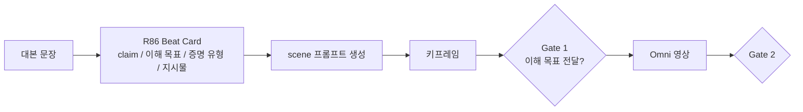

# 이과형 채널 분석 + R86 의미 기반 장면 설계(Semantic Beat Contract) 계획

## 목표
1. **이과형**(과학 커뮤니케이터, 구독자 약 61만 명)을 벤치마크합니다. 이 채널은 *"그런데 이것은 틀렸습니다!"*처럼 상식을 먼저 꺼낸 뒤 뒤집는 구조, 비유 중심 애니메이션, 감성적 마무리가 특징입니다. 분석의 초점은 그 자체보다 **"문장 하나가 화면 하나로 어떻게 번역되는가"**입니다.
2. 결과를 바탕으로 프롬프트 생성 방식을 **"내레이션 → 장면"**에서 **"내레이션 → 시청자가 이해해야 할 것 → 그것을 보여주는 장면"**으로 바꾸는 **R86** 규칙을 설계합니다.

---

## 제 의견: 방향이 맞고, 이번 결함들이 그 증거입니다
지금 파이프라인은 문장마다 `scene`을 바로 쓰고, 인간 컷은 `[준비 → 실험 행동]` 2비트로 나눕니다 (`youtube-script` SKILL L43). 그런데 **"이 컷을 본 시청자가 무엇을 이해해야 하는가"를 적는 칸이 없습니다.** 그래서 이런 컷이 나옵니다:

| 컷 | 내레이션 | 실제 화면 | 문제 |
|---|---|---|---|
| Ep12 C23 | "문 앞에서 단어 하나를 소리 내 말하라" | 가위로 소포 끈 자르기 | 장면은 '바쁘지만' 아무것도 설명하지 않음 |
| Ep12 C05 | "빨간 블록을 상자에 넣고 뚜껑을 닫았다" | 벤치에서 태블릿 보기 | 행동이 다른 컷에서 이미 소진됨 |
| Ep12 C19 | "두 가지를 머리에 담으면 문에서 잡히는 게 없다" | 이마 짚는 남자 (+폐허) | '잊었다'는 감정만 있고 **왜**(작업 기억 과부하)는 안 보임 |
| R84 뇌 7컷 | 서로 다른 메커니즘 문장 | 같은 각도의 회색 뇌 | 문장이 바뀌어도 시각 정보는 0 |

→ 내레이션의 **명사**를 그리는 게 아니라 문장의 **주장(claim)과 인과**를 그려야 무의미한 장면이 줄고 이해도가 올라갑니다. 다만 Shorts는 문장당 2~4초라서, **"한 컷에 한 가지 이해"**로 좁혀야 합니다. 욕심내서 한 컷에 다 넣으면 오히려 읽히지 않습니다.

---

## Step 1 — `@Research` 이과형 분석 (읽기 전용, 영상 생성 없음)
**대상**: 최근·인기 영상 8~10편. 뇌과학·생물 주제 우선, Shorts가 있으면 포함.
**분석 축 (문장 단위로 분해)**:
1. **문장 → 화면 매핑표**: 문장마다 화면이 하는 '기능'을 분류합니다 — 메커니즘 / 비교 / 인과 화살표 / 스케일(크기·시간) / 통념 반전 / 데이터 / 비유 / 감정·리액션 / 장식(무의미). **장식 컷의 비율**이 핵심 지표입니다.
2. **비유 설계법**: 추상 개념(예: 엔트로피, 시냅스)을 어떤 일상 사물로 바꾸는지, 비유가 몇 컷 동안 유지되고 언제 실제 구조로 돌아오는지.
3. **"틀렸습니다" 반전 구조**: 통념 제시 → 반전 → 근거 순서와 각 단계의 시각적 처리.
4. **도식·텍스트 사용**: 화면 위 라벨, 화살표, 수식을 언제 쓰고 언제 빼는지.
5. **페이싱**: 컷 길이, 개념 하나당 머무는 시간, 반복·리캡 위치.
6. **채택할 것 / 버릴 것**: 우리 포맷(Shorts, 2.5D 비닐, 31번 AI 뇌, Siren 영어 내레이션)에 옮길 수 있는 원칙만 추립니다. **화풍·캐릭터·멘트를 복제하는 것은 금지합니다.**

**산출물**: `@Research` 아티팩트 1개 (매핑표, 기능 비율 차트, 비유 사례 10개, 채택 원칙 Top 7)

---

## Step 2 — R86 Semantic Beat Contract 설계 (`@Operator` 구현)
visual_plan의 각 컷에 아래 필드를 **필수**로 넣고, `scene` 프롬프트는 이 필드들로부터 생성합니다.

```json
{
  "sentence_index": 13,
  "claim": "Holding two tasks overloads working memory, so the doorway reset wipes the item",
  "viewer_must_understand": "두 가지를 쥐면 기억 슬롯이 꽉 차서, 문을 지나며 하나가 떨어진다",
  "visual_proof_type": "causal_metaphor",
  "concrete_referent": "남자의 두 손에 든 물건 2개 → 문턱을 넘는 순간 하나가 손에서 미끄러짐",
  "metaphor_continuity_id": "hands_as_memory_slots",
  "anti_filler_check": "이 컷을 지우면 시청자가 놓치는 정보 = 과부하가 망각의 원인이라는 것"
}
```
- **`visual_proof_type`** (8종): `mechanism`, `comparison`, `causal_arrow`, `scale`, `misconception_flip`, `data`, `metaphor`, `reaction`. 같은 유형이 3컷 연속으로 나오면 실패. `reaction`은 편당 2컷 이하.
- **비유 연속성**: `metaphor_continuity_id`가 한 번 등장하면 해당 Act 안에서 같은 비유로 이어가고, 실제 구조(뇌 컷)로 돌아올 때 대응 관계를 명시합니다.
- **뇌 컷**: `viewer_must_understand`가 R85 6-Scale 샷과 부위·시점 규칙을 결정합니다 (문장이 바뀌면 보여주는 정보도 반드시 바뀜).
- **prompt-gate lint 추가**: `anti_filler_check` 빈칸, `concrete_referent`가 `scene`에 없는 경우, `claim`과 무관한 행동 동사(예: 끈 자르기) → 실패.
- **Gate 연동**: `@Research`가 Gate 1·2 서명 때 **"이 컷이 `viewer_must_understand`를 실제로 전달하는가"**를 판정합니다.

### 적용 위치


---

## 진행 순서 & 일정
1. **지금**: `@Research`는 R85 준비 작업(논문 수치, 해부 도판, 레퍼런스 사진 점검)을 먼저 끝내고 바로 이어서 이과형 분석 → 보고.
2. `@Operator`의 R85 Phase 0~2가 끝나면 → R86 필드·lint 구현을 **Phase 2.5**로 추가.
3. **R85 Phase 3(4편 재구축)의 컷 재기획 단계부터 R86 Beat Card를 적용합니다** → 교체 대상 컷(뇌 32컷 + 결함 약 20컷)을 Beat Card 기준으로 다시 씁니다.

## Open Questions
> [!IMPORTANT]
> **Q1. 4편 재구축에 R86 적용 범위** — (추천) 교체 대상 컷에만 적용하고 정상 컷과 Siren 오디오는 유지 / 대안: 4편 전 컷을 Beat Card로 재검토 (정상 컷 중 '장식' 판정이 나면 그것도 교체 → 재구축 범위와 시간 증가)
>
> **Q2. 분석 범위** — (추천) 뇌·생물 주제 우선 8~10편 / 대안: 채널 전반 대표작 위주
>
> **Q3. 4편 재구축을 이과형 분석이 끝날 때까지 기다릴지** — (추천) 기다립니다. 분석은 하루 안에 끝나는 규모이고, Beat Card 없이 재구축하면 같은 '장식 컷' 문제가 다시 나옵니다.

## Verification
- 분석 보고서: 실제로 본 영상에서 문장-화면 매핑 표본이 80문장 이상인지 확인.
- R86: `prompt-gate`가 Ep12 C23·C05·C19 같은 기존 장식 컷 문장을 **실패로 잡는지** 회귀 테스트로 확인 + `pytest -v`.
- 재구축본: `@Research`의 Gate 2 서명에서 컷마다 '이해 목표 전달' 판정을 기록하고, 장식 컷은 0컷이어야 합니다.
