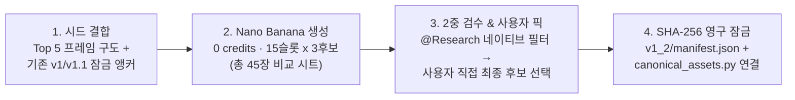

# ALL ABOUT BRAIN — `R87` 3초 훅(`80%+`) & 조건부 화살표 개편 + `Canonical v1.2` (`15`슬롯) 레퍼런스 제작 계획

**목표**: 완성 확인된 **도시 120ft 항공 드론 샷**과 **`Ep #31` 6-Scale Flow 뇌 스타일은 100% 영구 고정**한 채, 사용자가 지적한 2가지 구조적 약점(**① 비공간 주제의 어색한 도시 골목 화살표, ② 0–3초 초반 잔존율 `Viewed %` 저하**)을 **전역 파이프라인(`R87`) + 전용 레퍼런스 라이브러리(`Canonical v1.2`)**로 근본 해결합니다.

> [!IMPORTANT]
> **영구 고정 & 운영 결정 사항 (사용자 확정)**
> - **완성 유지 (무변경 잠금)**: `120ft` 도시 항공 드론(`D01–D02`) · `Ep #31` 6-Scale Flow 뇌(`A01–A19 cand_02.png` + `PatrickHand` 콜아웃) · 기존 `85`슬롯 `Canonical v1 + v1.1` 무삭제 유지.
> - **기존 예약/큐 유지**: `Ep #11` (`11/20 19:30 ET`) · `Ep #12` (`11/21 19:30 ET`) YouTube 예약 및 기존 IG/TikTok 대기 큐 순서는 그대로 유지하며, 본 **`R87` 개편안은 차기작(`Ep #13+`)부터 전역 적용**합니다.
> - **상세 기술 명세 SSOT (CEO 독립 검증 완료)**: [r87_hook_and_conditional_arrow_spec.md](file:///home/canadaofbin/gdrive/Kyubin_Yun_Workspace/07_Youtube/.agents/research/r87_hook_and_conditional_arrow_spec.md)

---

## 1. 실측 포렌식 & 코드 4대 근본 원인 (`@Research` 분석 · CEO 독립 검증 완료)

| # | 문제 영역 | 실측 증거 | 코드·규칙의 정확한 원인 (CEO 라인 대조 완료) |
| :---: | :--- | :--- | :--- |
| **1** | **정적 `Cut #1` + 썸네일 괴리** | **Top 5**(`84.2%` `p4ou90cHt50` `t=0.15s` 투명 두상 뇌 · `80.4%` 유리 마네킹 · `76.0%` `Ep #6` 헤드폰 충격) vs **Bottom 5 + `Ep #10`**(책상/찻상/침대 끝 정적 앉기, `Ep #10`은 `19.83s` `C09`까지 뇌 미출현) | 기존 `Canonical v1+v1.1` (`85`슬롯)에 **`0.0s` 훅 전용 뇌/충격 레퍼런스가 `0`개**였고, `Cut #1` 정적 일상 컷 금지 게이트가 없었음. |
| **2** | **`"Why do/did"` 질문형 강제** | **Top 5 = `0 / 5`** vs **Bottom 5 + `Ep #10` = `4 / 6`** (`Ep #7` `30.0%`, `Ep #8` `64.3%`, `Ep #10`) | [pipeline/config.py](file:///home/canadaofbin/gdrive/Kyubin_Yun_Workspace/07_Youtube/pipeline/config.py#L751) `EXPRESSIVE_V8_DEFAULT_OPENING_MODE = "paradox_question"`이 평범한 건강 Q&A형 질문을 기본값으로 유도. |
| **3** | **v8 자막 면적 `-45%` 축소 + 훅 타이틀 `0`** | `Top 1–2`는 **`86pt` + `#FFE600` 강조**, `Top 5`는 **상단 대형 훅 타이틀** 사용 vs `v8`은 배경에 묻히는 작은 흰 글씨 | [pipeline/config.py](file:///home/canadaofbin/gdrive/Kyubin_Yun_Workspace/07_Youtube/pipeline/config.py#L1160-L1166)이 **`64pt`, `Outline=3.5`, `Shadow=0.0`, `2w`, 순백 `#FFFFFF`**으로 축소했고, [prompt_quality_v5.py](file:///home/canadaofbin/gdrive/Kyubin_Yun_Workspace/07_Youtube/pipeline/prompt_quality_v5.py#L419-L423)이 `0–2.2s` 상단 훅 카피까지 전면 금지. |
| **4** | **비공간 주제 `R80` 골목 화살표 강제** | `Ep #10` 수면제 `39.4–50.1s`에 맥락 없는 회색 골목 화살표 + `"side by side"` 대사에 단일 빨간 화살표 | [pipeline/research_dossier.py](file:///home/canadaofbin/gdrive/Kyubin_Yun_Workspace/07_Youtube/pipeline/research_dossier.py#L1068-L1070)이 전 `135`개 도시에를 무조건 `seeded_v8["r80_mode"] = True`로 변환 + 비공간 물리 대비 레퍼런스 `0`개. |

---

## 2. 문제별 `Canonical v1.2` 신규 레퍼런스 제작 계획 (`15` 슬롯 · `45` 후보 · `0` 크레딧)

기존 `v1` (`42`슬롯) + `v1.1` (`43`슬롯) = `85`슬롯은 무변경 유지하고, 부족했던 **2개 신규 카테고리(`J` 0–3초 훅 `6`종 · `K` 비공간 대비 `6`종) + `Category C-v2` 공간 맥락 보정 `3`종** = 총 **`15`슬롯**을 제작해 SHA-256 잠금합니다.

### 2-1. 4단계 레퍼런스 제작 & 채택 프로토콜 (`Reference -> Our Style`)

- **화풍 이탈 `0%` 보장**: 모든 `v1.2` 슬롯은 빈 프롬프트가 아니라 **기존 승인된 `Canonical v1/v1.1` 앵커(`A01, A02, A12, B01–B15, G03, H03, I01/I02`)를 `Ingredients`로 직접 결합**해 생성합니다.
- **사용자 최종 픽**: `Canonical v1`에서 `A01–A12 cand_02.png`를 사용자가 직접 골라 뇌 스타일을 완성한 방식 그대로, **`v1.2`도 `3`후보 비교 시트(`cand_01 | cand_02 | cand_03`)를 올려드리고 사용자가 직접 채택한 이미지만 잠급니다.**

### 2-2. `Category J` (`J01–J06`, `6`슬롯) — `0.0s–3.0s` 3초 훅 전용 마스터 레퍼런스
| 슬롯 ID | 해결하는 문제 | 결합 앵커 (Ingredients) | 화면 구도 (`0.0s` 스와이프 즉시 차단) |
| :--- | :--- | :--- | :--- |
| **`J01_hook_0s_mode1_daily_action`** | 썸네일-0초 괴리 제거 (`p4ou90cHt50` `84.2%` 계승) | `A01` + `B01/B13` + `E10/E08` | `t=0.0s` 일상 행동(간식·알약·커피·스마트폰) 중인 2.5D 인물의 두상이 **즉시 `Mode 1` 반투명 투시로 열리며 내부 뇌 활성/정지 영역이 노출**되는 첫 프레임. |
| **`J02_hook_0s_mode1_bed_sleep_shock`** | 수면/각성/마비 주제의 정적 침대 컷 제거 (`31_O2CmlKOk` `80.4%` 계승) | `A01` + `E14` + `G03` | `t=0.0s` 침대 위 깨어 있거나 누운 인물의 **반투명 `Mode 1` 두상 속 뇌간/펌프/회로 이상**이 즉시 드러나는 오프닝 앵커. |
| **`J03_hook_0s_bizarre_experiment_interrupt`** | 정적 설명 오프닝의 지루함 제거 (`Ep #6` `76.0%` 계승) | `B05` (놀람) + `B11` + `E06/E14` | `t=0.0s` 일상 자세에 **기묘한 물리 실험 장치/자극이 즉각 개입**하고 `B05` 2D 잉크 경악 표정이 동시에 터지는 반전 오프닝. |
| **`J04_hook_0s_hands_paradox_prop_macro`** | 작은 소품이 멀리서 안 보이는 문제 해결 | `B01` 4지 손 + `G03/H03` | `t=0.0s` 화면 중앙 `60%`를 채우는 **초근접 역설 소품 액션**(빈 캡슐 벌림, 알약/간식 클로즈업, 스위치 차단) + 상단 `HookTitle` 여백. |
| **`J05_hook_0s_mode2_instant_brain_headroom`** | 0.0초부터 완성된 `Ep #31` 뇌로 즉시 승부 | `A02/A06/A07` (`cand_02`) + `I03` | `t=0.0s` 순수 `#040711` 배경 하단 `58%`에 완성된 `Mode 2` 절개 뇌 + 상단 `Y=250–415px` 완전 개방 `HookTitle` 여백 확보. |
| **`J06_hook_0s_closeup_ink_shock_headroom`** | 무음 스크롤 시 표정+훅 타이틀 동시 시선 고정 | `B05/B09` + `I03` | 초근접 2.5D 비닐 경악/호기심 표정 + 상단 `Y=250–415px` 무클러터 여백으로 `118pt HookTitle` 0px 겹침 보장. |

### 2-3. `Category K` (`K01–K06`, `6`슬롯) — 비공간 주제용 `A vs B` 물리 대비 (`R80` 골목 화살표 대체)
| 슬롯 ID | 적용 주제 (골목 화살표 금지 대상) | 결합 앵커 | 화면 구도 (`0%` 뜬금없는 도시 골목) |
| :--- | :--- | :--- | :--- |
| **`K01_contrast_fluid_tubes_open_vs_blocked`** | 수면제·혈류·CSF·호르몬 분비/차단 | `A05` 시안 유체 + `E01` | 깔끔한 실험대 위 투명 유리/아크릴 2관: 좌측 시안 유체 활발 순환 vs 우측 물리적 협착/정체 (`Start+End` 쌍). |
| **`K02_contrast_sponge_pump_active_vs_stiff`** | 세척·펌프·흡수·회복 메커니즘 비유 | `Ep #10 C12/C13` 수조 + `I01` | 나란히 놓인 2개 투명 수조: 좌측 압착·이완 맑은 순환 vs 우측 굳어 멈춘 정체 수조. |
| **`K03_contrast_split_treatment_tray_ab`** | 약물·식습관·임상 실험군 vs 대조군 (`Ep #13` 핵심) | `G03/H03` + `E15` 오크 테이블 | 좌(실험 조건 소품, 예: 고당·고지방 푸딩) vs 우(대조 조건 소품, 예: 플레인 요거트) `side by side` 오버헤드 비교 트레이. |
| **`K04_contrast_dual_receptor_lock_board`** | 통증 차단·수면 마비·신경 억제/단절 | `H01/H02` + `A10/A11` 색 코드 | 미니멀 실험실 보드 위 2개 물리 잠금/신호 게이트(열림·전달 vs 이중 자물쇠 차단, `Start+End` 락). |
| **`K05_contrast_flat_scale_vs_active_brain`** | 겉 수치 동일(`0 lb` 변화) vs 뇌 내부 급변 역설 (`Ep #13` 핵심) | `G06` 황동 질감 + `A02` | 좌측 바늘 0 고정 체중계/저울 vs 우측 내부 보상 회로가 강하게 활성화된 뇌 돔 대비. |
| **`K06_contrast_dual_brain_state_transition`** | `K01–K05` 소품 대비 → `A12` 상하 뇌 비교 직결 | `A12` (`cand_02.png`) + `F09` | 상단(실험군 앰버/시안) vs 하단(대조군 슬레이트) `Start+End` 상태 변화 전용 쌍. |

### 2-4. `Category C-v2` (`C01b–C03b`, `3`슬롯) — 공간·이동 주제 전용 맥락 보정 화살표
- **`C01b` (이중 레인 주체 동반)** · **`C02b` (지그재그 탐색 주체 동반)** · **`C03b` (실내 문지방 출발/차단 맥락)**: 물리적 공간 이동·거리·문지방 실험(`Navigation / Doorway`)에만 허용하며, 빈 회색 골목에 화살표만 덩그러니 띄우는 구도를 영구 금지하고 **실제 이동 주체(택시/버스/인물)와 출발·경계 소품**이 화살표와 함께 등장하도록 고정합니다.

---

## 3. 전역 파이프라인 & 규칙 개편 스펙 (`R87-H` & `R87-A`)

### 3-1. `R87-H` — `0.0s–3.0s` 3초 훅 계약 (목표 `Viewed >= 80%`)
1. **`R87-H1` (`Cut #1` Visual Pattern Interrupt)**: `hook_visual_mode ∈ {mode1_daily_xray_shock, mode2_instant_brain_shock, bizarre_prop_interrupt}` 필수, 정적 앉기·관자놀이 문지르기·차 따르기 정규식 차단, `R87_FIRST_CUT_MAX_SEC = 2.60s`, 썸네일↔`Cut #1` 시각 약속 일치 검증.
2. **`R87-H2` (`S01` 오프닝 문장)**: [config.py:L751](file:///home/canadaofbin/gdrive/Kyubin_Yun_Workspace/07_Youtube/pipeline/config.py#L751) 기본값을 `immediate_brain_shock`으로 전환, `"Why do/does/did"`·`"How come"`·`"Imagine"` 전면 금지, **`6–12 words`**, `prosody-qa` **`S01 <= 3.50s`**.
3. **`R87-H3` (3플랫폼 `YT/IG/TT` 세이프존 무음 락)**:
   - **`0.00–2.20s` 전용 `HookTitle`**: `2–3` ALL-CAPS 단어, **`118pt`**, `Outline=7.0`, 흰색+`#FFE14A` 2톤, **`Y ∈ [250, 415]px`, `X ∈ [85, 905]px`** (3앱 상단 UI `<220px`·우측 아이콘 `>=920px`·중앙 인물 `>440px`·후속 `PatrickHand` 콜아웃 `0px` 충돌).
   - **본문 ASS 자막 가독성 복원**: [config.py:L1160–L1166](file:///home/canadaofbin/gdrive/Kyubin_Yun_Workspace/07_Youtube/pipeline/config.py#L1160-L1166) `64pt` → **`82pt`** (`Outline=5.5`, `Shadow=1.5`, `MarginV=510`, `MarginR=165`, `2–3w`, 절당 핵심어 1개 `#FFE600` 강조).

### 3-2. `R87-A` — `R80` 조건부 화살표 게이트 & 비공간 대체
- [research_dossier.py:L1068–L1070](file:///home/canadaofbin/gdrive/Kyubin_Yun_Workspace/07_Youtube/pipeline/research_dossier.py#L1068-L1070)의 무조건 `r80_mode = True` 자동 주입 제거 → `visual_plan.spatial_arrow_eligible: bool` 명시 판정 의무화.
  - **`True` (공간 이동/문지방/미로 실험)**: `C01b–C03b` 허용(단, 빈 골목 금지 · `"side by side"` 대사에 단일 화살표 금지 · 이동 주체 앵커 필수).
  - **`False` (약물·수면·식습관·통증·감정·인지편향)**: `spatial_3d_arrow_diorama` 배치 시 **`prompt-gate` Tier-1 하드 FAIL** → **`Category K` (`K01–K05`) 물리 대비 + `K06/A12` 상하 뇌 대비**로 자동 라우팅.
- **전역 수정 대상 (`@Operator` 구현 → CEO 독립 검증)**:
  - 규칙: `.agents/AGENTS.md`, `neuro_diorama_pacing_brain_r76_r86.md`, `reference_depiction_rules.md`, `qa_gates_rules.md`
  - 코드: `pipeline/config.py`, `pipeline/canonical_assets.py`, `pipeline/research_dossier.py`, `pipeline/prompt_quality_v5.py`, `pipeline/flow_prompt_builder.py`, `pipeline/diorama_assembler.py`, `pipeline/dynamic_episode_qa.py`, `pipeline/prosody.py`
  - 테스트: `tests/test_r87_hook_and_conditional_arrow.py` 신규 작성 + 기존 전체 `pytest` 무충돌 검증.

---

## 4. `Ep #13` 파일럿 실증 & 4단계 실행 로드맵

- **🥇 `Ep #13` 파일럿 확정 후보 (`Schema v2` `ready: true`, `issues: []` CEO 검증 완료)**:
  - **`thanarajah_2023_2025_ultraprocessed_snack_reward_rewiring`** (*Cell Metabolism* 2023, `DOI: 10.1016/j.cmet.2023.02.015`, Max Planck Cologne / Yale, `N=46`, `8주`, `brain_news / habits`)
  - `Ep #10(수면)·#11(통증)·#12(기억)`과 도메인 무충돌 + **`0.0s` `J01`(푸딩 한 입 + Mode 1 보상회로 활성화) + `HookTitle` (`1 DAILY SNACK / REWIRED IT!`) + `R87-A` 비공간 대체(`K03` 푸딩 vs 플레인 요거트 트레이 + `K05` `0 lb` 체중계 vs 활성 뇌 + `K06/A12` 상하 뇌, 골목 화살표 `0`건)**을 1편에서 100% 입증!

| 단계 | 담당 방 | 실행 내용 | 게이트 |
| :---: | :---: | :--- | :--- |
| **Phase 1** | `@Research` ✅ | 실측 분석 + `R87` 명세 + `v1.2` `15`슬롯 설계 + `Ep #13` 추천 | **CEO 독립 검증 완료 (`PASS`)** |
| **Phase 2** | `@Operator` → `@Research` → **사용자** | `Canonical v1.2` **`15`슬롯 × `3`후보(`45`장, `0 credits`)** 생성 → `@Research` 네이티브 1차 검수 → **사용자 후보 시트 직접 픽** → `v1_2/manifest.json` SHA-256 잠금 | **사용자 최종 픽 승인** + CEO SHA 검증 |
| **Phase 3** | `@Operator` → `@YouTube_CEO` | `R87-H` (`Cut #1` + `S01` + `118pt HookTitle` + `82pt ASS`) & `R87-A` (조건부 화살표 + `v1.2` 로더) 규칙·코드·`pytest` 전역 구현 | CEO 독립 `pytest` 전수 통과 + Red-Team 검증 |
| **Phase 4** | `@Operator` → `@Research` → `@YouTube_CEO` | **`Ep #13` (`Max Planck Snack Rewiring`)** 첫 `R87` 파일럿 제작 → Gate 1/2/3 통과 → YouTube 예약 및 `3s Hook >= 80%` 실측 검증 | CEO Gate 3 PASS + 루트 MP4 배치 |
