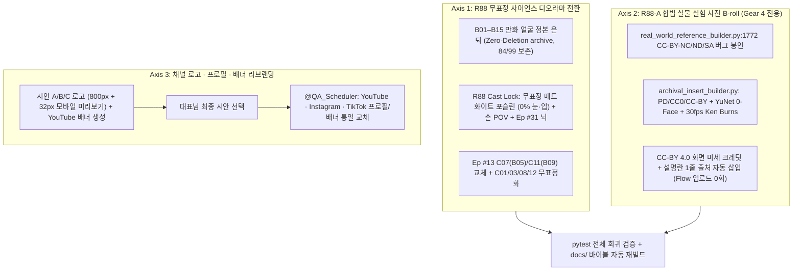

# Implementation Plan (`R88`): 2D 만화 캐릭터 전면 폐기 · 합법적 실물 실험 사진 인서트 · `Ep #31` 채널 로고/배너 리브랜딩

## Goal Description

채널 공개 영상 `23`편 실측 데이터(`2026-11-21_studio_metrics.json`) 대조 결과, **초기 뇌·장면 중심(`783`뷰, 최고 `2,045`뷰·`APV 90%`)** 및 **무표정 포슬린 디오라마(`473`뷰, 최고 `1,251`뷰·`APV 84%`)** 대비 **2D 만화 눈·입 비닐 캐릭터 도입 이후(`173`뷰, `Ep #10` 제외 `96`뷰, `APV 45.7%`)** 성과가 급락했고, `Ep #10`에서도 비닐 인형 0–3초는 `56.2%` 이탈한 반면 `Ep #31` 뇌 본편(Q1→Q4)은 `0.0%p` 이탈(사실상 100% 완주)을 기록했습니다.

동시에 [`@Deep_Research`](conversation://8c666be9-5bad-43d9-b91a-e7ba2b936c62)의 1차 공식 법령·정책 검증([deep_research_real_experiment_photos_policy_report.md](../04_Deep_Research/deep_research_real_experiment_photos_policy_report.md))에서 **정식 라이선스(`PD`/`CC0`/`CC-BY 4.0`) 무인(`0-Face`) 실제 실험 장치·MRI·대학 건물 사진의 짧은 `2–4초` Gear 4 FFmpeg 증빙 B-roll 삽입**이 합법·YPP 안전·`Inauthentic Content` 방어 가점임을 확인했고, 기존 [real_world_reference_builder.py](file:///home/canadaofbin/gdrive/Kyubin_Yun_Workspace/07_Youtube/pipeline/real_world_reference_builder.py#L1772)의 치명적 `"cc-by-nc"` 통과 버그도 함께 발견했습니다.

본 계획은 **Google Flow 호출 `0`건 · 기존 공개 영상 미접촉 · 기존 정본 `84/99`슬롯 100% 보존** 상태에서 아래 3대 축을 전역 파이프라인과 브랜드 자산에 일괄 반영합니다.



---

## User Review Required

> [!IMPORTANT]
> **승인 전 확인이 필요한 3가지 결정 사항**
> 1. **실제 실험 사진 삽입 범위 (`R88-A` 안전 경계)**:
>    - **허용**: `Public Domain`(NIH/NIMH/`1931`년 이전) · `CC0` · `CC-BY 4.0` **무인(`0-Face`) 실험 장치·MRI/fMRI·대학 건물·실험 노트** (`2–4s` 30fps 켄번즈, 전체 영상의 `<= 8%`, `CC-BY`는 화면 미세 크레딧 + 설명란 1줄 출처 자동 삽입). `1931`년 이전 작고한 역사 인물(예: 피니어스 게이지 다게레오타입)은 명시적 PD 플래그 시 제한 허용.
>    - **영구 차단**: **생존 피험자·임상 환자·아동 얼굴 식별 사진 (`0%` — `YuNet` 자동 차단)**, `CC-BY-NC`, `CC-BY-SA`(편집본 삽입 시 동일조건변경허락 전염), `All Rights Reserved` 유료 저널/언론 사진. *(실제 인물 사진은 Google Flow 재료로도 절대 업로드하지 않음.)*
> 2. **로고/프로필 교체는 2단계 승인**:
>    - 먼저 **시안 A(`Ep #31` 석고+시안 뇌 단독, 1순위) · 시안 B(`Mode 1` 무표정 반투명 두개골+뇌) · 시안 C(반절개 시안/레드 대조) + YouTube 배너 1종**을 렌더링해 대표님께 보여드린 뒤, **대표님이 최종 고르신 시안 1개만** YouTube·Instagram·TikTok에 반영합니다.
> 3. **작업 순서 (`G3` 직렬 안전)**:
>    - 현재 [`@Operator`](conversation://1f9808d4-ebac-4b58-a570-45c8f1f00a85)가 진행 중인 `[MASTER_UPGRADE_BIBLE_AND_TOKEN_DIET_GO]` 완료·검증 직후 본 계획을 순차 착수하여 `fuse.rclone` 파일 충돌을 `0`으로 유지합니다.

---

## Proposed Changes

### Component 1: `R88` 무표정 사이언스 디오라마 캐스트 전환 (`B01–B15` 은퇴)

#### [MODIFY] [config.py](file:///home/canadaofbin/gdrive/Kyubin_Yun_Workspace/07_Youtube/pipeline/config.py) · [depiction_rules.py](file:///home/canadaofbin/gdrive/Kyubin_Yun_Workspace/07_Youtube/pipeline/depiction_rules.py) · [flow_prompt_builder.py](file:///home/canadaofbin/gdrive/Kyubin_Yun_Workspace/07_Youtube/pipeline/flow_prompt_builder.py) · [porcelain_anchor_pack.py](file:///home/canadaofbin/gdrive/Kyubin_Yun_Workspace/07_Youtube/pipeline/porcelain_anchor_pack.py)
- **`R88_FACELESS_CAST_PROFILE` 도입 (`R85_HUMAN_IDENTITY_LOCK_SUFFIX` 업그레이드)**:
  - 기존 `"2D black ink eyes"` / 만화 얼굴 클로즈업 지시 제거 → **`"smooth featureless matte-white architectural porcelain figure, zero eyes, zero mouth, zero eyebrows, zero cartoon face, zero hair, zero photorealistic skin; frame via hands-only close-up, back/three-quarter silhouette, or translucent Mode 1 x-ray cranium"`**로 전역 전환.
  - 기존 프롬프트 게이트(`prompt_quality_v5.py`) 및 `porcelain_anchor_pack.py`에서 신규 에피소드(`Ep #13+`)의 **`B01–B15` 만화 얼굴 슬롯 선택 및 `"2D black ink eyes"` / `"cartoon facial expression"` 토큰을 하드 차단** (과거 공개/동결 에피소드 `Ep #1–#12` 하위 호환 유지).

#### [MODIFY] [manifest.json](file:///home/canadaofbin/gdrive/Kyubin_Yun_Workspace/07_Youtube/BCI_Shorts_Channel/canonical_assets/v1/manifest.json) · [canonical_assets.py](file:///home/canadaofbin/gdrive/Kyubin_Yun_Workspace/07_Youtube/pipeline/canonical_assets.py)
- `v1/manifest.json`의 `B01–B15` (`15`슬롯) 상태를 `status: "retired_r88_cartoon_face"`, `selectable_for_new_episodes: false`로 표기(Zero-Deletion 보존, 파일 삭제 `0`건).
- `canonical_assets.py`의 활성 선택 풀에서 `B01–B15` 제외 → **활성 정본 `84`슬롯**(`A01–A19` 뇌 · `C/C_v2` 화살표 · `D01–D02` 120ft 드론 · `E01–E16` 공간 · `F01–F12` 전환 · `G01–G09` 실험소품 · `H01–H04` 반전소품 · `I01–I05` 데이터스탬프 · `J01–J06` 훅 · `K01–K06` 대비) 100% 보존.

#### [MODIFY] [visual_plan.json](file:///home/canadaofbin/gdrive/Kyubin_Yun_Workspace/07_Youtube/BCI_Shorts_Channel/projects/v8_ep13_snack_reward_rewiring/02_script/visual_plan.json) & [03_visuals/visual_plan.json](file:///home/canadaofbin/gdrive/Kyubin_Yun_Workspace/07_Youtube/BCI_Shorts_Channel/projects/v8_ep13_snack_reward_rewiring/03_visuals/visual_plan.json)
- `Ep #13`의 만화 얼굴 클로즈업 2컷 교체:
  - **`C07`** (`canonical_B05_expr_surprised.png` 제거) → **무표정 포슬린 손/체중계+푸딩 대비 소품 클로즈업** (`K05` 또는 실험실 저울 매크로)
  - **`C11`** (`canonical_B09_expr_confusion.png` 제거) → **갈라진 실험 테이블 위 달콤한 스낵 vs 저당 스낵 선택 갈등 손 POV 컷** (`K03` 기반)
  - **`C01, C03, C08, C12`**: 만화 눈·입 묘사 제거 → 무표정 매트 화이트 포슬린 뒷모습/측면 실루엣 · `Mode 1` 투시 두개골 · 손 POV로 갱신 후 `prompt-gate` 재통과.

#### [MODIFY] `.agents/rules/cast_depiction_rules.md` · `.agents/rules/reference_depiction_rules.md` & 자동 바이블 재빌드
- `cast_depiction_rules.md`: `R88` 무표정 포슬린/손 POV 기준 반영(`<= 3.5 KB` 유지).
- `scripts/build_locked_assets_bible.py` 재실행으로 `docs/LOCKED_ASSETS_AND_REFERENCES_BIBLE.md` 및 `ALL_ABOUT_BRAIN_GOLDEN_STYLE_SHEET.jpg` 자동 갱신(`B01–B15` 은퇴 표기 + 대표 시트에서 만화 얼굴 제거).

---

### Component 2: `R88-A` 합법 실물 실험 사진 인서트 파이프라인 (`Gear 4 FFmpeg` 전용)

#### [MODIFY] [real_world_reference_builder.py](file:///home/canadaofbin/gdrive/Kyubin_Yun_Workspace/07_Youtube/pipeline/real_world_reference_builder.py)
- **`L1772` 치명적 라이선스 부분문자열 버그 봉인**:
  - 기존 `any(k in lic_raw for k in R85_OPEN_LICENSE_KEYWORDS)`가 `"cc-by-nc"`, `"cc-by-nd"`를 `"cc-by"`로 오통과시키던 결함 제거.
  - 엄격 라이선스 분류기 `classify_media_license(raw_license: str) -> Literal["direct_insert_pd_cc0", "direct_insert_cc_by", "flow_guide_only_cc_by_sa", "banned"]` 도입:
    - `nc`, `noncommercial`, `nd`, `noderivs`, `all rights reserved`, `fair use` 포함 시 **무조건 `banned` 차단**.
    - `cc-by-sa` / `sharealike`는 **본편 직접 삽입 금지 (`flow_guide_only_cc_by_sa`)** — `R72-R` Flow 구조 가이드로만 격리.
    - 본편 직접 삽입 허용 화이트리스트: `Public Domain` (`PD`, `CC0`, `USGov/NIH/NASA`, `pre-1931`) 및 `CC-BY` (`CC BY 2.0/3.0/4.0`, `NC/ND/SA` 없음).

#### [NEW] [archival_insert_builder.py](file:///home/canadaofbin/gdrive/Kyubin_Yun_Workspace/07_Youtube/pipeline/archival_insert_builder.py)
- **Google Flow 업로드 `0`회 · Gear 4 FFmpeg 전용 합법 아카이브 B-roll 빌더**:
  1. `03_visuals/archival_inserts_manifest.json` 검증: 라이선스(`direct_insert_pd_cc0` 또는 `direct_insert_cc_by`), `source_url`, `author`, `license_uri`, `allow_deceased_pre1931_portrait: bool = False`.
  2. **`YuNet 0-Face` 자동 프라이버시 게이트**: 기본 `0` 얼굴 강제(생존 피험자·환자·아동 얼굴 검출 시 즉시 `REJECT`; `pre-1931` 작고 역사 인물 플래그 + PD 검증 시에만 제한 통과).
  3. **에피소드당 상한 잠금**: 최대 `1–2`컷, 컷당 `2.0–4.0s`, 합산 `<= 8%` (예: `75s` 중 `<= 6s`) — `Reused/Inauthentic Content` 위험 `0%`.
  4. **30fps 켄번즈 `.mp4` 합성 (`03_visuals/archival_insert_clips/`)**: 정지 이미지를 `1080x1920 @ 30fps` 부드러운 슬로우 줌/팬 + 미세 필름 프레임 + (`CC-BY` 시) 우하단/상단 안전영역 미세 출처 크레딧(`Source: <Author> · CC BY 4.0`)을 입힌 `.mp4`로 출력(`ALLOW_STATIC_IMAGE_VIDEO_FALLBACK=False` & `DQ7`/`DQ_Smooth` 100% 충족).

#### [MODIFY] [diorama_assembler.py](file:///home/canadaofbin/gdrive/Kyubin_Yun_Workspace/07_Youtube/pipeline/diorama_assembler.py) · [dynamic_episode_qa.py](file:///home/canadaofbin/gdrive/Kyubin_Yun_Workspace/07_Youtube/pipeline/dynamic_episode_qa.py) · [publish.py](file:///home/canadaofbin/gdrive/Kyubin_Yun_Workspace/07_Youtube/pipeline/publish.py) · `.agents/rules/metadata_contract_rules.md`
- `diorama_assembler.py`: `archival_insert_clips/`에서 검증된 `R88-A` 켄번즈 `.mp4`를 EDL에 정식 매핑.
- `dynamic_episode_qa.py` (`DQ8`): AI 생성 컷의 실사 얼굴/피부 차단은 `100%` 유지하되, `archival_inserts_manifest.json` SHA-256 검증을 통과한 합법 `archival_insert_clips/` 컷만 명시적으로 구분 판정.
- `publish.py` & `metadata_contract_rules.md`: `CC-BY` 아카이브 인서트가 포함된 에피소드에 한해 `R68-D` 설명란 하단에 `Image credit: <Author>, CC BY 4.0 (<URI>).` 1줄을 자동 병기(`CC-BY 4.0 § 3(a)(2)` 완벽 준수).

---

### Component 3: 새 채널 로고 · 프로필 3종 시안 & YouTube 배너 제작 + 3대 플랫폼 교체

#### [NEW] [build_brand_identity_pack.py](file:///home/canadaofbin/gdrive/Kyubin_Yun_Workspace/07_Youtube/scripts/build_brand_identity_pack.py)
- 실제 잠금 `Ep #31` 원조 스틸(`ep31_orig_mode2_lateral_9x16.png`, `ep31_orig_mode1_head_9x16.png`, `A02`/`A12`) + Pillow 고해상도 합성을 사용해 **`0` Flow 호출**로 브랜드 시안 팩을 `BCI_Shorts_Channel/brand_assets/v2_ep31_rebrand/`에 생성:
  - **시안 A (`logo_A_ep31_gypsum_cyan.png`, 1순위)**: `#040711` 원형 + `Ep #31` 석고 3D 뇌 + 시안(`#27D8FF`) 혈관 포인트 (`800×800px` + `32px/64px` 원형 축소 프리뷰 시트 포함)
  - **시안 B (`logo_B_mode1_xray_skull.png`)**: `#040711` 원형 + 무표정 반투명 측면 X-Ray 두개골 속 `Ep #31` 뇌
  - **시안 C (`logo_C_split_cyan_crimson.png`)**: `#040711` 원형 + `Ep #31` 뇌 반절개 시안(`#27D8FF`) vs 크림슨(`#FF2525`) 듀얼 대조
  - **YouTube 배너 (`banner_youtube_2560x1440.png`)**: `#040711` 배경 + `AABCondensed-Black` 화이트 **`ALL ABOUT BRAIN`** / **`REAL NEUROSCIENCE · VERIFIED STUDIES`** + 좌우 은은한 `Ep #31` 뇌 실루엣 (`1546×423px` 모바일·데스크톱 중앙 안전영역 준수)
  - **비교 컨택트 시트 (`brand_rebrand_comparison_sheet.jpg`)**: 3종 로고의 `800px` 대형 + `32px` 쇼츠 원형 아이콘 실사이즈 비교표 + 배너 미리보기 → 대표님 육안 선택 후 [`@QA_Scheduler`](conversation://ef8185bb-5afd-4859-b697-2fe07f1ecf1c)가 YouTube · Instagram · TikTok 프로필 및 YouTube 배너 교체 실행 *(기공개 영상 `0`건 접촉, CAPTCHA 시 즉시 중단·인계)*.

---

## Verification Plan

### Automated Tests (`0` Flow / `0` Browser Calls)
```bash
/home/canadaofbin/hermes-venv/bin/python -X utf8 -m pytest tests/test_r88_faceless_cast_and_archival_insert.py tests/test_rules_mapping_and_token_budget.py tests/test_master_docs_and_assets_bible_parity.py -q --tb=short
/home/canadaofbin/hermes-venv/bin/python -X utf8 main.py prompt-gate --dir BCI_Shorts_Channel/projects/v8_ep13_snack_reward_rewiring
/home/canadaofbin/hermes-venv/bin/python -X utf8 -m pytest --ignore=tests/test_blender_brain_sim.py -k "not blender_render" -q --tb=short
```
- **신규 테스트 (`tests/test_r88_faceless_cast_and_archival_insert.py`)**:
  - `classify_media_license`: `"cc-by-nc"`, `"cc-by-nd"`, `"cc-by-sa"`, `"All Rights Reserved"`가 본편 직접 삽입에서 `100%` 거부되고 `PD`/`CC0`/`CC-BY 4.0`만 통과하는지 검증 (`real_world_reference_builder.py:1772` 회귀 영구 봉인).
  - `archival_insert_builder.py`: 얼굴 이미지 입력 시 `YuNet 0-Face` 거부, `> 8%` 비중 초과 거부, 통과 시 `30fps` 켄번즈 `.mp4` 생성 및 `CC-BY` 크레딧 오버레이·설명란 1줄 병기 검증.
  - `R88` 캐스트 잠금: `B01–B15` 신규 선택 차단, `"2D black ink eyes"` 신규 프롬프트 차단, `Ep #13` `prompt-gate` PASS 검증.
  - `build_brand_identity_pack.py`: `800×800` 로고 3종 및 `2560×1440` 배너 치수·안전영역 검증.

### Manual Verification
- `brand_rebrand_comparison_sheet.jpg`에서 로고 시안 A/B/C(특히 `32px` 원형 축소판)와 배너를 대표님이 직접 육안 선택 → 승인 시 YouTube·IG·TikTok 3곳 통일 적용.
